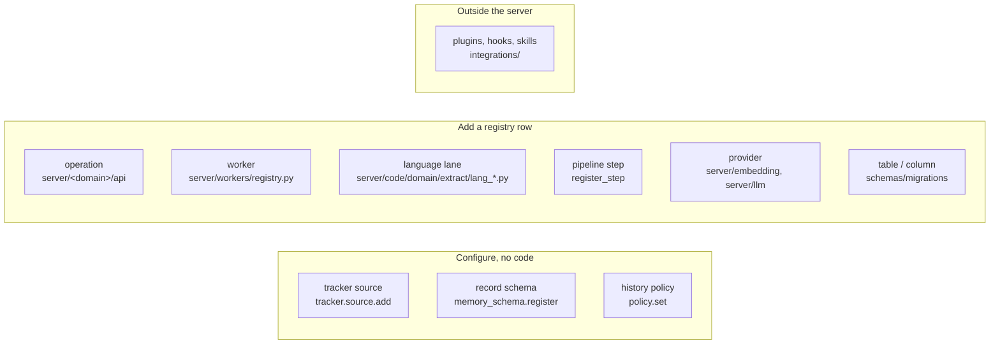

<!-- i18n: source=docs/development/extending-loom.md blob=73da8dff0ce992ad0dcb19d796cbf828d8785b33 model=claude-sonnet-5-5 -->
> このページは[英語の原文](https://github.com/ClickHouse/loom/blob/main/docs/development/extending-loom.md)の機械翻訳です。内容は英語の原文が優先されます。
> Machine-translated from the [English page](https://github.com/ClickHouse/loom/blob/main/docs/development/extending-loom.md), which is authoritative.

# Loom の拡張

Loom には種類ごとに 1 つのレジストリがあります：オペレーション、ワーカー、設定、プロバイダー、言語レーン、抽出ステップ、トラッカーソースです。Loom を拡張するには、適切なレジストリに行を追加します。HTTP、MCP、SDK、生成されるリファレンスは、それに追従します。

まず、データだけで済むかどうかを確認してください。トラッカーソース、レコードスキーマ、プロシージャ、履歴ポリシーは、プログラミングではなく設定で扱います。

## 拡張ポイントを選ぶ

| やりたいこと | 拡張ポイント | 場所 | ガイド |
| ------------------------------------------------------------ | ----------------------------- | ------------------------------------------------------------------------------------------------ | ---------------------------------------------------------------------- |
| 呼び出し元に新しい機能を公開する | オペレーション | `server/<domain>/api/ops_<group>.py`、`server/<domain>/app/<group>.py` | [オペレーションを追加する](https://github.com/ClickHouse/loom/blob/main/docs/development/adding-an-operation.md) |
| スケジュールに従ってバックグラウンドで処理を行う | ワーカー | `server/<domain>/workers/<name>.py`、`server/workers/registry.py` の 1 行 | [ワーカーを追加する](https://github.com/ClickHouse/loom/blob/main/docs/development/adding-a-worker.md) |
| 新しいデータを保存する | テーブルまたはカラム | `schemas/migrations/<NNN>_*.sql`、`server/<domain>/store/` | [テーブルを追加する](https://github.com/ClickHouse/loom/blob/main/docs/development/adding-a-table.md) |
| 新しいプログラミング言語をインデックスする | コードインデックスの言語レーン | `server/code/domain/extract/lang_<lang>.py`、`lang_detect.py`、`server/code/app/index/ingest.py` | [言語サポートを追加する](https://github.com/ClickHouse/loom/blob/main/docs/development/adding-language-support.md) |
| 一部の呼び出し元について、抽出で残す内容を変更する | パイプラインステップ | `server/memory/app/pipeline.py` の `register_step` | [抽出パイプライン](https://github.com/ClickHouse/loom/blob/main/docs/guides/extraction-pipeline.md) |
| 新しいイシュートラッカーまたは CI の履歴を読み取る | トラッカーソース（データのみ） | `tracker.source.add` + `tracker.source.set_mapping` | [トラッカーレコードの規約](https://github.com/ClickHouse/loom/blob/main/docs/features/tracker/record-contract.md) |
| ID と型付きフィールドを持つ事実を保持する | レコードスキーマ（データのみ） | `memory_schema.register`、`memory.record.write` | [メモリへの書き込み](https://github.com/ClickHouse/loom/blob/main/docs/features/memory/writing.md) |
| エージェントの履歴に基づいて、実行できることを制限する | 履歴ポリシー（データのみ） | `policy.set` | [トークンとグラント](https://github.com/ClickHouse/loom/blob/main/docs/guides/tokens-and-grants.md#add-history-policy) |
| 別の埋め込みプロバイダーまたは LLM プロバイダーを使う | プロバイダークライアント | `server/embedding/`、`server/llm/` | [下記](#add-a-provider) |
| 設定を追加する | 設定フィールド | `server/settings/catalog.py` の該当領域のセクション | [下記](#add-a-setting) |
| 別のクライアントからセッションを取り込む、またはエージェント向けガイダンスを配布する | インテグレーション、フック、スキル | `integrations/`、`skills/` | [下記](#add-an-integration) |

## すべての拡張に共通すること

- **コードがレジストリです。** トランスポートは `ALL_OPERATIONS` を走査し、スーパーバイザーは `_WORKERS` を走査し、設定リファレンスは `server/settings/` から生成されます。各レジストリには、再生成するまで失敗するスナップショットテストまたはセンサステストがあります。
- **生成ファイル。** `make lint` はすべてのジェネレーターを `--check` 付きで実行します。対象は、SDK の op テーブル（`scripts/codegen/sdk_py_gen.py`、`sdk_ts_gen.py`）、リーチマニフェスト（`op_reach_census.py`）、リファレンスページ（`docs_reference.py`、`settings_reference.py`）、Codex プラグインのコピー（`agent_plugin_sync.py`）です。詳しくは[コード生成](https://github.com/ClickHouse/loom/blob/main/docs/development/code-generation.md)を参照してください。
- **成熟度。** 新しい op は、安定版の op を置き換える場合を除き、`maturity="experimental"` を宣言します（[op の追加](https://github.com/ClickHouse/loom/blob/main/docs/development/adding-an-operation.md#5-check-reach-and-maturity)）。
- **計測。** ランキング、抽出、プロバイダーのデフォルトを変更する場合は、変更の前後で該当するベンチを実行します（[パフォーマンスチューニング](https://github.com/ClickHouse/loom/blob/main/docs/guides/performance-tuning.md#measure-first)）。
- **基盤となる構造は拡張ポイントではありません。** エンジン（ClickHouse）、アイデンティティタプル、行ごとのコンテンツハッシュ監査、5 つの信念改訂オペレーションは、PR とアーキテクチャドキュメントに設計上の根拠を示した場合にのみ変更できます（[システム概要](https://github.com/ClickHouse/loom/blob/main/docs/architecture/system-overview.md)）。

## プロバイダを追加する

エンベッダーと LLM は、設定によって選択されるクライアントです。

**エンベッダー**は `server/embedding/` に、`openai.py`、`gemini.py`、`local.py`、`fake.py` と並べて配置します。エンベッダーは `server/embedding/_provider.py` にある HTTP の共通処理を利用します。

- リトライ可能なステータスに対してのみリトライします。最初のリクエストを含めて合計 3 回まで試行します（リトライは最大 2 回）。
- プロバイダ側で黙って切り詰められる代わりに、`EmbedderInputTooLarge` を送出します。
- 空のベクトル、次元数が異なるベクトル、有限でない値を含むベクトルに対しては、`MalformedEmbedding` を送出します。

`server/embedding/embedder.py` に組み込みます。具体的には、`LOOM_EMBEDDING_MODEL` からのプロバイダ推論（`_inferred_provider`）、`LOOM_EMBEDDING_PROVIDER` の値、`KEY_ENVS` 内のキー用の環境変数です。キーがない場合は fake エンベッダーにフォールバックし、エラーをログに出力します。

**LLM** は `server/llm/` に、`openai.py`、`anthropic.py`、`fake.py` と並べて配置し、`LLMClient`（`server/llm/client.py`）を実装します。`_build_llm_client` のほか、`DEFAULT_MODEL_BY_PROVIDER`、`KEY_ENV_BY_PROVIDER`、`resolve_llm_provider`（`server/core/llm_provider.py`）に組み込みます。

> **警告:** プロバイダを変えると品質が変わります。類似度のゲートは `text-embedding-3-small` に合わせて調整されています。新しいプロバイダをデフォルトにする前に、そのプロバイダに対して `make bench-quick` を実行してください。新しいエンベッダーを追加した場合は、既存のすべての名前空間で `loom reembed` を実行する必要があります。

## 設定を追加する

新しいフィールドは、`server/settings/catalog.py` の該当する領域のセクション（`MemorySearch`、`Code`、`Tracker` など）に追加します。すべての設定はこの1つのファイルで宣言します。フィールドの上に置くコメントには、その設定が何を制御するか、値が何を意味するかを書きます。このコメントは、生成される[設定リファレンス](https://github.com/ClickHouse/loom/blob/main/docs/reference/configuration.md)の該当行になります。環境変数名は `LOOM_<FIELD>` です。

設定は `settings.<field>` として読み取り、`getattr(settings, "<field>", default)` は使わないでください。後者は `tests/unit/test_settings_attribute_access.py` で失敗します。コピーしたデフォルト値はずれていきますし、フィールドを削除する人から読み取り箇所が見えなくなるためです。再生成は `python scripts/codegen/settings_reference.py` と `python scripts/codegen/settings_schema.py` で行います。

フラグを廃止するには、その設定、対応する分岐、およびそれを運んでいたリクエスト単位のフィールドを削除します。まだそのフィールドを送信するクライアントも引き続き処理され、そのフィールド名は `ignored_args` に含まれます。

## インテグレーションを追加する

| インテグレーション | 場所 | 備考 |
| ----------------------------------------- | ------------------------------------------------------------------- | -------------------------------------------------------------------------------------------------------------------------------------------------------------------------------------------------------------------------------------------------------------------------------------------------------- |
| コーディングエージェント用プラグインのフックまたはスキル | `integrations/claude-code-plugin/` (`hooks/`, `lib/`, `skills/`) | 信頼できる唯一の情報源です。`python scripts/codegen/agent_plugin_sync.py` が、スクリプト、スキル、一覧表示用アイコン (`assets/`) を `integrations/codex-plugin/` にコピーします。新しいフックは Codex の `hooks.json` に手動で組み込みます。インストール済みのクライアントは、マニフェスト内のプラグインのバージョンが変わると変更を取得します。 |
| 別のクライアント用のセッションキャプチャフック | `integrations/<client>/` (`cursor/`, `generic/`) | `loom ingest-transcript` または `conversation.append` を呼び出し、抽出には `memory.set_from_messages` を使います。 |
| ポータブルなエージェントスキル | `skills/<name>/SKILL.md` | 名前を指定して任意の Agent-Skills クライアントにインストールします。ガイダンスのみで、フックはありません。 |
| フレームワークアダプター | `sdk/python/loom/integrations/`, `sdk/typescript/src/integrations/` | SDK をフレームワークのストアまたはメモリのインターフェースでラップします (Python では LangGraph の `LoomStore` と Strands の `LoomMemoryStore`、TypeScript では Strands アダプター)。 |
| オブザーバビリティバックエンド | `server/observability/` | スパンにはすでに `loom.request_id` が含まれ、OTLP 経由でエクスポートされます。新しいエクスポーターを作るより、OTLP コレクターを使うことを推奨します。 |

[インテグレーション](https://github.com/ClickHouse/loom/blob/main/docs/features/integrations/index.md)では、提供済みのインテグレーションを説明しています。[エージェントインテグレーション](https://github.com/ClickHouse/loom/blob/main/docs/guides/agent-integration.md)では、新しいクライアントが書き込むべき内容と読み取るべき内容を扱います。

## 関連情報

- [リポジトリガイド](https://github.com/ClickHouse/loom/blob/main/docs/development/repository-guide.md)
- [テスト](https://github.com/ClickHouse/loom/blob/main/docs/development/testing.md)
- [コントリビュート](https://github.com/ClickHouse/loom/blob/main/CONTRIBUTING.md)
