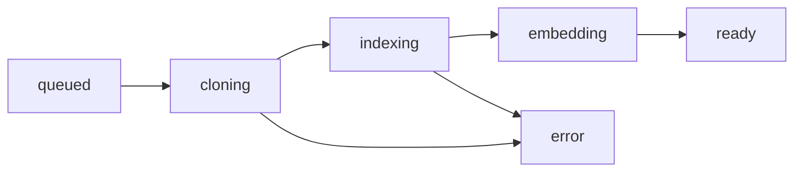

<!-- i18n: source=docs/features/code-index/repositories.md blob=dfd41b79236a859839f989a995deb2de9cd4ad2b model=claude-sonnet-5-5 -->
> このページは[英語の原文](https://github.com/ClickHouse/loom/blob/main/docs/features/code-index/repositories.md)の機械翻訳です。内容は英語の原文が優先されます。
> Machine-translated from the [English page](https://github.com/ClickHouse/loom/blob/main/docs/features/code-index/repositories.md), which is authoritative.

<a id="adding-repositories"></a>

# リポジトリの追加

新規インストールの状態では、インデックス対象のリポジトリはありません。エントリは、ユーザーが自分で追加したリポジトリと、オペレーターの設定という 2 つのソースから取得され、マージされます。ここで追加した名前空間に対するオペレーターのエントリはスキップされます（下記のルールを参照）。1 つのコード名前空間は 1 つのブランチに対応します（[概要](https://github.com/ClickHouse/loom/blob/main/docs/features/code-index/overview.md#one-namespace-is-one-branch)）。

| パス | 方法 | ビルド担当 | ティア |
| ------------------- | ---------------------------------------------------------------------------------------------------- | -------------------------------------- | -------------------------------------------------- |
| セルフサービス | ダッシュボードの **Repositories → Add repository**、または自分が管理するカードの **Add branch** | `code_ingest` ワーカーが、スライス単位で実行 | 高速ティア。オプションでコンパイラティア |
| オペレーター設定 | `LOOM_CODE_REPOS_JSON` のエントリ（またはスカラーの `LOOM_CODE_*` 設定）の後に `loom code backfill` を実行 | オペレーターが `loom code` CLI で実行 | 高速ティア。設定されている場合はコンパイラティアも |

高速ティアのセルフサービスには、オペレーターの作業もシェルアクセスも不要です。コンパイラティアは精度を高めるためのオプションであり、ワーカーイメージに対象言語のツールチェーンが必要です。

<a id="self-service-repositories"></a>

## セルフサービスリポジトリ

`LOOM_CODE_SELF_SERVICE_ENABLED` と `code_ingest` ワーカーが必要です。どちらも標準の開発用 Compose デプロイでは有効になっています。カスタムデプロイではどちらも無効にできます。

[リポジトリジョブのサンドボックス](https://github.com/ClickHouse/loom/blob/main/docs/operations/code-index-operations.md#repository-job-sandbox)も必要です。ここで追加したリポジトリには、そのリポジトリ自身のビルドコードを実行するコンパイラティアが割り当てられ、クローンは利用者が選んだホストと通信します。そのため、サンドボックスがない場合は追加が拒否され（`SANDBOX_UNAVAILABLE`）、すでに追加済みのエントリも取得・インデックス作成が行われなくなります。同梱の Compose スタックのうちサンドボックスを実行するのは blue/green 版（`dev/docker-compose.colour.yml`）だけで、AppArmor プロファイルが読み込まれたホストが必要です。リリース版スタックを含むそれ以外のスタックでは、`LOOM_CODE_REPOS_JSON` を使ってリポジトリをインデックスしてください（[クイックスタート](../../getting-started/quickstart.md#optional-index-a-repository-on-the-released-stack)）。

各 org が保持できるエントリは最大 `LOOM_CODE_SELF_SERVICE_MAX_REPOS`（20）件です。

org にサインインしているメンバーなら誰でもリポジトリを追加でき、追加した人が最初のメンテナーになります。リモートには `owner/name`（GitHub の短縮形）、HTTPS URL、SSH/scp 形式の Git URL を指定できます。GitHub、GitLab、Bitbucket は明示的にラベル付けされ、それ以外のサーバーは汎用アダプターを使います。ローカルパスと `file://` URL は拒否されます。リモートは `git ls-remote` に応答する必要があり、HTTPS ではオプションのアクセストークンを、SSH ではワーカーの SSH 設定を使用します。ブランチが空の場合、Loom はリモートのシンボリック `HEAD` に従います。`master` を前提にすることはありません。名前空間は、デフォルトブランチでは `code-<name>`、それ以外では `code-<name>-<branch-slug>` になります。

ワーカーは `LOOM_CODE_REPOS_ROOT`（デフォルトは `var/code_repos/self`）の下にベアミラーをクローンします。ミラーは Git リポジトリごとに1つで、そのブランチ間で共有されます。最初のインデックスはカーソルを使って1パスあたり `LOOM_CODE_BOOTSTRAP_FILES_PER_PASS`（400）ファイルずつ構築されるため、再起動しても続きから再開できます。`code.repos` は `stage` と `stage_detail` で進捗を報告します。



エントリは、チャンクの `LOOM_CODE_READY_EMBED_COVERAGE`（0.95）の割合にベクトルが付くまで `embedding` のままです。それまでは `code.search` は字句検索で応答します（[鮮度](https://github.com/ClickHouse/loom/blob/main/docs/features/code-index/freshness.md)）。

| Op                          | ロール | 動作                                                                                                                                                      |
| --------------------------- | ------ | --------------------------------------------------------------------------------------------------------------------------------------------------------- |
| `code.repo.remote_branches` | viewer | 何も書き込む前に Git リモートが示す情報を返します：プロバイダー、ブランチと先頭コミット、デフォルトブランチ、リリース形式のブランチ、クォータと準備状況の警告 |
| `code.repo.add`             | viewer | `repo@branch` を追加します（空の場合はリモートのデフォルトを検出）。`branches` で追加のブランチも指定でき、アクセス、フィルター、`scip_producer`、`access_token` を指定できます |
| `code.repo.add_branch`      | admin  | メンテナンスしているリポジトリの別のブランチをインデックスします。リモート、トークン、プレフィックス、アクセスは引き継がれます                           |
| `code.repo.set_access`      | admin  | `classification`（`standard` / `restricted`）と `join_policy`（`open` / `approval` / `closed`）を設定します                                                |
| `code.repo.set_source`      | admin  | このリポジトリが読み取るトラッカーの名前空間を、主となるものを先頭にしてリンクします（[トラッカー概要](https://github.com/ClickHouse/loom/blob/main/docs/features/tracker/overview.md#linking-a-tracker-to-a-repository)） |
| `code.repo.remove`          | admin  | セルフサービスのインデックスを廃止します。`confirm` は名前空間と一致している必要があります                                                                |

引数は[オペレーションリファレンス](https://github.com/ClickHouse/loom/blob/main/docs/reference/operations.md#code)に記載しています。

ルール：

- org が保持できるアクティブなセルフサービスエントリは、ブランチを含めて最大 `LOOM_CODE_SELF_SERVICE_MAX_REPOS`（20）件です（`REPO_QUOTA`）。すでにインデックス済みのブランチ（名前空間は問いません）、または名前空間にデータや、自分が管理していない権限が存在するブランチは `REPO_EXISTS` で拒否されます。その場合は既存のインデックスに参加してください。オペレーターが設定したエントリのブランチで、まだ最初のインデックスがないものは、そのブランチに対して `loom code backfill` が実行されるまで `REPO_NOT_INDEXED` で拒否されます。
- admin 権限は、リポジトリのブランチ間で一方向に伝播します。オペレーターのエントリは自身の admin をリポジトリのすべてのブランチに渡します。ここで追加したブランチは、その admin を、ここで追加した他の standard ブランチにだけ渡します。ここで追加した restricted ブランチは、オペレーターの admin だけを受け取ります。同期のたびに、保持している他のコピーが取り消されるか、オペレーター admin のコピーがオペレーター権限のコピーに置き換えられます。`granted_by` がレプリカの設定にないエントリを指しているコピーも取り消されます（廃止されたエントリ、またはローリングデプロイがまだ届いていない新しいエントリ。その場合はそのエントリで admin を再度付与してください）。admin がすべてそのようなコピーだったブランチは admin がいない状態になり、リポジトリのオペレーターエントリのいずれかに対する admin 権限だけがそのブランチに届きます。そのようなコピーを持っていたメンバーは、そこで他の人（自分自身を含む）に権限を付与または承認している可能性があるため、そのブランチの権限を確認してください。ブランチを再び広げても、制限によって取り消されたコピーは戻りません。兄弟ブランチで該当の admin を再度付与してください。ブランチを広げられるのは、そこで付与された権限を持つ admin か、オペレーターエントリからのコピーを持つ admin だけで、ここで追加したブランチからのコピーは含まれません。
- 取り消しも同じ経路をたどります。オペレーターエントリで行った取り消しは、ここで追加したブランチからはコピーされた権限だけを削除します。standard ブランチでは、対象者がここで追加したブランチで付与された admin 権限を持っている間は何も削除しません。ブランチ唯一の admin であるコピーは残ります。ただしここで追加した restricted ブランチでは、取り消しによって、ソースがオペレーターエントリでないコピーが削除されます（保持者が、取り消されたものとは別のオペレーターエントリで付与された admin 権限を持っている場合は、代わりに次の同期で書き換えられます）。そこに残されたオペレーターのコピーは、元のオペレーター権限がなくなった後の次の同期で削除されます。
- ここで追加した名前空間（`code.repo.add` または `code.repo.add_branch`）を指すオペレーターエントリは、その後に削除されたものであっても、スキップされ、サーバーログに警告が出ます。追加した人の権限がオペレーターエントリの権限になってしまうためです。ブランチを削除しても名前は解放されません。そのエントリは別の名前空間で記載してください。種別が記録されていないレジストリ行はそのエントリのアクセス行として読まれ、メンバーが `namespace.register` で作成した名前空間にはレジストリ行がなく、セルフサービスが無効の間はレジストリが読まれません。いずれの場合も、名前空間を記載する前にその権限を確認してください。
- `code.repo.set_access` がオペレーターエントリ向けに書き込むアクセス行は、そのエントリが設定から外れている間は一覧に表示されないため、その名前空間はインデックスされません。エントリが戻れば再び適用され、org のリポジトリクォータには含まれません。種別が記録されていないレジストリ行は、そのエントリがなくなると、ここで追加したブランチとして一覧に表示されます。
- オペレーター名前空間上のコピーで、`granted_by` が、ここで追加したブランチまたは設定されなくなった名前空間を指す `repo-maintainers:<namespace>` であるものは、取り消されるまで残ります。それらの権限を一覧表示し、残すべきでないものを取り消してください。
- セルフサービスが無効の間は、オペレーターエントリでの取り消しはここで追加したブランチを認識しないため、そこにある取り消された権限のコピーは、セルフサービスを再び有効にしても残ります。そのブランチで取り消してください。
- restricted リポジトリは `open` になりません。`code.repo.add` は `approval` を設定します。restricted のインデックスを standard に広げるには、`confirm` を名前空間と同じにする必要があります。
- プライベートリポジトリのトークンは、`LOOM_JWT_SECRET` から導出した鍵で暗号化して保存され、返されることはありません。このシークレットをローテーションすると、メンテナーが再入力するまで保存済みのトークンは使えなくなります。
- `code.repo.remove` はレジストリ行を廃止し、再開可能な消去サーガによって、その名前空間のすべての `code_*` 行を削除します。ミラーは、他のブランチが使っていない場合に削除されます。オペレーターが設定したエントリは `REPO_FROM_CONFIG` で拒否されます。
- `LOOM_CODE_SELF_SERVICE_ENABLED=false` にするとこの機能は無効になります（`SELF_SERVICE_OFF`）。
- `LOOM_CODE_INTEL_ENABLED=false` にすると、`code.repo.remove` 以外のすべての `code.repo.*` op が `PRECONDITION_FAILED` で拒否されます。他のすべての `code.*` op と同じ扱いです。スイッチがオフの状態での廃止は、インデックスとこのレプリカのミラーを削除します。他のレプリカは、コードインテリジェンスが再び有効になってから初めて、自身のミラーのコピーを掃除します。

公開リポジトリとリリースブランチを1回の呼び出しで追加します。

```bash
curl -fsS -X POST "$LOOM_BASE_URL/v1/code.repo.add" \
  -H "Authorization: Bearer $LOOM_API_KEY" -H 'Content-Type: application/json' \
  -d '{"org":"acme","repo":"acme/widgets","branch":"main","branches":["release/2.4"]}'
```

レスポンスには各ブランチの名前空間が含まれます。追加できなかったブランチは、理由とともに `skipped` に返されます。

<a id="repository-profiles-and-compiler-preflight"></a>

## リポジトリプロファイルとコンパイラのプリフライト

すべてのエントリは、`code.index_status` で `profile` と `provider` を報告します。`generic` は、リポジトリに依存しない検索、シンボル、呼び出し、影響範囲、コンテキストパックを扱います。`clickhouse` プロファイルは、ClickHouse 専用の SQL 登録、エラーコード、ステートレステストの規約を識別します。プロジェクトに C++ や SQL が含まれているというだけでは、これらの前提は推測されません。

`compiler_candidates` はビルドマニフェストから推測されます。ウォーターマークのない候補は `quality_warnings` に表示され、有効にすべきワーカーが示されます。

| 候補                  | ワーカー環境でのプリフライト                                                                                                                                     | ワーカー                                     |
| --------------------- | ---------------------------------------------------------------------------------------------------------------------------------------------------------------- | -------------------------------------------- |
| C/C++                 | `scip-clang --version`（amd64 イメージ内）。リポジトリの CMake が clang 21 で構成できること                                                                      | `code_scip_full`、続いて `code_scip_delta`   |
| TypeScript/JavaScript | インデクサーとパッケージマネージャーは Docker に含まれます。ネイティブサーバーでは `sh scripts/install-code-toolchains.sh` を実行します。リポジトリの依存関係は自動的に準備されます。 | `code_scip_ts_delta`                         |
| Go                    | `scip-go --version`。すべてのモジュールで `go env` が成功すること                                                                                                | `code_scip_go_delta`                         |
| Python                | `scip-python --version`。プロジェクトのインポートがその環境で解決できること                                                                                      | `code_scip_py_delta`、続いて `code_scip_apply` |

コンパイラのプリフライトが失敗しても、高速ティアは引き続き利用できます。`code.index_status` とヘルスタブでは、ワーカーのエラー、言語ごとのカバレッジ、未解決のエッジ、埋め込みのカバレッジ、鮮度を確認できます。PR/レビュー履歴は現在 GitHub API を使用します。他のプロバイダーでも Git 履歴とコードインテリジェンスは利用できますが、オンボーディング時に明示的な警告が表示されます。

<a id="operator-configured-repositories"></a>

## オペレーターが設定するリポジトリ

`LOOM_CODE_REPOS_JSON` は、インデックス対象のブランチごとに 1 つのオブジェクトを保持します。エントリのフィールド、前提条件（イメージ、エンベダー、書き込み可能なミラー、GitHub トークン）、最初のインデックス作成（`loom code init`、`backfill`、`backfill-prs`、`scripts/ops/code_intel_bootstrap.sh`）、コンパイラティア、その他のブランチについては、[コードインデックス運用ランブック](https://github.com/ClickHouse/loom/blob/main/docs/operations/code-index-operations.md)を参照してください。ワーカーはオペレーターが設定したエントリを自動では開始しません。`git_head` ウォーターマークを持たないエントリは、`loom code backfill` が実行されるまでスキップされます。すべての設定項目は[設定リファレンス](https://github.com/ClickHouse/loom/blob/main/docs/reference/configuration.md#code)にあります。

<a id="who-can-read"></a>

## 閲覧できるユーザー

コード名前空間には通常の権限付与（grant）のルールが適用されます（[ID と名前空間](https://github.com/ClickHouse/loom/blob/main/docs/concepts/identities-and-namespaces.md)、[トークンと grant](https://github.com/ClickHouse/loom/blob/main/docs/guides/tokens-and-grants.md)）。トークンはコード名前空間（または `*`）を指定する必要があり、指定がない場合、呼び出しは `AUTH_INSUFFICIENT` で失敗します。次の3つのスイッチでこの動作が変わります。

| スイッチ                                                          | 効果                                                                                                                                         |
| ----------------------------------------------------------------- | -------------------------------------------------------------------------------------------------------------------------------------------- |
| `LOOM_CODE_ORG_READABLE=true`、またはエントリの `org_readable`      | 組織内の認証済みプリンシパルは、grant なしで読み取れます（デフォルトはオフ）。書き込みは引き続き grant に基づきます                                       |
| `LOOM_CODE_REPO_PUBLIC=true`、またはエントリの `public`             | 名前空間は `join_policy=open` かつ検索可能な状態で登録され、組織のメンバーは誰でもすぐに閲覧者として参加できます。それ以外の場合のポリシーは `approval` です |
| `classification: "restricted"`（エントリ、または `code.repo.set_access`） | 組織内での閲覧や公開の対象にはなりません。メンテナーが閲覧者を個別に承認し、すべての読み取りに、その名前空間を指定したトークンと有効な直接の grant が必要です  |

`code.repo.set_access` の行は、設定済みの classification と join policy より優先され、再起動後も維持されます。`code.refresh`（writer）と管理用の op には、常に grant が必要です。

<a id="failure-modes"></a>

## 障害モード

| 症状                                              | 原因と対処                                                                                                                                                                                                                                                             |
| ------------------------------------------------- | ---------------------------------------------------------------------------------------------------------------------------------------------------------------------------------------------------------------------------------------------------------------------- |
| 設定したエントリがインデックスされない            | `git_head` ウォーターマークがない：`loom code init` と `loom code backfill` を実行する。または、名前空間がページから追加されたもの（その後削除されたかどうかを問わない）で、ログにエントリがスキップされたと出ている：別の名前空間の下に一覧する                        |
| リポジトリを追加すると `SANDBOX_UNAVAILABLE` が返る | このデプロイメントはサンドボックスを実行できない：代わりに `LOOM_CODE_REPOS_JSON` にリポジトリを一覧する（`LOOM_CODE_SANDBOX_REQUIRED` が設定されている場合はそれらもスキップされる）。または[サンドボックスの要件](https://github.com/ClickHouse/loom/blob/main/docs/operations/code-index-operations.md#repository-job-sandbox)を参照する |
| セルフサービスのカードが `error` のままになる     | `code.repos` の `stage_detail` を読む。クローンに失敗した場合は次のパスで再試行される（タイムアウトは `LOOM_CODE_BOOTSTRAP_CLONE_TIMEOUT_S`）                                                                                                                         |
| プライベートなセルフサービスリポジトリの fetch が止まる | `LOOM_JWT_SECRET` がローテーションされた：トークンを再入力する                                                                                                                                                                                                         |
| エントリが `code.repos` に表示されない            | `loom.code.repos_config_errors` を確認する。また `code.repos` は呼び出し元が読み取れるものだけを一覧する                                                                                                                                                               |
| admin の取り消しや引き下げで busy が返る          | コード名前空間での取り消しは、まず `loom.code_repos` を再読み込みして、他のプロセスからここで追加されたブランチを把握する。その読み込みが失敗している間は busy を返す：読み込みが成功してから再試行する                                                               |
| ここで追加した制限付きブランチに admin がいない   | その admin がすべて、ここで追加されたブランチからのコピーだった。同期はそれらを取り消す：リポジトリのオペレーターエントリのいずれかに admin を付与する（ない場合は、オペレーターが先にそのブランチを `LOOM_CODE_REPOS_JSON` に一覧する）                                |
| 新しいメンテナーが他のブランチの権限を持たない    | このプロセスが `loom.code_repos` を読み込む前に admin の付与が行われた（そのプロセスは初回に `not synced` をログに出す）：そのリポジトリのブランチに対する次の admin 付与または承認、あるいはブランチの追加でコピーされる。または、もう一度付与する                      |
| 回答が字句検索のみになる                          | エントリが `LOOM_CODE_READY_EMBED_COVERAGE` に達していない（[鮮度](https://github.com/ClickHouse/loom/blob/main/docs/features/code-index/freshness.md)）                                                                                                                 |

<a id="related"></a>

## 関連ドキュメント

- [概要](https://github.com/ClickHouse/loom/blob/main/docs/features/code-index/overview.md)と[質問別のオペレーション](https://github.com/ClickHouse/loom/blob/main/docs/features/code-index/operations.md)
- [鮮度](https://github.com/ClickHouse/loom/blob/main/docs/features/code-index/freshness.md)と[履歴と PR](https://github.com/ClickHouse/loom/blob/main/docs/features/code-index/history-and-prs.md)
- [コードインデックス運用ランブック](https://github.com/ClickHouse/loom/blob/main/docs/operations/code-index-operations.md)
