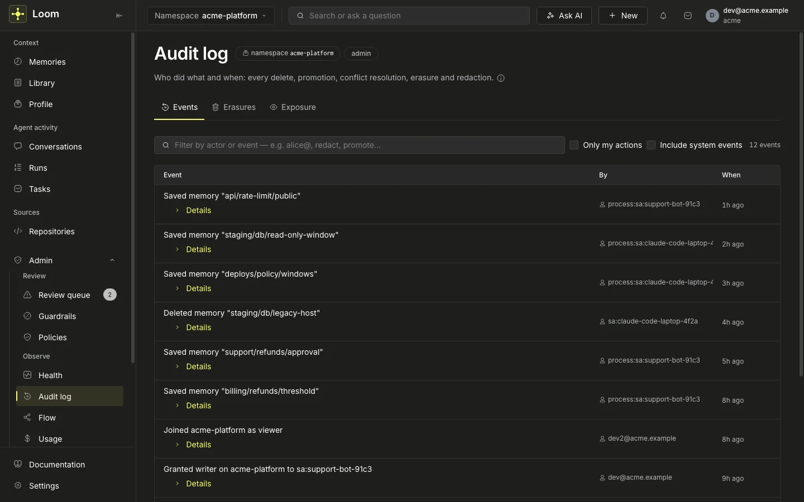

<!-- i18n: source=docs/features/observability/audit.md blob=8e4e9949ca4f7a4e54f9bad556832bda780a76c4 model=claude-sonnet-5-5 -->
> このページは[英語の原文](https://github.com/ClickHouse/loom/blob/main/docs/features/observability/audit.md)の機械翻訳です。内容は英語の原文が優先されます。
> Machine-translated from the [English page](https://github.com/ClickHouse/loom/blob/main/docs/features/observability/audit.md), which is authoritative.

<a id="audit-log"></a>

# 監査ログ

監査行、`audit_verifier` ワーカー、チェックポイントチェーンは、デフォルトで有効です。

Loom は、誰かが説明責任を負う可能性のある形で状態を変更する操作ごとに、また一部のサーバー自身が発生させるイベントについても、`loom.audit_log` に1行を書き込みます。目的は、改ざんを検出できるようにすることです。各行は自身の内容の SHA-256 を保持し、ワーカーが終了した1時間単位のウィンドウをハッシュチェーンに封じます。ClickHouse の管理者はテーブルを編集できますが、次回の verifier の実行で、その編集や削除が明らかになります。これはエンジニアリング上のプリミティブであり、コンプライアンス認証ではありません。



<a id="what-leaves-an-audit-row"></a>

## 監査行を残すもの

| ソース                                                                | `event_type`                                                                                                                                                                                                                                  | `subject` の内容                                                                                                                                                                                                                                                                                                                                                                                              |
| --------------------------------------------------------------------- | --------------------------------------------------------------------------------------------------------------------------------------------------------------------------------------------------------------------------------------------- | ------------------------------------------------------------------------------------------------------------------------------------------------------------------------------------------------------------------------------------------------------------------------------------------------------------------------------------------------------------------------------------------------------------ |
| `audit=True` と宣言された任意のオペレーション                         | op 名（`memory.delete`、`grants.create`）                                                                                                                                                                                                     | op が `audit_subject` を宣言している場合はその値（認証情報を含まない、または消去の対象とすべきテキストのハッシュ）。宣言していない場合は、検証済みの入力のうち名前を表さないテキスト値をすべてハッシュ化した JSON                                                                                                                                                                                                  |
| `memory.set`（ポイント書き込み）                                      | `memory.set`                                                                                                                                                                                                                                  | キー、メモリ id、`content_sha256`、`source_class`、判定結果、`pinned`。値は含まない                                                                                                                                                                                                                                                                                                                           |
| `memory.update`、`memory.update_by_id`                                | op 名                                                                                                                                                                                                                                         | キー、メモリ id、`content_sha256`、`source_class`、バージョン、および書き込み後のマーキング前における競合チェックの判定結果（バージョンが重複として書かれた場合は `duplicate`、改訂後の行が埋め込まれない場合は空。埋め込まれない型、または `high` の値が該当する）。値は含まない                                                                                                                              |
| `memory.bulk_set`                                                     | `memory.bulk_set`                                                                                                                                                                                                                             | 書き込みごとに 1 行のハッシュのみの行                                                                                                                                                                                                                                                                                                                                                                         |
| Postgres 上でコミットされるすべてのリビジョン                         | `memory.revision`                                                                                                                                                                                                                             | キー、メモリ id、バージョン、`content_sha256`、`source_class`、ステータス、`pinned`、tombstoned。アクターはトークンのプリンシパル、なければパイプラインステージのプリンシパル、それもなければリクエスト内では `-`、Loom 自身のジョブでは `process:loom`。リビジョンとともに保存されるため fail-open ではなく、記録されるか保留（parked）になるまで再試行される（[ストレージのオーソリティ](../../architecture/storage-authority.md#audit)） |
| `memory.import`                                                       | 書き込んだファクトには `memory.bulk_set`、書き込んだカテゴリリンクには `memory.import`                                                                                                                                                        | 一括書き込みのハッシュのみの行。リンクについては `count` と `category_links`（キーとカテゴリ名）。テキストは含まない                                                                                                                                                                                                                                                                                          |
| `high` の行、または `high` として保持されているエビデンスの読み取り   | `memory.sensitive_read`（`memory.get`、`memory.get_by_id`、`memory.bulk_get`、`memory.history`、`memory.evidence`、`namespace.snapshot`、`erasure.export`、および `include_high` 付きの `memory.export_evidence` から）                         | キーとメモリ id（`memory.history` と `erasure.export` はバージョンを追加）。公開されたエビデンスについては、その種別、セッション、チャンクインデックス、リンクされたキー。`erasure.export` が返す会話ターンについては、そのエージェント、スレッド id、メッセージ id。スレッドについては、そのエージェントとスレッド id                                                                                         |
| 制限付き名前空間への、受理されたリクエスト                            | `namespace.restricted_access`（その名前空間を指定する op、それを指定する `audit.list`（トランスポートは `op`）、ドキュメントのダウンロードとアップロード、inbox の watch、`admin/claim_release`、`admin/namespace.adopt`、委任トークンの発行、MCP プライマーから） | `op`、`transport`、呼び出し元の `token_id` と `roles`。発行の場合は `granted_to`、つまり新しいトークンのサブジェクト                                                                                                                                                                                                                                                                                          |
| Loom が自身でメモリを退役させたとき                                   | `memory.auto_supersede`                                                                                                                                                                                                                       | `reason`、`count`、`retired`：最大 200 件の退役した行（id、キー、エージェント、ユーザー、セッション、それぞれが後継とした行とキー、判定のラベル、コンフリクトリゾルバによる退役の場合は `judge_verdict`、`judge_confidence`、`judge_model`、`judge_prompt_version`、および再読み込みで退役を確認できなかった場合は `unconfirmed`（`"true"`））。値は含まない。これを超える行は複数のイベントに分割される |
| superseded 状態の行の `memory.restore`                                | `memory.unsupersede`                                                                                                                                                                                                                          | キー、メモリ id、`superseded_by`、復元された `content_sha256` と `version`                                                                                                                                                                                                                                                                                                                                    |
| 別の表記で取得された、または複数のうちの 1 つとして取得された `grants.revoke` の行 | `grants.revoke`                                                                                                                                                                                                                               | `namespace`、保存されているサブジェクト `subject`、`named`（呼び出しで指定されたサブジェクト）、および行の挿入が失敗した場合は `landed`（`"unknown"`）。入力を保持する op 自身の行とは別に書かれる                                                                                                                                                                                                             |
| サーバー自身                                                          | `budget.violated`、`ratelimit.exceeded`、`worker.failed`、`audit.tamper_detected`、…                                                                                                                                                          | イベントの対象                                                                                                                                                                                                                                                                                                                                                                                                |

生成された[オペレーションリファレンス](https://github.com/ClickHouse/loom/blob/main/docs/reference/operations.md)の **Audit** 列は、トランスポートが監査する op（各 `Operation` の `audit` フラグ）を示します。上の表にあるメモリ書き込みは独自の行を書くため、そこにはマークがありません。読み取り op に `audit=True` と宣言されたものはなく、`high` の行の読み取りは `memory.sensitive_read`（上記）を書きます。`audit.list` は `audit=False` で、監査証跡の読み取りで追加されるのは、制限付き名前空間に対するアクセス行のみです。

トランスポートは、ハンドラーが成功した後に行を書きます（HTTP と MCP のどちらも `server/transport/_common.py` の `emit_op_audit`）。この書き込みは **fail-open** です。挿入に失敗するとログに記録されて行は失われますが、オペレーション自体は成功します。

`audit=True` の op では、サブジェクトは、`audit_subject` を宣言していればその値、宣言していなければ `audit.input_subject` が整形した検証済みの入力です。呼び出しの対象や実行者を表すフィールド（ID フィールド、プリンシパルである `subject`、`actor`、`grantee`、`owner_email`、`requester`、`approver`、`decision_maker`、`version`、および id、key、URI、name、org、agent、namespace、`_by` のいずれかで終わる名前）と、数値、真偽値、日付または時刻、Literal、Enum として型付けされたフィールドは、送信されたままになります。名前が認証情報を示すフィールド（`server/observability/audit.py` の `audit.is_credential`）は、サフィックスにかかわらずハッシュ化されます。単一のネストされたモデルを持つフィールドにも同じ規則が適用され、モデルのリストは全体がハッシュ化されます。そのまま保持されるプリンシパルと `_by` フィールドは個人データであり、消去しても `loom.audit_log` からは削除されません。それ以外のすべての値（メモリの値、判断の理由、reason、レコードのフィールド、復元されたスナップショットの行）は、消去が `loom.audit_log` に及ばないため、SHA-256 とその長さである `{"sha256", "chars"}` として保存されます（メモリの `content_sha256` が持つのと同じハッシュなので、移動された値のハッシュは一致します）。ハンドラーが自分で書く 3 種類の行は、フィールド名の下にこの形式でテキストを保存します。`memory.cross_promote` と `memory.copy_to` の `rationale`、`memory.proposal_accept` と `memory.proposal_reject` の `reason`（オーナーのポリシーが行う判断では、代わりにポリシーのモードとしきい値が記録されます）、および `triple.follows_row_supersession` の `closed` で、そのアクターは書き込みを行ったプリンシパルまたは `process:loom` です。短い値のハッシュは推測によって復元できる場合があります。この規則が防ぐのは長いテキストが証跡に残ることであり、すべての単語を守るものではありません。入力に認証情報（トラッカーソースのパスワード、リポジトリのアクセストークン）を含む op は、それを除外する `audit_subject` を宣言します。`loom.audit_log` は、それが記述するデータと同様に権限を付与してください。

<a id="the-row"></a>

## 行の構造

`loom.audit_log` は月単位でパーティション分割された `MergeTree` で、`(org, namespace, event_type, ts)` の順に並べられており、`request_id` にはブルームフィルタ索引があります。

| 列                                           | 意味                                                                                                                                                                                              |
| -------------------------------------------- | ------------------------------------------------------------------------------------------------------------------------------------------------------------------------------------------------- |
| `ts`                                         | UTC、ミリ秒精度                                                                                                                                                                                   |
| `event_type`                                 | op 名またはサーバーイベント                                                                                                                                                                       |
| `org`, `namespace`                           | ゲートが認可したテナント                                                                                                                                                                          |
| `actor`                                      | トークンの subject（認証が無効の場合は `anonymous`）。メモリ書き込み自身の行（`memory.set`、`memory.bulk_set`、`memory.update`、`memory.update_by_id`）では `kind:subject` の形式で記録され、トークンがない場合は `-` になります |
| `subject`                                    | JSON テキスト。パースするかどうかは呼び出し側が決めます                                                                                                                                           |
| `request_id`                                 | `loom.agent_events` および `X-Request-Id` レスポンスヘッダと結合できます                                                                                                                          |
| `row_hash`                                   | 正規化した行に対する SHA-256                                                                                                                                                                      |
| `build_commit`, `instance`, `instance_label` | その行を書き込んだビルドとプロセス                                                                                                                                                                |
| `consumer`                                   | リクエストの送信元クライアント                                                                                                                                                                    |
| `token_id`                                   | リクエストを行った認証情報（その `jti`。なければトークンハッシュの先頭部分）                                                                                                                      |

ハッシュは `ts`、`event_type`、`org`、`namespace`、`actor`、`subject`、`request_id` を対象とし、キーをソートした ASCII JSON として計算されます（`server/observability/audit.py` の `_canonical`）。ビルド、インスタンス、コンシューマ、トークンのスタンプはハッシュの対象外であるため、スタンプ列を追加しても既存の行は無効になりません。

`audit.list`、`erasure.export`、`namespace.snapshot` は、`erasure.failed` または `erasure.abandoned` の行の subject を、失敗理由をステップとエラーの種類だけに切り詰めた形で返します。そのため、これらの行から再計算したハッシュは保存されているハッシュと異なる場合があります。`dev/verify_audit_chain.py` は保存された行を検証します。

<a id="per-row-hashes-and-checkpoints"></a>

## 行ごとのハッシュとチェックポイント

複数のサーバーレプリカが同時に書き込むため、行から行へのハッシュチェーンは分岐してしまいます。そこで各行が自身のハッシュを持ち、書き込みに調整は不要です。行ごとのハッシュは**変更された**行を検出できますが、削除された行は検出できません。削除はチェックポイントチェーンが扱います（設計は[セキュリティアーキテクチャ](https://github.com/ClickHouse/loom/blob/main/docs/architecture/security.md)を参照）。

1. `LOOM_AUDIT_CHECKPOINT_WINDOW_SECONDS`（1 h）のウィンドウが閉じてから `LOOM_AUDIT_CHECKPOINT_GRACE_SECONDS`（10 min）が経過すると、`audit_verifier` ワーカーがそのウィンドウを `loom.audit_checkpoints` に封印します。記録するのは、行数、ソート済みの行ハッシュに対する SHA-256、そして直前のチェックポイントのハッシュを含む `checkpoint_hash` です。
2. 毎回のパスで、封印済みの直近 `LOOM_AUDIT_CHECKPOINT_VERIFY_WINDOWS`（24）個のウィンドウを再集計し、リンクを再確認します。

封印を行うのは 1 つのワーカーだけなので、チェーンの書き込み元は 1 つであり、リクエストパスにはコストがかかりません。削除が現れるのは、そのウィンドウが封印された後、かつそのウィンドウが再集計されている間に限られます。

再集計の結果は、`server/insights/domain/audit_checkpoints.py` の `classify` によって分類されます。

| 検出結果 | 意味 | 改ざんか |
| -------- | ---- | -------- |
| `deletion` | 封印時より行数が少ない | はい |
| `modification` | 行数は同じだがダイジェストが異なる | はい |
| `chain` | チェックポイント自身のハッシュが再計算結果と一致しない、または直前のチェックポイントを指していない | はい |
| `late_insert` | 封印時より行数が多い：バックフィル、または非常に遅れた非同期挿入 | それだけでは改ざんとしない。報告される |

空のウィンドウも、空文字列のダイジェストで封印されます。そのため、後からそこに行が挿入されると不一致になります。

<a id="the-verifier-worker"></a>

## verifier ワーカー

`audit_verifier`（`server/insights/workers/audit_verifier.py`）は、workers リースを保持しているプロセス上で、`LOOM_AUDIT_VERIFIER_INTERVAL_SECONDS`（1 時間）ごとに実行されます。各パスの処理は次のとおりです。

1. 直近 1 時間のすべての行を再ハッシュします（1 ページ 10,000 行、最大 500,000 行。上限を超えた場合は `truncated` を報告します）。
2. 封印済みのウィンドウを検証し、その後、閉じたウィンドウを封印します。封印はパスごとに最大 `LOOM_AUDIT_CHECKPOINT_MAX_SEAL_PER_PASS`（48）個です。ここで発生したエラーは部分的な失敗としてログに記録され、行ごとのチェックを妨げることはありません。
3. 未報告の不整合について、`audit.tamper_detected` 行を**1 行**書き込みます（`subject.break_keys`）。このため、不整合は毎時ではなく 1 回だけ報告されます。

パスの結果（`rows_checked`、`breaks`、`windows_sealed`、`windows_verified`、`checkpoint_breaks`、`new_breaks`、`truncated`）は、ほかのワーカーと同様に `loom.worker_status` に記録されます。詳しくは[ワーカー](https://github.com/ClickHouse/loom/blob/main/docs/reference/workers.md)を参照してください。

<a id="checkpoint-lag"></a>

### チェックポイントラグ

`loom.audit.checkpoint_lag_windows` は、最新の封印済み `window_end` から現在までの 1 時間ウィンドウの数を数えます。この値は `loom.audit_checkpoints` から直接読み取られるため、sealer が停止していても報告されます。

| 値                     | 意味                                                                             |
| ---------------------- | -------------------------------------------------------------------------------- |
| 0 または 1             | 正常：チェーンは猶予期間の分だけ遅れています                                     |
| 着実に増加している     | sealer が停止しています：ワーカーが無効、失敗している、またはリースを保持していません |
| 減少している           | 停止後のバックフィルです。各パスで封印されるウィンドウは最大 48 個です           |
| チェックポイントなしで 0 | 一度も封印されていません（空のテーブルではゲージは 0 を示します）                |

カタログの残りについては、[テレメトリ](https://github.com/ClickHouse/loom/blob/main/docs/features/observability/telemetry.md#backlogs-and-process-state)を参照してください。

<a id="reading-the-trail"></a>

## 監査証跡の読み取り

`audit.list` は、呼び出し元の行を新しい順にページングし、不透明なキーセットカーソルを使います。ページが 1 回の書き込みの途中で終わることはありません。1 つのリクエストが同じミリ秒に書き込んだ行は同じページに含まれるため、1 ページが `limit` を超える行数を保持することがあります。

| フィールド   | 意味                                                                 |
| ------------ | -------------------------------------------------------------------- |
| `org`        | 必須                                                                 |
| `namespace`  | 呼び出し元が読み取れる名前空間を 1 つ指定（読み取れない場合は空のページ）。すべてを対象にするには省略 |
| `event_type` | 完全一致                                                             |
| `since`      | `ts >= since` の行                                                   |
| `limit`      | 1–500、デフォルトは 50                                               |
| `cursor`     | 前のページの `next_cursor`。あわせてフィルタも再度渡す               |
| `fields`     | 出力行をこれらのフィールドに絞り込む                                 |

この op には `viewer` とスコープが必要です。名前を指定した名前空間は、その名前空間の読み取りと同じゲートを通過します。読み取れない名前空間を指定した場合は、403 ではなく空のページが返されます。`namespace` を指定しない場合、トークンが `*` を持つ org 管理者は、読み取れない制限付きの名前空間とコレクションを除いた org 全体を読み取ります。プラットフォーム管理者は、クレームにかかわらず、読み取れない制限付きの名前空間を除いた org 全体を読み取ります（ダッシュボードのセッションでは、本人の名前空間のみが対象です）。それ以外の呼び出し元（トークンに名前空間が列挙されている org 管理者を含む）は、トークンまたは付与によって到達できる名前空間を読み取ります。

```bash
curl -s "$LOOM_BASE_URL/v1/audit.list" \
  -H "Authorization: Bearer $LOOM_API_KEY" -H 'Content-Type: application/json' \
  -d '{"org": "acme", "namespace": "support", "event_type": "memory.delete", "limit": 100}'
```

```python
from loom import Agent

async with Agent(org="acme", namespace="support", agent="auditor") as admin:
    page = await admin.audit.list(event_type="memory.delete", limit=100)
    while page.get("next_cursor"):
        page = await admin.audit.list(
            event_type="memory.delete", cursor=page["next_cursor"], limit=100
        )
```

管理ドロワーの **Audit log** ビューは、同じ op を読み取ります。サーバーイベント（`budget.violated`、`ratelimit.exceeded`、`worker.failed`）はトグルの背後に隠され、消去の集計がリストの横に表示されます。

1 つのリクエストを台帳と監査証跡にわたって追跡するには、次のようにします。

```sql
SELECT ts, event_type, actor, subject FROM loom.audit_log WHERE request_id = '<id>';
SELECT * FROM loom.agent_events WHERE request_id = '<id>';
```

<a id="verifying-offline"></a>

### オフラインでの検証

`dev/verify_audit_chain.py` は、ワーカーの `row_matches_hash` を使って、ウィンドウ内のすべての行ハッシュを再計算します。終了コード 0 はすべて成功、1 は不一致、2 は検証できなかったことを示します。不一致は、パーティション、`ts`、`request_id`、保存されたハッシュで示され、actor、subject、名前空間では示されません。

```bash
python dev/verify_audit_chain.py --org acme --ts-since <YYYY-MM-DD> --json
```

<a id="erasure-and-the-audit-log"></a>

## 消去と監査ログ

消去は、それ自体の監査行も含めて監査証跡を保持します。残存データの調査では、`loom.audit_log` が空であることは求められません。`user_id` スコープの場合、テーブルに `user_id` 列がないため、エクスポートでは `subject` を部分文字列で照合します。詳細は[保持期間と消去](https://github.com/ClickHouse/loom/blob/main/docs/features/memory/retention-and-erasure.md)を参照してください。

<a id="settings"></a>

## 設定

| 設定                                      | デフォルト | 効果                                                                    |
| ----------------------------------------- | ---------- | ----------------------------------------------------------------------- |
| `LOOM_AUDIT_VERIFIER_ENABLED`             | `true`     | 検証ワーカーを実行する                                                  |
| `LOOM_AUDIT_VERIFIER_INTERVAL_SECONDS`    | `3600`     | パスの実行間隔                                                          |
| `LOOM_AUDIT_CHECKPOINT_WINDOW_SECONDS`    | `3600`     | ウィンドウの長さ                                                        |
| `LOOM_AUDIT_CHECKPOINT_GRACE_SECONDS`     | `600`      | ウィンドウが閉じてから封印されるまでに経過しているべき時間              |
| `LOOM_AUDIT_CHECKPOINT_VERIFY_WINDOWS`    | `24`       | 各パスで再集計する封印済みウィンドウの数                                |
| `LOOM_AUDIT_CHECKPOINT_MAX_SEAL_PER_PASS` | `48`       | 1 回のパスで封印するウィンドウ数の上限                                  |
| `LOOM_BUDGET_VIOLATION_AUDIT_INTERVAL_S`  | `60`       | op ごとに、1 インターバルあたり `budget.violated` の行は最大 1 行（バースト後） |
| `LOOM_BUDGET_VIOLATION_AUDIT_BURST`       | `5`        | ウィンドウ内で、個別に行を書き込む違反の数                              |

すべての設定は[設定リファレンス](https://github.com/ClickHouse/loom/blob/main/docs/reference/configuration.md)に記載されています。

<a id="limits-and-failure-modes"></a>

## 制限と障害モード

- **フェイルオープンの書き込み。** 監査行の挿入に失敗すると、その行は失われますが、操作自体は失敗しません。ただし、退役を取り消す `memory.restore` と `namespace.restore` は、それぞれの記録に依存するため例外です。行はキューに入れられず、処理の実行中に直接挿入されます。op の行はレスポンスの前に、切り離された消去の行は各ステップの実行ごとに挿入されます。クラッシュで失われるのは、処理中だった作業の行だけです（`LOOM_RESTRICTED_AUDIT_INLINE=false` の場合は、応答の後に書き込まれる制限付きアクセスの行も失われます）。Postgres authority では、メモリ書き込みの監査行は、書き込みが応答する前に Postgres で永続化されます（[監査](../../architecture/storage-authority.md#audit)）。
- **検知であり、防止ではありません。** ClickHouse のテーブルへの書き込み権限を持つ人は、テーブルを改変できます。検証ツールは変更を示しますが、元に戻すことはできません。
- **限定的な遡及範囲。** 行ごとのチェックは直近 1 時間を読み取り、チェックポイントの再集計は直近 24 個の確定済みウィンドウを対象にします。両方より古い改変は、ワーカーによる再検査の対象外です。それより古いパーティションには `dev/verify_audit_chain.py` を実行してください。
- **遅れての挿入は改ざんではありません。** 古いウィンドウへのバックフィルは `late_insert` として報告されます。
- **デフォルトでは TTL はありません。** 監査行が期限切れになるのは、保持期間を設定した場合だけです。テーブル全体には 0 より大きい `LOOM_RETENTION_AUDIT_LOG_DAYS` を、特定の名前空間の行にはその名前空間の `retention_days` を設定します（[設定された保持期間](https://github.com/ClickHouse/loom/blob/main/docs/features/memory/retention-and-erasure.md#configured-retention)）。

<a id="related"></a>

## 関連ドキュメント

- [テレメトリ](https://github.com/ClickHouse/loom/blob/main/docs/features/observability/telemetry.md)：台帳、メトリクス、クエリの帰属。
- [コストと使用量](https://github.com/ClickHouse/loom/blob/main/docs/features/observability/cost-and-usage.md)。
- [セキュリティアーキテクチャ](https://github.com/ClickHouse/loom/blob/main/docs/architecture/security.md)。
- [履歴と来歴](https://github.com/ClickHouse/loom/blob/main/docs/features/memory/history-and-provenance.md)：メモリごとのバージョン履歴。これは別の仕組みです。
