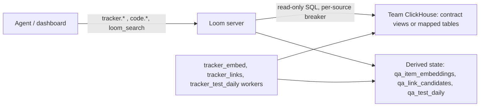

<!-- i18n: source=docs/features/tracker/overview.md blob=c43c9c14bbb3aece5e21c57716e38e3f7ca0c5e8 model=claude-sonnet-5-5 -->
> このページは[英語の原文](https://github.com/ClickHouse/loom/blob/main/docs/features/tracker/overview.md)の機械翻訳です。内容は英語の原文が優先されます。
> Machine-translated from the [English page](https://github.com/ClickHouse/loom/blob/main/docs/features/tracker/overview.md), which is authoritative.

<a id="issue-duplicate-checks-and-regression-candidates-for-agents"></a>

# エージェント向けの Issue 重複チェックとリグレッション候補

`LOOM_TRACKER_ORG` を設定してソースを登録すると、Loom はトラッカーのレコードとインデックス済みの PR 履歴を使って、エージェントがバグがすでに報告されているかを確認したり、リグレッションを引き起こした可能性のある変更をランク付けしたりできるようになります。
PR 履歴がインデックス済みでトラッカーがないリポジトリについては、[コード履歴と bisect 候補](../code-index/history-and-prs.md)を参照してください。

トラッカーとは、チームが Issue、プルリクエスト、インシデント、CI 実行を記録したもので、チーム自身の ClickHouse に保持されます。Loom は読み取り専用の認証情報でこれをライブで読み取り、コピーは行いません。すべてのステートメントは[レコードコントラクト](record-contract.md)に基づいて記述されるため、新しいトラッカーを追加してもコードの変更は不要です。チームがコントラクトの名前でビューを公開するか、自身のテーブルからマッピングを保存します。

ライブで読み取ることで、レコードのコピーはチームのアクセス制御下の 1 つだけになり、デプロイ側には消去しなければならないデータが残りません。すべての読み取りにはタイムバジェットとサーキットブレーカーがあり、ソースが応答しない場合、結果は `tracker_unavailable` を返します。

Loom が保持するのは派生状態のみです。類似度の埋め込み（`loom.qa_item_embeddings`）、復元された Issue→PR リンク（`loom.qa_link_candidates`）、テストごとの日次 CI 集計（`loom.qa_test_daily`）、重複チェックのキャリブレーションの適合結果、登録済みのソース（`loom.qa_sources`、認証情報は暗号化）です。



<a id="portability-and-record-types"></a>

## 移植性とレコードタイプ

トラッカープレーンはリポジトリに依存しません。Jira、GitHub、GitLab、Linear、ヘルプデスク、社内トラッカーのいずれも、ClickHouse のビューまたは保存済みマッピングを通じて同じコントラクトを提供できます。コード内でリポジトリ名やベンダーが選択されることはありません。必須の論理レコードは、issue とプルリクエスト／変更です。コントラクト上のテーブル名は `github_issues` と `github_prs` ですが、マッピングモードではダッシュボードにこれらが **items** と **changes** として表示されるため、ソース側のテーブルやカラムがこれらの名前である必要はありません。

任意の構造化レコードを用意すると、より多くの操作が可能になります。対象は、インシデント、サポートケース、チャットスレッド、コンポーネントリスクのスナップショット、リリースとリリースヘルス、バージョン履歴、CI チェック、クラウドインスタンスとその関係です。これらは型付きのテーブルレコードであり、ファイル添付ではありません。PDF、Office ファイル、任意のドキュメントは Library プレーンに属します。issue でそれらを参照する必要がある場合は、トラッカーの行からその URL をリンクしてください。

1 つのリポジトリに複数のトラッカー名前空間を順番にリンクできます。`#42` のような番号はシステムをまたぐと曖昧になるため、番号による検索では最初のトラッカーを使用します。セマンティック検索、重複チェック、回答ルーティング、bisect 候補スキャンでは、呼び出し元がアクセスできるリンク済みのすべてのトラッカーを読み取り、返されるすべてのアイテムにトラッカーの名前空間が示されます。

<a id="tracker-namespaces"></a>

## トラッカー名前空間

トラッカーは**トラッカー名前空間**（`kind = tracker` のディレクトリ行）を通じて読み取ります。各名前空間は、ソースと、読み取りを許可する `repos`（`source_id` の `Org/repo` プレフィックス）を指定します。一覧にないリポジトリは一切読み取られません。

| 種別       | 読み取り対象                                                                                                  | 参加ポリシー                   |
| ---------- | ------------------------------------------------------------------------------------------------------------- | ------------------------------ |
| standard   | すべてのステートメントに `is_private = 0` を追加します。`core_incidents`、`support_cases`、`slack_threads` は完全に拒否します | `open`（デフォルト）または `approval` |
| restricted | プライベートな行も読み取ります。すべての読み取りに、その名前空間を指定したトークンと、有効な直接の許可が必要です | `approval`                     |

読み取り側は `namespace.join`（`role: "viewer"`）で参加します。open の名前空間では、サービスアカウントを含め、直ちに参加が認められます。restricted の名前空間では、管理者の承認を待ちます。レイアウトと適用方法は[公開と非公開](record-contract.md#public-and-private)に、アクセスモデルは[ID と名前空間](https://github.com/ClickHouse/loom/blob/main/docs/concepts/identities-and-namespaces.md)にあります。

<a id="the-operations"></a>

## 操作

すべての tracker op は `org`（デフォルトは `LOOM_TRACKER_ORG`）と必須の `namespace` を取ります。名前空間には、トラッカー名前空間、またはそれに紐付けられたコード名前空間を指定します。MCP では、各 op は `loom_<op>` ツールとして公開されます（`loom_tracker_duplicate_check`）。`tracker` ツールセットには質問系の op が含まれます。`tracker.contract` と `tracker.source.*` は名前を指定して呼び出せます。

| Op                        | 答える内容                                                                                                                                             |
| ------------------------- | ------------------------------------------------------------------------------------------------------------------------------------------------------ |
| `tracker.duplicate_check` | このドラフトは既に存在するか。較正済みの `duplicate_of` / `related` / `none` の判定                                                                    |
| `tracker.similar`         | 既に同じ内容を述べているレポート：貼り付けた `text`、`issue_number`、スタック `frames` に対する重複および関連する issue と PR                           |
| `tracker.item`            | 最大10件の issue または PR 番号のレコード：コンポーネント、重大度、バイセクトの判定、影響を受けるブランチ、テスト、CI、バックポート、fixes / caused-by グラフ |
| `tracker.links`           | 誰もリンクを記載していない場合に、どの PR がこの issue を修正した可能性が高いか（またはこの PR がどの issue を修正したか）                             |
| `tracker.flaky`           | このテストは既知の flaky か。そのテストを挙げている flaky テストの issue。`include_signal` で CI 履歴も付与できます                                    |
| `tracker.test_signal`     | flaky か、リグレッションか、インフラ起因か。1つのテスト自身の CI 履歴                                                                                  |
| `tracker.release`         | 1つのバージョンのリリース準備状況：ステータス付きのブロッカーと最新のヘルススナップショット                                                            |
| `tracker.component`       | 1つのコンポーネントのリスクスナップショットと、その未解決 issue（重大度の高い順）                                                                      |
| `tracker.answer`          | 散文の質問、またはアーティファクトのアンカーに対し、名前付きテンプレートで回答します。検索した範囲も示します（`explain_only` はプランを返します）       |
| `tracker.binding`         | 名前空間がトラッカープレーンに問い合わせできる内容：そのトラッカー名前空間（プライマリが先頭）と、呼び出し元が実行できるテンプレート                    |
| `tracker.contract`        | 接続前のレコードコントラクトと空のビューテンプレート                                                                                                   |
| `tracker.source.*`        | ソースの登録、確認、チェック、再マップ、ローテーション、一覧表示、削除（[レコードコントラクト](record-contract.md#adding-a-tracker-source)）           |

コードプレーンも、リンクされたトラッカーを読み取ります（`code.bisect_candidates`、`code.backport_gap`、`code.first_build`、`code.history`、`code.context_pack`。[履歴と PR](../code-index/history-and-prs.md#pr-and-tracker-planes)を参照）。また、[`loom_search`](https://github.com/ClickHouse/loom/blob/main/docs/features/unified-search.md) は、コードスコープ下で不具合の形をしたクエリに対し、重複チェックを1つのレッグとして実行します。

<a id="duplicate-check"></a>

### 重複チェック

`tracker.duplicate_check` は、報告者が提出するのと同じ形のドラフトを受け取ります：`title`、`body`、`frames`、`component`、`version`（`X.Y`）、言及している issue 番号 `mentions`、コードの `paths` と `symbols`。

```python
from loom import Agent

async with Agent(org="acme", namespace="code-widgets", agent="triage-bot") as bot:
    res = await bot.tracker.duplicate_check(
        namespace="code-widgets",
        title="Upload hangs after token refresh",
        body="Steps: … Observed: the request never returns.",
        component="upload",
        paths=["src/upload/client.py"],
    )
    print(res["verdict"], res["epistemic"], res["answer"])
```

`tracker.similar` のレッグを1回実行し、融合した各候補を、その名前空間に保存されたロジスティック適合でスコアリングします。

1. **レッグ。** タイトルと本文に対する BM25F（コンポーネント、バージョン、エラーコードのブースト付き）、位置減衰付きのフレーム IDF、テキストが番号で挙げている項目、Loom 自身の埋め込みに対するベクトルレッグ（`LOOM_TRACKER_SIMILAR_VECTOR_LEG`、再現率専用：候補を追加するだけで、再ランクはしません）、そして修正進行中レッグ（ドラフトの paths → それに触れる PR → それらが修正する issue）です。
2. **判定。** 最上位候補の較正済み確率が重複しきい値に達すると `duplicate_of`、関連しきい値に達すると `related`、それ以外は項目なしの `none` になります。適合は、レコード自身のラベル付き重複に基づいて `tracker_links` パスにより毎週再適合されます。再適合ごとの推奨しきい値が提供され、`LOOM_TRACKER_DUPCHECK_DUPLICATE_THRESHOLD_MIN` / `_MAX` の範囲に制限されます。
3. **ジャッジとリランク。** `related` の回答では、LLM 呼び出しが1回、同一不具合の候補を `duplicate` に昇格させることがあります（降格はしません）。リランク呼び出しは `nearest` の手がかりを並べ替えますが、判定は変更しません。どちらも実際の LLM プロバイダーが必要で、失敗時はフェイルオープンします。
4. **リンク。** issue 行には、リンクされた PR、修正が含まれるリリース、そのバックポートが付きます。`none` または `related` の場合、`related_prs` に、ドラフトに既に対処している可能性のある PR が列挙されます（[`code.pr_check`](../code-index/history-and-prs.md#pre-pr-duplicate-check-codepr_check)）。

`epistemic` は、回答をどこまで信頼できるかを示します。

| 値             | 意味                                                         |
| -------------- | ------------------------------------------------------------ |
| `calibrated`   | 適合が保存されている                                         |
| `uncalibrated` | 適合なし：最大で `related`、信頼度は null                    |
| `degraded`     | レッグまたはトラッカーが応答しなかった。`none` は問題なしの保証ではない |
| `unavailable`  | トラッカーが応答しなかった                                   |

`none` は「重複の較正済みの証拠がない」ことを意味し、「未報告」を意味しません。いずれにせよ `related` の一覧を確認してください。コード名前空間を宛先にした場合、チェックは呼び出し元が読み取れるすべてのトラッカーを、紐付けられたものを先頭に、`LOOM_TRACKER_DUPCHECK_FANOUT_NAMESPACES`（デフォルト 4）まで読み取り、各項目の名前空間を示します。

<a id="bisect"></a>

### バイセクト

`code.bisect_candidates` はコード名前空間を宛先とし、それに紐付けられたトラッカーを読み取ります。`issue_number` のトリアージ列（`triage_reproduces_on`、`triage_clean_on`）に以前記録された観測がリリースウィンドウを与え、トラッカーの PR diff（`github_prs.diff`、`affected_file_paths`、コントラクトの `bisect` 機能）がフレームについてスキャンされます。フレームがない場合、スキャンは issue の最も希少なパターン（`LOOM_TRACKER_BISECT_SCOPE_PATTERNS`）とそのコンポーネントのディレクトリ（`LOOM_TRACKER_BISECT_COMPONENT_DIRS`）に限定されます。トラッカーがない場合、バイセクトはリポジトリ自身の PR 履歴を読み取ります。issue の再現やトリアージ観測の検証は行わず、エンジニアまたはテスト用エージェントが調査するための PR をランク付けします。全体の流れは[履歴と PR](../code-index/history-and-prs.md#bisect-candidates-codebisect_candidates)にあります。

<a id="from-a-bug-draft-to-candidate-prs"></a>

### バグドラフトから候補 PR まで

リポジトリをビルドせずに、過去のレポートを確認し、マージ済みの変更をランク付けするには、この手順を使います。以下のリクエストは1つのドラフトの例であり、記録された結果ではありません。

1. セットアップを確認します。重複チェックには、[登録済みのトラッカーソース](record-contract.md#adding-a-tracker-source)と、呼び出し元が読み取れる名前空間が必要です。両方の操作で同じコード名前空間を使うには、[トラッカーをリンク](#linking-a-tracker-to-a-repository)し、そこで `tracker.binding` を確認します。`kind: "none"` は、未紐付けまたは拒否されたことを意味する場合があり、トラッカーが存在しないことを示すものではありません。[インデックス済みの PR 履歴](../code-index/history-and-prs.md#the-pr-plane)のみを持つリポジトリでも変更のランク付けはできますが、その履歴はトラッカーの重複チェックの代わりにはなりません。
2. ドラフトを、トラッカーに紐付けられたコード名前空間を使って `POST /v1/tracker.duplicate_check` に送信します。例のスコープとコードの手がかりは、リポジトリ固有のものに置き換えてください。

   ```json
   {
     "org": "acme",
     "namespace": "code-widgets",
     "title": "Upload hangs after token refresh",
     "body": "The upload request never returns after refreshing its token.",
     "paths": ["src/upload/client.py"],
     "symbols": ["UploadClient.send"]
   }
   ```

   `verdict`、`epistemic`、`items`、`closest`、`related_prs`、`leg_status` を合わせて読んでください。同じ不具合として扱う前に、リンクされたレポートと修正を確認します。`none` は、バグが未報告であると結論づける許可ではありません。degraded または unavailable の読み取りでは、重複の問いは未解決のままです。

3. 原因となった変更の調査がまだ必要な場合は、レポートのコードの手がかりを、同じコード名前空間の `POST /v1/code.bisect_candidates` に送信します。

   ```json
   {
     "org": "acme",
     "namespace": "code-widgets",
     "paths": ["src/upload/client.py"],
     "symbols": ["UploadClient.send"],
     "text": "Upload hangs after refreshing its token.",
     "before": "now",
     "limit": 5
   }
   ```

   `issue_number` は、プライマリのリンク済みトラッカーにある実際のレポートに対してのみ指定してください。正常なリリースと不具合のあるリリースが観測されている場合は、[バージョンウィンドウの例](../code-index/history-and-prs.md#bisect-candidates-codebisect_candidates)の説明に従って、その観測を指定します。ここでの `before: "now"` は、上限をリクエスト時刻に設定するもので、観測された障害時刻ではありません。観測されたリリース境界、`before` の観測された時間の上限（分かっていれば `after` も）、または `bad_sha` の既知の不良コミットを使うことを推奨します。この例のような未提出のドラフトで、リリースと時間の境界をすべて省略すると、`no_failing_version` とともに `unknown` になり、候補スキャンは実行されません。導入したコミットまたは PR を既に挙げているトラッカーレコードがあれば、代わりにスキャンなしで回答できます。この操作は、最後の正常バージョンを見つけることはしません。

4. 証拠を調査とともに保管します。候補リストと並べて、`candidates_from`、`epistemic`、`causes`、`tracker_unavailable`、および `partial` / `partial_reason` を読んでください。`candidates_from: "code_history"` は、トラッカーの読み取りが成功したことではなく、リポジトリ履歴へのフォールバックを示します。各候補の `matched_paths`、`matched_symbols`、`score` がそのランキングを説明します。`epistemic: "lower_bound"` は、空のリストが何も除外しないことを意味します。diff を確認し、別の再現またはテストで、候補の前後で報告された挙動を比較してください。ランキング自体は、不具合もその原因も証明しません。

<a id="ci-test-history"></a>

### CI テスト履歴

`tracker.test_signal` は、`checks` テーブルから1つのテストの CI 実行を読み取り、`flaky`、`regression_candidate`、`infra_candidate`、`no_signal`（沈黙であり、健全性ではない）、または `unknown_test`（類似のテスト名付き）を返します。失敗率とその Wilson 下限、連続する実行間の反転、同一コミットの再実行での反転、多数の無関係なテストにわたる失敗の集中（インフラ）、テストのホームファイルの変更頻度を加味します。`pr_number` を指定すると、その PR ヘッドの結果の連続が加わり、テストソースは flaky テストの兆候についてスキャンされます。

`tracker_test_daily` ワーカーは checks を毎日 `loom.qa_test_daily` に集約するため、読み取りではリモートから未集約の時間分のみを取得します。checks テーブルは、ソースエントリの `checks.from`（[ソースエントリのオプション](record-contract.md#source-entry-options)）から、なければソース自身の `checks` テーブルから、それもなければ `LOOM_TRACKER_CHECKS_FROM` から取得されます。いずれもない場合、この op は読み取るものがありません。`tracker.flaky` は、より軽い問い、つまり flaky テストの issue がそのテストを挙げているか（`flaky_by_issue` または `no_flaky_signal`）に答えます。

<a id="links-to-fixing-prs"></a>

### 修正 PR へのリンク

issue は `fixes` エッジなしでクローズされることがよくあります。毎日の `tracker_links` パスは、直近の `LOOM_TRACKER_LINKS_ISSUE_DAYS`（90）日以内にオープンされた各 issue について、その後にマージされたトランク PR をランク付け（タイトルと本文に対する BM25F、クローズキーワード、diff 内のスタックフレーム、コンポーネント）し、上位 `LOOM_TRACKER_LINKS_PER_ISSUE`（20）件を `loom.qa_link_candidates` に書き込みます。`tracker.links` は、それらを両方向で提供します。1つの修正を必要とする利用側（`code.backport_gap`、バイセクト）は、スコアが `LOOM_TRACKER_LINKS_MIN_SCORE`（1.0）を超え、かつクローズキーワードがその issue を挙げている場合にのみ、最上位候補を採用します。

<a id="linking-a-tracker-to-a-repository"></a>

## トラッカーをリポジトリにリンクする

コード名前空間は、リンクされたトラッカーを順に読み取ります。最初のトラッカーが**プライマリ**です。その番号がリポジトリの issue 番号および PR 番号になるため、番号による検索（`tracker.item`、PR の事実情報、blame、バックポート、最初のビルド）はプライマリのみを読み取ります。検索（`tracker.duplicate_check`、`tracker.similar`、`tracker.answer`、`loom_search` のレコード側、bisect の候補スキャン）はリンクされたすべてのトラッカーを読み取り、各結果の取得元を示します。

| 担当者 | 方法 |
| ---------- | ---- |
| メンテナー | `tracker_namespaces` を指定した `code.repo.set_source`（リポジトリの管理者であり、かつリポジトリ自身のリンクにまだ含まれていない各トラッカーの管理者であること）、またはリポジトリカードの Trackers セクション。そのリポジトリについて、`LOOM_CODE_REPOS_REFRESH_SECONDS` 以内にオペレーターのマップを置き換えます。`repos` がそのリポジトリをカバーしていないトラッカーも、`not_covering` として受け付けられます。 |
| オペレーター | `LOOM_TRACKER_CODE_NAMESPACE_BINDINGS_JSON`：コード名前空間名に対するグロブをキーとし、それぞれ 1 つのトラッカー名前空間、または順序付きのリストを指定します。リンクされるのはオペレーターのリポジトリ（`LOOM_CODE_REPOS_JSON` または `LOOM_CODE_REPO`）のみです。セルフサービスのリポジトリ（`code.repo.add`）は、そのメンテナーがリンクします。 |

リンクされた標準トラッカーはリポジトリのすべての読み取り者に読み取られるため、リンクは長期にわたる権限の委任になります。新しいリンクには、制限付きかどうかにかかわらず、そのトラッカーの管理者権限が必要です。トラッカーの読み取り者で管理者ではない場合は 403 になり、それ以外のユーザーには `NOT_A_TRACKER_NAMESPACE` が返ります。トラッカーの管理者が標準トラッカーをリンクすると、その後の `code.repo.set_access` による参加ポリシーの変更も含め、誰が読み取れるかはリポジトリの管理者が決めます。オペレーターのリポジトリに対するリンクは、ブランチの追加前後どちらで設定しても、`code.repo.add_branch` でそこから追加された各ブランチの読み取り者にも読み取られ、各ブランチへの参加者はそのブランチの管理者が決めます。

```bash
LOOM_TRACKER_CODE_NAMESPACE_BINDINGS_JSON='{"code-widgets*": ["tracker-widgets", "tracker-helpdesk"]}'
```

オペレーターのリポジトリから `code.repo.add_branch` で追加されたブランチは、そのリポジトリをルート（`qa_branch_of`）として記録します。ブランチ自身にリンクがない場合はそのリポジトリのリンクを読み取るため、オペレーターが変更したグロブや、リポジトリに設定されたリンクがブランチにも反映されます。セルフサービスのリポジトリでメンテナーが設定したリンクは、新しいブランチにコピーされます。その後にそのリポジトリへ設定されたリンクは、トラッカーの管理者が `code.repo.set_source` でブランチに設定します。メンテナーのリンクを持っていた、削除済みの名前空間と同じ名前で、その名前空間のパージが実行される前にオペレーターのリポジトリのブランチを再追加した場合、トラッカーの管理者が `code.repo.set_source` でリンクするまで、そのブランチはトラッカーを読み取りません。

リンクは名前から推測されることはなく、リンクは 1 つの組織に属します。2 つの組織が同じコード名前空間名を持つことがありますが、一方で設定したリンクがもう一方に適用されることはありません。ゲートは、バインドされた名前空間に対して呼び出し元について再度実行されるため、公開リポジトリにバインドされた制限付きトラッカーは、ゲートが拒否するユーザーに対して閉じたままです。`tracker.binding` は名前空間の解決先を返します。バインドされていない場合、拒否された場合、「トラッカーなし」の場合はいずれも同じ応答（`kind: "none"`）になるため、拒否によって何も明らかになりません。

<a id="adding-a-tracker-from-the-dashboard"></a>

## ダッシュボードからトラッカーを追加する

`LOOM_TRACKER_SELF_SERVICE_ENABLED` が有効（デフォルト）で、組織の登録数が `LOOM_TRACKER_SELF_SERVICE_MAX_SOURCES`（10）未満である間は、サインイン済みの組織メンバーであれば誰でも、Repositories ページの Trackers 一覧からトラッカーを追加できます。このフローでは、まずコントラクトを表示し、次に接続（または `tracker.source.inspect` が提案するマッピング）を表示し、その後 `dry_run: true` のチェックを実行します。チェックでは、失敗したテーブルごとに `CREATE OR REPLACE VIEW` のドラフトが返されます。チェックしたフォームと送信されるフォームが一致するまで、_Add_ は無効のままです。登録者は最初の管理者になります。op としての手順、読み取り専用ユーザーの SQL、オペレーター向けのフォームについては、[トラッカーソースの追加](record-contract.md#adding-a-tracker-source)を参照してください。

<a id="settings-that-change-it"></a>

## 動作を変える設定

| 設定                                                         | デフォルト | 効果                                                                            |
| ------------------------------------------------------------ | ---------- | ------------------------------------------------------------------------------- |
| `LOOM_TRACKER_ORG`                                           | `""`       | トラッカーの名前空間が属する組織。空の場合、トラッカーの名前空間は一切応答しない |
| `LOOM_TRACKER_LIVE_SERVE`                                    | on         | キルスイッチ：off にすると、トラッカーの読み取りはすべて `tracker_unavailable` を返す |
| `LOOM_TRACKER_LIVE_BUDGET_MS`, `LOOM_TRACKER_LIVE_TIMEOUT_S` | 300, 1.5   | 読み取り 1 回あたりの呼び出し側の予算と、リモートの `max_execution_time`        |
| `LOOM_TRACKER_CIRCUIT_FAILURE_THRESHOLD`, `_COOLDOWN_S`      | 3, 120     | ソースのブレーカーを開く連続失敗回数と、開いたままにする時間                    |
| `LOOM_TRACKER_EMBED_ENABLED`                                 | on         | ベクトル側を埋める `tracker_embed` パス                                         |
| `LOOM_TRACKER_LINKS_ENABLED`                                 | on         | 日次のリンク復元パス。重複チェックのキャリブレーションも再フィットする          |
| `LOOM_TRACKER_TEST_DAILY_ENABLED`                            | on         | テストごとの日次 CI ロールアップ                                                |

しきい値、レッグ、ジャッジ、リランク、bisect の範囲、テストシグナルの設定は、[設定リファレンス](https://github.com/ClickHouse/loom/blob/main/docs/reference/configuration.md#tracker)を参照してください。

<a id="limits-and-failure-modes"></a>

## 制限と障害モード

- **応答の遅いソース**は、予算内に `tracker_unavailable` を返します（または、1 つのレグを縮退させ、`leg_status` にその名前を示します）。各ソースは独自の接続、ブレーカー、予算を持つため、あるチームの障害が別のチームに影響することはありません。
- **コントラクトを満たさないソースは、ビューまたはマッピングが修正されるまで提供されません**。失敗と判定されたソースは 60 s 後に再チェックされます（[ソースのチェック](record-contract.md#checking-a-source)）。
- **適合結果ができるまでは未較正です。** 新しいトラッカーの重複チェックは、ラベル付き重複に対する再適合が実行されるまで `uncalibrated` を返します。制限付き名前空間は、組織の標準の適合結果を借用します。
- **ベクトルレグの遅れは最大 1 パス分です。** クエリ時のキャッチアップでは、パス以降に変更された項目を `LOOM_TRACKER_SIMILAR_CATCH_UP_BUDGET_MS` の範囲内で埋め込みます。
- **存在しないテーブルは `not_provided` を返します。** インシデント、リリース、CI チェックなどの任意のテーブルは、ソースが提供している場合にのみ読み取られます。

<a id="related"></a>

## 関連ドキュメント

- [GitHub フィード](github-feed.md)：スケジュール実行される CLI ジョブで、チーム所有のレコードを維持します
- [レコードコントラクト](record-contract.md)：テーブル、カラム、エイリアス、マッピングモード、ソース
- [履歴と PR](../code-index/history-and-prs.md)：トラッカーを読み取るコードプレーンの op
- [リポジトリの追加](../code-index/repositories.md)
- [ダッシュボード](https://github.com/ClickHouse/loom/blob/main/docs/features/dashboard.md)
- [設定リファレンス](https://github.com/ClickHouse/loom/blob/main/docs/reference/configuration.md#tracker)
- [オペレーションリファレンス](https://github.com/ClickHouse/loom/blob/main/docs/reference/operations.md#tracker)
