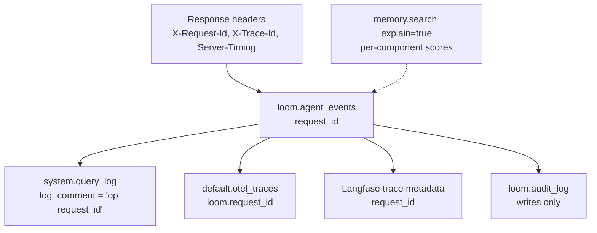

<!-- i18n: source=docs/guides/debugging.md blob=7e3e8e18681a11279a779257bf5385dbd9bce7c0 model=claude-sonnet-5-5 -->
> このページは[英語の原文](https://github.com/ClickHouse/loom/blob/main/docs/guides/debugging.md)の機械翻訳です。内容は英語の原文が優先されます。
> Machine-translated from the [English page](https://github.com/ClickHouse/loom/blob/main/docs/guides/debugging.md), which is authoritative.

<a id="debug-a-request"></a>

# リクエストのデバッグ

Loom は 1 つのリクエストが行うすべての処理に同じ id を付与するため、リクエストの追跡は結合（join）で行えます。このページでは、レスポンスヘッダーから、回答を決定したコンポーネントまでを、1 つのリクエストについて順にたどります。デプロイメント自体が正常でない場合は、[トラブルシューティング](https://github.com/ClickHouse/loom/blob/main/docs/operations/troubleshooting.md)から始めてください。ワーカーが実行されなかった場合は、[ワーカーのステータス](https://github.com/ClickHouse/loom/blob/main/docs/operations/monitoring.md#worker-status)を参照してください。



<a id="1-capture-the-requests-ids"></a>

## 1. リクエストの id を取得する

すべての HTTP レスポンスには次のヘッダーが含まれます。

| ヘッダー                          | 意味                                                                                                                                                                                     |
| --------------------------------- | ---------------------------------------------------------------------------------------------------------------------------------------------------------------------------------------- |
| `X-Request-Id`                    | リクエストの id。独自の id（英字、数字、`.`、`_`、`-` の 1 〜 64 文字）を送ると Loom がそのまま返すため、ログと Loom の行が同じキーを共有できます。これ以外の値は生成された id に置き換えられます。 |
| `X-Trace-Id`                      | リクエストのスパンツリーの OpenTelemetry トレース id。                                                                                                                                   |
| `Server-Timing`                   | 成功時の `app`（ハンドラーの処理時間）と `ch`（ClickHouse の処理時間、ステートメント数、読み取りバイト数）。                                                                              |
| `X-Loom-Hint`, `X-Loom-Hint-Code` | 該当する場合の、この呼び出しに対するメンターのヒント。SDK はこれをログに出力します。                                                                                                      |

```bash
curl -si "$LOOM_BASE_URL/v1/memory.search" -H "Authorization: Bearer $LOOM_API_KEY" \
  -H 'Content-Type: application/json' -H 'X-Request-Id: dbg-0001' \
  -d '{"org":"acme","namespace":"support","agent":"bot","query":"refund window"}' \
  | grep -iE '^(x-request-id|x-trace-id|server-timing)'
```

`Server-Timing` は「なぜ遅かったのか」の答えになることがよくあります。`ch` の時間やバイト数が大きい場合は、クエリに原因があります。`app` が大きく `ch` が小さい場合は、プロバイダー呼び出し（埋め込み、リランク、LLM）に原因があります。

<a id="2-join-the-request-across-systems"></a>

## 2. システム間でリクエストを結合する

同じ ID が `loom.agent_events.request_id`、Langfuse のトレースメタデータ、および `default.otel_traces` のスパン属性 `loom.request_id` に入っています。

```sql
-- the ledger row: operation, identity, latency, success, error_code, tokens, cost, model
SELECT * FROM loom.agent_events WHERE request_id = 'dbg-0001';

-- every ClickHouse statement the request issued
SELECT query_duration_ms, read_rows, read_bytes, substring(query, 1, 200) AS q
FROM system.query_log
WHERE type = 'QueryFinish' AND log_comment LIKE '% dbg-0001%'
ORDER BY event_time_microseconds;

-- its spans
SELECT SpanName, Duration, SpanAttributes['loom.operation'] AS op
FROM default.otel_traces
WHERE SpanAttributes['loom.request_id'] = 'dbg-0001'
ORDER BY Timestamp;
```

`log_comment` のタグは、[クエリの帰属](https://github.com/ClickHouse/loom/blob/main/docs/operations/monitoring.md#logs-traces-and-query-attribution)に一覧があります。`LOOM_OTEL_EXPORTER` が `ch` に解決される場合、スパンは `default.otel_traces`（`LOOM_CLICKSTACK_DATABASE` が設定されている場合はそのデータベース）に送られます。それ以外の場合は、OTLP エンドポイントに送られます。Langfuse を別途設定している場合は、これらに加えて [Langfuse](https://github.com/ClickHouse/loom/blob/main/docs/features/integrations/langfuse.md) にも送られます。

> **注意:** 台帳にクエリのテキストは保存されません。`loom.agent_events` は、自由形式の引数をすべて `sha256:<16 hex>/<length>` という形式に置き換えます。何が問い合わせられたかを確認するには、後述の検索トレースログか、お使いのクライアントのログを参照してください。

<a id="3-explain-a-search-answer"></a>

## 3. 検索結果を説明する

**なぜこの順位になったのか。** `memory.search` に `explain=true` を指定すると、返された各ヒットに `score_components` が付きます。ここにはランキングのシグナルが含まれ、リランカーを通した場合はその移動量（`rerank_from`、`rerank_pos`、`rerank_delta`）も含まれます。リランカーが順序を変更した場合は、リランカー自身の融合スコア（`rank_score_pre_rerank`）も含まれます。リンクされたコードが変更されたために順位が下がった行には、移動した位置（`code_changed_places`）が付きます。

```python
out = await agent.call("memory.search", {"query": "refund window", "explain": True})
for h in out["results"]:
    c = h["score_components"]
    print(
        h["memory_key"],
        h["similarity"],
        h["rank_score"],
        c.get("rerank_from"),
        c.get("rank_score_pre_rerank"),
    )
```

`memory.search_trace` は `memory.search` と同じ引数を受け取り、ベクトル検索のみ（融合、アセンブリ、リランカーなし）をスコアリングして、ヒットごとに `similarity`、`distance`、`entity_boost`、`rank_score`、`rank`、`source` を返します。

**なぜ回答を控えたのか。** `memory.search` の応答そのものを確認します。

| フィールド                                | わかること                                                                                                     |
| ----------------------------------------- | -------------------------------------------------------------------------------------------------------------- |
| `abstain`, `abstain_code`                 | どのゲートが作動したか：`no_match`、`below_threshold`、`entity_absent`、`low_calibrated_confidence`、`page_expired`。 |
| `retrieval_risk`, `retrieval_confidence`  | 最良のヒットがゲートからどれだけ離れているか。                                                                 |
| `calibration_explanation`                 | どの類似度ゲートが有効だったか（エンベッダーから校正されたものか、スカラーのフォールバックか）。               |
| `degraded`                                | この読み取りでフォールバックしたプロバイダーと、代わりに応答が行ったこと。                                     |
| `pending_extraction`                      | まだ抽出されていない、遅延された `set_from_messages` のバッチ。0 を超える場合、空の回答は不在の証明になりません。 |
| `namespaces_searched`, `candidates_total` | 検索が想定した名前空間と行に到達したかどうか。                                                                 |

`calibration.get` は、ある名前空間で有効なしきい値と、それを生成したティア（名前空間、クラスター、スカラー）を示します。各用語については [検索とランキング](https://github.com/ClickHouse/loom/blob/main/docs/concepts/retrieval-and-ranking.md) で説明しています。

**エージェントは時間の経過とともに何を検索したのか。** `LOOM_SEARCH_TRACE_LOG_ENABLED=true` が必要です（デフォルトはオフ）。`memory.search_trace_log(since_hours=, agent=, run_id=)` は検索ごとに1行を返します。含まれるのは `returned_keys`、`returned_scores`、`abstain`、`retrieval_risk`、`latency_ms` で、`LOOM_LANGFUSE_CAPTURE_IO_LEVEL` が `off` でない場合は `query` も含まれます（デフォルトは `off` のため、デフォルトでは行にキーとスコアは含まれますが、質問は含まれません）。

<a id="4-explain-a-write"></a>

## 4. 書き込みを説明する

- **書き込み自体の応答。** `memory.set` は `status`、`conflict_verdict`、`peers`、`duplicate_of`、`merged_into_key`、`noop`、`advisories` を返します。書き込みが「消えた」場合、たいていは正規の一致先にマージされたか、重複としてマークされています。`advisories` は、二重エンコードされた値やサイズの大きすぎる値を示します。
- **履歴。** `memory.history` は `loom.memory_versions` からキーのバージョンを一覧表示します。`memory.provenance` は、誰が、どのソース、セッション、実行から書き込んだかを示します。
- **抽出で破棄されたもの。** `memory.extraction_status` は、保留中の `set_from_messages` バッチ（`pending`、`failed`）を一覧表示します。`loom drops --namespace <ns>` は、パイプラインが破棄した、切り詰めた、または処理を断念したものを、ステージと理由ごとに出力します（[メモリ取り込みの破棄](https://github.com/ClickHouse/loom/blob/main/docs/operations/maintenance.md#memory-ingest-drops)）。`set_from_messages` のレスポンスには、`pipeline_errors` とステップごとの `stage_ms` が含まれます（[抽出パイプライン](https://github.com/ClickHouse/loom/blob/main/docs/guides/extraction-pipeline.md)）。
- **監査証跡。** `audit.list(event_type=, since=)` は `loom.audit_log` を読み取ります。誰が何を変更したかが、行ごとのコンテンツハッシュとともに記録されています。メモリを作成または変更するすべての書き込みは、ハッシュのみの行を残します（[監査](https://github.com/ClickHouse/loom/blob/main/docs/features/observability/audit.md)）。
- **実行のビュー。** `run.get(run_id)` は、実行が想起したもの（`recalled_keys`）、書き込んだもの、そのターン、コストを返します（[トレースと再開](https://github.com/ClickHouse/loom/blob/main/docs/guides/trace-and-resume.md)）。

<a id="related"></a>

## 関連ドキュメント

- [トラブルシューティング](https://github.com/ClickHouse/loom/blob/main/docs/operations/troubleshooting.md)
- [モニタリング](https://github.com/ClickHouse/loom/blob/main/docs/operations/monitoring.md)
- [テレメトリ](https://github.com/ClickHouse/loom/blob/main/docs/features/observability/telemetry.md)
- [システム概要](https://github.com/ClickHouse/loom/blob/main/docs/architecture/system-overview.md)
- [パフォーマンスチューニング](https://github.com/ClickHouse/loom/blob/main/docs/guides/performance-tuning.md)
