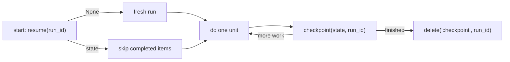

<!-- i18n: source=docs/guides/trace-and-resume.md blob=d597f5338750e0167731c70d5eb3f07fc5bc291d model=claude-sonnet-5-5 -->
> このページは[英語の原文](https://github.com/ClickHouse/loom/blob/main/docs/guides/trace-and-resume.md)の機械翻訳です。内容は英語の原文が優先されます。
> Machine-translated from the [English page](https://github.com/ClickHouse/loom/blob/main/docs/guides/trace-and-resume.md), which is authoritative.

<a id="trace-and-resume-long-agent-runs"></a>

# 長時間のエージェント実行のトレースと再開

長時間の実行（300 個のファイルの処理、リポジトリのクロール、計画の実行）は、クラッシュ、コンテキストウィンドウの枯渇、デプロイ、一時停止などで途中で止まることがあります。実行の `run_id` をキーとするワーキングメモリのブロックが、進捗を ClickHouse に保持します。新しいプロセスはそれを読み戻し、最後に完了した作業単位から続行します。別個のチェックポイントストアは不要です。

<a id="the-pattern"></a>

## パターン

1. タスクに対して安定した `run_id`（ジョブ id、計画 id など）を選びます。
2. 作業単位ごとに `checkpoint(state, run_id=...)` を呼びます。`state` は新しいプロセスが続行するために必要なもの（完了した項目の id、カーソル、JSON 文字列など）です。
3. 起動時に `resume(run_id=...)` を呼びます。`None` は新規の実行を意味します。それ以外の場合は、チェックポイントが完了済みとしているものをスキップします。



<a id="with-the-python-sdk"></a>

## Python SDK の場合

```python
from loom import Agent

RUN = "reindex-catalog"


async def process(agent: Agent, items: list[str]) -> None:
    done = set((await agent.working_memory.resume(run_id=RUN) or "").split())
    for item in items:
        if item in done:
            continue
        await do_work(item)
        done.add(item)
        await agent.working_memory.checkpoint(" ".join(sorted(done)), run_id=RUN)
```

`checkpoint` と `resume` は、ブロック `checkpoint` に対する `working_memory.set` と `working_memory.get` です（`block_key=` で変更できます）。`checkpoint` は呼ぶたびに前回の内容を上書きします。

> **Warning:** デフォルトの `char_limit` は 4,096 文字です（`sdk/python/loom/working_memory.py` の `DEFAULT_CHAR_LIMIT`）。状態は小さく保つか、状態へのポインタを保存してください。大きなブロブは `context.offload` に置き、その `blob_key` をチェックポイントに入れます。

タスクが完了したら、チェックポイントを削除します。

```python
await agent.working_memory.delete("checkpoint", run_id=RUN)
```

1 つのスナップショットではなく進捗ログが必要な場合は、`working_memory.append(..., run_id=RUN)` でブロックに追記し、`working_memory.render(run_id=RUN)` でブロックを読み戻します。

<a id="over-mcp"></a>

## MCP の場合

`working_memory.set`（`loom_working_memory_set`）は `coding`、`atomic`、`all` のツールセットに登録されており、`readonly` と `assistant` を除くその他のすべてのツールセットでは `loom_op` 経由で実行されます。`working_memory.get` はどのツールセット（`all` を含む）にも登録されていません。`{"op": "working_memory.get", "arguments": {...}}` を指定して `loom_op` から呼び出してください。エージェントは次のように動作します。

1. 各ステップの後に、`run_id` と `block_key="checkpoint"` を指定して `working_memory.set` を呼びます。
2. 起動時に、同じ `run_id` と `block_key` を指定して `working_memory.get` を呼びます。

`run_id` が異なる 2 つの実行が、互いのチェックポイントを参照することはありません。

<a id="which-plane-holds-a-checkpoint"></a>

## チェックポイントを保持するプレーン

| 状態                                        | プレーン               | 理由                                                                                              |
| ------------------------------------------- | ---------------------- | ------------------------------------------------------------------------------------------------- |
| 小さな再開用カーソル（完了した id、オフセット） | ワーキングメモリ       | 正確なキーで読み戻される。ステップごとに上書きされる。埋め込みは行われない                         |
| 大きな部分結果やステップの出力              | `context.offload` ブロブ | ブロックの上限を超える内容を `summary` と `ttl_seconds` 付きで保持する。`context.fetch` で読み取る |
| 実行が確立した主張                          | `memory.set`           | 永続的で、埋め込まれ、後の想起のためにランク付けされる                                             |

[調査エージェントガイド](https://github.com/ClickHouse/loom/blob/main/docs/guides/investigation-agent-memory.md)では、あらゆる種類のエージェントの状態をそれぞれのプレーンに対応付けています。

<a id="trace-what-the-run-did"></a>

## 実行内容のトレース

- `run.begin` / `run.complete` は実行そのものを記録します。目標、ステータス、依存したメモリ（`memories_used`）、振り返りが対象です。`run.get` は、その実行が想起したキー、書き込んだメモリ、ターン、コストとともに実行を返します（[実行](https://github.com/ClickHouse/loom/blob/main/docs/features/runs.md)）。
- 実行が書き込んだメモリには、その `run_id` が付きます。`memory.search(run_id=...)` でそれらに絞り込めます。
- `conversation.create` と `conversation.append` は `run_id` を受け取るため、実行のトランスクリプトがそれに紐づきます（[会話とセッション](https://github.com/ClickHouse/loom/blob/main/docs/features/conversations-and-sessions.md)）。
- `LOOM_SEARCH_TRACE_LOG_ENABLED=true`（デフォルトはオフ）を設定すると、`memory.search_trace_log(run_id=...)` が、その実行が行ったすべての検索とその返却内容を一覧表示します（[デバッグ](https://github.com/ClickHouse/loom/blob/main/docs/guides/debugging.md)）。

Loom はプロセス内の変数をスナップショットしません。チェックポイントが保持するのは、そこに入れたものだけです。

<a id="why-it-holds"></a>

## 仕組み

`loom.working_memory` は、`(org, namespace, agent, user_id, session_id, run_id, block_key)` で並べられた `ReplacingMergeTree(version)` です。`checkpoint` を呼ぶたびに行の新しいバージョンが書き込まれ、読み取りは最新のものに集約されます。`run_id` はソートキーに含まれるため、2 つの実行は 2 つの行になります。

<a id="related"></a>

## 関連項目

- [ワーキングメモリとプロファイル](https://github.com/ClickHouse/loom/blob/main/docs/features/memory/working-memory-and-profiles.md)
- [実行](https://github.com/ClickHouse/loom/blob/main/docs/features/runs.md)
- [ヘッドレスボット](https://github.com/ClickHouse/loom/blob/main/docs/guides/headless-bots.md)
