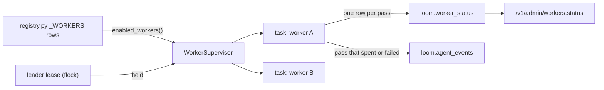

<!-- i18n: source=docs/reference/workers.md blob=f87e42a2c2dfebb8afda1a3c564252eabe3f4c04 model=claude-sonnet-5-5 -->
> このページは[英語の原文](https://github.com/ClickHouse/loom/blob/main/docs/reference/workers.md)の機械翻訳です。内容は英語の原文が優先されます。
> Machine-translated from the [English page](https://github.com/ClickHouse/loom/blob/main/docs/reference/workers.md), which is authoritative.

<a id="workers-reference"></a>

# ワーカーリファレンス

ワーカーは、監視されるバックグラウンドループです。ワーカースーパーバイザーが、1 つのパス関数を一定の間隔で実行します。ワーカーは、リクエストが待つべきではない処理を担当します。具体的には、欠けているベクトルの補完、エンティティの抽出、監査チェーンの検証、中断された消去の再開、コードおよびトラッカーデータの取り込みなどです。このページの末尾にある表はレジストリから生成されているため、このコミットのコードで宣言されているすべてのワーカーが一覧に含まれます。

<a id="how-workers-run"></a>

## ワーカーの実行方法



**ワーカーは行です。** `server/workers/registry.py` は、ループごとに 1 つの `_Worker(...)` を `_WORKERS` に保持します。各行には、名前、`run_pass` を持つモジュール、有効化する設定フラグ（なしの場合は常に有効）、間隔を保持する設定フィールドがあり、必要に応じて、2 つ目の必須フラグ（`also_requires`）、アイドル間隔、パスのデッドライン、初回パスのフック、所有するテーブルを指定できます。`enabled_workers()` は有効な行を `WorkerSpec` に変換し、そのときに初めてワーカーのモジュールをインポートします。そのため、無効なワーカーのオプション依存関係は読み込まれません。設定はスーパーバイザーの起動時に読み込まれます。ワーカーのフラグや間隔を変更すると、ワーカーを実行するプロセスの次回の再起動で反映されます。

**ワーカーごとに 1 つのタスク。** `WorkerSupervisor`（`server/workers/supervisor.py`）は、有効な spec ごとに 1 つの asyncio タスクを起動し、そのループを管理します。

- **起動時のずらし。** 最初のパスは `crc32(name) % interval` 秒待ってから実行されます（間隔が 2 s 未満の場合は 0）。これにより、すべてのワーカーが同じ起動タイミングで ClickHouse にクエリを発行することを避けます。このハッシュはプロセスや再起動をまたいで安定しています。
- **初回パスの実行要否。** 出力が存在しないワーカーは、代わりにすぐに実行されます。判定にはワーカー独自の `first_pass_due` フックを使うか、`owned_tables` から導出される汎用ルールを使います。汎用ルールでは、所有するテーブルに、対象範囲内の名前空間の行がない場合に実行が必要と判定されます（`server/workers/first_pass.py`）。この判定は 30 s で打ち切られ、エラーが発生した場合は「実行不要」とみなされます。
- **期限超過。** 最後に記録されたパスが間隔より古いワーカーは、フルのずらしを待たず、起動から 300 s の範囲内に開始されます。これにより、頻繁な再起動によって日次のパスが延期され続けることを防ぎます。
- **デッドライン。** 各パスはタイムアウト付きで実行されます。タイムアウトは、行の `max_pass_seconds`、なければ間隔の 4 倍を 60 s から 900 s の範囲に収めた値（`default_max_pass_seconds`）です。デッドラインを過ぎたパスはキャンセルされ、失敗として数えられます。
- **失敗とバックオフ。** 失敗したパスは、1、2、4 …秒の指数バックオフ（上限 60 s）の後に再試行されます。デッドラインで打ち切られたパスや、間隔がデッドラインより長いワーカー（日次・週次のもの）は、代わりに間隔いっぱい待ちます。すぐに再試行すると、同じだけデータベースの時間を消費してしまうためです。3 回連続で失敗すると、スーパーバイザーは `<worker>: DEGRADED — N consecutive failures` を ERROR レベルでログに出力し、ステータスレジストリでそのワーカーを degraded とマークします。
- **部分的なパス。** 一部の処理（leg）が失敗した状態で終了したパス（`pass_context.note_failure`）は、連続失敗のカウントに含まれますが、通常の間隔が維持されます。残りの処理は予定どおりに実行される必要があるためです。
- **アイドル間隔。** 実行すべき作業がなかった正常なパス（`pass_context.mark_idle()`）は、行にアイドル間隔があればその間隔だけ待ちます。これにより、作業がまとめて到着するワーカーは、作業がある間は頻繁に、ない間はまれにポーリングします。
- **シャットダウン。** サーバーを停止すると各タスクがキャンセルされ（実行中のパスは完了せずキャンセルされます）、タスクの終了を最大 10 s 待ち（`WorkerSupervisor.stop_all`）、その後、保留中のステータス行をフラッシュします。

すべてのパスは `background` トラフィッククラスで実行され（ClickHouse の優先度が低く、スレッド数も制限されるため、パスが本番の読み取りと対等に競合することはありません）、クエリには `log_comment` で `worker.<name>` のタグが付きます。

<a id="which-process-runs-the-workers"></a>

## ワーカーを実行するプロセス

`LOOM_BACKGROUND_WORKERS` は、プロセスがスーパーバイザーを起動するかどうかを決めます（`server/workers/leader.py`）。

| 値               | 動作                                                                                                                                                                                              |
| ---------------- | ------------------------------------------------------------------------------------------------------------------------------------------------------------------------------------------------- |
| `auto`（デフォルト） | デプロイメントのうち `workers_supervisor` リース（`loom._migration_lock` 内の Keeper キー）を保持するプロセスがスーパーバイザーを実行します。他のプロセスはリースを争い、期限が切れた時点で引き継ぎます。 |
| `on`             | 常にスーパーバイザーを実行します（単一プロセスのコンテナ、または専用のワーカーコンテナ）。Postgres authority の下では、セルゲートがそのプロセスにサービスを許可している間だけ実行します。          |
| `off`            | 実行しません（純粋な Web レプリカ）。                                                                                                                                                             |

リースはデプロイメント全体で 1 つです。そのため、`uvicorn --workers N` で N 個のレプリカを動かしても、各ワーカーのコピーはプロセスごとではなく、全体で 1 つだけ実行されます。リーダーが停止した場合、そのキーは `LOOM_SUPERVISOR_LEASE_TTL_S` の経過後に期限切れになります。

同梱の compose ファイルは、1 つのイメージから 2 つの役割を別々のコンテナに分けています。`dev/docker-compose.cloud.yml` は、`loom` サービス（コンテナ `loom-server`、Web ティア、`LOOM_BACKGROUND_WORKERS=off`）と、`loom-workers`（1 プロセス、`on`、公開ポートなし）を実行します。`dev/docker-compose.colour.yml` は `loom-<colour>`（`off`）と `loom-<colour>-workers`（`auto`）を実行し、共有ロックを争うのはワーカーコンテナだけです。そのため blue/green の切り替え中は、旧 colour が停止するまでワーカーを保持し、新しい colour は 1 回の再試行間隔内にそれを引き継ぎます。**別コンテナにする理由：** リクエスト処理と同じイベントループで長時間のパスを実行するプロセスでは、keep-alive クライアントへの応答がテールで遅くなります。ワーカーを Web ティアから外せばこのコストはなくなりますが、その代わりコンテナが 1 つ増えます。[デプロイメント](https://github.com/ClickHouse/loom/blob/main/docs/operations/deployment.md)を参照してください。

`jwt_revocation_refresh` は、スーパーバイザーが動作する場所では常に有効です。リーダーかどうかにかかわらず、すべてのプロセスは起動時にトークンの失効リストも読み込むため、ワーカーを持たない Web レプリカが失効済みのトークンを受け入れることはありません。

<a id="turning-a-worker-on-or-off"></a>

## ワーカーのオン・オフの切り替え

1. 下の表の **有効化の設定** 列でワーカーのスイッチを探し、ワーカーを実行しているコンテナに設定します（`LOOM_<NAME>_ENABLED=true` または `false`）。2 つ目のフラグを持つワーカー（列内の `+ LOOM_…`）は、両方がオンのときだけ実行されます。`code_backport_gaps` には `LOOM_CODE_PR_HISTORY_ENABLED` が、`code_coverage_notify` には `LOOM_CODE_INTEL_ENABLED` が必要です。
2. 必要に応じて、**実行間隔の設定** で実行間隔を変更します。
3. そのコンテナを再起動し、ワーカーの状態を確認します（下記）。

LLM を使うワーカー（`profile_consolidation`、`reflection_distill`、`observe_extract`、`code_summary`、およびデフォルトでオンの `entity_extractor`、`conversation_titler`、`conflict_resolver`）をオンにするには、フラグだけでは足りません。

1. 実際の LLM プロバイダーを設定します。fake プロバイダーでは、ワーカーは偽の出力で動作します。`conversation_titler` はその処理をスキップします。`conflict_resolver` はフラグを設定しない限りオフで、設定した場合も、キーを持つ実際のプロバイダーが設定されるまで、競合チェックで未処理とマークされた行をそのまま残します。解決されたプロバイダーにキーがない場合、`loom doctor` の `llm_provider` 行が警告します。[デプロイ](https://github.com/ClickHouse/loom/blob/main/docs/operations/deployment.md#providers)を参照してください。
2. ワーカーを実行している 1 つのコンテナに、そのワーカーのフラグを設定します。
3. 名前空間ごとのワーカーでは、`namespace.register` または名前空間の設定で、その名前空間をオプトインします。`consolidation_enabled` は `profile_consolidation` を制御します（また、最近グラフが走査された名前空間に加えて、LLM を使わない `entity_communities` の処理の対象となる名前空間も選択します）。ワーカーをまず 1 つの名前空間に展開することもできます。

各名前空間には 24 時間のローリング方式の支出上限 `LOOM_DEFAULT_DAILY_COST_CAP_USD`（デフォルトは `1.0`、`0` で無効）があり、名前空間ごとに `daily_cost_cap_usd` で上書きできます（ダッシュボードの **Usage** ビューで編集可能）。上限を超えると、LLM を使うワーカーはその名前空間をスキップし、LLM を使うリクエスト経路は失敗せずに支出を停止します。`memory.ask` と `knowledge.synthesize` は `budget_capped` で回答を控え、`code.search` のクエリ拡張と `code.ask` の合成はスキップされます。通常の読み取りと書き込みがコストを理由に拒否されることはありません。`cost.summary` と `cost.budget_status` が支出を報告します。[コストと使用量](https://github.com/ClickHouse/loom/blob/main/docs/features/observability/cost-and-usage.md)を参照してください。

<a id="seeing-what-the-workers-did"></a>

## ワーカーの動作を確認する

```bash
curl -s -H "Authorization: Bearer $ADMIN_TOKEN" \
  http://localhost:7777/v1/admin/workers.status | jq
```

`GET /v1/admin/workers.status`（`admin` トークンが必要）は、登録されているすべてのワーカーを、無効なものも含めて一覧表示します。各ワーカーについて `enabled` とその実行間隔を返し、無効なワーカーには `disabled_reason: disabled_by_setting` を返します。このエンドポイントは、このプロセス内のレジストリと、ワーカーごとの最新の `loom.worker_status` 行をマージします。そのため、Web 専用のコンテナでも、ワーカーのコンテナが実行したパスを報告できます。`store` ブロックには、テーブルから取得した行数と、それらを報告したインスタンスが示されます。ダッシュボードの管理者向け **Health** ビューにも同じデータが表示され、`/v1/health?include=workers` を使うと、問い合わせたプロセスについてスーパーバイザーが把握している状態も確認できます。

完了したパスは、アイドル状態のものも含めて、それぞれ `loom.worker_status` 行を 1 行書き込みます。LLM やエンベッダーの費用が発生したパス、または失敗したパスは、操作名 `worker.<name>.pass` の `loom.agent_events` 行も 1 行書き込みます。これにより、メンテナンスの費用はリクエストの費用と同じ台帳に記録されます。失敗し続けるワーカーへの対処手順は、[トラブルシューティング](../operations/troubleshooting.md)にあります。

<a id="reading-the-table"></a>

## 表の読み方

| 列 | 意味 |
| ------------------- | ---- |
| **Worker** | レジストリ名です。`workers.status`、`worker.<name>` クエリタグ、`DEGRADED` ログ行に現れます。 |
| **処理内容** | worker モジュールの docstring の最初の文です。 |
| **有効化する設定** | 行の `enabled` フィールド（および `also_requires`）の環境変数、または「常時有効」です。 |
| **既定値** | 実際の LLM プロバイダーを使用し、他に何も設定していない場合に、その設定が読み込まれる値です（一部は validator によって解決されます。フェイクプロバイダーでは conflict resolver は無効になります）。デプロイメントの `.env` では異なる場合があります。標準スタックについては[クイックスタート](../getting-started/quickstart.md)を参照してください。 |
| **実行間隔の設定** | 実行間隔の環境変数です。間隔が worker モジュール内の定数である場合は `<module>.<attribute>` です。 |
| **既定値（秒）** | 実行間隔の既定値（秒）です。モジュール定数の場合は空欄です。 |

ジェネレーター（`scripts/codegen/docs_reference.py`、`render_workers`）は `_WORKERS` と設定の既定値を読み取ります。このページが古くなっていると `make lint` が失敗します。スイッチと実行間隔以外で worker を調整する設定（バッチサイズ、リース期間、worker ごとの上限）は、[設定リファレンス](https://github.com/ClickHouse/loom/blob/main/docs/reference/configuration.md#workers)とそのプレーンごとのセクションにあります。

<a id="tests-that-pin-the-worker-set"></a>

## ワーカー構成を固定するテスト

- `tests/unit/test_worker_registry_snapshot.py` は、3 種類の設定プロファイル（すべてのスイッチが既定値のもの、すべての `*_enabled` フラグをオンにしたもの、本番用のスイッチ構成）で監視対象のリストを構築し、すべての `WorkerSpec` フィールド（順序、実行間隔、デッドライン、アイドル間隔、初回パスのフック、パスの呼び出し対象）を `tests/unit/snapshots/worker_registry.json` と比較します。意図した変更の場合にのみ再生成してください：`LOOM_UPDATE_WORKER_SNAPSHOT=1 python -m pytest tests/unit/test_worker_registry_snapshot.py`。
- `tests/unit/test_worker_registry_parity.py` は、すべての `*_enabled` フラグをオンにし、`worker_meta()`（`workers.status` が表示する内容）と `enabled_workers()`（スーパーバイザーが実行する内容）が同じ集合を示していることを検証します。

パスの書き方と行の追加方法については、[ワーカーの追加](https://github.com/ClickHouse/loom/blob/main/docs/development/adding-a-worker.md)を参照してください。

<a id="workers"></a>

## ワーカー

<!-- BEGIN GENERATED: workers -->
<!-- Generated by `python scripts/codegen/docs_reference.py`; edit the source, not this region. -->
<!-- prettier-ignore-start -->

| ワーカー | 役割 | 有効化する設定 | デフォルト | 実行間隔の設定 | デフォルト（秒） |
| --- | --- | --- | --- | --- | --- |
| `audit_verifier` | 監査の改ざん検知ワーカー。 | `LOOM_AUDIT_VERIFIER_ENABLED` | True | `LOOM_AUDIT_VERIFIER_INTERVAL_SECONDS` | 3600 |
| `code_backport_gaps` | 夜間に実行するバックポートレポート（全体対象）：直近 `LOOM_CODE_BACKPORT_GAPS_DAYS` の間にマージされた trunk の PR のうち、メンテナがバックポート対象とラベル付けしたもの（loom の台帳では `pr-must-backport*`、QA の… | `LOOM_CODE_BACKPORT_GAPS_ENABLED` + `LOOM_CODE_PR_HISTORY_ENABLED` | True | `LOOM_CODE_BACKPORT_GAPS_INTERVAL_SECONDS` | 86400.0 |
| `code_coverage_import` | 計測済みカバレッジの日次インポート（`server.code.app.index.coverage_import`）。 | `LOOM_CODE_COVERAGE_IMPORT_ENABLED` + `LOOM_CODE_INTEL_ENABLED` | False | `LOOM_CODE_COVERAGE_IMPORT_INTERVAL_SECONDS` | 86400.0 |
| `code_coverage_notify` | カバレッジ監視の通知配信。 | `LOOM_CODE_COVERAGE_NOTIFY_ENABLED` + `LOOM_CODE_INTEL_ENABLED` | True | `LOOM_CODE_COVERAGE_NOTIFY_INTERVAL_SECONDS` | 60 |
| `code_crossref` | 前回の実行以降に `git_head` が進んだ C++ エントリごとの SQL <-> C++ クロスリファレンス：テストクエリを、そのクエリが使う関数や設定を登録するファイルに結び付ける `code_test_map` 行。 | `LOOM_CODE_CROSSREF_ENABLED` | True | `LOOM_CODE_CROSSREF_INTERVAL_SECONDS` | 1800 |
| `code_embed_recovery` | コードプレーン向けの埋め込みリカバリ（メモリプレーンの埋め込みワーカーに相当）。 | `LOOM_CODE_EMBED_RECOVERY_ENABLED` | False | `LOOM_CODE_EMBED_RECOVERY_INTERVAL_SECONDS` | 30 |
| `code_graph_stats` | 週次のグラフ統計：インクルードグラフ上の PageRank、ファイルごとの次数、テスト↔ソースの対応表。 | `LOOM_CODE_GRAPH_STATS_ENABLED` | False | `LOOM_CODE_GRAPH_STATS_INTERVAL_SECONDS` | 604800 |
| `code_ingest` | コードプレーン向けの、マージごとの高速ティアのインジェスト。 | `LOOM_CODE_INGEST_ENABLED` | False | `LOOM_CODE_INGEST_INTERVAL_SECONDS` | 120 |
| `code_pr_history` | GitHub REST API からのマージ済み PR 履歴の同期（カーソルで再開可能）。 | `LOOM_CODE_PR_HISTORY_ENABLED` | False | `LOOM_CODE_PR_HISTORY_INTERVAL_SECONDS` | 900 |
| `code_scip_apply` | ステージングされた SCIP の差分をコンパイラグレードのティアに適用する。 | `LOOM_CODE_SCIP_APPLY_ENABLED` | False | `LOOM_CODE_SCIP_APPLY_INTERVAL_SECONDS` | 60 |
| `code_scip_delta` | マージごとのコンパイラティアの鮮度維持：scip-clang の差分。 | `LOOM_CODE_SCIP_DELTA_ENABLED` | True | `LOOM_CODE_SCIP_DELTA_INTERVAL_SECONDS` | 300 |
| `code_scip_full` | C++ の完全な再インデックス。1 回の実行につき 1 エントリ。 | `LOOM_CODE_SCIP_FULL_ENABLED` | True | `LOOM_CODE_SCIP_FULL_INTERVAL_SECONDS` | 900 |
| `code_scip_go_delta` | Go 向けの、マージごとのコンパイラティアの鮮度維持。 | `LOOM_CODE_SCIP_GO_DELTA_ENABLED` | True | `LOOM_CODE_SCIP_GO_DELTA_INTERVAL_SECONDS` | 900 |
| `code_scip_py_delta` | マージごとの Python コンパイラティアの差分。 | `LOOM_CODE_SCIP_PY_DELTA_ENABLED` | True | `LOOM_CODE_SCIP_PY_DELTA_INTERVAL_SECONDS` | 600 |
| `code_scip_ts_delta` | TypeScript 向けの、マージごとのコンパイラティアの鮮度維持。 | `LOOM_CODE_SCIP_TS_DELTA_ENABLED` | True | `LOOM_CODE_SCIP_TS_DELTA_INTERVAL_SECONDS` | 600 |
| `code_summary` | code.map のオリエンテーション用に、LLM がファイルとモジュールの要約カードを週次で作成する。 | `LOOM_CODE_SUMMARY_ENABLED` | False | `LOOM_CODE_SUMMARY_INTERVAL_SECONDS` | 604800 |
| `conflict_resolver` | 競合チェックが印を付けた書き込みを、1 行につき 1 回の LLM 呼び出しで判定する（同時実行数は最大 `memory_conflict_resolver_concurrency`）。判定結果に基づいて処理する（`memory.app.conflict_resolver`）。 | `LOOM_MEMORY_CONFLICT_RESOLVER_ENABLED` | True | `LOOM_MEMORY_CONFLICT_RESOLVER_INTERVAL_SECONDS` | 10.0 |
| `conversation_titler` | 会話タイトル生成ワーカー。 | `LOOM_CONVERSATION_TITLER_ENABLED` | True | `LOOM_CONVERSATION_TITLER_INTERVAL_SECONDS` | 1800 |
| `delete_version_check` | memory.delete_version がトゥームストーンの後に行うべきチェックを完了させる。 | `LOOM_DELETE_VERSION_CHECK_ENABLED` | True | `LOOM_DELETE_VERSION_CHECK_INTERVAL_SECONDS` | 60 |
| `document_blob_gc` | ドキュメント原本の削除処理：どの有効なドキュメントからも参照されない `loom.document_blobs` の行と、どの行からも参照されないバケットオブジェクト。 | `LOOM_DOCUMENT_BLOB_GC_ENABLED` | True | `LOOM_DOCUMENT_BLOB_GC_INTERVAL_SECONDS` | 3600 |
| `embedding_worker` | 埋め込みリカバリワーカー。 | `LOOM_EMBEDDING_WORKER_ENABLED` | True | `LOOM_EMBEDDING_WORKER_INTERVAL_SECONDS` | 5 |
| `entity_communities` | エンティティコミュニティのワーカー（デフォルトは無効）。 | `LOOM_ENTITY_COMMUNITIES_ENABLED` | False | `LOOM_ENTITY_COMMUNITIES_INTERVAL_SECONDS` | 21600 |
| `entity_extractor` | エンティティ抽出ワーカー。 | `LOOM_ENTITY_EXTRACT_ENABLED` | True | `LOOM_ENTITY_EXTRACT_INTERVAL_SECONDS` | 60 |
| `erasure_reclaim` | 消去の領域回収ワーカー：パージされた行のバイト列をディスクから取り除く。 | `LOOM_ERASURE_RECLAIM_ENABLED` | True | `LOOM_ERASURE_RECLAIM_INTERVAL_SECONDS` | 3600 |
| `erasure_recovery` | 消去 Saga のリカバリワーカー。 | `LOOM_ERASURE_RECOVERY_ENABLED` | True | `LOOM_ERASURE_RECOVERY_INTERVAL_SECONDS` | 60 |
| `extraction_queue` | 保留された `memory.set_from_messages` リクエストを再実行する。 | `LOOM_EXTRACTION_QUEUE_ENABLED` | True | `LOOM_EXTRACTION_QUEUE_INTERVAL_SECONDS` | 15 |
| `keeper_sweep` | プロセスが保持したまま終了した KeeperMap のキーを削除する（`server.core.leases.DEAD_KEYS`）：有効期限から 1 時間経過したリースとクレーム、および 1 日経過したグラフ投影スロット。 | 常に有効 |  | `LOOM_KEEPER_SWEEP_INTERVAL_SECONDS` | 3600.0 |
| `knowledge_gaps` | 1 日 1 回、各名前空間の最近のミスを、`knowledge.gaps.list` が返すギャップにまとめる。 | `LOOM_KNOWLEDGE_GAPS_ENABLED` | False | `LOOM_KNOWLEDGE_GAPS_INTERVAL_SECONDS` | 86400 |
| `knowledge_ingest` | インジェストジョブを実行する（`server/knowledge/app/ingest_run.py`）。 | `LOOM_KNOWLEDGE_INGEST_ENABLED` | True | `LOOM_KNOWLEDGE_INGEST_INTERVAL_SECONDS` | 0 |
| `knowledge_pg_delivery` | ナレッジ配信ワーカー：リクエストが Postgres のオーソリティにコミットしたものの ClickHouse に公開しなかったナレッジドキュメントを公開し（`server.knowledge.app.pg_delivery`）、期限切れの… | `LOOM_PG_DELIVERY_ENABLED` | True | `LOOM_PG_DELIVERY_INTERVAL_SECONDS` | 2 |
| `knowledge_source_push` | 範囲が限られた Drive チャネルセットを更新する。通常のソースのポーリングとは独立して動作する。 | `LOOM_KNOWLEDGE_SOURCE_PUSH_ENABLED` | False | `LOOM_KNOWLEDGE_SOURCE_PUSH_INTERVAL_SECONDS` | 300 |
| `knowledge_source_retire` | ソースの同期や認証が無効でも、キューに入ったソースの削除を完了させる。 | 常に有効 |  | `LOOM_KNOWLEDGE_SOURCE_SYNC_INTERVAL_SECONDS` | 900 |
| `knowledge_source_sync` | 登録済みの各ドキュメントソースで変更されたファイルを、その名前空間のドキュメントに取り込む（`server.knowledge.app.source_sync`）。 | `LOOM_KNOWLEDGE_SOURCE_SYNC_ENABLED` | False | `LOOM_KNOWLEDGE_SOURCE_SYNC_INTERVAL_SECONDS` | 900 |
| `mcp_session_run_sweep` | MCP セッション実行のスイーパー。 | 常に有効 |  | `LOOM_MCP_SESSION_RUN_SWEEP_INTERVAL_SECONDS` | 60 |
| `memory_code_links` | コードリンクの処理：前回の処理以降に書き込まれたメモリを、そのメモリが名指しするコードにリンクする（最初の処理時やキューに遅れたときは、それ以前に書き込まれたものも対象）。その後、各リポジトリの… | `LOOM_MEMORY_CODE_LINKS_ENABLED` | True | `LOOM_MEMORY_CODE_LINKS_INTERVAL_SECONDS` | 60 |
| `memory_expiry_sweep` | メモリの有効期限スイープワーカー。 | `LOOM_MEMORY_EXPIRY_SWEEP_ENABLED` | True | `LOOM_MEMORY_EXPIRY_SWEEP_INTERVAL_SECONDS` | 300 |
| `memory_webhook_deliver` | メモリ Webhook：アウトボックス内の配信期限が来たイベントを、各 Webhook に POST する。 | `LOOM_MEMORY_WEBHOOK_DELIVER_ENABLED` | True | `LOOM_MEMORY_WEBHOOK_DELIVER_INTERVAL_SECONDS` | 5 |
| `namespace_gc` | namespace_gc ワーカー：誰も書き込まない、登録済みのベンチ用名前空間を削除する。 | `LOOM_NAMESPACE_GC_WORKER_ENABLED` | True | `LOOM_NAMESPACE_GC_INTERVAL_SECONDS` | 3600 |
| `oauth_signin_state_sweep` | 一度だけ変化し、ClickHouse Keeper に保持されるサインイン状態。 | 常に有効 |  | `LOOM_OAUTH_SIGNIN_STATE_SWEEP_INTERVAL_SECONDS` | 300 |
| `observe_extract` | 常時キャプチャ（observe）プレーン向けの、遅延抽出ワーカー。 | `LOOM_OBSERVE_EXTRACT_ENABLED` | False | `LOOM_OBSERVE_EXTRACT_INTERVAL_SECONDS` | 300 |
| `orphan_vector_reconcile` | 孤立ベクトルの照合ワーカー。 | `LOOM_ORPHAN_VECTOR_RECONCILE_ENABLED` | True | `LOOM_ORPHAN_VECTOR_RECONCILE_INTERVAL_SECONDS` | 600 |
| `pg_delivery` | Postgres 配信ワーカー：リクエストが公開しなかった、コミット済みのリビジョンを公開する。 | `LOOM_PG_DELIVERY_ENABLED` | True | `LOOM_PG_DELIVERY_INTERVAL_SECONDS` | 2 |
| `pg_payload_clear` | Postgres のペイロードのクリア：リストアで使う可能性のある ClickHouse バックアップのすべてに保存された時点で、メモリリビジョンのペイロード（`row`）を削除する。 | `LOOM_PG_PAYLOAD_CLEAR_ENABLED` | False | `LOOM_PG_PAYLOAD_CLEAR_INTERVAL_SECONDS` | 60 |
| `profile_consolidation` | プロファイル統合ワーカー。 | `LOOM_PROFILE_CONSOLIDATION_ENABLED` | False | `LOOM_PROFILE_CONSOLIDATION_INTERVAL_SECONDS` | 21600 |
| `projection_repair` | プロジェクション修復ワーカー。 | `LOOM_PROJECTION_REPAIR_ENABLED` | True | `LOOM_PROJECTION_REPAIR_INTERVAL_SECONDS` | 300 |
| `query_history` | オプトインしたクエリグループは非公開のドラフトになる。ソースのローテーションはスーパーバイザーが永続化する。 | `LOOM_KNOWLEDGE_QUERY_HISTORY_ENABLED` | False | `LOOM_KNOWLEDGE_QUERY_HISTORY_INTERVAL_SECONDS` | 3600 |
| `recalibration` | 再キャリブレーションワーカー：ベンダーが埋め込みモデルを黙って改訂しても、しきい値が合い続けるよう、埋め込みのキャリブレーションプローブを再実行する。 | `LOOM_RECALIBRATION_ENABLED` | True | `LOOM_RECALIBRATION_INTERVAL_SECONDS` | 604800 |
| `reflection_distill` | リフレクション蒸留ワーカー（デフォルトは無効）。 | `LOOM_REFLECTION_DISTILL_ENABLED` | False | `LOOM_REFLECTION_DISTILL_INTERVAL_SECONDS` | 3600 |
| `retention_reconcile` | 保持期間の照合ワーカー。 | `LOOM_RETENTION_RECONCILE_ENABLED` | True | `LOOM_RETENTION_RECONCILE_INTERVAL_SECONDS` | 300 |
| `sensitivity_sweep` | 機微度の日次スイープ。 | `LOOM_SENSITIVITY_SWEEP_ENABLED` | True | `LOOM_SENSITIVITY_SWEEP_INTERVAL_SECONDS` | 86400 |
| `structured_profile` | 構造化プロファイルのワーカー。 | `LOOM_STRUCTURED_PROFILE_ENABLED` | True | `LOOM_STRUCTURED_PROFILE_INTERVAL_SECONDS` | 120 |
| `task_lease_sweep` | タスクインボックスのスイーパー。 | `LOOM_TASK_LEASE_SWEEP_ENABLED` | True | `LOOM_TASK_LEASE_SWEEP_INTERVAL_SECONDS` | 60 |
| `task_webhook_deliver` | タスクインボックスプレーン向けの署名付き Webhook（ウェイクアップ層）。 | `LOOM_TASK_WEBHOOK_DELIVER_ENABLED` | True | `LOOM_TASK_WEBHOOK_DELIVER_INTERVAL_SECONDS` | 5 |
| `tracker_embed` | `tracker_embed` の処理：30 分ごと（呼び出し時のギャップは、レグのクエリ時キャッチアップが補う）に、設定されているすべてのトラッカー名前空間（`configured_namespaces()` — ソースマップ。… | `LOOM_TRACKER_EMBED_ENABLED` | True | `LOOM_TRACKER_EMBED_INTERVAL_SECONDS` | 1800.0 |
| `tracker_links` | 日次の Issue と PR のリンク復元：設定された各トラッカー名前空間について、直近 `LOOM_TRACKER_LINKS_ISSUE_DAYS` の間に作成されたすべての Issue に対し、その後の期間にマージされた trunk の PR を BM25F でランク付けする… | `LOOM_TRACKER_LINKS_ENABLED` | True | `LOOM_TRACKER_LINKS_INTERVAL_SECONDS` | 86400.0 |
| `tracker_test_daily` | 公開 CI 履歴の、テストごとの日次ロールアップ。 | `LOOM_TRACKER_TEST_DAILY_ENABLED` | True | `LOOM_TRACKER_TEST_DAILY_INTERVAL_SECONDS` | 1800 |
| `usage_fold` | 使用量の書き戻しワーカー。 | `LOOM_USAGE_FOLD_ENABLED` | True | `LOOM_USAGE_FOLD_INTERVAL_SECONDS` | 300 |

<!-- prettier-ignore-end -->
<!-- END GENERATED: workers -->

<a id="related"></a>

## 関連ドキュメント

- [設定リファレンス](https://github.com/ClickHouse/loom/blob/main/docs/reference/configuration.md)：各ワーカーのチューニング設定。
- [モニタリング](https://github.com/ClickHouse/loom/blob/main/docs/operations/monitoring.md)：ヘルスチェック、メトリクス、ワーカーのゲージ。
- [トラブルシューティング](../operations/troubleshooting.md)：ループして失敗し続けるワーカー。
- [コードインデックスの運用](../operations/code-index-operations.md)：コードプレーンのワーカーとバックフィル。
- [ワーカーの追加](https://github.com/ClickHouse/loom/blob/main/docs/development/adding-a-worker.md)。
