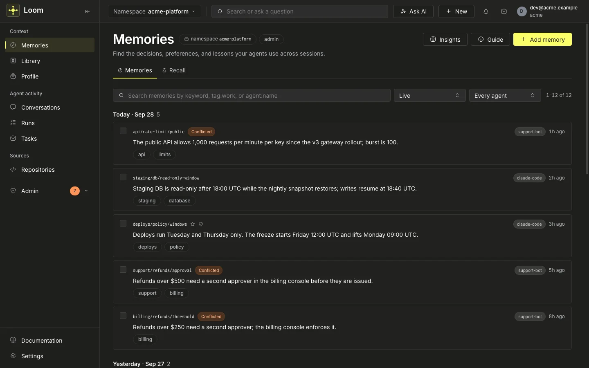

<!-- i18n: source=README.md blob=29675cf2a8d5e7d37f9dc00aeedb1a413885bb38 model=claude-sonnet-5-5 -->
> 이 페이지는 [영어 원문](https://github.com/ClickHouse/loom/blob/main/README.md)을 기계 번역한 것이며, 영어 원문이 기준입니다.
> Machine-translated from the [English page](https://github.com/ClickHouse/loom/blob/main/README.md), which is authoritative.

<h1 align="center">ClickHouse Loom</h1>

<p align="center">
  <b>AI 에이전트를 위한 공유 메모리, 문서 검색, 코드 인텔리전스.</b><br>
  Claude Code, Codex, Cursor 그리고 직접 만든 에이전트에서 사용할 수 있습니다.
</p>

<p align="center">
  <a href="https://pypi.org/project/clickhouse-loom/"></a>
  <a href="https://www.npmjs.com/package/@clickhouse/loom"></a>
  <a href="https://github.com/ClickHouse/loom/blob/main/LICENSE"></a>
  <a href="https://glama.ai/mcp/servers/ClickHouse/loom"></a>
  <a href="https://github.com/ClickHouse/loom/actions/workflows/ci.yml?query=branch%3Amain+event%3Apush"></a>
  <a href="https://scorecard.dev/viewer/?uri=github.com/ClickHouse/loom"></a>
</p>

<p align="center">
  <!-- languages -->
  <a href="../../README.md">English</a> · <a href="../zh-CN/README.md">简体中文</a> · <a href="../ja/README.md">日本語</a> · 한국어 · <a href="../pt-BR/README.md">Português (Brasil)</a> · <a href="../es/README.md">Español</a>
  <br>
  <a href="https://loom.clickhouse.com/docs/ko/">문서</a>
  <!-- /languages -->
</p>

<p align="center">
  <a href="#what-loom-is-for">Loom의 용도</a> ·
  <a href="#measured-results">벤치마크</a> ·
  <a href="#get-started">시작하기</a> ·
  <a href="#why-loom">기능</a> ·
  <a href="#integrations">통합</a> ·
  <a href="https://loom.clickhouse.com/docs/">문서</a>
</p>

<p>
  
  
  
</p>

Loom은 에이전트에 장기적인 공유 메모리를 제공하는 오픈 소스 셀프 호스팅 MCP 서버입니다. 한 에이전트가 세션에서 알게 된 내용을 다음 에이전트나 도구가 찾아 쓸 수 있습니다.

에이전트는 MCP, HTTP, Python 또는 TypeScript로 연결합니다. Docker 또는 [Helm 차트를 사용한 Kubernetes](https://github.com/ClickHouse/loom/blob/main/docs/operations/kubernetes.md)에서 직접 호스팅할 수 있습니다. 에이전트 컨텍스트와 인덱스 데이터는 [ClickHouse](docs/use-cases/self-hosted-clickhouse.md)에 저장되며, 배포 환경에 따라 라이브 메모리와 지식 상태를 위해 [최초 부팅 시 Postgres](https://github.com/ClickHouse/loom/blob/main/docs/operations/postgres.md)를 선택할 수도 있습니다. 대시보드에서 메모리, 리포지토리, 태스크, 실행을 한곳에서 확인할 수 있습니다.

<a id="what-loom-is-for"></a>

## Loom의 용도

- **코딩 에이전트 간에 공유되는 장기 메모리**: 세션 시작 시 컨텍스트를 불러오고 실행 중인 세션을 기록하는 플러그인을 제공합니다.
  [에이전트 메모리](docs/use-cases/agent-memory.md) ·
  [코딩 에이전트 연결](https://github.com/ClickHouse/loom/blob/main/docs/getting-started/connect-a-coding-agent.md)
- **에이전트 애플리케이션용 메모리**: 사용자별로, Python 또는 TypeScript
  SDK에서 사용합니다. [첫 번째 에이전트](https://github.com/ClickHouse/loom/blob/main/docs/getting-started/first-agent.md)
- **다중 사용자 MCP 메모리 서버**: 네임스페이스, 역할, 토큰을 지원합니다.
  [다중 사용자 모드](docs/getting-started/quickstart.md#start-in-multi-user-mode) ·
  [네임스페이스와 공유](https://github.com/ClickHouse/loom/blob/main/docs/features/namespaces-and-sharing.md)
- **저장소의 코드 인덱스**: 코딩 에이전트가 정의, 호출자, 변경 영향을 조회합니다.
  [코드 인덱스](docs/use-cases/code-intelligence.md) ·
  [언어 지원과 제한](https://github.com/ClickHouse/loom/blob/main/docs/features/code-index/overview.md#language-support)
- **대상 코드에 연결된 메모리**: 리팩터링 후에도 코드를 따라가고, 코드가 바뀌면 표시되며, 에이전트가 해당 코드를 읽거나 수정할 때 나타납니다.
  [코드에 연결된 메모리](docs/use-cases/memory-linked-to-code.md)
- **코딩 에이전트의 모델 비용 절감**: 아래 [측정 결과](#measured-results)를 참고하세요.
  [코딩 에이전트 비용](docs/use-cases/coding-agent-cost.md)
- **인용을 포함한 문서 검색(RAG)**: extractor 서비스가 변환하는 PDF, `.docx`, `.pptx` 파일도 포함합니다. [문서 검색](docs/use-cases/document-search.md)
- **멀티 에이전트 워크플로를 위한 공유 컨텍스트**: 공유 메모리, 작업 인박스, 결정 사항을 제공합니다. [멀티 에이전트](docs/use-cases/multi-agent.md)
- **자율 에이전트를 위한 메모리, 회상, 감사, 삭제.**
  [자율 에이전트](docs/use-cases/autonomous-agents.md)
- **에이전트 작업 기록**: 검색 가능한 대화(기록이 켜져 있을 때), 이어서 작업할 수 있는 세션 요약, 목표·결과·모델 비용(제공된 경우)이 포함된 실행 내역, PR 및 트래커 이력을 포함합니다.
  [실행과 PR 이력](docs/use-cases/runs-and-pr-history.md)

모든 사용 사례와 다른 도구가 더 적합한 경우는 [사용 사례](docs/use-cases/index.md)에서 확인하세요.

Loom은 단일 에이전트의 단기 메모리를 위한 인프로세스 라이브러리가 아니며, 에이전트 프레임워크도 아닙니다.
[Loom이 맞지 않는 경우](https://github.com/ClickHouse/loom/blob/main/docs/getting-started/overview.md#when-it-does-not-fit)

<a id="measured-results"></a>

## 측정 결과

| 평가                           | Loom 사용 | Loom 미사용 | 효율 향상                          | 범위                               |
| ------------------------------ | --------- | ----------- | ---------------------------------- | ---------------------------------- |
| 코딩 에이전트 답변 품질        | **0.84**  | 0.78        | 모델 비용 **20% 절감**             | 질문 24개 × 쌍 실행 3회            |
| 코딩 에이전트 파일 위치 특정   | **96.4%** | 91.4%       | 모델 비용 **21% 절감**             | 질문 36개 × 쌍 실행 10회           |
| 메모리 vs 전체 기록 기반 답변  | **94%**   | 90%         | 리더 프롬프트 토큰 **91% 감소**    | LongMemEval-S 쌍 질문 100개        |

두 코딩 설정 모두 ClickHouse 코드베이스에서 Claude Code(`claude-sonnet-5`)를 사용했습니다.
비용은 Loom의 서버 측 모델 호출, 호스팅, 인덱싱을 제외한 전체 세션의 모델 비용입니다. 답변 품질은
검증된 답변의 핵심 요점을 얼마나 포함하는지를 측정하며, 모순이 있으면 감점합니다.
파일 위치 특정은 에이전트가 답변 끝에 제시하도록 요청받은 최대 세 개의 파일 중에 올바른 파일이 포함되어 있는지를 집계합니다.

메모리 행은 동일한 `gpt-5` 리더를 사용하여 검색된 메모리와 전체 대화 기록을 비교합니다.
토큰 절감에는 메모리 구축 비용이 포함되지 않습니다. 94% 대 90%의 정확도 차이는 기술적(descriptive) 수치이며 통계적으로 입증된 것은 아닙니다.

**별도로, Loom의 `memory.ask` 구성은 LongMemEval-S 전체 500개 질문에서 답변 정확도 96.6%를 기록했습니다.**
이는 위의 고정 리더 비교가 아니라, 자체적으로 구성된 답변 모델을 사용한 제품 평가입니다.

결과는 테스트한 워크로드에 한정됩니다.

[프로토콜 및 재현 가능한 아티팩트](https://github.com/ClickHouse/loom/blob/main/docs/benchmarks/results.md) ·
[상세 결과](#benchmark-details) ·
[내 워크로드에서 평가하기](https://github.com/ClickHouse/loom/blob/main/docs/getting-started/evaluate.md)

<a id="get-started"></a>

## 시작하기

<a id="1-choose-your-docker-setup"></a>

### 1. Docker 설정 선택

- **개인용(기본값):** 로그인 없음, localhost에서만 접근 가능, `dev/local`
  네임스페이스를 사용합니다. 한 사람이 여러 에이전트를 연결할 수 있습니다.
- **팀용:** 인증된 계정과 네임스페이스 접근 제어를 사용합니다.
  [첫 부팅부터 다중 사용자 모드로 시작하기](docs/getting-started/quickstart.md#start-in-multi-user-mode).

두 모드 모두 구성된 LLM과 임베딩을 포함해 동일한 Loom 기능을 지원합니다.
단일 사용자 모드는 기능이 축소된 버전이 아닙니다. 데이터를 삭제하지 않고
[기존 설치를 전환](docs/getting-started/quickstart.md#2-open-the-dashboard)할 수도 있으며,
새 계정에 기존 네임스페이스에 대한 접근 권한을 부여할 수 있습니다.

아무것도 설치하지 않고 사용해 보려면 codespace에서 여세요.

[](https://codespaces.new/ClickHouse/loom?quickstart=1)
([실행되는 항목과 접근 가능한 대상](docs/getting-started/quickstart.md#try-it-in-github-codespaces))

기본 개인용 설치는 Docker가 설치되어 있어야 합니다. Windows에서는 `docker`가 동작하는 WSL 2
터미널에서 실행하세요. WSL 통합이 켜진 Docker Desktop이나 배포판 안에 설치된 Docker Engine이면 됩니다.

```bash
curl -fsSL https://github.com/ClickHouse/loom/releases/latest/download/install.sh -o loom-install.sh && sh loom-install.sh && rm loom-install.sh
```

홈 디렉터리나 [본인만 쓸 수 있는 다른 디렉터리](docs/getting-started/quickstart.md#fast-path-released-image-no-clone)에서
실행하세요. 설치 프로그램은 Loom과 ClickHouse를 시작하고, 마이그레이션을 적용하며, 대시보드 URL인
**http://localhost:7777/**을 출력합니다. 새로 설치한 경우에는 메모리가 저장되고 다시 읽히는지도 확인합니다.
터미널에서는 발견한 코딩 에이전트(Claude Code, Codex, VS Code)를 연결할지 묻고, 새로 설치한 경우
대시보드를 엽니다. 이미지에는 서버, 워커, 대시보드, Python, TypeScript, Go 컴파일러 인덱서가 포함되며,
`amd64`에서는 C++ 인덱서도 포함됩니다. TypeScript 의존성은 자동으로 준비됩니다.
[빠른 시작 및 고정된 릴리스](docs/getting-started/quickstart.md)

설치 위치는 `~/.loom`입니다(`LOOM_INSTALL_DIR`로 다른 디렉터리를 지정할 수 있습니다). Compose 파일과
시작 설정은 `~/.loom/.env`에 있습니다. 설치 명령을 다시 실행하면 제자리에서 업그레이드되며 `.env` 설정은
유지됩니다.

단일 사용자 모드는 localhost에서만 사용하세요. 공유 접근이 필요하면 TLS를 포함한
[팀 배포 가이드](https://github.com/ClickHouse/loom/blob/main/docs/operations/deployment.md#identity-modes)를 따르세요.

<a id="2-configure-models-and-api-keys"></a>

### 2. 모델과 API 키 구성

**기본 설치는 키나 네트워크 없이도 부팅됩니다.** 스토리지, 대시보드, 구조적 코드 인덱싱, 시맨틱 검색이
동작하며, 시맨틱 검색에는 이미지에 포함된 작은 로컬 임베딩 모델이 사용됩니다. 가짜 LLM은 AI가 생성한
답변을 제공하지 않습니다.

| 구성 요소 | 실제 사용을 위한 구성 | 구성하지 않은 경우 |
| ---------- | -------------------------------------------------- | --------------------------------------------------------------------------- |
| 임베딩 | 제공자, 임베딩 모델, 차원, API 키. | `local`(CPU의 bge-small): 시맨틱 검색은 되지만 호스팅 모델보다 성능이 낮습니다. |
| LLM | 제공자, 모델, API 키. | `fake-echo-1`: 의미 있는 추출, 요약, 답변이 없습니다. |

**Settings → Models & keys**를 열고 두 제공자와 모델을 선택한 뒤 키를 입력하고
**Test & apply**를 클릭하세요. Docker를 재시작할 필요는 없으며, 임베딩 공간을 변경하면 기존 인덱스가
다시 만들어집니다. 대시보드의 임베딩 선택지는 호스팅 제공자입니다. `local`을 유지한 채 LLM만 추가하려면
대신 `~/.loom/.env`에 LLM 설정 줄을 지정하세요
([모델과 키](https://github.com/ClickHouse/loom/blob/main/docs/getting-started/models-and-keys.md#claude-for-the-llm)).

**OpenAI API 키 하나로 두 역할을 모두 처리할 수 있습니다.** Claude는 별도의 임베딩 제공자가 필요합니다.
OpenAI, Gemini, OpenAI 호환 임베딩 엔드포인트를 지원합니다. 에이전트의 CLI 로그인이나 구독은 Loom의
제공자 키를 대신하지 않습니다.

환경 변수로 구성하려면 `~/.loom/.env`를 수정한 뒤 서버를 다시 생성하세요.

```bash
docker compose --project-directory "$HOME/.loom" up -d --force-recreate loom
```

키만 지정해서는 고정된 모델(로컬 임베더와 가짜 LLM)이 바뀌지 않습니다. 제공자와 모델도 함께 지정하세요.
대시보드에 저장된 설정이 `.env`보다 우선합니다. 제공자별 예시와 상태 확인은
[모델과 API 키](https://github.com/ClickHouse/loom/blob/main/docs/getting-started/models-and-keys.md)를 따르세요.

**나머지는 모두 한 파일에 있습니다.** [`loom.example.yaml`](https://github.com/ClickHouse/loom/blob/main/loom.example.yaml)은
모든 설정의 기본값과 역할을 영역별로 나열합니다. ClickHouse 연결, 타임아웃과 예산, 속도 제한, 워커,
기능을 켜고 끄는 `*_enabled` 스위치가 포함됩니다. 어떤 설정이든 `~/.loom/.env`에 `LOOM_<NAME>`으로
지정하고 서버를 다시 생성하면 적용됩니다. 구성 파일을 마운트하는 배포에서는 이 파일의 사본에 지정할 수
있습니다([설정을 읽는 방식](https://github.com/ClickHouse/loom/blob/main/docs/operations/deployment.md#how-settings-are-read)).
`live`로 표시된 설정은 Loom이 실행 중일 때도 변경할 수 있습니다. `loom settings set <name> <value>`를
사용하거나 Admin → Deployment settings에서 변경하세요. `loom settings list --changed`는 기본값과
다른 설정과 각 값의 출처를 보여 줍니다([런타임 설정](https://github.com/ClickHouse/loom/blob/main/docs/operations/runtime-settings.md)).

<a id="3-connect-your-agents"></a>

### 3. 에이전트 연결

설치 프로그램이 에이전트를 연결했다면 아래 명령은 건너뛰세요. 개인용 설치가 실행 중인 머신에서는
플러그인에 토큰이 필요하지 않습니다.

```bash
# Claude Code
claude plugin marketplace add ClickHouse/loom
claude plugin install loom@loom

# Codex
codex plugin marketplace add ClickHouse/loom
codex plugin add loom@loom
```

새 세션을 시작하면 첫 세션이 `http://localhost:7777`에 연결됩니다. Codex에서는 `codex`를 대화형으로 한 번
실행하고 플러그인의 훅을 승인하세요. 승인하기 전에는 도구만 동작합니다. 에이전트에게 기억해 둘 만한
내용을 알려 주고, 다음 세션에서 그에 대해 물어보세요.

Cursor의 경우, Teams 또는 Enterprise 플랜에서 팀 관리자가 이 저장소를 팀 마켓플레이스로 가져올 수
있습니다. 이 저장소의 [Cursor 플러그인](https://github.com/ClickHouse/loom/blob/main/docs/features/integrations/cursor.md#plugin)은
Cursor에서 테스트되지 않았으며, MCP 항목과 Loom의 스킬을 설치합니다. 개인용 설치가 실행 중인 머신에서는
아래 버튼으로 토큰이 필요 없는 [로컬 MCP 항목](https://github.com/ClickHouse/loom/blob/main/docs/features/integrations/cursor.md#mcp-tools)을 추가할 수 있습니다.

[](https://cursor.com/en/install-mcp?name=loom&config=eyJ1cmwiOiJodHRwOi8vbG9jYWxob3N0Ojc3NzcvbWNwP3Rvb2xzZXQ9Y29kaW5nIn0%3D)

개인용 설치가 실행 중인 머신의 VS Code 에이전트 모드에서는 아래 버튼으로 토큰이 필요 없는
[로컬 MCP 항목](https://github.com/ClickHouse/loom/blob/main/docs/features/integrations/vscode.md#local-single-user-server)을 추가할 수 있습니다.

[](https://vscode.dev/redirect?url=vscode%3Amcp%2Finstall%3F%257B%2522name%2522%253A%2522loom%2522%252C%2522type%2522%253A%2522http%2522%252C%2522url%2522%253A%2522http%253A%252F%252Flocalhost%253A7777%252Fmcp%2522%257D)
[](https://insiders.vscode.dev/redirect?url=vscode-insiders%3Amcp%2Finstall%3F%257B%2522name%2522%253A%2522loom%2522%252C%2522type%2522%253A%2522http%2522%252C%2522url%2522%253A%2522http%253A%252F%252Flocalhost%253A7777%252Fmcp%2522%257D)

팀 서버에서는 Claude Code에 `--config server_url=… --config token=…`을 전달하거나,
[코딩 에이전트 연결](https://github.com/ClickHouse/loom/blob/main/docs/getting-started/connect-a-coding-agent.md)에
설명된 대로 Codex가 서버를 가리키게 하세요. 토큰은 **Settings → Tokens**에서 만드세요. Cursor 및 기타
MCP 클라이언트와 [SDK](https://github.com/ClickHouse/loom/blob/main/docs/getting-started/first-agent.md)도
해당 문서에서 다룹니다.

<a id="why-loom"></a>

## Loom을 사용하는 이유

- **이어지는 메모리.** 결정과 발견한 내용을 에이전트와 세션 간에 공유합니다. 각 사실에는 작성자가 기록되고, 버전 이력과 충돌 검토를 통해 수정 내용을 추적할 수 있으며, 네임스페이스는 원하는 시점으로 롤백할 수 있습니다.
  [메모리](https://github.com/ClickHouse/loom/blob/main/docs/concepts/memory.md)
- **근거를 갖춘 코드 인텔리전스.** 정의, 호출자, 변경 영향, 관련 테스트를 찾고, 코드를 커밋, 풀 리퀘스트, 이슈와 연결합니다. 소스 위치, 완전성 신호, 티어별 최신성을 사용해 결과를 검증할 수 있습니다.
  [코드 인덱스](https://github.com/ClickHouse/loom/blob/main/docs/features/code-index/overview.md)
- **근거 기반 검색.** 접근이 허용된 메모리, 문서, 대화, 트래커 레코드를 검색합니다. 답변에는 출처가 인용되며, 신뢰도가 낮은 검색은 답변을 보류할 수 있습니다.
  [검색](https://github.com/ClickHouse/loom/blob/main/docs/concepts/retrieval-and-ranking.md)
- **멀티 에이전트 인계.** 리스, 재시도, 검토 규칙, 결과를 갖춘 영속적인 작업 인박스를 통해 작업을 할당합니다. 워크플로는 사용자의 에이전트가 실행하며, Loom은 인계 내용을 보존합니다. [작업 큐](https://github.com/ClickHouse/loom/blob/main/docs/features/tasks-and-decisions.md)
- **에이전트 데이터에 대한 제어.** 네임스페이스 접근, 출처, 보존, 감사 레코드, 검증된 삭제를 관리합니다. 컨텍스트는 ClickHouse에서 계속 쿼리할 수 있습니다.
  [보안](https://github.com/ClickHouse/loom/blob/main/docs/architecture/security.md)

<a id="integrations"></a>

## 통합

| 통합                                                                                                                                                                                                                                                                                   | 연결 대상                                                              |
| --------------------------------------------------------------------------------------------------------------------------------------------------------------------------------------------------------------------------------------------------------------------------------------------- | ----------------------------------------------------------------------------- |
| [Claude Code](https://github.com/ClickHouse/loom/blob/main/docs/features/integrations/claude-code.md), [Codex](https://github.com/ClickHouse/loom/blob/main/docs/features/integrations/codex.md), [Cursor](https://github.com/ClickHouse/loom/blob/main/docs/features/integrations/cursor.md) 및 [기타 MCP 클라이언트](https://github.com/ClickHouse/loom/blob/main/docs/features/integrations/mcp-clients.md) ([모든 통합](https://github.com/ClickHouse/loom/blob/main/docs/features/integrations/index.md)) | 기존 에이전트 워크플로에서 메모리와 코드 인텔리전스를 사용할 수 있습니다.                 |
| [Python](https://github.com/ClickHouse/loom/blob/main/docs/reference/python-sdk.md), [TypeScript](https://github.com/ClickHouse/loom/blob/main/docs/reference/typescript-sdk.md) 및 [HTTP](https://github.com/ClickHouse/loom/blob/main/docs/reference/operations.md)                                                                                                                                                         | 직접 만든 에이전트와 애플리케이션.                                             |
| [Langfuse](https://github.com/ClickHouse/loom/blob/main/docs/features/integrations/langfuse.md)                                                                                                                                                                                                                                          | 요청 트레이스, 모델 비용, 검색 점수, 프롬프트 버전 귀속. |
| [ClickStack / HyperDX](https://github.com/ClickHouse/loom/blob/main/docs/features/integrations/clickstack.md)                                                                                                                                                                                                                            | ClickHouse의 OpenTelemetry 트레이스, 로그, 메트릭. |

Langfuse와 ClickStack은 선택적 통합이며, Docker 스택에 포함된 서비스가 아닙니다.

<a id="benchmark-details"></a>

## 벤치마크 상세

<a id="detailed-retrieval-reader-and-code-search-results"></a>

### 검색, 리더, 코드 검색 상세 결과

| 평가                                                  | 결과                                                                                               |
| ----------------------------------------------------- | -------------------------------------------------------------------------------------------------- |
| LongMemEval-S 근거 검색 (500개 질문)                  | 처음 30개 메모리 안에 뒷받침하는 세션이 하나 이상 있는 질문이 **98.6%**입니다.                     |
| LongMemEval-S 고정 `gpt-5` 리더 (500개 질문)          | 상위 200개 메모리 기준 답변 정확도 **92.0%**입니다.                                                |
| LoCoMo (전체 10개 대화)                               | 답변 정확도 **89.6%**, 적대적 질문에 대한 올바른 답변 거부 **90.8%**입니다.                        |
| MemoryAgentBench 사실 질문 샘플 (500개 질문)          | 생성된 답변에서 SubEM **99.0%**, 토큰 중첩 F1 **95.7%**입니다.                                     |
| 개념 기반 코드 검색 (36개 질문)                       | 정답 파일 재현율은 5위 이내 **91.2%**, 10위 이내 **97.2%**이며 MRR은 **0.91**입니다.               |
| SWE-bench Verified 파일 위치 특정 (200개 이슈)        | 처음 10개 안에 변경된 파일이 있는 이슈: BM25 **57%** 대비 **82%**, 처음 5개 안에서는 **76.5%**입니다. |
| 트래커 중복 탐지 (104쌍)                              | 기록된 이전 중복 항목을 첫 번째로 순위화한 비율은 **87.5%**입니다.                                 |

이 평가들은 서로 다른 작업을 측정하며, 하나의 종합 점수가 아닙니다. SWE-bench는 이슈 해결이 아니라 파일 위치 특정을 측정합니다. [결과 기록](https://github.com/ClickHouse/loom/blob/main/docs/benchmarks/results.md)에는 채점 정의, 소규모 샘플 평가, 약하거나 부정적인 결과, 전체 프로토콜, 모델, 아티팩트가 포함되어 있습니다.

[방법론](https://github.com/ClickHouse/loom/blob/main/docs/benchmarks/methodology.md) ·
[범위와 알려진 한계](https://github.com/ClickHouse/loom/blob/main/docs/benchmarks/coverage.md) ·
[벤치마크 실행하기](https://github.com/ClickHouse/loom/blob/main/docs/benchmarks/running.md)

<a id="documentation-and-contributing"></a>

## 문서 및 기여

공유 에이전트 컨텍스트, 코드 인텔리전스, 권한 기반 검색을 시작하려면
[문서](https://loom.clickhouse.com/docs/)를 참고하세요. 배포 요구 사항은
[사전 요구 사항](https://github.com/ClickHouse/loom/blob/main/docs/getting-started/overview.md#prerequisites)을 참고하세요.

[배포](https://github.com/ClickHouse/loom/blob/main/docs/operations/deployment.md) · [자주 묻는 질문](https://github.com/ClickHouse/loom/blob/main/docs/faq.md) ·
[기여하기](https://github.com/ClickHouse/loom/blob/main/CONTRIBUTING.md) · [보안 문제 신고](https://github.com/ClickHouse/loom/blob/main/SECURITY.md) ·
[`llms.txt`](https://loom.clickhouse.com/docs/llms.txt) ·
[`llms-full.txt`](https://loom.clickhouse.com/docs/llms-full.txt)

Apache-2.0 · [라이선스](https://github.com/ClickHouse/loom/blob/main/LICENSE) · [고지 사항](https://github.com/ClickHouse/loom/blob/main/NOTICE)
