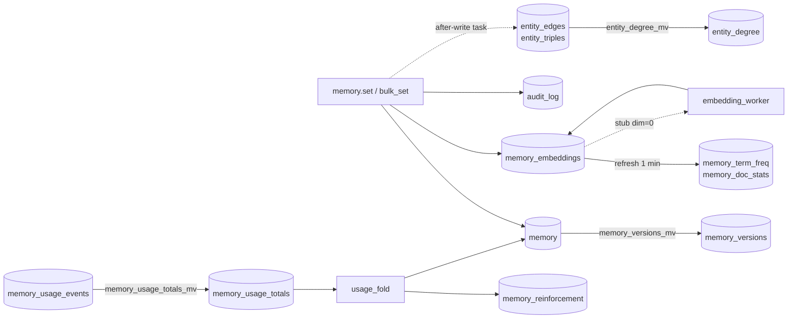

<!-- i18n: source=docs/architecture/clickhouse.md blob=60c6c8456feb6c09e511f2b2c546f32c8ee0cdf0 model=claude-sonnet-5-5 -->
> 이 페이지는 [영어 원문](https://github.com/ClickHouse/loom/blob/main/docs/architecture/clickhouse.md)을 기계 번역한 것이며, 영어 원문이 기준입니다.
> Machine-translated from the [English page](https://github.com/ClickHouse/loom/blob/main/docs/architecture/clickhouse.md), which is authoritative.

<a id="clickhouse"></a>

# ClickHouse

Loom의 영구 상태는 ClickHouse에 저장됩니다. 단, 문서 바이트는 선택 사항인 S3 호환 버킷에 저장되며, Postgres 메모리 권한(authority) 아래에서는 라이브 메모리, 지식 상태, 그리고 이와 함께 있는 레코드가 Postgres 테이블에 저장됩니다. 버킷은 `LOOM_DOCUMENT_OBJECT_STORE=s3`일 때 사용됩니다. ClickHouse는 Postgres가 보관하는 라이브 메모리와 지식 상태의 프로젝션을 보관합니다. [저장소 권한](https://github.com/ClickHouse/loom/blob/main/docs/architecture/storage-authority.md#the-tables) 문서에 모든 Postgres 테이블이 나와 있습니다. Loom의 ClickHouse 데이터베이스는 `loom`과 `loom_telemetry`입니다. 정식 ClickHouse 스키마는 모든 마이그레이션이 적용된 서버에서 덤프한 [`schemas/schema.sql`](https://github.com/ClickHouse/loom/blob/main/schemas/schema.sql)이며, Postgres 스키마는 `schemas/pg_migrations/`에 있는 저널입니다. 생성된 [스키마 참조](https://github.com/ClickHouse/loom/blob/main/docs/reference/schema.md)에는 모든 ClickHouse 테이블의 엔진, 키, TTL, 인덱스가 나열되어 있습니다. 이 페이지에서는 테이블 계열, Loom이 엔진, 인덱스, 뷰를 사용하는 방식, 그리고 마이그레이션이 실행되는 방식을 다룹니다.

<a id="goals-and-non-goals"></a>

## 목표와 비목표

| 목표                                                                                      | 비목표                                                                                      |
| ----------------------------------------------------------------------------------------- | ------------------------------------------------------------------------------------------- |
| 모든 플레인에 하나의 엔진(ClickHouse가 기준)을 사용하므로, 읽기가 여러 저장소를 가로질러 조인하지 않습니다. | 테이블 간 트랜잭션. 기본 행이 먼저 기록되고, 파생 행이 뒤따릅니다.                          |
| 모든 행에 테넌트, 작성자(`actor`), 콘텐츠(`content_sha256`)가 명시됩니다.                 | 모든 테이블의 트랜잭션 시간 이력. 버전 미러는 `loom.memory`만 다룹니다.                     |
| 변경 가능한 상태를 추가 전용 버전으로 관리합니다. 쓰기는 INSERT이고 읽기는 결정적입니다.  | 요청 경로에서의 제자리 업데이트. 업데이트는 새 버전이거나 일괄 처리되는 백그라운드 폴드입니다. |
| 메모리 콘텐츠를 담은 데이터는 작성자나 운영자가 요청하지 않는 한 만료되지 않습니다.       | 사실, 문서, 대화, 그래프에 대한 기본 보존 기간.                                             |
| 모든 테이블이 삭제 대상으로 분류됩니다.                                                   | 규정 준수 보장.                                                                             |

<a id="table-families"></a>

## 테이블 계열

"기록 주체"는 행을 삽입하는 코드 또는 [워커](https://github.com/ClickHouse/loom/blob/main/docs/reference/workers.md)를 나타냅니다.
보존 기간은 [파티셔닝과 TTL](#partitioning-and-ttl)에 있습니다.

| 계열                         | 주요 테이블                                                                                                                                                                                                                                                                                            | 기록 주체                                                                                                              |
| ---------------------------- | ------------------------------------------------------------------------------------------------------------------------------------------------------------------------------------------------------------------------------------------------------------------------------------------------------ | ---------------------------------------------------------------------------------------------------------------------- |
| 메모리 팩트                  | `memory`, `memory_versions`, `shared`, `working_memory`                                                                                                                                                                                                                                                | `memory.set`, `memory.bulk_set`, 수명 주기 op, `working_memory.*`; `memory_versions_mv`가 이력을 채움                  |
| 메모리 임베딩                | `memory_embeddings`, `memory_reinforcement`, `memory_term_freq`, `memory_doc_stats`                                                                                                                                                                                                                    | 동일한 쓰기 경로(`build_embedding_row`); `embedding_worker`가 스텁을 채움; `usage_fold`; BM25용 refreshable view       |
| 근거와 청크                  | `memory_evidence`, `memory_chunks`, `memory_chunk_sources`, `memory_belief_sources`, `session_summaries`, `derived_facts`                                                                                                                                                                              | `set_from_messages` 프로젝션, 통합(consolidation)                                                                      |
| 레코드와 분류 체계           | `memory_records`, `memory_record_versions`, `memory_record_fields`, `memory_record_conflicts`, `memory_schemas`, `memory_schema_fields`, `categories`, `memory_categories`                                                                                                                             | `memory.record.*`, `namespace.*`, 카테고리 할당                                                                        |
| 쓰기 경로 상태               | `memory_extraction_queue`, `memory_projection_failures`, `memory_drops`, `blacklist`, `blacklist_version`, `conflict_allowlist`, `learnings_queue`, `consolidation_runs`, `memory_ask_precedents`                                                                                                      | 지연 추출, fail-open 프로젝션, `blacklist.*`, `conflicts.resolve`, `memory.consolidate`, `memory.ask`                  |
| 지식                         | `documents`, `document_blobs`(업로드된 원본), `chunks`, `chunk_supersessions`, `chunk_term_freq`                                                                                                                                                                                                       | `knowledge.add`; `chunk_term_freq_mv`, `chunk_context_term_freq_mv`                                                    |
| 대화                         | `conversations`, `conversation_threads`, `conversation_embeddings`                                                                                                                                                                                                                                     | `conversation.*`; `conversation_titler`                                                                                |
| 엔티티 그래프                | `entity_edges`, `entity_degree`, `entity_triples`, `entity_edge_memories`, `entity_edge_rows`, `entity_triple_memories`, `entity_triple_rows`, `entity_vectors`, `entity_summaries`, `entity_canonical_map`, `entity_communities`, `operator_edges`                                                    | `memory.set` 쓰기 후 프로젝션, `entity_extractor`, `entity_communities`; `entity_degree_mv`                           |
| 코드 인덱스                  | `code_files`, `code_chunks`, `code_symbols`, `code_edges`, `code_pr_history` 및 기타 `code_*` 테이블                                                                                                                                                                                                   | `code_ingest`, `code_scip_*` 워커, `code_pr_history`, `code_embed_recovery`, `code_summary`, `code_graph_stats`        |
| 트래커                       | `qa_sources`, `qa_item_embeddings`, `qa_link_candidates`, `qa_test_daily`, `qa_rollup_days`, `qa_fail_hours`                                                                                                                                                                                           | `tracker.source.add`, `tracker_embed`, `tracker_links`, `tracker_test_daily`                                           |
| 실행, 태스크, 브리프         | `agent_runs`, `agent_turn_usage`, `session_outcomes_by_user`, `procedure_runs`, `tasks`, `task_events`, `task_leases`, `agent_run_claims`, `task_inboxes`, `session_briefs`, `context_blobs` 및 관련 테이블                                                                                             | `run.*`, `task.*` / `inbox.*`, `session.brief_*`, `context.offload`, `reflection_distill`                              |
| 네임스페이스, 인증, 거버넌스 | `namespaces`, `namespace_grants`, `namespace_policies`, `namespace_types`, `namespace_snapshots`, `namespace_calibration_*`, `service_accounts`, `user_state`, `revoked_tokens`, `signing_keys`, `auth_attempts`, `runtime_overrides`, `oauth_state`, `idempotency`, `policy_decisions` 및 관련 테이블 | `namespace.*`, `grants.*`, 가입 및 클레임 흐름, `recalibration`, 멱등성 캐시                                           |
| 텔레메트리, 감사, 비용       | `events`, `agent_events`, `agent_cost_rollup_daily`, `audit_log`, `audit_checkpoints`, `search_trace_log`, `memory_exposures`, `memory_usage_events`, `memory_usage_totals`, `memory_served_daily`, `code_search_trace`, `worker_status` 및 관련 테이블                                                  | 이벤트 스트림, op 원장, `observability/audit.py`, `audit_verifier`, 수퍼바이저                                         |
| 서비스 수준                  | `loom_telemetry.sli_minute`(별도의 데이터베이스: Loom이 자신의 테이블에서 파생한 텔레메트리는 `loom` 밖에 있음)                                                                                                                                                                                         | `sli_minute_refresh`, SLO 클래스가 있는 `agent_events` 요청 행을 대상으로 1분에 한 번                                  |
| 삭제                         | `erasure_requests`, `erasure_reversals`                                                                                                                                                                                                                                                                | `erasure.request`, `erasure_recovery`, `memory.restore`                                                                |
| 공급자 캐시                  | `embedding_cache`, `llm_response_cache`                                                                                                                                                                                                                                                                | 임베더와 LLM 클라이언트 래퍼                                                                                           |

**SLI 롤업이 별도의 데이터베이스를 쓰는 이유.** `loom`에는 Loom이 제공하는 데이터가 들어 있고, 파생된 운영 텔레메트리는 그 밖에 둡니다. 그래서 대시보드나 알림 사용자는 메모리가 들어 있는 데이터베이스에 대한 권한 없이 `SELECT ON
loom_telemetry.*`만 받으면 되고, 롤업은 `loom`을 건드리지 않고 일시 중지(refresh에 대한 `SYSTEM STOP VIEW` / `SYSTEM START VIEW`), 비우기 후 다시 접기(refold), 또는 별도 보존 기간 설정이 가능합니다. refold는 `SYSTEM STOP
VIEW loom_telemetry.sli_minute_refresh`, `TRUNCATE TABLE loom_telemetry.sli_minute`(센티널도 함께 사라짐), 그다음 `SYSTEM START VIEW` 순서입니다. 먼저 중지하는 것이 중요한데, truncate 이후에 커밋되는 refresh가 새 센티널을 기록하면 refold가 시작되지 않기 때문입니다. 롤업은 원장의 최근 31일만 refresh당 한 시간씩 읽으므로 약 12시간이 걸리며, `loom.sli.rollup_lag_s`로 진행 정도를 볼 수 있습니다. 더 긴 이력이 필요한 배포는 `loom_telemetry`도 백업합니다. 뷰를 삭제하지 마십시오. 마이그레이션 045는 적용된 것으로 기록되어 있어 어떤 것도 뷰를 다시 만들지 않습니다. 대가는 데이터베이스가 하나 늘어나는 것입니다. 설정 SQL은 마이그레이션 사용자에게 `CURRENT GRANTS ON loom_telemetry.*`를 부여하며, 이 권한이 없으면 preflight가 해당 권한을 지목합니다.

**ClickHouse 밖의 상태.** Postgres 메모리 권한(authority) 아래에서는 [스토리지 권한](https://github.com/ClickHouse/loom/blob/main/docs/architecture/storage-authority.md#the-tables) 문서에 나열된 테이블을 Postgres가 보관합니다. 업로드된 문서 원본은 `document_blobs`의 행이며 네임스페이스별로 SHA-256으로 주소가 지정됩니다(`server/knowledge/store/blobs.py`). `LOOM_DOCUMENT_OBJECT_STORE=s3`이면 각 행은 S3 호환 버킷에 있는 객체의 카탈로그 항목이고, 바이트는 버킷이 보관합니다([지식](https://github.com/ClickHouse/loom/blob/main/docs/features/knowledge.md#where-originals-are-stored)). 토큰 서명 키(`signing_keys`), 속도 제한·지연 예산·라이브 설정에 대한 관리자 런타임 재정의(`runtime_overrides`), 로그인 시도 횟수(`auth_attempts`), 그래프 탐색 표식(`graph_projections`: 진행 중인 프로젝션과 각 네임스페이스의 마지막 그래프 쓰기), 각 네임스페이스의 마지막 쓰기(`namespace_write_keys`), 수퍼바이저 리스도 ClickHouse에 있습니다. 따라서 이 ClickHouse(Postgres 메모리 권한 아래에서는 그 Postgres도)와, 행이 객체를 가리키는 동안의 문서 버킷을 가리키는 새 Loom은 모든 기능을 되찾습니다. 파일 시스템에는 `var/code_repos` 아래의 코드 플레인 git 미러가 있는데, 이는 ClickHouse가 기록한 원격 저장소의 캐시이며 미러가 없는 호스트는 다시 clone합니다. 서명 키와 저장된 자격 증명을 봉인하는 루트 시크릿 `LOOM_JWT_SECRET`은 환경 변수에 있습니다. 프로세스 캐시와 파일 잠금은 [시스템 개요](https://github.com/ClickHouse/loom/blob/main/docs/architecture/system-overview.md#deployment-topology)에 나열되어 있습니다.

<a id="conventions-every-table-follows"></a>

## 모든 테이블이 따르는 규칙

- **Identity 접두사.** 테넌트 행은 정렬 키의 맨 앞에 identity 튜플을 두고, 모든 읽기는 이 튜플로 필터링하므로 기본 인덱스가 다른 테넌트의 granule을 먼저 걸러냅니다. 네임스페이스 단위의 삭제, 스냅샷, 보존 기간 재정의는 스캔이 아니라 하나의 키 범위입니다.

  | 컬럼         | 의미                                  | 기본값  |
  | ------------ | ------------------------------------- | ------- |
  | `org`        | 테넌트 경계. 필수                     | —       |
  | `namespace`  | 공유와 권한 부여의 단위. 필수         | —       |
  | `agent`      | 쓰는 에이전트. 메모리 행에서 필수     | —       |
  | `user_id`    | 행이 대상으로 하는 최종 사용자        | `'-'`   |
  | `session_id` | 행이 나온 세션                        | `'-'`   |

  `'-'`는 "해당 없음"을 뜻하며 저장됩니다. `'*'`는 읽기 시점의 와일드카드이며 저장되지 않습니다. 에이전트별이 아닌 테이블(코드 인덱스, 태스크, 네임스페이스 설정)은 `(org, namespace, …)` 또는 `(org, inbox, …)`를 키로 사용합니다. 메모리 테이블에는 `run_id`가 추가됩니다. 서버는 메모리 쓰기에 `actor`와 `source_class`를 기록합니다
  ([시스템 개요](https://github.com/ClickHouse/loom/blob/main/docs/architecture/system-overview.md#the-identity-tuple)).

- `org`, `namespace`, `agent`, 모델 이름, 상태, 이벤트 종류에는 **`LowCardinality(String)`**을 사용합니다.
- **추가한 뒤 병합.** 변경 가능한 상태는 `ReplacingMergeTree`입니다. 쓰는 쪽은 더 높은 버전의 새 행을 삽입하고, 읽는 쪽은 `FINAL`을 사용합니다. 변경(mutation)은 요청 경로에 두지 않습니다.
- **대기하는 삽입.** 이후의 읽기가 의존하는 쓰기는 `wait_for_async_insert = 1`로 보내므로, 삽입이 반환되면 이미 기록된 상태입니다. 커밋 방식(`async_insert = 0`, 클라이언트 세션 기본값)이거나 배치 방식입니다
  ([배치 삽입](#batched-inserts)). 보내고 잊는 방식의
  텔레메트리는 `async_insert = 1, wait_for_async_insert = 0`으로 보냅니다.
- **시간은 UTC.** `DateTime` 컬럼에는 자체 시간대가 없으므로, 서버 클라이언트와 마이그레이션 러너는 `session_timezone = 'UTC'`를 고정하고 시간대 정보가 있는 파라미터를 UTC로 바인딩합니다. 그래서 `<timezone>`이 다르게 설정된 서버도 같은 시각을 읽고 씁니다.
- **재시도해도 중복되지 않음.** 모든 삽입은 배치와 배치별 nonce(`insert_dedup_token`)로 만든 `insert_deduplication_token`을 포함하므로, 소켓이 끊긴 뒤의 재시도도 배치를 한 번만 반영합니다. 비동기 삽입은 내용이 아니라 이 토큰으로만 중복이 제거되므로, 한 플러시 윈도우 안의 동일한 두 행은 모두 반영됩니다. 호출자가 자신의 토큰을 전달하면 그 토큰이 행의 identity를 나타내므로, 한 행을 쓰는 두 작성자의 쓰기도 한 번만 반영됩니다. `conversation.save_message`가 새 트랜스크립트 행을 이렇게 씁니다.

<a id="batched-inserts"></a>

### 배치 삽입

커밋된 삽입은 파트를 하나 만들므로, 요청마다 쓰는 테이블은 요청 속도만큼 파트가 생기고 병합이 뒤처집니다("too many parts"). 모든 요청에서, 또는 모든 프로세스가 짧은 간격으로 쓰는 행은 배치 삽입으로 보내며, `async_insert = 1, wait_for_async_insert = 1`을 사용합니다(`server/core/ch_writes.py`). 두 그룹으로 나뉩니다.

- **`ch_batched_inserts`로 전환되는 그룹** (`batched_insert_settings`): `audit_log`, `conversation.append`의 `conversations` 턴과 `conversation.compact`의 요약 턴, 중복 제거로 첫 쓰기가 버려졌을 때 `conversation.save_message`가 다시 쓰는 턴, `conversation_embeddings` 행(`conversation.append`, `conversation.save_message`, `conversation.compact`. 아래의 너비 규칙 적용), `agent_events` 플러시, `memory_webhook_outbox`, `memory_evidence`, `memory_belief_sources`. `memory_webhook_attempts`는 커밋 방식을 유지합니다. 한 워커가 패스마다 두 번, 한 삽입 뒤에 다른 삽입을 이어서 쓰므로 배치해도 파트가 줄지 않기 때문입니다.
- **어느 쪽이든 대기하는 비동기 삽입** (`async_insert_settings`): `auth_attempts`, 정책 witness의 `agent_events`와 `memory_exposures` 행, `memory_projection_failures`, 그래프 Undo 마커, `namespace_write_marks` 플러시, 사용량 이벤트 플러시, carry 확인응답의 게시와 철회, 대기하는 모든 엔티티 그래프 삽입(`memory.set`, `memory.bulk_set`. `wait=True`인 `graph_insert_settings`), 그리고 follow 플랜의 후속 삽입(`entity_triple_memories`, `entity_triple_rows`, `entity_triples`).

ClickHouse는 한 테이블에 동시에 들어오는 삽입을 파티션당 하나의 파트로 모으고, 그 파트들이 기록되면 각 삽입에 한 번씩 응답합니다. 반환 시점에 그 행은 커밋된 삽입의 행만큼 내구성이 있고 보이며, 같은 호출자의 다음 삽입은 이후의 파트에 들어가므로 한 호출자의 쓰기 순서는 유지됩니다. 버퍼는 ClickHouse 쪽에 있으므로, 멈춘 Loom 프로세스도 이미 응답한 데이터를 잃지 않습니다. 플러시 전체가 실패하면 그것을 기다리던 모든 삽입이 실패하며, 이 중 어느 것을 재시도해도 자신의 토큰으로 한 번만 반영됩니다. 각 삽입은 다른 삽입이 합류하도록 `ch_batched_insert_wait_min_ms`(쓰기가 드문 경우)에서 `ch_batched_insert_wait_max_ms`(부하가 높은 경우) 사이만큼 기다리며, 기다리는 동안 풀의 연결을 점유합니다. 삽입은 `async_insert_use_adaptive_busy_timeout = 1`을 보내므로 서버 프로필이 무엇을 설정하든 이 한계가 유지됩니다. 이 값을 끄면 모든 플러시가 최대 시간만큼 기다립니다. 꾸준한 부하에서 테이블은 ClickHouse 노드당 초당 약 1000 /
`ch_batched_insert_wait_max_ms`개의 파트를 받으며, 이는 삽입 형태(ClickHouse는 컬럼 목록과 설정마다 버퍼를 하나씩 유지합니다)와 기록되는 파티션 단위입니다. 대기가 끝나기 전에 버퍼가 차면 더 많아지고, 쓰기가 드물 때는 삽입당 최대 하나입니다. 삽입은 `async_insert_max_query_number = 10000`도 보내므로, 높은 속도에서는 ClickHouse의 기본값인 450개 문장이 아니라 윈도우가 플러시를 결정합니다.

윈도우는 두 가지입니다. 사용량 이벤트 플러셔와 종료 시 드레인, 그리고 write-mark 플러시는 최대 `ch_batched_insert_background_wait_max_ms`(200 ms, ClickHouse의 기본값)까지 기다리므로 파트당 더 많은 행을 모읍니다. 그 외의 모든 배치 삽입과 대기하는 비동기 삽입은 최대 `ch_batched_insert_wait_max_ms`(50 ms)만 기다립니다. `agent_events` 타이머 플러시도 여기에 포함되며(`flush_now`는 진행 중인 플러시를 기다립니다), 버퍼가 가득 차서 요청이 수행하는 사용량 이벤트 플러시도 마찬가지입니다. 두 윈도우는 서로 다른 삽입 형태이므로 별도의 버퍼를 채웁니다.

ClickHouse 자체의 목표는 테이블당 초당 삽입 한 번, 파트 하나, 삽입당 1,000행 이상입니다. 이 윈도우들은 그 목표에 한참 못 미치며, 파트 생성 속도를 삽입당 하나에서 위의 속도로 줄이는 데 그칩니다. 배치는 지연 시간을 파트 수와 맞바꿉니다. 대기하는 각 삽입은 윈도우만큼의 시간을 더하고 그동안 풀의 연결을 점유합니다. 따라서 요청 경로에서 초당 R_request개, 백그라운드에서 초당 R_background개의 배치 삽입이 지속되면 최소 R_request × `ch_batched_insert_wait_max_ms` / 1000 + R_background × `ch_batched_insert_background_wait_max_ms` / 1000개의 연결이 점유됩니다. 초당 100번의 `conversation.append`가 각각 배치 삽입 두 개를 수행하면 최소 100 × 2 × 50 / 1000 = 10개를 점유합니다. 이는 하한입니다. 대기 중인 삽입은 윈도우 동안, 그리고 이후 플러시와 파트 기록 동안 연결을 점유하며, 이 시간은 부하가 높을수록 대기열이 쌓이며 늘어납니다. `memory.set`은 여섯 개 이상을 기다립니다. 감사 행, outbox 행(웹훅 네임스페이스), `entity_edges`와 `entity_edge_memories` 삽입, `entity_triples`와 `entity_triple_memories` 삽입, 그리고 carry된 쓰기의 `carry_acks`입니다. `memory.set_from_messages`는 약 열 개를 기다립니다. 두 연산의 엔티티 그래프 삽입은 대기하는 비동기 삽입이므로 `ch_batched_inserts = false`로 해도 연결을 점유합니다. 메모리 쓰기나 대량 쓰기를 주로 받는 프로세스는 어느 쪽이든 이를 감안해 풀 크기를 정하거나 `ch_batched_insert_wait_max_ms`를 낮춰야 합니다. 한 프로세스가 초당 200건의 쓰기를 받고 각각 배치 삽입 두 개를 수행하는 경우(`bench/write_rate.py --target client`), 공식의 하한인 `ch_pool_maxsize = 20`에서는 12,000건 중 3,367건의 쓰기가 503 `OVERLOADED`로 거부되었고, 40이나 64에서는 한 건도 거부되지 않았습니다. 한 호스트에서 한 번 실행한 결과이므로 대략적인 규모로만 보십시오. `ch_pool_maxsize`는 하한의 세 배 이상에 프로세스의 다른 문장 몫을 더해 정하십시오. 기본값 64는 초당 약 300건의 요청 경로 배치 삽입에 대해 하한의 세 배를 감당하고, 다른 문장을 위해 약 20개의 연결이 남습니다. 이 속도를 넘는 프로세스는 `ch_pool_maxsize`를 올리거나 `ch_batched_inserts = false`로 설정해야 하며, `ch_batched_insert_wait_max_ms`를 낮추어도 연결이 확보됩니다
([문제 해결](https://github.com/ClickHouse/loom/blob/main/docs/operations/troubleshooting.md)).

`ch_batched_inserts`(실시간 반영, 기본적으로 켜짐)는 위 첫 번째 그룹의 배치를 끕니다. 끄면 해당 삽입은 커밋 방식이 되어 삽입마다 파트가 하나씩 생깁니다. 두 번째 그룹은 어느 쪽이든 같은 한계로 기다리며, 보내고 잊는 삽입은 달라지지 않습니다. 쓰기 속도 때문에 위와 같이 풀이 고갈되는데 풀을 늘릴 수 없는 프로세스, 또는 트래픽이 적고 파트 수보다 지연 시간이 더 중요한 배포에서는 이 값을 끄십시오(`LOOM_CH_BATCHED_INSERTS=false`). 쓰기가 너무 드물어 파트를 공유하지 못하면 각 삽입은 여전히 `ch_batched_insert_wait_min_ms`만큼 기다립니다.

ClickHouse는 비동기 버퍼를 테이블, 문장 형태, 설정, 사용자별로 구분하므로 하나의 플러시에 여러 org의 행이 들어갈 수 있고, 실패하는 행 하나(잘못된 너비의 벡터, 코드 190)가 그 플러시에 포함된 모든 호출자의 플러시를 실패시킵니다. 임베딩 행은 코딩된 너비가 `embedding_dim`과 같을 때만 배치되며, 공유 플러시가 코드 190으로 실패한 `conversation_embeddings` 행은 커밋 방식으로 다시 전송됩니다. 다른 배치 테이블에는 코딩된 벡터가 없습니다.

다음 테이블은 커밋 방식을 유지합니다.

- `memory`, `memory_embeddings`, `shared`, `session_summaries`, `entity_summaries`의 **버전 행**: 이들의 fenced `INSERT … SELECT FROM input()`([롤링
  업그레이드](https://github.com/ClickHouse/loom/blob/main/docs/architecture/rolling-upgrades.md))은 버퍼링할 수 없습니다. Postgres authority에서는 커밋된 쓰기의 `memory`와 `memory_embeddings` 행을 Loom이 대신 배치합니다. 각 프로세스는 마지막 플러시 이후 큐에 쌓인 모든 커밋을 테이블당 하나의 커밋된 삽입으로 보내며, 이는 초당 최대 1000 / `pg_publish_interval_ms`번이고 행이 걸친 파티션마다 파트가 하나씩 생깁니다([게시](https://github.com/ClickHouse/loom/blob/main/docs/architecture/storage-authority.md#publication)).
- **`entity_canonical_map`**: `org`로 파티션되어 있으므로, `max_partitions_per_insert_block`보다 많은 org에 걸친 공유 플러시는 그것을 기다리는 모든 삽입을 실패시킵니다.
- **`Quantized`로 코딩된 벡터가 있는 행**(`entity_vectors`, `memory_chunks`): 코덱은 파트를 기록할 때 다른 너비의 벡터를 거부하므로(코드 190), 크기가 맞지 않는 행 하나가 같은 플러시의 다른 모든 삽입을 실패시킵니다.
- **크기가 맞지 않을 수 있는 `conversation_embeddings` 행**(`embedding_insert_settings`): 컬럼이 일반 컬럼이거나, 서비스 중인 모델의 `embedding_dim`으로 코딩되어 있고 벡터가 그 너비일 때(빈 벡터는 그 너비로 채워집니다) 행이 배치됩니다. 컬럼을 읽지 못했거나, 컬럼이 코딩된 너비가 `embedding_dim`과 다른 동안(리빌드 이전의 모델 변경, 또는 이 프로세스가 아직 읽지 못한 리빌드)에는 행이 커밋 방식으로 전송됩니다. 다른 프로세스의 너비가 맞지 않는 행 때문에 플러시가 실패한 배치 행은 커밋 방식으로 다시 전송됩니다.
- **토큰이 행의 identity를 나타내는 쓰기**(`conversation.save_message`): 복제 테이블은 커밋된 삽입과 버퍼링된 삽입의 토큰을 따로 유지하므로, 같은 identity의 모든 작성자는 동일한 방식으로 보냅니다.

<a id="engines-and-why"></a>

## 엔진과 선택 이유

| 엔진                                               | 사용처                                                                                                                                                                                                                               | 이유                                                                                  |
| -------------------------------------------------- | ------------------------------------------------------------------------------------------------------------------------------------------------------------------------------------------------------------------------------------ | ------------------------------------------------------------------------------------- |
| `ReplacingMergeTree(version)`                      | 변경 가능한 행: `memory`, `memory_embeddings`, `shared`, `working_memory`, `code_*` 인덱스, 태스크, 설정                                                                                                                              | 업데이트는 행 전체의 INSERT이며, `FINAL`이 키마다 최신 행만 남깁니다. 잠금이 없습니다.    |
| `ReplacingMergeTree(created_at)` 또는 `(updated_at)` | 키마다 한 번만 기록되는 행: `memory_evidence`, `memory_chunks`, 캐시, `idempotency`, `namespaces`                                                                                                                                      | 같은 방식으로 병합하되, 행 자체의 타임스탬프를 버전으로 사용합니다.                       |
| 버전이 없는 `ReplacingMergeTree`                   | `memory_versions`, `code_symbol_ids`, `code_symbol_names`                                                                                                                                                                            | `version` 또는 전체 식별 정보가 정렬 키에 들어 있으므로, 정확히 같은 행을 다시 삽입한 경우에만 병합됩니다. |
| `MergeTree`                                        | 추가 전용 로그: `events`, `agent_events`, `audit_log`, `conversations`, `task_events`, `entity_edges`, 트레이스                                                                                                                       | 행은 특정 시점에 대한 사실입니다.                                                       |
| `SummingMergeTree`                                 | 카운터: `entity_degree`, `memory_usage_totals`, `memory_served_daily`, `code_unit_signal`                                                                                                                                            | 카운터는 델타를 INSERT하는 방식이며, 읽고-수정하고-쓰는 방식이 아닙니다.                 |
| `AggregatingMergeTree`                             | 가산되지 않는 롤업: `memory_term_freq`, `chunk_term_freq`, `code_term_freq`, `agent_cost_rollup_daily`, `memory_exposure_breadth_hourly`, `query_nodes`, `namespace_write_marks`, `subject_last_seen`, `loom_telemetry.sli_minute`        | 부분 집계 상태(고유 개수는 합산할 수 없음)를 저장하고 `-Merge`로 마무리합니다.            |
| `KeeperMap`                                        | `task_leases`, `agent_run_claims`, `oauth_signin_state`, 마이그레이션 잠금 `loom._migration_lock` (또한 `workers_supervisor` 리스, 클레임, 컴파일러 티어의 `scip_entry:*` 키)                                                          | 프로세스 간 선형화 가능한 compare-and-swap을 제공합니다.                                |

**배포마다 하나의 `keeper_map_path_prefix`.** KeeperMap 경로는 마이그레이션에 고정되어 있으며(`/loom/migration_lock`, `/loom/instances`, `/loom/task_leases`, `/loom/agent_run_claims`, `/loom/graph_projections`, `/loom/namespace_write_keys`), ClickHouse는 이 경로를 서버의 `keeper_map_path_prefix` 아래에 둡니다. ClickHouse 서버가 Keeper와 prefix를 공유하는 두 배포는 이 키들을 함께 쓰게 됩니다. 즉 workers 리스 하나, 마이그레이션 잠금 하나, 그리고 모든 클레임을 공유합니다. 배포마다 고유한 prefix를 지정하세요.

**변경 가능한 상태에 `ReplacingMergeTree`를 쓰는 이유.** `ALTER … UPDATE`는 파트 전체를 비동기로 다시 쓰며, 자신이 쓴 내용을 바로 읽을 수 있다는 보장이 없습니다. 경량 `UPDATE`는 이후의 모든 읽기가 적용해야 하는 패치 파트를 만들고, 양자화 코드 읽기([벡터 저장소](#vector-storage))를 끕니다. 버전 행은 한 번의 INSERT이며 다음 `FINAL` 읽기에서 바로 보이고, 이력은 미러에 남습니다. 대가는 아래의 쓰기 규칙과 `FINAL` 비용이며, 이 비용은 식별 정보 prefix 덕분에 한 테넌트의 그래뉼 범위로 제한됩니다.

메모리 테이블에서 `version`은 벽시계 기준 나노초 타임스탬프이므로(`server/memory/store/rows.py`, `next_version`), 두 레플리카의 버전을 서로 비교할 수 있습니다. 대신 시계 오차가 제한된 범위 내에 있어야 합니다. 설정 테이블은 `updated_at`, `created_at` 또는 `version`을 버전으로 사용합니다.

<a id="the-final-write-rule"></a>

## FINAL 쓰기 규칙

업데이트, tombstone, 복원, touch, 잠금, 승격은 모두 더 높은 `version`을 가진 완전한 행을 INSERT하는 방식으로 처리합니다. **버전 행에는 영속화되는 모든 컬럼이 있어야 합니다.** ClickHouse는 생략된 컬럼을 DDL 기본값으로 채우며, `FINAL`에서는 그 기본값이 모든 읽기 측에서 실제 값을 대체합니다. `server/memory/store/rows.py`의 빌더를 사용하세요.

| 빌더                                                    | 테이블                                  | 동작                                                                                                                                         |
| ------------------------------------------------------- | --------------------------------------- | -------------------------------------------------------------------------------------------------------------------------------------------- |
| `build_memory_version_row(existing, **changes)`         | `memory`                                | `MEMORY_PERSISTED_COLS`의 모든 컬럼을 복사하고, 변경 사항을 적용하며, 저장된 `value` 바이트를 그대로 유지합니다.                            |
| `build_revision_row(existing, new)`                     | `memory`                                | 현재 행 위에 새 값을 기록합니다. 사용량, 계보, 식별 정보, 잠금, 만료를 이어받고, `REVISION_RESETS`를 초기화하며, 증명은 유지합니다.          |
| `build_first_version_row(new, now=…)`                   | `memory`                                | 첫 쓰기를 DDL 기본값(`FIRST_VERSION_DEFAULTS`)으로 완성하여, 모든 첫 버전이 insert 깔때기의 검사를 통과하게 합니다.                         |
| `insert_memory_versions(rows)` (`inserts.py`)           | `memory`                                | 유일한 `loom.memory` insert입니다. 영속 컬럼이 빠졌거나 알 수 없는 컬럼이 있는 행은 거부하고, 그렇지 않으면 커밋된 상태로 insert합니다.     |
| `build_embedding_row(**columns)`                        | `memory_embeddings`                     | `EMBEDDING_PERSISTED_COLS` 기본값으로 전체 행을 만듭니다. 알 수 없는 컬럼이 있으면 예외가 발생하며, `content_excerpt_lemma`와 새 `version`을 채웁니다. |
| `build_session_summary_row`, `build_entity_summary_row` | `session_summaries`, `entity_summaries` | 같은 패턴입니다.                                                                                                                             |

새 컬럼은 같은 변경 안에서 빌더의 컬럼 집합과 그 빌더에 데이터를 공급하는 모든 프로젝션에 추가합니다. `MATERIALIZED` 컬럼(`content_excerpt_lc`, `content_excerpt_stem`, `value_preview`, `value_len`)은 insert에 포함해서는 안 됩니다. 버전이 있는 다른 테이블(`namespaces`, `code_summaries`)은 다시 insert하기 전에 전체 행을 읽습니다.

`FINAL`을 올바르게 유지하기 위한 쿼리 규칙은 두 가지입니다.

- 식별 컬럼은 `PREWHERE` 또는 `FINAL` 이전에 필터링하고, 행 상태 조건(`tombstoned_at`, `status`, 만료, 유효성)은 `FINAL` 이후의 `WHERE`에 둡니다. 병합 전에 상태 조건을 적용하면 tombstone이 제외되어 그 아래 버전이 되살아납니다.
- 필터링에 사용하는 컬럼 이름을 표현식의 별칭으로 쓰지 마세요(`SELECT toString(memory_id) AS memory_id … WHERE memory_id IN …`). `WHERE`가 별칭으로 해석되어 아무것도 일치하지 않게 되며 오류도 나지 않습니다. `tests/unit/test_sql_alias_shadow.py`는 이 패턴이 발견되면 빌드를 실패시킵니다.

<a id="content-hashes"></a>

## 콘텐츠 해시

`loom.memory`의 `content_sha256`은 값의 정규 JSON(canonical JSON)에 대한 SHA-256입니다. 다음 용도로 사용됩니다.

- **낙관적 동시성 제어.** `memory.set`과 `memory.update_by_id`는 `if_match_sha256`을 받으며, 해시가 일치하지 않으면 409 `PRECONDITION_FAILED`로 응답합니다. 해시는 `memory.get`, `memory.get_by_id`, `memory.set` 응답에 포함됩니다.
- **검증 바인딩.** `verified_sha256`은 누군가 검증한 바이트를 기록합니다. 값이 수정되면 `verified_by`와 `verified_at`은 유지되지만 해시가 더 이상 일치하지 않으므로, 읽는 쪽에서는 이 쌍을 통해 "오래됨(stale)" 상태를 판단합니다.
- **감사.** 메모리를 생성하거나 변경하는 모든 쓰기는 해시만 담은 `audit_log` 행을 하나 남깁니다(키, id, 해시, 행위자, 소스 클래스, 판정이 기록되며 값은 기록되지 않습니다).

코드 청크의 id는 경로, 범위, 콘텐츠 해시를 기반으로 한 UUIDv5이므로, 변경되지 않은 청크는 다시 수집해도 같은 행으로 저장됩니다.

<a id="sort-keys"></a>

## 정렬 키

신원 접두사 다음에 오는 정렬 키는 테이블에서 가장 많이 일어나는 읽기를 뒷받침합니다.

| 테이블              | `ORDER BY`                                                                         | 뒷받침하는 읽기                                                                                     |
| ------------------- | ---------------------------------------------------------------------------------- | --------------------------------------------------------------------------------------------------- |
| `memory`            | `(org, namespace, agent, user_id, session_id, memory_key)`                         | 키 기준 포인트 읽기. 병합 단위는 신원당 키 하나입니다.                                              |
| `memory_embeddings` | `(org, namespace, agent, user_id, session_id, scope, embedding_model, memory_key)` | 하나의 신원과 하나의 모델에 대한 벡터 조회. 두 모델의 벡터는 별개의 행입니다.                       |
| `memory_versions`   | `(org, namespace, agent, user_id, session_id, memory_key, version)`                | 하나의 키의 이력. 키에 `version`이 포함되어 있어 모든 행이 유지됩니다.                              |
| `code_chunks`       | `(org, namespace, embedding_model, path, chunk_id)`                                | 재수집 diff와 파일 읽기를 위한, 한 경로의 모든 청크.                                                |
| `code_edges`        | `(org, namespace, tier, to_symbol_id, edge_kind, from_symbol_id, path, line)`      | "X를 호출하는 곳"은 키 범위로 조회됩니다. 프로젝션 `by_from`과 `by_path`는 피호출자 조회와 파일별 읽기를 뒷받침합니다. |
| `code_symbols`      | `(org, namespace, tier, qualified_name, symbol_id)`                                | 정규화된 이름으로 정의 조회. `code_symbol_names_mv`와 `code_symbol_ids_mv`가 키를 다시 구성합니다.  |
| `entity_edges`      | `(org, namespace, entity_a, entity_b)`                                             | 엔티티의 이웃.                                                                                      |
| `task_events`       | `(org, inbox, seq)`                                                                | 인박스의 이벤트를 순서대로 조회.                                                                    |

정렬 키와 파티션 키는 `CREATE` 시점에만 지정할 수 있습니다. 이를 바꾸는 마이그레이션은 전체 `CREATE TABLE` 위에 `-- loom: rebuild-if-empty <table>`을 선언합니다. 러너는 비어 있는 테이블을 트윈 테이블로 교체하고, 행이 있는 테이블은 거부하면서 `scripts/ops/table_rebuild.py`(트윈, 복사, `EXCHANGE TABLES`)를 안내합니다(`server/core/schema/table_rebuild.py`).

<a id="partitioning-and-ttl"></a>

## 파티셔닝과 TTL

대부분의 시계열 테이블은 `PARTITION BY toYYYYMM(<time column>)`을 사용합니다. 테넌트 디렉터리 테이블(`namespaces`, `namespace_grants`, `service_accounts`, `user_state`, …)은 `org`로 파티셔닝하고, `working_memory`와 `shared`는 `(org, namespace)`로 파티셔닝합니다. 전체를 읽는 작은 테이블(`code_pr_history`, `code_pr_reviews`)에는 파티션 키가 없습니다.

`code_chunks`는 `(org, namespace)`로 파티셔닝되므로 각 저장소 인덱스가 자체 파트를 가지고, 텍스트 인덱스의 포스팅 리스트는 하나의 네임스페이스만 다루며, 폐기된 인덱스는 `DROP PARTITION`으로 제거됩니다. 키는 베이스라인의 `CREATE`에서 선언합니다.

**기본적으로 메모리 콘텐츠를 삭제하는 테이블은 없습니다.** 팩트, 임베딩, 문서, 청크, 대화, 그래프에는 TTL이 없습니다. 이들은 명시적인 삭제, 기록하는 쪽이 설정한 만료(`ttl_seconds`, 행의 `on_expire`에 따라 `memory_expiry_sweep`이 적용), 또는 삭제 요청(erasure)으로만 제거됩니다. 스키마 TTL이 있는 테이블은 텔레메트리, 캐시, 러너 상태를 담습니다.

| 기간 | 테이블 |
| ---------- | ---------- |
| 60분 | `code_search_memo` |
| 3일 | `memory_webhook_outbox`, `memory_webhook_attempts` |
| 7일 | `llm_response_cache`, `code_scip_parts` |
| 30일 | `events`, `embedding_cache`, `memory_drops`, `memory_extraction_queue`, `memory_ask_precedents`, `worker_status`, `code_scip_batches` |
| 90일 | `erasure_requests`, `oauth_state`, `policy_decisions` |
| 180일 | `search_trace_log`, `memory_exposures`, `memory_exposure_breadth_hourly`, `consolidation_runs`, `code_search_trace`, `code_search_outcome` |
| 400일 | `loom_telemetry.sli_minute` |
| 5년 | `erasure_reversals` |
| 기타 | `idempotency`(`expires_at` 기준), `revoked_tokens`(토큰 만료 후 10일), `context_blobs`(`expires_at` 후 1일) |

운영자는 `LOOM_RETENTION_<TABLE>_DAYS`로 `audit_log`, `agent_events`, `memory`, `memory_embeddings`, `conversations`, `chunks`, `documents`에 보존 기간을 추가할 수 있고, `LOOM_TIERING_<TABLE>_WARM_DAYS`와 `LOOM_TIERING_WARM_VOLUME_NAME`으로 티어링을 설정할 수 있습니다. 네임스페이스별 `retention_days` 또는 `warm_days` 재정의는 같은 TTL 표현식 안의 `multiIf`가 됩니다(`server/storage/retention_overrides.py`). 워커 리더가 부팅 시 이를 적용하고 `retention_reconcile`이 계속 동기화하며, 각 `MODIFY TTL`이 뮤테이션이므로 변경되지 않은 테이블은 건너뜁니다. 테이블의 마지막 기간 설정이 해제되면 같은 과정에서 `ALTER TABLE … REMOVE TTL`을 실행합니다. 이 테이블들에는 스키마 TTL이 없습니다. 모든 기간의 기본값은 0(꺼짐)입니다.

<a id="merges-and-skip-indexes"></a>

### 머지와 스킵 인덱스

파트 수가 계속 늘어난다면 거의 항상 머지가 실패하고 있다는 뜻입니다. 머지가 빌드할 수 없는 스킵 인덱스가 있으면 해당 테이블의 모든 머지가 실패하고, 결국 insert가 `TOO_MANY_PARTS`를 받게 됩니다. Loom은 `exclude_materialize_skip_indexes_on_merge`로 이런 인덱스(`chunks`의 텍스트 인덱스 `content_text`와 `context_text`)를 머지에서 제외합니다. insert된 파트는 여전히 인덱스를 빌드하지만, 머지된 파트는 인덱스 없이 만들어집니다. `ops.health`의 `clickhouse_parts` 검사(`_clickhouse_parts_check`)는 `system.part_log`에서 최근 15분간 실패한 `MergeParts` 이벤트를 읽고 에러 코드와 이 복구 방법을 보고합니다. 예외 텍스트는 `system.part_log`에 남아 있습니다. 같은 이유로 메모리 콘텐츠 테이블에는 행 TTL이 없습니다. 런북은 [문제 해결](https://github.com/ClickHouse/loom/blob/main/docs/operations/troubleshooting.md)에 있습니다.

`memory_embeddings`는 이 설정에 `embedding_hnsw_idx`도 지정하는데, 이는 어떤 마이그레이션에서도 선언하지 않는 인덱스입니다. 운영자가 해당 이름의 벡터 인덱스를 직접 추가하지 않으면 이 설정은 아무 일도 하지 않으며, 추가한 경우에는 머지가 그래프를 다시 빌드하지 않도록 하므로 어떤 마이그레이션도 이를 초기화하지 않습니다.

<a id="the-write--derive-loop"></a>

## 쓰기 → 파생 루프

쓰기는 기본 행을 삽입하고 바로 반환합니다. 나머지는 모두 이후에 세 가지 메커니즘 중 하나로 파생됩니다.

1. **삽입 시점 materialized view**는 원본 INSERT 안에서 실행됩니다. `memory_versions_mv`는 모든 `memory` 행을 `memory_versions`로 복사하고, `memory_usage_totals_mv`와 `entity_degree_mv`는 원본 행을 합계로 접어 넣습니다. `memory_served_daily`는 view를 거치지 않습니다. 에이전트가 읽을 때 그 횟수를 직접 삽입하며, 합계가 usage fold를 거쳐 랭킹이 되는 `memory_usage_events`와는 분리되어 있습니다. 따라서 제공된 읽기는 강화 신호를 움직이지 않습니다.
2. **Refreshable materialized view**(`REFRESH EVERY 1 MINUTE APPEND`)는 고수위 표시(high-water mark)보다 새로운 행을 추가합니다. BM25 통계, 일별 비용 롤업, 시간별 노출 범위, 주체별 마지막 확인 시각, 분당 요청 SLI가 여기에 해당합니다. SLI 롤업의 표시 기준은 `agent_events.ingested_at`, 즉 ClickHouse가 행을 받은 시각이므로 지연된 flush도 누락되지 않습니다.
3. **워커**는 처리가 필요한 행을 폴링하여 새 버전을 기록합니다. 대상은 스텁 임베딩(`embedding_worker`, `code_embed_recovery`), 엔티티(`entity_extractor`), usage fold(`usage_fold`), 지연된 추출(`extraction_queue`, `observe_extract`), 실패한 프로젝션(`projection_repair`), 고아 벡터(`orphan_vector_reconcile`), 만료(`memory_expiry_sweep`), TTL(`retention_reconcile`)입니다.

큐 서비스는 없습니다. 큐는 행이 자신의 상태를 가지고 있는 테이블입니다. `memory_extraction_queue` 행은 버전으로서 `pending → running → done | failed`로 이동하며(모델 호출 보류가 끝날 때까지는 `held`), `embedding_dim = 0`인 임베딩 행은 벡터를 기다리는 스텁이고, `memory_projection_failures` 행은 다시 실행할 프로젝션입니다. 읽기 경로는 완료되지 않은 행을 걸러냅니다.



**파생하는 이유.** 그래프 프로젝션, BM25 갱신, 감사 fan-out을 기다리는 `memory.set`은 각각의 왕복 시간을 모두 부담해야 하고, 하나라도 실패하면 함께 실패합니다. 응답 경로에는 호출자의 다음 읽기에 필요한 것만 남깁니다. 즉 `memory` 행, 그 `memory_embeddings` 행, 같은 키의 대체(supersession), 감사 영수증입니다. 프로젝션은 fail-open으로 동작하며(`memory/app/after_write.py`), 같은 프로세스에서 같은 네임스페이스를 읽을 때는 그래프 프로젝션이 끝나기를 기다립니다(`after_write.settle`). 파생 테이블은 원본보다 몇 초 늦습니다. BM25 레그는 이 지연을 스스로 병합합니다.

임베딩 행은 삽입된 시점에 그 버전이 5초보다 오래되었다면(view 지연 10초의 절반) refresh 워터마크보다 아래에 놓일 수 있습니다. 긴 임베딩이나 판정, 느린 삽입이 그런 경우를 만듭니다. 이런 행은 해당 쓰기가 응답 이후에 직접 BM25 테이블로 접어 넣으므로(`after_write.index_late_rows`), 느린 쓰기가 두 번의 삽입을 추가로 기다리지는 않습니다.

<a id="the-memory_versions-mirror"></a>

## memory_versions 미러

병합(merge)은 대체된 `memory` 행을 버리므로 RMT 테이블은 이력이 아닙니다.
`memory_versions_mv`는 삽입된 모든 `memory` 행을 `memory_versions`로 복사하며, 이 테이블은 각 버전을 그대로 보관합니다.
`memory.history`, `memory.redact`, `namespace.rollback`, 그리고 사용량 폴드(usage fold)가 이 테이블을 읽고, 삭제 사가(erasure saga)는 이 테이블에서 행을 삭제합니다.
새 `memory` 컬럼은 같은 마이그레이션에서 `memory_versions`와 뷰의 `SELECT`에 함께 추가해야 합니다.
`tests/unit/test_memory_versions_schema.py`는 컬럼 목록을 서로 비교합니다.

<a id="materialized-views"></a>

## 머티리얼라이즈드 뷰

| 뷰                                                                                                                                         | 종류                            | 원본 → 대상                                           |
| ------------------------------------------------------------------------------------------------------------------------------------------ | ------------------------------- | ----------------------------------------------------- |
| `memory_versions_mv`                                                                                                                       | 삽입 시점                       | `memory` → `memory_versions`                          |
| `memory_record_versions_mv`                                                                                                                | 삽입 시점                       | `memory_records` → `memory_record_versions`           |
| `memory_usage_totals_mv`                                                                                                                   | 삽입 시점                       | `memory_usage_events` → `memory_usage_totals`         |
| `entity_degree_mv`                                                                                                                         | 삽입 시점                       | `entity_edges` → `entity_degree`                      |
| `session_brief_revisions_mv`                                                                                                               | 삽입 시점                       | `session_briefs` → `session_brief_revisions`          |
| `chunk_term_freq_mv`, `chunk_context_term_freq_mv`, `code_term_freq_mv`, `code_doc_stats_mv`, `code_symbol_ids_mv`, `code_symbol_names_mv` | 삽입 시점                       | 청크 및 코드 인덱스 통계와 조회                       |
| `memory_term_freq_refresh`, `memory_doc_stats_refresh`                                                                                     | `REFRESH EVERY 1 MINUTE APPEND` | `memory_embeddings` → BM25 통계                       |
| `agent_cost_rollup_refresh`                                                                                                                | `REFRESH EVERY 1 MINUTE APPEND` | `agent_events` → `agent_cost_rollup_daily`            |
| `memory_exposure_breadth_hourly_refresh`                                                                                                   | `REFRESH EVERY 1 MINUTE APPEND` | `memory_exposures` → `memory_exposure_breadth_hourly` |
| `subject_last_seen_refresh`                                                                                                                | `REFRESH EVERY 1 MINUTE APPEND` | `agent_events` → `subject_last_seen`                  |
| `loom_telemetry.sli_minute_refresh`                                                                                                        | `REFRESH EVERY 1 MINUTE APPEND` | `agent_events` → `loom_telemetry.sli_minute`          |

**삽입 시점 뷰와 리프레시 가능 뷰.** 삽입 시점 뷰는 원본에 삽입이 한 번 일어날 때마다 파트를 하나씩 기록합니다. 삽입 빈도가 낮은 원본이나 같은 요청에서 대상을 다시 읽는 경우(`memory_versions`)에 적합합니다. 삽입 빈도가 높은 원본에는 1분마다 파트 하나를 추가하는 리프레시 가능 뷰를 사용합니다. BM25 롤업은 센티널 행(`org = ''`, `namespace = ''`, `term = ''`)에 진행 위치를 보관하며, 이 행에는 `max(version)`이 들어 있고 생성된 지 10초 이상 지난 행만 읽습니다. 롤업은 쓰기보다 약 1분 늦게 반영되지만, `memory.search`가 더 최근의 원본 행을 병합하므로(`LOOM_MEMORY_SEARCH_BM25_LIVE_TAIL`, 기본 켜짐) BM25 점수는 정확합니다.

**이벤트 스트림.** `loom.events`는 예산 위반만 담습니다. `server/observability/events_stream.py`가 위반을 큐에 쌓고 플러시마다 커밋된 삽입을 한 번 기록합니다. 그 밖의 모든 텔레메트리 기록기(감사 행, 노출, 검색 트레이스, 쿼리 노드, 코드 검색 결과)는 각자의 테이블에 직접 삽입하며, `events`를 다른 테이블로 분배하는 뷰는 없습니다. 작업 원장(`agent_events`)도 같은 방식으로 큐에 쌓이고, 각 플러시는 일괄 삽입으로 처리되므로(`server/observability/events.py`) 모든 프로세스의 플러시가 파트를 공유합니다. 플러시가 실패해도 요청은 실패하지 않으며, 프로세스가 중단되면 큐에 있던 내용은 유실됩니다.

<a id="vector-storage"></a>

## 벡터 저장소

- `CODED_TABLES`의 벡터 컬럼은 `Array(BFloat16)`이며, 설치 환경에 따라 `Quantized` 코덱 또는
  일반 코덱으로 코딩됩니다(어느 쪽인지는 아래 Quantized 코드 항목에 있습니다).
  Loom의 마이그레이션은 다른 벡터 컬럼을 코딩하지 않으며, `LOOM_CODE_VECTOR_TABLES`에 이름이 있는 테이블은
  생성될 때의 레이아웃과 차원을 그대로 유지합니다. `entity_vectors.entity_embedding`은 벡터가 반복되므로
  `LZ4`를 유지합니다. 코딩된 경우에는 `allow_suspicious_codecs`를 켤 수 있는 곳에서만 `Quantized` 뒤에 `LZ4`를 유지하며,
  ClickHouse Cloud 서비스의 기본값처럼 이 설정이 0으로 고정된 곳에서는 그 코덱 없이 컬럼이 저장됩니다.
  체인을 다시 추가하는 방법은
  [권장 설정](https://github.com/ClickHouse/loom/blob/main/docs/operations/deployment.md#recommended-clickhouse-settings)에 있습니다.
  쿼리 벡터는 `Array(Float32)`로 바인딩됩니다. 메모리 하나는 최대 두 개의 벡터(값과 키)를 가지므로,
  3072 차원에서는 벡터가 최대 12 KiB입니다.
- **벡터 유사도(HNSW) 인덱스를 가진 테이블은 없습니다.** 검색은 식별 조건을 통과한 행에 대한
  `cosineDistance` 스캔입니다. 정확 검색이거나, 코드 우선 읽기(아래)가 적용되는 경우에는 코드를 먼저 보고 다시 점수를 매깁니다.
  따라서 읽기가 스캔하는 바이트는 코퍼스 크기가 아니라 네임스페이스 크기에 따라 증가합니다.
  측정 결과는 [벡터 인덱스가 없는 이유](#why-there-is-no-vector-index)에 있습니다.
- **Quantized 코드.** ClickHouse 26.8 이상에서 새로 설치하면, `enable_quantized_codec`이 켜져 있거나
  Loom의 ClickHouse 사용자가 이를 켤 수 있는 경우 `CODED_TABLES`(`server/core/schema/vector_codec_ddl.py`)의
  벡터 컬럼을 `CODEC(Quantized('rabitq', <dim>, 0))`으로 생성합니다. 러너가 적용 시점에 `CREATE` 문을 다시 작성합니다
  ([제한된 ClickHouse 설정](#gated-clickhouse-settings)).
  `enable_quantized_codec`을 0으로 고정한 서버에서는 새로 설치해도 일반 레이아웃이 생성되며,
  설정이 켜진 뒤에 `scripts/ops/vector_codec_rebuild.py`로 코덱을 적용합니다.
  ClickHouse Cloud는 이 설정을 기본값 0의 읽기 전용으로 두다가, 운영자가 설정 프로필 재정의로 서비스에 대해 활성화하면
  여전히 읽기 전용이지만 값이 1로 읽히고 코딩된 테이블이 동작합니다. 기존 테이블도 같은 도구로 옮깁니다.
- **코드 우선 읽기.** 컬럼이 코딩되어 있고 해당 테이블에 패치 파트가 없으면, 읽기는
  `vector_search_use_quantized_codes = 1`(`LOOM_VECTOR_SEARCH_QUANTIZED_CODES`)을 보냅니다. 코드에 대한 한 번의 패스로
  `LIMIT × LOOM_VECTOR_SEARCH_QUANTIZED_FETCH_MULTIPLIER`개의 후보를 유지하고, 이를 전체 정밀도로 다시 점수화합니다.
  코딩 여부와 패치 파트는 `LOOM_VECTOR_CODES_STATE_PROBE_SECONDS`마다 다시 확인하며, 확인에 실패하면 "패치 파트 없음이 아님"으로 간주합니다.
  이 설정을 거부하는 레플리카에서는 설정을 제거하고 읽기를 다시 시도합니다.
  메모리 팩트 레그는 별도의 스위치 `LOOM_MEMORY_SEARCH_FACT_CODES_FIRST`를 가집니다. 이 스위치의 `auto`는
  자체 패치 파트 확인(`LOOM_MEMORY_EMBEDDINGS_PATCH_PARTS_PROBE_SECONDS`마다)을 따릅니다.
  `LOOM_VECTOR_SEARCH_QUANTIZED_CODES`가 false이거나 레플리카가 해당 설정을 모르는 동안에는
  `on`과 `auto` 모두 꺼진 것으로 읽힙니다. 오버페치는 `LOOM_MEMORY_SEARCH_FACT_CODES_FETCH_MULTIPLIER`입니다.
- **고정 길이 플레이스홀더.** 임베딩을 기다리는 행은 `embedding_dim = 0`인 영벡터를 저장합니다
  (`server/core/vectors/placeholders.py`). 모든 벡터 레그는 `embedding_dim > 0`으로 필터링합니다.
- **벡터 테이블에는 제자리 업데이트가 없습니다.** 쓰기, 폴드, 거부, 툼스톤 경로는 새 버전을 기록하며,
  강화 정보는 `memory_reinforcement`에 있습니다. `memory_embeddings`에 경량 `UPDATE`를 실행하면 패치 파트가 남고,
  패치 파트 확인 때문에 그 파트가 병합될 때까지 테이블 전체에서 코드 우선 읽기가 꺼집니다.
- **행당 모델 하나.** `embedding_model`이 정렬 키에 있으므로 검색은 자신의 모델 벡터끼리만 비교합니다.
  `loom reembed`는 모델이 바뀐 뒤 벡터를 다시 생성합니다(`--in-database`는 26.7 이상에서 `aiEmbed`를 사용합니다).

**쿼리 형태.** ClickHouse는 `Limit → Sorting → Expression → [Filter] → ReadFromMergeTree` 계획에서,
정렬 키가 오름차순 하나이고 그것이 단순 거리 호출일 때만 top-k를 코드 우선 스캔으로 내려보냅니다.
`ORDER BY 1 - cosineDistance(…) DESC`, 두 번째 정렬 키, `LIMIT n BY`, 윈도 함수, `JOIN`은 조용히 전체 스캔으로 되돌아갑니다.
벡터 쿼리는 단순 거리 별칭으로 정렬하고 유사도는 Python에서 계산합니다. 청크 레그는 `FINAL`이나 `JOIN` 없이 후보를 읽은 다음,
`FINAL` 아래에서 기본 키로 조회합니다. `tests/unit/test_vector_search_query_shape.py`가 이 형태를 검증합니다.

<a id="why-there-is-no-vector-index"></a>

### 벡터 인덱스가 없는 이유

`vector_similarity` 인덱스는 파트마다 HNSW 그래프 하나입니다. 이는 Loom의 읽기 방식과 맞지 않으며, 이유는 네 가지입니다.
문단에 따로 적지 않은 한, 수치는 `memory_embeddings`와 같은 형태(정렬 키, `ReplacingMergeTree`,
`index_granularity = 256`, 파티션당 병합된 파트 하나)의 테이블에 합성 1536 차원 벡터 1M개를 넣고
`vector_similarity('hnsw', 'cosineDistance', 1536, 'bf16', 16, 128)`로 인덱스를 만든 ClickHouse 26.9에서,
필터마다 쿼리 30회로 얻은 것입니다. 명령은 `bench/vector_index_vs_exact.py`에 있습니다.

**테넌트 읽기는 인덱스를 사용하지 않습니다.** ClickHouse는 기본 키 조건이 파트의 모든 그래뉼을 유지할 때만 그래프를 검색합니다.
Loom의 모든 벡터 읽기는 모든 벡터 테이블 정렬 키의 접두부인 `(org, namespace)`로 필터링합니다.
`code_chunks`를 제외한 모든 벡터 테이블에서 파트 하나에 여러 테넌트가 들어 있으므로(`memory_embeddings`는 월별로 파티셔닝됩니다),
읽기는 해당 테넌트의 그래뉼을 가져와 정확하게 정렬합니다. 인덱스 검색은 실행되지 않으며
(`ProfileEvents['USearchSearchCount'] = 0`) 읽기 비용은 일반 테이블과 같습니다.
쿼리당 읽은 MiB와 p50이며, 모든 읽기는 `FINAL` 아래에서 수행했습니다.

| 테넌트 비중 | 행 | 정확 스캔 | 인덱스 사용 시 | 코드 우선, LIMIT 60 |
| ----------- | ---- | ----------------- | ----------------- | --------------------- |
| 50%          | 500k | 1,478 MiB, 141 밀리초 | 1,478 MiB, 140 밀리초 | 134 MiB, 55 밀리초 |
| 10%          | 100k | 295 MiB, 491 밀리초 | 295 MiB, 476 밀리초 | 49 MiB, 44 밀리초 |
| 1%           | 10k  | 30 MiB, 57 밀리초 | 30 MiB, 55 밀리초 | 21 MiB, 18 밀리초 |
| 0.1%         | 1k   | 3.2 MiB, 12 밀리초 | 3.2 MiB, 13 밀리초 | 3.4 MiB, 9 밀리초 |

바이트를 비교해 보십시오. 두 번의 실행 모두에서 10% 테넌트의 읽기가 50% 테넌트보다 느렸으므로, 밀리초는 크기 순서를 따르지 않습니다.
`vector_search_filter_strategy`, `vector_search_index_fetch_multiplier`,
`hnsw_candidate_list_size_for_search` 설정은 여기서 아무것도 바꾸지 않습니다. 인덱스가 열리지 않기 때문입니다.
코드 우선 열은 코드 배수 1(레그의 기본값은 3)에서 팩트 레그의 60행을 읽은 결과이며,
이 60행의 정확한 상위 10개에 대한 recall@10은 0.95-1.00이었습니다.

**인덱스가 실행되는 곳에서는 선택도가 높은 필터가 recall을 떨어뜨립니다.** 정렬 키 밖의 조건이 있으면 그래프가 먼저 실행되고,
조건은 그 후보를 나중에 걸러냅니다. 다음은 `vector_search_index_fetch_multiplier`별 정확한 답에 대한 recall@10입니다.

| 필터가 통과시키는 행 | x1    | x10   | x100  |
| ---------------------- | ----- | ----- | ----- |
| 전체                    | 0.783 | 0.783 | 0.783 |
| 10%                    | 0.200 | 0.820 | 0.933 |
| 1%                     | 0.080 | 0.163 | 0.723 |

필터가 없는 행은 `hnsw_candidate_list_size_for_search = 256`일 때 이 데이터에 대한 이 그래프 자체의 recall입니다(1024에서는 0.847).
테넌트마다 파티션을 두면 테넌트 읽기에서 인덱스가 실행됩니다. 이때 50% 테넌트의 `FINAL` 읽기는 141 ms 대신 76 ms가 걸리고
recall@10은 0.757이며, 10%와 1% 테넌트는 0.747과 0.843을 얻습니다. `code_chunks`는 `(org, namespace)`로 파티셔닝되어 있으므로
거기에 인덱스를 두면 실행되어 이렇게 읽힐 것입니다. 이를 배제하는 이유는 recall 손실과 아래의 오래된 버전입니다.
`memory_embeddings`의 경우 네임스페이스마다 파티션을 두는 것은 수천 개의 네임스페이스를 가진 테이블이 감당할 수 있는 레이아웃이 아닙니다.

**`FINAL` 아래에서는 대체된 버전을 반환합니다.** 그래프는 `FINAL`이 버전을 병합하기 전에 모든 버전의 행을 반환하므로,
키의 최신 버전이나 툼스톤이 오래된 행에 밀립니다. `bench/ann_final_staleness.py`(키 30k개, 키당 3개 버전, 파트 18개,
128 차원, 쿼리 5회)를 26.9에서 실행한 결과, recall@10은 0.38이고 10개 중 6.2개 행이 오래된 것이었으며,
인덱스를 사용하지 않는 `prefilter` 방식은 1.00에 오래된 행이 없었습니다. 그래프에서 후보 키를 가져와 스킵 인덱스를 끄고
`FINAL` 아래에서 다시 읽는 `reread` 방식은 오래된 행을 제거하지만(recall 0.90-0.98) `prefilter`보다 두 배 걸려
(20 ms 대비 37-39 ms), 이 경우 인덱스가 대체하려던 스캔보다 비용이 더 듭니다.

**저장 공간이 두 배가 되고 쓰기가 느려집니다.** 그래프는 테이블 데이터 2.25 GiB 옆에 2.27 GiB를 차지했습니다.
1M 행을 인덱스가 있는 테이블로 복사하는 데는 두 번의 실행에서 135-166 s가 걸렸고, 인덱스 없이 코딩된 테이블로는 17-51 s가 걸렸습니다.
`exclude_materialize_skip_indexes_on_merge`에 인덱스를 지정하면 병합된 파트에 그래프가 아예 없고,
지정하지 않으면 병합할 때마다 그래프를 다시 만듭니다. 또한 그래프는 벡터 유사도 인덱스 캐시에 남아 있어야 하며,
그렇지 않으면 읽기가 디스크에서 로드합니다. 이 서버(`vector_similarity_index_cache_size` 5 GiB, `SLRU`)에서는
파티셔닝된 테이블의 그래프가 로드된 뒤, 단일 파트 그래프에 대한 30회의 읽기가 모두 캐시에서 빗나가
(`VectorSimilarityIndexCacheMisses`) 그래프를 다시 로드했고 9 ms 대신 4.8 s가 걸렸습니다.

대신 큰 네임스페이스의 스캔을 줄이는 것은 코드 우선 읽기입니다. 100k 행 이상에서는 테넌트의 그래뉼 안에서 `FINAL` 아래에
정확 스캔보다 6-11배 적은 바이트를 읽습니다. ClickHouse가 읽기가 선택한 기본 키 범위 안에서 인덱스를 검색하고
`FINAL` 아래에서 버전을 해소하게 되면 인덱스를 다시 검토할 만합니다.

<a id="text-indexes-and-lexical-search"></a>

## 텍스트 인덱스와 어휘 검색

| 테이블        | 인덱스                       | 인덱싱 표현식    | 토크나이저        |
| ------------- | ---------------------------- | ---------------- | ----------------- |
| `chunks`      | `content_text`               | `content_lc`     | `splitByNonAlpha` |
| `chunks`      | `context_text`               | `context_lc`     | `splitByNonAlpha` |
| `code_chunks` | `idx_code_chunks_content_ng` | `lower(content)` | `ngrams(3)`       |
| `code_chunks` | `idx_code_chunks_lexemes`    | `lexemes`        | `splitByNonAlpha` |

네 인덱스 모두 `GRANULARITY 100000000`을 사용합니다. 파트당 그래뉼 하나, 파트별 포스팅 리스트입니다.

`memory_embeddings`와 `memory_evidence`에는 텍스트 인덱스가 없습니다. 키 접두사로 읽기 범위를 좁힌 뒤, 소문자 컬럼에 `hasAnyTokens`와 `hasAllTokens`를 실행합니다.
`memory_embeddings`에는 `content_excerpt_stem`(`MATERIALIZED`, `stem(…, 'en')`)과 `content_excerpt_lemma`도 있습니다. 이 컬럼은 `build_embedding_row`가 쿼리 측의 lemmatizer로 채우므로 서버 측 사전이 필요하지 않습니다. 어휘 검색 경로는 소문자, 어간(stem), 표제어(lemma) 형태를 매칭하며, `bm25_hybrid`는 통계 테이블로부터 SQL에서 Okapi BM25를 계산합니다.

`code_chunks`의 3-gram 인덱스는 부분 문자열 grep에 사용됩니다. 이 인덱스가 그래뉼을 좁히고, 최종 판정은 정확한 `position()` 또는 `match()` 조건이 합니다. 쿼리에는 `lower(content) LIKE '%…%'` 조건이 반드시 포함되어야 하며, 세 글자 미만의 리터럴에는 이 인덱스를 사용할 수 없습니다.

나머지는 스킵 인덱스로 가지치기합니다. `tags`, `entities`, `files`, `concepts`, `memory_id`, `content_sha256`에는 `bloom_filter`, `memory_key`와 코드 심볼 이름에는 `ngrambf_v1`, `valid_to`, `invalid_at`, `version`에는 `minmax`, `status`와 `memory_type`에는 `set`을 사용합니다.

<a id="deletes-and-mutations"></a>

## 삭제와 뮤테이션

Loom은 툼스톤 버전(`tombstoned_at`을 설정하고 나머지 모든 컬럼은 그대로 가져옴)을 기록하여 메모리를 삭제합니다. 이 버전은 다음 `FINAL` 읽기에서 보이고, 이전 버전은 `memory_versions`에 남으며, `memory.restore`가 복원할 수 있는 기간을 둡니다. 물리적 제거는 `purge=true`를 사용하는 삭제(erasure), 러너 상태, 그리고 `knowledge.restore`가 제거하는 대체(supersession) 행에만 사용합니다.

- **`knowledge.restore`**는 하나의 삭제가 기록한 행에 대해 경량 `DELETE FROM loom.chunk_supersessions`를 실행합니다. 대상은 문서의 `source_uri`, 해당 리비전의 인제스천, 그리고 삭제가 해당 행에 찍은 `superseded_at`입니다(`server/knowledge/store/restore.py`). 그러면 N-1 빌드와 N 빌드 모두에서 청크가 `LIVE_CHUNK_SQL`을 통해 다시 활성 상태로 읽힙니다. 이 테이블에 쓰는 materialized view는 없으며, 다른 폐기 작업이 기록한 행은 그대로 남습니다. 문서를 포함할 수 있는 purge가 진행 중일 때 스스로 복원을 취소하는 경우에는, 자신이 기록한 `loom.documents` 행 하나도(`version` 기준으로) 삭제하므로 purge 후에는 콘텐츠의 사본이 남지 않습니다.

- **카운터 폴드**(`loom.memory`에 대한 사용량 폴드의 `evidence_count` / `recall_count`)는 배치 경량 `UPDATE`를 사용합니다. 대상 묶음(chunk)마다 하나의 구문을 실행하고, 행별 값은 `transform()`을 통해 병렬 배열로 전달합니다(`server/memory/workers/usage_fold.py`). ClickHouse Cloud에서는 각 구문이 패치 파트와 Keeper 항목이 되므로 비용은 구문 단위로 발생합니다. 테이블에 완료되지 않은 뮤테이션이 너무 많으면 해당 패스는 건너뜁니다. "lightweight update unsupported" 오류만 `ALTER TABLE … UPDATE`로 폴백하며, 일시적인 오류는 다음 패스에서 재시도합니다.
- **삭제(erasure) purge**는 행을 제거합니다. `erasure/store/mutations.py::LIGHTWEIGHT_PURGE_TABLES`(벡터, 청크, 요약, 증거 테이블)에서는 purge가 경량 `DELETE FROM`을 사용하며, 이는 행 마스크만 기록합니다. 행은 모든 읽기에서 즉시 사라지고 바이트는 다음 머지 때 제거됩니다. 폭이 좁은 테이블은 `ALTER TABLE … DELETE`를 유지합니다. 사가(saga)는 내장된 태그로 각 뮤테이션을 폴링하고, 잔여 데이터 조사(residue census)가 결과를 확인합니다.
- **거부된 지식 쓰기의 자체 청크**: Postgres authority에서, 쓰기의 기반이 된 문서를 삭제(erasure)가 제거했기 때문에 쓰기가 거부되면, 해당 쓰기가 삽입한 청크 행을 삭제합니다(소스와 버전 기준의 경량 `DELETE FROM loom.chunks`, `chunks.delete_versions`). 따라서 그 텍스트와 작성자가 삭제 이후에도 남지 않습니다.
- **나머지 `ALTER … UPDATE/DELETE` 호출 위치**는 `tests/unit/test_clickhouse_mutation_inventory.py`에 나열되어 있으며, 새 호출 위치가 생기면 그곳에 분류될 때까지 이 테스트가 실패합니다.
- **비공개 정의 마스킹(redaction)**은 일치하는 learnings 후보의 모든 버전을 상태 사본을 포함하여 제자리에서 지웁니다. 대체 버전을 쓰면 마스킹된 텍스트가 이전 버전에 그대로 저장된 채 남게 됩니다. 이 작업은 소스의 과거 마스킹과 함께, 후보 리뷰 리스 아래에서 실행됩니다. 무효화된 모델 시도는 대신 자신의 후보 버전만 경량 `DELETE FROM`으로 제거하며, 클레임 버전으로 범위를 제한하므로 이후의 리뷰 결정을 제거할 수 없습니다.
- **추출 재시도**(`memory.extraction_retry_mine`)는 실패한 큐 행을 비동기로 제자리에서 업데이트합니다. 업데이트는 관찰된 정확한 ID와 버전을 대상으로 하며, 호출자의 네임스페이스, 주체(principal), 읽기 범위를 사용합니다. 대화 기록(transcript)을 새 버전으로 복사하면 동시에 진행된 삭제(erasure) 이후 이를 되살릴 수 있습니다. 이 뮤테이션은 페이로드나 버전을 바꾸지 않으며 행을 만들 수 없습니다. 요청은 뮤테이션이 수락되면 반환되고, 뮤테이션이 `system.mutations`에서 아직 끝나지 않은 상태에서 다시 요청된 재시도는 아무것도 제출하지 않습니다.
- **프로바이더 락 복구**는 키가 만료되고 이전 소유자의 참여자가 중지된 것으로 간주되면(은퇴했거나, `stale_after_s` 동안 하트비트가 없고 `system.processes`에 해당 id로 태그된 쿼리가 없는 경우), strict 모드의 조건부 `UPDATE`로 `loom._migration_lock` Keeper 키 하나를 인수합니다. `loom provider-lock clear`는 같은 방식으로 키를 삭제합니다. 둘 다 Keeper 작업이며 MergeTree 콘텐츠 뮤테이션이 아닙니다. TTL이 지났다는 것만으로는 프로바이더 락 인수가 허용되지 않습니다.
- **실행 id 클레임**(`loom.agent_run_claims`, KeeperMap)은 하나의 `run.begin` 안에서만 존재합니다. 클레임하고, 실행 행을 읽고, 쓰고, 클레임을 해제합니다. 비어 있는 클레임을 가져가는 이후의 begin은 행을 읽고 새 id로 진행합니다. `run.complete`와 삭제(erasure) 사가의 `agent_runs.delete` 단계도, begin 도중 죽은 프로세스가 남긴 키에 대해 클레임을 해제합니다. 모두 Keeper 키 삭제이며 MergeTree 뮤테이션이 아닙니다.
- **로그인 상태**(`loom.oauth_signin_state`, KeeperMap)는 각 코드, 디바이스 grant, 완료된 IdP 왕복, 세션의 현재 리프레시 토큰을 보관합니다. 값은 strict 모드의 compare-and-set으로만 변경됩니다. 새 키는 `INSERT`, 그 외에는 작성자가 읽은 값을 조건으로 하는 `ALTER … UPDATE`를 사용합니다. 키는 해당 자격 증명의 만료 시각을 가지며, 5분마다 실행되는 스윕이 만료된 키를 하나의 `ALTER … DELETE`로 삭제합니다. 모두 Keeper 키 작업이며 MergeTree 뮤테이션이 아닙니다.
- **Grant 변경 및 계정 클레임**은 리스(`server.core.leases`)이며 `loom._migration_lock`의 키입니다. grant 변경은 읽기부터 쓰기까지 해당 grant의 클레임을 유지하므로, 같은 grant에 대한 동시 변경은 이를 기다립니다. 읽기는 순차 일관성(sequentially consistent)을 가지며, 60초의 클레임이 인수될 수 있게 되기 훨씬 전인 20초 후(각 구문은 10초 후)에 중단됩니다. 저장소 메인테이너가 브랜치 전반에 걸쳐 수행하는 변경(revoke의 팬아웃, sync의 미러)은 먼저 (저장소, 주체)마다 클레임 하나, 즉 `repo:<owner/name>`을 유지하고, 그다음 네임스페이스 순서로 해당 브랜치들의 클레임을 유지하며, 이 범위 안에서 브랜치들을 하나의 insert로 기록합니다. 관리자를 제거할 수 있는 변경은 먼저 네임스페이스의 admins 클레임(주체가 없는 키)을 유지하고 그 아래에서 관리자 수를 셉니다. 어느 플레인에서든 계정의 디렉터리 행(`loom.namespaces`)을 다시 쓰는 변경은 admins 클레임보다 먼저, 같은 방식으로 해당 계정의 클레임을 유지합니다. `task_claims`, `oauth_claims`, `grant_claims`는 스키마에 존재하지만 어떤 코드 경로도 이를 쓰거나 읽지 않습니다.
- **그래프 프로젝션과 그래프 쓰기**(`loom.graph_projections`, 서버에 Keeper가 있는 경우 KeeperMap): 프로젝션은 해당 네임스페이스의 슬롯 키 32개 중 하나를 유지하고 종료 시 이를 해제합니다(insert가 불확실하게 실패한 begin은 슬롯이 오래되도록 남겨 둡니다). 15초보다 오래된 슬롯(프로세스가 죽은 경우)을 발견한 begin은 먼저 그 슬롯을 해제합니다. 그래프 쓰기는 버전 검사를 하는 UPDATE로 네임스페이스의 쓰기 키를 올리며, 프로세스당 네임스페이스마다 하나만 진행 중일 수 있습니다. 모두 Keeper 키 작업입니다. Keeper가 없는 서버에서는 이 테이블이 MergeTree이며 모든 begin, end, write가 1일 TTL을 가진 행이 됩니다.
- **죽은 리스 및 슬롯 키.** 리더의 시간별 `keeper_sweep` 워커는 만료 후 한 시간이 지난 `loom._migration_lock` 키(리스와 클레임)와 하루가 지난 `loom.graph_projections` 슬롯 키를 삭제합니다. 이는 보유자가 자기 삭제를 하기 전에 죽은 키입니다. 테이블마다 strict 모드 Keeper 삭제를 한 번 수행하며, 그 사이에 기록된 키가 있으면 삭제가 실패하고 다음 스윕이 재시도합니다.
- **셀 프로브 논스(nonce).** `loom cell prepare`는 라우터가 셀의 프로브 리스너를 통해 다시 읽을 수 있도록 `loom._migration_lock`의 `cell-probe` 키 아래에 논스를 기록하고, 리스를 해제하듯이 해당 논스를 아직 보유한 상태에서 그 키를 삭제합니다. strict 모드 Keeper 삭제 한 번입니다.
- **네임스페이스 쓰기 키**(`loom.namespace_write_keys`, KeeperMap, 서버에 Keeper가 있는 경우에만): 메모리 플레인에 대한 쓰기는 요청 말미에 해당 네임스페이스의 키를 덮어씁니다. Keeper 쓰기 한 번이며, 파트도 뮤테이션도 없습니다.

**삭제(erasure)를 위한 분류.** `server/erasure/store/census.py`는 `schemas/schema.sql`의 모든 테이블을 정확히 하나의 목록에 넣으며, `tests/unit/test_every_table_is_classified.py`는 어느 목록에도 없는 테이블이 있으면 실패합니다.

| 목록                | 내용                                                                                                       |
| ------------------- | ---------------------------------------------------------------------------------------------------------- |
| `_CENSUS`           | 범위 내 콘텐츠를 보관할 수 있는 테이블마다 하나의 `Substrate(...)`: 라이브 조건자, 사용자 조건자, 소유 단계. |
| `STEP_ONLY_TABLES`  | 사가 단계가 비우지만 census가 세지 않는 테이블과 그 이유.                                                  |
| `NO_MEMORY_CONTENT` | 그 외 모든 테이블과, 메모리 콘텐츠를 보관하지 않는 이유.                                                   |

사가에 대한 설명은 [메모리 아키텍처](https://github.com/ClickHouse/loom/blob/main/docs/architecture/memory-architecture.md#erasure-saga)에 있습니다.

<a id="query-attribution"></a>

## 쿼리 귀속

모든 구문에는 출처를 나타내는 `log_comment` 설정이 포함되므로, `system.query_log`를 작업별로 그룹화하고 Loom의 원장과 조인할 수 있습니다. 이는 쿼리 텍스트가 아니라 설정이므로 실행 계획과 쿼리 해시에는 영향을 주지 않습니다.

| 출처                | `log_comment`                                         |
| ------------------- | ----------------------------------------------------- |
| HTTP 또는 MCP 요청  | `<op> <request_id>` (예: `memory.search 5f…`)         |
| 워커 패스           | `worker.<name>`                                       |
| `loom` 명령         | `cli.<command>[.<subcommand>]` (`loom serve` 제외)    |
| 그 외               | 호출자의 `untagged:<module>.<function>`               |

요청 구문은 `query_id = "<request_id>:<n>:<nonce>"`도 함께 전송합니다. `n`은 요청의 구문 수를 세고, nonce는 요청마다 한 번 생성되므로 같은 호출자 ID를 가진 두 요청이 같은 `query_id`를 전송하는 일은 없습니다. 전달(carry)된 insert는 앞에 `loom-carry/<process>/`를 붙입니다.
`LOOM_CH_LOG_COMMENT_STATEMENT_DIGEST=true`로 설정하면 구문 형태 해시와 처음 200자가 덧붙습니다. 시크릿을 포함하는 구문이나 analyst로 실행된 구문에는 해시만 붙습니다. 새 백그라운드 루프는 `server.core.ch.set_query_tag(...)`를 호출하며, 요청에서 예약된 작업은 해당 요청의 태그를 유지합니다.

```sql
-- ClickHouse work per operation over the last hour
SELECT splitByChar(' ', log_comment)[1] AS op,
       count() AS queries,
       sum(read_bytes) AS read_bytes,
       sum(query_duration_ms) AS ms
FROM system.query_log
WHERE event_time > now() - INTERVAL 1 HOUR
  AND type = 'QueryFinish'
  AND current_database = 'loom'
GROUP BY op
ORDER BY read_bytes DESC;
```

ClickHouse Cloud에서는 `clusterAllReplicas('default', system.query_log)`를 사용하세요.

<a id="statement-classes-deadlines-and-traffic-classes"></a>

## 구문 클래스, 데드라인, 트래픽 클래스

각 구문의 클래스는 첫 키워드로 결정됩니다(`server/core/ch.py`, `statement_class`).

| 클래스  | 구문                                                                          | 데드라인 설정             | 기본값  |
| ------- | ----------------------------------------------------------------------------- | ------------------------- | ------- |
| `read`  | `SELECT`, `WITH` 및 아래에 나열되지 않은 모든 구문                            | `LOOM_CH_TIMEOUT_READ_S`  | 30 s    |
| `write` | `INSERT`, 경량 `UPDATE`                                                       | `LOOM_CH_TIMEOUT_WRITE_S` | 60 s    |
| `ddl`   | `ALTER`, `CREATE`, `DROP`, `OPTIMIZE`, `SYSTEM`, `EXCHANGE`, `DELETE FROM`, … | `LOOM_CH_TIMEOUT_DDL_S`   | 300 s   |

데드라인은 `max_execution_time`과 클라이언트 측 타임아웃으로 적용되므로, 서버가 응답하지 않는 경우에도 풀 슬롯이 해제됩니다. `statement_timeout(seconds)`는 한 블록에 한해 이 값을 늘립니다. 데드라인에 도달한 구문은 다시 실행되지 않으며, 일시적인 네트워크 오류만 한 번의 재연결 후 재시도를 받습니다. `LOOM_CH_POOL_WAIT_MS` 안에 풀 슬롯을 얻지 못한 구문은 503 `OVERLOADED`로 실패합니다(프로세스당 `LOOM_CH_POOL_MAXSIZE`개의 슬롯).

읽기에는 `LOOM_CH_SETTINGS_BY_TRAFFIC_CLASS`의 트래픽 클래스별 설정(`production`, `interactive`, `bench`, `background`)도 적용됩니다. 설정 항목은 `priority`, `max_threads`이며, 백그라운드 작업에는 파일 시스템 캐시 우회도 포함됩니다. 이 설정은 `SELECT`/`WITH`에만 적용되며 반환되는 행을 바꾸지 않습니다.

**스키마 가드.** 브랜치에서 빌드한 서버는 데이터베이스보다 마이그레이션이 앞서 있을 수 있습니다. 보류 중인 마이그레이션이 생성할 테이블을 지정하는 구문은 클라이언트에서 `SchemaPendingError`와 함께 거부되며, 원장 행에는 해당 요청이 어떤 테이블 없이 처리되었는지 기록됩니다. 보류 중인 마이그레이션 목록은 최대 1분에 한 번만 다시 읽습니다.

<a id="read-your-writes"></a>

## 쓰기 후 읽기 일관성

단일 self-hosted 서버에서는 커밋되었거나 배치로 삽입된 데이터가 다음 읽기에서 바로 보입니다. ClickHouse Cloud에서는 레플리카가 뒤처질 수 있고 HTTP 풀이 요청을 여러 레플리카에 분산하므로, Loom은 필요한 곳에 `select_sequential_consistency = 1`을 추가합니다.

- **호출자 자신의 쓰기 직후의 포인트 읽기**(작업 메모리, 문서, 키로 조회하는 메모리, 프로필 섹션)는 `own_write_reads()` 안에서 실행됩니다.
- **최근에 쓰기가 있었던 네임스페이스의 검색**(`LOOM_CH_READ_YOUR_WRITES_WINDOW_S` 이내, 20초)은 `sequential_reads()` 아래에서 실행됩니다. 풀이 비어 있으면 같은 방식으로 검색을 다시 실행합니다(`LOOM_CH_READ_YOUR_WRITES`). 이 프로세스가 한 쓰기는 프로세스 내부에서 알 수 있습니다. 다른 프로세스가 한 쓰기는 `loom.namespace_write_keys`를 통해 알 수 있는데, 이는 쓰기가 설정하는 네임스페이스당 Keeper 키 하나이며, 응답하기 전에 서버의 시계로 타임스탬프가 찍힙니다.

이 범위는 컨텍스트 변수이므로 생성된 태스크가 상속합니다.

**순차적 일관성이 보장하는 범위.** SharedMergeTree(ClickHouse Cloud)에서 순차적으로 일관된 읽기는 읽기가 시작되기 전에 확인 응답된 모든 삽입을 봅니다. self-hosted ReplicatedMergeTree에서는 `insert_quorum`과 `insert_quorum_parallel = 0`으로 기록된 삽입만 기다립니다. ClickHouse는 비동기 삽입에 이 설정을 허용하지 않으며(또한 테이블에 대한 모든 삽입을 직렬화합니다), 따라서 한 레플리카의 읽기가 다른 레플리카가 방금 확인 응답한 행을 놓칠 수 있습니다. 이에 기반한 보장에는 로그인 시도 재집계, 서명 키 폐기의 단일 실행, `task.create`의 멱등성 키(재시도가 첫 호출이 저장한 태스크를 찾음), 단일 `code.coverage.ready` 이벤트, 문서 버킷 순회와 사용자 삭제, 복원 후 지식 삭제의 읽기가 있으며, Postgres authority에서는 세 가지가 더 있습니다. ClickHouse가 더 이상 보유하지 않는 지식 헤드를 제거하는 읽기, 삭제 작업이 이후에 거부하는 문서 id를 읽는 읽기([스토리지 authority](https://github.com/ClickHouse/loom/blob/main/docs/architecture/storage-authority.md#knowledge-documents)), 그리고 게시되지 않은 커밋을 읽은 뒤 수행하는 원본 정리 작업의 ClickHouse 읽기([지식](https://github.com/ClickHouse/loom/blob/main/docs/features/knowledge.md#replacing-editing-and-deleting))입니다. 이 보장은 Cloud와 단일 서버에서 정확히 유지됩니다. self-hosted 복제 클러스터에서는 모든 Loom 프로세스를 하나의 레플리카로 보내야 합니다. `loom doctor`의 `replica_consistency` 줄은 `loom.auth_attempts`, `loom.signing_keys`, `loom.tasks`, `loom.task_events`, `loom.document_blobs`, `loom.blob_uploads` 또는 `loom.documents`에 레플리카가 둘 이상 있으면 경고합니다.

**Keeper 읽기.** 레플리카 간에 상태를 전달하는 Keeper 키(네임스페이스 쓰기 키, 그래프 프로젝션과 쓰기, 클레임과 리스)는 각 레플리카 자신의 Keeper 세션을 통해 읽습니다. Keeper 노드는 로컬 상태에서 읽기에 응답하므로 잠시 리더보다 뒤처질 수 있고, 따라서 한 레플리카가 방금 쓴 키가 다른 레플리카의 읽기에서는 없을 수 있습니다. 쓰기와 compare-and-swap의 버전 검사는 항상 리더를 거칩니다. self-hosted Keeper 앙상블에서 레플리카 간 read-after-write가 필요하면 `keeper_server`에 `<coordination_settings><quorum_reads>true</quorum_reads></coordination_settings>`를 설정하십시오. 그러면 모든 읽기가 리더를 거치며, 읽기마다 왕복이 한 번 추가됩니다. `deploy/clickhouse-config/keeper.xml`처럼 Keeper 노드가 하나인 경우에는 아무것도 필요하지 않습니다.

<a id="migrations"></a>

## 마이그레이션

- 파일은 `schemas/migrations/NNN_<name>.sql` 형식이며 `server/core/schema/migrate.py`가 번호 순서대로 적용합니다. **병합된 마이그레이션은 절대 수정하거나 삭제하지 않습니다**. 원장(ledger)이 모든 파일의 체크섬을 기록하기 때문입니다.
- 원장은 `loom._migrations`(`filename`, SHA-256 `checksum`, `applied_at`, `applied_by`)입니다. 이미 기록된 파일은 건너뛰며, 해시가 바뀌면 드리프트로 보고합니다. `--strict`를 지정하면 드리프트가 있거나 파일 없이 원장 행만 남아 있을 때 종료 코드 1로 끝납니다.
- `-- loom: baseline covers N` 헤더가 붙은 파일은 저장소에 더 이상 없는 N 이하 번호의 모든 마이그레이션을 대체합니다. 새 데이터베이스에는 이 파일을 적용하고, 대체된 파일을 이미 가진 데이터베이스에는 실행하지 않고 기록만 합니다.
- 서버는 부팅 시 대기 중인 마이그레이션을 적용합니다(`LOOM_BOOT_MIGRATE`). 공유 데이터베이스를 사용하는 브랜치 서버에서는 `false`로 설정하세요. 모든 프로세스는 KeeperMap 락 `loom._migration_lock`으로 직렬화되며, Keeper가 없는 서버는 거부됩니다.
- 모든 `ALTER`는 `alter_sync`와 함께 전송되고, 변경(mutating) 작업은 `mutations_sync`도 함께 전송됩니다. 단, 사용자가 이 값을 바꿀 수 있는 경우에 한합니다. 파일 하나를 적용한 뒤 러너는 `system.mutations`를 폴링하며, 뮤테이션이 실패하거나 `LOOM_MIGRATE_MUTATION_WAIT_S`가 지나도록 끝나지 않으면 해당 파일은 실패 처리됩니다.
- `-- loom: tolerate-error <code>`를 사용하면 일부 서버에서만 허용되는 구문이 해당 코드로 실패해도 넘어갈 수 있습니다(예: OSS `ReplacingMergeTree`의 `MODIFY SETTING index_granularity`, 코드 472).
- 새로 설치할 때 필요한 재작성(벡터 코덱, `code_chunks` 파티션 키)은 러너 안에서 처리되므로 파일 자체는 바이트 단위로 동일하게 유지됩니다.
- `schemas/schema.sql`은 `scripts/ops/dump_schema.py`로 다시 생성하며, CI가 이를 검사합니다.

```bash
loom migrate                    # apply pending migrations (also: make migrate)
loom migrate --status           # applied and pending, no changes
loom migrate --dry-run          # what would apply, with hashes and drift
loom migrate --dry-run --strict # exit 1 on drift or ledger-only rows
loom migrate --target 008       # apply through one migration only
make schema-dump                # regenerate schemas/schema.sql after a migration change
make schema-check               # verify schema.sql matches the migrations
```

마이그레이션 작성 방법은 [마이그레이션](https://github.com/ClickHouse/loom/blob/main/docs/development/migrations.md)과
[테이블 추가](https://github.com/ClickHouse/loom/blob/main/docs/development/adding-a-table.md)에서 다룹니다.

<a id="gated-clickhouse-settings"></a>

## 제한된 ClickHouse 설정

일부 DDL에는 ClickHouse가 제한하는 세션 설정이 필요합니다. 일부 서버는 이 플래그가 붙은 관련 없는 구문을 거부하므로, 러너는 각 플래그를 그것이 필요한 구문에만 보냅니다 (`server/core/schema/migrate.py`, `_stmt_experimental_settings`):

| 설정                                                | 전송 대상                                                                                                                                                                                      |
| --------------------------------------------------- | ---------------------------------------------------------------------------------------------------------------------------------------------------------------------------------------------- |
| `allow_experimental_nlp_functions`                  | `stem(` 또는 `lemmatize(`를 호출하는 구문과 `memory_embeddings`에 대한 모든 `ALTER`. 읽기 전용인 환경에서는 보내지 않습니다. ClickHouse Cloud가 그런 경우이며, 이 설정 없이 `stem()`을 실행합니다. |
| `allow_experimental_vector_similarity_index`        | `vector_similarity` / HNSW 인덱스를 지정하는 구문.                                                                                                                                             |
| `allow_experimental_statistics`                     | `STATISTICS`가 있는 구문.                                                                                                                                                                      |
| `enable_quantized_codec`, `allow_suspicious_codecs` | 사용자가 값을 1로 설정할 수 있는 26.8 이상에서 코덱이 지정된 `CREATE` (아래 참조). `allow_suspicious_codecs`는 `Quantized` 뒤에 코덱이 연결될 때만 보냅니다.                                  |

두 코덱 설정이 벡터 레이아웃을 결정하므로, 러너는 둘 중 어느 것을 보내기 전에 `system.settings`에서 `value`, `readonly`, `min`, `max`, `disallowed_values`를 읽습니다 (`server/core/schema/vector_codec_ddl.py`의 `CodecSettings`). 이 사용자가 설정을 1로 지정할 수 없으면 해당 설정은 고정된 것으로 간주합니다. `readonly = 1`(`<readonly/>` 제약)이거나, `<max>0</max>` 또는 `<disallowed>1</disallowed>` 제약이 있는 경우이며, 후자는 `system.settings`에 `readonly = 0`으로 표시됩니다. 고정된 설정은 보내지 않습니다. 값이 1이면 변경이 필요 없고, 0이면 서버가 이를 거부합니다(코드 452).

| `system.settings`의 상태 | `enable_quantized_codec`                          | `allow_suspicious_codecs`                                                                                |
| ------------------------ | ------------------------------------------------- | -------------------------------------------------------------------------------------------------------- |
| 설정 가능                | 벡터 테이블에 코덱 적용. 코덱이 지정된 각 `CREATE`와 함께 전송 | `entity_vectors`가 `LZ4` 체인을 유지. 해당 `CREATE`와 함께 전송                                          |
| 1로 고정                 | 벡터 테이블에 코덱 적용. 전송하지 않음            | `entity_vectors`가 `LZ4` 체인을 유지. 전송하지 않음                                                      |
| 0으로 고정 또는 없음     | 벡터 테이블은 일반 형식                           | `entity_vectors`에 `Quantized`만 적용. 서버가 체인을 허용하지 않기 때문입니다(코드 36)                    |

프로바이더 재구축의 후보 테이블과 `dev/restore_loom.py`도 같은 표를 따르지만, 코덱을 켤 수 없는 곳에서는 테이블을 일반 형식으로 만드는 대신 코덱이 적용된 테이블 생성을 거부합니다. 복원은 아무것도 쓰기 전에, 프로바이더 재구축은 후보의 `CREATE` 전에 거부합니다(남아 있는 자체 소유 후보는 먼저 삭제됩니다). 26.7에서 프로바이더 재구축은 `enable_quantized_codec` 대신 `allow_experimental_codecs`를 사용합니다.
`scripts/ops/vector_codec_rebuild.py`는 코덱을 켤 수 없는 곳에서 실행을 거부하고, `allow_suspicious_codecs`를 켤 수 없는 곳에서는 `--chain`을 거부합니다. 켤 수 있게 된 뒤 `--chain LZ4`로 실행하면 체인이 다시 추가됩니다.

`schemas/schema.sql`은 참조용 덤프이며 설치 경로가 아닙니다(헤더에 `loom migrate`로 설치하라고 되어 있습니다). `clickhouse-client --multiquery`로 직접 적용하려면 먼저 세션에 이 플래그들을 설정해야 합니다.

<a id="cloud-and-self-hosted-differences"></a>

## Cloud와 자체 호스팅의 차이

지원되는 서버 버전은
[ClickHouse 요구 사항](https://github.com/ClickHouse/loom/blob/main/docs/operations/deployment.md#clickhouse-requirements)에 있습니다.

| 영역                               | 자체 호스팅 (단일 노드)                                                                   | ClickHouse Cloud                                                                                                                                                                                                                       |
| ---------------------------------- | ----------------------------------------------------------------------------------------- | -------------------------------------------------------------------------------------------------------------------------------------------------------------------------------------------------------------------------------------- |
| 연결                               | 8123 포트의 HTTP                                                                          | 8443 포트의 TLS (`LOOM_CH_PORT=8443` 또는 `LOOM_CH_SECURE=true`). `LOOM_CH_KEEPALIVE_TIMEOUT`은 로드 밸런서의 유휴 종료 시간보다 짧게 유지하세요.                                                                                      |
| 쓰기 후 읽기 일관성                | 대기한 insert는 다음 읽기에서 보입니다.                                                   | 레플리카가 뒤처질 수 있습니다. [쓰기 후 읽기 일관성](#read-your-writes)을 참고하세요.                                                                                                                                                  |
| 롤링 업그레이드                    | 단일 버전.                                                                                | 한동안 레플리카 간 버전이 다를 수 있습니다. 설정 지원 여부는 레플리카별로 확인하며, 거부된 설정은 제외하고 읽기를 다시 시도합니다.                                                                                                      |
| NLP 함수                           | `stem()`을 사용할 수 있습니다.                                                            | `allow_experimental_nlp_functions`는 읽기 전용이며, 마이그레이션은 이 설정 없이 실행됩니다. 두 환경 모두 lemma 컬럼은 애플리케이션이 채웁니다.                                                                                          |
| 코덱                               | `Quantized`는 26.8 이상이 필요하며, 두 코덱 설정 모두 쓰기가 가능합니다.                  | 읽기 전용: `enable_quantized_codec`는 운영자가 활성화할 때까지 기본값 0이고(일반 설치), 활성화하면 1입니다(코덱 적용). `allow_suspicious_codecs`는 Loom 사용자에게 활성화되기 전까지 0이며, 활성화되면 새 설치나 재빌드에서 LZ4 체인이 적용됩니다. |
| `MODIFY SETTING index_granularity` | OSS `ReplacingMergeTree`가 거부하지만(코드 472) 허용하고 넘어갑니다.                     | 허용됩니다.                                                                                                                                                                                                                            |
| 경량 업데이트                      | 최근 버전에서 지원되며, 그 외에는 `ALTER UPDATE`로 대체합니다.                            | 각 `UPDATE`는 패치 파트와 Keeper 항목 하나입니다. 문장은 일괄 처리되며, 뮤테이션이 대기 중이면 대기 후 재시도합니다.                                                                                                                    |
| `OPTIMIZE … FINAL`                 | 병합 후에 반환됩니다.                                                                     | 병합이 끝나기 전에 반환됩니다. 코드 컴팩션은 모든 레플리카의 `system.merges`를 폴링합니다.                                                                                                                                             |
| 파일 시스템 캐시                   | 로컬 디스크에서는 효과가 없습니다.                                                        | 클라이언트가 모든 세션에서 `enable_filesystem_cache = 1`을 전송합니다.                                                                                                                                                                 |
| Keeper                             | 필수: 번들 스택에 내장 Keeper가 포함되어 있습니다 (`deploy/clickhouse-config/keeper.xml`). | Keeper를 사용할 수 있습니다.                                                                                                                                                                                                           |
| 내구성                             | 단일 노드는 직접 추가하지 않는 한 복제나 백업이 없습니다.                                 | 복제와 백업은 서비스에서 관리합니다.                                                                                                                                                                                                   |

26.8 이전 버전에서는 `WHERE` 절이 있는 벡터 검색 읽기가 쿼리 조건 캐시에 잘못된 항목을 기록할 수 있으며, 이후 같은 조건의 일반 `SELECT`가 더 적은 행을 반환할 수 있습니다. 레플리카 중 하나라도 이보다 오래된 버전이면 모든 Loom 세션은 연결할 때 이 캐시를 끕니다
(`server/core/ch.py`, `condition_cache_unsafe`).

<a id="invariants"></a>

## 불변 조건

- 모든 테넌트 읽기는 정렬 키의 식별 접두사로 필터링합니다. 예외는 전역 id로 주소를 지정하는 행(`erasure_requests`, `oauth_state`)과 테넌트 컬럼이 없는 테이블(캐시, `idempotency`, `revoked_tokens`, `worker_status`)입니다.
- `ReplacingMergeTree` 버전 행은 저장되는 모든 컬럼을 담고 있으며, 행 상태 조건은 `FINAL` 이후에 실행됩니다.
- 어떤 표현식에도 해당 `WHERE`가 필터링하는 컬럼의 이름을 별칭으로 붙이지 않습니다.
- 벡터 문은 하나의 정렬 키로 단순 오름차순 거리 기준으로 정렬하며, `JOIN`, 윈도우, `LIMIT BY`를 사용하지 않습니다. 모든 벡터 구간은 `embedding_dim > 0`으로 필터링합니다.
- 벡터 테이블은 새 버전으로 기록합니다.
- 모든 문에는 `log_comment`, 클래스 데드라인, 풀 슬롯이 있습니다.
- `memory_versions`는 모든 `memory` 행을 받으며, 컬럼 목록이 일치합니다.
- 메모리 콘텐츠를 담는 테이블에는 스키마 TTL이 없습니다.
- 모든 `loom.*` 테이블은 `_CENSUS`, `STEP_ONLY_TABLES`, `NO_MEMORY_CONTENT` 중 하나에 속합니다.
- 파생 행은 쓰기의 유일한 사본이 될 수 없습니다. 원본 행이 먼저 기록되며 파생 작업은 다시 재생할 수 있습니다.
- 병합된 마이그레이션 파일은 절대 수정하지 않습니다.

<a id="source-entry-points"></a>

## 소스 진입점

- `server/core/ch.py`: `set_query_tag`, `statement_class`, `statement_settings`,
  `sequential_reads`, `own_write_reads`; `server/core/ch_writes.py`: `batched_insert_settings`,
  `async_insert_settings`, `committed_insert_settings`, `dedup_settings`, `insert_dedup_token`;
  `server/core/ch_schema_guard.py`: `pending_tables`.
- `server/core/schema/journal.py`: 데이터로 표현한 저널(파일 순서, 베이스라인, 구문, 각 파일이 생성하거나 삭제하는 객체).
- `server/core/schema/migrate.py`, `server/core/schema/migrate_lease.py`: 러너, 원장, 락, 게이트된 설정.
- `server/core/schema/vector_codec_ddl.py`, `server/core/schema/table_rebuild.py`:
  적용 시점의 재작성과 재구축.
- `server/core/vectors/codes_state.py`, `patch_parts.py`:
  벡터 읽기 정책.
- `server/memory/store/rows.py`, `inserts.py`: 버전 행 빌더.
- `server/erasure/store/census.py`: `_CENSUS`, `STEP_ONLY_TABLES`, `NO_MEMORY_CONTENT`;
  `server/erasure/store/mutations.py`: `LIGHTWEIGHT_PURGE_TABLES`.
- `server/memory/app/after_write.py`: fail-open 프로젝션.
- `server/observability/events_stream.py`, `server/observability/audit.py`: 텔레메트리 및 감사 행.
- `server/storage/retention_overrides.py`: TTL 구성;
  `server/knowledge/store/blobs.py`: 문서 원본.
- `server/insights/app/ops.py` (`_clickhouse_parts_check`): 파트 및 머지 점검.
- `scripts/ops/dump_schema.py`, `table_rebuild.py`, `vector_codec_rebuild.py`: 운영자
  도구.

<a id="related"></a>

## 관련 문서

- [스키마 레퍼런스](https://github.com/ClickHouse/loom/blob/main/docs/reference/schema.md): 모든 테이블, 자동 생성.
- [메모리 아키텍처](https://github.com/ClickHouse/loom/blob/main/docs/architecture/memory-architecture.md): 메모리 플레인의 쓰기 및 읽기 경로.
- [코드 인덱스 아키텍처](https://github.com/ClickHouse/loom/blob/main/docs/architecture/code-index-architecture.md): `code_*` 테이블.
- [마이그레이션](https://github.com/ClickHouse/loom/blob/main/docs/development/migrations.md): 마이그레이션 작성 및 테스트 방법.
- [문제 해결](https://github.com/ClickHouse/loom/blob/main/docs/operations/troubleshooting.md): too many parts, 느린 insert.
- [성능 튜닝](https://github.com/ClickHouse/loom/blob/main/docs/guides/performance-tuning.md): 트래픽 클래스, 벡터 설정값.
