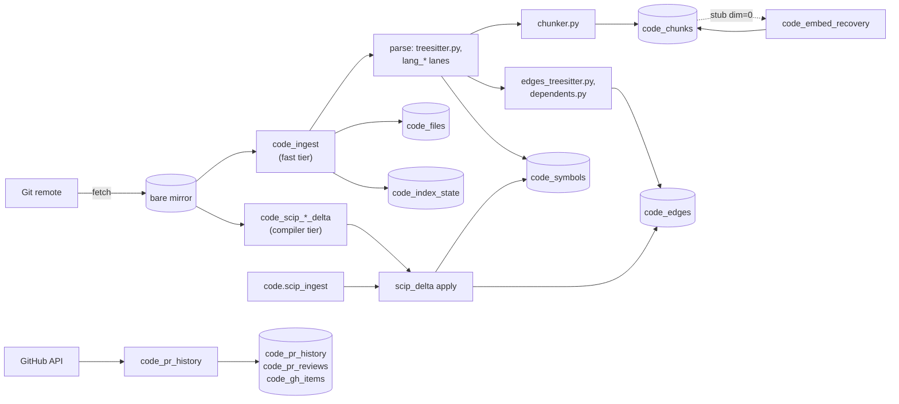

<!-- i18n: source=docs/architecture/code-index-architecture.md blob=9c0d2829f06e5917747d7848ef3ce0748e0c02d4 model=claude-sonnet-5-5 -->
> 이 페이지는 [영어 원문](https://github.com/ClickHouse/loom/blob/main/docs/architecture/code-index-architecture.md)을 기계 번역한 것이며, 영어 원문이 기준입니다.
> Machine-translated from the [English page](https://github.com/ClickHouse/loom/blob/main/docs/architecture/code-index-architecture.md), which is authoritative.

# 코드 인덱스 아키텍처

이 페이지는 코드 인덱스의 내부를 설명합니다. 파일이 어떻게 청크, 심볼, 엣지가 되는지, 그리고 두 티어가 어떻게 최신 상태를 유지하는지를 다룹니다. 각 op가 무엇에 답하는지, 지원하는 언어와 그 깊이, `as_of`를 읽는 방법은 [코드 인덱스 개요](https://github.com/ClickHouse/loom/blob/main/docs/features/code-index/overview.md)와
[최신성](https://github.com/ClickHouse/loom/blob/main/docs/features/code-index/freshness.md)에 있습니다. 클론, 백필, 컴파일러 티어 등 운영 방법은
[코드 인덱스 운영](https://github.com/ClickHouse/loom/blob/main/docs/operations/code-index-operations.md)에 있습니다.

## 목표와 비목표

| 목표                                                                                                     | 비목표                                                                                               |
| -------------------------------------------------------------------------------------------------------- | ---------------------------------------------------------------------------------------------------- |
| 로컬 bare 미러를 폴링하여 병합마다 빠른 티어를 최신 상태로 유지하며, 인바운드 웹훅은 사용하지 않습니다.   | 작업 트리 인덱싱. 커밋되지 않았거나 푸시되지 않은 변경 사항은 인덱스에 포함되지 않습니다.             |
| 컴파일러 인덱서가 있는 곳에서는 정확한 호출, 오버라이드, 상속 엣지를 제공하고, 그 외에는 등급이 매겨진 휴리스틱을 사용합니다. | 서버 프로세스 안에서 컴파일러 실행. SCIP 프로듀서는 workers 프로세스의 서브프로세스에서 실행됩니다. |
| 멱등적 수집: 바이트가 변하지 않으면 동일한 행이 생성되며 임베딩 비용도 들지 않습니다.                   | 범용 코드 호스트. 인덱스는 네임스페이스를 키로 하는 읽기 전용 참조 데이터입니다.                       |
| 모든 응답에 읽은 커밋과 티어를 명시하고, 응답이 비어 있다면 그 이유를 설명합니다.                       | 오래된 상태 숨기기. 뒤처진 티어는 보고됩니다.                                                         |
| 다른 언어를 다시 인덱싱하지 않고도 새 언어를 추가할 수 있습니다.                                         | 모든 언어에 대한 동일한 깊이 ([언어](https://github.com/ClickHouse/loom/blob/main/docs/features/code-index/overview.md)). |

## 하나의 네임스페이스, 하나의 브랜치

코드 네임스페이스는 하나의 저장소 브랜치를 하나의 커밋 기준으로 나타냅니다. 이 네임스페이스는 `loom.namespaces`에서 `kind='code'`를 가지며(`code/app/index/registry.py`, `ensure_registered`), 메모리를 보관하지 않고, 모든 `code_*` 행을 `(org, namespace)` 키로 구분합니다. Loom은 저장소마다 bare git 미러를 하나씩 유지합니다. 이 미러는 ClickHouse에 기록된 원격 저장소의 캐시입니다. 미러가 없으면 `code_ingest`가 클론하고(`loom code init`으로 미리 클론할 수도 있습니다), 매 처리 주기마다 fetch합니다. `server/code/app/index/gitrepo.py`는 `git`을 셸로 호출하며, 작업 트리가 없고 `fetch` 외에는 아무것도 쓰지 않습니다. 같은 저장소의 브랜치들은 미러를 공유합니다.

미러가 없는 호스트에서 기록 읽기(`blame_range`, bisect, `first_build`, 교훈의 코드 확인)가 일어나면, 해당 호스트는 백그라운드에서 미러를 한 번 클론합니다(`server/code/app/index/mirrors.py`, `history_dir`). op 이름을 지정한 읽기는 자신이 시작한 클론을 최대 10초 동안, 또는 op의 지연 시간 예산에서 남은 시간 동안 중 더 짧은 쪽만큼 기다립니다. 그 외의 읽기는 클론이 끝날 때까지 `no_git_mirror`로 응답합니다. 클론이 끝나면 클론에 없는 원장의 병합 커밋을 sha로 fetch하고 고정합니다. 업스트림에서 이미 삭제된 스테이징 브랜치에서 만든 병합은 워커의 미러(prune하지 않음)에는 있지만 새 클론에는 없기 때문입니다. 미러가 있으면 그대로 응답하고, 인덱싱된 head가 없는 미러는 백그라운드에서 해당 브랜치를 fetch합니다. 브랜치의 head가 아닌 head(PR head)는 fetch하지 않습니다.

그 결과 문의를 받은 모든 서빙 호스트에 모든 미러의 전체 사본이 생깁니다. 이것이 장점(이동이나 스케일 아웃 후에도 어느 호스트든 기록 읽기에 응답할 수 있음)이자 비용(호스트마다 저장소 크기만큼의 디스크)입니다. `LOOM_CODE_HISTORY_CLONE_ON_READ=false`로 이 동작을 끌 수 있습니다. 이 경우 워커의 호스트만 클론하고, 다른 곳의 기록 읽기는 `no_git_mirror`로 응답합니다.

저장소 항목은 두 출처에서 가져와 병합합니다.

| 출처              | 읽는 곳                           | 비고                                                                                                       |
| ----------------- | --------------------------------- | ---------------------------------------------------------------------------------------------------------- |
| 환경 변수         | `code/domain/index/repos.py`      | `LOOM_CODE_REPOS_JSON` 또는 개별 `LOOM_CODE_*` 설정.                                                       |
| `loom.code_repos` | `code/app/index/repo_registry.py` | `row_kind`별 셀프 서비스 행(아래 참조). 비공개 원격 저장소의 토큰은 암호화되어 저장되며 반환되지 않습니다. |

`loom.code_repos` 행의 `row_kind`는 그 행의 종류를 나타냅니다.

- `page`: 페이지에서 추가한 브랜치입니다. 삭제 여부와 관계없이 운영자 항목이 해당 네임스페이스를 차지하지 못하게 합니다.
- `access`: 운영자 항목의 분류와 참여 정책입니다.
- `''`: 이 컬럼이 생기기 전에 기록된 행입니다. 운영자 항목의 네임스페이스에서는 해당 항목의 access 행으로, 그 외에서는 페이지에서 추가한 브랜치로 읽습니다.

`configured_repos()`는 부팅 시, 모든 인제스트 주기마다, 그리고 추가 후에 갱신되는 프로세스 내 스냅샷을 읽습니다. 스냅샷을 처음 읽기 전에는 `RegistryUnread`를 발생시킵니다(셀프 서비스가 켜져 있을 때). 페이지 네임스페이스가 건너뛰는 항목을 아직 알 수 없기 때문입니다. 접근 권한을 결정하는 모듈은 `config_entries()`를 읽으며, 이 함수는 첫 읽기 전에는 조직이 읽을 수 있는 항목이 없는 상태로 항목을 나열합니다(`tests/unit/test_repo_snapshot_contract.py`). 전체 목록이 필요한 op는 이 구간 동안 503으로 응답합니다. 메모리 읽기, 검색, `memory.for_file`은 코드 링크 없이 응답합니다. 네임스페이스를 지정하지 않은 코드 호출은 어떤 멤버도 해당 네임스페이스를 페이지에서 추가하지 않은 경우에만 `LOOM_CODE_NAMESPACE`를 기본값으로 사용합니다. 항목을 폐기하면(`code/app/index/retire.py`) 해당 행이 비활성화되고, 그 네임스페이스의 모든 `code_*` 테이블에 대해 삭제 saga가 실행되며, 호출을 처리한 호스트에서 다른 항목이 미러를 쓰지 않는 경우 미러도 제거됩니다. 다른 호스트는 각자의 sweep에서 자기 사본을 제거합니다.

## 모든 레플리카의 Git 미러

모든 서빙 프로세스가 기록 조회(blame, bisect, 인용, PR 오버레이, 커밋 커버리지)에 응답할 수 있으므로, 각 호스트는 자신의 bare 미러를 유지합니다
(`code/app/index/mirrors.py`). 미러는 원격 저장소의 캐시입니다. ClickHouse가 원격을 지정하며, 어느 호스트든 이를 바탕으로 미러를 다시 만들 수 있습니다.

- **워밍업.** 부팅 시 각 프로세스는 자신에게 없는 인덱싱된 항목의 미러를 `LOOM_CODE_MIRROR_WARMUP_CONCURRENCY`개씩 클론하며, 각 클론은 최대 30 s까지의 무작위 대기 후에 시작합니다. 따라서 N개의 레플리카가 동시에 시작해도 모두가 한꺼번에 GitHub에서 클론하지 않습니다. 클론은 백그라운드에서 실행되며, 준비 상태(readiness)는 클론을 기다리지 않습니다.
- **새 디스크의 비용.** `LOOM_CODE_REPOS_ROOT`가 비어 있는 호스트는 기록 조회에 응답하기 전에 인덱싱된 모든 저장소의 전체 bare 클론을 만듭니다(큰 저장소는 수 GB). 새 레플리카가 운영자 없이 캐시를 구축해야 하므로 워밍업은 기본적으로 켜져 있습니다. `LOOM_CODE_REPOS_ROOT`를 롤아웃 이후에도 유지되는 볼륨에 두면 이 비용을 파드마다가 아니라 볼륨당 한 번만 치릅니다. 클론은 `--filter=blob:none`이 아니라 전체 클론입니다. 부분 클론은 `git blame`이 실행되는 동안 누락된 blob을 원격에서 하나씩 가져오므로 기록 조회가 네트워크 읽기가 되고, 저장소 작업 샌드박스 밖에서 원격에 접근하게 되기 때문입니다.
- **게이트.** 모든 기록 조회는 `mirrors.history_dir`를 거치며, 이 함수는 미러를 반환하거나 미러가 없는 이유를 반환합니다. 미러가 준비되기 전까지 조회는 git 오류 대신 `no_git_mirror: cloning <entry>`(또는 여기서 클론되지 않는 이유)로 응답하고, 실행 중인 클론이 없으면 클론을 시작합니다. `LOOM_GIT_HISTORY=none`은 호스트에서 기록 기능을 끕니다. 이 경우 조회는 `no_git_history`로 응답합니다.
- **호스트 루프.** 리더만 원격에 무엇이 바뀌었는지 묻습니다(추가 브랜치와 PR 헤드의 `ls-remote`). 리더의 패스가 가져온 내용은 ClickHouse에 있습니다. 각 항목의 브랜치 팁(`clone_head`), 열린 PR의 헤드(`code_gh_items.head_sha`), 원장(ledger)의 머지입니다. 각 호스트는 `LOOM_CODE_MIRROR_FETCH_INTERVAL_S`마다 이를 읽어, 자신의 미러가 다른 sha로 가지고 있는 브랜치와 PR 헤드만 이름으로 페치하고, 없는 원장 머지는 한 페이지 분량을 함께 페치합니다. 최신 상태인 호스트는 네트워크 호출을 하지 않습니다. 추가 브랜치는 다른 호스트에서 따라가지 않습니다. 새 클론에는 원격에 있던 모든 브랜치가 들어 있고, 그 브랜치의 머지는 원장을 통해 들어옵니다. 호스트당 하나의 프로세스가 각 미러의 라운드를 수행하며, 미러로의 모든 페치(패스의 페치, 호스트 루프의 페치, 조회의 페치)는 미러의 `.fetch-lock`을 잡습니다. 패스의 페치는 해당 간격 동안 호스트의 라운드로도 인정됩니다. 같은 루프가 필요할 때 `git gc --no-prune`을 실행하고 `LOOM_CODE_REPOS_ROOT`를 정리합니다. 대상은 활성 항목(제한된 항목 포함)이 지정하지 않는 미러, `checkout-*` 트리, 미러 잠금 파일, 그리고 완료되지 않은 클론입니다. 레지스트리를 읽을 수 없을 때는 아무것도 정리하지 않습니다.
- **샌드박스.** 저장소 작업 샌드박스가 없는 호스트는 뷰어가 추가한, 네트워크 원격을 가진 항목을 읽기 경로에서도 워커에서도 클론하거나 페치하지 않습니다(`compiler_tier.unsandboxed_skip`).
- **원격이 잃어버린 머지.** 원격이 더 이상 제공하지 않는 원장 머지("not our ref"가 두 번의 호출에서 발생한 경우이며, 일시적인 거부 한 번은 집계하지 않습니다)는 미러에 기록되고(`loom-unpinned-merges`), 다시 요청하지 않으며, `/v1/health?include=mirrors`(`mirrors.unpinned_merges`)와 `loom doctor`에 집계됩니다.
- **리더**도 누락된 미러를 백그라운드에서 클론하므로, 오래 걸리는 클론 하나가 같은 패스의 다른 항목을 지연시키지 않습니다. 인덱싱된 항목은 새 호스트에서 미러가 다시 클론되는 동안에도 Repositories 카드의 단계를 유지합니다.
- **삭제.** 미러와 체크아웃에는 메모리 콘텐츠가 아니라 저장소 콘텐츠가 들어 있으므로, 삭제 집계(erasure census)는 이를 세지 않습니다. 제거된 저장소의 사본은 각 호스트의 정리 작업과 함께 사라집니다.

`/v1/health?include=mirrors`는 `mirrors`를 반환합니다. 이 호스트의 미러 중 `ready`와 `cloning`인 개수, 그리고 사유별로 센 `failed`와 `absent`입니다. 이 응답은 토큰 없이 제공되므로 어떤 항목의 이름도 포함하지 않습니다. 디스크 사용량은 모든 호스트의 모든 미러 크기의 합이며, N개의 레플리카는 N개의 사본을 보유합니다.

## 구성 요소

## 빠른 티어: `code_ingest`

`server/code/workers/ingest.py`는 `LOOM_CODE_INGEST_INTERVAL_SECONDS`마다 폴링합니다.
`code.refresh`는 CI에서 한 번의 패스를 실행시킵니다. 각 패스는 엔트리마다 다음을 수행합니다.

1. 미러를 **가져오고**, `code_index_state`의 `git_head` 워터마크부터 팁까지 first-parent 커밋을 오래된 것부터 순회합니다. 한 패스에서 최대 `LOOM_CODE_INGEST_MAX_COMMITS_PER_PASS`개까지 처리합니다.
2. 각 커밋에서 **변경된 파일만 정확히 다시 인덱싱합니다**(`code/app/index/ingest.py`의 `ingest_file`). 파싱, 청크 분할, 심볼, 엣지, 호출 가드, 파일 행, 그리고 커밋이 지목하는 병합된 PR의 컨텍스트 팩과 리뷰 브리프를 처리합니다. 그다음 `git_head`를 앞으로 옮깁니다. 크래시가 나면 마지막으로 완료된 커밋부터 다시 실행합니다.
3. `LOOM_CODE_INGEST_WALK_BUDGET_SHARE`가 남겨 둔 몫으로 **순회합니다**. 정합성 복구(reconciliation)와 extractor 재청크가 여기에 해당합니다(아래 참고).

| 제한                                    | 효과                                                                                          |
| --------------------------------------- | --------------------------------------------------------------------------------------------- |
| `LOOM_CODE_INGEST_MAX_PASS_SECONDS`     | 패스 길이.                                                                                    |
| `LOOM_CODE_INGEST_PASS_BUDGET_FRACTION` | 이 비율을 넘기면 패스는 새 단위를 시작하지 않고 커서를 저장한 뒤 `partial: true`를 반환합니다. |
| `LOOM_CODE_INGEST_SECONDS_PER_FILE`     | 커밋의 비용을 예측합니다. 초과할 것으로 예측된 커밋은 패스의 첫 작업일 때만 시작합니다.       |
| `LOOM_CODE_INGEST_SLICE_SHARE`          | 크기가 큰 커밋 하나가 여러 패스로 나뉘기 전에 커밋 단계에서 차지할 수 있는 최대 비율.         |
| `LOOM_CODE_INGEST_LANES`                | 나란히 인제스트하는 엔트리 수(기본값 1, 최대 8). 한 엔트리의 커밋은 순차적으로 처리됩니다.    |
| `LOOM_CODE_INGEST_ROUND_FILES`          | 커밋 안에서 한 라운드에 처리하는 파일 수. 읽기는 두 개의 쿼리로 미리 가져오고, 쓰기는 배치로 처리합니다. |

레인이 도움이 되는 이유는 레인이 CPU가 아니라 ClickHouse 왕복을 기다리기 때문입니다.

**수용 기준.** 파일이 거부 목록(`code/app/index/denylist.py`, `LOOM_CODE_INGEST_EXCLUDE`,
`LOOM_CODE_INGEST_IGNORE_FILE`)과 일치하거나, 바이너리이거나, `LOOM_CODE_INGEST_MAX_FILE_BYTES`를 넘으면 파싱 전에 거부됩니다.
따라서 grep의 `coverage_floor: true`는 모든 바이트가 아니라 수용된 모든 청크를 뜻합니다.

### 파서 선택

`ingest_parse.parse_for_ingest`는 다음을 순서대로 시도합니다. 이 순서는 새 파일 종류가 extractor 스탬프에 들어가지 않게 합니다.

1. `treesitter.lang_for_path`: 스탬프가 찍힌 코어(`.h`를 포함한 C/C++는 C++ 문법으로 처리, Python, shell, SQL, 문서, 설정). 이후 `ingest_parse._lane_language`가 CMake 파일과 TLC 설정을 다시 분류합니다.
2. 설정 파일 중 Helm과 Kubernetes 매니페스트(`lang_gotemplate`, `lang_k8s`).
3. `lang_detect.detect_by_extension`(`LANG_BY_EXTENSION`).
4. shebang, 그다음 Linguist 이름과 ShellCheck 지시문에 의한 shell 감지(`lang_detect.detect_shell`).
5. `LOOM_CODE_HOST_ISLANDS`를 사용하는 호스트 파일(Dockerfile, Makefile, Jenkinsfile, CI YAML)(`lang_hosts`).
6. 기대 출력 픽스처. 파일당 임베딩되지 않는 청크 하나(`lang_reference`).
7. 그 외 모든 텍스트. 심볼 없이 청크로 나눕니다(`lang_text`).

파서는 `ingest_parse._PARSERS`에서 가져옵니다. 문법 누락이나 `code_parse_timeout_s` 또는 `code_parse_memory_mb`를 초과한 tree-sitter 파싱(`bounded_parse`, 한 번에 하나의 파싱)을 포함해 이 파싱이 실패하면, `code_files.index_error`가 설정된 청크 전용 파일로 격하됩니다. `code.index_errors`가 이를 보고하며, TLA+ 스펙은 대신 정규식 리더로 폴백합니다. 다른 곳에서 한도를 넘긴 파싱은 호출한 쪽의 폴백을 따르며 오류를 기록하지 않습니다.
Tree-sitter 모듈은 지연 임포트되므로, 코드 워커를 끈 서버는 `code` extras 없이 부팅됩니다.

### 청크

`server/code/domain/extract/chunker.py`는 고정 윈도 대신 의미 단위로 자릅니다.

| 청크             | 내용                                                                                                        |
| ---------------- | ----------------------------------------------------------------------------------------------------------- |
| `function`       | 함수 본문 하나. 너무 큰 함수는 최상위 문장 단위로 나누고, 각 조각 앞에 시그니처를 붙입니다.                 |
| `class_skeleton` | 메서드 본문을 생략한 클래스.                                                                                |
| `file_header`    | 맨 앞의 주석과 include.                                                                                     |
| `other`          | 나머지를 묶은 것.                                                                                           |

트리가 없는 파일은 줄 단위 윈도로 폴백합니다. 문법이 없는 레인은 심볼 범위로 자릅니다(`lane_units.span_chunks`). 청크 id는
`uuid5("loom://code/{namespace}/{path}#{scope}@{sha16}")`입니다. 콘텐츠 주소 방식이므로 변경되지 않은 청크는 id와 해시를 유지하고, 임베딩 단계는 조회 없이 이를 건너뜁니다.
한 파일 안의 동일한 청크에는 순번 접미사가 붙습니다.

### 심볼과 엣지

심볼 id는 `treesitter.symbol_id(qualified_name, signature)`입니다. 이름과 정규화된 시그니처(공백 축약, 기본값 제거, 따라서 오버로드는 서로 다름)에 대한 SHA-256의 처음 128비트입니다. 빠른 티어, SCIP 변환기, 읽기 경로가 모두 이 함수를 호출하므로, 두 티어에서 공유하는 심볼은 하나의 id로 저장됩니다. Python과 shell은 모듈 경로로 이름을 한정하므로, 테스트 트리의 수많은 `main()` 함수가 서로 구분됩니다.

빠른 티어 엣지(`edges_treesitter.py`, `tier='treesitter'`)는 이름으로 해석되고 등급이 매겨집니다.

| 신뢰도 | 규칙                                                                    |
| ------ | ----------------------------------------------------------------------- |
| 1.0    | 같은 파일 안의 유일한 정의                                              |
| 0.8    | 둘러싼 클래스의 메서드                                                  |
| 0.6    | 리포지토리 전체 심볼 이름 테이블에서의 유일한 일치                      |
| 없음   | 모호하거나 알 수 없음: 엣지 없음. `code_call_sites_unresolved`에 기록   |

틀린 엣지는 없는 엣지보다 나쁘므로, `code.callers`는 집계에서 제외된 호출 지점이 몇 개인지 보고합니다. 생성자 호출(`T x(...)`, `new T`, `make_unique<T>`)은 `T::T`에 대한 호출입니다. 수신자 타입 모듈(`cpp_receivers.py`, `py_receivers.py`, `ts_receivers.py`, `go_receivers.py`)이 멤버 호출을 바인딩합니다. 엣지 종류는 `calls`, `includes`, `inherits`, `overrides`, `uses_type`, `fixture_use`, `reads`, `writes`입니다.

**의존 파일.** 엣지는 리포지토리 전체 이름 테이블을 기준으로 해석되므로, 심볼을 추가·삭제하거나 시그니처를 바꾸는 커밋은 그 심볼을 이름으로 참조하는, 변경되지 않은 파일의 엣지도 바꿉니다.
`code/app/index/dependents.py`는 같은 커밋에서 그런 파일의 엣지만 다시 추출하며, 최대 `LOOM_CODE_INGEST_DEPENDENTS_MAX_FILES`개까지 처리합니다. 넘친 분량은 `code_index_state`(`dependents_pending`)에서 대기하다가 정합성 복구를 통해 소진됩니다.

### 임베딩과 벡터 테이블

`code_ingest`는 새 청크를 인라인으로 임베딩하며, 콘텐츠 해시로 메모이즈하고(`embed_reuse.py`) 텍스트 길이를 제한합니다(`embed_text.py`). `LOOM_CODE_CONTEXT_DESCRIPTION_ENABLED`(기본값 켜짐)를 사용하면 청크의 임베딩 텍스트 앞에 LLM이 만든 한 줄 설명이 붙으며, 이는 최선 노력 방식이고 예산으로 제한됩니다. 프로바이더가 실패하면 `embedding_dim = 0` 스텁이 남고, `code_embed_recovery`가 이를 채웁니다. 이때 텍스트별 폴백을 쓰고, `LOOM_CODE_EMBED_MAX_ATTEMPTS` 이후에는 포이즈닝 처리합니다. 네임스페이스 청크 중 `LOOM_CODE_READY_EMBED_COVERAGE` 비율만큼 벡터가 생길 때까지 `code.search`는 어휘 기반 경로로 답하며 그 사실을 알립니다.

| 테이블                                    | 채우는 주체                                        | 용도                                                                                                  |
| ----------------------------------------- | -------------------------------------------------- | ----------------------------------------------------------------------------------------------------- |
| `code_summaries`                          | `code_summary`(주간, 기본값 꺼짐)                  | `code.map`을 위한 파일 및 모듈 카드. 입력 해시로 제어하며, `code_graph_stats`의 PageRank를 포함합니다. |
| 두 번째 모델 테이블, `code_chunks_prefix` | `LOOM_CODE_VECTOR_TABLES`; `loom code vector-twin` | 벡터 경로는 더 작은 트윈에서 후보를 추리고, 제공 중인 벡터로 다시 점수를 매깁니다(`prefix_twin.py`).   |
| `code_answers`                            | `code.ask`                                         | 질문 임베딩을 키로 하는 답변 캐시. 인용된 모든 파일의 해시가 최신일 때만 제공됩니다.                  |

대량 패스는 병합되기 전까지 키마다 여분의 사본을 남깁니다. `code/app/index/compaction.py`는 대량 패스 후 트윈 테이블에 `OPTIMIZE … FINAL`을 실행합니다. `code_chunks`는
`loom code compact --table code_chunks --apply`로만 컴팩션됩니다.

## 컴파일러 티어: SCIP

컴파일러 티어는 `tier='scip'` 심볼과 엣지를 보관합니다. 서버는 protobuf를 직접 파싱하지 않습니다. 프로듀서가 SCIP 출력을 버전이 있는 JSON 델타(`scripts/scip_harness/scip_to_delta.py`)로 변환하고, `code/app/index/scip_delta.py`가 이를 적용합니다. 적용은 변경된 파일마다 델타가 내보내는 항목을 upsert하고, 더 이상 내보내지 않는 해당 파일의 `scip` 행은 tombstone 처리합니다. 삭제된 파일은 통째로 tombstone 처리합니다. 같은 델타를 다시 적용해도 활성 집합은 동일합니다.

| 프로듀서          | 언어                    | 워터마크         | 워커                                                   | 실행 방식                                                                                                                             |
| ----------------- | ----------------------- | ---------------- | ------------------------------------------------------ | ------------------------------------------------------------------------------------------------------------------------------------- |
| `scip-clang`      | C++                     | `scip_commit`    | `code_scip_full`, `code_scip_delta`, `code_scip_apply` | `run_delta.sh`를 통해 변경된 TU(및 변경된 헤더를 포함하는 TU, 상한 있음)를 처리합니다. `code_scip_full`은 티어를 초기 구성하고 매주 다시 인덱싱합니다. |
| `scip-typescript` | TypeScript / JavaScript | `scip_commit_ts` | `code_scip_ts_delta`                                   | 패스마다 워크스페이스 전체를 인덱싱하고, 변환기가 해당 구간의 파일로 범위를 제한합니다.                                                |
| `scip-go`         | Go                      | `scip_commit_go` | `code_scip_go_delta`                                   | 모듈마다 한 번씩 빌드합니다(`run_go_monorepo_delta.sh`).                                                                              |
| `scip-python`     | Python                  | `scip_commit_py` | `code_scip_py_delta`, `code_scip_apply`                | 머지마다 델타를 처리합니다(`run_python_delta.sh`). 첫 실행에서는 트리 전체를 인덱싱합니다.                                              |

`code/domain/index/compiler_tiers.py`(`TIERS`)는 프로듀서별 워터마크, 레이블, 워커를 모아 둔 단일 표이며, 상태 핸들러와 대시보드가 이를 읽습니다. 델타 워커는 자신의 워터마크를 `git_head`와 비교하고, 체크아웃을 이동한 뒤(네트워크가 아니라 로컬 미러에서 fetch), 서브프로세스로 프로듀서를 실행하고, `code.scip_ingest`가 사용하는 것과 같은 경로로 델타를 적용합니다. 한 번의 패스는 워터마크 이후의 모든 머지를 처리합니다.

CI 작업 같은 외부 프로듀서는 `code.scip_ingest`로 델타를 여러 부분으로 나누어 업로드할 수 있습니다. 각 부분은 `code_scip_batches` / `code_scip_parts`에 스테이징되고 `code_scip_apply`가 적용합니다. 컴파일러 티어의 모든 패스는 `LOOM_CODE_SCIP_LOCK_DIR`의 엔트리별 락 파일과 ClickHouse 리스를 획득하므로, 전체 재인덱싱과 델타가 한 엔트리에서 동시에 실행되지 않습니다. `loom code scip-full`은 C++ 티어를 다시 구축하고, `loom code scip-delta`는 델타 패스를 한 번 실행합니다.

두 티어에 같은 행이 있으면 읽기는 컴파일러 행을 우선하며, 모든 응답에는 읽은 티어(`scip` 또는 `treesitter`)가 표시됩니다.

## 익스트랙터 스탬프

콘텐츠 주소 기반 청크와 해시된 심볼 id는 행을 만든 코드가 아니라 입력을 키로 삼기 때문에, 청커를 고쳐도 기존 행에는 반영되지 않습니다.
`server/code/domain/extract/extractor_stamp.py`가 이 간극을 메웁니다. 이 파일은 모든 익스트랙터 모듈의 코드 토큰(`logic_tokens`: 주석, 빈 줄, docstring은 제외하고 import는 바인딩하는 이름으로만 줄이므로, 모듈을 패키지 사이에서 옮겨도 스탬프는 바뀌지 않습니다)과 스탬프 대상 그래머의 설치 버전(`STAMPED_GRAMMARS`: 기본 라이브러리, C++, Python, bash)을 해시합니다.

스탬프는 변경 시 다시 도출하는 범위를 최소화하도록 두 가지 방식으로 나뉩니다.

- **단계별** (`STAGES`: `chunk`, `symbol`, `edge`, `guard`; `STAGE_MODULES`). 한 단계의 스탬프는 그 단계의 모듈과, 그 단계가 읽는 단계(`STAGE_INPUTS`)의 모듈을 포함합니다.

  | 변경된 모듈                       | 바뀌는 단계                   |
  | --------------------------------- | ----------------------------- |
  | `chunker.py`                      | `chunk`                       |
  | `edges_treesitter.py`             | `edge`, `chunk`, `guard`      |
  | `treesitter.py`, `lang_python.py` | 전체 (`symbol`이 나머지에 입력을 공급함) |
  | `call_guards.py`                  | `guard`                       |

- **언어 계열별** (`LANGUAGE_FAMILIES`: `python`, `shell`, `typescript`, `cpp`,
  `other`; `MODULE_LANGUAGES`). Python에만 해당하는 변경은 `.py` 파일만 복구하고 C++는 그대로 둡니다. TypeScript 엣지 모듈(`ts_receivers.py`, `ts_reexports.py`,
  `ts_config.py`, `ts_workspace.py`)은 `typescript`만 바꿉니다. 스탬프 대상 모듈이 `MODULE_LANGUAGES`에 없으면 모든 계열이 바뀝니다.

각 패스는 실행 중인 스탬프를 `code_index_state`에 저장된 스탬프와 비교합니다. 바뀐 단계는 색인된 모든 네임스페이스에서 해당 계열의 모든 파일에 대해, 속도를 조절한 배치로 다시 도출됩니다(`LOOM_CODE_EXTRACTOR_RECHUNK_PER_PASS`, 스위치 `LOOM_CODE_EXTRACTOR_RECHUNK_ENABLED`).
기록된 스탬프가 비어 있으면 기록만 하고 동작은 하지 않습니다. 따라서 다음과 같습니다.

- `EXTRACTOR_MODULES`에 있는 모듈의 코드를 변경하면 영향받는 계열의 모든 저장소가 다시 색인되며, 대규모 배포에서는 몇 시간이 걸립니다. 주석과 docstring은 자유롭게 수정할 수 있습니다.
- 이 파일들은 포매터 대상에서 제외되어 있으며(`pyproject.toml`), `tests/unit/test_code_extractor_stamp.py`가 제외 목록과 모듈 목록이 어긋나지 않게 유지합니다. `server/code/domain/extract/`에 있으면서 어느 단계에도 속하지 않는 모듈은 이유와 함께 테스트의 `NON_EXTRACTOR_MODULES`에 나열해야 합니다.
- 추출 동작이 바뀔 때만 이 파일들을 변경하고, 배포 후 다시 도출이 일어날 것을 예상하세요.

**레인 모듈은 스탬프에 포함되지 않습니다.** 레인 파서(`lang_typescript.py`,
`lang_rust.py`, `lang_go.py`, `lane_units.py` 등), 해당 그래머, 파일 선택 모듈(`lang_detect.py`, `denylist.py`)은 스탬프를 바꾸지 않습니다. 위의 TypeScript 엣지 모듈은 예외입니다. 레인 수정은 해당 언어의 파일에 대해 `loom code backfill --paths-file`로 적용합니다.

## 조정(Reconciliation)

워터마크는 어떤 커밋을 순회했는지만 알려 주며, 모든 행이 최신인지는 알려 주지 않습니다.
`code/app/index/reconcile.py`가 드리프트를 측정합니다. `code_files` 행에는 `blob_sha`와 `indexed_commit`이 들어 있습니다. `git ls-tree -r <head>`를 한 번 실행하면, blob이 다른 경로는 오래된 경로(stale)로, 존재하지 않는 경로는 삭제된 경로(gone)로 표시됩니다. blob이 없는 행은 고유한 커밋마다 `git diff --name-only`를 한 번씩 실행하는 방식으로 대체하며, 최대 `LOOM_CODE_RECONCILE_MAX_COMMITS`개의 커밋까지 처리합니다.

`code_ingest`의 매시간 점검(`LOOM_CODE_RECONCILE_ENABLED`,
`LOOM_CODE_RECONCILE_INTERVAL_SECONDS`)은 오래된 경로를 최대 `LOOM_CODE_RECONCILE_HEAL_PER_PASS`개까지 `ingest_file`로 다시 수집합니다. 새로운 콘텐츠만 임베딩됩니다. 수동으로 실행하려면 `loom code reconcile --heal`을 사용합니다. `loom.code.stale_files` 게이지는 해당 개수를 보고합니다.

## 워터마크와 커버리지

`code_index_state`(`ReplacingMergeTree(version)`, 키 `(org, namespace, state_key)`)는 `git_head`, 프로듀서별 SCIP 워터마크, 익스트랙터 스탬프, 커서, `dependents_pending`을 보관합니다. 모든 응답의 `as_of` 블록과 `loom.code.tier_lag_seconds{tier}`는 프로듀서의 로그가 아니라 이 행들과 미러를 기반으로 계산됩니다. 커밋별 커버리지(`code/app/index/commit_coverage.py`)는 워터마크 비교가 아니라, 미러에서 티어마다 한 번씩 실행하는 `git merge-base --is-ancestor`로 판단합니다. 호출자에게 보이는 내용은 [최신성](https://github.com/ClickHouse/loom/blob/main/docs/features/code-index/freshness.md)에서 확인할 수 있습니다.

## PR 기록, 백포트, 트래커 링크

| 테이블                                                 | 작성자                                                      | 내용                                                                                               |
| ------------------------------------------------------ | ----------------------------------------------------------- | -------------------------------------------------------------------------------------------------- |
| `code_pr_history`, `code_pr_reviews`, `code_gh_items`  | `code_pr_history` (GitHub REST, `updated_at` 기준 커서)     | 파일, 리뷰 코멘트, 이슈가 포함된 병합된 PR. 속도 제한이나 5xx가 발생하면 커서는 이동하지 않습니다.  |
| `code_context_packs`, `code_review_briefs`             | 병합 커밋 시점의 `code_ingest` 또는 요청 시                 | PR별 컨텍스트 팩과 리뷰어용 브리프.                                                                |
| `code_backport_gaps`                                   | `code_backport_gaps` (매일 밤, `code_pr_history` 필요)      | 백포트 레이블이 붙은 trunk PR마다 릴리스 브랜치 네임스페이스별로 한 행: 적용됨, 적용 필요, 영향 없음. |
| `code_test_map`, `code_symbol_stats`, `code_unit_risk` | `code_graph_stats` (매주), `loom code crossref`             | 테스트↔소스 맵, 심볼 fan-in, 단위별 위험도.                                                        |
| `code_coverage_files`                                  | `code_coverage_import` (매일), `loom code coverage-import`  | 소스 파일별로, 테스트별 커버리지 실행에서 실행된 라인 범위.                                        |
| `qa_link_candidates`                                   | `tracker_links` (매일)                                      | 최근 이슈별 상위 병합 PR. BM25F, diff의 스택 프레임, 닫기 언급을 기준으로 순위를 매깁니다.         |
| `qa_item_embeddings`                                   | `tracker_embed`                                             | 임베딩 기간 내 트래커 이슈와 PR의 벡터. 키와 필터 정보만 있고 텍스트는 없습니다.                   |

`code.repo.set_source`는 저장소를 트래커에 순서대로 연결합니다. 첫 번째가 기본 트래커이며, 그 번호가 저장소의 이슈 및 PR 번호가 됩니다. 이 링크는 `code_index_state`의 `qa_binding` 행이며 `(org, namespace)`로 읽습니다. 코드 네임스페이스 이름은 저장소와 브랜치에서 파생되므로 서로 다른 두 org가 같은 이름을 가질 수 있습니다. 운영자의 `LOOM_TRACKER_CODE_NAMESPACE_BINDINGS_JSON`은 운영자 자신의 저장소(`LOOM_CODE_REPOS_JSON` 또는 `LOOM_CODE_REPO`)에만 적용되며, 이름이 glob과 일치하는 셀프 서비스 저장소에는 적용되지 않습니다. 트래커 워커는 각 네임스페이스를 해당 네임스페이스 자체의 소스를 통해 읽으므로, 제한된 네임스페이스의 행이 표준 네임스페이스 아래에 기록되는 일은 없습니다. 레코드 규약은 [트래커 레코드 규약](https://github.com/ClickHouse/loom/blob/main/docs/features/tracker/record-contract.md)에 있습니다.

`code.repo.add_branch`는 루트가 운영자 저장소인 경우, 루트 저장소(소스, 또는 소스가 브랜치라면 그 소스의 루트)를 지정하는 새 브랜치의 `qa_branch_of` 행을 기록합니다. 따라서 셀프 서비스 루트의 브랜치는, 나중에 운영자가 그 루트의 이름을 설정하더라도 해당 맵을 읽기 시작하지 않습니다. 루트가 운영자 저장소인 등록된 브랜치는 읽는 시점에 그 저장소의 링크를 따르며 glob도 포함됩니다. 옆에 셀프 서비스 항목이 없는 `qa_branch_of` 행은 따르지 않습니다. 운영자 저장소가 아닌 소스는 자체 `qa_binding` 행이 브랜치로 복사되며, 비워진 행도 포함됩니다. 운영자 소스는 그 자체가 루트입니다. 두 행은 소스의 행을 먼저 읽은 뒤 `qa_branch_of`를 마지막으로 기록하므로, 실패하면 브랜치는 아무것도 따르지 않게 됩니다.

`code.repo.remove`는 네임스페이스의 분리된 퍼지 전에, 두 행 중 값이 있는 행을 비웁니다. 네임스페이스를 등록하면 같은 이름의 제거된 네임스페이스가 남긴 행을 비우고, 자기 프로세스의 스냅샷에서 그 이름을 제거하므로 새 네임스페이스는 둘 다 따르지 않습니다. 비워진 `qa_binding`은 트래커 관리자가 링크하기 전까지 해제된 것으로 읽습니다. `qa_binding` 행이 없던 네임스페이스에는 행이 생성되지 않으므로, 같은 이름으로 설정된 운영자 항목에는 운영자의 맵이 계속 적용됩니다. 제거된 이름으로 설정된 운영자 항목에는 이런 정리가 이루어지지 않습니다. 퍼지가 실행될 때까지는 제거된 네임스페이스의 `qa_binding` 행이 있으면 그것을 읽으며, 빌드 N-1에서 제거했다면 이전 링크가, N에서 제거했다면 아무 링크도 없습니다. 다른 프로세스는 읽은 행을 최대 `LOOM_CODE_REPOS_REFRESH_SECONDS` 동안 유지합니다.

## 스토리지

| 테이블                                                         | 엔진과 키                                                                                              | 비고                                                                                          |
| -------------------------------------------------------------- | ------------------------------------------------------------------------------------------------------ | --------------------------------------------------------------------------------------------- |
| `code_files`                                                   | RMT(`version`), `(org, namespace, path)`                                                               | 경로별 마지막 파싱 결과: language, `blob_sha`, `indexed_commit`, `index_error`.               |
| `code_chunks`                                                  | RMT(`version`), `(org, namespace, embedding_model, path, chunk_id)`, `(org, namespace)` 기준 파티셔닝  | 콘텐츠, `lexemes`, 벡터. 텍스트 인덱스: `lower(content)`의 3-gram, `lexemes`의 토큰.          |
| `code_symbols`                                                 | RMT(`version`), `(org, namespace, tier, qualified_name, symbol_id)`                                    | 시그니처, 범위, 문서 주석, `scip_symbol`을 포함한 정의. 이름에 대한 ngram 스킵 인덱스.         |
| `code_symbol_names`, `code_symbol_ids`                         | RMT, `code_symbol_names_mv` / `code_symbol_ids_mv`로 채움                                              | 심볼을 짧은 이름과 id 기준으로 키를 다시 구성한 테이블.                                       |
| `code_edges`                                                   | RMT(`version`), `(org, namespace, tier, to_symbol_id, edge_kind, from_symbol_id, path, line)`          | 호출자는 키 범위로 조회하며, 프로젝션 `by_from`(피호출자)과 `by_path`를 제공합니다.           |
| `code_call_sites_unresolved`, `code_caller_guards`             | RMT(`version`)                                                                                         | 피호출자 이름별로 해석되지 않은 호출 지점, 각 호출자의 호출 지점을 둘러싼 가드.               |
| `code_term_freq`, `code_doc_stats`                             | AMT, RMT; `code_term_freq_mv`, `code_doc_stats_mv`로 채움                                              | 어휘 검색 경로를 위한 BM25 통계.                                                              |
| `code_unit_signal`                                             | `SummingMergeTree((positive, negative))`                                                               | `code.outcome`에서 가져온 단위별 결과 카운터.                                                 |
| `code_search_trace`, `code_search_outcome`, `code_search_memo` | TTL 180일의 MT, TTL 60분의 RMT                                                                         | 쿼리별 트레이스와 결과, 그리고 제공된 `code.search` 응답의 단기 메모.                         |

모든 컬럼은 생성된 [스키마 레퍼런스](https://github.com/ClickHouse/loom/blob/main/docs/reference/schema.md)에서 확인할 수 있습니다.

## 쿼리 패턴

| Op                               | 경로                          | 동작 방식                                                                                                                                                                                                                                                                                                                                                                                          |
| -------------------------------- | ----------------------------- | -------------------------------------------------------------------------------------------------------------------------------------------------------------------------------------------------------------------------------------------------------------------------------------------------------------------------------------------------------------------------------------------------- |
| `code.search`                    | `code/app/search/pipeline.py` | 먼저 라우팅(패턴, 경로, 이력 질문)한 뒤 마감 시간 안에서 각 경로를 실행합니다(`gather.py`): 어휘 검색(idf 가중 토큰 수), 벡터 검색(벡터 인덱스 없는 스캔 또는 twin 후보 목록), PR 이력, 퍼지 심볼 투표. `fusion.py`가 역순위 방식(k = 60)으로 결과를 융합하고, `serve.py`가 토큰 예산에 맞춰 페이지를 나누거나 답변을 보류합니다. 메모 윈도우 안의 반복 요청은 `code_search_memo`를 한 번 읽는 것으로 처리됩니다. |
| `code.grep`                      | `code/store/index/grep.py`    | 3-gram 인덱스로 granule을 좁히고, `position()` 또는 `match()`가 판정하며, 각 일치 항목은 자신을 둘러싼 단위에 결합됩니다. `mode=presence`는 최대 여덟 개의 브랜치 네임스페이스에 걸칩니다.                                                                                                                                                                                                                                                                                                                    |
| `code.symbol`                    | `code/app/symbol/`            | 스코프로 한정된 심볼 이름(모듈/클래스/네임스페이스 한정 이름)은 `code_symbols`의 키 접두사 읽기이고, 짧은 이름은 `code_symbol_names`를 거치며, 정의가 여럿이면 `near_paths` 또는 검토 중인 PR을 기준으로 순위를 매깁니다.                                                                                                                                                                                                                           |
| `code.callers`, `code.impact`    | `code/store/index/edges.py`   | 호출자는 `code_edges`의 `to_symbol_id` 범위이며 컴파일러 행을 우선하고, 해석되지 않은 개수를 함께 반환합니다. `code.impact`는 diff hunk를 시드 심볼에 매핑한 뒤 바깥쪽으로 탐색합니다. 탐색 결과가 비면 `no_indexed_paths`, `no_seeds_in_hunks` 또는 `no_static_callers`로 응답합니다.                                                                                                                                   |
| `code.outline`, `code.enclosing` | —                             | `code_symbols`와 `code_chunks` 범위를 경로별로 읽습니다.                                                                                                                                                                                                                                                                                                                                          |

## 불변 조건

- 코드 네임스페이스는 하나의 브랜치입니다. 모든 `code_*` 행은 `(org, namespace)`를 키로 사용합니다.
- `git_head`는 커밋의 모든 파일이 기록된 후에만 앞으로 이동합니다.
- `treesitter.symbol_id`는 유일한 symbol-id 함수이며, 두 티어와 읽기 경로에서 모두 사용됩니다.
- 청크 id는 콘텐츠 기반으로 주소가 지정됩니다. 변경되지 않은 청크는 다시 임베딩되지 않습니다.
- 스탬프가 찍힌 모듈의 코드가 변경되면 모든 네임스페이스에서 해당 언어 계열의 단계가 다시 파생됩니다. 주석과 docstring은 다시 파생을 일으키지 않습니다.
- 델타 적용은 멱등적이며, 생산자가 더 이상 내보내지 않는 항목은 삭제 표시(tombstone) 처리합니다.
- 서버는 SCIP protobuf를 파싱하지 않습니다.
- 커밋별 커버리지는 미러에서의 조상 관계 검사이며, 워터마크가 아닙니다.
- 검색은 `embedding_dim > 0`으로 필터링합니다. 스텁 청크는 어휘 검색으로만 찾을 수 있습니다.

## 소스 진입점

| 경로                                                                                                                               | 설명                                                                                          |
| ---------------------------------------------------------------------------------------------------------------------------------- | --------------------------------------------------------------------------------------------- |
| `server/code/app/index/ingest_pass.py`                                                                                             | 빠른 티어 패스.                                                                               |
| `server/code/app/index/ingest.py`                                                                                                  | `ingest_file`, 파일별 단계.                                                                   |
| `server/code/app/index/ingest_parse.py`, `ingest_chunks.py`, `ingest_edges.py`, `ingest_resolve.py`, `ingest_reconcile.py`         | `parse_for_ingest`와 `_PARSERS`, 청크, 엣지, 엣지 해석 읽기, 키 비교 쓰기.                    |
| `server/code/domain/extract/treesitter.py`, `lang_detect.py`, `lang_*.py`, `lane_units.py`                                         | 언어.                                                                                         |
| `server/code/domain/extract/chunker.py`, `edges_treesitter.py`, `call_guards.py`; `server/code/app/index/dependents.py`            | 청크와 엣지.                                                                                  |
| `server/code/domain/extract/extractor_stamp.py`                                                                                    | 스탬프.                                                                                       |
| `server/code/app/index/reconcile.py`, `commit_coverage.py`, `scip_delta.py`; `server/code/domain/index/compiler_tiers.py`          | 드리프트, 커버리지, 티어.                                                                     |
| `server/code/workers/scip_*.py`, `scripts/scip_harness/`                                                                           | 컴파일러 티어.                                                                                |
| `server/code/workers/embed_recovery.py`, `summary.py`, `graph_stats.py`, `pr_history.py`, `backport_gaps.py`, `coverage_notify.py` | 백그라운드 워커.                                                                              |
| `server/code/domain/index/repos.py`; `server/code/app/index/repo_registry.py`, `registry.py`, `retire.py`, `gitrepo.py`            | 엔트리, 미러, 네임스페이스.                                                                   |
| `server/code/app/search/`, `server/code/store/index/`                                                                              | 읽기와 쓰기.                                                                                  |

## 관련 문서

- [코드 인덱스 개요](https://github.com/ClickHouse/loom/blob/main/docs/features/code-index/overview.md) (언어 및 티어),
  [최신성](https://github.com/ClickHouse/loom/blob/main/docs/features/code-index/freshness.md),
  [기록과 PR](https://github.com/ClickHouse/loom/blob/main/docs/features/code-index/history-and-prs.md).
- [코드 인덱스 운영](https://github.com/ClickHouse/loom/blob/main/docs/operations/code-index-operations.md).
- [언어 지원 추가하기](https://github.com/ClickHouse/loom/blob/main/docs/development/adding-language-support.md).
- [ClickHouse](https://github.com/ClickHouse/loom/blob/main/docs/architecture/clickhouse.md), [운영 레퍼런스](https://github.com/ClickHouse/loom/blob/main/docs/reference/operations.md#code).
