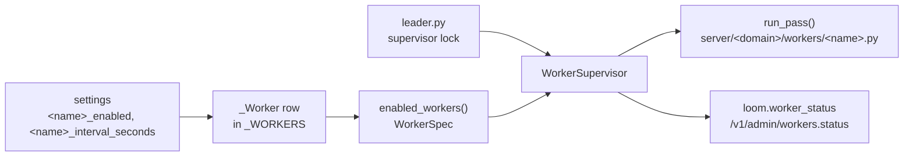

<!-- i18n: source=docs/development/adding-a-worker.md blob=caf48d881a70356a242d6cb16a1569b75e93391e model=claude-sonnet-5-5 -->
> 이 페이지는 [영어 원문](https://github.com/ClickHouse/loom/blob/main/docs/development/adding-a-worker.md)을 기계 번역한 것이며, 영어 원문이 기준입니다.
> Machine-translated from the [English page](https://github.com/ClickHouse/loom/blob/main/docs/development/adding-a-worker.md), which is authoritative.

<a id="add-a-background-worker"></a>

# 백그라운드 워커 추가

워커는 `server/workers/registry.py`(`_WORKERS`)의 한 행과 패스 함수 하나를 가진 모듈로 구성됩니다. `enabled_workers()`는 활성화된 행을 `WorkerSpec`으로 변환하고, `WorkerSupervisor`(`server/workers/supervisor.py`)는 각 워커를 실행하고, 시간을 측정하고, 백오프를 적용하고, 종료 처리를 합니다. 생성된 [워커 레퍼런스](https://github.com/ClickHouse/loom/blob/main/docs/reference/workers.md)에서 모든 행을 확인할 수 있습니다.



<a id="1-write-the-pass"></a>

## 1. 패스 작성하기

`server/<domain>/workers/<name>.py`에 `async def run_pass()`를 만듭니다. 슈퍼바이저는 이 함수를 간격마다 한 번 호출하고 반환값은 버립니다. 작은 예시는 `server/tasks/workers/lease_sweep.py`입니다.

```python
from server.workers import pass_context
from server.workers.status import record_pass


async def run_pass() -> SweepResult:
    from server.tasks.app.sweep import sweep_once

    with record_pass("task_lease_sweep") as rec:
        counts = await sweep_once()
        rec.outcome = dict(counts)
    result = SweepResult(**counts)
    if result.total == 0:
        pass_context.mark_idle()
    else:
        log.info("task_lease_sweep: expired=%d ...", result.expired)
    return result
```

패스 규약은 다음과 같습니다.

- **멱등성과 제한된 작업량.** 패스는 마감 시간에 취소될 수도 있고, 크래시 후 다시 실행될 수도 있으며, 배포 후 다른 색상에서 실행될 수도 있습니다. 제한된 양의 작업만 수행하고 나머지는 다음 패스에 남겨 두세요.
- **마감 시간.** 기본값은 `min(4 × interval, 900 s)`이며 최소 60 s입니다(`default_max_pass_seconds`). 마감 시간을 넘긴 패스는 취소되며 실패로 집계됩니다. 더 오래 걸리는 패스에는 해당 행에 `max_pass_seconds` 또는 `max_pass_setting`을 설정하세요.
- **실패.** 예외가 발생하면 패스가 실패합니다. 슈퍼바이저는 지수 백오프(1 s에서 시작해 60 s까지 두 배씩 증가)로 재시도하며, 연속 3회 실패하면 워커를 `degraded`로 표시합니다. 마감 시간에 중단된 패스나, 간격이 마감 시간보다 긴 워커(일간 및 주간 패스)는 전체 간격만큼 기다립니다(`failure_hold_seconds`). 그래서 재시도가 같은 데이터베이스 시간을 다시 소모하지 않습니다.
- **부분 실패.** 패스 자체는 실패시키지 않고 일부 단계만 실패하는 경우 `pass_context.note_failure(exc, what)`를 호출합니다. 이 호출은 연속 실패 횟수에 반영되며 `loom.worker.partial_failures{worker}`에 표시됩니다.
- **유휴.** 처리할 것이 없었던 패스는 `pass_context.mark_idle()`을 호출합니다. 그러면 슈퍼바이저는 `idle_interval_seconds`만큼 대기합니다.
- **커서.** 페이징하는 워커는 `pass_context.resume_cursor()`로 커서를 읽고, 멈춘 지점에서 `pass_context.set_cursor(value)`를 호출합니다. 커서는 해당 패스의 `loom.worker_status` 행에 저장되므로 프로세스를 재시작해도 이어서 실행됩니다.
- **광범위한 `except`에는 이유를 적습니다.** `# noqa: BLE001 — <what must not fail>`

<a id="2-attribute-its-queries"></a>

## 2. 쿼리 출처 지정하기

supervisor는 모든 패스에 태그를 붙입니다.

- ClickHouse 쿼리는 `log_comment` `worker.<name>`을 가집니다(`server/workers/status.py`의 `set_worker_identity`).
- 프로바이더 스팬은 `loom.operation=worker.<name>`을 가집니다.
- 패스는 백그라운드 트래픽 클래스(`bind_background`)에서 실행됩니다.
- 패스의 LLM 및 임베더 사용 비용은 하나의 원장 행 `worker.<name>.pass`에 기록됩니다.

supervisor **밖에서** 도는 루프(태스크, 스레드, CLI 루프)는 스스로 태그를 지정해야 합니다. 그렇지 않으면 해당 쿼리가 `untagged:<module>.<function>`으로 기록됩니다.

```python
from server.core.ch import set_query_tag

set_query_tag("worker.my_loop")
```

<a id="3-add-its-settings"></a>

## 3. 설정 추가하기

`server/settings/catalog.py`에서 해당 영역의 섹션(`Memory`, `Code`, `Tracker` 등)에 스위치와 실행 주기를 추가합니다. 각 주석은 생성되는 [설정 레퍼런스](https://github.com/ClickHouse/loom/blob/main/docs/reference/configuration.md)에서 해당 행의 설명 텍스트가 됩니다.

```python
    # Lease sweeper: return expired leases to todo, resume deferred tasks at
    # resume_at, escalate stale triage. One read per pass.
    task_lease_sweep_enabled: bool = True
    # Seconds between passes while there is work.
    task_lease_sweep_interval_seconds: int = 60
    # Seconds between passes that found nothing.
    task_lease_sweep_idle_interval_seconds: int = 300
```

워커가 자격 증명을 필요로 하거나, 외부 제공자에 비용을 지출하거나, 운영자가 직접 선택해 사용하는 플레인을 담당한다면 기본값을 **off**로 설정합니다. 기본값이 on인 워커는 노트북을 포함한 모든 스택에서 실행됩니다.

<a id="4-add-the-registry-row"></a>

## 4. 레지스트리 행 추가

```python
(
    _Worker(
        "task_lease_sweep",
        "server.tasks.workers.lease_sweep",
        "task_lease_sweep_enabled",
        "task_lease_sweep_interval_seconds",
        idle_interval="task_lease_sweep_idle_interval_seconds",
    ),
)
```

| `_Worker` 필드                         | 의미                                                                                                                                      |
| -------------------------------------- | ----------------------------------------------------------------------------------------------------------------------------------------- |
| `name`                                 | 워커의 이름입니다. 로그 태그, 원장 operation, 상태 행에 쓰입니다.                                                                         |
| `module`                               | 전체 모듈 경로입니다. 워커가 활성화된 경우에만 import되므로 부팅이 빠르게 유지되고 선택적 의존성은 선택 사항으로 남습니다.               |
| `enabled`                              | 워커를 켜는 설정 플래그입니다. `None`이면 항상 켜집니다.                                                                                  |
| `interval`                             | 주기를 초 단위로 담고 있는 설정 필드입니다.                                                                                               |
| `pass_attr`                            | 패스 함수의 이름입니다(기본값 `run_pass`).                                                                                                |
| `also_requires`                        | 워커에 필요한 두 번째 설정 플래그입니다(읽는 원장, 제공하는 플레인). 꺼져 있으면 워커도 꺼집니다.                                          |
| `idle_interval`                        | 유휴 패스 이후의 대기 시간을 담는 설정 필드입니다.                                                                                        |
| `max_pass_seconds`, `max_pass_setting` | 패스 제한 시간입니다. 고정값을 쓰거나 설정에서 읽습니다.                                                                                  |
| `first_pass_due`                       | 모듈 속성입니다. 시작할 때 한 번 호출되는 비동기 검사이며, `True`이면 부팅 지연 이후가 아니라 지금 첫 패스를 실행합니다.                  |
| `owned_tables`                         | `True`: 모듈이 `OWNED_TABLES`와 `due_scope`를 export합니다. 범위 내 네임스페이스에 대해 소유 테이블에 행이 없으면 첫 패스가 실행 대상이 됩니다. |

**부팅 지연.** 첫 패스 훅이 없으면 첫 패스는 `crc32(name) % interval`만큼 기다립니다. 그러면 몇 시간만 살아 있는 프로세스에서 하루 주기 워커는 한 번도 실행되지 않을 수 있으므로, 워커가 채우는 대상을 선언하세요.

```python
from server.workers.first_pass import OwnedTable

OWNED_TABLES = (OwnedTable("loom.qa_item_embeddings", namespace_column="namespace"),)


def due_scope() -> list[tuple[str, str]]: ...  # the (org, namespace) pairs this worker fills
```

이는 `server/tracker/workers/embed.py`의 선언입니다. 검사는 테이블당 쿼리 한 번이며 `FIRST_PASS_DUE_TIMEOUT_SECONDS`로 제한됩니다. 읽을 수 없는 테이블은 실행 대상으로 간주됩니다.

<a id="5-understand-where-it-runs"></a>

## 5. 실행 위치 이해하기

**배포당 하나의 supervisor.** `server/workers/leader.py`는 ClickHouse를 통해 모든 컨테이너와 호스트에 걸쳐 하나의 프로세스를 선출합니다. 이때 Keeper 락 테이블 `loom._migration_lock`의 `workers_supervisor` 키를 사용합니다. 리더는 `LOOM_SUPERVISOR_LEASE_TTL_S / 6`마다 임대를 갱신합니다. 임대를 잃은 리더는 자신의 워커를 중지합니다. 리더가 종료되면 `LOOM_SUPERVISOR_LEASE_TTL_S`(기본값 30초)가 지난 뒤 다른 프로세스가 이를 이어받습니다.

| `LOOM_BACKGROUND_WORKERS` | 효과                                                                                                        |
| ------------------------- | ----------------------------------------------------------------------------------------------------------- |
| `auto` (기본값)           | 임대를 얻기 위해 경쟁하고, 임대를 보유하는 동안 supervisor를 실행합니다. 배포 환경 밖(`LOOM_DEPLOYMENT` 없음)에서는 `off`입니다. |
| `on`                      | 항상 supervisor를 실행합니다.                                                                               |
| `off`                     | 웹만 실행합니다.                                                                                            |

모든 레플리카를 `auto`로 실행하세요. 어떤 레플리카든 리더가 될 수 있습니다. `make server` 또는 iso 서버는 `on`으로 설정하지 않으면 워커를 실행하지 않습니다.

**두 복사본이 잠시 겹칠 수 있습니다.** 리더는 갱신 없이 T/2가 지나면 워커를 중지하며, 이는 다른 프로세스가 T에 이어받기 전입니다. 그러나 이미 전송된 구문은 그대로 반영되며, `on` 프로세스는 임대를 가져가지 않습니다. 두 번째 복사본이 해를 끼치지 않도록 만드세요. 멱등 쓰기, 임대 기반 클레임, 저장소에 보관하는 커서가 그 방법입니다. LLM에 비용을 쓰는 워커는 두 복사본이 실행되는 동안 비용이 두 배가 됩니다.

**배치 사이에서 중단하기.** 오래 도는 루프는 쓰기를 수행하는 배치마다 앞서 `pass_context.check_stop()`을 호출합니다. 이 호출은 패스가 중지되었거나 임대가 만료되면 `PassStopped`를 발생시키며, `asyncio.to_thread`에서 실행 중인 작업에도 전달됩니다. `PassBudget.exhausted()`는 이를 대신 호출해 줍니다.

**롤링 업그레이드.** 이전 빌드는 실행 중인 최신 빌드에 임대를 양보합니다([장애와 복구](../architecture/failure-and-recovery.md#background-workers) 참고). 이전 리더는 중지될 때 임대를 해제하고, 더 새로운 프로세스가 다음 라운드에서 몇 초 안에 이를 가져갑니다.

<a id="6-pin-it-in-tests"></a>

## 6. 테스트에 고정하기

- **레지스트리 스냅샷.** `tests/unit/test_worker_registry_snapshot.py`는 세 가지 설정 프로필(`defaults`, `all_on`, `production`)에서 워커 목록을 만들고, 모든 `WorkerSpec` 필드를 `tests/unit/snapshots/worker_registry.json`과 비교합니다. 의도한 변경일 때만 다시 생성하세요.

  ```bash
  LOOM_UPDATE_WORKER_SNAPSHOT=1 python -m pytest tests/unit/test_worker_registry_snapshot.py
  ```

  production에서 해당 워커를 실행해야 한다면, 이 테스트의 `_PRODUCTION_FLAGS`에 워커의 플래그를 추가하세요.

- **일치 검사.** `tests/unit/test_worker_registry_parity.py`는 모든 플래그를 켠 상태에서 `worker_meta()`(`/v1/admin/workers.status`가 렌더링하는 내용)와 `enabled_workers()`가 동일한 집합을 나열하는지 확인합니다.
- **패스 자체.** 단위 테스트에서 스텁 리포지토리 또는 로컬 ClickHouse를 대상으로 `run_pass()`를 호출합니다. 감독되는 패스 밖에서는 `pass_context` 호출이 로그만 남깁니다.
- **생성된 문서.** `python scripts/codegen/docs_reference.py`는
  [워커 레퍼런스](https://github.com/ClickHouse/loom/blob/main/docs/reference/workers.md)를 다시 생성합니다. 이 문서가 최신이 아니면 `make lint`가 실패합니다.

<a id="7-check-it-runs"></a>

## 7. 실행 확인

- `/v1/admin/workers.status`는 이 프로세스의 레지스트리와 워커별 최신 `loom.worker_status` 행을 병합하므로, 웹 티어에서 workers 컨테이너에서 실행 중인 워커를 확인할 수 있습니다.
- `/v1/health?include=workers`는 워커별 상태와 `workers_leader`를 보고합니다. 이 값은 응답하는 프로세스가 잠금을 보유하고 있는지와 그 이유를 나타냅니다.
- `loom.worker.consecutive_failures{worker}`와 `loom.worker.partial_failures{worker}`에 알림을 설정하세요 ([모니터링](https://github.com/ClickHouse/loom/blob/main/docs/operations/monitoring.md)).

<a id="related"></a>

## 관련 문서

- [Loom 확장하기](https://github.com/ClickHouse/loom/blob/main/docs/development/extending-loom.md)
- [워커 레퍼런스](https://github.com/ClickHouse/loom/blob/main/docs/reference/workers.md)
- [장애와 복구](../architecture/failure-and-recovery.md)
- [워커 상태](https://github.com/ClickHouse/loom/blob/main/docs/operations/monitoring.md#worker-status)
