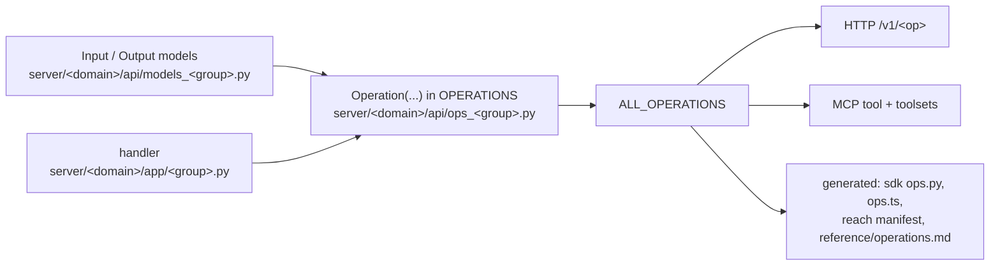

<!-- i18n: source=docs/development/adding-an-operation.md blob=32e9eb1349c29c12bc71e2adc8c55441a459025d model=claude-sonnet-5-5 -->
> 이 페이지는 [영어 원문](https://github.com/ClickHouse/loom/blob/main/docs/development/adding-an-operation.md)을 기계 번역한 것이며, 영어 원문이 기준입니다.
> Machine-translated from the [English page](https://github.com/ClickHouse/loom/blob/main/docs/development/adding-an-operation.md), which is authoritative.

<a id="add-an-operation"></a>

# 오퍼레이션 추가하기

오퍼레이션은 레지스트리에 한 번만 선언합니다. HTTP 라우트(`POST /v1/<op>`), OpenAPI 스키마, MCP 도구(`loom_<op with dots as underscores>`), 카탈로그(`/v1/operations`, `ops.capabilities`), SDK op 테이블, [오퍼레이션 레퍼런스](https://github.com/ClickHouse/loom/blob/main/docs/reference/operations.md)는 모두 이 선언에서 파생됩니다. 개발자는 모델, 핸들러, 선언, 테스트를 작성하고 나머지는 다시 생성합니다.



예제는 가장 작은 op 중 하나인 `calibration.get`이며, `server/memory/api/models_calibration.py`, `server/memory/api/ops_calibration.py`, `server/memory/app/calibration.py`를 사용합니다.

<a id="1-define-the-input-and-output-models"></a>

## 1. 입력 및 출력 모델 정의

그룹의 models 모듈인 `server/<domain>/api/models_<group>.py`에 모델을 작성합니다. models 모듈에는 Pydantic 와이어 모델만 둡니다. 핸들러는 import하지 않습니다.

```python
from pydantic import BaseModel, Field


class CalibrationGetInput(BaseModel):
    org: str
    namespace: str


class CalibrationGetOutput(BaseModel):
    source: str  # "namespace" / "cluster" / "scalar"
    embedder_model: str = ""
    noise_floor: float
    ...
    similar_pairs_n: int = Field(default=0)
```

모델 규칙:

- **식별 정보.** 네임스페이스를 대상으로 하는 op는 `org`와 `namespace`를 받습니다. 행을 쓰는 op는 식별 튜플의 나머지인 `agent`, `user_id`, `session_id`, `run_id`를 받습니다(마지막 세 개의 기본값은 `'-'`). MCP에서는 서버가 생략된 식별 필드를 연결의 기본값으로 채운 다음, 본문에 지정된 `(org, namespace)`를 인가합니다.
- **서버가 기록하는 컬럼은 본문에서 받지 않습니다.** 쓰기 경로에서 `actor`(`server.memory.app.provenance.writer_actor`)와 `source_class`(`server.memory.domain.provenance.source_class_for`)를 설정합니다. 요청은 `derived`, `external`, `imported`로의 하향 선언만 할 수 있습니다.
- **에이전트와 무관한 필드는 MCP에서 숨깁니다.** 랭킹 조정 값이나 파이프라인 스위치에는 `json_schema_extra=MCP_HIDDEN`(`server/operations/base.py`)을 지정합니다. MCP 스키마에서는 해당 필드가 빠지지만, op는 계속 그 필드를 받습니다.
- **읽기 입력에는 "A 또는 B 중 하나" 같은 모델 수준 검증기를 두지 않습니다.** 전송 계층은 인가 전에 본문을 검증하므로, 예외를 발생시키는 `@model_validator`는 네임스페이스 게이트가 거부할 주체에게 op의 구조를 알려 주게 됩니다. 이 규칙은 핸들러에 두고 `server.core.errors.ValidationError`를 발생시키십시오. `tests/unit/test_op_inputs_after_gate.py`가 등록된 모든 op를 검사합니다.
- **필드를 폐기하려면** 삭제하십시오. 해당 필드를 계속 보내는 클라이언트의 요청은 처리되며, 그 필드는 `ignored_args`에 이름이 표시됩니다([알 수 없는 필드와 제거된 필드](https://github.com/ClickHouse/loom/blob/main/docs/reference/http-api.md#unknown-and-removed-fields)).

<a id="2-write-the-handler"></a>

## 2. 핸들러 작성

그룹마다 `server/<domain>/app/` 아래에 핸들러 모듈 하나를 둡니다. 핸들러는 `async`이며 입력 모델을 받아 출력 모델을 반환합니다. 모듈 최상단에서 wire 모델을 import하며, 모델은 핸들러를 import하지 않으므로 import에 순환이 생기지 않습니다.

```python
from server.memory.api.models_calibration import CalibrationGetInput, CalibrationGetOutput


async def handle_calibration_get(input: CalibrationGetInput) -> CalibrationGetOutput:
    from server.memory.app.embedder_calibration import get_calibration, get_namespace_calibration

    ns_cal = await get_namespace_calibration(input.org, input.namespace)
    ...
```

- 순수 로직은 도메인의 `domain/`에, SQL은 `store/`에 둡니다. 핸들러는 이들을 조합합니다.
- **거부**는 `server.core.errors.LoomServerError`의 하위 클래스(또는 `{"code", "message"}` detail을 가진 `HTTPException`)를 raise합니다. 전송 계층은 이를 에러 envelope으로 변환하고, MCP에서는 `isError` 결과로 변환합니다. 새 에러 코드는 생성된 [에러 레퍼런스](https://github.com/ClickHouse/loom/blob/main/docs/reference/errors.md)에 나타납니다.
- **넓은 `except`에는 이유를 적습니다:** `except Exception as e:  # noqa: BLE001 — <what must not fail>`.
- ClickHouse 쿼리에 `log_comment`를 태깅하는 일은 전송 계층이 하며, 핸들러는 아무것도 하지 않습니다.
- 설정은 `settings.<field>`로 읽고, `getattr(settings, ...)`는 사용하지 않습니다.
- op가 `loom.memory` 또는 `loom.shared`에 쓰는 경우, `server/memory/store/rows.py`의 빌더로 행을 만듭니다([테이블 추가](https://github.com/ClickHouse/loom/blob/main/docs/development/adding-a-table.md#2-mirror-every-column-on-replacingmergetree-write-paths)).

<a id="ops-addressed-by-an-org-wide-id"></a>

### 조직 전체 id로 지정하는 op

`memory.get_by_id`, `memory.update_by_id`처럼 `(org, memory_id)`만 받는 op는 전송 계층에서 네임스페이스를 받지 못합니다. 이런 op는 `row_scoped=True`로 선언하고, 읽기 전에 호출자가 접근할 수 있는 네임스페이스를 확인한 뒤 다른 곳의 행은 **숨깁니다**:

```python
import server.memory.store as memory_repo
from server.memory.app.id_namespace import namespace_for_id

namespace = await namespace_for_id(input.org, input.memory_id, strong=False)
if namespace is None:
    return MemoryGetByIdOutput(found=False)
row = await memory_repo.get_by_id(input.memory_id, org=input.org, namespace=namespace, ...)
if row is None:
    return MemoryGetByIdOutput(found=False)
```

403이 아니라 행이 없을 때와 같은 응답을 돌려줍니다. 403은 해당 id가 다른 테넌트에 존재한다는 사실을 확인해 주기 때문입니다. 쓰기에서는 `namespace_for_id`에 `Role.WRITER`와 `strong=True`를 전달해 보유자를 최신 상태로 읽습니다. `memory.redact`처럼 행을 먼저 읽어야 하는 op는 조회 후 `authz.row_in_scope`로 검사합니다([행 범위 작업](https://github.com/ClickHouse/loom/blob/main/docs/architecture/security.md#row-scoped-operations)).

<a id="3-declare-the-operation"></a>

## 3. 오퍼레이션 선언하기

```python
from server.operations.base import Operation, Role

calibration_get = Operation(
    name="calibration.get",
    maturity="experimental",
    input_model=CalibrationGetInput,
    output_model=CalibrationGetOutput,
    handler=handle_calibration_get,
    idempotent=True,
    required_role=Role.VIEWER,
    audit=False,
)

OPERATIONS: list[Operation] = [calibration_get]
```

지연 시간 예산은 모든 op의 예산을 설정하는 `server/settings/catalog.py`의 `OP_BUDGETS_P99_MS`에 항목 하나로 들어갑니다. 예: `"calibration.get": 60,` (ms 단위의 op 설계 목표 p99이며, 이를 넘긴 성공 호출은 `budget.violated` 이벤트를 발생시킵니다). 핸들러가 실행 중에 기록하는 요청 형태(`server.observability.budget_shape`)는 `OP_SHAPE_BUDGETS_P99_MS`에 별도의 예산을 가지며, 카탈로그에 목록이 있습니다. `tests/unit/test_op_budgets.py`는 항목이 없는 op를 실패 처리합니다. 배포 환경에서는 `LOOM_LATENCY_BUDGET_OVERRIDES`로 op 하나를, `LOOM_LATENCY_BUDGET_MULTIPLIER`로 전체 op를 조정할 수 있습니다.

선언은 해당 그룹의 ops 모듈인 `server/<domain>/api/ops_<group>.py`에 두며, 이 모듈은 모델과 핸들러를 import합니다. 모듈의 `OPERATIONS` 리스트에 추가하세요. **새 그룹 모듈**은 `server/operations/registry.py`에서 import하여 `_OPERATION_MODULES`에 추가합니다.

| 필드                          | 필수 | 의미                                                                                                                                                                                                                                                                                                                  |
| ----------------------------- | ---- | --------------------------------------------------------------------------------------------------------------------------------------------------------------------------------------------------------------------------------------------------------------------------------------------------------------------- |
| `name`                        | 예   | 점으로 구분한 `<group>.<verb>` 형식입니다. HTTP 경로는 `/v1/<name>`, MCP 도구는 `loom_<name with . → _>`입니다.                                                                                                                                                                                                      |
| `input_model`, `output_model` | 예   | Pydantic 모델입니다.                                                                                                                                                                                                                                                                                                  |
| `handler`                     | 예   | 비동기 callable로, 입력 모델을 받아 출력 모델을 반환합니다.                                                                                                                                                                                                                                                           |
| `idempotent`                  | 예   | 일시적인 실패 시 재시도해도 안전합니다. SDK와 클라이언트가 이 값에 의존합니다.                                                                                                                                                                                                                                        |
| `required_role`               | 예   | `Role.VIEWER`, `WRITER`, `ADMIN`, `ORG_ADMIN`, `PLATFORM_ADMIN` 중 하나입니다.                                                                                                                                                                                                                                        |
| `audit`                       | 아니요 | `True`이면 성공 시 `loom.audit_log`에 행 하나를 기록합니다. 메모리, 권한 부여, 정책, 설정을 변경하는 op에는 반드시 지정하세요.                                                                                                                                                                                         |
| `writes`                      | 아니요 | viewer가 호출할 수 있고 재시도가 안전하더라도 op가 저장된 상태를 변경하는 경우입니다(피드백 행, 읽음 표시 등). writer 역할이나 `audit=True`는 이미 "쓰기"를 의미합니다.                                                                                                                                                 |
| `maturity`                    | 아니요 | `stable`(기본값) 또는 `experimental`입니다. [5단계](#5-check-reach-and-maturity)를 참고하세요.                                                                                                                                                                                                                         |
| `skip_namespace_authz`        | 아니요 | 네임스페이스 **자체**를 대상으로 동작하는 op(join, leave, register)나 대상을 핸들러만 확정할 수 있는 op(id 기준의 `memory.verify`, 범위 기준의 `erasure.request`, 호출자 역할 기준의 `erasure.list`)에서 전송 계층의 네임스페이스 검사를 건너뜁니다. 이 경우 핸들러가 자체 규칙을 적용합니다. 역할 검사는 그대로 실행됩니다. |
| `deployment_scoped`           | 아니요 | op가 어떤 네임스페이스의 데이터가 아니라 배포 환경에 관한 사실(빌드, 레지스트리)을 읽습니다. 범위가 지정된 토큰은 네임스페이스별 역할 중 가장 높은 역할로 통과합니다.                                                                                                                                                 |
| `row_scoped`                  | 아니요 | 조직 전체에서 유효한 id로 지정됩니다. 핸들러가 행의 범위를 인가하며(읽기 전에 `namespace_for_id`, 읽은 후에 `row_in_scope`), 범위 밖의 행은 찾을 수 없는 것으로 처리해 숨깁니다.                                                                                                                                      |

op가 **읽기 전용**(MCP `readOnlyHint`, `readonly` 툴셋)이 되는 조건은 `idempotent`이고, `required_role == Role.VIEWER`이며, `audit`와 `writes`가 모두 아닌 경우뿐입니다(`Operation.read_only`). 읽기 전용 도구를 자동 승인하는 클라이언트는 이 플래그를 신뢰합니다.

<a id="4-decide-mcp-visibility"></a>

## 4. MCP 노출 범위 결정

`server/operations/toolsets.py`가 op를 어디에 나열할지 결정합니다.

- **선별된 목록**(`_MCP_CORE_OPS`, `_MCP_CODING_OPS`, `_MCP_ATOMIC_OPS`, `_MCP_TASK_OPS`, `_MCP_TRACKER_OPS`, `_MCP_CODE_CORE_OPS`)에 넣으면 해당 `?toolset=`에 op가 나열됩니다. 나열된 속성은 모든 턴마다 토큰을 소비하므로, 해당 유형의 에이전트가 실제로 호출하는 것만 추가하세요. `tests/unit/test_mcp_listing_budget.py`는 나열 결과가 토큰 상한을 넘지 않도록 확인합니다.
- **나열되지 않음**(대부분의 op): 어떤 목록에서든 `loom_op`를 통해 이름으로 호출할 수 있습니다(`readonly`에서는 읽기만 가능, [MCP 툴셋](https://github.com/ClickHouse/loom/blob/main/docs/reference/mcp.md#toolsets)). `?toolset=all`은 `stable` op를 나열하며, `experimental` op는 core 또는 atomic 목록에 포함된 경우에만 나열합니다(`server/operations/toolsets.py`의 `listed_under_all`).
- **`_MCP_HIDDEN_OPS`**: MCP로 접근할 수 없습니다. `tests/unit/test_hidden_op_says_why.py`는 대신 호출해야 할 op를 알려 주는 거부 메시지를 요구합니다.

나열되는 op에는 `server/transport/mcp_descriptions.py`(`TOOL_DESCRIPTIONS`)에 설명이 필요합니다. 모델을 독자로 삼아 작성하세요. 도구를 언제 호출하는지, 무엇을 반환하는지, 무엇에 사용하면 안 되는지를 적습니다. 변경된 사실에 관한 설명은 자체 문구를 쓰지 않고 같은 모듈의 `revision_policy()`를 끼워 넣습니다. 다른 op는 점으로 구분된 op 이름으로 지칭합니다. 각 목록은 나열된 op를 해당 도구 이름으로 바꾸고 나열되지 않은 op에는 표시를 붙입니다([MCP 레퍼런스](https://github.com/ClickHouse/loom/blob/main/docs/reference/mcp.md#tool-list)). op를 호출 형태(`op(args)`)로 쓰거나, 더 긴 코드 스팬 안에 넣거나, "(via loom_op)"를 직접 써 넣지 마세요. 필드의 예시 값으로 주는 op 이름은 작은따옴표(`'memory.ask'`)로 감싸며, 나열 시에는 쓴 그대로 유지됩니다.

<a id="5-check-reach-and-maturity"></a>

## 5. 도달 범위와 성숙도 확인

op의 **도달 범위(reach)**는 파생 값입니다(`Operation.reach`, `server/operations/reach.py`). MCP 로스터 포함 여부와, SDK, `examples/`, `dev/`, `scripts/`, 플러그인 훅, 대시보드의 `"/v1/<op>"` 호출 지점을 커밋된 상태로 스캔한 결과를 합쳐 계산합니다. `{"http_only"}`는 원시 `/v1/*` POST만 해당 op에 도달한다는 뜻입니다.

모든 op는 모든 표면에 노출되거나, 노출되지 않는 이유를 코드에 밝힙니다. HTTP는 레지스트리의 모든 op를 제공하며, 두 SDK 모두 레지스트리에서 생성됩니다. MCP는 `_MCP_HIDDEN_OPS`가 사람과 운영자용으로 남겨 두지 않는 한 해당 op에 도달합니다. 대시보드는 사람이 필요로 할 때 op를 호출합니다. 관리, 검토, 조회, 구성, 확인 후 삭제가 그런 경우이며, 이런 종류의 새 op는 해당 컨트롤과 함께 출시됩니다. 에이전트나 클라이언트 프로그램만 호출하는 op, 또는 대시보드가 다른 op를 통해 제공하는 op는 `NOT_IN_DASHBOARD`(`server/operations/dashboard.py`)에 이유와 함께 명시합니다. 집계(census)의 `--check`(`tests/unit/test_op_reach_census.py`)는 대시보드 호출 지점도 없고 `server/operations/dashboard.py`에 항목도 없는 op에서 실패합니다.

- MCP에서 숨겨져 있고 다른 도달 경로가 없는 op(`server/operations/reach.py`에 종류가 나열되어 있습니다)는 `maturity="experimental"`로 선언합니다.
- `stable` op는 [MCP `all` 툴셋에 나열](https://github.com/ClickHouse/loom/blob/main/docs/reference/operations.md#mcp-all-listing)되어 있거나, MCP에서 숨겨져 있다면 다른 도달 경로가 있어야 하며, 프로덕션 호출자가 있어야 합니다. 호출자가 있는지는 `python scripts/codegen/op_reach_census.py --call-counts --days 30`으로 확인할 수 있습니다. 새 op는 stable op를 대체하는 경우가 아니면 `experimental`로 선언합니다.
- 매니페스트 갱신: `python scripts/codegen/op_reach_census.py --write-manifest` (`server/operations/reach_manifest.py`에 기록합니다).

<a id="6-write-the-tests"></a>

## 6. 테스트 작성

| 테스트                                                   | op에 요구하는 것                                                                                                                                                                                                                                                                                                             |
| -------------------------------------------------------- | ---------------------------------------------------------------------------------------------------------------------------------------------------------------------------------------------------------------------------------------------------------------------------------------------------------------------------- |
| `tests/unit/` 아래의 단위 테스트                         | 핸들러의 거부 경로와 정상 경로를 다룹니다.                                                                                                                                                                                                                                                                                   |
| `tests/integration/test_cross_principal_leakage.py`      | 읽기 형태의 모든 op를 다른 테넌트(다른 네임스페이스의 writer와 viewer, 그리고 다른 org)로 호출하고 canary nonce를 사용합니다. 어떤 응답에도 nonce가 포함되어서는 안 되며, 모든 호출은 200(빈 응답), 403 또는 404로 끝나야 하고 500이 나와서는 안 됩니다. 페이로드는 입력 모델로부터 합성되므로, 새 읽기 op는 등록되는 날부터 검사됩니다。 |
| `tests/integration/test_restricted_namespace_leakage.py` | 제한된 네임스페이스에 대해 동일하게 검사합니다.                                                                                                                                                                                                                                                                              |
| `tests/unit/test_op_inputs_after_gate.py`                | 입력 모델이 모델 수준 검증 오류 없이 생성됩니다.                                                                                                                                                                                                                                                                             |
| `tests/unit/test_op_reach_census.py`                     | reach와 maturity가 일치하고 manifest가 최신 상태입니다.                                                                                                                                                                                                                                                                      |
| `tests/unit/test_mcp_listing_budget.py`                  | 목록에 올린 op가 목록을 예산 이내로 유지하며, 그 설명이 클라이언트가 호출할 수 없는 도구를 가리키지 않습니다.                                                                                                                                                                                                                 |

leakage 스위트가 op의 본문을 합성하지 못하면 그 사실을 보고합니다. 건너뛰지 말고 힌트를 추가하세요. 호출자 자신의 네임스페이스를 변경하는 op는 스위트의 `_SKIP_OPS`에 넣고, writer 게이트는 다른 곳에서 다룹니다. 통합 테스트는 실행 중인 서버(`LOOM_BASE_URL`)가 필요하며, 서버가 없으면 건너뜁니다. 토큰은 CI에서 활성화되지 않는 직접 가입 대신 스위트의 헬퍼로 발급하세요.

<a id="7-regenerate-and-run-the-gates"></a>

## 7. 재생성하고 게이트 실행하기

```bash
python scripts/codegen/sdk_py_gen.py                       # sdk/python/loom/ops.py
python scripts/codegen/sdk_py_client_gen.py                # sdk/python/loom/client.py
python scripts/codegen/sdk_ts_gen.py                       # sdk/typescript/src/generated/ops.ts
python scripts/codegen/op_reach_census.py --write-manifest # server/operations/reach_manifest.py
python scripts/codegen/docs_reference.py                   # generated regions of docs/reference/*.md
make format
make lint          # ruff, gates, every generator with --check, the reach census --check, Biome's dashboard accessibility rules
make typecheck
make test-unit     # reach census, MCP listing budget
```

생성된 파일이 최신 상태가 아니면 CI가 실패합니다. 생성된 SDK 파일은 모든 클라이언트에 op를 한꺼번에 제공합니다. Python과 TypeScript에서 `agent.call("calibration.get", {...})`는 새 TypedDict와 인터페이스를 기준으로 타입이 검사됩니다. SDK 클라이언트의 직접 작성한 메서드(`sdk/python/loom/<group>.py`)는 선택 사항이며, 자주 쓰는 동사에 대해서만 추가하면 됩니다. 이 메서드도 도달 경로로 간주됩니다.

`python scripts/codegen/wire_changelog.py <rev_a> <rev_b>`는 두 리비전 사이에 클라이언트에 영향을 주는 변경 사항을 출력합니다. 릴리스 노트는 이 출력을 바탕으로 작성됩니다.

<a id="before-you-open-the-pr"></a>

## PR을 열기 전에

- [ ] 모델, 핸들러, 선언, `OPERATIONS` 항목(새 그룹이라면 `_OPERATION_MODULES`도 포함).
- [ ] `required_role`, `idempotent`, `audit`, `writes`, `maturity`를 신중하게 선택했습니다.
- [ ] `row_scoped` op는 다른 소유자의 행을 존재하지 않는 행으로 응답합니다.
- [ ] 툴셋 배치와, 목록에 포함되는 경우 설명.
- [ ] 위에 명시한 테스트가 통과하고, 생성되는 파일을 다시 생성했습니다.
- [ ] 해당 op를 담당하는 기능 페이지가 [operations 레퍼런스](https://github.com/ClickHouse/loom/blob/main/docs/reference/operations.md)의 앵커를 링크합니다.

<a id="related"></a>

## 관련 문서

- [Loom 확장하기](https://github.com/ClickHouse/loom/blob/main/docs/development/extending-loom.md)
- [시스템 개요](https://github.com/ClickHouse/loom/blob/main/docs/architecture/system-overview.md): 모든 op가 통과하는 게이트 순서
- [HTTP API](https://github.com/ClickHouse/loom/blob/main/docs/reference/http-api.md)
- [코드 생성](https://github.com/ClickHouse/loom/blob/main/docs/development/code-generation.md)
