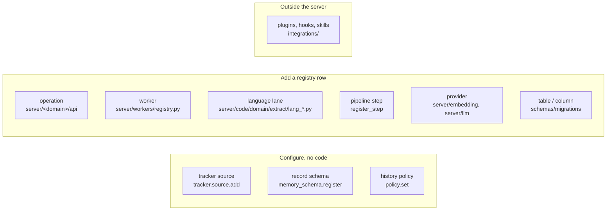

<!-- i18n: source=docs/development/extending-loom.md blob=73da8dff0ce992ad0dcb19d796cbf828d8785b33 model=claude-sonnet-5-5 -->
> 이 페이지는 [영어 원문](https://github.com/ClickHouse/loom/blob/main/docs/development/extending-loom.md)을 기계 번역한 것이며, 영어 원문이 기준입니다.
> Machine-translated from the [English page](https://github.com/ClickHouse/loom/blob/main/docs/development/extending-loom.md), which is authoritative.

# Loom 확장하기

Loom에는 종류별로 레지스트리가 하나씩 있습니다. 연산, 워커, 설정, 프로바이더, 언어 레인, 추출 단계, 트래커 소스입니다. Loom을 확장하려면 알맞은 레지스트리에 행을 추가하세요. HTTP, MCP, SDK, 생성된 레퍼런스가 그 행을 따라갑니다.

먼저 데이터만으로 해결되는지 확인하세요. 트래커 소스, 레코드 스키마, 프로시저, 히스토리 정책은 프로그래밍하는 것이 아니라 설정하는 것입니다.

## 확장 지점 선택

| 하려는 작업                                                  | 확장 지점                     | 위치                                                                                             | 가이드                                                                 |
| ------------------------------------------------------------ | ----------------------------- | ------------------------------------------------------------------------------------------------ | ---------------------------------------------------------------------- |
| 호출자에게 새로운 기능을 노출하기                            | 오퍼레이션                    | `server/<domain>/api/ops_<group>.py`, `server/<domain>/app/<group>.py`                           | [오퍼레이션 추가](https://github.com/ClickHouse/loom/blob/main/docs/development/adding-an-operation.md)                              |
| 일정에 따라 백그라운드에서 작업 수행하기                     | 워커                          | `server/<domain>/workers/<name>.py`, `server/workers/registry.py`의 행                           | [워커 추가](https://github.com/ClickHouse/loom/blob/main/docs/development/adding-a-worker.md)                                        |
| 새로운 데이터 저장하기                                       | 테이블 또는 컬럼              | `schemas/migrations/<NNN>_*.sql`, `server/<domain>/store/`                                       | [테이블 추가](https://github.com/ClickHouse/loom/blob/main/docs/development/adding-a-table.md)                                       |
| 새로운 프로그래밍 언어 인덱싱하기                            | 코드 인덱스 언어 레인         | `server/code/domain/extract/lang_<lang>.py`, `lang_detect.py`, `server/code/app/index/ingest.py` | [언어 지원 추가](https://github.com/ClickHouse/loom/blob/main/docs/development/adding-language-support.md)                           |
| 일부 호출자에 대해 추출이 유지하는 내용 변경하기             | 파이프라인 단계               | `server/memory/app/pipeline.py`의 `register_step`                                                | [추출 파이프라인](https://github.com/ClickHouse/loom/blob/main/docs/guides/extraction-pipeline.md)                    |
| 새로운 이슈 트래커 또는 CI 이력 읽기                         | 트래커 소스 (데이터만)        | `tracker.source.add` + `tracker.source.set_mapping`                                              | [트래커 레코드 규약](https://github.com/ClickHouse/loom/blob/main/docs/features/tracker/record-contract.md)           |
| 식별자와 타입이 있는 필드로 사실 보관하기                    | 레코드 스키마 (데이터만)      | `memory_schema.register`, `memory.record.write`                                                  | [메모리 쓰기](https://github.com/ClickHouse/loom/blob/main/docs/features/memory/writing.md)                           |
| 에이전트의 이력에 따라 에이전트가 할 수 있는 일 제한하기     | 이력 정책 (데이터만)          | `policy.set`                                                                                     | [토큰과 권한 부여](https://github.com/ClickHouse/loom/blob/main/docs/guides/tokens-and-grants.md#add-history-policy)  |
| 다른 임베딩 또는 LLM 제공자 사용하기                         | 제공자 클라이언트             | `server/embedding/`, `server/llm/`                                                               | [아래](#add-a-provider)                                                |
| 설정 추가하기                                                | 설정 필드                     | `server/settings/catalog.py`에서 해당 영역의 섹션                                                | [아래](#add-a-setting)                                                 |
| 다른 클라이언트의 세션을 수집하거나 에이전트 지침 배포하기   | 통합, 훅 또는 스킬            | `integrations/`, `skills/`                                                                       | [아래](#add-an-integration)                                            |

## 모든 확장이 공통으로 따르는 것

- **코드가 곧 레지스트리입니다.** 트랜스포트는 `ALL_OPERATIONS`를 순회하고, 슈퍼바이저는 `_WORKERS`를 순회하며, 설정 레퍼런스는 `server/settings/`에서 생성됩니다. 각 레지스트리에는 스냅샷 또는 census 테스트가 있으며, 다시 생성하기 전까지 이 테스트는 실패합니다.
- **생성된 파일.** `make lint`는 모든 생성기를 `--check` 옵션으로 실행합니다. 대상은 SDK op 테이블(`scripts/codegen/sdk_py_gen.py`, `sdk_ts_gen.py`), reach 매니페스트(`op_reach_census.py`), 레퍼런스 페이지(`docs_reference.py`, `settings_reference.py`), Codex 플러그인 사본(`agent_plugin_sync.py`)입니다. [코드 생성](https://github.com/ClickHouse/loom/blob/main/docs/development/code-generation.md)을 참고하십시오.
- **성숙도.** 안정(stable) op를 대체하는 경우가 아니라면 새 op는 `maturity="experimental"`로 선언합니다([op 추가하기](https://github.com/ClickHouse/loom/blob/main/docs/development/adding-an-operation.md#5-check-reach-and-maturity)).
- **측정.** 랭킹, 추출 또는 프로바이더 기본값을 변경할 때는 변경 전후에 관련 벤치를 실행합니다([성능 튜닝](https://github.com/ClickHouse/loom/blob/main/docs/guides/performance-tuning.md#measure-first)).
- **기반 구조는 확장 지점이 아닙니다.** 엔진(ClickHouse), 아이덴티티 튜플, 행 단위 콘텐츠 해시 감사, 다섯 가지 신념 수정 연산은 PR과 아키텍처 문서에 설계 근거를 함께 제시한 경우에만 변경할 수 있습니다([시스템 개요](https://github.com/ClickHouse/loom/blob/main/docs/architecture/system-overview.md)).

## 프로바이더 추가

임베더와 LLM은 설정으로 선택되는 클라이언트입니다.

**임베더**는 `openai.py`, `gemini.py`, `local.py`, `fake.py`와 같은 위치인 `server/embedding/`에 추가합니다. 임베더는 `server/embedding/_provider.py`의 HTTP 공통 처리를 공유합니다.

- 재시도 가능한 상태 코드에 대해서만 재시도하며, 최초 요청을 포함해 총 세 번 시도합니다(재시도는 최대 두 번).
- 프로바이더가 입력을 조용히 잘라내는 대신 `EmbedderInputTooLarge`를 발생시킵니다.
- 비어 있거나, 차원이 맞지 않거나, 유한하지 않은 벡터에는 `MalformedEmbedding`을 발생시킵니다.

`server/embedding/embedder.py`에 연결합니다. `LOOM_EMBEDDING_MODEL`로부터 프로바이더를 추론하는 부분(`_inferred_provider`), `LOOM_EMBEDDING_PROVIDER` 값, `KEY_ENVS`의 키 변수를 설정합니다. 키가 없으면 fake 임베더로 대체되고 오류가 기록됩니다.

**LLM**은 `openai.py`, `anthropic.py`, `fake.py`와 같은 위치인 `server/llm/`에 추가하며 `LLMClient`(`server/llm/client.py`)를 구현합니다. `_build_llm_client`와 `DEFAULT_MODEL_BY_PROVIDER`, `KEY_ENV_BY_PROVIDER`, `resolve_llm_provider`(`server/core/llm_provider.py`)에 연결합니다.

> **경고:** 프로바이더는 품질을 바꿉니다. 유사도 게이트는 `text-embedding-3-small`에 맞춰 보정되어 있습니다. 새 프로바이더를 기본값으로 지정하기 전에 해당 프로바이더로 `make bench-quick`을 실행하세요. 새 임베더를 사용하려면 기존의 모든 네임스페이스에서 `loom reembed`를 실행해야 합니다.

## 설정 추가하기

새 필드는 `server/settings/catalog.py`에서 해당 영역의 섹션(`MemorySearch`, `Code`, `Tracker` 등)에 추가합니다. 이 파일은 모든 설정을 선언하는 단일 파일입니다. 필드 위의 주석에는 그 설정이 무엇을 제어하는지, 값이 무엇을 의미하는지를 적습니다. 이 주석은 생성되는 [구성 레퍼런스](https://github.com/ClickHouse/loom/blob/main/docs/reference/configuration.md)에서 해당 설정의 행이 됩니다. 환경 변수 이름은 `LOOM_<FIELD>`입니다.

설정은 `settings.<field>`로 읽으며, `getattr(settings, "<field>", default)`는 사용하지 않습니다. `tests/unit/test_settings_attribute_access.py`는 후자의 방식을 쓰면 실패합니다. 복사해 둔 기본값은 원본과 어긋나기 쉽고, 필드를 삭제하는 사람에게 그 필드를 읽는 코드가 있다는 사실을 숨기기 때문입니다. `python scripts/codegen/settings_reference.py`와 `python scripts/codegen/settings_schema.py`로 다시 생성합니다.

플래그를 폐기하려면 설정과 그에 따른 분기, 그리고 해당 플래그를 전달하던 요청별 필드를 삭제합니다. 여전히 그 필드를 보내는 클라이언트의 요청은 그대로 처리되며, 해당 필드의 이름은 `ignored_args`에 표시됩니다.

## 통합 추가

| 통합                                      | 위치                                                                | 참고                                                                                                                                                                                                                                                                                                     |
| ----------------------------------------- | ------------------------------------------------------------------- | -------------------------------------------------------------------------------------------------------------------------------------------------------------------------------------------------------------------------------------------------------------------------------------------------------- |
| 코딩 에이전트 플러그인 훅 또는 스킬       | `integrations/claude-code-plugin/` (`hooks/`, `lib/`, `skills/`)    | 기준이 되는 원본입니다. `python scripts/codegen/agent_plugin_sync.py`가 스크립트, 스킬, 목록 아이콘(`assets/`)을 `integrations/codex-plugin/`으로 복사합니다. 새 훅은 Codex `hooks.json`에 직접 연결해야 합니다. 설치된 클라이언트는 매니페스트의 플러그인 버전이 바뀌면 변경 사항을 반영합니다. |
| 다른 클라이언트용 세션 캡처 훅            | `integrations/<client>/` (`cursor/`, `generic/`)                    | `loom ingest-transcript` 또는 `conversation.append`를 호출하고, 추출에는 `memory.set_from_messages`를 사용합니다.                                                                                                                                                                                        |
| 이식 가능한 에이전트 스킬                 | `skills/<name>/SKILL.md`                                            | 이름으로 모든 Agent-Skills 클라이언트에 설치됩니다. 안내만 제공하며 훅은 없습니다.                                                                                                                                                                                                                       |
| 프레임워크 어댑터                         | `sdk/python/loom/integrations/`, `sdk/typescript/src/integrations/` | SDK를 프레임워크의 스토어 또는 메모리 인터페이스로 감쌉니다(Python의 LangGraph `LoomStore`와 Strands `LoomMemoryStore`, TypeScript의 Strands 어댑터).                                                                                                                                                      |
| 관측성 백엔드                             | `server/observability/`                                             | 스팬에는 이미 `loom.request_id`가 포함되며 OTLP로 내보냅니다. 새 익스포터보다 OTLP 컬렉터를 사용하는 것을 권장합니다.                                                                                                                                                                                     |

[통합](https://github.com/ClickHouse/loom/blob/main/docs/features/integrations/index.md)에서 제공되는 통합을 설명합니다. [에이전트 통합](https://github.com/ClickHouse/loom/blob/main/docs/guides/agent-integration.md)에서는 모든 새 클라이언트가 쓰고 읽어야 하는 내용을 다룹니다.

## 관련 문서

- [저장소 가이드](https://github.com/ClickHouse/loom/blob/main/docs/development/repository-guide.md)
- [테스트](https://github.com/ClickHouse/loom/blob/main/docs/development/testing.md)
- [기여하기](https://github.com/ClickHouse/loom/blob/main/CONTRIBUTING.md)
