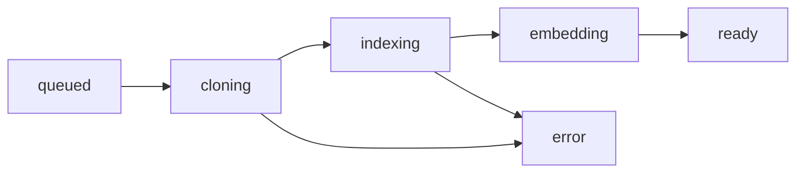

<!-- i18n: source=docs/features/code-index/repositories.md blob=dfd41b79236a859839f989a995deb2de9cd4ad2b model=claude-sonnet-5-5 -->
> 이 페이지는 [영어 원문](https://github.com/ClickHouse/loom/blob/main/docs/features/code-index/repositories.md)을 기계 번역한 것이며, 영어 원문이 기준입니다.
> Machine-translated from the [English page](https://github.com/ClickHouse/loom/blob/main/docs/features/code-index/repositories.md), which is authoritative.

<a id="adding-repositories"></a>

# 리포지토리 추가

새로 설치한 상태에서는 어떤 리포지토리도 인덱싱되어 있지 않습니다. 항목은 두 가지 출처에서 오며 서로 병합됩니다. 사용자가 직접 추가한 리포지토리와 운영자의 구성입니다. 여기에서 추가한 네임스페이스에 대한 운영자 항목은 건너뜁니다(아래 규칙 참조). 코드 네임스페이스 하나는 브랜치 하나입니다([개요](https://github.com/ClickHouse/loom/blob/main/docs/features/code-index/overview.md#one-namespace-is-one-branch)).

| 경로                | 방법                                                                                                 | 빌드 주체                              | 티어                                               |
| ------------------- | ---------------------------------------------------------------------------------------------------- | -------------------------------------- | -------------------------------------------------- |
| 셀프 서비스         | 대시보드의 **Repositories → Add repository**, 또는 직접 관리하는 카드의 **Add branch**               | `code_ingest` 워커, 슬라이스 단위      | 빠른 티어, 선택적 컴파일러 티어                    |
| 운영자 구성         | `LOOM_CODE_REPOS_JSON`의 항목(또는 스칼라 `LOOM_CODE_*` 설정), 이후 `loom code backfill`             | 운영자, `loom code` CLI 사용           | 빠른 티어, 구성된 경우 컴파일러 티어 추가          |

셀프 서비스는 빠른 티어에 대해 운영자나 셸 접근이 필요하지 않습니다. 컴파일러 티어는 선택적인 정밀도 향상 기능이며 워커 이미지에 해당 언어의 툴체인이 필요합니다.

<a id="self-service-repositories"></a>

## 셀프 서비스 저장소

`LOOM_CODE_SELF_SERVICE_ENABLED`와 `code_ingest` 워커가 필요합니다. 기본 개발용 Compose 배포는 둘 다 활성화하며, 커스텀 배포에서는 둘 중 하나를 비활성화할 수 있습니다.

[저장소 작업 샌드박스](https://github.com/ClickHouse/loom/blob/main/docs/operations/code-index-operations.md#repository-job-sandbox)도 필요합니다. 여기에서 추가한 저장소에는 자체 빌드 코드를 실행하는 컴파일러 티어가 적용되고, 해당 저장소의 clone은 사용자가 선택한 호스트와 통신합니다. 따라서 샌드박스가 없으면 추가가 거부되며(`SANDBOX_UNAVAILABLE`), 이미 추가된 항목도 더 이상 가져오거나 인덱싱하지 않습니다.
제공되는 Compose 스택 중에서는 블루/그린 스택(`dev/docker-compose.colour.yml`)만 샌드박스를 실행하며, AppArmor 프로필이 로드된 호스트에서 동작합니다. 릴리스 스택을 포함한 나머지 스택에서는 `LOOM_CODE_REPOS_JSON`으로 저장소를 인덱싱하세요
([빠른 시작](../../getting-started/quickstart.md#optional-index-a-repository-on-the-released-stack)).

각 org는 최대 `LOOM_CODE_SELF_SERVICE_MAX_REPOS`(20)개의 항목을 가질 수 있습니다.

org에 로그인한 구성원은 누구나 저장소를 추가할 수 있으며, 추가한 사람이 첫 번째 maintainer가 됩니다.
원격 주소는 `owner/name`(GitHub 약식 표기), HTTPS URL, SSH/scp 형식의 Git URL 중 하나를 사용할 수 있습니다. GitHub, GitLab, Bitbucket은 명시적으로 구분되고, 그 외 서버는 일반 어댑터를 사용합니다. 로컬 경로와 `file://` URL은 거부됩니다. 원격은 `git ls-remote`에 응답해야 하며, HTTPS에는 선택적 액세스 토큰을, SSH에는 워커의 SSH 설정을 사용합니다.
브랜치를 비워 두면 Loom은 원격의 심볼릭 `HEAD`를 따르며, `master`를 가정하지 않습니다. 네임스페이스는 기본 브랜치이면 `code-<name>`, 그 외에는 `code-<name>-<branch-slug>`입니다.

워커는 `LOOM_CODE_REPOS_ROOT`(기본값 `var/code_repos/self`) 아래에 bare 미러를 clone합니다. 미러는 Git 저장소당 하나이며 해당 저장소의 브랜치들이 공유합니다. 첫 인덱스는 커서를 사용해 한 번에 `LOOM_CODE_BOOTSTRAP_FILES_PER_PASS`(400)개 파일씩 구축하므로, 재시작해도 이어서 진행됩니다. `code.repos`는 `stage`와 `stage_detail`로 진행 상황을 보고합니다:



청크의 `LOOM_CODE_READY_EMBED_COVERAGE`(0.95) 비율이 벡터를 가질 때까지 항목은 `embedding` 단계에 머뭅니다. 그때까지 `code.search`는 어휘 검색으로 응답합니다
([최신성](https://github.com/ClickHouse/loom/blob/main/docs/features/code-index/freshness.md)).

| Op                          | 역할   | 동작                                                                                                                                                      |
| --------------------------- | ------ | --------------------------------------------------------------------------------------------------------------------------------------------------------- |
| `code.repo.remote_branches` | viewer | 아무것도 쓰기 전에 Git 원격이 보여 주는 정보: 제공자, 브랜치와 헤드, 기본 브랜치, 릴리스 형태의 브랜치, 할당량 및 준비 상태 경고 |
| `code.repo.add`             | viewer | `repo@branch`를 추가합니다(비워 두면 원격 기본값을 탐색). 선택적으로 `branches`를 더 지정할 수 있으며, 접근 권한, 필터, `scip_producer`, `access_token`을 지정합니다 |
| `code.repo.add_branch`      | admin  | 관리하는 저장소의 다른 브랜치를 인덱싱합니다. 원격, 토큰, 접두사, 접근 권한을 상속합니다                                                         |
| `code.repo.set_access`      | admin  | `classification`(`standard` / `restricted`)과 `join_policy`(`open` / `approval` / `closed`)를 설정합니다                                                       |
| `code.repo.set_source`      | admin  | 이 저장소가 읽는 트래커 네임스페이스를 기본 항목을 먼저 두어 연결합니다([트래커 개요](https://github.com/ClickHouse/loom/blob/main/docs/features/tracker/overview.md#linking-a-tracker-to-a-repository)) |
| `code.repo.remove`          | admin  | 셀프 서비스 인덱스를 폐기합니다. `confirm`은 네임스페이스와 같아야 합니다                                                                                           |

인자는 [오퍼레이션 레퍼런스](https://github.com/ClickHouse/loom/blob/main/docs/reference/operations.md#code)에 있습니다.

규칙:

- org는 브랜치를 포함해 최대 `LOOM_CODE_SELF_SERVICE_MAX_REPOS`(20)개의 활성 셀프 서비스 항목을 가질 수 있습니다(`REPO_QUOTA`). 이미 어떤 네임스페이스로든 인덱싱된 브랜치이거나, 네임스페이스에 데이터가 있거나 사용자가 관리하지 않는 권한이 있는 브랜치는 `REPO_EXISTS`로 거부됩니다. 대신 해당 인덱스에 참여하세요. 아직 첫 인덱스가 없는 운영자 구성 항목의 브랜치는 `loom code backfill`이 실행될 때까지 `REPO_NOT_INDEXED`로 거부됩니다.
- admin 권한은 저장소의 브랜치 간에 한 방향으로만 전달됩니다. 운영자 항목은 admin을 저장소의 모든 브랜치에 전달하고, 여기에서 추가한 브랜치는 admin을 여기에서 추가한 다른 standard 브랜치에만 전달합니다. 여기에서 추가한 restricted 브랜치는 운영자의 admin만 받습니다. 모든 동기화는 해당 브랜치가 가진 다른 사본을 취소하거나, 운영자 admin의 사본을 운영자 권한의 사본으로 만듭니다. `granted_by`가 레플리카에 구성되지 않은 항목을 가리키는 사본도 취소됩니다(폐기된 항목이거나, 롤링 배포가 아직 반영되지 않은 새 항목입니다. 그 항목에 admin을 다시 부여하세요). admin이 전부 그런 사본이던 브랜치는 admin이 없는 상태가 되며, 저장소의 운영자 항목에 부여된 admin 권한만 그 브랜치에 닿습니다. 그런 사본을 가졌던 구성원은 그곳에서 다른 사람이나 자기 자신에게 권한을 부여하거나 승인했을 수 있으니, 해당 권한 부여를 검토하세요. 브랜치를 다시 넓혀도 제한 때문에 취소된 사본은 돌아오지 않으며, 형제 브랜치에서 그 admin을 다시 부여하세요. 브랜치를 넓힐 수 있는 것은 그곳에서 직접 부여받은 admin 권한을 가진 admin, 또는 운영자 항목에서 온 사본을 가진 admin뿐이며, 여기에서 추가한 브랜치에서 온 사본은 인정되지 않습니다.
- 취소도 같은 경로를 따릅니다. 운영자 항목에서 한 취소는 여기에서 추가한 브랜치에서는 복사된 권한만 제거하며, 대상이 여기에서 추가한 브랜치에서 부여받은 admin 권한을 가지고 있는 동안에는 standard 브랜치의 권한을 제거하지 않습니다. 브랜치의 유일한 admin인 사본은 유지됩니다. 단, 여기에서 추가한 restricted 브랜치에서는 출처가 운영자 항목이 아닌 사본을 취소가 제거합니다(취소된 항목이 아닌 다른 운영자 항목에서 부여받은 admin 권한을 보유자가 유지한다면, 그 사본은 다음 동기화에서 다시 쓰입니다). 그곳에 유지된 운영자 사본은 운영자 권한이 사라지면 다음 동기화 때 제거됩니다.
- 여기에서 추가한 네임스페이스(`code.repo.add` 또는 `code.repo.add_branch`)를 지정하는 운영자 항목은, 이후 제거되었더라도 건너뛰며 서버 로그에 경고를 남깁니다. 추가한 사람의 권한이 운영자 항목의 권한이 되어 버리기 때문입니다. 브랜치를 제거해도 이름은 해제되지 않으므로, 항목을 다른 네임스페이스로 나열하세요. 종류가 기록되지 않은 레지스트리 행은 항목의 접근 행으로 읽히고, 구성원이 `namespace.register`로 만든 네임스페이스에는 레지스트리 행이 없으며, 셀프 서비스가 꺼져 있는 동안에는 레지스트리를 읽지 않습니다. 각 경우에 네임스페이스를 나열하기 전에 그 권한 부여를 검토하세요.
- 운영자 항목에 대해 `code.repo.set_access`가 쓴 접근 행은 항목이 구성에서 빠져 있는 동안 나열되지 않으므로 네임스페이스가 인덱싱되지 않습니다. 항목이 돌아오면 다시 적용되며, org의 저장소 할당량에는 포함되지 않습니다. 종류가 기록되지 않은 레지스트리 행은 항목이 사라지면 여기에서 추가한 브랜치로 나열됩니다.
- 운영자 네임스페이스의 사본 중 `granted_by`가 여기에서 추가한 브랜치나 더 이상 구성되지 않은 네임스페이스를 가리키는 `repo-maintainers:<namespace>`인 것은 취소될 때까지 남아 있습니다. 해당 권한 부여를 나열하고 유지되면 안 되는 것은 취소하세요.
- 셀프 서비스가 꺼져 있는 동안 운영자 항목에 대한 취소는 여기에서 추가한 브랜치를 보지 못하므로, 취소된 권한의 사본이 그곳에 남아 있다가 셀프 서비스를 다시 켜도 그대로 유지됩니다. 해당 브랜치에서 직접 취소하세요.
- restricted 저장소는 절대 `open`이 될 수 없습니다. `code.repo.add`는 `approval`로 설정합니다. restricted 인덱스를 standard로 넓히려면 `confirm`이 네임스페이스와 같아야 합니다.
- 비공개 저장소의 토큰은 `LOOM_JWT_SECRET`에서 파생한 키로 암호화되어 저장되며 반환되지 않습니다. 이 시크릿을 교체하면 maintainer가 토큰을 다시 입력할 때까지 저장된 토큰을 사용할 수 없습니다.
- `code.repo.remove`는 레지스트리 행을 폐기하고, 재개 가능한 삭제 saga를 통해 네임스페이스의 모든 `code_*` 행을 제거합니다. 다른 브랜치가 미러를 사용하지 않으면 미러도 삭제됩니다. 운영자 구성 항목은 `REPO_FROM_CONFIG`로 거부됩니다.
- `LOOM_CODE_SELF_SERVICE_ENABLED=false`는 이 기능을 제거합니다(`SELF_SERVICE_OFF`).
- `LOOM_CODE_INTEL_ENABLED=false`이면 다른 모든 `code.*` op와 마찬가지로 `code.repo.remove`를 제외한 모든 `code.repo.*` op가 `PRECONDITION_FAILED`로 거부됩니다. 스위치가 꺼진 상태에서 폐기하면 인덱스와 이 레플리카의 미러가 제거되며, 다른 레플리카는 코드 인텔리전스가 다시 켜진 뒤에야 자신의 미러 사본을 정리합니다.

공개 저장소와 릴리스 브랜치를 한 번의 호출로 추가합니다:

```bash
curl -fsS -X POST "$LOOM_BASE_URL/v1/code.repo.add" \
  -H "Authorization: Bearer $LOOM_API_KEY" -H 'Content-Type: application/json' \
  -d '{"org":"acme","repo":"acme/widgets","branch":"main","branches":["release/2.4"]}'
```

응답에는 각 브랜치의 네임스페이스가 나옵니다. 추가하지 못한 브랜치는 이유와 함께 `skipped`로 반환됩니다.

<a id="repository-profiles-and-compiler-preflight"></a>

## 리포지토리 프로필과 컴파일러 사전 점검

모든 항목은 `code.index_status`에서 `profile`과 `provider`를 보고합니다. `generic`은 리포지토리에 종속되지 않는 검색, 심볼, 호출, 영향 분석, 컨텍스트 팩을 처리합니다. `clickhouse` 프로필은 ClickHouse 전용 SQL 등록, 오류 코드, stateless 테스트 규칙을 식별합니다. 프로젝트에 C++나 SQL이 들어 있다는 이유만으로 이러한 가정을 추론하지는 않습니다.

`compiler_candidates`는 빌드 매니페스트에서 추론됩니다. 워터마크가 없는 후보는 활성화해야 할 워커와 함께 `quality_warnings`에 표시됩니다.

| 후보                  | 워커 환경에서의 사전 점검                                                                                                                                         | 워커                                         |
| --------------------- | ---------------------------------------------------------------------------------------------------------------------------------------------------------------- | -------------------------------------------- |
| C/C++                 | `scip-clang --version` (amd64 이미지에서); 리포지토리의 CMake가 clang 21로 구성됨                                                                                | `code_scip_full`, 이후 `code_scip_delta`     |
| TypeScript/JavaScript | 인덱서와 패키지 관리자는 Docker에 포함되어 있으며, 네이티브 서버에서는 `sh scripts/install-code-toolchains.sh`를 실행합니다. 리포지토리 의존성은 자동으로 준비됩니다. | `code_scip_ts_delta`                         |
| Go                    | `scip-go --version`; 모든 모듈에서 `go env`가 성공함                                                                                                             | `code_scip_go_delta`                         |
| Python                | `scip-python --version`; 프로젝트 임포트가 해당 환경에서 해석됨                                                                                                  | `code_scip_py_delta`, 이후 `code_scip_apply` |

컴파일러 사전 점검이 실패해도 빠른 티어는 계속 사용할 수 있습니다. `code.index_status`와 Health 탭은 워커 오류, 언어별 커버리지, 해석되지 않은 엣지, 임베딩 커버리지, 최신 상태를 보여 줍니다. PR/리뷰 기록은 현재 GitHub API를 사용합니다. 다른 제공자는 Git 기록과 코드 인텔리전스는 그대로 받지만, 온보딩 시 명시적인 경고가 표시됩니다.

<a id="operator-configured-repositories"></a>

## 운영자가 구성한 리포지토리

`LOOM_CODE_REPOS_JSON`은 인덱싱되는 브랜치마다 객체 하나를 담습니다. 항목 필드, 사전 요구 사항(이미지, 임베더, 쓰기 가능한 미러, GitHub 토큰), 첫 인덱싱(`loom code init`, `backfill`, `backfill-prs`, `scripts/ops/code_intel_bootstrap.sh`), 컴파일러 티어, 그 밖의 브랜치는
[코드 인덱스 운영 런북](https://github.com/ClickHouse/loom/blob/main/docs/operations/code-index-operations.md)에서 다룹니다. 워커는
운영자가 구성한 항목을 자동으로 시작하지 않으며, `git_head` 워터마크가 없는 항목은 `loom code backfill`이 실행될 때까지 건너뜁니다. 모든 설정은
[구성 레퍼런스](https://github.com/ClickHouse/loom/blob/main/docs/reference/configuration.md#code)에 있습니다.

<a id="who-can-read"></a>

## 읽을 수 있는 사용자

코드 네임스페이스는 일반적인 권한 부여 규칙을 따릅니다
([아이덴티티와 네임스페이스](https://github.com/ClickHouse/loom/blob/main/docs/concepts/identities-and-namespaces.md),
[토큰과 권한 부여](https://github.com/ClickHouse/loom/blob/main/docs/guides/tokens-and-grants.md)). 토큰은 코드
네임스페이스(또는 `*`)를 명시해야 하며, 그렇지 않으면 호출이 `AUTH_INSUFFICIENT`로 실패합니다. 세 가지 스위치로
이 동작을 바꿀 수 있습니다.

| 스위치                                                            | 효과                                                                                                                                         |
| ----------------------------------------------------------------- | -------------------------------------------------------------------------------------------------------------------------------------------- |
| `LOOM_CODE_ORG_READABLE=true`, 또는 항목의 `org_readable`         | 조직의 인증된 모든 주체가 권한 부여 없이 읽을 수 있습니다(기본값은 꺼짐). 쓰기는 계속 권한 부여로 결정됩니다                                 |
| `LOOM_CODE_REPO_PUBLIC=true`, 또는 항목의 `public`                | 네임스페이스가 `join_policy=open`으로 등록되고 검색 가능해져, 조직 구성원 누구나 즉시 읽기 권한으로 참여할 수 있습니다. 그렇지 않으면 정책은 `approval`입니다 |
| `classification: "restricted"` (항목 또는 `code.repo.set_access`) | 조직 읽기 허용이나 공개가 되지 않습니다. 메인테이너가 읽기 사용자를 각각 승인하며, 모든 읽기에는 네임스페이스를 명시한 토큰과 유효한 직접 권한 부여가 필요합니다 |

`code.repo.set_access` 행은 설정된 분류와 참여 정책보다 우선하며 재시작 후에도 유지됩니다.
`code.refresh`(작성자)와 관리자 op는 항상 권한 부여가 필요합니다.

<a id="failure-modes"></a>

## 장애 유형

| 증상                                              | 원인 및 해결                                                                                                                                                                                                                                                           |
| ------------------------------------------------- | ---------------------------------------------------------------------------------------------------------------------------------------------------------------------------------------------------------------------------------------------------------------------- |
| 구성된 항목이 인덱싱되지 않음                     | `git_head` 워터마크가 없습니다. `loom code init`과 `loom code backfill`을 실행하세요. 또는 네임스페이스가 페이지에서 추가된 것이며(이후 제거되었든 아니든) 로그에 해당 항목을 건너뛴다고 표시됩니다. 이 경우 다른 네임스페이스 아래에 나열하세요                         |
| 리포지토리를 추가하면 `SANDBOX_UNAVAILABLE`이 반환됨 | 이 배포에서는 샌드박스를 실행할 수 없습니다. 대신 `LOOM_CODE_REPOS_JSON`에 리포지토리를 나열하세요(`LOOM_CODE_SANDBOX_REQUIRED`가 설정된 경우에는 이 방법도 건너뜁니다). 또는 [샌드박스 요구 사항](https://github.com/ClickHouse/loom/blob/main/docs/operations/code-index-operations.md#repository-job-sandbox)을 참고하세요 |
| 셀프 서비스 카드가 `error` 상태로 유지됨          | `code.repos`의 `stage_detail`을 확인하세요. 클론에 실패하면 다음 순회에서 재시도합니다(타임아웃은 `LOOM_CODE_BOOTSTRAP_CLONE_TIMEOUT_S`)                                                                                                                                |
| 비공개 셀프 서비스 리포지토리의 fetch가 중단됨    | `LOOM_JWT_SECRET`이 교체되었습니다. 토큰을 다시 입력하세요                                                                                                                                                                                                             |
| `code.repos`에 항목이 없음                        | `loom.code.repos_config_errors`를 확인하세요. 또한 `code.repos`는 호출자가 읽을 수 있는 항목만 나열합니다                                                                                                                                                              |
| 관리자 권한을 취소하거나 낮출 때 busy가 반환됨    | 코드 네임스페이스에서 취소하면 먼저 `loom.code_repos`를 다시 읽어 다른 프로세스에서 여기에 추가된 브랜치를 확인하며, 이 읽기가 실패하는 동안에는 busy를 반환합니다. 읽기가 성공하면 다시 시도하세요                                                                      |
| 여기에서 추가한 제한된 브랜치에 관리자가 없음     | 해당 브랜치의 관리자가 모두 여기에서 추가된 브랜치에서 복사된 것이었고, 동기화가 이를 취소했습니다. 리포지토리의 운영자 항목 중 하나에 관리자 권한을 부여하세요(운영자 항목이 없으면 먼저 운영자가 `LOOM_CODE_REPOS_JSON`에 해당 리포지토리의 브랜치를 나열해야 합니다)       |
| 새 메인테이너에게 다른 브랜치 권한이 없음         | 이 프로세스가 `loom.code_repos`를 읽기 전에 관리자 권한이 부여되었습니다(해당 프로세스는 처음에 `not synced`를 로그에 남깁니다). 리포지토리의 브랜치에 대한 다음 관리자 부여나 승인, 또는 브랜치 추가 시 권한이 복사됩니다. 또는 다시 부여하세요                          |
| 답변이 어휘 검색 결과뿐임                         | 해당 항목이 `LOOM_CODE_READY_EMBED_COVERAGE`에 도달하지 못했습니다([최신성](https://github.com/ClickHouse/loom/blob/main/docs/features/code-index/freshness.md))                                                                                                        |

<a id="related"></a>

## 관련 문서

- [개요](https://github.com/ClickHouse/loom/blob/main/docs/features/code-index/overview.md) 및 [질문별 operations](https://github.com/ClickHouse/loom/blob/main/docs/features/code-index/operations.md)
- [최신성](https://github.com/ClickHouse/loom/blob/main/docs/features/code-index/freshness.md) 및 [히스토리와 PR](https://github.com/ClickHouse/loom/blob/main/docs/features/code-index/history-and-prs.md)
- [코드 인덱스 운영 런북](https://github.com/ClickHouse/loom/blob/main/docs/operations/code-index-operations.md)
