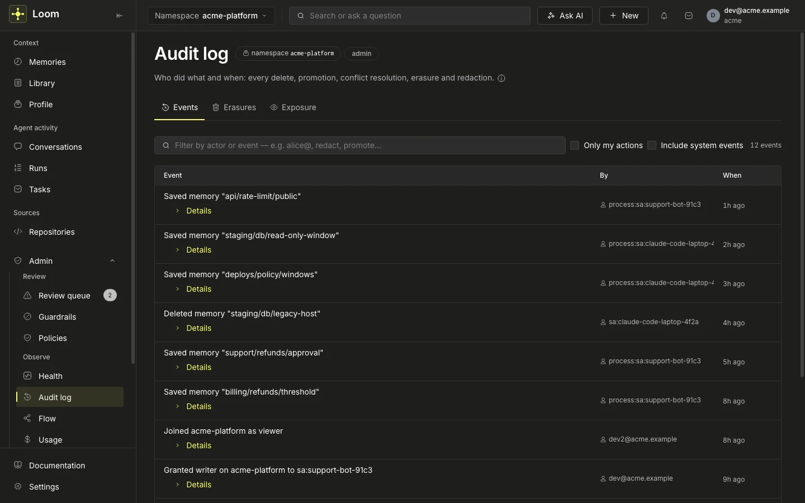

<!-- i18n: source=docs/features/observability/audit.md blob=8e4e9949ca4f7a4e54f9bad556832bda780a76c4 model=claude-sonnet-5-5 -->
> 이 페이지는 [영어 원문](https://github.com/ClickHouse/loom/blob/main/docs/features/observability/audit.md)을 기계 번역한 것이며, 영어 원문이 기준입니다.
> Machine-translated from the [English page](https://github.com/ClickHouse/loom/blob/main/docs/features/observability/audit.md), which is authoritative.

<a id="audit-log"></a>

# 감사 로그

감사 행, `audit_verifier` 워커, 체크포인트 체인은 기본적으로 켜져 있습니다.

Loom은 누군가가 책임 소재를 밝혀야 할 수 있는 방식으로 상태를 변경하는 각 작업마다 `loom.audit_log`에 행을 하나씩 기록하며, 서버가 직접 발생시키는 일부 이벤트도 함께 기록합니다. 목표는 변조를 탐지할 수 있게 하는 것입니다. 각 행에는 자신의 내용에 대한 SHA-256 해시가 들어 있고, 워커가 닫힌 1시간 단위 구간을 해시 체인으로 봉인합니다. ClickHouse 관리자는 여전히 테이블을 수정할 수 있지만, 다음 verifier 실행에서 수정이나 삭제가 드러납니다. 이는 엔지니어링 기본 구성 요소일 뿐, 컴플라이언스 인증이 아닙니다.



<a id="what-leaves-an-audit-row"></a>

## 감사 행을 남기는 항목

| 출처                                                                  | `event_type`                                                                                                                                                                                                                                  | `subject`에 담기는 내용                                                                                                                                                                                                                                                                                                                                                                                      |
| --------------------------------------------------------------------- | --------------------------------------------------------------------------------------------------------------------------------------------------------------------------------------------------------------------------------------------- | ------------------------------------------------------------------------------------------------------------------------------------------------------------------------------------------------------------------------------------------------------------------------------------------------------------------------------------------------------------------------------------------------------------ |
| `audit=True`로 선언된 모든 operation                                  | op 이름(`memory.delete`, `grants.create`)                                                                                                                                                                                                | op가 `audit_subject`를 선언한 경우 그 값(자격 증명 없음, 또는 삭제 요청이 찾아내야 하는 텍스트의 해시). 선언하지 않은 경우 검증된 입력에서 이름을 가리키지 않는 모든 텍스트 값을 해시한 JSON                                                                                                                                                                                                                           |
| `memory.set` (단건 쓰기)                                              | `memory.set`                                                                                                                                                                                                                                  | 키, 메모리 id, `content_sha256`, `source_class`, 판정, `pinned`. 값은 절대 담지 않습니다                                                                                                                                                                                                                                                                                                                     |
| `memory.update`, `memory.update_by_id`                                | op 이름                                                                                                                                                                                                                                       | 키, 메모리 id, `content_sha256`, `source_class`, 버전, 그리고 쓰기 후 표시 이전의 충돌 검사 판정(중복으로 기록된 버전은 `duplicate`, 수정된 행이 임베딩되지 않은 경우, 즉 임베딩 대상이 아닌 타입이거나 `high` 값인 경우는 빈 값). 값은 절대 담지 않습니다                                                                                                                                                                 |
| `memory.bulk_set`                                                     | `memory.bulk_set`                                                                                                                                                                                                                             | 쓰기 한 건당 해시만 담은 행 하나                                                                                                                                                                                                                                                                                                                                                                             |
| Postgres에서 커밋된 모든 리비전                                       | `memory.revision`                                                                                                                                                                                                                             | 키, 메모리 id, 버전, `content_sha256`, `source_class`, 상태, `pinned`, tombstoned, 그리고 actor로 토큰의 principal, 없으면 파이프라인 단계의 principal, 요청 중이면 `-`, Loom 자체 작업이면 `process:loom`. 리비전과 함께 저장되므로 fail-open이 아닙니다. 기록될 때까지 재시도하거나 보류 처리합니다([스토리지 권한](https://github.com/ClickHouse/loom/blob/main/docs/architecture/storage-authority.md#audit)) |
| `memory.import`                                                       | 기록하는 사실에는 `memory.bulk_set`, 기록하는 카테고리 링크에는 `memory.import`                                                                                                                                                               | 대량 쓰기의 해시 전용 행. 링크의 경우 `count`와 `category_links`(키와 카테고리 이름). 텍스트는 절대 담지 않습니다                                                                                                                                                                                                                                                                                              |
| `high` 행 또는 `high`로 보관된 근거의 읽기                            | `memory.sensitive_read` (`memory.get`, `memory.get_by_id`, `memory.bulk_get`, `memory.history`, `memory.evidence`, `namespace.snapshot`, `erasure.export`, 그리고 `include_high`가 지정된 `memory.export_evidence`에서 발생)                   | 키와 메모리 id(`memory.history`와 `erasure.export`는 버전을 추가). 공개된 근거는 종류, 세션, 청크 인덱스, 연결된 키. `erasure.export`가 제공하는 대화 턴은 에이전트, 스레드 id, 메시지 id. 스레드는 에이전트와 스레드 id                                                                                                                                                                                       |
| 제한된 네임스페이스로 들어온, 허용된 요청                             | `namespace.restricted_access` (해당 네임스페이스를 지정한 op, 이를 지정한 `audit.list`(transport `op`), 문서 다운로드와 업로드, inbox watch, `admin/claim_release`, `admin/namespace.adopt`, 위임 토큰 발급, MCP primer에서 발생) | `op`, `transport`, 호출자의 `token_id`와 `roles`. 발급의 경우 새 토큰의 subject인 `granted_to`                                                                                                                                                                                                                                                                                                              |
| Loom이 스스로 메모리를 폐기하는 경우                                  | `memory.auto_supersede`                                                                                                                                                                                                                       | `reason`, `count`, `retired`: 폐기된 행 최대 200개(id, 키, 에이전트, 사용자, 세션, 각 행이 대체된 대상 행과 키, 판정기의 레이블, 충돌 해결기에 의한 폐기의 `judge_verdict`, `judge_confidence`, `judge_model`, `judge_prompt_version`, 그리고 재조회로 폐기를 확인하지 못했을 때의 `unconfirmed`(`"true"`)). 값은 절대 담지 않습니다. 행이 더 많으면 여러 이벤트로 나뉩니다 |
| 대체된 행의 `memory.restore`                                          | `memory.unsupersede`                                                                                                                                                                                                                          | 키, 메모리 id, `superseded_by`, 복원된 `content_sha256`과 `version`                                                                                                                                                                                                                                                                                                                                          |
| 다른 표기로 가져온 `grants.revoke` 행, 또는 여러 행 중 하나           | `grants.revoke`                                                                                                                                                                                                                               | `namespace`, 저장된 `subject`, `named`(호출이 지정한 subject), 그리고 행 삽입이 실패했을 때의 `landed`(`"unknown"`). 입력을 담는 op 자체의 행과 별개로 기록됩니다                                                                                                                                                                                                                                             |
| 서버 자체                                                             | `budget.violated`, `ratelimit.exceeded`, `worker.failed`, `audit.tamper_detected`, …                                                                                                                                                          | 이벤트가 다루는 대상                                                                                                                                                                                                                                                                                                                                                                                         |

생성된 [operation 레퍼런스](https://github.com/ClickHouse/loom/blob/main/docs/reference/operations.md)의
**Audit** 열은 transport가 감사하는 op(각 `Operation`의 `audit` 플래그)를 나열합니다. 위 표의 메모리 쓰기는 자체 행을 기록하므로 그 열에는 표시가 없습니다. 읽기 op 중 `audit=True`로 선언된 것은 없으며, `high` 행의 읽기는 `memory.sensitive_read`(위 참고)를 기록합니다. `audit.list`는 `audit=False`이므로, 감사 기록을 읽어도 제한된 네임스페이스에 대한 restricted-access 행만 추가됩니다.

transport는 핸들러가 성공한 뒤에 행을 기록합니다(`server/transport/_common.py`의 `emit_op_audit`, HTTP와 MCP 공통). 이 쓰기는 **fail-open**입니다. 삽입이 실패하면 로그를 남기고 행은 유실되며, operation 자체는 성공합니다.

`audit=True` op의 subject는 `audit_subject`를 선언한 경우 그 값이고, 그렇지 않으면 `audit.input_subject`가 만든 형태의 검증된 입력입니다. 호출이 작용한 대상이나 행위자를 가리키는 필드(식별 필드, principal인 `subject`, `actor`, `grantee`, `owner_email`, `requester`, `approver`, `decision_maker`, `version`, 그리고 id, key, URI, name, org, agent, namespace 또는 `_by` 접미사로 끝나는 이름)와, 숫자, 불리언, 날짜 또는 시간, Literal, Enum으로 타입이 지정된 필드는 전송된 그대로 유지됩니다. 이름이 자격 증명을 나타내는 필드(`server/observability/audit.py`의 `audit.is_credential`)는 접미사와 관계없이 해시됩니다. 중첩된 모델 하나를 담은 필드에도 같은 규칙이 적용되고, 모델 목록은 통째로 해시됩니다. 전송된 그대로 유지되는 principal과 `_by` 필드는 개인 데이터이며, 삭제 요청으로도 `loom.audit_log`에서 제거되지 않습니다. 그 밖의 모든 값(메모리 값, 결정의 근거, 사유, 레코드의 필드, 복원된 스냅샷의 행)은 `{"sha256", "chars"}`, 즉 SHA-256과 길이로 저장됩니다(메모리의 `content_sha256`이 담는 것과 같은 해시이므로, 옮겨진 값의 해시와 일치합니다). 삭제 요청이 `loom.audit_log`에는 미치지 않기 때문입니다. 핸들러가 직접 기록하는 세 가지 행은 필드 이름 아래에 이 형태로 텍스트를 저장합니다. `memory.cross_promote`와 `memory.copy_to`의 `rationale`, `memory.proposal_accept`와 `memory.proposal_reject`의 `reason`(소유자의 정책이 내린 결정은 대신 정책의 모드와 임계값을 기록), 그리고 actor가 쓰기 principal 또는 `process:loom`인 `triple.follows_row_supersession`의 `closed`입니다. 짧은 값의 해시는 추측으로 복원될 수 있습니다. 이 규칙은 긴 텍스트를 기록에서 제외하기 위한 것이지, 모든 단어를 가리기 위한 것이 아닙니다. 입력에 자격 증명이 들어 있는 op(트래커 소스의 비밀번호, 리포지토리의 액세스 토큰)는 이를 제외하는 `audit_subject`를 선언합니다. `loom.audit_log`에는 그것이 설명하는 데이터와 같은 수준으로 권한을 부여하세요.

<a id="the-row"></a>

## 행

`loom.audit_log`는 월 단위로 파티셔닝되고 `(org, namespace, event_type, ts)` 순서로 정렬된 `MergeTree`이며, `request_id`에 bloom-filter 인덱스가 있습니다.

| 컬럼                                         | 의미                                                                                                                                                                                              |
| -------------------------------------------- | ------------------------------------------------------------------------------------------------------------------------------------------------------------------------------------------------- |
| `ts`                                         | UTC, 밀리초 정밀도                                                                                                                                                                                |
| `event_type`                                 | op 이름 또는 서버 이벤트                                                                                                                                                                          |
| `org`, `namespace`                           | 게이트가 권한을 부여한 테넌트                                                                                                                                                                     |
| `actor`                                      | 토큰의 subject (인증이 꺼져 있으면 `anonymous`). 메모리 쓰기 자체의 행(`memory.set`, `memory.bulk_set`, `memory.update`, `memory.update_by_id`)은 `kind:subject` 형식으로 기록하며, 토큰이 없으면 `-`입니다 |
| `subject`                                    | JSON 텍스트. 파싱 여부는 호출자가 결정합니다                                                                                                                                                      |
| `request_id`                                 | `loom.agent_events` 및 `X-Request-Id` 응답 헤더와 조인됩니다                                                                                                                                      |
| `row_hash`                                   | 정규화된 행에 대한 SHA-256                                                                                                                                                                        |
| `build_commit`, `instance`, `instance_label` | 행을 기록한 빌드와 프로세스                                                                                                                                                                       |
| `consumer`                                   | 요청이 대신 처리된 클라이언트                                                                                                                                                                     |
| `token_id`                                   | 요청을 보낸 자격 증명 (해당 `jti`, 없으면 토큰 해시 접두사)                                                                                                                                       |

해시는 `ts`, `event_type`, `org`, `namespace`, `actor`, `subject`, `request_id`를 키를 정렬한 ASCII JSON으로 만들어 계산합니다(`server/observability/audit.py`의 `_canonical`).
빌드, 인스턴스, consumer, 토큰 스탬프는 해시에 포함되지 않으므로 스탬프 컬럼을 추가해도 기존 행이 무효화되지 않습니다.

`audit.list`, `erasure.export`, `namespace.snapshot`은 `erasure.failed` 또는 `erasure.abandoned` 행의 subject를 반환할 때 실패 사유를 단계와 오류 종류만 남기고 잘라내므로, 이렇게 반환된 행으로 다시 계산한 해시는 저장된 해시와 다를 수 있습니다.
`dev/verify_audit_chain.py`는 저장된 행을 검증합니다.

<a id="per-row-hashes-and-checkpoints"></a>

## 행 단위 해시와 체크포인트

여러 서버 레플리카가 동시에 기록하므로, 행에서 행으로 이어지는 해시 체인은 분기될 수 있습니다. 대신 각 행이 자체 해시를 가지며, 기록에 별도의 조율이 필요하지 않습니다. 행 단위 해시는 **수정된** 행은 찾아내지만 삭제된 행은 찾아내지 못합니다. 삭제는 체크포인트 체인이 처리합니다(설계는 [보안 아키텍처](https://github.com/ClickHouse/loom/blob/main/docs/architecture/security.md)에 있습니다).

1. `LOOM_AUDIT_CHECKPOINT_WINDOW_SECONDS`(1시간) 단위의 윈도우가 닫힌 뒤 `LOOM_AUDIT_CHECKPOINT_GRACE_SECONDS`(10분)가 지나면, `audit_verifier` 워커가 이를 `loom.audit_checkpoints`에 봉인합니다. 봉인되는 내용은 행 수, 정렬된 행 해시에 대한 SHA-256, 그리고 이전 체크포인트의 해시를 포함하는 `checkpoint_hash`입니다.
2. 매 패스마다 봉인된 마지막 `LOOM_AUDIT_CHECKPOINT_VERIFY_WINDOWS`(24)개 윈도우의 행 수를 다시 세고 연결을 다시 확인합니다.

봉인은 워커 하나가 수행하므로 체인의 기록 주체는 하나뿐이며, 요청 경로에는 추가 비용이 없습니다. 삭제는 해당 윈도우가 봉인된 뒤에, 그리고 그 윈도우가 다시 집계되는 동안에만 드러납니다.

다시 집계한 결과는 `server/insights/domain/audit_checkpoints.py`의 `classify`가 분류합니다.

| 결과           | 의미                                                                                | 변조 여부               |
| -------------- | ----------------------------------------------------------------------------------- | ----------------------- |
| `deletion`     | 봉인된 것보다 행이 적음                                                             | 예                      |
| `modification` | 행 수는 같지만 다이제스트가 다름                                                    | 예                      |
| `chain`        | 체크포인트 자체의 해시가 다시 계산되지 않거나, 이전 체크포인트를 가리키지 않음      | 예                      |
| `late_insert`  | 봉인된 것보다 행이 많음: 백필 또는 매우 늦은 비동기 삽입                            | 그 자체로는 아님, 보고됨 |

빈 윈도우도 빈 문자열의 다이제스트로 봉인되므로, 나중에 그 윈도우에 행이 삽입되면 불일치로 나타납니다.

<a id="the-verifier-worker"></a>

## 검증 워커

`audit_verifier`(`server/insights/workers/audit_verifier.py`)는 워커 lease를 보유한 프로세스에서 `LOOM_AUDIT_VERIFIER_INTERVAL_SECONDS`(1시간)마다 실행됩니다. 각 패스는 다음을 수행합니다.

1. 지난 1시간의 모든 행을 다시 해시합니다(페이지당 10,000행, 최대 500,000행. 상한을 넘으면 `truncated`로 보고합니다).
2. 봉인된 윈도우를 검증한 다음, 닫힌 윈도우를 봉인합니다. 한 패스에 최대 `LOOM_AUDIT_CHECKPOINT_MAX_SEAL_PER_PASS`(48)개까지 처리합니다. 여기서 발생한 오류는 부분 실패로 로그에 남으며, 행별 검사를 막지 않습니다.
3. 이전에 보고되지 않은 손상(`subject.break_keys`)에 대해 `audit.tamper_detected` 행을 **한 개** 기록합니다. 따라서 손상은 매시간 반복해서 보고되지 않고 한 번만 보고됩니다.

패스 결과(`rows_checked`, `breaks`, `windows_sealed`, `windows_verified`, `checkpoint_breaks`, `new_breaks`, `truncated`)는 다른 모든 워커와 마찬가지로 `loom.worker_status`에 기록됩니다. 자세한 내용은 [워커](https://github.com/ClickHouse/loom/blob/main/docs/reference/workers.md)를 참고하세요.

<a id="checkpoint-lag"></a>

### 체크포인트 지연

`loom.audit.checkpoint_lag_windows`는 가장 최근에 봉인된 `window_end`부터 현재까지의 1시간 단위 윈도우 수를 셉니다. 이 값은 `loom.audit_checkpoints`에서 직접 읽으므로 봉인 작업이 중단된 상태에서도 보고됩니다.

| 측정값                | 의미                                                                             |
| --------------------- | -------------------------------------------------------------------------------- |
| 0 또는 1              | 정상: 체인이 유예 기간만큼 뒤따라갑니다                                          |
| 꾸준히 증가           | 봉인 작업이 멈춤: 워커가 비활성화되었거나, 실패하고 있거나, lease를 보유하지 못함 |
| 감소                  | 중단 이후의 백필: 각 패스는 최대 48개의 윈도우를 봉인합니다                      |
| 0이며 체크포인트 없음 | 봉인된 적이 없음(빈 테이블에서는 게이지가 0으로 표시됩니다)                      |

나머지 카탈로그는 [텔레메트리](https://github.com/ClickHouse/loom/blob/main/docs/features/observability/telemetry.md#backlogs-and-process-state)를 참고하세요.

<a id="reading-the-trail"></a>

## 기록 읽기

`audit.list`는 호출자의 행을 최신순으로, 불투명한 keyset 커서를 사용해 페이지 단위로 반환합니다. 페이지는 하나의 쓰기 중간에서 끝나지 않습니다. 한 요청이 같은 밀리초에 쓴 행은 한 페이지에 함께 오므로, 한 페이지에 `limit`보다 많은 행이 있을 수 있습니다.

| 필드         | 의미                                                                 |
| ------------ | -------------------------------------------------------------------- |
| `org`        | 필수                                                                 |
| `namespace`  | 호출자가 읽을 수 있는 네임스페이스 하나(읽을 수 없으면 빈 페이지). 생략하면 전체 |
| `event_type` | 정확히 일치                                                          |
| `since`      | `ts >= since`인 행                                                   |
| `limit`      | 1–500, 기본값 50                                                     |
| `cursor`     | 이전 페이지의 `next_cursor`. 필터도 함께 다시 전달해야 합니다        |
| `fields`     | 출력 행을 이 필드들로만 구성                                         |

이 op에는 `viewer` 권한과 스코프가 필요합니다. 이름을 지정한 네임스페이스는 해당 네임스페이스를 읽을 때와 같은 검사를 통과해야 하며, 읽을 수 없는 네임스페이스를 지정하면 403이 아니라 빈 페이지가 반환됩니다. `namespace`를 지정하지 않으면, 토큰이 `*`를 클레임하는 org 관리자는 읽을 수 없는 제한된 네임스페이스와 컬렉션을 제외한 org 전체를 읽습니다. 플랫폼 관리자는 클레임과 관계없이 읽을 수 없는 제한된 네임스페이스를 제외한 org 전체를 읽습니다(대시보드 세션은 해당 사용자 본인의 네임스페이스만 지정합니다). 그 외의 호출자, 즉 토큰에 네임스페이스 목록이 포함된 org 관리자도, 토큰이나 권한 부여로 접근할 수 있는 네임스페이스를 읽습니다.

```bash
curl -s "$LOOM_BASE_URL/v1/audit.list" \
  -H "Authorization: Bearer $LOOM_API_KEY" -H 'Content-Type: application/json' \
  -d '{"org": "acme", "namespace": "support", "event_type": "memory.delete", "limit": 100}'
```

```python
from loom import Agent

async with Agent(org="acme", namespace="support", agent="auditor") as admin:
    page = await admin.audit.list(event_type="memory.delete", limit=100)
    while page.get("next_cursor"):
        page = await admin.audit.list(
            event_type="memory.delete", cursor=page["next_cursor"], limit=100
        )
```

관리자 드로어의 **Audit log** 보기는 같은 op를 읽습니다. 서버 이벤트(`budget.violated`, `ratelimit.exceeded`, `worker.failed`)는 토글 뒤에 숨기고, 목록 옆에 삭제 요약을 보여줍니다.

하나의 요청을 원장과 감사 기록에서 함께 따라가려면 다음을 사용합니다.

```sql
SELECT ts, event_type, actor, subject FROM loom.audit_log WHERE request_id = '<id>';
SELECT * FROM loom.agent_events WHERE request_id = '<id>';
```

<a id="verifying-offline"></a>

### 오프라인 검증

`dev/verify_audit_chain.py`는 워커의 `row_matches_hash`로 지정한 구간의 모든 행 해시를 다시 계산합니다. 종료 코드 0은 모두 통과, 1은 불일치, 2는 검증하지 못함을 뜻합니다. 불일치는 파티션, `ts`, `request_id`, 저장된 해시로 표시되며, actor, subject, 네임스페이스는 절대 표시되지 않습니다.

```bash
python dev/verify_audit_chain.py --org acme --ts-since <YYYY-MM-DD> --json
```

<a id="erasure-and-the-audit-log"></a>

## 삭제와 감사 로그

삭제를 수행해도 감사 추적은 유지되며, 삭제 작업 자체의 감사 행도 함께 남습니다. 잔여 데이터 조사(residue census)는 `loom.audit_log`가 비어 있을 것을 요구하지 않습니다. `user_id` 범위의 경우, 해당 테이블에 `user_id` 컬럼이 없으므로 내보내기는 `subject`를 부분 문자열로 비교하여 일치 여부를 판단합니다. 자세한 내용은 [보존 및 삭제](https://github.com/ClickHouse/loom/blob/main/docs/features/memory/retention-and-erasure.md)를 참고하십시오.

<a id="settings"></a>

## 설정

| 설정                                      | 기본값  | 효과                                                                    |
| ----------------------------------------- | ------- | ----------------------------------------------------------------------- |
| `LOOM_AUDIT_VERIFIER_ENABLED`             | `true`  | 검증기 워커를 실행합니다                                                |
| `LOOM_AUDIT_VERIFIER_INTERVAL_SECONDS`    | `3600`  | 검증 실행 주기                                                          |
| `LOOM_AUDIT_CHECKPOINT_WINDOW_SECONDS`    | `3600`  | 윈도우 길이                                                             |
| `LOOM_AUDIT_CHECKPOINT_GRACE_SECONDS`     | `600`   | 윈도우를 봉인하기 전에 닫힌 상태로 유지되어야 하는 시간                 |
| `LOOM_AUDIT_CHECKPOINT_VERIFY_WINDOWS`    | `24`    | 매 실행마다 다시 집계하는 봉인된 윈도우 수                              |
| `LOOM_AUDIT_CHECKPOINT_MAX_SEAL_PER_PASS` | `48`    | 한 번의 실행에서 봉인하는 윈도우 수의 상한                              |
| `LOOM_BUDGET_VIOLATION_AUDIT_INTERVAL_S`  | `60`    | 버스트 이후에는 op당 간격마다 최대 한 개의 `budget.violated` 행을 기록합니다 |
| `LOOM_BUDGET_VIOLATION_AUDIT_BURST`       | `5`     | 윈도우당 별도의 행으로 기록되는 위반 횟수                               |

모든 설정은 [구성 레퍼런스](https://github.com/ClickHouse/loom/blob/main/docs/reference/configuration.md)에서 확인할 수 있습니다.

<a id="limits-and-failure-modes"></a>

## 한계와 장애 모드

- **Fail-open 쓰기.** 감사 insert가 실패하면 해당 행은 유실되지만 작업 자체는 실패하지 않습니다. 단, 폐기를 되돌리는 `memory.restore`와 `namespace.restore`는 자신의 기록에 의존하므로 예외입니다. 행은 큐에 쌓이지 않고 작업이 실행되는 시점에 바로 insert됩니다. 일반 op의 행은 응답 전에, 분리된 삭제 작업의 행은 각 단계가 실행될 때 insert됩니다. 크래시가 발생하면 아직 진행 중이던 작업의 행만 유실됩니다(`LOOM_RESTRICTED_AUDIT_INLINE=false`인 경우 응답 이후에 기록되는 제한 접근 행도 유실됩니다). Postgres 권한 구성에서는 메모리 쓰기의 감사 행이 쓰기가 응답하기 전에 Postgres에 영속적으로 저장됩니다([감사](https://github.com/ClickHouse/loom/blob/main/docs/architecture/storage-authority.md#audit)).
- **방지가 아닌 탐지.** ClickHouse 테이블에 쓰기 권한이 있는 사용자는 누구나 테이블을 변경할 수 있습니다. 검증기는 변경 사실을 보여 줄 뿐, 되돌릴 수는 없습니다.
- **제한된 되돌아보기 범위.** 행 단위 검사는 최근 1시간을 읽고, 체크포인트 재계산은 봉인된 최근 24개 윈도우를 다룹니다. 두 범위보다 오래된 수정은 워커가 다시 검사하지 않습니다. 더 오래된 파티션에는 `dev/verify_audit_chain.py`를 실행하십시오.
- **늦은 insert는 변조가 아닙니다.** 오래된 윈도우에 대한 백필은 `late_insert`로 보고됩니다.
- **기본적으로 TTL 없음.** 감사 행은 보존 기간이 설정된 경우에만 만료됩니다. 테이블 전체에는 0보다 큰 `LOOM_RETENTION_AUDIT_LOG_DAYS`가, 특정 네임스페이스의 행에는 해당 네임스페이스의 `retention_days`가 적용됩니다([설정된 보존 기간](https://github.com/ClickHouse/loom/blob/main/docs/features/memory/retention-and-erasure.md#configured-retention)).

<a id="related"></a>

## 관련 문서

- [텔레메트리](https://github.com/ClickHouse/loom/blob/main/docs/features/observability/telemetry.md): 원장, 메트릭, 쿼리 귀속.
- [비용 및 사용량](https://github.com/ClickHouse/loom/blob/main/docs/features/observability/cost-and-usage.md).
- [보안 아키텍처](https://github.com/ClickHouse/loom/blob/main/docs/architecture/security.md).
- [이력 및 출처](https://github.com/ClickHouse/loom/blob/main/docs/features/memory/history-and-provenance.md): 메모리별 버전
  이력이며, 다른 메커니즘입니다.
