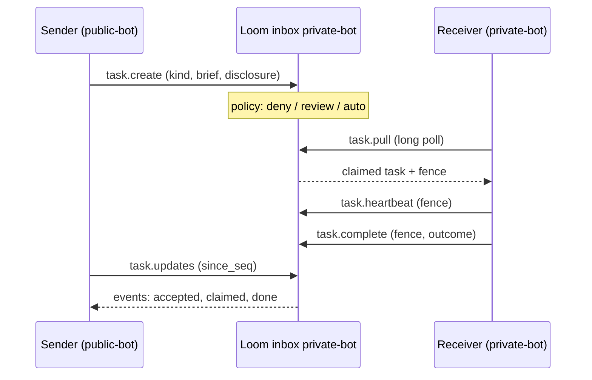
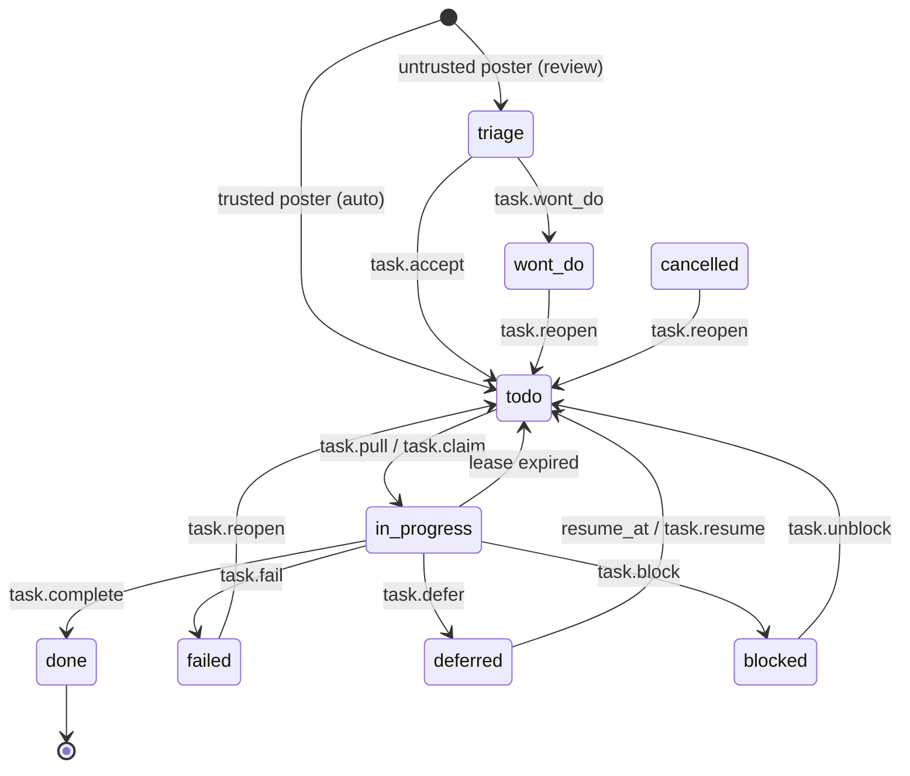

<!-- i18n: source=docs/features/tasks-and-decisions.md blob=6e870a75844f0d2a108f440b9a1d087f08200002 model=claude-sonnet-5-5 -->
> 이 페이지는 [영어 원문](https://github.com/ClickHouse/loom/blob/main/docs/features/tasks-and-decisions.md)을 기계 번역한 것이며, 영어 원문이 기준입니다.
> Machine-translated from the [English page](https://github.com/ClickHouse/loom/blob/main/docs/features/tasks-and-decisions.md), which is authoritative.

<a id="tasks-decisions-and-policies"></a>

# 태스크, 결정, 정책

메모리 옆에는 에이전트 간 조정을 위한 세 가지 플레인이 있습니다. 모든 op는 어떤 MCP 목록에서든 이름으로 호출할 수 있으며,
`all` 목록에 표시되는 op는 [MCP 툴셋](https://github.com/ClickHouse/loom/blob/main/docs/reference/mcp.md#toolsets)에 정리되어 있습니다.

| 플레인          | 답하는 질문                                                     | Ops                 |
| -------------- | --------------------------------------------------------------- | ------------------- |
| 태스크 인박스     | "이 작업은 다른 에이전트의 몫입니다. 어떻게 넘기나요?"    | `inbox.*`, `task.*` |
| 결정      | "이와 비슷한 경우에 무엇을 결정했고, 이유는 무엇이며, 효과가 있었나요?" | `decision.*`        |
| 이력 정책 | "이 에이전트가 방금 한 행동을 고려할 때, 지금 이 작업을 해도 되나요?"           | `policy.*`          |

**결정은 소유자가 합니다.** Loom은 소유자가 설정한 모드를 저장하고 적용할 뿐입니다. 게시자를 신뢰 대상으로 승격하거나, 분류된 태스크를 자동으로 수락하거나, 정책 규칙을 shadow에서 enforce로 옮기는 일은 절대 하지 않습니다. Loom이 근거(게시자의 이력, 규칙의 shadow 원장)를 제공하면, 사람이나 소유자 에이전트가 이를 읽고 모드를 변경합니다. 신뢰를 자동으로 바꾸면 작성자가 자신을 감시하는 신호를 조작해 게이트를 통과할 수 있게 되기 때문입니다.

<a id="task-inbox"></a>

## 작업 인박스

각 에이전트는 영속적인 큐를 가집니다. 게시자는 자신이 읽을 수 없는 인박스에도 쓸 수 있습니다. 인박스 소유자는 각 게시자를 어느 정도까지 신뢰할지 정합니다. 클레임된 작업의 소유자는 한 번에 한 명뿐입니다. 에이전트는 자신의 작업을 직접 가져오며, 선택 사항인 서명된 webhook은 "지금 가져오라"는 신호만 전달합니다.



<a id="statuses"></a>

### 상태



- `task.wont_do`(소유자)와 `task.cancel`(소유자, 또는 아직 소유자가 없을 때의 게시자)은 끝나지 않은 모든 상태에서 적용됩니다. 끝난 작업(`done`, `wont_do`, `failed`, `cancelled`)은 409 `TASK_TERMINAL`로 응답합니다.
- `task.reopen`(소유자)은 `failed`, `wont_do`, `cancelled` 상태를 다시 `todo`로 되돌립니다.
- `triage → todo → in_progress → done` 흐름에서 벗어나는 모든 이동에는 `reason`이 붙습니다.

<a id="register-an-inbox"></a>

### 인박스 등록

소유자 네임스페이스의 관리자가 인박스를 등록하고 `(poster, kind)`별로 신뢰를 설정합니다.

```python
from loom import Agent

async with Agent(org="acme", namespace="private", agent="admin", api_key=ADMIN_TOKEN) as a:
    await a.tasks.register_inbox(
        "private-bot",
        owner_agent="private-bot",
        posters=["sa:public-bot"],  # may post without holding the namespace
        accept_disclosure=["confidential", "internal"],
        default_lease_seconds=1800,
        max_attempts=3,
    )
    await a.tasks.set_policy(
        "private-bot",
        poster="sa:public-bot",
        kind="security_finding",
        mode="review",
        require_evidence=["inputs.finding_id", "inputs.test"],
    )
    await a.tasks.set_policy("private-bot", poster="sa:public-bot", kind="*", mode="deny")
```

| 모드     | 이 게시자와 kind의 작업은…                                                  |
| -------- | --------------------------------------------------------------------------- |
| `deny`   | 403 `TASK_POSTER_DENIED`로 거부됩니다.                                      |
| `review` | 소유자 에이전트나 사람이 수락하거나 거절할 때까지 `triage`에 머뭅니다.      |
| `auto`   | `todo`에 들어가 바로 가져갈 수 있습니다.                                    |

- 행이 없으면 인박스 소유자와 소유자 네임스페이스의 writer는 `auto`로 게시하고, 그 외의 게시자는 `review`로 게시합니다.
- 에이전트 라벨을 키로 한 행은 소유자 네임스페이스의 writer에게만 `auto`를 부여합니다. 라벨은 호출자가 고르기 때문입니다. 외부 게시자는 서비스 계정 subject(`sa:<name>`)를 키로 지정하세요.
- `require_evidence`는 create가 반드시 담아야 하는 brief 필드를 지정합니다. 누락된 필드는 422 응답에 이름이 나옵니다.
- 공개 수준은 `confidential`, `internal`, `public_ok`입니다. 인박스가 받지 않는 수준의 작업은 허용되는 값을 알려 주는 422를 받습니다.

`inbox.register` 인자:

| 인자                            | 기본값      | 의미                                                            |
| ------------------------------- | ----------- | --------------------------------------------------------------- |
| `default_lease_seconds`         | 1800        | pull이 다른 값을 요청하지 않을 때 클레임이 받는 리스입니다.     |
| `max_attempts`                  | 3           | 작업이 사람에게 막히기(blocked) 전까지 허용되는 리스 만료 횟수입니다. |
| `max_defers`                    | 5           | 작업이 사람에게 막히기 전까지 허용되는 defer 횟수입니다.        |
| `triage_escalate_after_seconds` | 14400 (4 h) | 응답 없는 triage 항목을 한 번 에스컬레이션하는 경과 시간입니다. |
| `webhook_url`                   | 비어 있음   | 인박스에 새 이벤트가 있을 때 서명된 깨우기 알림을 받습니다.     |
| `webhook_secret_ref`            | 비어 있음   | webhook 서명 시크릿을 담은 환경 변수입니다.                     |

`webhook_url`은 호스트가 공개 주소로만 해석되는 `http` 또는 `https` URL이어야 합니다. 전송할 때마다 URL을 해석하여 루프백, 사설, 링크 로컬(클라우드 메타데이터), 멀티캐스트 주소를 거부하고, 확인한 바로 그 주소로 연결하며(이름은 `Host` 헤더와 TLS SNI로 유지됩니다) 리디렉션을 따르지 않습니다. `webhook_secret_ref`는 인박스 org 자신의 변수 `LOOM_WEBHOOK_SECRET_<ORG>__<NAME>` 중 하나여야 합니다. ORG는 org id에서 소문자는 대문자로 바꾸고, 숫자는 그대로 두며, 그 외의 모든 바이트(대문자 포함)는 `_`와 두 자리 16진수로 쓴 값입니다(org `acme-corp` → `LOOM_WEBHOOK_SECRET_ACME_2DCORP__ALERTS`, `acme_corp` → `ACME_5FCORP`). NAME은 문자와 숫자로 이루어집니다.
`inbox.register`는 그 밖의 이름을 거부하며(422), 그런 이름을 지정한 행은 읽지 않으므로 어떤 테넌트도 Loom이 다른 테넌트의 시크릿으로 서명하게 만들 수 없습니다. 서로 다른 두 org id가 같은 ORG 부분을 갖는 일은 없습니다.

<a id="post-a-task"></a>

### 작업 게시

```python
async with Agent(org="acme", namespace="public", agent="public-bot", api_key=PUBLIC_TOKEN) as a:
    out = await a.tasks.create(
        "private-bot",  # the target inbox
        kind="security_finding",
        title="Out-of-bounds read in the JSON reader",
        brief={
            "objective": "confirm and file in the private repository",
            "inputs": {"finding_id": "f-77", "test": "json_oob.sql"},
        },
        disclosure="confidential",
        idempotency_key="f-77",  # a retried create lands once
    )
    out["task"]["status"]  # "triage", or "todo" when the poster is trusted
```

한 게시자가 같은 `idempotency_key`로 두 번 create하면, 서로 경합하더라도 작업은 하나만 저장됩니다. 두 요청은 키에 대한 리스 아래에서 한 번에 하나씩 실행되고, 각각 그 작업을 응답하며, 작업을 저장한 쪽만 `created=true`라고 말합니다. 키는 게시자 고유의 것이므로, 다른 게시자가 같은 키로 create하면 그 게시자 자신의 작업이 저장됩니다. 작업을 저장한 뒤 중단된 create를 재시도하면 빠뜨렸던 `created` 이벤트를 기록합니다. 빠진 리스 행은 리스 스윕이 기록할 몫이므로, 작업은 스윕의 60 s 유예 시간과 한 번 더의 패스 뒤에 클레임할 수 있게 됩니다. 처음 create 자신의 이벤트가 그래도 기록된 경우(삽입 도중 취소된 경우)에는 두 이벤트가 하나의 중복 제거 토큰을 공유하며, 리더(`task.history`, `task.updates`, `/v1/task/watch`, webhook)는 첫 번째만 남깁니다. 그래서 작업은 히스토리와 각 커서의 전달에서 한 번만 생성된 것으로 보입니다. 같은 키를 가진 다른 create를 10 s 넘게 기다린 create는 409 `PRECONDITION_FAILED`로 응답하고, 리스 저장소(Keeper)가 응답하지 않으면 503으로 응답합니다. 어느 쪽이든 재시도하세요.

`namespace`는 게시자 자신의 것이고, 첫 번째 인자가 인박스를 지정합니다. `create`는 `priority`(기본값 3), `deadline`, `not_before`, `origin`, `parent_task_id`도 받습니다. `not_before`가 있는 작업은 `todo` 상태이지만 그 시각까지 `pull`에서 보이지 않으며, 봇이 자신의 "나중에 재시도" 백로그를 유지하는 방법이 이것입니다.

| 거부 사유                                  | 응답                                                       |
| ------------------------------------------ | ---------------------------------------------------------- |
| 게시 권한은 없지만 인박스를 읽을 수 있음   | 403 `AUTH_INSUFFICIENT`                                    |
| 게시도 읽기도 할 수 없음                   | 404 `RESOURCE_NOT_FOUND`, 등록되지 않은 인박스와 동일       |
| 정책이 이 게시자나 kind를 거부함           | 403 `TASK_POSTER_DENIED`                                   |
| 허용되지 않는 공개 수준                    | 422, 허용되는 값 포함                                      |
| brief에 `require_evidence` 필드가 없음     | 422, 누락된 필드 이름 포함                                 |

<a id="pull-work-finish"></a>

### 가져오기, 작업, 완료

```python
async with Agent(org="acme", namespace="private", agent="private-bot", api_key=PRIVATE_TOKEN) as a:
    async for task in a.tasks.stream("private-bot", kinds=["security_finding"]):
        fence = task["fence"]
        try:
            result = await work(
                task["brief"], heartbeat=lambda: a.tasks.heartbeat(task["task_id"], fence=fence)
            )
            await a.tasks.complete(task["task_id"], fence=fence, outcome={"issue_url": result.url})
        except Exception as e:
            await a.tasks.fail(task["task_id"], fence=fence, reason=str(e)[:500])
```

- **롱 폴.** `task.pull`과 `task.updates`는 최대 30 s(`wait_seconds`)까지 대기합니다. 같은 서버 프로세스에서의 create는 대기 중인 pull을 즉시 깨우고, 다른 레플리카에서의 create는 약 2 s 안에 감지됩니다.
- **리스와 펜스.** 클레임은 리스와 `fence` 토큰을 받으며, 소유자의 모든 쓰기는 이 토큰을 제시해야 합니다. `task.heartbeat`는 리스를 연장합니다. 워커가 죽으면 `task_lease_sweep` 워커가 작업을 `todo`로 되돌리고, `max_attempts`번 만료되면 사람에게 막힌 상태로 만듭니다. 오래된 펜스는 409 `TASK_FENCE_STALE`을 받습니다. 클레임은 리스를 얻은 뒤 다시 읽은 작업이 해당 펜스에서 여전히 `todo`일 때만 유효하며, 그렇지 않으면 클레임은 리스를 찾았던 상태 그대로 돌려놓습니다. 각 스윕은 경합 때문에 작업과 어긋난 리스 행도 바로잡습니다. 행이 없는 `todo` 또는 triage 작업에는 행을 만들고, 유휴 또는 만료된 행은 작업의 펜스를 따르며(리스를 얻은 뒤 중단된 클레임은 펜스가 하나 앞선 행을 남깁니다), 끝난 작업의 행은 제거합니다. 최근 60 s 안에 기록된 행은 건너뛰는데, 아직 진행 중인 create나 reopen의 것일 수 있기 때문입니다. 취소가 끝내려던 작업을 위해 reconcile이 다시 써 넣은 행은 60 s 유예 뒤 첫 번째 패스에서 제거됩니다. 클레임의 리스와 상태 쓰기 사이에 들어온 취소는 클레임이 덮어써서 작업이 `in_progress`로 남습니다. 이 경합은 reconcile 이전부터 있었으며 reconcile로 해결되지 않습니다.
- **그 밖의 이동.** `task.defer`(`resume_at` 포함), `task.block`(`blocked_on`: `sender`, `human`, `external`), `task.wont_do`, `task.progress`(메모이며 상태는 바뀌지 않음).
- **Triage.** `task.pull(status="triage")`는 클레임하지 않은 채 review 항목을 반환하며, `task.accept` 또는 `task.wont_do`로 결정합니다. 게시자는 자신의 작업을 수락할 수 없습니다(403 `TASK_SELF_ACCEPT`). triage 상태의 작업은 만료되거나 자동 수락되지 않습니다.

<a id="follow-the-outcome"></a>

### 결과 추적

발신자는 커서로 자신이 게시한 작업의 이벤트를 읽습니다.

```python
upd = await a.tasks.updates(since_seq=cursor, wait_seconds=30)
for ev in upd["events"]:  # accepted, claimed, done, wont_do, blocked, ...
    reconcile(ev)
if upd["events"]:
    cursor = upd["next_seq"]  # save only after reconcile succeeds
```

읽기와 저장 사이에 크래시가 나면 이벤트가 다시 전달되므로, `reconcile`은 반복을 견뎌야 합니다. 커서는 가장 최신 이벤트보다 약 3 s 뒤에 머물러, 다른 레플리카에 아직 기록 중인 행을 건너뛰지 않게 합니다.

<a id="operations"></a>

### 작업(Operations)

| 그룹                      | Ops                                                                                                                    |
| ------------------------- | ---------------------------------------------------------------------------------------------------------------------- |
| 인박스 설정 (admin)       | `inbox.register`, `inbox.policy_set`, `inbox.principals`; `inbox.list`, `inbox.policy_list` (viewer)                   |
| 게시 (발신자)             | `task.create`, `task.updates`, `task.cancel`                                                                           |
| 작업 수행 (소유자)        | `task.pull`, `task.claim`, `task.heartbeat`, `task.progress`, `task.complete`, `task.fail`, `task.defer`, `task.block` |
| Triage와 복구 (소유자)    | `task.accept`, `task.wont_do`, `task.unblock`, `task.resume`, `task.reopen`, `task.update`, `task.reassign`            |
| 읽기                      | `task.get`, `task.list`, `task.counts`, `task.history`                                                                 |

Python SDK는 이들을 `agent.tasks`로 제공합니다. MCP에서는 `?toolset=tasks`가 작업 중인 에이전트가 쓰는 op를 나열합니다: `task.pull`, `task.create`, `task.complete`, `task.fail`, `task.wont_do`, `task.defer`, `task.heartbeat`, `task.updates`, `task.list`, `task.get`, `inbox.list`.

대시보드의 **Tasks** 페이지는 네임스페이스의 모든 인박스를 나열하며, 사람이 처리해야 할 항목을 보여 주는 타일, 다음 단계별로 묶은 행, 인라인 Accept / Won't do, 작업별 패널(`if_match_version`을 사용하는 `task.update`)을 제공합니다. writer는 상태 머신이 가진 모든 전환으로 작업을 옮길 수 있습니다. 패널의 버튼(Start는 `loom-ui`가 보유한 하루짜리 리스로 하는 `task.claim`이고, Mark done과 Fail은 현재 리스의 펜스를 붙인 `task.complete` / `task.fail`)을 쓰거나, 행이나 카드를 다른 그룹으로 끌어다 놓으면 해당 그룹으로 가는 한 단계 이동이 실행됩니다(To do로는 수락, unblock, resume, reopen이 되고, In progress로는 시작, Waiting으로는 block, Closed로는 done 또는 won't do 처리가 됩니다). 작업을 끌고 있는 동안에는 한 단계로 갈 수 없는 그룹이 흐리게 표시됩니다. 인박스 설정에서는 Loom이 이미 알고 있는 org의 ID 중에서 게시자를 고릅니다(`inbox.principals`, admin).

<a id="settings"></a>

### 설정

| 설정                                | 기본값 | 효과                                                                                                                         |
| ----------------------------------- | ------ | ---------------------------------------------------------------------------------------------------------------------------- |
| `LOOM_TASK_LEASE_SWEEP_ENABLED`     | true   | 스위퍼를 실행합니다: 만료된 리스, `resume_at`에 도달한 deferred 작업, 오래된 triage, 작업과 어긋난 리스 행을 처리합니다.     |
| `LOOM_TASK_WEBHOOK_DELIVER_ENABLED` | true   | 새 이벤트 배치마다 인박스의 `webhook_url`로 서명된 알림을 한 번씩 보냅니다.                                                  |

[설정: 작업 인박스](https://github.com/ClickHouse/loom/blob/main/docs/reference/configuration.md#task-inbox)를 참고하세요.

<a id="decisions"></a>

## 결정

결정 기록에는 나중에도 중요한 선택이 담깁니다. 공급업체, 아키텍처, 정책 예외 같은 것입니다.
`decision.record`는 `category`, `scenario`, `reasoning`, `outcome`, `alternatives`, `confidence`, 그리고 해당 결정의
`caused_by` 또는 `influenced_by` 키를 받습니다. 다음을 기록합니다.

- 내장 `decision` 스키마의 타입이 지정된 레코드
- 같은 키로 저장되는 `decision` 타입의 검색 가능한 메모리 행
- 각 `caused_by` / `influenced_by` 키에서 해당 결정으로 이어지는 엣지

저장소의 trunk 코드 네임스페이스에 기록된 결정은, 해당 네임스페이스를 읽을 수 있는 호출자가 그 저장소의 체크아웃에서
MCP `loom_search`를 호출할 때도 검색됩니다([통합 검색](https://github.com/ClickHouse/loom/blob/main/docs/features/unified-search.md#reading-the-memory-section)).

메모리 행의 값은 한 문장입니다.
`<scenario>. Decided <outcome> because <reasoning>. Rejected: <alternative>; …`이며, `decision.outcome`이 결과를
기록한 뒤에는 `Realized: …`가 뒤에 붙습니다. 카테고리는 이 문장에 들어가지 않습니다. 카테고리는 레코드와 행의
`decision:category:<category>` 태그에 남으며, 카테고리별 필터는 이 태그를 읽습니다. reasoning이 outcome과 글자 그대로
같으면(대소문자, 공백, 끝 문장부호는 제외) 이유 없이 적은 금지 사항이나 불변 조건을 기록한 것으로 봅니다. 이 경우
문장은 `Decided <outcome>.`으로 표시되고 `context.pack`에는 `because`가 나타나지 않습니다. 각 부분은 레코드가 보관한
그대로, 레코드의 한도 안에서 전체가 저장됩니다(scenario 2,000자, outcome 1,000자, reasoning 4,000자, realized
outcome 2,000자, 각 300자인 alternatives 최대 10개). 더 긴 alternative는 공백 또는 두 CJK 문자 사이에서 잘리고 `…`로
끝나므로, 잘린 이름이 파일처럼 읽히지 않습니다. 문장은 최대 약 12,000자까지 늘어날 수 있습니다. `memory.for_file`은
이를 전체로 보여 주며, 블록의 상한을 넘으면 이름만 표시합니다. 검색은 발췌를 임베딩하는데, 저장된 처음 1,200자에서
` (#<key>)` 접미사를 뺀 부분이므로 scenario로 시작합니다. 더 긴 문장은 청크로도 저장되며 검색은 이 청크도 읽습니다.

`stage`는 `decided`(기본값) 또는 `proposed`입니다. 후자는 아직 선택되지도 구현되지도 않은 제안, 계획, 작업
항목 같은 안을 뜻합니다. proposed 결정의 문장은 `Proposed <outcome> because <reasoning>.`으로 표시되고 행에는
`decision:proposed` 태그가 붙으므로, 편집 전 블록과 검색은 이를 제안으로 보여 줍니다. proposed 금지 사항은
`constraint` 태그를 유지합니다. 편집 전 블록은 여전히 이를 맨 앞에 제안 표현으로 보여 주며, 이유가 없으면
`Proposed <outcome>.`으로 표시합니다.

stage는 레코드가 아니라 행에 보관됩니다. `context.pack`은 proposed 결정을 `→ proposed: <outcome>`으로 나열하고,
`decision.precedents`와 `decision.chain`은 레코드를 가진 행의 태그에서 읽은 `stage`를 응답합니다(결과가 기록된
결정은 decided로 읽힙니다).

`decision.outcome`은 stage를 제거합니다. 결과를 기록한다는 것은 그 결정이 실행되었다는 뜻이기 때문이며, 이후 문장은
`Decided … Realized: …`로 표시됩니다. `stage: "decided"`로 결정을 다시 기록해도 stage가 제거됩니다. `decision.record`는
호출자가 직접 붙인 `decision:proposed` 태그를 무시합니다. 행의 태그를 통째로 교체하는 `memory.update`는 이 태그도 다른
태그처럼 수정하며, 읽는 쪽은 그 결과를 따릅니다.

`loom decisions extract`를 실행하면 문서가 여전히 서술하는 행의 stage가 유지됩니다([문서에서 결정 추출하기](#extract-decisions-from-a-document)의
**Stage** 참고). 따라서 나중에 수락됨으로 표시된 제안도 그 행은 proposed로 남습니다. 이런 결정을 decided로 바꾸려면
다음 중 하나를 사용합니다. `--dry-run`이 보고하는 본문(추출기의 식별 정보를 담고 있어 행을 대체합니다)에
`stage: "decided"`를 넣어 보내거나, `decision.outcome`으로 결과를 기록하거나, 고정(pin)되거나 증명(attest)되지 않은 그 문서의
추출된 행을 삭제하고 다시 추출합니다. 다시 추출하면 모든 행의 stage를 새로 읽습니다.

- **검사**: 블랙리스트는 저장된 모든 필드를 전체로 읽습니다. 민감도와 속성 레이블은 저장된 category, scenario,
  outcome, reasoning, alternatives, realized outcome을 읽습니다(행이 보관하지 않는 `decision_maker`와 `run_id`는
  제외).
- **파일**: `files`는 `memory.set`과 같이 행의 파일을 지정합니다. 지정하지 않으면 저장된 필드에서 감지하며, realized
  outcome에서는 감지하지 않습니다. `memory.for_file`은 결정이 이름을 든 파일을 편집하기 전에 그 결정을 그대로
  제공하고, 고정되어 있으면 `(pinned)`, `source-changed` 태그가 붙으면 `(source changed)`로 표시합니다
  ([블록이 표시되는 방식](https://github.com/ClickHouse/loom/blob/main/docs/concepts/memory.md#tags-entities-and-files)).
- **출처**: `source_resource_id`와 `source_class`는 `memory.set`과 같이 해당 컬럼을 설정합니다.
  `source_resource_id`는 결정의 근거가 된 문서를 가리킵니다.
- **결과**: `decision.outcome`은 행의 파일, 출처, 선언된 클래스, 호출자의 태그를 유지합니다. `decision:proposed`
  태그를 제거하고, `decision` 태그를 다시 설정하며, 서버의 `sensitivity:` 및 `attribute:` 레이블을 다시 계산합니다.

결정은 텍스트가 아니라 키로 식별됩니다. 쓰기 시점의 충돌 검사는 결정이 서로 아무리 비슷하더라도 한 결정을 다른
결정의 행에 병합하지 않고, 중복으로 처리하지 않으며, 대체하게 하지도 않고, 고정된 결정이 이를 거부하게 하지도
않습니다. 다른 키 아래의 비슷한 결정은 충돌로 표시됩니다. 사용자를 지정한 쓰기가 모두 그렇듯, 사용자를 위해 기록된
결정은 그 사용자의 결정과만 비교됩니다([쓰기가 판정되는 방식](https://github.com/ClickHouse/loom/blob/main/docs/features/memory/conflicts-and-refusal.md#how-a-write-is-judged)).
충돌 해결기는 이후 비슷한 한 쌍 중 하나가 다른 쪽의 갱신이라고 판단하면 그것을 폐기할 수 있습니다. 이는
`memory.auto_supersede`로 기록되며 `memory.restore`로 되돌릴 수 있습니다.

`category`와 `scenario`가 결정을 식별합니다. 같은 scenario를 다시 결정하면 이전 레코드를 대체하며
(`superseded_prior=true`), 이력에는 이전 레코드가 남습니다. 키는 레코드의 식별 키와 같은 방식으로 만들어집니다
([타입이 지정된 레코드](https://github.com/ClickHouse/loom/blob/main/docs/features/memory/writing.md#typed-records) 참고). scenario는 어떤 문자 체계로 작성해도 기록되며, 글자나 숫자가 없는
category 또는 scenario(문장부호, 기호, 결합 문자만 있는 경우)는 400 `MISSING_IDENTITY_FIELD`로 거부됩니다. 결정을
글자 그대로 다시 기록하면 같은 문장이 쓰이며, `memory.set`은 이를 재진술로 처리합니다. 즉 행을 강화하고, 고정된
결정도 이를 받아들입니다. 재진술 비교는 문장의 바이트를 비교하므로, 다른 문장 형식으로 저장된 행은 같은 필드를
쓰더라도 재진술이 아니라 수정으로 처리됩니다. 이는 `decision.record`에서 오든, 문장도 다시 만드는
`decision.outcome`에서 오든 마찬가지입니다. 값이 잠긴 행은 잠금이 끝나거나 해제될 때까지 둘 모두를 423 `LOCKED`로
거부합니다. 증명된 행은 쓰기를 받아들이며, 증명은 `memory.verify`가 다시 연결할 때까지 오래된 것으로 읽힙니다.
고정된 행은 고정이 해제될 때까지 `decision.record`를 거부하며, 고정은 `memory.pin`으로만 다시 설정됩니다.
`decision.outcome`은 고정을 유지합니다. 고정된 결정의 작성자가 그 결정을 다르게 내리면 호출은 409
`PINNED_CONFLICT`로 거부되고 아무것도 기록되지 않습니다. 관리자가 먼저 `memory.unpin`으로 고정을 해제해야 합니다.
고정은 작성자 본인의 행만 보호합니다. 같은 scenario에 대한 다른 ID의 결정은 여전히 레코드를 대체합니다. 새
레코드에는 새 결정이 서술하는 내용만 담깁니다. 생략된 필드와 이전의 `realized_outcome`, `success`는 이어지지
않으며, `decision.record`로 쓰든 `memory.record.write`로 쓰든 같습니다. `success` 없이 호출한 `decision.outcome`은
레코드의 판정을 유지합니다.

레코드는 마지막 작성자의 텍스트, 즉 이를 기록한 에이전트, 사용자, 세션을 보관합니다. 따라서 그 작성자의 결정 행을
삭제하면 레코드가 폐기됩니다. 만료된 행도 여전히 활성으로 간주됩니다. 같은 키 아래의 다른 ID의 행은 레코드 평면에서
이미 대체된 것이므로 레코드를 유지하지 않습니다.

- **레코드를 폐기하는 경우**: 작성자의 결정 행에 대한 `memory.delete` 또는 `memory.delete_version`(`memory.delete`를
  통해 삭제하는 `keep_redirect=false`의 `memory.move`와 `action="delete"`의 `memory.apply` 포함), 툼스톤 처리되는 쪽에
  대한 `conflicts.resolve`와 `memory.dedup_resolve`, `sweep=true`의 `blacklist.add`, `blacklist.sweep`.
  `decision.chain`, `decision.precedents`, `decision.outcome`은 더 이상 이 레코드를 제공하지 않으며,
  `memory.record.history`는 마지막 버전을 `status="tombstoned"`로 보여 줍니다. 경합하는 두 폐기는 각각 툼스톤 버전을
  기록할 수 있으므로, 이력에 툼스톤이 두 번 나열될 수 있습니다.
- **폐기 이후**: `memory.restore` 또는 삭제 이전으로의 `namespace.rollback`은 행을 되살리지만 레코드는 되살리지
  않습니다. `decision.record`를 다시 호출하십시오. `keep_redirect=false`로 이동된 행은 더 이상 결정이 아닙니다. 새
  키에는 레코드가 없으며, 같은 category와 scenario로 `decision.record`를 호출하면 파생된 키 아래에 다시 기록됩니다.
- **레코드를 활성 상태로 두는 경우**: 다른 ID의 행 삭제, 다른 방식으로 행을 툼스톤 처리하는 `memory.clear`와
  `namespace.rollback`, 리디렉션 행이 이전 키 아래에서 여전히 작성자의 활성 행으로 간주되는 `keep_redirect=true`의
  `memory.move`, 작성자의 ID로 다른 `memory_type`을 사용해 키를 다시 쓰는 `memory.set`, 만료된 작성자 행에 대한 만료
  스윕의 툼스톤.
- **결정 행이 없는 레코드**: `decision` 스키마에 대한 `memory.record.write`는 레코드만 기록합니다.
  `decision.chain`은 이를 제공하고 `decision.outcome`은 이에 대해 not-found로 응답합니다. 결정은
  `decision.record`로 기록하십시오.
- **`decision.outcome`**: 레코드의 작성자 ID로 기록하며, 고정된 행의 고정을 유지하고, 작성자의 행이 활성 상태가
  아니면 not-found로 응답합니다. 행 쓰기는 읽은 행을 조건으로 하며, 호출 중에 결정이 바뀌거나 다른 조건부 쓰기가
  키를 점유하고 있으면 409 `PRECONDITION_FAILED`로, 키의 리스 저장소에 접근할 수 없으면 503으로 응답합니다. 이
  경우 다시 호출하십시오. 결정의 텍스트를 유지하는 재기록은 행의 값을 그대로 두므로, outcome은 행을 쓰기 전과 레코드를
  쓰기 전에 작성자의 레코드를 한 번 더 확인하고, 레코드가 바뀌었으면 같은 409로 응답합니다. 두 번째 확인에서
  걸리면 행에는 호출을 다시 할 때까지 outcome의 문장과 outcome 태그가 남으며, 그 호출은 행의 재진술로 간주됩니다.
  조건은 행의 값에 대한 것이며 고정에 대한 것이 아닙니다. outcome이 읽은 뒤 쓰기 전에 발생한 `memory.unpin`은
  되돌려지는데, outcome이 행을 다시 고정된 상태로 쓰기 때문입니다.

| 작업                  | 역할   | 기능                                                                                               |
| --------------------- | ------ | -------------------------------------------------------------------------------------------------- |
| `decision.record`     | writer | 결정과 그 인과 엣지를 기록합니다.                                                                  |
| `decision.precedents` | viewer | 과거 결정에 대한 시맨틱 검색(최대 25개)이며, `category` 또는 `with_outcome_only`로 좁힐 수 있습니다. |
| `decision.chain`      | viewer | 인과 엣지를 `upstream`, `downstream`, `both` 방향으로 최대 4홉까지 따라갑니다.                      |
| `decision.outcome`    | writer | `realized_outcome`과 `success`를 기록하고, 결정을 내린 실행이 의존한 메모리에 점수를 더하거나 뺍니다. |

결정이 내려진 `run_id`를 전달하십시오. `decision.outcome`은 그 실행의 `memories_used`를 통해 점수를 줄 메모리를
찾습니다([실행](https://github.com/ClickHouse/loom/blob/main/docs/features/runs.md)).

```python
rec = await agent.decision.record(
    category="storage",
    scenario="retention for raw transcripts in the support namespace",
    reasoning="Replay needs 30 days; legal hold is handled by export, not by retention.",
    outcome="keep transcripts 30 days",
    alternatives=["keep forever", "7 days"],
    confidence=0.8,
    influenced_by=["policy/legal/hold"],
)
prior = await agent.decision.precedents("how long do we keep transcripts?", category="storage")
await agent.decision.outcome(rec["memory_key"], "no replay gaps in the quarter", success=True)
```

<a id="extract-decisions-from-a-document"></a>

### 문서에서 결정 추출하기

`loom decisions extract`는 [지식](https://github.com/ClickHouse/loom/blob/main/docs/features/knowledge.md) 문서 하나를 읽고 그 문서가 서술하는 결정을 기록합니다. 토큰 없이 프로세스 내에서
실행되므로 운영자용 명령이며, 문서 섹션의 윈도우마다 설정된 LLM을 호출합니다. 윈도우마다 읽기 한 번(다시 읽는
윈도우는 두 번, 아래 참고)과 근거 확인 한 번을 호출하고, 저장된 결정이 사라진 것으로 보이면 윈도우마다 확인을 한 번
더 호출하며, 이는 드라이 런에서도 마찬가지입니다. 이 모델 호출은 네임스페이스의 비용 한도로 제한되지 않습니다.
조직에서 보류된 모델 호출(모델 호출이 꺼져 있거나 추론 게이트웨이가 거부 또는 지연한 경우), 즉 모델 읽기나 쓰기에
필요한 임베딩에 대한 호출이 보류되면 실행이 중단됩니다. 더 이상 아무것도 기록되지 않고 아무것도 폐기되지 않으며
종료 코드 1로 끝납니다. 문서 소스 동기화는 기록하는 각 문서에 대해 같은 추출을 실행하며, 네임스페이스 비용 한도의
일부 범위 안에서 수행됩니다([결정 마이닝](https://github.com/ClickHouse/loom/blob/main/docs/features/knowledge.md#mining-decisions)).

```bash
loom decisions extract --org O --namespace NS --source-uri URI            # dry run: prints what it would write
loom decisions extract --org O --namespace NS --source-uri URI --apply    # writes
loom decisions extract --org O --namespace NS --source-uri URI --repo OWNER/NAME --into source --apply
```

- **저장소(Repository)**: 기본적으로 문서의 네임스페이스는 문서에 나오는 코드 이름을 조회하고 그 문서의 결정을 기록하는 곳이며, 저장소의 코드 네임스페이스에 추가된 문서에 적합합니다. 개인 또는 팀의 네임스페이스에 있는 문서는 `--repo OWNER/NAME`(또는 원격 URL)으로 저장소를 지정합니다. 이는 `code.repos`가 체크아웃의 원격과 대조하는 방식과 같이 owner/name으로 매칭됩니다(포크의 원격은 업스트림으로 따라가지 않으므로 업스트림을 지정하세요). 이때 문서의 이름은 해당 저장소의 trunk 코드 네임스페이스에서 조회되고, `--into`가 행이 기록될 위치를 정합니다.
  - `--into source` (코드 네임스페이스 밖에 있는 문서의 기본값): 문서의 네임스페이스에 기록하며, 각 행에 `repo:<id>` 태그를 붙입니다. 이 태그는 코딩 플러그인이 `memory.for_file`로 보내는 태그이므로, 자신의 네임스페이스(플러그인의 `namespace`)가 문서의 네임스페이스와 같은 세션은 문서에 나오는 파일을 편집하기 전에 해당 행을 받습니다. 편집 전 훅은 그 네임스페이스와 저장소의 trunk만 읽으므로, 독자가 각자의 네임스페이스에서 작업하는 팀 공유 문서는 `--into repo`로 기록합니다. trunk 안에 있는 문서는 태그가 없는 행을 만들며, 모든 편집자가 그곳에서 읽습니다.
  - `--into repo` (코드 네임스페이스에 있는 문서의 기본값): 저장소의 trunk 코드 네임스페이스에 기록하며, 저장소의 모든 독자가 편집 전에 해당 행을 받습니다. `source_resource_id`는 여전히 문서 자신의 네임스페이스에 있는 문서를 인용합니다. 문서별 접근 권한은 없으므로, 문서의 네임스페이스를 읽을 수 없는 저장소 독자는 행의 결정은 볼 수 있지만 그 행이 인용한 문서는 거부됩니다. 이 행들은 trunk의 것이므로, 문서의 네임스페이스를 지워도 남아 있으며 trunk에서 `memory.delete`로 삭제해야 합니다.
  - **태그**: trunk 밖의 문서에 대한 `--into source`에서는, 실행이 그대로 두는 추출기의 행(고정됨, 증명됨, 또는 결과가 기록되었으면서 아직 서술되어 있거나 판정되지 않은 행, 또는 아직 서술되어 있거나 판정되지 않아 폐기 단계가 유지하는 행)과 `source-changed` 태그를 붙이는 행은 태그만 쓰는 기록으로 `repo:<id>` 태그를 얻습니다. 다른 작성자의 행에는 태그가 붙지 않습니다.
  - **접근**: 실행은 문서의 네임스페이스와 저장소의 네임스페이스를 읽고, 행이 기록될 곳에 씁니다. 인증 컨텍스트가 바인딩되어 있으면 각각을 확인하고(viewer, viewer 및 writer, 드라이 런은 viewer) 모델 호출 전에 거부합니다. CLI는 운영자로서 인증 없이 실행됩니다.
  - **이전 실행의 행**: 조정(reconcile) 및 폐기(retire) 단계가 읽는 모든 메모리 행은 행이 기록될 네임스페이스에 있습니다. 따라서 이 문서의 행이 실행이 쓸 수 있는 다른 네임스페이스(문서의 네임스페이스, 지정한 저장소의 trunk, 또는 브랜치의 코드 네임스페이스에 있는 문서라면 그 저장소의 trunk)에 있거나, 다른 저장소의 `repo:<id>` 태그를 가지고 있으면(`--repo`가 없는 실행이나 원격이 없는 저장소를 지정한 실행에서는 어떤 태그든) 모델 호출 전에 거부합니다. 계속하면 문서의 결정이 두 곳에 남거나 잘못된 저장소에 연결되기 때문입니다. 거부 메시지는 호출자가 읽을 수 있으면 연결된 저장소를 `owner/name`으로 알려 주고, 그 다른 네임스페이스를 읽을 수 없는 호출자는 거부됩니다. 실행이 보지 못하는 경우는 두 가지입니다. 하나는 이후 실행이 `--repo`를 생략하거나 다른 저장소를 지정했을 때, `--into repo` 실행이 문서를 담은 코드 네임스페이스의 저장소가 아닌 다른 저장소(코드 네임스페이스 밖의 문서라면 어떤 저장소든)에 기록한 행이므로, 같은 `--repo`를 다시 지정하세요. 다른 하나는 서로 다른 `--into`로 같은 문서에 대해 두 실행이 동시에 도는 경우로, 둘 다 상대 네임스페이스가 비어 있다고 판단할 수 있습니다.
  - **Exit 1**: 위의 거부 외에, 모델 호출 전에 다음 경우에 종료 코드 1로 끝납니다.
    - 조직에 설정되지 않았거나 호출자가 읽을 수 없는 저장소(두 경우 모두 같은 응답)
    - trunk 밖의 문서에 대한 `--into source`에서, 행에 태그를 붙일 원격이 없는 저장소
    - `--repo` 없는 `--into`
    - 다른 저장소의 코드 네임스페이스에 있는 문서에 대한 `--into source`(행이 지정한 저장소의 코드에 연결되지만 다른 저장소에서 읽히게 됩니다)
    - 대시보드에서 추가한 저장소를 읽을 수 없는 경우

- **윈도(Windows)**: 현재 임베딩 모델의 문서 라이브 청크를 섹션별로 묶어 호출당 최대 `--window-chars`(기본값 `LOOM_MEMORY_DECISION_EXTRACT_WINDOW_CHARS`, 24,000)만큼 읽습니다. 한 번에 들어가는 문서는 전체를 읽으므로, 선택과 다른 섹션에 문서가 적은 이유(문제 서술, 측정값, 빠진 사례 목록)도 함께 읽힙니다. 기본값은 밀도 높은 설계 문서의 응답(윈도와 거의 같은 토큰 수)을 읽기의 출력 한도(`LOOM_LLM_MAX_TOKENS_OVERRIDES`의 `decision_extract`) 안에 유지합니다. 한도에서 잘린 응답은 해당 윈도를 잃으며, 버려졌다는 줄이 `--window-chars`를 낮추거나(sync는 이 설정을 읽습니다) 한도를 높이라고 알려 줍니다. 다른 임베딩 모델로 청킹된 문서는 청크가 없으므로, 명령은 먼저 `loom rechunk`를 실행하라고 안내하고 아무것도 쓰지 않습니다. 라이브 문서가 없는 `--source-uri`는 종료 코드 1로 끝나며 아무것도 쓰지 않습니다. 프롬프트에는 추출기가 이 문서에 대해 이미 보유한 결정 최대 `LOOM_MEMORY_DECISION_EXTRACT_KNOWN_MAX`(기본값 30)개의 카테고리와 시나리오가 나열되며, 모델에게 텍스트가 여전히 기록하는 결정에는 이를 재사용하도록 요청합니다. 그래서 다시 실행해도 같은 키를 읽습니다. 이전 결과는 보여 주지 않으므로, 바뀐 결과는 현재 텍스트에서 그대로 읽힙니다.
- **읽기(Read)**: 모델은 각 결정에 대해 결과, 문서가 제시한 이유, 문서가 기각한 선택지(제시된 이유와 함께, 또는 이유 없이)를 자신의 간결한 표현으로 쓰며, 각 주장은 문서의 짧은 인용문 하나에서 세 개를 인용합니다(`server/memory/domain/decision_extract.py`, `SYSTEM`). 문서가 이유 없이 서술한 결정은 이유 없이 기록됩니다. 새 설계가 대체하는 현재 또는 이전 접근 방식은 새 설계의 기각된 선택지입니다. 측정값, 요약, 안건 또는 벤치마크 결과는 결정이 아닙니다. 응답에 결정이 없고 윈도의 텍스트가 캡션보다 긴 경우(이미지와 링크 마크업을 제거한 뒤 80자 초과), 같은 프롬프트로 윈도를 한 번 더 읽으며 `read again`으로 보고합니다. 문서에 제목이 있으면 윈도의 텍스트는 `[document: <title>]` 줄(제목의 처음 200자)로 시작합니다.
- **근거 확인(Grounding)**: 각 인용문은 모델이 읽은 텍스트 안에 있어야 합니다. 연속된 공백은 공백 하나로 보고, 대소문자는 무시하며, 슬라이드나 다이어그램 내보내기가 문장을 나눈 것을 모델이 그대로 복사하는 경우처럼 두 단어 사이의 레이블 줄을 최대 세 줄까지 건너뛰어 읽습니다(`find_span`). 찾은 인용문은 레이블 줄을 뺀 문서 자신의 말로 한 줄로 유지되며, 12자 미만의 인용문은 근거가 되지 못합니다. 인용문이 하나도 발견되지 않는 이유 또는 기각된 선택지는 제외됩니다(`reason '...' left out: none of its quotes is in the document text`). 결과 인용문이 하나도 발견되지 않는 결정은 버려집니다(`none of the outcome's quotes is in the document text`). 브레드크럼의 어느 수준의 제목에든 `recap`, `summary` 또는 `background`가 단어로 들어 있는 섹션의 결과 인용문은 결정의 위치로 인정되지 않으며, 다른 결과 인용문이 없는 결정은 버려집니다(`the quote is in a recap, summary or background section`). 다만 이유는 그런 섹션의 텍스트에 근거할 수 있습니다.
- **지지 확인(Support check)**: 같은 윈도에 대한 두 번째 호출이 유지된 각 주장을 인용문과 함께 읽고, 문서의 맥락에서 읽은 인용문이 그 주장을 서술하거나 직접 함축할 때만 지지합니다. 인용문을 요약하거나 결합하는 것은 괜찮지만, 이유, 원인, 숫자, 이름 또는 기각된 선택지를 덧붙이는 것은 안 됩니다. 지지되지 않은 주장은 제외되고(`... left out: the support check found it not stated`), 결과가 지지되지 않은 결정은 버려집니다. 이 확인은 결정이 확정되었는지 제안에 그쳤는지는 판단하지 않으며, 그것은 읽기 단계의 몫입니다. 같은 호출은 문서에 대해 추출기가 저장한 결정(알려진 결정 상한까지)도 텍스트와 대조해 읽고, 여전히 서술되어 있는지와 어느 후보가 그것을 다시 서술하는지를 판단합니다. 저장된 결정은 어느 윈도의 확인이든 서술되어 있다고 하면 서술된 것으로 보고, 모든 윈도가 그렇지 않다고 할 때만 더 이상 서술되지 않은 것으로 판정됩니다. 그 경우 후보 없이 한 번 더 읽으며, 모든 윈도의 두 번째 확인이 일치할 때만 더 이상 서술되지 않은 것으로 칩니다. 그 밖의 모든 경우(실패하거나 읽을 수 없는 확인, 결정을 빠뜨린 응답)는 판정이 없으며, 확인이 유실되면 그 윈도의 후보도 함께 유실됩니다.
- **이미지 전용 섹션(Image-only sections)**: 자체 텍스트에 단어가 없거나(제목만 있거나 이미지 위의 제목) 이미지와 80자 이하의 다른 텍스트(캡션)만 있는 섹션은 모델로 보내지 않으며 `image-only, rationale not extracted` 줄이 표시됩니다. 하위 섹션 위에 제목만 있는 섹션은 여기에 해당하지 않습니다. 첫 제목 위의 텍스트, 또는 제목이 없는 문서도 이미지와 캡션 이하의 텍스트만 있으면 같은 방식으로 건너뛰며, `(untitled)`로 보고됩니다. 이미지는 Markdown 이미지(인라인 또는 `![diagram][fig1]`처럼 참조 방식. `![spill flow]` 같은 단축 참조는 `vec![0; n]` 같은 매크로처럼 보이므로 읽지 않습니다), HTML 이미지, 또는 `[image]`, `[Image 3]`, `[image: ...]` 같은 자리 표시자입니다. 캡션의 글자 수는 HTML 태그, 링크 대상, 참조 레이블, 이미지를 감싼 링크가 남기는 빈 대괄호, 단독 URL을 제외하고 세므로, 링크로 감싼 배지는 글자 수를 늘리지 않습니다. 태그는 한 줄 안의 소문자 이름이므로 `x < 10k`와 `Option<A>`는 텍스트로 남습니다. 코드 안의 이미지 마크업(코드 스팬이나 블록 안의 `` 또는 ``)은 텍스트입니다. 단어가 없는 청크도 보내지 않습니다.
- **중복 및 섹션별 한도(Duplicates and limits per section)**: 실행의 앞선 후보가 이미 가진 키 아래의 후보, 또는 같은 결과(공백과 대소문자 제외)를 가진 후보는 버려집니다. `decision.record`에 맞지 않는 후보와, 첫 결과 인용문이 있는 섹션에서 `--max-per-section`(기본값 3)을 넘는 후보도 마찬가지입니다.
- **단계(Stage)**: 모델은 각 후보를 `decided` 또는 `proposed`로 표시합니다. 단순한 `decided`가 아닌 모든 것(제안, RFC, 계획, 향후 작업, 후속 작업, 또는 답이 없음)은 `stage: "proposed"`로 기록됩니다. 제안을 이미 내린 선택처럼 제공하는 것이 선택을 제안처럼 제공하는 것보다 에이전트를 더 오도하기 때문입니다. 텍스트가 여전히 서술하는 저장된 결정은 단계를 유지하며, 문서가 읽히는 단계가 다르면 실행의 메모가 그 단계를 알려 줍니다. 단, 결과가 기록된 행은 문서 내용과 무관하게 decided로 읽힙니다. 고정되거나 증명된 행은 실행에서 다시 기록되지 않으므로 그 단계는 수동으로만 바뀝니다.
- **쓰기(Write)**: 에이전트 `loom-decisions`(사용자와 세션은 `-`)로 `decision.record`를 통해 씁니다. 이유는 `; `로 이어 추론으로 쓰고(이유가 없는 결정은 결과 자체를 쓰며, 서술에서는 명시된 이유가 없는 것으로 읽힙니다), 각 기각된 선택지는 `<option> — rejected: <reason>` 또는 선택지만으로 쓰며, confidence는 0.5, `source_class="derived"`, `source_resource_id`는 `knowledge:<namespace>/<source_uri>#<section breadcrumb>`, 태그는 `source-kind:design_doc`, 금지나 불변식에는 `constraint`, 저장소 trunk 밖의 문서에 대한 `--into source`에서는 `repo:<id>`입니다. 행의 `actor`는 `process:cli:decisions`입니다. 각 `decision.record`와 행을 삭제하는 각 `memory.delete_version`은 전송 계층이 그 op에 대해 쓰는 감사 행을 `process:cli:decisions` 액터로 남깁니다. 태그 쓰기인 `memory.update_by_id`는 HTTP에서처럼 감사 행을 선언하지 않습니다.
- **파일(Files)**: 문서 텍스트에 있는 백틱으로 감싸거나 한정된 각 이름과 각 단독 클래스 이름은 문서의 네임스페이스에서(`--repo`가 있으면 저장소의 trunk에서) `code.symbol`로 조회됩니다. 정의하는 파일이 정확히 하나이면(생성자보다 클래스를 우선) `files`에 들어가며, 여러 개이거나 없으면 아무것도 추가하지 않습니다. 테스트나 Markdown 페이지만 정의하는 이름은 아무것도 연결하지 않습니다. 결정은 코드를 규율하며, 테스트나 페이지의 편집은 대신 그 결정을 보여 주게 되기 때문입니다. 드라이 런은 `only a test or a page defines it`라고 표시하고 그 이름을 미해결(`only tests or pages`)로 나열해 사람이 코드 파일을 추가하게 하며, snake_case이고 페이지가 문서화하고 있으면 설정으로 나열합니다. 테스트만 정의하는 snake_case 이름은 헬퍼이므로 나열되지 않습니다. 어떤 경로가 테스트로 간주되는지는 `server/memory/domain/decision_extract.py`의 `governs`가 정하며, 흔한 테스트, 목(mock), 엔드 투 엔드 레이아웃을 포함합니다. 이것이 놓치는 경로는 연결이 유지됩니다. 인용된 문장이 적은 저장소 경로(`src/Storages/MergeTreeData.cpp`)도 `memory.set`이 감지하는 것과 같이 추가됩니다. 이름에 대해 코드 인덱스를 읽을 수 없으면, 이미 기록된 결정은 그 행이 가진 파일을 유지하고 새 결정은 해석된 파일만으로 기록됩니다. Pull request 번호와 설정 이름은 드라이 런에서 미해결로 출력되어 사람이 추가하게 합니다. 백틱으로 감싼 snake_case 이름은 먼저 조회되고, 인덱스가 정의하지 않으면 설정으로 보고됩니다. 여러 파일에 정의된 이름은 사람이 파일을 고르도록 미해결로 출력됩니다.
- **조정(Reconcile)**: 지지 확인이 해당 키의 저장된 결정이 더 이상 서술되지 않는다고 판정할 때 문서가 달리 말하는 것으로 봅니다. 모델의 표현만으로는 변경이 아닙니다. 여전히 서술된 결정은 행 필드에 대해서만, 저장된 표현 그대로 다시 기록됩니다. 행이 고정되었거나 현재 형태로 증명(`memory.verify`)된 경우 재추출에 대해 동결됩니다. 개정이 결정에 이유나 기각된 선택지를 추가하더라도, 문서가 여전히 서술하는 결정은 저장된 표현을 유지합니다. 확인은 텍스트가 행의 내용을 여전히 말하는지를 묻는 것이지, 더 많이 말하는지를 묻는 것이 아닙니다. 키의 활성 레코드가 속한 행에 따라 다음과 같이 처리됩니다.
  - **추출기 자신의 행으로, 고정되거나 증명되지 않았고 이 문서에서 온 것**: 여전히 서술되어 있고 `files`, `source_resource_id`, `constraint` 태그, `repo:` 태그가 같으면 쓰기가 없습니다. 더 이상 서술되지 않으면 텍스트가 지금 읽히는 대로 다시 기록되며(레코드는 대체되고 이력이 보존됨), 여전히 서술되어 있지만 다른 행 필드가 있으면(코드가 인덱싱된 뒤 해석되는 파일, 이름이 바뀐 제목, `--repo`를 지정한 첫 실행) 저장된 표현으로 다시 기록됩니다.
  - **판정 없음**(알려진 결정 상한을 넘은 저장된 행, 응답이 빠뜨렸거나 true도 false도 아닌 답을 한 행, 확인이 유실된 행): 고정되거나 증명되거나 이미 활용된 행은 그대로 둡니다. 그 밖의 행은 실행이 그 키를 제시하면 다시 기록되는데, 표현이 다르면 텍스트가 지금 읽히는 대로, 파일, 출처, 태그만 바뀌었으면 저장된 표현과 단계로 기록됩니다.
  - **추출기 자신의 행으로, 고정되거나 증명되었고 이 문서를 인용하는 것**: 더 이상 서술되지 않으면 쓰기가 없고, 행의 에이전트, 사용자, 세션과 함께 전체 `decision.record` 본문이 출력되며, 행에 이미 `source-changed` 태그가 없으면 붙입니다. 본문을 수용하려면 관리자가 고정된 행을 `memory.unpin`으로 고정 해제한 뒤 보냅니다(고정된 작성자 행에 대한 `decision.record`는 409 `PINNED_CONFLICT`로 응답합니다). 증명된 행은 본문을 받으며, 그 증명은 `memory.verify`가 다시 결합할 때까지 오래된 것으로 읽힙니다.
  - **다른 작성자의 행 또는 다른 문서의 행**: 개정도 태그 지정도 하지 않으며 본문이 출력됩니다. 지지 확인은 추출기 자신의 행만 읽습니다.
  - **결과가 기록된 행**(`decision.outcome`): `decision.record`가 결과 없이 행을 재구성하게 되므로 다시 기록되지 않으며, 더 이상 서술되지 않는 행은 고정되거나 증명된 행처럼 `source-changed`로 태그됩니다.
  - **재서술(A restatement)**: 지지 확인이 저장된 결정을 다시 서술한다고 지목하지만 그 결정이 사라진 것으로 발견되지 않은 후보는, 키가 새것이거나 서술된 것으로 발견되지 않은 저장된 결정의 키인 경우 기록되지 않습니다(`restates <key>, not found gone`). 저장된 행과 그 단계는 그대로 유지되고, 후보의 키 아래 행은 사라진 것으로 발견되면 폐기되며 판정이 없으면 저장된 표현을 유지합니다. 이 처리는 더 이상 서술되지 않는 행과 판정이 없는 행의 재기록보다 먼저 일어납니다.
  - **키 아래 레코드 없음**: 후보와 가장 가까운(코사인만 사용) 결정 키 `LOOM_MEMORY_DECISION_EXTRACT_RESTATEMENT_TOP_K`(기본값 20)개 중, 다른 키 아래에 있으면서 네임스페이스의 충돌 임계값 이상으로 같게 읽히는 고정되거나 증명된 결정이 있으면 후보를 건너뜁니다(`already recorded by <agent> under <key>`). 질의는 후보의 서술이며 카테고리는 제외하므로, 다른 카테고리로 분류된 고정되거나 증명된 결정도 해당됩니다. 그렇지 않으면 결정이 기록됩니다. 조회는 500행으로 제한되므로 큰 값이나 `LOOM_MEMORY_SEARCH_PER_KEY_CAP=0`은 더 적은 키를 읽을 수 있습니다.
- **태그 쓰기**: 행의 `memory_id`로 `memory.update_by_id`를 호출하며, 태그만 바꾸고 읽은 값을 조건으로 합니다. 그 사이에 `decision.outcome`이나 재기록으로 값이 바뀌었다면 건드리지 않고 경합으로 보고합니다. 추출기가 만든 새 버전이 됩니다. 행의 고정, 값, 증명은 그대로 유지되고(값의 해시가 바뀌지 않으므로 증명은 여전히 그 값에 묶여 있습니다), 행위자와 시점만 이 버전으로 옮겨 가므로 편집 전 줄은 `by cli:decisions, just now`로 표시됩니다. 모든 `memory.update_by_id`와 마찬가지로 전체 개정입니다. 행이 다시 임베딩되고 충돌 검사를 거치므로, 가까운 유사 결정이 있는 결정은 `conflicted`로 표시되고(`include_conflicted=false`가 아니면 `memory.for_file`이 여전히 나열합니다), 오래된 충돌 표시는 지워집니다.
- **경합**: `decision.record`는 사전 조건을 받지 않으므로, 실행이 읽은 시점과 다시 기록하는 시점 사이에 `decision.outcome`이 반영되면 그 결과는 나머지 기록과 함께 교체됩니다. 태그 쓰기의 사전 조건은 값만 확인하며, 그 사이에 일어난 태그만의 변경은 확인하지 않습니다.
- **폐기**: 문서를 인용하는 `loom-decisions` 행 중 고정되거나 증명되지 않았고 더 이상 기술되지 않은(위 참조) 행은 `memory.delete_version`으로 삭제되며, 이때 해당 기록도 함께 폐기됩니다. 고정되거나 증명된 행, 또는 `decision.outcome`이 결과를 기록한 행은 대신 `source-changed` 태그가 붙습니다. 이번 실행이 다른 키로 그 자리에 결정을 기록한 행은 그 키로 교체되었다고 보고합니다. 여전히 기술된 행은 실행이 다시 내보냈든 아니든 그대로 남으며, 판정이 없는 행(알려진 결정 상한을 넘은 행, 또는 검사에서 빠졌거나 유실된 행)도 마찬가지입니다. 판정은 추출기 자신의 기록을 기준으로 합니다. 활성 기록을 다른 신원이 쓴 키는 건드리지 않습니다. 긴 문서에서 한 결정의 진술이 두 윈도우에 걸치면 각 윈도우에서 더 이상 기술되지 않은 것으로 읽힐 수 있습니다.
- **문서 인용**: 행의 `source_resource_id`가 `knowledge:<document namespace>/<source_uri>#`로 시작하면 그 행이 문서를 인용하는 것입니다. 여기서 네임스페이스는 행이 있는 곳이 아니라 문서가 있는 네임스페이스입니다. 따라서 `#`이 들어간 제목(`C# bindings`)도 문제가 되지 않습니다. 다만 같은 문자열로 시작하는 문서 `<source_uri>#<part>`가 그 네임스페이스에 수집된 적이 있다면 예외입니다. `doc#v2#Intro`는 `doc#v2` 문서가 존재하게 되면 그 문서를 인용하는 것으로 봅니다.
- **`source-changed` 해제**: 실행이 태그된 행의 키로 후보를 내보내고 근거 검사에서 그 행이 다시 기술된 것으로 확인되면, 행이 이 문서를 인용하는 한 고정 여부와 관계없이 실행이 태그를 제거합니다. 폐기 단계는 태그를 제거하지 않습니다.
  수동으로는 관리자가 행의 `memory_id`에 `memory.update_by_id`를 호출해 `tags`에서 `source-changed`를 뺀 값으로 제거하거나, (`memory.unpin` 후) 결정을 다시 기록하거나 삭제하면 됩니다.
- **거부와 경합**: 서버가 거부한 쓰기(블랙리스트에 오른 결정, 실행 중에 고정된 행, 사용 중인 키, 저장소 타임아웃)는 코드와 함께 보고되고, 임베딩 제공자의 오류로 중단된 쓰기(`memory.set`과 `memory.search`는 프로세스 내에서 임베딩합니다)는 오류 이름과 함께 보고됩니다. 실행이 읽은 뒤 행이 삭제되었거나 다시 쓰인 것을 발견한 쓰기, 또는 실행이 읽는 사이에 행이 삭제된 키는 그렇게 보고되며, 이는 다음 실행이 정리하는 경합입니다. 어느 경우든 실행은 다음 후보와 폐기 단계로 계속 진행합니다.
- **한도**: `--max-per-section`은 1 이상, `--window-chars`는 500 이상이어야 하며, 더 작은 값은 거부됩니다. 모델의 토큰 한도에서 잘린 응답은 도달한 상한(`decision_extract` 12000, `decision_support` 8000, `LOOM_LLM_MAX_TOKENS_OVERRIDES`로 설정하지 않은 경우)과 함께 보고되며, 두 플래그 중 하나를 낮추거나 해당 항목을 올리라는 안내가 붙습니다. 윈도우의 읽기, 빈 응답 뒤의 두 번째 읽기, 또는 근거 검사가 실패하면(제공자 오류, 타임아웃) 그 윈도우만 손실됩니다.
- **모델과 종료 코드**: 가짜 모델로 문서를 읽게 되는 경우 실행은 모델을 호출하기 전에 거부됩니다. 가짜 모델의 결정은 구조상 근거 검사를 통과하기 때문입니다. 해당하는 경우는 키가 필요한 제공자(`LOOM_LLM_PROVIDER=openai` 또는 `anthropic`)에 API 키가 설정되지 않았거나, 제공자가 전혀 구성되지 않은 경우입니다. `LOOM_LLM_PROVIDER=fake`를 명시적으로 설정하면 의도적으로 가짜 모델로 실행됩니다. 그 외에 가짜 모델이 응답한 윈도우(키가 없는 대체 모델 `LOOM_LLM_FALLBACK_MODEL`)는 읽지 못한 것으로 처리되어 버려집니다. 모든 윈도우의 모델 호출이 실패했거나 읽을 수 없는 응답이 왔거나, 아무 응답도 없고 다시 읽을 때도 실패한 실행은 아무것도 읽지 않으며 아무것도 폐기하지 않습니다. 명령은 문서에 대해 실행할 수 없을 때(문서 없음, 청크 없음, 사용할 수 있는 모델 없음, 위 **Repository**에 따른 거부, 모델 호출 전에 추출기 자신의 행을 읽을 수 없음, 읽힌 윈도우 없음) 1로 종료하고, 쓰기나 필요한 읽기가 거부되거나 실패했을 때(드라이 런의 읽기도 포함되며, 다른 윈도우는 읽혔지만 모델이 읽을 수 있게 응답하지 못한 윈도우나 근거 검사도 포함됩니다) 2로 종료하며, 그 외에는 0으로 종료합니다. 경합은 종료 코드를 바꾸지 않습니다.

인용문은 주장의 근거를 확인하는 데 쓰일 뿐 저장되지 않습니다. 기록에는 모델의 표현으로 쓴 결정과 문서 섹션의 인용이 남습니다. 추출된 행은 그대로 제공되며, 누구도 검토할 필요가 없습니다. 고정은 선택 사항입니다. 행을 재추출로부터 보호하려면 `memory.get`으로 행의 신원을 읽고 그 신원으로 `memory.pin`을 호출하거나, `memory.verify`로 현재 값을 증명하세요. 이후 실행에서 문서가 더 이상 그 내용을 말하지 않으면, 행을 개정하거나 삭제하는 대신 `source-changed` 태그를 붙입니다. 편집 전에 `memory.for_file`은 고정된 추출 행을 `(pinned)`로, `source-changed` 태그가 붙은 행을 `(source changed)`로 표시하며, 모든 결정 행에 대해 그렇게 합니다([결정](#decisions)). 저장소의 트렁크 코드 네임스페이스로 추출된 행은 그곳에 기록된 모든 결정과 마찬가지로 저장소 체크아웃에서 `loom_search`에도 나타납니다([통합 검색](https://github.com/ClickHouse/loom/blob/main/docs/features/unified-search.md#reading-the-memory-section)). 다만 그 화면은 고정 상태도, 출처가 바뀌었는지도 표시하지 않으므로, 추출된 행은 거기서 다른 결정과 똑같이 읽힙니다.

<a id="history-policies"></a>

## 기록 정책

역할은 누가 무엇을 호출할 수 있는지를 정합니다. 기록 정책은 에이전트 이벤트 추적(`loom.agent_events`)에 남은 호출자 자신의 최근 기록에 대한 규칙을 더합니다. 예를 들어 "읽기 이후에만", "시간당 쓰기 200회 이하" 같은 규칙입니다. 정책은 권한을 빼앗기만 할 수 있습니다. 역할 검사에 실패한 호출은 정책 게이트에 도달하지 않습니다.

규칙은 `effect` + `actions` + `condition`으로 구성됩니다.

- `effect`: `forbid`는 조건이 성립하면 거부하고, `require`는 조건이 성립하지 않으면 거부합니다.
- `actions`: op 이름 또는 glob(`memory.delete`, `memory.*`).
- `condition`: 과거만 참조하는 리프를 `all`, `any`, `not`으로 결합한 트리.

| 리프             | 성립하는 경우                                                                                                  |
| ---------------- | -------------------------------------------------------------------------------------------------------------- |
| `formerly`       | 일치하는 이벤트가 윈도 안에 발생한 경우.                                                                       |
| `count_within`   | 일치하는 이벤트의 수가 `value`와의 비교(`gt`, `gte`, `lt`, `lte`, `eq`)를 만족하는 경우.                       |
| `not_since`      | `anchor` 이벤트가 윈도 안에 발생했고, 가장 최근 anchor 이후 지정한 이벤트가 발생하지 않은 경우.                |
| `breadth_within` | 주체에게 표시된 고유 키의 수가 `value` 또는 네임스페이스 라이브 행의 `fraction`과의 비교를 만족하는 경우.      |

각 리프는 `within`(`30s`, `15m`, `1h`, `7d`, 상한은 `LOOM_POLICY_MAX_WINDOW_SECONDS`), `operation`, 그리고
`key`를 받으며, 그 값은 `agent`(기본값), `session`, `user` 중 하나입니다(`breadth_within`의 기본값은 `actor`로, 검증된 토큰 subject입니다). 컴파일러가 호출자를 고정하므로 규칙은 다른 주체의 이벤트를 읽지 않습니다. `args_equal`은 이벤트 인자를 리터럴 또는 현재 호출의 `$args.<field>`와 비교합니다.

```python
await agent.policy.set(
    "read-before-delete",
    effect="require",
    actions=["memory.delete"],
    condition={
        "op": "formerly",
        "within": "1h",
        "operation": "memory.get",
        "args_equal": {"memory_key": "$args.memory_key"},
    },
    description="An agent deletes only what it has just looked at.",
)
verdict = await agent.policy.check(
    operation="memory.delete", agent="cleanup-bot", args={"memory_key": "notes/old"}
)
# verdict: {decision, would_enforce, mode, write_shaped, determining_rules, errors, rules, latency_ms}
```

<a id="modes"></a>

### 모드

`LOOM_POLICY_MODE`는 배포의 모드를 설정합니다.

| 모드            | 효과                                                                                                         |
| --------------- | ------------------------------------------------------------------------------------------------------------ |
| `off` (기본값)  | 게이트가 아무것도 읽거나 쓰지 않습니다.                                                                      |
| `shadow`        | 규칙을 실행하고 각 결정을 `loom.policy_decisions`에 추가하며, 아무것도 차단하지 않습니다.                    |
| `enforce`       | 거부하는 규칙이 있으면 결정에 관여한 규칙과 리프별 값을 담아 403 `POLICY_FORBIDDEN`으로 응답합니다.          |

규칙 자체의 `mode`(`inherit`, `shadow`, `enforce`)는 배포의 모드보다 우선합니다. 단, 배포가 `off`인 경우는 예외입니다. 규칙을 enforce로 옮기는 일은 `policy.decisions`를 읽은 뒤 소유자가 수행하는 단계입니다.

`enforce`에서 평가할 수 없는 규칙은 쓰기 성격의 호출(writer 역할 이상)을 거부하고, 읽기는 허용하면서 오류를 보고합니다. 게이트는 `policy.*`와 `ops.*`에는 적용되지 않으므로 운영자는 언제나 규칙을 고칠 수 있습니다. 에이전트가 할 수 있는 일을 넓히는 변경은 `policy.widened` 감사 행도 기록합니다.

| 작업               | 역할   | 동작                                                                           |
| ------------------ | ------ | ------------------------------------------------------------------------------ |
| `policy.set`       | admin  | 규칙을 생성하거나 교체합니다. `leaf_count`와 범위가 넓어졌는지 여부를 반환합니다. |
| `policy.delete`    | admin  | 규칙을 제거합니다.                                                             |
| `policy.list`      | viewer | 네임스페이스의 규칙과 배포의 모드를 반환합니다.                                |
| `policy.check`     | viewer | 저장된 규칙 또는 전달한 `rules`에 대해 호출을 드라이런합니다.                  |
| `policy.decisions` | viewer | `allow` / `deny`로 필터링하여 결정 원장을 읽습니다.                            |

대시보드의 **Policies** 페이지(관리자 드로어)에서 규칙을 관리하고, 호출을 드라이런하고, 원장을 읽을 수 있습니다. 설정은 `LOOM_POLICY_MODE`, `LOOM_POLICY_MAX_WINDOW_SECONDS`(기본값 86,400), `LOOM_POLICY_CACHE_TTL_SECONDS`(기본값 30, 다른 레플리카는 이 시간 안에 규칙 변경을 반영합니다)이며, [구성: 인증](https://github.com/ClickHouse/loom/blob/main/docs/reference/configuration.md#auth)에 있습니다.

<a id="limits"></a>

## 제한 사항

- 클레임은 배타적이지만 작업과 트랜잭션으로 묶여 있지는 않습니다. 작업을 완료하는 것과 그 결과를 기록하는 것은 두 번의 호출이므로, 결과 쓰기는 멱등하게 만들어야 합니다.
- `decision.chain`은 4홉에서 멈추며, `decision.precedents`는 최대 25개를 반환합니다.
- 정책 평가는 과거 이벤트만 대상으로 합니다. 현재 호출은 아직 트레이스에 포함되지 않으므로 증거(witness)는 항상 이전 이벤트입니다.

<a id="related"></a>

## 관련 문서

- [실행(Runs)](https://github.com/ClickHouse/loom/blob/main/docs/features/runs.md): 결정이 기여도를 반영하는 실행 원장입니다.
- [네임스페이스와 공유](https://github.com/ClickHouse/loom/blob/main/docs/features/namespaces-and-sharing.md): 소유자 네임스페이스와 권한 부여입니다.
- [토큰과 권한 부여](https://github.com/ClickHouse/loom/blob/main/docs/guides/tokens-and-grants.md): `posters`에 사용하는 서비스 계정 주체입니다.
- [헤드리스 봇](https://github.com/ClickHouse/loom/blob/main/docs/guides/headless-bots.md).
- [대시보드](https://github.com/ClickHouse/loom/blob/main/docs/features/dashboard.md): Tasks 보드와 Policies 페이지입니다.
- [보안 아키텍처](https://github.com/ClickHouse/loom/blob/main/docs/architecture/security.md): 정책 게이트의 위치를 설명합니다.
