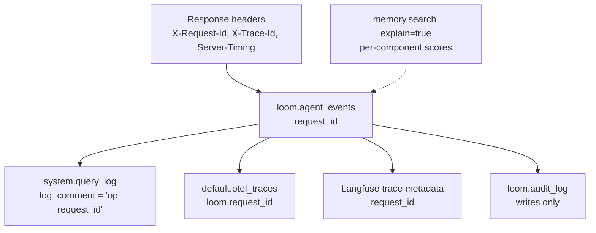

<!-- i18n: source=docs/guides/debugging.md blob=7e3e8e18681a11279a779257bf5385dbd9bce7c0 model=claude-sonnet-5-5 -->
> 이 페이지는 [영어 원문](https://github.com/ClickHouse/loom/blob/main/docs/guides/debugging.md)을 기계 번역한 것이며, 영어 원문이 기준입니다.
> Machine-translated from the [English page](https://github.com/ClickHouse/loom/blob/main/docs/guides/debugging.md), which is authoritative.

<a id="debug-a-request"></a>

# 요청 디버그

Loom은 하나의 요청이 수행하는 모든 작업에 동일한 id를 태깅하므로, 요청을 추적하는 일은 조인(join) 한 번으로 끝납니다.
이 페이지는 응답 헤더에서 시작해 답변을 결정한 컴포넌트까지 하나의 요청을 따라갑니다. 배포 자체가 정상이 아닌 경우에는
[문제 해결](https://github.com/ClickHouse/loom/blob/main/docs/operations/troubleshooting.md)에서 시작하세요. 워커가 실행되지 않았다면
[워커 상태](https://github.com/ClickHouse/loom/blob/main/docs/operations/monitoring.md#worker-status)를 참고하세요.



<a id="1-capture-the-requests-ids"></a>

## 1. 요청의 id 수집하기

모든 HTTP 응답에는 다음 헤더가 포함됩니다.

| 헤더                              | 의미                                                                                                                                                                                      |
| --------------------------------- | ----------------------------------------------------------------------------------------------------------------------------------------------------------------------------------------------------- |
| `X-Request-Id`                    | 요청의 id입니다. 직접 id(영문자, 숫자, `.`, `_`, `-` 1~64자)를 보내면 Loom이 그대로 반환하므로, 사용자의 로그와 Loom의 행이 하나의 키를 공유합니다. 그 밖의 값은 생성된 id로 대체됩니다. |
| `X-Trace-Id`                      | 요청의 스팬 트리에 대한 OpenTelemetry 트레이스 id입니다.                                                                                                                                 |
| `Server-Timing`                   | 성공 시 `app`(핸들러 시간)과 `ch`(ClickHouse 시간, 구문 수, 읽은 바이트 수)를 제공합니다.                                                                                                 |
| `X-Loom-Hint`, `X-Loom-Hint-Code` | 이 호출에 대해 멘토가 제공하는 힌트입니다(있는 경우). SDK가 이를 로그로 남깁니다.                                                                                                         |

```bash
curl -si "$LOOM_BASE_URL/v1/memory.search" -H "Authorization: Bearer $LOOM_API_KEY" \
  -H 'Content-Type: application/json' -H 'X-Request-Id: dbg-0001' \
  -d '{"org":"acme","namespace":"support","agent":"bot","query":"refund window"}' \
  | grep -iE '^(x-request-id|x-trace-id|server-timing)'
```

`Server-Timing`은 "왜 느렸는가"에 대한 답을 주는 경우가 많습니다. `ch`의 시간이나 바이트 수가 크면 쿼리가 원인입니다. `ch`는 작은데 `app`이 크면 제공자 호출(임베딩, 리랭크, LLM)이 원인입니다.

<a id="2-join-the-request-across-systems"></a>

## 2. 시스템 간 요청 연결

동일한 id가 `loom.agent_events.request_id`, Langfuse 트레이스 메타데이터, 그리고 `default.otel_traces`의 스팬 속성 `loom.request_id`에 들어 있습니다.

```sql
-- the ledger row: operation, identity, latency, success, error_code, tokens, cost, model
SELECT * FROM loom.agent_events WHERE request_id = 'dbg-0001';

-- every ClickHouse statement the request issued
SELECT query_duration_ms, read_rows, read_bytes, substring(query, 1, 200) AS q
FROM system.query_log
WHERE type = 'QueryFinish' AND log_comment LIKE '% dbg-0001%'
ORDER BY event_time_microseconds;

-- its spans
SELECT SpanName, Duration, SpanAttributes['loom.operation'] AS op
FROM default.otel_traces
WHERE SpanAttributes['loom.request_id'] = 'dbg-0001'
ORDER BY Timestamp;
```

`log_comment` 태그는 [쿼리 귀속](https://github.com/ClickHouse/loom/blob/main/docs/operations/monitoring.md#logs-traces-and-query-attribution)에 나와 있습니다.
`LOOM_OTEL_EXPORTER`가 `ch`로 결정되면 스팬은 `default.otel_traces`(`LOOM_CLICKSTACK_DATABASE`가 설정된 경우 해당 데이터베이스)로 전송되며, 그렇지 않으면 OTLP 엔드포인트로 전송됩니다. Langfuse가 구성되어 있으면 스팬은 [Langfuse](https://github.com/ClickHouse/loom/blob/main/docs/features/integrations/langfuse.md)로도 전송됩니다.

> **참고:** 원장은 쿼리 텍스트를 저장하지 않습니다. `loom.agent_events`는 모든 자유 텍스트 인수를 `sha256:<16 hex>/<length>` 형태로 대체합니다. 어떤 질문이 있었는지 확인하려면 아래의 검색 트레이스 로그나 사용 중인 클라이언트 로그를 사용하세요.

<a id="3-explain-a-search-answer"></a>

## 3. 검색 응답 설명하기

**이 결과가 왜 이 순위에 있는가?** `explain=true`로 `memory.search`를 호출하면 반환된 각 히트에 `score_components`가 붙습니다. 여기에는 순위 신호가 담기고, 리랭커를 거친 경우 리랭커가 만든 이동(`rerank_from`, `rerank_pos`, `rerank_delta`)이, 리랭커가 순서를 바꾼 경우에는 리랭커 이전의 자체 통합 점수(`rank_score_pre_rerank`)가 함께 담깁니다. 연결된 코드가 바뀌어 순위가 내려간 행에는 내려간 자리 수(`code_changed_places`)가 들어 있습니다.

```python
out = await agent.call("memory.search", {"query": "refund window", "explain": True})
for h in out["results"]:
    c = h["score_components"]
    print(
        h["memory_key"],
        h["similarity"],
        h["rank_score"],
        c.get("rerank_from"),
        c.get("rank_score_pre_rerank"),
    )
```

`memory.search_trace`는 `memory.search`와 같은 인자를 받아 벡터 단계만 점수를 계산하며(통합, 조립, 리랭커 없음), 히트마다 `similarity`, `distance`, `entity_boost`, `rank_score`, `rank`, `source`를 반환합니다.

**왜 답변을 보류했는가?** `memory.search` 응답 자체를 읽어 보세요.

| 필드                                      | 알려 주는 내용                                                                                                 |
| ----------------------------------------- | -------------------------------------------------------------------------------------------------------------- |
| `abstain`, `abstain_code`                 | 어떤 게이트가 작동했는지: `no_match`, `below_threshold`, `entity_absent`, `low_calibrated_confidence`, `page_expired`. |
| `retrieval_risk`, `retrieval_confidence`  | 가장 좋은 히트가 게이트에서 얼마나 떨어져 있는지.                                                              |
| `calibration_explanation`                 | 적용된 유사도 게이트(임베더로 보정한 값 또는 스칼라 대체값).                                                   |
| `degraded`                                | 이번 읽기에서 대체 동작으로 전환된 프로바이더와, 응답이 대신 수행한 동작.                                      |
| `pending_extraction`                      | 아직 추출되지 않은 지연된 `set_from_messages` 배치. 0보다 크면 빈 응답이 부재의 증거는 아닙니다.               |
| `namespaces_searched`, `candidates_total` | 검색이 예상한 네임스페이스와 행에 도달했는지.                                                                  |

`calibration.get`은 네임스페이스에 적용 중인 임계값과, 그 값을 만든 티어(네임스페이스, 클러스터, 스칼라)를 보여 줍니다.
[검색과 순위 지정](https://github.com/ClickHouse/loom/blob/main/docs/concepts/retrieval-and-ranking.md)에서 각 용어를 설명합니다.

**에이전트가 시간에 따라 무엇을 검색했는가?** `LOOM_SEARCH_TRACE_LOG_ENABLED=true`가 필요합니다(기본값은 꺼짐). `memory.search_trace_log(since_hours=, agent=, run_id=)`는 검색마다 한 행을 반환합니다: `returned_keys`, `returned_scores`, `abstain`, `retrieval_risk`, `latency_ms`, 그리고 `LOOM_LANGFUSE_CAPTURE_IO_LEVEL`이 `off`가 아닐 때의 `query`. 이 값의 기본값은 `off`이므로 기본 상태에서는 행에 질문 없이 키와 점수만 담깁니다.

<a id="4-explain-a-write"></a>

## 4. 쓰기 설명하기

- **쓰기 자체의 응답.** `memory.set`은 `status`, `conflict_verdict`, `peers`,
  `duplicate_of`, `merged_into_key`, `noop`, `advisories`를 반환합니다. "사라진" 쓰기는
  대부분 정식(canonical) 일치 항목에 병합되었거나 중복으로 표시된 경우입니다. `advisories`는
  이중 인코딩되었거나 크기가 지나치게 큰 값을 알려 줍니다.
- **이력.** `memory.history`는 `loom.memory_versions`에서 키의 버전 목록을 보여 줍니다.
  `memory.provenance`는 누가, 어떤 소스, 세션, 실행에서 썼는지 알려 줍니다.
- **추출 과정에서 누락된 항목.** `memory.extraction_status`는 보류된 `set_from_messages`
  배치(`pending`, `failed`)를 나열합니다. `loom drops --namespace <ns>`는 파이프라인이
  버렸거나, 잘라 냈거나, 처리를 포기한 항목을 단계와 사유별로 출력합니다
  ([메모리 수집 누락 항목](https://github.com/ClickHouse/loom/blob/main/docs/operations/maintenance.md#memory-ingest-drops)).
  `set_from_messages` 응답에는 `pipeline_errors`와 단계별 `stage_ms`가 포함됩니다
  ([추출 파이프라인](https://github.com/ClickHouse/loom/blob/main/docs/guides/extraction-pipeline.md)).
- **감사 추적.** `audit.list(event_type=, since=)`는 `loom.audit_log`를 읽습니다. 누가 무엇을
  변경했는지를 행별 콘텐츠 해시와 함께 보여 줍니다. 메모리를 생성하거나 변경하는 모든 쓰기는
  해시만 담은 행을 남깁니다
  ([감사](https://github.com/ClickHouse/loom/blob/main/docs/features/observability/audit.md)).
- **실행 단위 보기.** `run.get(run_id)`는 한 실행이 불러온 항목(`recalled_keys`), 쓴 항목, 턴, 비용을
  반환합니다
  ([추적 및 재개](https://github.com/ClickHouse/loom/blob/main/docs/guides/trace-and-resume.md)).

<a id="related"></a>

## 관련 문서

- [문제 해결](https://github.com/ClickHouse/loom/blob/main/docs/operations/troubleshooting.md)
- [모니터링](https://github.com/ClickHouse/loom/blob/main/docs/operations/monitoring.md)
- [텔레메트리](https://github.com/ClickHouse/loom/blob/main/docs/features/observability/telemetry.md)
- [시스템 개요](https://github.com/ClickHouse/loom/blob/main/docs/architecture/system-overview.md)
- [성능 튜닝](https://github.com/ClickHouse/loom/blob/main/docs/guides/performance-tuning.md)
