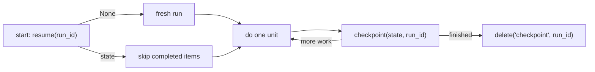

<!-- i18n: source=docs/guides/trace-and-resume.md blob=d597f5338750e0167731c70d5eb3f07fc5bc291d model=claude-sonnet-5-5 -->
> 이 페이지는 [영어 원문](https://github.com/ClickHouse/loom/blob/main/docs/guides/trace-and-resume.md)을 기계 번역한 것이며, 영어 원문이 기준입니다.
> Machine-translated from the [English page](https://github.com/ClickHouse/loom/blob/main/docs/guides/trace-and-resume.md), which is authoritative.

<a id="trace-and-resume-long-agent-runs"></a>

# 긴 에이전트 실행 추적 및 재개

긴 실행(파일 300개 처리, 리포지토리 크롤링, 계획 수행)은 도중에 멈출 수 있습니다. 크래시, 가득 찬 컨텍스트 윈도우, 배포, 일시 중지 등이 원인입니다. 실행의 `run_id`를 키로 하는 작업 메모리 블록이 진행 상황을 ClickHouse에 보관하므로, 새 프로세스는 이를 다시 읽어 마지막으로 완료된 작업 단위부터 이어서 진행합니다. 별도의 체크포인트 저장소는 필요하지 않습니다.

<a id="the-pattern"></a>

## 패턴

1. 작업에 안정적인 `run_id`를 정합니다. 작업 id나 계획 id가 그 예입니다.
2. 작업 단위가 끝날 때마다 `checkpoint(state, run_id=...)`를 호출합니다. `state`는 새 프로세스가 이어서 진행하는 데 필요한 모든 것입니다. 완료된 항목 id, 커서, JSON 문자열 등이 해당합니다.
3. 시작할 때 `resume(run_id=...)`를 호출합니다. `None`이면 새 실행이고, 그렇지 않으면 체크포인트에 완료로 기록된 항목을 건너뜁니다.



<a id="with-the-python-sdk"></a>

## Python SDK 사용

```python
from loom import Agent

RUN = "reindex-catalog"


async def process(agent: Agent, items: list[str]) -> None:
    done = set((await agent.working_memory.resume(run_id=RUN) or "").split())
    for item in items:
        if item in done:
            continue
        await do_work(item)
        done.add(item)
        await agent.working_memory.checkpoint(" ".join(sorted(done)), run_id=RUN)
```

`checkpoint`와 `resume`은 `checkpoint` 블록에 대한 `working_memory.set`과 `working_memory.get`입니다(`block_key=`로 변경할 수 있습니다). `checkpoint`를 호출할 때마다 이전 체크포인트를 덮어씁니다.

> **Warning:** 기본 `char_limit`은 4,096자입니다(`sdk/python/loom/working_memory.py`의 `DEFAULT_CHAR_LIMIT`). 상태를 작게 유지하거나 상태를 가리키는 포인터를 저장하세요. 큰 blob은 `context.offload`에 두고 그 `blob_key`를 체크포인트에 넣는 것이 좋습니다.

작업이 끝나면 체크포인트를 지웁니다.

```python
await agent.working_memory.delete("checkpoint", run_id=RUN)
```

스냅샷 하나가 아니라 진행 로그가 필요하다면, `working_memory.append(..., run_id=RUN)`로 블록에 내용을 추가하고 `working_memory.render(run_id=RUN)`으로 블록들을 다시 읽습니다.

<a id="over-mcp"></a>

## MCP 사용

`working_memory.set`은 `coding`, `atomic`, `all` 툴셋에 (`loom_working_memory_set`으로) 노출되어 있고, `readonly`와 `assistant`를 제외한 다른 모든 툴셋에서는 `loom_op`를 통해 실행됩니다. `working_memory.get`은 `all`을 포함해 어떤 툴셋에도 노출되어 있지 않으므로 `{"op": "working_memory.get", "arguments": {...}}`로 `loom_op`를 통해 호출하세요. 에이전트는 다음과 같이 동작합니다.

1. 각 단계 이후 `run_id`와 `block_key="checkpoint"`를 지정해 `working_memory.set`을 호출합니다.
2. 시작할 때 같은 `run_id`와 `block_key`로 `working_memory.get`을 호출합니다.

`run_id`가 다른 두 실행은 서로의 체크포인트를 볼 수 없습니다.

<a id="which-plane-holds-a-checkpoint"></a>

## 체크포인트를 보관하는 영역

| 상태                                        | 영역                   | 이유                                                                                              |
| ------------------------------------------- | ---------------------- | ------------------------------------------------------------------------------------------------- |
| 작은 재개 커서(완료된 id, 오프셋)           | 작업 메모리            | 정확한 키로 읽음, 단계마다 덮어씀, 임베딩되지 않음                                                |
| 큰 부분 결과 또는 단계 출력                 | `context.offload` blob | 블록 한도를 넘는 내용을 `summary` 및 `ttl_seconds`와 함께 보관, `context.fetch`로 읽음            |
| 실행이 확립한 주장                          | `memory.set`           | 영구 보관되고, 임베딩되며, 이후 회상을 위해 순위가 매겨짐                                         |

[조사 에이전트 가이드](https://github.com/ClickHouse/loom/blob/main/docs/guides/investigation-agent-memory.md)는 에이전트 상태의 각 종류를 해당 영역에 대응시켜 설명합니다.

<a id="trace-what-the-run-did"></a>

## 실행이 한 일 추적

- `run.begin` / `run.complete`는 실행 자체를 기록합니다. 목표, 상태, 실행이 의존한 메모리(`memories_used`), 회고가 포함됩니다. `run.get`은 실행이 회상한 키, 작성한 메모리, 턴, 비용과 함께 실행을 반환합니다([실행](https://github.com/ClickHouse/loom/blob/main/docs/features/runs.md)).
- 실행이 작성한 메모리에는 해당 `run_id`가 붙으며, `memory.search(run_id=...)`로 그 메모리만 좁혀 볼 수 있습니다.
- `conversation.create`와 `conversation.append`는 `run_id`를 받으므로 실행의 대화 기록이 해당 실행에 연결됩니다([대화 및 세션](https://github.com/ClickHouse/loom/blob/main/docs/features/conversations-and-sessions.md)).
- `LOOM_SEARCH_TRACE_LOG_ENABLED=true`(기본값은 꺼짐)이면 `memory.search_trace_log(run_id=...)`가 실행이 수행한 모든 검색과 반환된 결과를 나열합니다([디버깅](https://github.com/ClickHouse/loom/blob/main/docs/guides/debugging.md)).

Loom은 프로세스 내부 변수를 스냅샷으로 저장하지 않습니다. 체크포인트에는 직접 넣은 내용만 담깁니다.

<a id="why-it-holds"></a>

## 동작하는 이유

`loom.working_memory`는 `(org, namespace, agent, user_id, session_id, run_id, block_key)` 순서로 정렬된 `ReplacingMergeTree(version)`입니다. `checkpoint`를 호출할 때마다 행의 새 버전이 기록되고, 읽기는 최신 버전으로 합쳐집니다. `run_id`가 정렬 키에 포함되어 있으므로 두 실행은 두 개의 행이 됩니다.

<a id="related"></a>

## 관련 문서

- [작업 메모리와 프로필](https://github.com/ClickHouse/loom/blob/main/docs/features/memory/working-memory-and-profiles.md)
- [실행](https://github.com/ClickHouse/loom/blob/main/docs/features/runs.md)
- [헤드리스 봇](https://github.com/ClickHouse/loom/blob/main/docs/guides/headless-bots.md)
