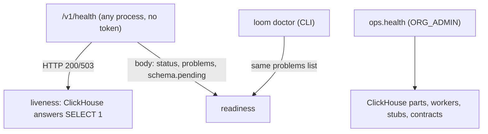

<!-- i18n: source=docs/operations/monitoring.md blob=b778428a5dabcc233847330b82b31b92a8373c9c model=claude-sonnet-5-5 -->
> 이 페이지는 [영어 원문](https://github.com/ClickHouse/loom/blob/main/docs/operations/monitoring.md)을 기계 번역한 것이며, 영어 원문이 기준입니다.
> Machine-translated from the [English page](https://github.com/ClickHouse/loom/blob/main/docs/operations/monitoring.md), which is authoritative.

<a id="monitoring"></a>

# 모니터링

이 페이지는 무엇을 지켜봐야 하는지 설명합니다. Loom은 네 가지 방식으로 자신의 상태를 보고합니다.

| 방식                            | 범위                                       |
| ------------------------------- | ------------------------------------------ |
| `/v1/health`, `loom doctor`     | 프로세스 하나                              |
| `ops.health`                    | ClickHouse에 대한 더 깊은 점검             |
| OpenTelemetry 메트릭 및 스팬    | 동일한 ClickHouse 또는 OTLP로 기록         |
| `loom.agent_events`             | 요청 원장, 작업당 한 행                    |

메트릭 이름과 레이블은
[텔레메트리](https://github.com/ClickHouse/loom/blob/main/docs/features/observability/telemetry.md)에 정리되어 있습니다.

<a id="running-operator-commands"></a>

## 운영자 명령 실행

운영자 명령은 `loom` 하위 명령입니다. 배포 환경이 설정된 컨테이너 안에서 실행합니다.

```bash
docker exec loom-server loom doctor            # web container
docker exec loom-workers loom code stats       # workers container (split deployments)
```

체크아웃한 소스에서는 `pip install -e .`로 동일한 CLI를 설치할 수 있으며, 이 CLI는 환경 변수와 `.env`에서 `LOOM_*`를 읽습니다. `loom <command> --help`에서 모든 플래그를 확인할 수 있고, [CLI 레퍼런스](https://github.com/ClickHouse/loom/blob/main/docs/reference/cli.md)에 전체 목록이 있습니다.

조직 전체에 대한 보기(네임스페이스 전반의 비용, `ops.health`)에는 `ORG_ADMIN` 또는 `PLATFORM_ADMIN`이 필요하며, 이 권한은 `LOOM_PLATFORM_ADMINS`로만 부여됩니다([배포](https://github.com/ClickHouse/loom/blob/main/docs/operations/deployment.md#required-environment)). 배포 전체에 적용되는 `/v1/admin/*` 라우트에는 `PLATFORM_ADMIN`이 필요합니다. `token.mint`, `namespace.adopt`, `claim_release`는 해당 작업이 이루어지는 조직의 `ORG_ADMIN`이 필요합니다. 네임스페이스 `admin`은 이 중 어느 것에도 접근할 수 없습니다.

<a id="health-checks"></a>

## 상태 점검



<a id="v1health"></a>

### /v1/health 엔드포인트

```bash
curl -s http://localhost:7777/v1/health | jq '{status, version, ch_ok, build_commit, schema, problems}'
curl -s 'http://localhost:7777/v1/health?include=workers' | jq '.workers_leader'
```

- **HTTP 상태는 ClickHouse에만 좌우됩니다.** `SELECT 1`에 응답하면 200, 응답하지 않으면 503입니다(`ch_error`는 오류의 종류를 알려 주며, 오류 텍스트는 서버 로그에 있습니다). 이를 liveness 프로브로 사용하세요. 상태 코드만 읽는 프로브(이미지의 healthcheck, 로드 밸런서)는 본문을 파싱하지 않는 200 응답 대신 장애를 감지하게 됩니다.
- **`status`**는 ClickHouse가 중단되었거나 `problems`의 항목 중 심각도가 `error`인 것이 있으면 `degraded`이고, 그렇지 않으면 `ok`입니다. 단, `code_tier_failing`은 배포가 아니라 리포지토리의 인덱스에 관한 것이므로 제외됩니다. readiness 점검에서는 `schema.pending`이 비어 있는지도 함께 확인해야 합니다(무중단 쌍의 전환이 정확히 이 방식으로 동작합니다).
- **`problems`**는 최악의 항목부터 정렬된 `{code, severity, message, fix, source}`의 목록입니다. 같은 목록을 `loom doctor`가 출력하고 대시보드 배너로도 표시합니다. `loom doctor`는 `code_tier_failing`에 나열된 항목을 최대 다섯 개까지 이름으로 보여 주며(나머지는 `code.repos`에 이름이 나옵니다), 플랫폼 관리자의 토큰은 제한되지 않은 나열 항목을 모두 이름으로 보여 줍니다([티어가 실패할 때](https://github.com/ClickHouse/loom/blob/main/docs/operations/code-index-operations.md#when-a-tier-fails)).

| 문제 코드                                 | 심각도                                                                                              | 의미                                                                                                                                                                                                                                                                                                                                                                                                    |
| ----------------------------------------- | --------------------------------------------------------------------------------------------------- | ------------------------------------------------------------------------------------------------------------------------------------------------------------------------------------------------------------------------------------------------------------------------------------------------------------------------------------------------------------------------------------------------- |
| `fake_embedder`, `fake_llm`               | warn (`LOOM_REQUIRE_REAL_PROVIDERS=true`이면 error)                                                 | 가짜 프로바이더가 구성되어 있습니다                                                                                                                                                                                                                                                                                                                                                                     |
| `embedder_key_missing`, `llm_key_missing` | warn (동일)                                                                                         | 실제 프로바이더가 키 없이 구성되어 있습니다. 프로세스는 가짜 클라이언트로 실행됩니다                                                                                                                                                                                                                                                                                                                    |
| `embedding_dim_mismatch`                  | error                                                                                               | 임베더가 `LOOM_EMBEDDING_DIM`과 다른 차원을 반환합니다                                                                                                                                                                                                                                                                                                                                                  |
| `coded_width_mismatch`                    | error                                                                                               | 코드화된 벡터 컬럼의 너비가 쓰기에 담긴 너비와 다릅니다. 해당 쓰기는 실패합니다                                                                                                                                                                                                                                                                                                                         |
| `provider_failing:<name>`                 | error                                                                                               | 해당 프로바이더에 대한 마지막 호출이 실패했습니다. 다음 호출이 성공하면 해제됩니다                                                                                                                                                                                                                                                                                                                      |
| `model_configuration_refused`             | error                                                                                               | 대시보드에 저장된 모델 구성이 게이트웨이 검사를 통과하지 못해 적용되지 않았습니다. 모든 데이터 플레인 요청이 503 `GATEWAY_REQUIRED`로 응답하며, 구성을 교체하기 전까지 서버는 준비 상태가 아닙니다                                                                                                                                                                                                       |
| `jwt_secret_empty`                        | error                                                                                               | 토큰에 서명할 수 없습니다                                                                                                                                                                                                                                                                                                                                                                               |
| `dev_jwt_secret`                          | warn                                                                                                | 인증이 켜진 상태에서 저장소에 포함된 개발용 시크릿을 사용 중입니다                                                                                                                                                                                                                                                                                                                                      |
| `config_drift`                            | error                                                                                               | 이 프로세스의 루트 시크릿 또는 MUST_MATCH 설정이 배포에 게시된 구성과 다릅니다. 준비 상태가 아닙니다([N개 레플리카 실행](https://github.com/ClickHouse/loom/blob/main/docs/operations/replicas.md))                                                                                                                                                                                                       |
| `revocation_not_loaded`                   | error                                                                                               | 인증이 켜져 있지만 이 프로세스가 `loom.revoked_tokens`를 한 번도 읽지 못했습니다. 모든 bearer가 503을 받습니다                                                                                                                                                                                                                                                                                          |
| `revocation_stale`                        | warn                                                                                                | 폐기 스냅샷이 max(300 s, 10 × `LOOM_JWT_REVOCATION_CACHE_TTL_SECONDS`)보다 오래되었습니다. 그 이후에 폐기된 토큰이 여기서는 여전히 인증됩니다                                                                                                                                                                                                                                                            |
| `revocation_too_stale`                    | error                                                                                               | 스냅샷이 `LOOM_JWT_REVOCATION_MAX_STALE_SECONDS`(600 s)보다 오래되었습니다. 갱신이 완료될 때까지 모든 bearer가 503을 받습니다                                                                                                                                                                                                                                                                            |
| `pending_migrations`                      | error                                                                                               | 이 빌드가 기대하는 마이그레이션이 스키마에 없습니다                                                                                                                                                                                                                                                                                                                                                     |
| `instance_label_missing`                  | warn                                                                                                | compose 파일 밖의 프로세스에 `LOOM_INSTANCE_LABEL`이 없습니다                                                                                                                                                                                                                                                                                                                                           |
| `workers_lease_absent`                    | warn 또는 info                                                                                      | warn: 유효한 workers 리스를 가진 프로세스가 없습니다(`LOOM_BACKGROUND_WORKERS=on`인 프로세스는 리스를 사용하지 않으므로 그 옆에서 이 항목이 보일 수 있으며, 인계나 콜드 스타트 중에는 한 순간 나타날 수 있습니다). info: 이 프로세스는 워커를 실행하지 않으며 최근 리스를 읽은 적이 없습니다                                                                                                   |
| `workers_lease_unreachable`               | warn                                                                                                | 이 프로세스가 ClickHouse에 workers 리스를 요청하지 못했습니다. 모든 프로세스가 같은 상태라면 워커를 실행하는 프로세스가 없습니다                                                                                                                                                                                                                                                                         |
| `workers_lease_given_up`                  | warn                                                                                                | 이 프로세스가 workers 리스를 반납하고 경쟁을 중단했습니다(드레인 중이거나 워커 자식 프로세스가 계속 시작에 실패했습니다). 다른 프로세스가 워커를 넘겨받습니다                                                                                                                                                                                                                                            |
| `otel_erasure_index`                      | warn                                                                                                | ClickStack 메트릭 테이블에 삭제에 필요한 인덱스가 없습니다([유지 관리](https://github.com/ClickHouse/loom/blob/main/docs/operations/maintenance.md#clickstack-erasure-index))                                                                                                                                                                                                                            |
| `code_tier_failing`                       | warn (`LOOM_CODE_TIER_FAILING_ERROR_LAG_COMMITS`만큼 뒤처지면 error, fetch 티어는 warn 유지)         | 코드 인덱스 티어가 `LOOM_CODE_TIER_FAILING_WARN_PASSES`회 연속으로, 또는 `LOOM_CODE_TIER_FAILING_WARN_HOURS` 동안 실패했습니다. fix에는 해당 오류 종류에 필요한 조치가 나옵니다([티어가 실패할 때](https://github.com/ClickHouse/loom/blob/main/docs/operations/code-index-operations.md#when-a-tier-fails)). `status`를 degraded로 만들지 않으며, `loom.health.problems`가 다른 문제와 똑같이 이를 담으므로 거기서 `severity="error"`로 알림을 만든다면 `code="code_tier_failing"`을 제외해야 합니다. |

그 밖의 본문 필드: `providers`(프로바이더별 호출 상태), `fake_embedding`, `fake_llm`, `providers_degraded`, `embedding_dim_mismatch`, `adaptive_thresholds`(임베더에서 도출한 유사도 게이트로, 같은 게이트를 사용하는 모든 레플리카에서 동일한 `calibration_hash`와 `source`(`shared` 또는 이 레플리카 자체의 `probe`)를 포함), `ratelimit.backend`(`shared` 또는 `per-process`), `mode`(`ch`이며, 구성된 경우 `langfuse`와 `clickstack`이 추가됨)가 있습니다. `?include=`는 `workers`, `langfuse`, `otel`, `embedding_cache`, `llm_cache`를 받으며, 각 서브시스템은 따로 보고되고 HTTP 상태는 ClickHouse만이 결정합니다.

<a id="loom-doctor"></a>

### loom doctor 명령

`loom doctor`는 점검 항목(`python_version`, `settings_load`, `jwt_secret`, `clickhouse_reachable`, `otel_erasure_index`, `llm_provider`)을 실행한 뒤 `problems` 목록을 `problem:<code>` 줄로 출력합니다. 종료하기 전에 모든 점검 결과를 보고하며, `FAIL`인 줄이 하나라도 있으면 종료 코드는 1입니다. `--json`은 `{ok, checks, problems}`를 출력합니다. `LOOM_CELL`이 설정되어 있고 ClickHouse에 접근할 수 있으면 [셀](https://github.com/ClickHouse/loom/blob/main/docs/architecture/cells.md) 점검(`cell_state`, `cell_marker`, `cell_marker_everywhere`, `cell_triggers`)도 실행하며, 이 점검은 최대 `WARN`으로 평가됩니다. `cell_deployment`는 배포 점검이 거부하면(`LOOM_PG_DSN`이 없거나, 다른 권한 또는 배포가 기록되어 있거나, ClickHouse 접근이 거부된 경우) `FAIL`입니다. 코드 인텔리전스가 켜져 있고 ClickHouse에 접근할 수 있으면 실패 중인 코드 인덱스 티어도 읽고, 배포의 런타임 오버라이드로 등급을 매깁니다. `problem:code_tier_failing`은 `status`를 degraded로 만들지 않으므로 최대 `WARN`입니다.

`--client`는 이 머신을 코딩 에이전트 클라이언트로서도 점검합니다. 훅이 사용할 서버 URL과 토큰(`--server-url`, `--token`으로 덮어쓸 수 있음), 토큰이 수락되고 자신의 네임스페이스에 쓸 수 있는지, Claude Code 또는 Codex 연동 상태, 서버에 도달하지 못한 캡처 작업을 확인합니다. `loom report`는 버그 리포트의 Environment 필드에 넣을 doctor 출력을 보여 줍니다([이슈 등록](https://github.com/ClickHouse/loom/blob/main/CONTRIBUTING.md#filing-an-issue)).

<a id="opshealth"></a>

### ops.health 작업

`POST /v1/ops.health`(`ORG_ADMIN`)는 ClickHouse에 대해 더 깊은 점검을 실행합니다. 각 점검은 `status`(`ok`, `warn`, `fail`), `detail`, `repair`를 반환합니다. 실패한 프로브의 `detail`에는 오류의 종류(Loom 오류의 코드와 메시지)가 나오고, 각 워커의 `last_error_kind`에는 오류의 클래스가 나옵니다. 오류 텍스트는 서버 로그와 `/v1/admin/workers.status`에 있습니다. 프로세스 내 supervisor가 워커를 실행할 때 `/v1/health?include=workers`도 워커 행을 같은 방식으로 줄여서 보여 줍니다. `last_error`는 없고 결과 수치와 플래그만 있습니다.

| 점검                     | 확인 대상                                                             |
| ------------------------ | --------------------------------------------------------------------- |
| `clickhouse_parts`       | 테이블별 활성 파트, 그리고 최근 15분 내에 실패한 머지                 |
| `workers`                | 최근 worker 패스 실패                                                   |
| `embedding_stubs`        | 아직 벡터를 기다리는 메모리 임베딩 행                                          |
| `schema_contracts`       | 스키마 덤프와 비교한 고위험 테이블 및 컬럼                                        |
| `memory_schema_contract` | 스키마 덤프와 비교한 저장된 `loom.memory` 컬럼                                |
| `op_mix`                 | `loom.agent_events`의 최근 operation 구성                              |
| `procedure_plane`        | `loom.procedure_runs`와 원장에 기록된 프로시저 키                            |

<a id="smoke-test"></a>

### 스모크 테스트

배포 후 메모리 하나를 처음부터 끝까지 쓰고 읽어 봅니다.

```bash
export LOOM_API_KEY=$(docker exec loom-server loom mint-token --subject smoke --org dev --namespaces smoke --roles writer --ttl-days 1)
curl -s -XPOST http://localhost:7777/v1/memory.set -H "Authorization: Bearer $LOOM_API_KEY" \
  -H 'Content-Type: application/json' \
  -d '{"org":"dev","namespace":"smoke","agent":"smoke","memory_key":"k","value":"deploy smoke test"}'
curl -s -XPOST http://localhost:7777/v1/memory.search -H "Authorization: Bearer $LOOM_API_KEY" \
  -H 'Content-Type: application/json' \
  -d '{"org":"dev","namespace":"smoke","agent":"smoke","query":"smoke test"}' | jq '.results[0].content_excerpt'
```

검색이 결과를 내지 않고 보류하면 `loom.embed.pending`과 `/v1/health`의 `providers` 블록을 확인하세요. 벡터를 기다리는 행은 저장은 되어 있지만 아직 검색할 수 없습니다.

<a id="worker-status"></a>

## 워커 상태

백그라운드 작업은 `server/workers/registry.py`(`_WORKERS`)에 선언된 감독형 루프에서 실행됩니다. 감독자는 실패한 패스를 백오프와 함께 재시도하고, 기한을 초과한 패스(기본값은 min(4 × interval, 900 s)이며 최소 60 s)를 취소하며, 워커가 연속으로 세 번 패스에 실패하면 `<worker>: DEGRADED`를 로그에 남깁니다. 각 워커는 하나의 `LOOM_*_ENABLED` 플래그로 켜고 끕니다. [워커 레퍼런스](https://github.com/ClickHouse/loom/blob/main/docs/reference/workers.md)에 모든 워커와 해당 플래그, 기본값, 실행 주기가 정리되어 있습니다.

```bash
curl -s -H "Authorization: Bearer $ADMIN_TOKEN" http://localhost:7777/v1/admin/workers.status | jq
```

"아무 일도 일어나지 않았다"는 보고의 상당수는 워커가 실행되지 않아서 생깁니다. 예를 들어 새 행의 임베딩, 지연된 배치의 추출, 커밋의 인덱싱이 여기에 해당합니다.

- `/v1/admin/workers.status`는 비활성화된 워커를 포함해 등록된 모든 워커를 간격 및 마지막 패스와 함께 보여 줍니다. 이 프로세스의 레지스트리와 `loom.worker_status`(30일 보관)를 병합하므로, 웹 전용 컨테이너에서도 워커 컨테이너가 실행한 패스를 볼 수 있습니다. 대시보드의 관리자 **Health** 보기에서도 같은 내용을 확인할 수 있습니다.
- `/v1/health?include=workers` → `workers_leader.reason`은 이 프로세스가 배포의 워커 리스(ClickHouse의 `workers_supervisor`)를 보유하고 있는지를 알려 줍니다.
- 메트릭: `loom.worker.consecutive_failures{worker}`와 `loom.worker.partial_failures{worker}`.
- `ops.projection_failures.list`(`ORG_ADMIN`)는 실패하여 `projection_repair` 워커를 기다리는 보조 프로젝션을 나열하며, `ops.projection_failures.retry`는 그중 하나를 재시도합니다.
- 워커의 ClickHouse 구문에는 `log_comment = 'worker.<name>'`이 붙습니다([쿼리 귀속](#logs-traces-and-query-attribution)).

<a id="what-to-alert-on"></a>

## 알림을 설정할 대상

아래 임계값은 시작점일 뿐입니다. 유사도 기준선은 임베더에 따라 달라지므로 직접 운영하는 배포 환경에서 정하세요.

| 신호                                                          | 알림 조건                                                         | 의미                                                                                                      | 첫 조치                                                                                                                                                                                                                                                                           |
| ------------------------------------------------------------- | ----------------------------------------------------------------- | --------------------------------------------------------------------------------------------------------- | --------------------------------------------------------------------------------------------------------------------------------------------------------------------------------------------------------------------------------------------------------------------------------- |
| `/v1/health` HTTP 상태                                        | 503                                                               | 이 프로세스에서 ClickHouse에 연결할 수 없음                                                               | [문제 해결](https://github.com/ClickHouse/loom/blob/main/docs/operations/troubleshooting.md#every-operation-fails-and-v1health-returns-503)                                                                                                                                                                                            |
| `/v1/health` `status`                                         | 5분 동안 `degraded`                                               | `code_tier_failing`이 아닌 `error` 문제                                                                   | `problems[].fix`를 읽습니다                                                                                                                                                                                                                                                       |
| `loom.search.top_similarity` 평균                             | 30분 동안 기준선 미만                                             | 실패 없이 검색 품질이 나빠짐(임베더 변경, 가짜 폴백)                                                      | [문제 해결](https://github.com/ClickHouse/loom/blob/main/docs/operations/troubleshooting.md#search-returns-arbitrary-results-or-extraction-writes-nothing)                                                                                                                                                                             |
| `loom.embed.pending`                                          | 15분 동안 100 초과                                                | 아직 검색할 수 없는 메모리가 있음. 임베더 처리량 또는 할당량 문제                                         | `/v1/health` → `providers`의 제공자 상태                                                                                                                                                                                                                                          |
| 모든 `loom.integrity.*`                                       | 0 초과                                                            | 이미 발생했고 저절로 해소되지 않는 결함([아래](#integrity-invariants))                                    | 복구 열                                                                                                                                                                                                                                                                           |
| `loom.worker.consecutive_failures`                            | ≥ 3                                                               | 워커가 반복해서 실패함                                                                                    | [문제 해결](https://github.com/ClickHouse/loom/blob/main/docs/operations/troubleshooting.md#a-worker-fails-every-pass)                                                                                                                                                                                                                 |
| `loom.process.open_fds / loom.process.fd_limit`               | 0.5 초과                                                          | 디스크립터 누수 또는 과도한 연결                                                                          | 프로세스별 시계열(`loom.pid`)                                                                                                                                                                                                                                                     |
| `loom.host.disk.free_bytes / loom.host.disk.total_bytes`      | 0.10 미만                                                         | `var/` 아래 디스크가 가득 차는 중(저장소 repack, 로그, blob). 0이 되면 호스트의 모든 쓰기가 실패함        | 프로세스당 시계열 하나(`loom.disk.path`)                                                                                                                                                                                                                                          |
| `loom.langfuse.breaker`                                       | = 2                                                               | Langfuse로 점수를 보내는 요청이 실패하며 점수가 버려짐                                                    | `POST /api/public/scores`에 대한 Langfuse 접근 가능 여부                                                                                                                                                                                                                          |
| `loom.code.index_lag_commits`                                 | 15분 동안 패스당 커밋 예산 초과                                   | 코드 인덱스가 브랜치보다 뒤처지고 있음                                                                    | [코드 인덱스 운영](https://github.com/ClickHouse/loom/blob/main/docs/operations/code-index-operations.md#failure-model)                                                                                                                                                                                                                 |
| `loom.code.tier_lag_seconds`                                  | 10분 동안 1800 초과                                               | 컴파일러 티어가 최근 병합을 따라잡지 못함                                                                 | `deploy/dashboards/code_plane.json`의 "code tier lag" 알림. 가장 느린 티어의 정상 주기보다 높게 설정하세요                                                                                                                                                                        |
| `loom.code.tier_failing`                                      | 15분 동안 어떤 지점이든(페이지 알림은 `severity="error"`)         | `code_tier_failing` 문제가 보고하는 코드 인덱스 티어가 `LOOM_CODE_TIER_FAILING_*` 임계값을 넘음           | `/v1/health`에 있는 `code_tier_failing`의 `fix`([티어가 실패할 때](https://github.com/ClickHouse/loom/blob/main/docs/operations/code-index-operations.md#when-a-tier-fails))                                                                                                                                                              |
| `ops.health`의 `clickhouse_parts` 또는 오류 252               | `fail`                                                            | 병합 실패                                                                                                 | [문제 해결](https://github.com/ClickHouse/loom/blob/main/docs/operations/troubleshooting.md#writes-fail-with-too_many_parts-or-merges-are-failing)                                                                                                                                                                                     |
| `loom.audit.checkpoint_lag_windows`                           | 증가 중                                                           | 감사 체크포인트 체인이 뒤처짐                                                                             | `audit_verifier` 워커의 패스                                                                                                                                                                                                                                                      |
| `loom.trust`별 `loom.auth.agents_provisioned{outcome=made}`   | 컨트롤 플레인의 정상 비율 초과(10분에 50부터 시작)                | 트러스트가 플릿이 늘어나는 속도보다 빠르게 새 에이전트를 지정함: 발급자 키 유출 또는 컨트롤 플레인 폭주  | 트러스트의 `auth.agent_provisioned` 감사 행(`audit.list`)을 컨트롤 플레인이 시작한 에이전트와 비교하세요. 다르면 `loom bot disable --name <trust>`를 실행하고 발급자의 키를 교체하세요                                                                                             |
| `loom.auth.trust_agents_used_ratio`                           | 0.8 초과                                                          | 트러스트가 활성 에이전트 기준으로 `--max-agents`에 가까워짐(해제된 에이전트는 자리를 반환함)              | `outcome=made`도 플릿 증가보다 빠르게 늘었다면 `outcome=made` 행을 따르세요(트러스트 비활성화, 키 교체). 아니라면 한도를 올리세요: 트러스트의 플래그와 더 큰 `--max-agents`로 `loom bot create --replace`를 실행합니다(에이전트의 토큰이 종료되며 각자 다시 교환합니다)          |
| `loom.auth.agents_provisioned{outcome=at_cap}`                | 10분 동안 0 초과로 증가                                           | 트러스트의 새 에이전트가 거부됨                                                                           | `outcome=made`도 플릿 증가보다 빠르게 늘었다면 `outcome=made` 행을 따르세요(트러스트 비활성화, 키 교체). 아니라면 한도를 올리세요: 트러스트의 플래그와 더 큰 `--max-agents`로 `loom bot create --replace`를 실행합니다(에이전트의 토큰이 종료되며 각자 다시 교환합니다)          |

HyperDX에서는 빈 결과를 0으로 읽으므로, 최소 샘플 가드는 행을 반환하지 않는 대신 정상 범위 안의 값을 반환해야 합니다.

무엇을 확장해야 하는지(웹 레플리카, 제공자 할당량, 워커 컨테이너, ClickHouse)를 알려 주는 신호는 [장애와 복구](../architecture/failure-and-recovery.md)에 있습니다.

<a id="pipeline-slos"></a>

### 파이프라인 SLO

Postgres 권한 아래에서 쓰기는 커밋 시점에 응답하고, 해당 메모리 행과 검색 문서가 ClickHouse에 들어가면 검색할 수 있게 됩니다([저장소 권한](https://github.com/ClickHouse/loom/blob/main/docs/architecture/storage-authority.md#publication)). 이전 쓰기가 아직 반영되지 않은 것을 발견한 검색은 `LOOM_PG_PROJECTION_WAIT_MS`(기본값 2000 ms)까지 기다리고, 그 시간을 넘기면 503 `PROJECTION_BEHIND`로 응답합니다.

| 목표                                        | 목푯값                                                                                                            | 신호                                                                          |
| ------------------------------------------- | ----------------------------------------------------------------------------------------------------------------- | ----------------------------------------------------------------------------- |
| 읽기가 이전 쓰기를 기다림                   | p99가 `LOOM_PG_PROJECTION_WAIT_MS`의 절반 미만이며, 장애 시를 제외하고 `deadline`으로 끝나는 경우가 없음(op는 503으로 응답) | `outcome`별 `loom.pg.search_wait_ms`                                          |
| 쓰기가 ClickHouse에 있음                    | p99가 `LOOM_PG_PROJECTION_WAIT_MS`의 절반 미만이어서 읽기의 대기에 나머지 절반이 남음                             | `loom.pg.projection_lag_ms{path="flush"}`                                     |
| 중지된 라이터의 리스 이후까지 기다리는 것이 없음 | 가장 오래된 대기 항목이 `LOOM_PG_REQUEST_LEASE_SECONDS`의 두 배에 `LOOM_PG_DELIVERY_IDLE_INTERVAL_SECONDS`를 더한 값 미만 | `loom.pg.oldest_pending_age_s{source="memory"}`                               |
| 장애 시를 제외하고 지연 오류가 없음         | 0                                                                                                                 | `loom.requests{loom.error_code="PROJECTION_BEHIND" or "PUBLICATION_PENDING"}` |
| ClickHouse가 계속 거부하는 항목이 없음      | 복원 조정(restore reconcile)이 잡고 있는 경우를 제외하고 0                                                        | `loom.pg.backlog{state="parked"}`                                             |

게시하기 전에 중지된 라이터가 있을 때 검색이 겪는 최악의 대기는 그 리스(`LOOM_PG_REQUEST_LEASE_SECONDS`)입니다. 기다리는 검색이 만료된 전달을 직접 게시합니다. 이는 기본 대기 시간보다 길기 때문에 지연 시간이 아니라 `outcome="deadline"`으로 나타납니다. 준비 상태(readiness)는 이들 중 어느 것에도 의존하지 않습니다. 모든 레플리카가 같은 Postgres를 읽으므로, 지연에 따라 움직이는 준비 상태 점검은 모든 레플리카를 한꺼번에 로테이션에서 빼 버리기 때문입니다.

전달 워커를 실행하는 모든 프로세스가 배포 전체의 백로그를 내보내며 여러 프로세스가 동시에 그럴 수 있으므로, 백로그 게이지는 `sum`이 아니라 `max`로 읽으세요.

알림:

| 신호                                              | 알림 조건                       | 의미                                                                                                                                                                      | 첫 조치                                                                                          |
| ------------------------------------------------- | ------------------------------- | ------------------------------------------------------------------------------------------------------------------------------------------------------------------------- | ------------------------------------------------------------------------------------------------ |
| `loom.pg.search_wait_ms{outcome="deadline"}` 비율 | 5분 동안 0 초과                 | 읽기가 데드라인까지 기다림: op는 503 `PROJECTION_BEHIND`로 응답하고, 리포트는 계속 읽음                                                                                   | ClickHouse 접근 가능 여부를 확인한 다음 `loom.pg.backlog`와 `pg_delivery` 워커의 패스를 확인     |
| `loom.pg.oldest_pending_age_s{source="memory"}`   | 10분 동안 목푯값 초과           | 전달 워커가 따라가지 못하거나 ClickHouse가 거부함                                                                                                                         | `GET /v1/health?include=postgres` → `postgres.backlog`, `pg_delivery` 워커 상태                  |
| `loom.pg.backlog{state="parked"}`                 | 0 초과                          | ClickHouse가 계속 거부한 전달 또는 복원 조정이 잡고 있는 전달(어느 쪽인지는 `last_error`에 나옴)                                                                          | 전달의 `last_error`([저장소 권한](https://github.com/ClickHouse/loom/blob/main/docs/architecture/storage-authority.md#delivery)) |
| 어느 프로세스에서도 `loom.pg.backlog` 지점이 없음 | 내보내기 주기 3회 동안          | 읽기가 중단됨: 백로그 읽기가 실패하거나, 전달 패스가 시작되지 않거나, 두 패스의 시작 사이 시간(한 패스와 그 뒤의 간격)이 내보내기 주기 두 번을 넘음                       | `pg_delivery` 및 `knowledge_pg_delivery` 워커 로그의 `backlog not read` 경고                     |

<a id="integrity-invariants"></a>

### 무결성 불변식

이 게이지들은 항상 0이어야 합니다. 워커 리스를 가진 프로세스가 15분마다 계산하고 캐시합니다.

| 메트릭                                                          | 0이 아닌 값의 의미                                                              | 복구                                               |
| --------------------------------------------------------------- | ------------------------------------------------------------------------------- | -------------------------------------------------- |
| `loom.integrity.divergent_entities`                             | 메모리 하나에 대해 `loom.memory`와 `loom.memory_embeddings`의 엔티티가 서로 다름 | 쓰기 경로를 조사 |
| `loom.integrity.orphan_vectors`                                 | 메모리 행이 사라진 임베딩 벡터                                                  | `orphan_vector_reconcile` 워커                     |
| `loom.integrity.orphan_entity_vectors`                          | 메모리 행이 사라진 엔티티 벡터                                                  | `orphan_vector_reconcile` 워커                     |
| `loom.integrity.orphan_graph_namespaces`                        | 엔티티 엣지는 있으나 유효한 메모리나 지식이 없는 네임스페이스                   | `loom erasure-re-verify --orphan-graph --erase`    |
| `loom.integrity.live_ns_unregistered`, `live_rows_unregistered` | `loom.namespaces` 행이 없는 네임스페이스에 있는 유효한 메모리                   | 네임스페이스를 등록하거나 `loom namespaces-adopt` 실행 |
| `loom.integrity.dim0_with_vector`                               | 벡터는 있지만 `embedding_dim = 0`이라 검색에 보이지 않는 행                     | `loom integrity-repair --apply`                    |
| `loom.integrity.tombstone_status_drift`                         | `tombstoned_at`이 설정되어 있으면서 상태가 다른 행                              | `loom integrity-repair`가 목록으로 표시            |
| `loom.integrity.active_past_valid_to`                           | 자체 `valid_to`가 지났는데도 활성 상태인 행                                     | `loom integrity-repair`가 목록으로 표시            |
| `loom.integrity.high_with_embedding`                            | 민감도가 높은데 유효한 임베딩 행이 남아 있는 행                                 | `loom sensitivity-sweep --apply`                   |

복구 명령은 [유지보수](https://github.com/ClickHouse/loom/blob/main/docs/operations/maintenance.md#backfills-and-repairs)에 설명되어 있습니다.

<a id="metrics"></a>

## 메트릭

Loom은 `LOOM_OTEL_METRICS_EXPORT_INTERVAL_S`초마다(기본값 60) OpenTelemetry 메트릭을 내보냅니다. `LOOM_OTEL_EXPORTER=ch`(OTLP 엔드포인트가 설정되지 않았을 때의 기본값)이면 메트릭은 같은 ClickHouse 서비스의 `default.otel_metrics_sum`, `default.otel_metrics_histogram`, `default.otel_metrics_gauge`에 바로 기록됩니다. `LOOM_CLICKSTACK_DATABASE`가 설정되어 있으면 여기와 이후 모든 곳에서 해당 데이터베이스를 사용합니다. 이 테이블들은 ClickStack/HyperDX가 읽는 테이블입니다. 대신 컬렉터로 보내려면 `LOOM_OTEL_EXPORTER_OTLP_ENDPOINT`를 설정하세요. 카운터와 히스토그램은 `LOOM_OTEL_METRICS_DELTA_TEMPORALITY=true`가 아니면 누적 방식입니다. 부팅 로그에서 익스포터를 확인할 수 있습니다.

```text
OTel metrics initialized — emitting every 60s (cumulative temporality, gauge heartbeat …s) to default.otel_metrics_{sum,histogram,gauge}
```

레이블은 닫힌 집합(연산, 네임스페이스, 제한된 열거형)에서만 가져옵니다. 키, 사용자 ID, 세션 ID, 쿼리 텍스트는 절대 레이블이 되지 않습니다(`tests/unit/test_domain_metrics.py`에서 이를 검증합니다). 요청과 비용, 검색 품질, 메모리 쓰기, 백로그, 무결성, 코드 인덱스별로 묶은 전체 목록은 [텔레메트리](https://github.com/ClickHouse/loom/blob/main/docs/features/observability/telemetry.md)에 있습니다.

시작용 쿼리:

```sql
-- mean top similarity per namespace, last hour
SELECT Attributes['loom.namespace'] AS ns,
       round(anyLast(Sum) / greatest(anyLast(Count), 1), 3) AS mean_top_similarity
FROM default.otel_metrics_histogram
WHERE MetricName = 'loom.search.top_similarity' AND TimeUnix > now() - INTERVAL 1 HOUR
GROUP BY ns;

-- every gauge's latest value
SELECT MetricName, anyLast(Value) AS latest
FROM default.otel_metrics_gauge
WHERE TimeUnix > now() - INTERVAL 5 MINUTE
GROUP BY MetricName ORDER BY MetricName;
```

첫 번째 쿼리는 누적 히스토그램을 읽으므로 시계열별 전체 기간 평균을 반환합니다. 특정 기간의 평균이 필요하면 각 시계열에서 각 지점과 바로 앞 지점의 차이를 구하세요(`deploy/hyperdx_dashboards.md`의 "The cumulative-counter correction" 참고).

<a id="dashboards"></a>

## 대시보드

[`deploy/hyperdx_dashboards.md`](https://github.com/ClickHouse/loom/blob/main/deploy/hyperdx_dashboards.md)는 ClickStack과 HyperDX 설정 가이드이자 SQL 패널 쿡북입니다. ClickStack 연동 자체는 [ClickStack](https://github.com/ClickHouse/loom/blob/main/docs/features/integrations/clickstack.md)에서 설명합니다.

- **컬렉터가 필요 없습니다.** Loom은 OTel 행을 자체 ClickHouse의 `default.otel_*`에 직접 기록하므로, 호스팅된 ClickStack은 소스가 기존 테이블을 가리키도록 설정하기만 하면 됩니다(`deploy/clickstack_sources.sh`가 이를 스크립트로 처리합니다). HyperDX 설치로 테이블이 생성되지 않은 환경에서는 `schemas/otel/clickstack_otel_tables.sql`을 한 번 직접 적용하세요. 모든 구문에 `IF NOT EXISTS`가 있습니다.
- **패널이 피하는 두 가지 함정.** FastAPI 계측은 부모와 같은 이름의 ASGI 자식 스팬(`POST /v1/memory.get http send`)을 생성하며, 이 때문에 스팬 이름 필터의 결과가 약 세 배로 부풀려집니다. `loom.*` 속성은 부모 스팬에만 있으므로 `mapContains(SpanAttributes, 'loom.operation')`으로 필터링하세요. 또한 누적 메트릭은 시계열별 델타 계산이 필요합니다. 구간에 `sum(Value)`를 적용하면 누적 합계를 다시 더하게 됩니다.
- **코드 인덱스 보드.** [`deploy/dashboards/code_plane.json`](https://github.com/ClickHouse/loom/blob/main/deploy/dashboards/code_plane.json)은 "Loom — Code Plane" 대시보드의 기준 소스입니다. 모든 타일의 소스와 SQL, 그리고 임계값과 사유가 담긴 `alert` 블록이 있는 타일이 여기에 정의되어 있습니다. UI에서 타일을 직접 편집하지 말고 JSON으로 프로비저닝해야 다음 재구성 때에도 동일하게 유지됩니다.
- 패널이 계속 비어 있다면 `docker logs loom-server 2>&1 | grep -i otel`을 확인하세요. 스팬은 몇 초마다, 메트릭은 내보내기 간격마다 한 번씩 플러시됩니다. 테이블이 없으면 `default.otel_traces does not exist … Self-disabling span export`로 표시됩니다.

<a id="logs-traces-and-query-attribution"></a>

## 로그, 트레이스, 쿼리 귀속

- **로그.** `docker logs loom-server`와 `docker logs loom-workers`를 사용합니다.
  로그 파이프라인에는 `LOOM_LOG_FORMAT=json`을, 상세 수준 조정에는 `LOOM_LOG_LEVEL`을 사용합니다. 부팅 로그에는 확정된 provider와 적용된 각 마이그레이션이 기록되며, supervisor는 실패한 모든 패스와 `DEGRADED` 줄을 기록합니다.
- **원장.** `loom.agent_events`에는 작업당 한 행이 있습니다. 컬럼은 `operation`, 식별 컬럼, `request_id`, `trace_id`, `latency_ms`, `success`, `error_code`, 토큰, `upstream_cost_usd`, `model`, `consumer`, `traffic_class`, `build_commit`, `instance`, `instance_label`입니다. `loom.audit_log`는 누가 무엇을 변경했는지를 행별 콘텐츠 해시와 함께 기록합니다([감사](https://github.com/ClickHouse/loom/blob/main/docs/features/observability/audit.md)).
- **트레이스.** 스팬은 `default.otel_traces`(또는 OTLP 엔드포인트)로 전송되며 `loom.org`, `loom.namespace`, `loom.agent`, `loom.operation`, `loom.request_id`, `enduser.id` 태그가 붙습니다. Langfuse가 구성되어 있으면 스팬 트리도 Langfuse로 전송됩니다([Langfuse](https://github.com/ClickHouse/loom/blob/main/docs/features/integrations/langfuse.md)). 모든 HTTP 응답에는 `X-Request-Id`(클라이언트가 영문자, 숫자, `.`, `_`, `-` 중 1~64자로 보낸 경우 그 값)와 `X-Trace-Id`가 포함됩니다.
- **모든 ClickHouse 쿼리는** `log_comment` 설정에 귀속 정보가 기록됩니다.

| `log_comment`                  | 발행 주체                                                         |
| ------------------------------ | ----------------------------------------------------------------- |
| `<operation> <request_id>`     | 요청(HTTP 또는 MCP)                                               |
| `worker.<name>`                | 워커 패스                                                         |
| `cli.<command>[.<subcommand>]` | `loom` 명령(`loom serve` 제외)                                    |
| `untagged:<module>.<function>` | 그 외 모든 경우. 백그라운드 루프는 `set_query_tag(...)`를 호출해야 합니다 |

`LOOM_CH_LOG_COMMENT_STATEMENT_DIGEST=true`로 설정하면 태그 뒤에 구문 다이제스트가 붙으므로, 끝에 `%`를 붙여 매칭하십시오.

```sql
-- which operations cost ClickHouse the most in the last hour
SELECT splitByChar(' ', log_comment)[1] AS source,
       count() AS queries, sum(read_bytes) AS bytes, sum(query_duration_ms) AS ms
FROM system.query_log
WHERE type = 'QueryFinish' AND event_time > now() - INTERVAL 1 HOUR AND log_comment != ''
GROUP BY source ORDER BY ms DESC LIMIT 20;

-- one request end to end
SELECT * FROM loom.agent_events WHERE request_id = '<id>';
```

`LOOM_INSTANCE_LABEL`(compose 파일 외부에서는 필수)을 설정하면 두 쿼리 모두에서 노트북이나 테스트 서버의 행을 배포 환경 자체의 행과 구분할 수 있습니다. 블루/그린 전환 후에는 `loom deploy-delta`가 전환 전후 각 측의 원장과 구문 형태를 비교합니다. 이 명령은 각 측에서 `--window-min`분(기본값 60)을 읽으므로 해당 구간이 지난 뒤에 실행하고, 직접 수행하는 확인용 읽기 트래픽은 포함되지 않게 하십시오. 전환 직후의 요청은 콜드 캐시에서 실행되어 전환 후 측의 지연 시간을 부풀립니다.

<a id="rate-limits-and-traffic-classes"></a>

## 속도 제한과 트래픽 클래스

모든 요청은 두 개의 토큰 버킷에서 차감됩니다. 하나는 네임스페이스별, 다른 하나는 조직별(네임스페이스 크기의 3배)이며, 둘 다 작업 클래스를 기준으로 구분됩니다. 제한을 초과하면 응답은 429
`RATE_LIMITED`이며 `Retry-After` 및 `X-RateLimit-*` 헤더가 포함됩니다.

| 클래스              | 작업                                                                                                          | 네임스페이스당 버스트 / 지속 |
| ------------------ | ------------------------------------------------------------------------------------------------------------- | ------------------------------- |
| `memory`           | `memory.*`, `conversation.*` (정확한 키 읽기와 `memory.import` 제외)                                          | 100 / 17 초당             |
| `memory.read`      | 정확한 키 읽기: `memory.get`, `memory.bulk_get`, `memory.history`, `working_memory.get`, …                   | 300 / 50 초당             |
| `memory.import`    | `memory.import`                                                                                               | 10 / 2 초당               |
| `knowledge.search` | `knowledge.search`                                                                                            | 20 / 3 초당               |
| `knowledge.query`  | `knowledge.query`                                                                                             | 20 / 3 초당               |
| `knowledge.read`   | `knowledge.inspect`를 제외한 나머지 `read_only` `knowledge.*` 작업: `knowledge.get`, `knowledge.list`, …      | 50 / 10 초당              |
| `knowledge.add`    | 그 외 모든 `knowledge.*` 작업. `knowledge.inspect`, `knowledge.synthesize`, `knowledge.dedup_list` 포함 | 10 / 2 초당               |
| `code`             | `code.*` (`memory`에서 차감되는 `code.outcome` 제외)                                                          | 60 / 10 초당              |
| `insights.query`   | `insights.query`                                                                                              | 20 / 3 초당               |
| `assistant.ask`    | `assistant.ask` 및 어시스턴트의 채팅 경로                                                                     | 10 / 1 초당               |
| `default`          | 그 외 모든 작업                                                                                               | 50 / 10 초당              |

요청은 `production`, `interactive`, `bench` 중 하나로 분류됩니다(`loom mint-token --traffic-class`의 토큰 클레임이 우선하고, 없으면 네임스페이스의 등록 정보, 그다음으로 요청의 힌트를 사용합니다). 응답 헤더 `X-Loom-Traffic-Class`가 어느 클래스인지 알려 줍니다. bench 트래픽은 더 작은 별도 버킷(`LOOM_RATELIMIT_CLASS_FRACTIONS`)과 더 낮은 ClickHouse 우선순위를 사용하므로, 벤치마크가 production의 예산을 소진할 수 없습니다. 제한은 복제본별로 적용됩니다. [장애와 복구](../architecture/failure-and-recovery.md)의 `LOOM_REPLICA_COUNT`를 참고하세요.
`{namespace|org, op_class, capacity, rate}`(또는 `clear: true`)와 함께 `POST /v1/admin/ratelimit.set`을 호출하면 버킷을 재정의할 수 있습니다. 재정의 값은 `loom.runtime_overrides`에 저장되며, 모든 프로세스가 `LOOM_RUNTIME_OVERRIDES_REFRESH_SECONDS`(기본값 10) 이내에 이를 반영하고, 재시작 후에도 유지됩니다. `POST /v1/admin/budget.set`은 지연 시간 예산 재정의를 같은 방식으로 저장합니다. 버킷 충전 자체는 호스트별로 유지됩니다.

<a id="related"></a>

## 관련 문서

- [문제 해결](https://github.com/ClickHouse/loom/blob/main/docs/operations/troubleshooting.md): 이러한 신호가 포착하는 증상별 런북
- [텔레메트리](https://github.com/ClickHouse/loom/blob/main/docs/features/observability/telemetry.md): 메트릭 및 스팬 카탈로그
- [비용 및 사용량](https://github.com/ClickHouse/loom/blob/main/docs/features/observability/cost-and-usage.md) 및
  [감사](https://github.com/ClickHouse/loom/blob/main/docs/features/observability/audit.md)
