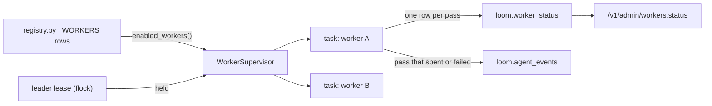

<!-- i18n: source=docs/reference/workers.md blob=f87e42a2c2dfebb8afda1a3c564252eabe3f4c04 model=claude-sonnet-5-5 -->
> 이 페이지는 [영어 원문](https://github.com/ClickHouse/loom/blob/main/docs/reference/workers.md)을 기계 번역한 것이며, 영어 원문이 기준입니다.
> Machine-translated from the [English page](https://github.com/ClickHouse/loom/blob/main/docs/reference/workers.md), which is authoritative.

<a id="workers-reference"></a>

# 워커 레퍼런스

워커는 감독되는 백그라운드 루프입니다. 워커 감독자(worker supervisor)가 일정한 간격으로 하나의 패스 함수를 실행합니다. 워커는 요청이 기다리지 않아야 하는 작업을 처리합니다. 누락된 벡터 채우기, 엔티티 추출, 감사 체인 검증, 중단된 삭제 작업 재개, 코드 및 트래커 데이터 수집 등이 여기에 해당합니다. 이 페이지 끝의 표는 레지스트리에서 생성되므로, 이 커밋의 코드가 선언한 모든 워커가 표에 나열됩니다.

<a id="how-workers-run"></a>

## 워커 실행 방식



**워커는 행(row)입니다.** `server/workers/registry.py`의 `_WORKERS`에는 루프마다 `_Worker(...)` 하나가 있습니다. 여기에는 이름, `run_pass`를 담은 모듈, 워커를 켜는 설정 플래그(없으면 항상 켜짐), 실행 간격을 담은 설정 필드가 들어갑니다. 선택적으로 두 번째 필수 플래그(`also_requires`), 유휴 간격, 패스 데드라인, 첫 패스 훅, 워커가 소유한 테이블도 지정할 수 있습니다. `enabled_workers()`는 활성화된 행을 `WorkerSpec`으로 바꾸고, 그때서야 해당 워커의 모듈을 import합니다. 따라서 비활성화된 워커의 선택적 의존성은 로드되지 않습니다. 설정은 supervisor가 시작될 때 읽습니다. 워커 플래그나 간격을 바꾸면 워커를 실행하는 프로세스를 다음에 재시작할 때 적용됩니다.

**워커마다 태스크 하나.** `WorkerSupervisor`(`server/workers/supervisor.py`)는 활성화된 spec마다 asyncio 태스크를 하나씩 시작하고 그 루프를 관리합니다.

- **부팅 시차.** 첫 패스는 `crc32(name) % interval`초를 기다립니다(간격이 2초 미만이면 0). 따라서 모든 워커가 같은 부팅 틱에 ClickHouse를 동시에 질의하지 않습니다. 이 해시는 프로세스와 재시작에 관계없이 안정적입니다.
- **첫 패스 필요 여부.** 출력이 없는 워커는 대신 즉시 실행됩니다. 이 확인은 워커 자체의 `first_pass_due` 훅이나, `owned_tables`에서 도출한 일반 규칙으로 수행합니다. 소유한 테이블 중 하나에 범위 내 네임스페이스의 행이 없으면 실행 대상입니다(`server/workers/first_pass.py`). 이 확인은 30초로 제한되며, 오류가 나면 "필요 없음"으로 판단합니다.
- **기한 초과.** 마지막으로 기록된 패스가 간격보다 오래된 워커는 전체 시차를 기다리지 않고 부팅 후 300초 범위 안에서 시작합니다. 그래서 잦은 재시작으로 매일 실행되는 패스가 계속 밀리지 않습니다.
- **데드라인.** 각 패스는 타임아웃 안에서 실행됩니다. 행의 `max_pass_seconds`가 있으면 그 값을, 없으면 간격의 네 배를 60초에서 900초 사이로 제한한 값(`default_max_pass_seconds`)을 씁니다. 데드라인을 넘긴 패스는 취소되고 실패로 집계됩니다.
- **실패와 백오프.** 실패한 패스는 1, 2, 4 … 초의 지수 백오프 후 재시도하며 최대 60초입니다. 데드라인에서 중단된 패스나, 간격이 데드라인보다 긴 워커(매일, 매주 실행되는 워커)는 대신 전체 간격을 기다립니다. 빠르게 재시도하면 같은 데이터베이스 시간을 다시 소모하기 때문입니다. 연속 세 번째 실패부터 supervisor는 ERROR 수준으로 `<worker>: DEGRADED — N consecutive failures`를 로그에 남기고, 상태 레지스트리에서 해당 워커를 degraded로 표시합니다.
- **부분 패스.** 작업 일부가 실패했지만 끝까지 마친 패스(`pass_context.note_failure`)는 연속 실패 횟수에는 포함되지만 정상 간격을 유지합니다. 나머지 작업은 제때 처리되어야 하기 때문입니다.
- **유휴 간격.** 할 일이 없었던 정상 패스(`pass_context.mark_idle()`)는 행에 유휴 간격이 있으면 그만큼 기다립니다. 그래서 작업이 몰려서 들어오는 워커는 작업이 있을 때는 자주, 없을 때는 드물게 폴링합니다.
- **종료.** 서버를 중지하면 각 태스크가 취소되고(진행 중인 패스는 끝나지 않고 취소됨), 태스크가 종료되기를 최대 10초 기다린 뒤(`WorkerSupervisor.stop_all`) 대기 중인 상태 행을 플러시합니다.

모든 패스는 `background` 트래픽 클래스에서 실행되며(ClickHouse 우선순위가 낮고 스레드 수가 제한되어, 패스가 운영 읽기와 대등하게 경쟁하지 않음), 쿼리는 `log_comment`에 `worker.<name>` 태그가 붙습니다.

<a id="which-process-runs-the-workers"></a>

## 어느 프로세스가 워커를 실행하는가

`LOOM_BACKGROUND_WORKERS`는 프로세스가 슈퍼바이저를 시작할지 결정합니다
(`server/workers/leader.py`):

| 값               | 동작                                                                                                                                                                                                  |
| ---------------- | ----------------------------------------------------------------------------------------------------------------------------------------------------------------------------------------------------- |
| `auto` (기본값)  | 배포에서 `workers_supervisor` 리스(`loom._migration_lock`의 Keeper 키)를 가진 프로세스가 슈퍼바이저를 실행하며, 나머지 프로세스는 리스를 얻기 위해 경쟁하고 리스가 만료되면 이어받습니다。 |
| `on`             | 항상 슈퍼바이저를 실행합니다(단일 프로세스 컨테이너 또는 전용 워커 컨테이너). Postgres authority 아래에서는 셀 게이트가 해당 프로세스의 서비스를 허용하는 동안에만 실행합니다.                         |
| `off`            | 슈퍼바이저를 실행하지 않습니다(순수 웹 레플리카).                                                                                                                                                       |

리스는 배포 전체에 하나뿐이므로, `uvicorn --workers N`으로 N개의 레플리카를 띄워도 모든 워커는 프로세스마다 하나씩이 아니라 전체에서 한 벌만 실행됩니다. 리더가 종료되면 해당 키는 `LOOM_SUPERVISOR_LEASE_TTL_S` 후에 만료됩니다.

제공되는 compose 파일은 하나의 이미지로 두 역할을 컨테이너로 나눕니다.
`dev/docker-compose.cloud.yml`은 `loom` 서비스(컨테이너 `loom-server`, 웹 티어, `LOOM_BACKGROUND_WORKERS=off`)와 `loom-workers`(프로세스 하나, `on`, 공개 포트 없음)를 실행합니다. `dev/docker-compose.colour.yml`은 `loom-<colour>`(`off`)와 `loom-<colour>-workers`(`auto`)를 실행하며, 공유 락을 두고 경쟁하는 것은 워커 컨테이너뿐입니다. 따라서 블루/그린 전환 중 겹치는 동안에는 이전 colour가 중지될 때까지 워커를 유지하고, 새 colour는 재시도 간격 한 번 안에 워커를 넘겨받습니다. **별도 컨테이너를 쓰는 이유:** 요청 처리와 같은 이벤트 루프에서 긴 작업을 실행하는 프로세스는 keep-alive 클라이언트에 대한 응답이 꼬리 구간에서 더 느려집니다. 워커를 웹 티어에서 분리하면 이 비용이 사라지며, 대신 컨테이너가 하나 더 필요합니다. [배포](https://github.com/ClickHouse/loom/blob/main/docs/operations/deployment.md)를 참고하세요.

`jwt_revocation_refresh`는 슈퍼바이저가 실행되는 곳에서는 항상 켜져 있습니다. 리더 여부와 관계없이 모든 프로세스는 부팅 시 토큰 폐기 목록도 로드하므로, 워커가 없는 웹 레플리카도 폐기된 토큰을 수락하지 않습니다.

<a id="turning-a-worker-on-or-off"></a>

## 워커 켜기와 끄기

1. 아래 표의 **활성화 설정** 열에서 워커의 스위치를 찾아 워커를 실행하는 컨테이너에
   설정합니다(`LOOM_<NAME>_ENABLED=true` 또는 `false`). 두 번째 플래그가 있는 워커
   (열의 `+ LOOM_…`)는 두 플래그가 모두 켜져 있을 때만 실행됩니다.
   `code_backport_gaps`에는 `LOOM_CODE_PR_HISTORY_ENABLED`가,
   `code_coverage_notify`에는 `LOOM_CODE_INTEL_ENABLED`가 필요합니다.
2. 필요하면 **실행 주기 설정**으로 실행 주기를 변경합니다.
3. 해당 컨테이너를 재시작한 다음 워커의 상태를 확인합니다(아래 참조).

LLM 기반 워커(`profile_consolidation`, `reflection_distill`, `observe_extract`,
`code_summary`, 그리고 기본으로 켜져 있는 `entity_extractor`,
`conversation_titler`, `conflict_resolver`)를 켜려면 플래그 외에도 다음이 필요합니다.

1. 실제 LLM 프로바이더를 설정합니다. fake 프로바이더에서는 워커가 가짜 출력으로
   실행되고, `conversation_titler`는 해당 패스를 건너뛰며, `conflict_resolver`는 플래그를
   설정하지 않으면 꺼져 있고 플래그를 설정한 경우에도 키가 있는 실제 프로바이더가
   설정될 때까지 충돌 검사에서 처리 대기로 표시된 행을 그대로 둡니다. 확인된 프로바이더에
   키가 없으면 `loom doctor`의 `llm_provider` 줄이 경고합니다.
   [배포](https://github.com/ClickHouse/loom/blob/main/docs/operations/deployment.md#providers)를 참조하세요.
2. 워커를 실행하는 컨테이너 한 곳에 워커의 플래그를 설정합니다.
3. 네임스페이스별 워커는 `namespace.register` 또는 네임스페이스 설정을 통해 해당
   네임스페이스를 참여시킵니다. `consolidation_enabled`는 `profile_consolidation`을
   제어하며(최근에 그래프를 탐색한 네임스페이스와 함께, LLM을 쓰지 않는
   `entity_communities` 패스가 처리할 네임스페이스도 선택합니다), 워커를 먼저 하나의
   네임스페이스에만 적용해 볼 수 있습니다.

각 네임스페이스에는 24시간 기준으로 계산되는 지출 한도 `LOOM_DEFAULT_DAILY_COST_CAP_USD`
(기본값 `1.0`, `0`이면 비활성화)가 있으며, 네임스페이스별 `daily_cost_cap_usd`로
덮어쓸 수 있습니다(대시보드의 **Usage** 보기에서 편집 가능). 한도를 넘으면 LLM 기반
워커는 해당 네임스페이스를 건너뛰고, LLM 기반 요청 경로는 실패하는 대신 지출을
멈춥니다. `memory.ask`와 `knowledge.synthesize`는 `budget_capped`와 함께 응답을 보류하고,
`code.search`의 쿼리 확장과 `code.ask`의 합성은 건너뜁니다. 일반 읽기와 쓰기는 비용 때문에
거부되지 않습니다. `cost.summary`와 `cost.budget_status`가 지출을 보고하며,
[비용과 사용량](https://github.com/ClickHouse/loom/blob/main/docs/features/observability/cost-and-usage.md)을
참조하세요.

<a id="seeing-what-the-workers-did"></a>

## 워커가 한 일 확인하기

```bash
curl -s -H "Authorization: Bearer $ADMIN_TOKEN" \
  http://localhost:7777/v1/admin/workers.status | jq
```

`GET /v1/admin/workers.status`(`admin` 토큰 필요)는 등록된 모든 워커를 비활성화된 워커까지 포함하여 나열하며, 각 워커의 `enabled`, 실행 간격을 보여 줍니다. 비활성화된 워커에는 `disabled_reason: disabled_by_setting`도 표시됩니다. 이 응답은 현재 프로세스의 인프로세스 레지스트리와 워커별로 가장 최근의 `loom.worker_status` 행을 병합한 것이므로, 웹 전용 컨테이너에서도 워커 컨테이너가 실행한 패스를 확인할 수 있습니다. 응답의 `store` 블록에는 테이블에서 가져온 행의 수와 해당 행을 보고한 인스턴스가 표시됩니다. 대시보드의 관리자용 **Health** 보기에서도 같은 데이터를 볼 수 있으며, `/v1/health?include=workers`는 요청을 받은 프로세스에 대한 supervisor의 관점을 추가로 보여 줍니다.

유휴 상태였던 패스를 포함하여 완료된 모든 패스는 `loom.worker_status` 행을 하나씩 기록합니다. LLM 또는 임베더 비용이 발생했거나 실패한 패스는 작업 이름이 `worker.<name>.pass`인 `loom.agent_events` 행도 하나 기록하므로, 유지 관리 비용이 요청 비용과 같은 원장에 나타납니다. 계속 실패하는 워커에 대한 런북은 [문제 해결](../operations/troubleshooting.md)에 있습니다.

<a id="reading-the-table"></a>

## 표 읽는 방법

| 열                  | 의미                                                                                                                                                                                                                                                                                   |
| ------------------- | -------------------------------------------------------------------------------------------------------------------------------------------------------------------------------------------------------------------------------------------------------------------------------------- |
| **워커**            | 레지스트리 이름입니다. `workers.status`, `worker.<name>` 쿼리 태그, `DEGRADED` 로그 줄에 나타납니다.                                                                                                                                                                                   |
| **하는 일**         | 워커 모듈 docstring의 첫 문장입니다.                                                                                                                                                                                                                                                   |
| **켜는 조건**       | 해당 행의 `enabled` 필드(와 `also_requires`)에 해당하는 환경 변수이며, 또는 "항상 켜짐"입니다.                                                                                                                                                                                         |
| **기본값**          | 실제 LLM provider를 사용하고 다른 설정은 하지 않았을 때 로드되는 해당 설정의 값입니다(일부는 validator가 결정하며, 예를 들어 충돌 해결기는 fake provider에서는 꺼집니다). 배포 환경의 `.env`는 다를 수 있으며, 기본 스택은 [빠른 시작](../getting-started/quickstart.md)에 설명되어 있습니다. |
| **주기 설정**       | 주기를 지정하는 환경 변수이며, 주기가 워커 모듈의 상수인 경우에는 `<module>.<attribute>`입니다.                                                                                                                                                                                        |
| **기본값(초)**      | 주기의 기본값(초 단위)입니다. 모듈 상수인 경우 비워 둡니다.                                                                                                                                                                                                                            |

생성기(`scripts/codegen/docs_reference.py`, `render_workers`)는 `_WORKERS`와 설정 기본값을 읽으며, 이 페이지가 최신이 아니면 `make lint`가 실패합니다.
스위치와 주기 외에 워커를 조정하는 설정(배치 크기, 리스 길이, 워커별 제한)은 [구성 레퍼런스](https://github.com/ClickHouse/loom/blob/main/docs/reference/configuration.md#workers)와 각 플레인별 섹션에 있습니다.

<a id="tests-that-pin-the-worker-set"></a>

## 워커 집합을 고정하는 테스트

- `tests/unit/test_worker_registry_snapshot.py`는 세 가지 설정 프로필(모든 스위치가 기본값인 경우, 모든 `*_enabled` 플래그를 켠 경우, 프로덕션용 스위치 프로필)에서 감독되는 목록을 만들고, 모든 `WorkerSpec` 필드(순서, 주기, 데드라인, 유휴 간격, 첫 실행 훅, 패스 callable)를 `tests/unit/snapshots/worker_registry.json`과 비교합니다. 의도한 변경이 있을 때만 다시 생성하세요:
  `LOOM_UPDATE_WORKER_SNAPSHOT=1 python -m pytest tests/unit/test_worker_registry_snapshot.py`.
- `tests/unit/test_worker_registry_parity.py`는 모든 `*_enabled` 플래그를 켠 뒤 `worker_meta()`(`workers.status`가 보여 주는 것)와 `enabled_workers()`(supervisor가 실행하는 것)가 같은 집합을 가리키는지 검증합니다.

[워커 추가하기](../development/adding-a-worker.md)에서는 패스를 작성하고 해당 행을 추가하는 방법을 다룹니다.

<a id="workers"></a>

## 워커

<!-- BEGIN GENERATED: workers -->
<!-- Generated by `python scripts/codegen/docs_reference.py`; edit the source, not this region. -->
<!-- prettier-ignore-start -->

| 워커 | 기능 | 활성화 설정 | 기본값 | 주기 설정 | 기본값(초) |
| --- | --- | --- | --- | --- | --- |
| `audit_verifier` | 감사 변조 탐지 워커. | `LOOM_AUDIT_VERIFIER_ENABLED` | True | `LOOM_AUDIT_VERIFIER_INTERVAL_SECONDS` | 3600 |
| `code_backport_gaps` | 매일 밤 실행하는 전체 백포트 보고서: 최근 `LOOM_CODE_BACKPORT_GAPS_DAYS` 동안 병합된 모든 trunk PR 중 메인테이너가 백포트 대상으로 라벨을 붙인 PR(loom의 원장에 있는 `pr-must-backport*`, QA의… | `LOOM_CODE_BACKPORT_GAPS_ENABLED` + `LOOM_CODE_PR_HISTORY_ENABLED` | True | `LOOM_CODE_BACKPORT_GAPS_INTERVAL_SECONDS` | 86400.0 |
| `code_coverage_import` | 매일 실행하는 측정 커버리지 가져오기(`server.code.app.index.coverage_import`). | `LOOM_CODE_COVERAGE_IMPORT_ENABLED` + `LOOM_CODE_INTEL_ENABLED` | False | `LOOM_CODE_COVERAGE_IMPORT_INTERVAL_SECONDS` | 86400.0 |
| `code_coverage_notify` | 커버리지 감시 알림 전달. | `LOOM_CODE_COVERAGE_NOTIFY_ENABLED` + `LOOM_CODE_INTEL_ENABLED` | True | `LOOM_CODE_COVERAGE_NOTIFY_INTERVAL_SECONDS` | 60 |
| `code_crossref` | 마지막 실행 이후 `git_head`가 바뀐 각 C++ 항목에 대한 SQL <-> C++ 상호 참조: 테스트 쿼리를, 그 쿼리가 사용하는 함수와 설정을 등록하는 파일에 연결하는 `code_test_map` 행. | `LOOM_CODE_CROSSREF_ENABLED` | True | `LOOM_CODE_CROSSREF_INTERVAL_SECONDS` | 1800 |
| `code_embed_recovery` | 코드 플레인의 임베딩 복구(메모리 플레인의 임베딩 워커에 대응). | `LOOM_CODE_EMBED_RECOVERY_ENABLED` | False | `LOOM_CODE_EMBED_RECOVERY_INTERVAL_SECONDS` | 30 |
| `code_graph_stats` | 주간 그래프 통계: include 그래프의 PageRank, 파일별 차수, 테스트↔소스 맵. | `LOOM_CODE_GRAPH_STATS_ENABLED` | False | `LOOM_CODE_GRAPH_STATS_INTERVAL_SECONDS` | 604800 |
| `code_ingest` | 코드 플레인의 병합 단위 빠른 티어 수집. | `LOOM_CODE_INGEST_ENABLED` | False | `LOOM_CODE_INGEST_INTERVAL_SECONDS` | 120 |
| `code_pr_history` | GitHub REST API에서 병합된 PR 기록을 동기화(커서로 재개 가능). | `LOOM_CODE_PR_HISTORY_ENABLED` | False | `LOOM_CODE_PR_HISTORY_INTERVAL_SECONDS` | 900 |
| `code_scip_apply` | 스테이징된 SCIP 델타를 컴파일러 등급 티어에 적용. | `LOOM_CODE_SCIP_APPLY_ENABLED` | False | `LOOM_CODE_SCIP_APPLY_INTERVAL_SECONDS` | 60 |
| `code_scip_delta` | 병합 단위 컴파일러 티어 최신성: scip-clang 델타. | `LOOM_CODE_SCIP_DELTA_ENABLED` | True | `LOOM_CODE_SCIP_DELTA_INTERVAL_SECONDS` | 300 |
| `code_scip_full` | C++ 전체 재인덱싱, 한 번에 항목 하나씩. | `LOOM_CODE_SCIP_FULL_ENABLED` | True | `LOOM_CODE_SCIP_FULL_INTERVAL_SECONDS` | 900 |
| `code_scip_go_delta` | Go의 병합 단위 컴파일러 티어 최신성. | `LOOM_CODE_SCIP_GO_DELTA_ENABLED` | True | `LOOM_CODE_SCIP_GO_DELTA_INTERVAL_SECONDS` | 900 |
| `code_scip_py_delta` | 병합마다 적용하는 Python 컴파일러 티어 델타. | `LOOM_CODE_SCIP_PY_DELTA_ENABLED` | True | `LOOM_CODE_SCIP_PY_DELTA_INTERVAL_SECONDS` | 600 |
| `code_scip_ts_delta` | TypeScript의 병합 단위 컴파일러 티어 최신성. | `LOOM_CODE_SCIP_TS_DELTA_ENABLED` | True | `LOOM_CODE_SCIP_TS_DELTA_INTERVAL_SECONDS` | 600 |
| `code_summary` | code.map 안내를 위한 주간 LLM 파일/모듈 요약 카드. | `LOOM_CODE_SUMMARY_ENABLED` | False | `LOOM_CODE_SUMMARY_INTERVAL_SECONDS` | 604800 |
| `conflict_resolver` | 충돌 검사에서 표시한 쓰기를 행마다 LLM 호출 한 번으로 판정하며(최대 `memory_conflict_resolver_concurrency`개 동시), 판정 결과에 따라 조치(`memory.app.conflict_resolver`). | `LOOM_MEMORY_CONFLICT_RESOLVER_ENABLED` | True | `LOOM_MEMORY_CONFLICT_RESOLVER_INTERVAL_SECONDS` | 10.0 |
| `conversation_titler` | 대화 제목 생성 워커. | `LOOM_CONVERSATION_TITLER_ENABLED` | True | `LOOM_CONVERSATION_TITLER_INTERVAL_SECONDS` | 1800 |
| `delete_version_check` | memory.delete_version이 툼스톤 이후에 수행해야 하는 검사를 마무리. | `LOOM_DELETE_VERSION_CHECK_ENABLED` | True | `LOOM_DELETE_VERSION_CHECK_INTERVAL_SECONDS` | 60 |
| `document_blob_gc` | 문서 원본 정리: 어떤 활성 문서도 참조하지 않는 `loom.document_blobs` 행과, 어떤 행도 참조하지 않는 버킷 객체. | `LOOM_DOCUMENT_BLOB_GC_ENABLED` | True | `LOOM_DOCUMENT_BLOB_GC_INTERVAL_SECONDS` | 3600 |
| `embedding_worker` | 임베딩 복구 워커. | `LOOM_EMBEDDING_WORKER_ENABLED` | True | `LOOM_EMBEDDING_WORKER_INTERVAL_SECONDS` | 5 |
| `entity_communities` | 엔티티 커뮤니티 워커(기본 꺼짐). | `LOOM_ENTITY_COMMUNITIES_ENABLED` | False | `LOOM_ENTITY_COMMUNITIES_INTERVAL_SECONDS` | 21600 |
| `entity_extractor` | 엔티티 추출 워커. | `LOOM_ENTITY_EXTRACT_ENABLED` | True | `LOOM_ENTITY_EXTRACT_INTERVAL_SECONDS` | 60 |
| `erasure_reclaim` | 삭제 회수 워커: 제거된 행의 바이트를 디스크에서 없앱니다. | `LOOM_ERASURE_RECLAIM_ENABLED` | True | `LOOM_ERASURE_RECLAIM_INTERVAL_SECONDS` | 3600 |
| `erasure_recovery` | 삭제 Saga 복구 워커. | `LOOM_ERASURE_RECOVERY_ENABLED` | True | `LOOM_ERASURE_RECOVERY_INTERVAL_SECONDS` | 60 |
| `extraction_queue` | 지연된 `memory.set_from_messages` 요청을 다시 실행. | `LOOM_EXTRACTION_QUEUE_ENABLED` | True | `LOOM_EXTRACTION_QUEUE_INTERVAL_SECONDS` | 15 |
| `keeper_sweep` | 프로세스가 종료되면서 잡고 있던 KeeperMap 키를 삭제(`server.core.leases.DEAD_KEYS`): 만료 후 한 시간이 지난 리스와 클레임, 하루가 지난 그래프 프로젝션 슬롯. | 항상 켜짐 |  | `LOOM_KEEPER_SWEEP_INTERVAL_SECONDS` | 3600.0 |
| `knowledge_gaps` | 하루에 한 번, 각 네임스페이스의 최근 미스를 묶어 `knowledge.gaps.list`가 제공하는 공백으로 만듭니다. | `LOOM_KNOWLEDGE_GAPS_ENABLED` | False | `LOOM_KNOWLEDGE_GAPS_INTERVAL_SECONDS` | 86400 |
| `knowledge_ingest` | 수집 작업을 실행(`server/knowledge/app/ingest_run.py`). | `LOOM_KNOWLEDGE_INGEST_ENABLED` | True | `LOOM_KNOWLEDGE_INGEST_INTERVAL_SECONDS` | 0 |
| `knowledge_pg_delivery` | 지식 전달 워커: 요청이 Postgres 기준 저장소에 커밋했지만 ClickHouse에는 게시하지 않은 지식 문서를 게시하고(`server.knowledge.app.pg_delivery`), 만료된… 항목을 정리 | `LOOM_PG_DELIVERY_ENABLED` | True | `LOOM_PG_DELIVERY_INTERVAL_SECONDS` | 2 |
| `knowledge_source_push` | 제한된 Drive 채널 집합을 갱신하며, 일반 소스 폴링은 별도로 계속 동작합니다. | `LOOM_KNOWLEDGE_SOURCE_PUSH_ENABLED` | False | `LOOM_KNOWLEDGE_SOURCE_PUSH_INTERVAL_SECONDS` | 300 |
| `knowledge_source_retire` | 소스 동기화나 인증이 꺼져 있어도 대기 중인 소스 삭제를 마무리. | 항상 켜짐 |  | `LOOM_KNOWLEDGE_SOURCE_SYNC_INTERVAL_SECONDS` | 900 |
| `knowledge_source_sync` | 등록된 각 문서 소스에서 변경된 파일을 해당 네임스페이스의 문서로 가져옴(`server.knowledge.app.source_sync`). | `LOOM_KNOWLEDGE_SOURCE_SYNC_ENABLED` | False | `LOOM_KNOWLEDGE_SOURCE_SYNC_INTERVAL_SECONDS` | 900 |
| `mcp_session_run_sweep` | MCP 세션 실행 정리 워커. | 항상 켜짐 |  | `LOOM_MCP_SESSION_RUN_SWEEP_INTERVAL_SECONDS` | 60 |
| `memory_code_links` | 코드 링크 처리: 지난 처리 이후 기록된 메모리를 그 메모리가 언급하는 코드에 연결하고(첫 처리 시 또는 큐보다 뒤처진 경우에는 그 이전에 기록된 메모리도), 이어서 모든 저장소의… | `LOOM_MEMORY_CODE_LINKS_ENABLED` | True | `LOOM_MEMORY_CODE_LINKS_INTERVAL_SECONDS` | 60 |
| `memory_expiry_sweep` | 메모리 만료 정리 워커. | `LOOM_MEMORY_EXPIRY_SWEEP_ENABLED` | True | `LOOM_MEMORY_EXPIRY_SWEEP_INTERVAL_SECONDS` | 300 |
| `memory_webhook_deliver` | 메모리 웹훅: 아웃박스에서 전달 시점이 된 이벤트를 해당 웹훅으로 POST합니다. | `LOOM_MEMORY_WEBHOOK_DELIVER_ENABLED` | True | `LOOM_MEMORY_WEBHOOK_DELIVER_INTERVAL_SECONDS` | 5 |
| `namespace_gc` | namespace_gc 워커 — 아무도 쓰지 않는 등록된 벤치 네임스페이스를 제거합니다. | `LOOM_NAMESPACE_GC_WORKER_ENABLED` | True | `LOOM_NAMESPACE_GC_INTERVAL_SECONDS` | 3600 |
| `oauth_signin_state_sweep` | 한 번만 바뀌며 ClickHouse Keeper에 보관되는 로그인 상태. | 항상 켜짐 |  | `LOOM_OAUTH_SIGNIN_STATE_SWEEP_INTERVAL_SECONDS` | 300 |
| `observe_extract` | 주변 캡처(observe) 플레인을 위한 지연 추출 워커. | `LOOM_OBSERVE_EXTRACT_ENABLED` | False | `LOOM_OBSERVE_EXTRACT_INTERVAL_SECONDS` | 300 |
| `orphan_vector_reconcile` | 고아 벡터 조정 워커. | `LOOM_ORPHAN_VECTOR_RECONCILE_ENABLED` | True | `LOOM_ORPHAN_VECTOR_RECONCILE_INTERVAL_SECONDS` | 600 |
| `pg_delivery` | Postgres 전달 워커: 요청이 게시하지 않은 커밋된 리비전을 게시합니다. | `LOOM_PG_DELIVERY_ENABLED` | True | `LOOM_PG_DELIVERY_INTERVAL_SECONDS` | 2 |
| `pg_payload_clear` | Postgres 페이로드 비우기: 복원에 사용할 수 있는 모든 ClickHouse 백업이 메모리 리비전의 페이로드(`row`)를 보유하게 되면 해당 페이로드를 삭제합니다. | `LOOM_PG_PAYLOAD_CLEAR_ENABLED` | False | `LOOM_PG_PAYLOAD_CLEAR_INTERVAL_SECONDS` | 60 |
| `profile_consolidation` | 프로필 통합 워커. | `LOOM_PROFILE_CONSOLIDATION_ENABLED` | False | `LOOM_PROFILE_CONSOLIDATION_INTERVAL_SECONDS` | 21600 |
| `projection_repair` | 프로젝션 복구 워커. | `LOOM_PROJECTION_REPAIR_ENABLED` | True | `LOOM_PROJECTION_REPAIR_INTERVAL_SECONDS` | 300 |
| `query_history` | 옵트인한 쿼리 그룹은 비공개 초안이 되며, 슈퍼바이저가 소스 순환을 영속화합니다. | `LOOM_KNOWLEDGE_QUERY_HISTORY_ENABLED` | False | `LOOM_KNOWLEDGE_QUERY_HISTORY_INTERVAL_SECONDS` | 3600 |
| `recalibration` | 재보정 워커 — 벤더가 임베더를 몰래 수정하더라도 임계값이 계속 일치하도록 임베더 보정 프로브를 다시 실행합니다. | `LOOM_RECALIBRATION_ENABLED` | True | `LOOM_RECALIBRATION_INTERVAL_SECONDS` | 604800 |
| `reflection_distill` | 리플렉션 증류 워커(기본 꺼짐). | `LOOM_REFLECTION_DISTILL_ENABLED` | False | `LOOM_REFLECTION_DISTILL_INTERVAL_SECONDS` | 3600 |
| `retention_reconcile` | 보존 조정 워커. | `LOOM_RETENTION_RECONCILE_ENABLED` | True | `LOOM_RETENTION_RECONCILE_INTERVAL_SECONDS` | 300 |
| `sensitivity_sweep` | 매일 실행하는 민감도 점검. | `LOOM_SENSITIVITY_SWEEP_ENABLED` | True | `LOOM_SENSITIVITY_SWEEP_INTERVAL_SECONDS` | 86400 |
| `structured_profile` | 구조화 프로필 워커. | `LOOM_STRUCTURED_PROFILE_ENABLED` | True | `LOOM_STRUCTURED_PROFILE_INTERVAL_SECONDS` | 120 |
| `task_lease_sweep` | 작업 인박스 정리 워커. | `LOOM_TASK_LEASE_SWEEP_ENABLED` | True | `LOOM_TASK_LEASE_SWEEP_INTERVAL_SECONDS` | 60 |
| `task_webhook_deliver` | 작업 인박스 플레인(깨우기 계층)을 위한 서명된 웹훅. | `LOOM_TASK_WEBHOOK_DELIVER_ENABLED` | True | `LOOM_TASK_WEBHOOK_DELIVER_INTERVAL_SECONDS` | 5 |
| `tracker_embed` | `tracker_embed` 처리: 30분마다(호출 시점의 쿼리 시 따라잡기가 그 사이 공백을 메웁니다), 설정된 모든 트래커 네임스페이스(`configured_namespaces()` — 소스 맵; … 대상 | `LOOM_TRACKER_EMBED_ENABLED` | True | `LOOM_TRACKER_EMBED_INTERVAL_SECONDS` | 1800.0 |
| `tracker_links` | 매일 실행하는 이슈–PR 링크 복구: 설정된 각 트래커 네임스페이스에서 최근 `LOOM_TRACKER_LINKS_ISSUE_DAYS` 동안 열린 모든 이슈에 대해, 그 이후 기간에 병합된 trunk PR을 BM25F로 순위화… | `LOOM_TRACKER_LINKS_ENABLED` | True | `LOOM_TRACKER_LINKS_INTERVAL_SECONDS` | 86400.0 |
| `tracker_test_daily` | 공개 CI 기록의 테스트별 일일 집계. | `LOOM_TRACKER_TEST_DAILY_ENABLED` | True | `LOOM_TRACKER_TEST_DAILY_INTERVAL_SECONDS` | 1800 |
| `usage_fold` | 사용량 환류 워커. | `LOOM_USAGE_FOLD_ENABLED` | True | `LOOM_USAGE_FOLD_INTERVAL_SECONDS` | 300 |

<!-- prettier-ignore-end -->
<!-- END GENERATED: workers -->

<a id="related"></a>

## 관련 문서

- [구성 레퍼런스](https://github.com/ClickHouse/loom/blob/main/docs/reference/configuration.md): 모든 워커의 튜닝 설정.
- [모니터링](../operations/monitoring.md): 상태 점검, 메트릭, 워커 게이지.
- [문제 해결](../operations/troubleshooting.md): 반복해서 실패하는 워커.
- [코드 인덱스 운영](https://github.com/ClickHouse/loom/blob/main/docs/operations/code-index-operations.md): 코드 플레인 워커와 백필.
- [워커 추가하기](../development/adding-a-worker.md).
