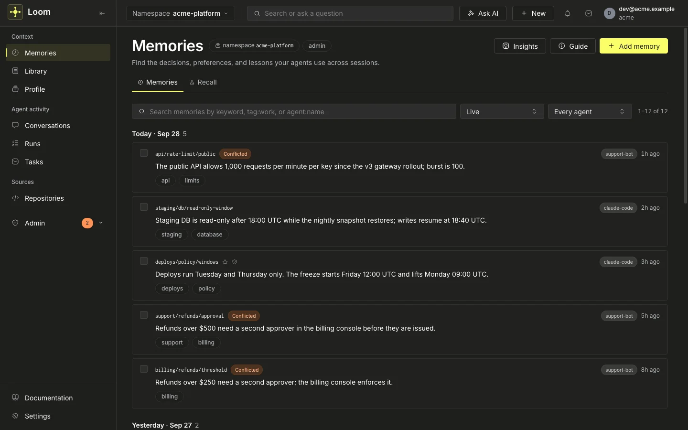
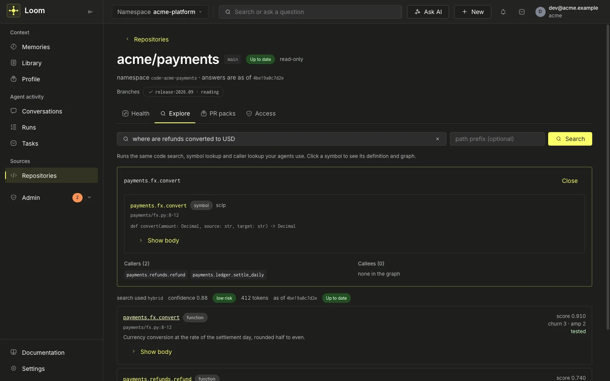

<!-- i18n: source=README.md blob=29675cf2a8d5e7d37f9dc00aeedb1a413885bb38 model=claude-sonnet-5-5 -->
> Esta página é uma tradução automática da [página em inglês](https://github.com/ClickHouse/loom/blob/main/README.md), que prevalece.
> Machine-translated from the [English page](https://github.com/ClickHouse/loom/blob/main/README.md), which is authoritative.

<h1 align="center">ClickHouse Loom</h1>

<p align="center">
  <b>Memória compartilhada, busca de documentos e inteligência de código para agentes de IA.</b><br>
  Para Claude Code, Codex, Cursor e seus próprios agentes.
</p>

<p align="center">
  <a href="https://pypi.org/project/clickhouse-loom/"></a>
  <a href="https://www.npmjs.com/package/@clickhouse/loom"></a>
  <a href="https://github.com/ClickHouse/loom/blob/main/LICENSE"></a>
  <a href="https://glama.ai/mcp/servers/ClickHouse/loom"></a>
  <a href="https://github.com/ClickHouse/loom/actions/workflows/ci.yml?query=branch%3Amain+event%3Apush"></a>
  <a href="https://scorecard.dev/viewer/?uri=github.com/ClickHouse/loom"></a>
</p>

<p align="center">
  <!-- languages -->
  <a href="../../README.md">English</a> · <a href="../zh-CN/README.md">简体中文</a> · <a href="../ja/README.md">日本語</a> · <a href="../ko/README.md">한국어</a> · Português (Brasil) · <a href="../es/README.md">Español</a>
  <br>
  <a href="https://loom.clickhouse.com/docs/pt-BR/">Documentação</a>
  <!-- /languages -->
</p>

<p align="center">
  <a href="#what-loom-is-for">Para que serve o Loom</a> ·
  <a href="#measured-results">Resultados medidos</a> ·
  <a href="#get-started">Primeiros passos</a> ·
  <a href="#why-loom">Recursos</a> ·
  <a href="#integrations">Integrações</a> ·
  <a href="https://clickhouse.github.io/loom/">Documentação</a>
</p>

<p>
  
  
  
</p>

Loom é um servidor MCP de código aberto e auto-hospedado que dá aos seus agentes uma memória
compartilhada de longo prazo: o que um agente aprende em uma sessão, o próximo agente ou
ferramenta consegue encontrar.

Os agentes se conectam por MCP, HTTP, Python ou TypeScript. Faça o self-host com Docker ou
[no Kubernetes com o Helm chart](https://github.com/ClickHouse/loom/blob/main/docs/operations/kubernetes.md); o contexto dos agentes e
os dados de índice ficam no [ClickHouse](docs/use-cases/self-hosted-clickhouse.md), e uma
implantação pode escolher o [Postgres no primeiro boot](https://github.com/ClickHouse/loom/blob/main/docs/operations/postgres.md) para o estado
ativo de memória e conhecimento. O painel reúne memórias, repositórios, tarefas e execuções
em um só lugar.

<a id="what-loom-is-for"></a>

## Para que serve o Loom

- **Memória de longo prazo compartilhada entre seus agentes de código**, com plugins que carregam contexto
  no início da sessão e capturam a sessão enquanto ela roda.
  [Memória do agente](docs/use-cases/agent-memory.md) ·
  [Conectar um agente de código](https://github.com/ClickHouse/loom/blob/main/docs/getting-started/connect-a-coding-agent.md)
- **Memória para uma aplicação de agente**, por usuário, a partir do SDK em Python ou TypeScript.
  [Seu primeiro agente](https://github.com/ClickHouse/loom/blob/main/docs/getting-started/first-agent.md)
- **Um servidor de memória MCP multiusuário** com namespaces, papéis e tokens.
  [Modo multiusuário](docs/getting-started/quickstart.md#start-in-multi-user-mode) ·
  [Namespaces e compartilhamento](https://github.com/ClickHouse/loom/blob/main/docs/features/namespaces-and-sharing.md)
- **Um índice de código dos seus repositórios** que os agentes de código consultam para obter definições,
  chamadores e impacto de mudanças. [Índice de código](docs/use-cases/code-intelligence.md) ·
  [Suporte a linguagens e limites](https://github.com/ClickHouse/loom/blob/main/docs/features/code-index/overview.md#language-support)
- **Memórias vinculadas ao código sobre o qual tratam**, que o acompanham em refatorações, são
  sinalizadas quando ele muda e aparecem quando um agente o lê ou edita.
  [Memória vinculada ao código](docs/use-cases/memory-linked-to-code.md)
- **Menor custo de modelo para agentes de código**, conforme [medido](#measured-results) abaixo.
  [Custo de agentes de código](docs/use-cases/coding-agent-cost.md)
- **Busca em documentos com citações (RAG)**, incluindo arquivos PDF, `.docx` e `.pptx` que o
  serviço extrator converte. [Busca em documentos](docs/use-cases/document-search.md)
- **Contexto compartilhado para fluxos de trabalho com vários agentes**: memória compartilhada, caixas de tarefas
  e decisões. [Multiagente](docs/use-cases/multi-agent.md)
- **Memória, recuperação, auditoria e exclusão para agentes autônomos.**
  [Agentes autônomos](docs/use-cases/autonomous-agents.md)
- **Um registro do trabalho dos agentes**, com conversas pesquisáveis (quando a gravação está ativada),
  resumos de sessão para retomar o trabalho, execuções com seus objetivos, resultados e custos de modelo quando
  informados, e histórico de PRs e de trackers.
  [Execuções e histórico de PRs](docs/use-cases/runs-and-pr-history.md)

Todos os casos de uso e quando outra ferramenta é mais adequada: [casos de uso](docs/use-cases/index.md).

O Loom não é uma biblioteca em processo para a memória de curta duração de um único agente, nem um framework de agentes.
[Quando o Loom não é adequado](https://github.com/ClickHouse/loom/blob/main/docs/getting-started/overview.md#when-it-does-not-fit)

<a id="measured-results"></a>

## Resultados medidos

| Avaliação                                | Com Loom  | Sem Loom | Ganho de eficiência                  | Escopo                                  |
| ---------------------------------------- | --------- | -------- | ------------------------------------ | --------------------------------------- |
| Qualidade das respostas do agente de código | **0.84**  | 0.78     | Custo do modelo **20% menor**        | 24 perguntas × 3 execuções pareadas     |
| Localização de arquivos do agente de código | **96.4%** | 91.4%    | Custo do modelo **21% menor**        | 36 perguntas × 10 execuções pareadas    |
| Memória vs. respostas com histórico completo | **94%**   | 90%      | **91% menos** tokens no prompt do leitor | 100 perguntas LongMemEval-S pareadas |

Ambas as configurações de código usam o Claude Code (`claude-sonnet-5`) na base de código do ClickHouse;
o custo é a fatura de modelo da sessão inteira, excluindo as chamadas de modelo do lado do servidor do Loom, a hospedagem
e a indexação. A qualidade das respostas
mede a cobertura dos pontos-chave de uma resposta verificada, com penalidade por contradição.
A localização de arquivos conta se o arquivo correto está entre os até três arquivos que o agente
deve nomear ao final da resposta.

A linha de memória compara memórias recuperadas com o histórico completo da conversa usando
o mesmo leitor `gpt-5`. A economia de tokens exclui a construção da memória; a diferença de 94% vs 90% na
acurácia é descritiva, não estabelecida estatisticamente.

**Separadamente, a configuração `memory.ask` do Loom obteve 96.6% de acurácia nas respostas em todas as
500 perguntas do LongMemEval-S.** Esta é uma avaliação do produto, com seus próprios modelos de
resposta configurados, e não a comparação com leitor fixo acima.

Os resultados são específicos das cargas de trabalho testadas.

[Protocolos e artefatos reproduzíveis](https://github.com/ClickHouse/loom/blob/main/docs/benchmarks/results.md) ·
[resultados detalhados](#benchmark-details) ·
[avalie na sua carga de trabalho](https://github.com/ClickHouse/loom/blob/main/docs/getting-started/evaluate.md)

<a id="get-started"></a>

## Primeiros passos

<a id="1-choose-your-docker-setup"></a>

### 1. Escolha sua configuração do Docker

- **Uso pessoal (o padrão):** sem login, acesso somente via localhost e um namespace `dev/local`.
  Uma pessoa pode conectar vários agentes.
- **Uso em equipe:** contas autenticadas e controles de acesso por namespace.
  [Comece no modo multiusuário desde a primeira inicialização](docs/getting-started/quickstart.md#start-in-multi-user-mode).

Os dois modos oferecem os mesmos recursos do Loom, incluindo LLMs e embeddings configurados.
O modo de usuário único não é uma edição com recursos reduzidos. Você também pode
[migrar uma instalação existente sem apagar seus dados](docs/getting-started/quickstart.md#2-open-the-dashboard);
conceda às novas contas acesso aos namespaces existentes.

Para experimentar sem instalar nada, abra em um codespace:

[](https://codespaces.new/ClickHouse/loom?quickstart=1)
([o que ele executa e quem pode acessá-lo](docs/getting-started/quickstart.md#try-it-in-github-codespaces))

Para a instalação pessoal padrão, com o Docker instalado (no Windows, em um terminal WSL 2
em que o `docker` funcione: Docker Desktop com a integração com WSL ativada, ou Docker Engine
instalado na distribuição):

```bash
curl -fsSL https://github.com/ClickHouse/loom/releases/latest/download/install.sh -o loom-install.sh && sh loom-install.sh && rm loom-install.sh
```

Execute-o a partir do seu diretório home ou de outro
[diretório em que somente você possa gravar](docs/getting-started/quickstart.md#fast-path-released-image-no-clone).
O instalador inicia o Loom e o ClickHouse, aplica as migrações e exibe a URL do painel:
**http://localhost:7777/**; em uma instalação nova, ele então verifica se uma memória é salva e lida
de volta. Em um terminal, ele também oferece conectar os agentes de código que encontrar (Claude Code, Codex,
VS Code) e, em uma instalação nova, abre o painel. A imagem inclui o servidor,
os workers, o painel e os indexadores de compilador para Python, TypeScript e Go, além do de C++ em
`amd64`; as dependências do TypeScript são preparadas automaticamente. [Quickstart e releases fixas](docs/getting-started/quickstart.md)

A instalação fica em `~/.loom` (`LOOM_INSTALL_DIR` escolhe outro diretório): o
arquivo Compose e as configurações de inicialização em `~/.loom/.env`. Executar o comando de instalação novamente
atualiza no mesmo lugar e mantém as configurações do seu `.env`.

Mantenha o modo de usuário único somente em localhost. Para acesso compartilhado, siga o
[guia de implantação para equipes](https://github.com/ClickHouse/loom/blob/main/docs/operations/deployment.md#identity-modes), incluindo TLS.

<a id="2-configure-models-and-api-keys"></a>

### 2. Configure modelos e chaves de API

**A instalação padrão inicia sem chaves nem rede.** O armazenamento, o painel,
a indexação estrutural de código e a busca semântica funcionam, usando um pequeno modelo de embedding local que a
imagem traz; o LLM fake não gera respostas por IA.

| Componente | Configure para uso real                                | Sem configuração                                                            |
| ---------- | ------------------------------------------------------ | --------------------------------------------------------------------------- |
| Embeddings | Provedor, modelo de embedding, dimensões e chave de API. | `local` (bge-small na CPU): recuperação semântica, mais fraca que um modelo hospedado. |
| LLM        | Provedor, modelo e chave de API.                       | `fake-echo-1`: sem extração, resumos ou respostas relevantes.               |

Abra **Settings → Models & keys**, escolha os dois provedores e modelos, informe as
chaves e clique em **Test & apply**. Não é necessário reiniciar o Docker; mudar o espaço de
embedding reconstrói o índice existente. As opções de embedding do painel são provedores
hospedados: para manter o `local` e adicionar um LLM, defina as linhas do LLM em `~/.loom/.env`
([Modelos e chaves](https://github.com/ClickHouse/loom/blob/main/docs/getting-started/models-and-keys.md#claude-for-the-llm)).

**Uma única chave de API da OpenAI pode atender aos dois papéis.** O Claude precisa de um provedor de embedding separado.
Há suporte para OpenAI, Gemini e endpoints de embedding compatíveis com OpenAI. O login da CLI
do seu agente ou a assinatura dele não fornece as chaves de provedor do Loom.

Prefere configurar por variáveis de ambiente? Edite `~/.loom/.env` e depois recrie o servidor:

```bash
docker compose --project-directory "$HOME/.loom" up -d --force-recreate loom
```

Uma chave sozinha não altera os modelos fixados (o embedder local e o LLM fake); defina
também o provedor e o modelo.
As configurações salvas no painel têm precedência sobre o `.env`. Consulte
[modelos e chaves de API](https://github.com/ClickHouse/loom/blob/main/docs/getting-started/models-and-keys.md) para receitas de provedores
e verificações de integridade.

**Todo o resto está em um único arquivo.** [`loom.example.yaml`](https://github.com/ClickHouse/loom/blob/main/loom.example.yaml) lista
cada configuração com seu valor padrão e o que ela faz, por área: a conexão com o ClickHouse,
timeouts e orçamentos, limites de taxa, workers e os interruptores `*_enabled` que ativam e desativam
recursos. Defina qualquer uma delas como `LOOM_<NAME>` em `~/.loom/.env` e recrie o
servidor; uma implantação que monta um arquivo de configuração pode defini-las em uma cópia deste arquivo
([como as configurações são lidas](https://github.com/ClickHouse/loom/blob/main/docs/operations/deployment.md#how-settings-are-read)). As marcadas com
`live` também mudam enquanto o Loom está em execução: `loom settings set <name> <value>` ou Admin → Deployment
settings. `loom settings list --changed` mostra o que difere dos padrões e
de onde veio cada valor ([configurações em tempo de execução](https://github.com/ClickHouse/loom/blob/main/docs/operations/runtime-settings.md)).

<a id="3-connect-your-agents"></a>

### 3. Conecte seus agentes

Se o instalador conectou seu agente, pule os comandos abaixo. Na máquina que executa uma
instalação pessoal, os plugins não precisam de token:

```bash
# Claude Code
claude plugin marketplace add ClickHouse/loom
claude plugin install loom@loom

# Codex
codex plugin marketplace add ClickHouse/loom
codex plugin add loom@loom
```

Inicie uma nova sessão; a primeira se conecta a `http://localhost:7777`. No Codex, execute
`codex` de forma interativa uma vez e aprove os hooks do plugin; até então só as
ferramentas funcionam. Conte ao agente algo que valha a pena guardar e pergunte sobre isso na próxima sessão.

Para o Cursor, em um plano Teams ou Enterprise, um administrador da equipe pode importar este repositório como
marketplace da equipe; o [plugin do Cursor](https://github.com/ClickHouse/loom/blob/main/docs/features/integrations/cursor.md#plugin),
não testado no Cursor, instala a entrada MCP e as skills do Loom. Na máquina que executa uma
instalação pessoal, o botão abaixo adiciona a [entrada MCP
local](https://github.com/ClickHouse/loom/blob/main/docs/features/integrations/cursor.md#mcp-tools), que não precisa de token:

[](https://cursor.com/en/install-mcp?name=loom&config=eyJ1cmwiOiJodHRwOi8vbG9jYWxob3N0Ojc3NzcvbWNwP3Rvb2xzZXQ9Y29kaW5nIn0%3D)

Para o modo agente do VS Code na máquina que executa uma instalação pessoal, os botões abaixo
adicionam a [entrada MCP local](https://github.com/ClickHouse/loom/blob/main/docs/features/integrations/vscode.md#local-single-user-server),
que não precisa de token:

[](https://vscode.dev/redirect?url=vscode%3Amcp%2Finstall%3F%257B%2522name%2522%253A%2522loom%2522%252C%2522type%2522%253A%2522http%2522%252C%2522url%2522%253A%2522http%253A%252F%252Flocalhost%253A7777%252Fmcp%2522%257D)
[](https://insiders.vscode.dev/redirect?url=vscode-insiders%3Amcp%2Finstall%3F%257B%2522name%2522%253A%2522loom%2522%252C%2522type%2522%253A%2522http%2522%252C%2522url%2522%253A%2522http%253A%252F%252Flocalhost%253A7777%252Fmcp%2522%257D)

Para um servidor de equipe, passe `--config server_url=… --config token=…` ao Claude Code ou
aponte o Codex para ele conforme descrito em
[conectar um agente de código](https://github.com/ClickHouse/loom/blob/main/docs/getting-started/connect-a-coding-agent.md). Crie
tokens em **Settings → Tokens**. O Cursor, outros clientes MCP e
[o SDK](https://github.com/ClickHouse/loom/blob/main/docs/getting-started/first-agent.md) também são abordados lá.

<a id="why-loom"></a>

## Por que o Loom

- **Memória que se mantém ao longo do tempo.** Compartilhe decisões e descobertas entre agentes e
  sessões. Cada fato registra quem o escreveu, o histórico de versões e a revisão de conflitos tornam
  as correções rastreáveis, e um namespace pode ser revertido para qualquer ponto no tempo.
  [Memória](https://github.com/ClickHouse/loom/blob/main/docs/concepts/memory.md)
- **Inteligência de código com evidências.** Encontre definições, chamadores, impacto de mudanças e
  testes relevantes; conecte o código a commits, pull requests e issues. Use localizações no código-fonte,
  sinais de completude e a atualização de cada camada para verificar um resultado.
  [Índice de código](https://github.com/ClickHouse/loom/blob/main/docs/features/code-index/overview.md)
- **Recuperação fundamentada.** Pesquise memórias, documentos, conversas e registros de
  rastreadores permitidos. As respostas citam suas fontes; uma recuperação com baixa confiança pode se abster.
  [Recuperação](https://github.com/ClickHouse/loom/blob/main/docs/concepts/retrieval-and-ranking.md)
- **Transferências entre vários agentes.** Atribua trabalho por meio de caixas de entrada de tarefas duráveis, com leases,
  novas tentativas, regras de revisão e resultados. Seus agentes executam o fluxo de trabalho; o Loom
  preserva as transferências. [Filas de tarefas](https://github.com/ClickHouse/loom/blob/main/docs/features/tasks-and-decisions.md)
- **Controle sobre os dados dos agentes.** Gerencie o acesso a namespaces, a procedência, a retenção, os registros
  de auditoria e a exclusão verificada. O contexto continua consultável no ClickHouse.
  [Segurança](https://github.com/ClickHouse/loom/blob/main/docs/architecture/security.md)

<a id="integrations"></a>

## Integrações

| Integração                                                                                                                                                                                                                                                                                   | O que ela conecta                                                             |
| --------------------------------------------------------------------------------------------------------------------------------------------------------------------------------------------------------------------------------------------------------------------------------------------- | ----------------------------------------------------------------------------- |
| [Claude Code](https://github.com/ClickHouse/loom/blob/main/docs/features/integrations/claude-code.md), [Codex](https://github.com/ClickHouse/loom/blob/main/docs/features/integrations/codex.md), [Cursor](https://github.com/ClickHouse/loom/blob/main/docs/features/integrations/cursor.md) e [outros clientes MCP](https://github.com/ClickHouse/loom/blob/main/docs/features/integrations/mcp-clients.md) ([todas as integrações](https://github.com/ClickHouse/loom/blob/main/docs/features/integrations/index.md)) | Memória e inteligência de código no fluxo de trabalho do seu agente atual.    |
| [Python](https://github.com/ClickHouse/loom/blob/main/docs/reference/python-sdk.md), [TypeScript](https://github.com/ClickHouse/loom/blob/main/docs/reference/typescript-sdk.md) e [HTTP](https://github.com/ClickHouse/loom/blob/main/docs/reference/operations.md)                                                                                                                                                         | Seus próprios agentes e aplicações.                                           |
| [Langfuse](https://github.com/ClickHouse/loom/blob/main/docs/features/integrations/langfuse.md)                                                                                                                                                                                                                                          | Traces de requisições, custos de modelos, pontuações de recuperação e atribuição de versão de prompt. |
| [ClickStack / HyperDX](https://github.com/ClickHouse/loom/blob/main/docs/features/integrations/clickstack.md)                                                                                                                                                                                                                            | Traces, logs e métricas do OpenTelemetry no ClickHouse.                       |

Langfuse e ClickStack são integrações opcionais, não serviços incluídos na stack do Docker.

<a id="benchmark-details"></a>

## Detalhes dos benchmarks

<a id="detailed-retrieval-reader-and-code-search-results"></a>

### Resultados detalhados de recuperação, leitor e busca de código

| Avaliação                                                         | Resultado                                                                                                         |
| ----------------------------------------------------------------- | ----------------------------------------------------------------------------------------------------------------- |
| Recuperação de evidências do LongMemEval-S (500 perguntas)        | **98.6%** das perguntas com pelo menos uma sessão de apoio nas primeiras 30 memórias.                             |
| Leitor `gpt-5` fixo no LongMemEval-S (500 perguntas)              | **92.0%** de acurácia nas respostas a partir das 200 principais memórias.                                         |
| LoCoMo (todas as 10 conversas)                                    | **89.6%** de acurácia nas respostas; **90.8%** de abstenções corretas em perguntas adversariais.                  |
| Amostra de perguntas de fatos do MemoryAgentBench (500 perguntas) | **99.0%** de SubEM; **95.7%** de F1 de sobreposição de tokens nas respostas geradas.                              |
| Busca conceitual de código (36 perguntas)                         | Recall do arquivo de referência de **91.2%** em 5 / **97.2%** em 10; MRR de **0.91**.                             |
| Localização de arquivos no SWE-bench Verified (200 issues)        | Issues com um arquivo alterado entre os 10 primeiros: **82%** contra **57%** do BM25; **76.5%** entre os 5 primeiros. |
| Detecção de duplicatas no tracker (104 pares)                     | Duplicata anterior registrada classificada em primeiro lugar em **87.5%** das vezes.                              |

Estes resultados medem tarefas diferentes, não uma pontuação agregada única. O SWE-bench mede
a localização de arquivos, não a resolução de issues. O [registro de resultados](https://github.com/ClickHouse/loom/blob/main/docs/benchmarks/results.md)
inclui as definições de pontuação, avaliações com amostras pequenas, resultados mais fracos e negativos,
além dos protocolos completos, modelos e artefatos.

[Metodologia](https://github.com/ClickHouse/loom/blob/main/docs/benchmarks/methodology.md) ·
[cobertura e lacunas conhecidas](https://github.com/ClickHouse/loom/blob/main/docs/benchmarks/coverage.md) ·
[execute os benchmarks](https://github.com/ClickHouse/loom/blob/main/docs/benchmarks/running.md)

<a id="documentation-and-contributing"></a>

## Documentação e contribuição

Para contexto compartilhado de agentes, inteligência de código e recuperação com controle de permissões, comece pela
[documentação](https://clickhouse.github.io/loom/). Para os requisitos de implantação, consulte os
[pré-requisitos](https://github.com/ClickHouse/loom/blob/main/docs/getting-started/overview.md#prerequisites).

[Implantação](https://github.com/ClickHouse/loom/blob/main/docs/operations/deployment.md) · [Perguntas frequentes](https://github.com/ClickHouse/loom/blob/main/docs/faq.md) ·
[Como contribuir](https://github.com/ClickHouse/loom/blob/main/CONTRIBUTING.md) · [Reporte de segurança](https://github.com/ClickHouse/loom/blob/main/SECURITY.md) ·
[`llms.txt`](https://clickhouse.github.io/loom/llms.txt) ·
[`llms-full.txt`](https://clickhouse.github.io/loom/llms-full.txt)

Apache-2.0 · [Licença](https://github.com/ClickHouse/loom/blob/main/LICENSE) · [Aviso](https://github.com/ClickHouse/loom/blob/main/NOTICE)
