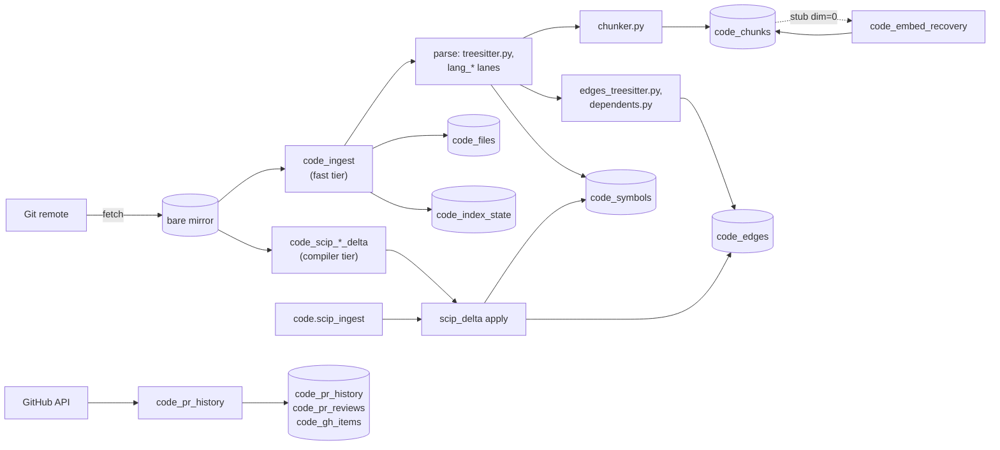

<!-- i18n: source=docs/architecture/code-index-architecture.md blob=9c0d2829f06e5917747d7848ef3ce0748e0c02d4 model=claude-sonnet-5-5 -->
> Esta página é uma tradução automática da [página em inglês](https://github.com/ClickHouse/loom/blob/main/docs/architecture/code-index-architecture.md), que prevalece.
> Machine-translated from the [English page](https://github.com/ClickHouse/loom/blob/main/docs/architecture/code-index-architecture.md), which is authoritative.

# Arquitetura do índice de código

Esta página é a visão interna do índice de código: como os arquivos se transformam em chunks, símbolos e arestas, e como as duas camadas se mantêm atualizadas. O que cada op responde, as linguagens e sua profundidade, e como interpretar `as_of` estão na [visão geral do índice de código](https://github.com/ClickHouse/loom/blob/main/docs/features/code-index/overview.md) e em [atualidade dos dados](https://github.com/ClickHouse/loom/blob/main/docs/features/code-index/freshness.md). A operação (clones, backfills, as camadas do compilador) está em [operações do índice de código](https://github.com/ClickHouse/loom/blob/main/docs/operations/code-index-operations.md).

## Objetivos e não objetivos

| Objetivos                                                                                                | Não objetivos                                                                                        |
| -------------------------------------------------------------------------------------------------------- | ---------------------------------------------------------------------------------------------------- |
| Atualização da camada rápida a cada merge, a partir de um poll de um espelho bare local; sem webhook de entrada. | Indexar uma árvore de trabalho. Alterações não commitadas e não enviadas por push nunca entram no índice. |
| Arestas exatas de chamada, sobrescrita e herança onde existe um indexador baseado em compilador; heurísticas graduadas nos demais casos. | Executar um compilador no processo do servidor. Os produtores de SCIP são executados em subprocessos do processo workers. |
| Ingestão idempotente: bytes inalterados geram as mesmas linhas e não custam nenhum embedding.            | Um host de código de uso geral. O índice é um dado de referência somente leitura, identificado por namespace. |
| Toda resposta informa o commit e a camada que leu, e explica por que uma resposta vazia está vazia.      | Esconder a defasagem. Uma camada atrasada é reportada.                                               |
| Uma nova linguagem entra sem reindexar as outras.                                                        | Mesma profundidade para todas as linguagens ([linguagens](https://github.com/ClickHouse/loom/blob/main/docs/features/code-index/overview.md)). |

## Um namespace, um branch

Um namespace de código é um branch de um repositório em um commit. Ele tem `kind='code'` em
`loom.namespaces` (`code/app/index/registry.py`, `ensure_registered`), não guarda
memórias e identifica cada linha `code_*` por `(org, namespace)`. O Loom mantém um espelho
git bare por repositório, um cache do remoto registrado no ClickHouse: `code_ingest` clona
um espelho ausente (ou `loom code init` o faz, com antecedência) e o atualiza com fetch a cada passada.
`server/code/app/index/gitrepo.py` chama o `git` por shell; não há árvore de trabalho e nada é escrito
além do `fetch`. Os branches de um mesmo repositório compartilham o espelho.

Uma leitura de histórico (`blame_range`, bisect, `first_build`, a verificação de código de uma lição) em um host
sem o espelho o clona uma vez em segundo plano
(`server/code/app/index/mirrors.py`, `history_dir`). Uma leitura que nomeia sua op espera até
10 s pelo clone que iniciou, ou pelo que restar do orçamento de latência da op, o que for
menor; as demais respondem `no_git_mirror` até que o clone termine. Após o clone, os commits de merge
do ledger que o clone não tem são buscados por sha e fixados: um merge feito em um branch de staging
que o upstream já apagou está no espelho do worker (nunca podado), mas não em um clone
novo. Um espelho presente responde como está; um que não tem o head indexado
busca o branch em segundo plano. Um head que não é o do branch (o head de um PR) não é buscado.

Isso coloca uma cópia completa de cada espelho em cada host de serviço que for consultado, o que é
o objetivo (qualquer host responde a leituras de histórico após uma mudança ou um scale-out) e o custo
(disco por host: o tamanho de um repositório cada). `LOOM_CODE_HISTORY_CLONE_ON_READ=false`
desativa isso: somente o host do worker clona, e uma leitura de histórico em qualquer outro lugar responde
`no_git_mirror`.

As entradas de repositório vêm de duas fontes, combinadas:

| Fonte             | Lida por                          | Notas                                                                                                      |
| ----------------- | --------------------------------- | ---------------------------------------------------------------------------------------------------------- |
| Ambiente          | `code/domain/index/repos.py`      | `LOOM_CODE_REPOS_JSON`, ou as configurações escalares `LOOM_CODE_*`.                                       |
| `loom.code_repos` | `code/app/index/repo_registry.py` | Linhas de autosserviço, por `row_kind` (abaixo). O token de um remoto privado é armazenado criptografado e nunca é retornado. |

O `row_kind` de uma linha de `loom.code_repos` diz o que ela é:

- `page`: um branch adicionado pela página. Ele mantém fora do seu namespace uma entrada do operador, removida ou não.
- `access`: a classificação e a política de entrada de uma entrada do operador.
- `''`: uma linha escrita antes da coluna, lida como a linha de acesso do namespace de uma entrada do operador e, em outros casos, como um branch adicionado pela página.

`configured_repos()` lê um snapshot em processo atualizado na inicialização, a cada passada de ingest
e após uma adição. Até a primeira leitura do snapshot, ele levanta `RegistryUnread`
(com autosserviço ativo), já que as entradas que um namespace de página ignora ainda não são conhecidas; os
módulos que decidem o acesso leem `config_entries()`, que lista as entradas anteriores a essa
leitura sem nenhuma legível pela organização (`tests/unit/test_repo_snapshot_contract.py`). Uma op que
precisa da lista completa responde 503 nessa janela; leituras de memória, busca e
`memory.for_file` respondem sem links de código. Uma chamada de código sem namespace usa por padrão
`LOOM_CODE_NAMESPACE` somente quando nenhum membro adicionou esse namespace pela página.
Aposentar uma entrada (`code/app/index/retire.py`) desativa suas linhas, executa uma saga de exclusão em
cada tabela `code_*` do namespace e remove o espelho quando nenhuma outra entrada o usa
no host que atendeu a chamada; a varredura de cada um dos outros hosts remove a própria cópia.

## Mirrors Git em cada réplica

Todo processo de serviço pode responder a uma leitura de histórico (blame, bisect, citações, overlays de PR, cobertura de commits), então cada host mantém seus próprios mirrors bare (`code/app/index/mirrors.py`). Um mirror é um cache do seu remote: o ClickHouse nomeia o remote, e qualquer host pode reconstruir o mirror a partir dele.

- **Warm-up.** Na inicialização, cada processo clona os mirrors das entradas indexadas que lhe faltam, `LOOM_CODE_MIRROR_WARMUP_CONCURRENCY` por vez, cada um após uma espera aleatória de até 30 s, para que N réplicas iniciadas juntas não clonem todas do GitHub ao mesmo tempo. Os clones rodam em segundo plano: a prontidão não espera por eles.
- **O custo de um disco novo.** Um host com `LOOM_CODE_REPOS_ROOT` vazio faz um clone bare completo de cada repositório indexado (vários GB para um repositório grande) antes de suas leituras de histórico responderem. O warm-up fica ativado por padrão porque uma nova réplica precisa montar seus caches sem um operador; coloque `LOOM_CODE_REPOS_ROOT` em um volume que sobreviva a um rollout para pagar esse custo uma vez por volume, não uma vez por pod. Os clones são completos, não `--filter=blob:none`: um clone parcial busca cada blob ausente no remote enquanto o `git blame` roda, o que transforma uma leitura de histórico em uma leitura de rede e alcançaria o remote fora do sandbox de jobs de repositório.
- **O portão.** Toda leitura de histórico passa por `mirrors.history_dir`, que retorna o mirror ou o motivo de não haver um. Enquanto o mirror não está presente, a leitura responde `no_git_mirror: cloning <entry>` (ou o motivo pelo qual ele não será clonado aqui) em vez de um erro do git, e inicia o clone se nenhum estiver em andamento. `LOOM_GIT_HISTORY=none` desativa o histórico em um host: essas leituras respondem `no_git_history`.
- **O loop do host.** Somente o líder pergunta ao remote o que mudou (`ls-remote` dos branches extras e dos heads de PR). O que a sua passada buscou está no ClickHouse: o tip do branch de cada entrada (`clone_head`), os heads dos PRs abertos (`code_gh_items.head_sha`) e os merges do ledger. A cada `LOOM_CODE_MIRROR_FETCH_INTERVAL_S`, cada host lê esses dados e busca, por nome, apenas os branches e heads de PR que seu mirror mantém em outro sha, mais uma página de merges do ledger que lhe faltam; um host que está em dia não faz nenhuma chamada de rede. Branches extras não são seguidos em outros hosts: um clone novo traz todos os branches que o remote tinha, e os merges neles chegam pelo ledger. Um processo por host executa a rodada de cada mirror, e todo fetch em um mirror (o da passada, o do loop do host, o de uma leitura) mantém o `.fetch-lock` do mirror; o fetch da passada também conta como a rodada do host no intervalo. O mesmo loop executa `git gc --no-prune` quando devido e varre `LOOM_CODE_REPOS_ROOT`: mirrors, árvores `checkout-*` e arquivos de lock de mirror que nenhuma entrada ativa nomeia (incluindo entradas restritas) e clones incompletos. Ele não varre nada quando o registro não pode ser lido.
- **Sandbox.** Um host sem o sandbox de jobs de repositório nunca clona nem busca uma entrada adicionada por um viewer com remote de rede, tanto no caminho de leitura quanto no worker (`compiler_tier.unsandboxed_skip`).
- **Merges que o remote perdeu.** Um merge do ledger que o remote não serve mais ("not our ref" em duas chamadas, para que uma recusa transitória não conte) é registrado no mirror (`loom-unpinned-merges`), nunca mais é solicitado e é contabilizado em `/v1/health?include=mirrors` (`mirrors.unpinned_merges`) e em `loom doctor`.
- **O líder** também clona um mirror ausente em segundo plano, para que um clone longo não retenha as outras entradas da sua passada; uma entrada indexada mantém seu estágio no card Repositories enquanto seu mirror é clonado novamente em um novo host.
- **Apagamento.** Mirrors e checkouts guardam conteúdo de repositório, não conteúdo de memória: o censo de apagamento não os conta. As cópias de um repositório removido somem com a varredura em cada host.

`/v1/health?include=mirrors` traz `mirrors`: quantos dos mirrors deste host estão `ready` e `cloning`, e `failed` e `absent` contados por motivo. Ele responde sem token, então não nomeia nenhuma entrada. O uso de disco é o tamanho de todos os mirrors em todos os hosts: N réplicas guardam N cópias.

## Componentes

## Camada rápida: `code_ingest`

`server/code/workers/ingest.py` faz polling a cada `LOOM_CODE_INGEST_INTERVAL_SECONDS`;
`code.refresh` dispara uma passada a partir do CI. Por entrada, cada passada:

1. **Busca** o mirror e percorre os commits de first-parent a partir da marca d'água `git_head`
   em `code_index_state` até o topo, do mais antigo para o mais novo, em no máximo
   `LOOM_CODE_INGEST_MAX_COMMITS_PER_PASS`.
2. **Reindexa exatamente os arquivos alterados** de cada commit (`ingest_file` em
   `code/app/index/ingest.py`): parse, chunks, símbolos, arestas, call guards, a linha do
   arquivo, além de um context pack e de um review brief para o PR mesclado que o commit
   cita. Em seguida avança `git_head`. Uma falha reexecuta a partir do último commit completo.
3. **Percorre** com a fração `LOOM_CODE_INGEST_WALK_BUDGET_SHARE` que sobra: reparos de
   reconciliação e re-chunks do extrator (abaixo).

| Limite                                  | Efeito                                                                                                          |
| --------------------------------------- | --------------------------------------------------------------------------------------------------------------- |
| `LOOM_CODE_INGEST_MAX_PASS_SECONDS`     | Duração da passada.                                                                                             |
| `LOOM_CODE_INGEST_PASS_BUDGET_FRACTION` | Após essa fração, a passada não inicia novas unidades, salva os cursores e retorna `partial: true`.             |
| `LOOM_CODE_INGEST_SECONDS_PER_FILE`     | Prevê o custo de um commit; um commit previsto para estourar só começa se for o primeiro da passada.            |
| `LOOM_CODE_INGEST_SLICE_SHARE`          | O máximo da fase de commits que um único commit grande pode ocupar antes de ser fatiado entre passadas.         |
| `LOOM_CODE_INGEST_LANES`                | Entradas ingeridas em paralelo (padrão 1, até 8). Os commits de uma mesma entrada continuam sequenciais.        |
| `LOOM_CODE_INGEST_ROUND_FILES`          | Arquivos por rodada dentro de um commit; leituras pré-carregadas em duas instruções, escritas em lote.          |

As lanes ajudam porque uma lane espera round trips do ClickHouse, não CPU.

**Admissão.** Um arquivo é recusado antes do parse quando corresponde à denylist
(`code/app/index/denylist.py`, `LOOM_CODE_INGEST_EXCLUDE`,
`LOOM_CODE_INGEST_IGNORE_FILE`), é binário ou excede `LOOM_CODE_INGEST_MAX_FILE_BYTES`.
Assim, `coverage_floor: true` em um grep significa todo chunk admitido, não todo byte.

### Escolha de um parser

`ingest_parse.parse_for_ingest` tenta as opções abaixo, em ordem. A ordem mantém novos tipos
de arquivo fora do carimbo do extrator:

1. `treesitter.lang_for_path`: o núcleo carimbado (C/C++ com `.h` pela gramática C++,
   Python, shell, SQL, doc, config). Depois, `ingest_parse._lane_language` reclassifica
   arquivos CMake e configs TLC.
2. Manifestos Helm e Kubernetes entre os arquivos de config (`lang_gotemplate`, `lang_k8s`).
3. `lang_detect.detect_by_extension` (`LANG_BY_EXTENSION`).
4. Um shebang e, depois, a detecção de shell por nomes do Linguist e diretivas do ShellCheck
   (`lang_detect.detect_shell`).
5. Arquivos host (Dockerfile, Makefile, Jenkinsfile, YAML de CI) com `LOOM_CODE_HOST_ISLANDS`
   (`lang_hosts`).
6. Fixtures de saída esperada, um chunk sem embedding por arquivo (`lang_reference`).
7. Qualquer outro texto, dividido em chunks sem símbolos (`lang_text`).

O parser vem de `ingest_parse._PARSERS`. Uma falha desse parse, incluindo uma gramática
ausente ou um parse do tree-sitter além de `code_parse_timeout_s` ou `code_parse_memory_mb`
(`bounded_parse`, um parse por vez), degrada para um arquivo apenas com chunks, com
`code_files.index_error` definido; `code.index_errors` o reporta; já uma especificação TLA+
recorre ao seu leitor baseado em regex. Um parse que ultrapassa seus limites em qualquer
outro lugar segue o fallback de quem o chamou e não registra erro.
Os módulos do tree-sitter são importados sob demanda, então um servidor com os workers de
código desligados inicia sem os extras de `code`.

### Blocos (chunks)

`server/code/domain/extract/chunker.py` corta unidades semânticas, nunca janelas fixas:

| Chunk            | Conteúdo                                                                                                                  |
| ---------------- | ------------------------------------------------------------------------------------------------------------------------- |
| `function`       | O corpo de uma função. Um corpo grande demais é dividido em instruções de nível superior, cada parte prefixada com a assinatura. |
| `class_skeleton` | Uma classe com os corpos dos métodos omitidos.                                                                            |
| `file_header`    | Comentários e includes iniciais.                                                                                          |
| `other`          | O restante, agrupado.                                                                                                     |

Arquivos sem árvore recorrem a janelas de linhas inteiras; lanes sem gramática cortam pelos
spans de seus símbolos (`lane_units.span_chunks`). Um id de chunk é
`uuid5("loom://code/{namespace}/{path}#{scope}@{sha16}")`. Ele é endereçado por conteúdo,
então um chunk inalterado mantém seu id e seu hash, e a etapa de embedding o ignora sem
consulta. Chunks idênticos em um mesmo arquivo recebem um sufixo ordinal.

### Símbolos e arestas

Um id de símbolo é `treesitter.symbol_id(qualified_name, signature)`: os primeiros 128 bits
do SHA-256 sobre o nome e uma assinatura normalizada (espaços colapsados, valores padrão
removidos, de modo que sobrecargas difiram). A camada rápida, o conversor SCIP e o caminho
de leitura o chamam, então ambas as camadas registram um símbolo compartilhado sob um único
id. Python e shell qualificam nomes pelo caminho do módulo, então as muitas funções `main()`
de uma árvore de testes permanecem distintas.

As arestas da camada rápida (`edges_treesitter.py`, `tier='treesitter'`) são resolvidas por
nome e graduadas:

| Confiança | Regra                                                                              |
| --------- | ---------------------------------------------------------------------------------- |
| 1.0       | Definição única no mesmo arquivo                                                   |
| 0.8       | Método da classe envolvente                                                        |
| 0.6       | Correspondência única na tabela de nomes de símbolos de todo o repositório         |
| none      | Ambígua ou desconhecida: sem aresta; registrada em `code_call_sites_unresolved`    |

Uma aresta errada é pior que uma ausente, então `code.callers` informa quantos sites sua
contagem deixa de fora. Chamadas de construtor (`T x(...)`, `new T`, `make_unique<T>`) são
chamadas a `T::T`. Módulos de tipo de receptor (`cpp_receivers.py`, `py_receivers.py`,
`ts_receivers.py`, `go_receivers.py`) vinculam chamadas de membro. Os tipos de aresta são
`calls`, `includes`, `inherits`, `overrides`, `uses_type`, `fixture_use`, `reads` e `writes`.

**Dependentes.** As arestas são resolvidas contra uma tabela de nomes de todo o repositório,
então um commit que adiciona, remove ou altera a assinatura de um símbolo muda as arestas de
arquivos intocados que o mencionam. `code/app/index/dependents.py` reextrai apenas as arestas
desses arquivos no mesmo commit, até `LOOM_CODE_INGEST_DEPENDENTS_MAX_FILES`. O excedente
aguarda em `code_index_state` (`dependents_pending`) e é escoado pela reconciliação.

### Embeddings e tabelas de vetores

`code_ingest` gera embeddings dos novos chunks na própria passada, com memoização pelo hash
do conteúdo (`embed_reuse.py`), usando texto limitado (`embed_text.py`). Com
`LOOM_CODE_CONTEXT_DESCRIPTION_ENABLED` (ativado por padrão), um chunk recebe uma descrição
de uma linha gerada por LLM, anexada antes do texto do embedding, em regime de melhor
esforço e condicionada a orçamento. Uma falha do provedor deixa um stub com
`embedding_dim = 0` que `code_embed_recovery` preenche, com fallback por texto e
envenenamento após `LOOM_CODE_EMBED_MAX_ATTEMPTS`. Até que `LOOM_CODE_READY_EMBED_COVERAGE`
dos chunks de um namespace tenha vetores, `code.search` responde a partir de suas pernas
lexicais e informa isso.

| Tabela                                    | Preenchida por                                     | Uso                                                                                                                  |
| ----------------------------------------- | -------------------------------------------------- | -------------------------------------------------------------------------------------------------------------------- |
| `code_summaries`                          | `code_summary` (semanal, desativado por padrão)    | Cartões de arquivo e de módulo para `code.map`, controlados por um hash das entradas, com PageRank de `code_graph_stats`. |
| tabelas do segundo modelo, `code_chunks_prefix` | `LOOM_CODE_VECTOR_TABLES`; `loom code vector-twin` | A perna vetorial seleciona candidatos no gêmeo menor e repontua com os vetores servidos (`prefix_twin.py`).          |
| `code_answers`                            | `code.ask`                                         | Cache de respostas indexado pelo embedding da pergunta; servido apenas se o hash de todo arquivo citado estiver atual. |

Passadas em massa deixam cópias extras por chave até um merge. `code/app/index/compaction.py`
executa `OPTIMIZE … FINAL` nas tabelas gêmeas após uma passada em massa. `code_chunks` só é
compactada por `loom code compact --table code_chunks --apply`.

## Camada do compilador: SCIP

A camada do compilador contém símbolos e arestas com `tier='scip'`. O servidor nunca faz parsing de
protobuf: um produtor converte a saída do SCIP em um delta JSON versionado
(`scripts/scip_harness/scip_to_delta.py`) e `code/app/index/scip_delta.py`
o aplica. Para cada arquivo tocado, a aplicação faz upsert do que o delta emite e marca como removidas (tombstone) as linhas `scip`
do arquivo que ele não emite mais; um arquivo excluído tem todas as linhas marcadas como removidas. Reaplicar um
delta produz o mesmo conjunto ativo.

| Produtor          | Linguagem               | Watermark        | Workers                                                | Como é executado                                                                                                                                  |
| ----------------- | ----------------------- | ---------------- | ------------------------------------------------------ | ------------------------------------------------------------------------------------------------------------------------------------------------- |
| `scip-clang`      | C++                     | `scip_commit`    | `code_scip_full`, `code_scip_delta`, `code_scip_apply` | TUs alteradas (e TUs que incluem cabeçalhos alterados, com limite) via `run_delta.sh`; `code_scip_full` popula a camada e a reindexa semanalmente. |
| `scip-typescript` | TypeScript / JavaScript | `scip_commit_ts` | `code_scip_ts_delta`                                   | Índice do workspace inteiro a cada passada, restrito pelo conversor aos arquivos da janela.                                                       |
| `scip-go`         | Go                      | `scip_commit_go` | `code_scip_go_delta`                                   | Um build por módulo (`run_go_monorepo_delta.sh`).                                                                                                 |
| `scip-python`     | Python                  | `scip_commit_py` | `code_scip_py_delta`, `code_scip_apply`                | Delta por merge (`run_python_delta.sh`); a primeira execução indexa a árvore.                                                                     |

`code/domain/index/compiler_tiers.py` (`TIERS`) é a tabela única de watermark, rótulo
e workers por produtor; os handlers de status e o painel a leem. Um worker de delta
compara seu watermark com `git_head`, move o checkout (buscando do espelho local,
não da rede), executa o produtor em um subprocesso e aplica o delta
pelo mesmo caminho que `code.scip_ingest` usa. Uma passada cobre todos os merges desde o
watermark.

Um produtor externo, como um job de CI, pode enviar um delta em partes com
`code.scip_ingest`; as partes ficam em staging em `code_scip_batches` / `code_scip_parts` e
são aplicadas por `code_scip_apply`. Toda passada da camada do compilador adquire um arquivo de lock por entrada em
`LOOM_CODE_SCIP_LOCK_DIR` e um lease do ClickHouse, então uma reindexação completa e um delta nunca
executam ao mesmo tempo na mesma entrada. `loom code scip-full` reconstrói
a camada C++; `loom code scip-delta` executa uma passada de delta.

Quando as duas camadas têm a mesma linha, as leituras preferem a linha do compilador, e toda resposta
indica a camada que leu (`scip` ou `treesitter`).

## O stamp do extrator

Chunks endereçados por conteúdo e ids de símbolo com hash dependem da entrada, não do código que
produziu as linhas, então uma correção no chunker nunca chegaria a uma linha existente.
`server/code/domain/extract/extractor_stamp.py` fecha essa lacuna. Ele calcula o hash dos tokens de código de
cada módulo extrator (`logic_tokens`: sem comentários, linhas em branco ou docstrings, e um
import reduzido aos nomes que ele vincula, de modo que mover um módulo entre pacotes não altera nenhum
stamp) mais as versões instaladas das gramáticas incluídas no stamp (`STAMPED_GRAMMARS`: a biblioteca base, C++,
Python, bash).

O stamp é dividido de duas formas, para que uma mudança reprocesse o mínimo possível:

- **Por estágio** (`STAGES`: `chunk`, `symbol`, `edge`, `guard`; `STAGE_MODULES`). O
  stamp de um estágio cobre seus módulos e os dos estágios que ele lê (`STAGE_INPUTS`).

  | Módulo alterado                   | Estágios afetados             |
  | --------------------------------- | ----------------------------- |
  | `chunker.py`                      | `chunk`                       |
  | `edges_treesitter.py`             | `edge`, `chunk`, `guard`      |
  | `treesitter.py`, `lang_python.py` | todos (`symbol` alimenta os demais) |
  | `call_guards.py`                  | `guard`                       |

- **Por família de linguagem** (`LANGUAGE_FAMILIES`: `python`, `shell`, `typescript`, `cpp`,
  `other`; `MODULE_LANGUAGES`). Uma mudança apenas em Python corrige os arquivos `.py` e deixa o C++
  em paz. Os módulos de arestas do TypeScript (`ts_receivers.py`, `ts_reexports.py`,
  `ts_config.py`, `ts_workspace.py`) afetam apenas `typescript`. Um módulo com stamp ausente
  em `MODULE_LANGUAGES` afeta todas as famílias.

A cada passagem, os stamps em execução são comparados com os de `code_index_state`. Um estágio alterado é
reprocessado para todos os arquivos dessa família em todos os namespaces indexados, em lotes
ritmados (`LOOM_CODE_EXTRACTOR_RECHUNK_PER_PASS`, chave `LOOM_CODE_EXTRACTOR_RECHUNK_ENABLED`).
Um stamp registrado vazio é gravado, nunca usado para agir. Portanto:

- uma mudança de código em um módulo de `EXTRACTOR_MODULES` reindexa todos os repositórios nas
  famílias afetadas, o que leva horas em uma implantação grande; comentários e docstrings
  podem ser editados livremente;
- esses arquivos são excluídos dos formatadores (`pyproject.toml`), e
  `tests/unit/test_code_extractor_stamp.py` mantém a lista de exclusão e o inventário de módulos
  em sincronia: um módulo em `server/code/domain/extract/` que não esteja em nenhum estágio deve ser
  listado em `NON_EXTRACTOR_MODULES` no teste, com o motivo;
- altere-os somente quando a extração mudar, e espere o reprocessamento após o deploy.

**Os módulos de lane ficam fora do stamp.** Os parsers de lane (`lang_typescript.py`,
`lang_rust.py`, `lang_go.py`, `lane_units.py`, …), suas gramáticas e os módulos de seleção de arquivos
(`lang_detect.py`, `denylist.py`) não o alteram; os módulos de arestas do TypeScript
acima são a exceção. Uma correção de lane é aplicada com `loom code backfill --paths-file`
sobre os arquivos dessa linguagem.

## Reconciliação

As marcas d'água indicam quais commits foram percorridos, não se cada linha está atualizada.
`code/app/index/reconcile.py` mede o desvio. Uma linha de `code_files` carrega `blob_sha`
e `indexed_commit`. Um único `git ls-tree -r <head>` marca um caminho como desatualizado (stale) quando seu blob
difere e como removido (gone) quando ele está ausente. Linhas sem blob recorrem a um
`git diff --name-only` por commit distinto, até `LOOM_CODE_RECONCILE_MAX_COMMITS`.

A verificação horária em `code_ingest` (`LOOM_CODE_RECONCILE_ENABLED`,
`LOOM_CODE_RECONCILE_INTERVAL_SECONDS`) reingere até
`LOOM_CODE_RECONCILE_HEAL_PER_PASS` caminhos desatualizados por meio de `ingest_file`; apenas o conteúdo novo
é embutido em embeddings. Manualmente: `loom code reconcile --heal`. O gauge `loom.code.stale_files`
informa a contagem.

## Marcas d'água e cobertura

`code_index_state` (`ReplacingMergeTree(version)`, com chave `(org, namespace, state_key)`)
guarda `git_head`, as marcas d'água SCIP por produtor, os carimbos do extrator, os cursores e
`dependents_pending`. O bloco `as_of` em cada resposta e
`loom.code.tier_lag_seconds{tier}` são calculados a partir dessas linhas e do mirror, não a partir do log
de um produtor. A cobertura por commit (`code/app/index/commit_coverage.py`) é um
`git merge-base --is-ancestor` por camada no mirror, nunca uma comparação de marcas d'água.
O que os chamadores veem está em [frescor](https://github.com/ClickHouse/loom/blob/main/docs/features/code-index/freshness.md).

## Histórico de PRs, backports e links de trackers

| Tabela                                                 | Escritor                                                    | Conteúdo                                                                                                       |
| ------------------------------------------------------ | ----------------------------------------------------------- | -------------------------------------------------------------------------------------------------------------- |
| `code_pr_history`, `code_pr_reviews`, `code_gh_items`  | `code_pr_history` (GitHub REST, cursor em `updated_at`)     | PRs mesclados com arquivos, comentários de revisão e issues. Um limite de taxa ou um 5xx deixa o cursor parado. |
| `code_context_packs`, `code_review_briefs`             | `code_ingest` no commit de merge, ou sob demanda            | Pacote de contexto e resumo para o revisor, por PR.                                                            |
| `code_backport_gaps`                                   | `code_backport_gaps` (noturno; requer `code_pr_history`)    | Para cada PR do trunk com label de backport, uma linha por namespace de release branch: coberto, pendente, não afetado. |
| `code_test_map`, `code_symbol_stats`, `code_unit_risk` | `code_graph_stats` (semanal), `loom code crossref`          | Mapa teste↔código-fonte, fan-in de símbolos, risco por unidade.                                                |
| `code_coverage_files`                                  | `code_coverage_import` (diário), `loom code coverage-import` | Por arquivo-fonte, os intervalos de linhas que uma execução de cobertura por teste executou.                   |
| `qa_link_candidates`                                   | `tracker_links` (diário)                                    | Principais PRs mesclados por issue recente, ranqueados por BM25F, stack frames no diff e menções de fechamento. |
| `qa_item_embeddings`                                   | `tracker_embed`                                             | Vetores de issues e PRs do tracker na janela de embedding; chaves e fatos de filtro, sem texto.               |

`code.repo.set_source` vincula um repositório a seus trackers, em ordem; o primeiro é o
principal, cujos números são os números de issues e PRs do repositório. Os links são a
linha `qa_binding` de `code_index_state` e são lidos por `(org, namespace)`: o nome de um
namespace de código é derivado do repositório e do branch, então duas orgs podem ter o
mesmo nome. O `LOOM_TRACKER_CODE_NAMESPACE_BINDINGS_JSON` do operador se aplica apenas
aos repositórios do próprio operador (`LOOM_CODE_REPOS_JSON` ou `LOOM_CODE_REPO`), nunca a
um repositório de autoatendimento cujo nome corresponda a um glob. Os workers do tracker
leem cada namespace por sua própria fonte, então as linhas de um namespace restrito nunca
caem sob um namespace padrão. O contrato de registros está em
[contrato de registros do tracker](https://github.com/ClickHouse/loom/blob/main/docs/features/tracker/record-contract.md).

`code.repo.add_branch` grava a linha `qa_branch_of` do novo branch, nomeando o repositório
raiz (a fonte, ou a raiz da própria fonte quando a fonte é um branch) quando essa raiz é
um repositório do operador, de modo que o branch de uma raiz de autoatendimento nunca
passe a ler o mapa se o operador configurar depois o nome dessa raiz. Um
branch registrado cuja raiz é um repositório do operador segue os links desse repositório
no momento da leitura, incluindo o glob; uma linha `qa_branch_of` sem uma entrada de
autoatendimento ao lado não é seguida. Uma fonte que não é um repositório do operador tem
a própria linha `qa_binding` copiada para o branch, inclusive uma limpa. Uma fonte do
operador é sua própria raiz. As duas linhas são gravadas lendo primeiro as linhas da
fonte e gravando `qa_branch_of` por último, de modo que uma falha deixa o branch sem
seguir nada.

`code.repo.remove` esvazia a que das duas linhas tiver um valor antes da limpeza
desanexada do namespace. Registrar um namespace esvazia qualquer linha que um namespace
removido de mesmo nome tenha deixado e remove o nome do snapshot do próprio processo, de
modo que o novo namespace não segue nenhuma delas. Um `qa_binding` esvaziado é lido como
limpo até que um admin do tracker o vincule. Um namespace que não tinha linha `qa_binding`
não recebe nenhuma, então o mapa do operador ainda alcança uma entrada do operador
configurada com o mesmo nome. Uma entrada do operador configurada com um nome removido não
recebe essa limpeza: até a limpeza ser executada, ela lê a linha `qa_binding` do namespace
removido, quando existe, com os links antigos após uma remoção na build N-1 e nenhum após
uma na N. Os outros processos mantêm as linhas que leram por até
`LOOM_CODE_REPOS_REFRESH_SECONDS`.

## Armazenamento

| Tabela                                                         | Engine e chave                                                                                         | Notas                                                                                         |
| -------------------------------------------------------------- | ------------------------------------------------------------------------------------------------------ | --------------------------------------------------------------------------------------------- |
| `code_files`                                                   | RMT(`version`), `(org, namespace, path)`                                                               | Último parse por caminho: linguagem, `blob_sha`, `indexed_commit`, `index_error`.             |
| `code_chunks`                                                  | RMT(`version`), `(org, namespace, embedding_model, path, chunk_id)`, particionada por `(org, namespace)` | Conteúdo, `lexemes`, vetor. Índices de texto: 3-gram em `lower(content)`, tokens em `lexemes`. |
| `code_symbols`                                                 | RMT(`version`), `(org, namespace, tier, qualified_name, symbol_id)`                                    | Definições com assinatura, intervalo, comentário de documentação, `scip_symbol`; índices de salto ngram sobre o nome. |
| `code_symbol_names`, `code_symbol_ids`                         | RMT, preenchidas por `code_symbol_names_mv` / `code_symbol_ids_mv`                                     | Os símbolos reindexados por nome curto e por id.                                              |
| `code_edges`                                                   | RMT(`version`), `(org, namespace, tier, to_symbol_id, edge_kind, from_symbol_id, path, line)`          | Os chamadores são um intervalo de chave; projeções `by_from` (chamados) e `by_path`.          |
| `code_call_sites_unresolved`, `code_caller_guards`             | RMT(`version`)                                                                                         | Pontos de chamada recusados, por nome do chamado; guardas em torno dos pontos de chamada de cada chamador. |
| `code_term_freq`, `code_doc_stats`                             | AMT, RMT; preenchidas por `code_term_freq_mv`, `code_doc_stats_mv`                                     | Estatísticas BM25 para a perna lexical.                                                       |
| `code_unit_signal`                                             | `SummingMergeTree((positive, negative))`                                                               | Contadores de resultado por unidade a partir de `code.outcome`.                               |
| `code_search_trace`, `code_search_outcome`, `code_search_memo` | MT com TTL de 180 dias; RMT com TTL de 60 minutos                                                      | Traces e resultados por consulta; um memo de curta duração das respostas de `code.search` servidas. |

Todas as colunas estão na [referência de schema](https://github.com/ClickHouse/loom/blob/main/docs/reference/schema.md) gerada.

## Padrões de consulta

| Op                               | Caminho                       | Como                                                                                                                                                                                                                                                                                                                                                                                                                      |
| -------------------------------- | ----------------------------- | ------------------------------------------------------------------------------------------------------------------------------------------------------------------------------------------------------------------------------------------------------------------------------------------------------------------------------------------------------------------------------------------------------------------------- |
| `code.search`                    | `code/app/search/pipeline.py` | Primeiro faz o roteamento (padrão, caminho, pergunta de histórico) e depois executa as etapas dentro do prazo (`gather.py`): lexical (contagem de tokens ponderada por idf), vetorial (uma varredura sem índice vetorial, ou shortlist por twin), histórico de PRs e votação fuzzy de símbolos. `fusion.py` faz a fusão por rank recíproco (k = 60); `serve.py` pagina dentro do orçamento de tokens ou se abstém. Uma repetição dentro da janela de memo é uma única leitura de `code_search_memo`. |
| `code.grep`                      | `code/store/index/grep.py`    | O índice de 3-gramas reduz os granules; `position()` ou `match()` decide; cada ocorrência é associada à unidade que a contém. `mode=presence` abrange até oito namespaces de branch.                                                                                                                                                                                                                                       |
| `code.symbol`                    | `code/app/symbol/`            | Um nome qualificado é uma leitura por prefixo de chave em `code_symbols`; um nome curto passa por `code_symbol_names`; várias definições são ordenadas por `near_paths` ou pelo PR em revisão.                                                                                                                                                                                                                            |
| `code.callers`, `code.impact`    | `code/store/index/edges.py`   | Os chamadores são o intervalo de `to_symbol_id` em `code_edges`, com preferência para as linhas do compilador, junto com a contagem de não resolvidos. `code.impact` mapeia os hunks do diff para símbolos semente e percorre o grafo para fora; um percurso vazio responde `no_indexed_paths`, `no_seeds_in_hunks` ou `no_static_callers`.                                                                                  |
| `code.outline`, `code.enclosing` | —                             | Leituras por caminho de `code_symbols` e dos spans de `code_chunks`.                                                                                                                                                                                                                                                                                                                                                      |

## Invariantes

- Um namespace de código corresponde a uma branch; toda linha `code_*` é identificada pela chave `(org, namespace)`.
- `git_head` só avança depois que todos os arquivos do commit são gravados.
- `treesitter.symbol_id` é a única função de symbol-id, usada pelas duas camadas e pelo caminho de leitura.
- Os ids de chunk são endereçados por conteúdo; um chunk não alterado não é gerado novamente como embedding.
- Uma alteração de código em um módulo marcado (stamped) rederiva seus estágios para a família da sua linguagem em todos os namespaces; comentários e docstrings nunca provocam isso.
- A aplicação de um delta é idempotente e marca como removido (tombstone) o que o produtor deixou de emitir.
- O servidor nunca faz parsing de protobuf SCIP.
- A cobertura por commit é uma verificação de ancestralidade no mirror, nunca uma marca d'água (watermark).
- A recuperação filtra por `embedding_dim > 0`; um chunk stub só pode ser encontrado por busca lexical.

## Pontos de entrada no código-fonte

| Caminho                                                                                                                            | O quê                                                                                                        |
| ---------------------------------------------------------------------------------------------------------------------------------- | ------------------------------------------------------------------------------------------------------------ |
| `server/code/app/index/ingest_pass.py`                                                                                             | A passagem da camada rápida.                                                                                 |
| `server/code/app/index/ingest.py`                                                                                                  | `ingest_file`, as etapas por arquivo.                                                                        |
| `server/code/app/index/ingest_parse.py`, `ingest_chunks.py`, `ingest_edges.py`, `ingest_resolve.py`, `ingest_reconcile.py`         | `parse_for_ingest` e `_PARSERS`, chunks, arestas, leituras de resolução de arestas, as escritas por diff de chaves. |
| `server/code/domain/extract/treesitter.py`, `lang_detect.py`, `lang_*.py`, `lane_units.py`                                         | Linguagens.                                                                                                  |
| `server/code/domain/extract/chunker.py`, `edges_treesitter.py`, `call_guards.py`; `server/code/app/index/dependents.py`            | Chunks e arestas.                                                                                            |
| `server/code/domain/extract/extractor_stamp.py`                                                                                    | O stamp.                                                                                                     |
| `server/code/app/index/reconcile.py`, `commit_coverage.py`, `scip_delta.py`; `server/code/domain/index/compiler_tiers.py`          | Desvio, cobertura, camadas.                                                                                  |
| `server/code/workers/scip_*.py`, `scripts/scip_harness/`                                                                           | Camada do compilador.                                                                                        |
| `server/code/workers/embed_recovery.py`, `summary.py`, `graph_stats.py`, `pr_history.py`, `backport_gaps.py`, `coverage_notify.py` | Workers em segundo plano.                                                                                    |
| `server/code/domain/index/repos.py`; `server/code/app/index/repo_registry.py`, `registry.py`, `retire.py`, `gitrepo.py`            | Entradas, mirrors, namespaces.                                                                               |
| `server/code/app/search/`, `server/code/store/index/`                                                                              | Leituras e escritas.                                                                                         |

## Relacionados

- [Visão geral do índice de código](https://github.com/ClickHouse/loom/blob/main/docs/features/code-index/overview.md) (linguagens e camadas),
  [atualização](https://github.com/ClickHouse/loom/blob/main/docs/features/code-index/freshness.md),
  [histórico e PRs](https://github.com/ClickHouse/loom/blob/main/docs/features/code-index/history-and-prs.md).
- [Operações do índice de código](https://github.com/ClickHouse/loom/blob/main/docs/operations/code-index-operations.md).
- [Como adicionar suporte a uma linguagem](https://github.com/ClickHouse/loom/blob/main/docs/development/adding-language-support.md).
- [ClickHouse](https://github.com/ClickHouse/loom/blob/main/docs/architecture/clickhouse.md), [referência de operações](https://github.com/ClickHouse/loom/blob/main/docs/reference/operations.md#code).
