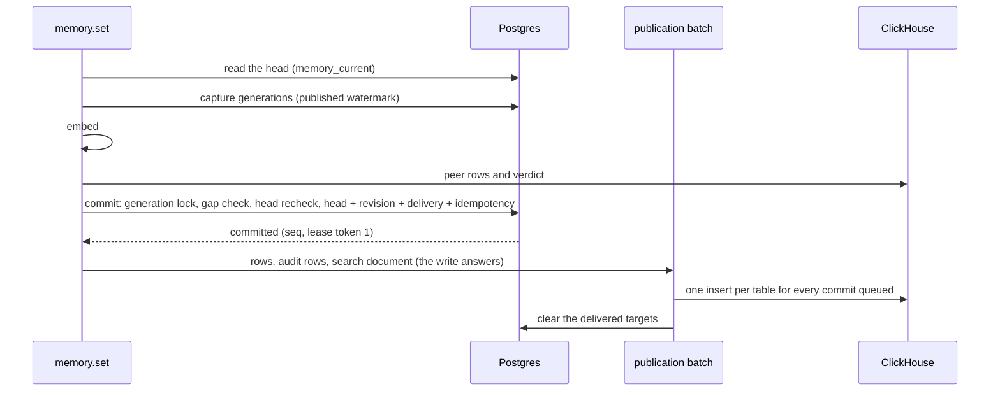

<!-- i18n: source=docs/architecture/storage-authority.md blob=ddfbb1e79149f5d1a03c9c3f7d95d4881dd6a2e6 model=claude-sonnet-5-5 -->
> Esta página é uma tradução automática da [página em inglês](https://github.com/ClickHouse/loom/blob/main/docs/architecture/storage-authority.md), que prevalece.
> Machine-translated from the [English page](https://github.com/ClickHouse/loom/blob/main/docs/architecture/storage-authority.md), which is authoritative.

# Autoridade de armazenamento: Postgres para a memória ativa, ClickHouse para a busca

O Loom funciona com uma de duas autoridades de memória, escolhida por implantação por meio de `LOOM_STORAGE_AUTHORITY`. Com `clickhouse` (o padrão), o ClickHouse guarda tudo, conforme descrito na [arquitetura de memória](https://github.com/ClickHouse/loom/blob/main/docs/architecture/memory-architecture.md). Com `postgres`, o Postgres guarda o conteúdo atual de cada chave de memória, cada revisão confirmada e o que cada revisão ainda deve ao ClickHouse, além do cabeçalho de cada documento de conhecimento ([documentos de conhecimento](#knowledge-documents)); o ClickHouse mantém todos os vetores, todas as etapas de busca, o histórico e as análises. Esta página descreve a autoridade Postgres: suas tabelas, os caminhos de escrita e leitura, a admissão sob concorrência, a idempotência, a exclusão, as falhas e os dois perfis de implantação do Postgres.

## Por que dois armazenamentos

Uma escrita de memória precisa de versões ordenadas, compare-and-set, locks e verificações de pin. Um insert no ClickHouse é uma part, e uma part custa um merge: confirmadas uma a uma, as tabelas de memória pagam esse custo a cada escrita, e dois escritores concorrentes não conseguem ver a linha um do outro antes de decidirem seus veredictos. O Postgres oferece uma transação curta com locks de linha; o ClickHouse continua fazendo o que faz bem: varrer vetores e texto.

| Estado                                                                | Armazenamento                                                                         |
| --------------------------------------------------------------------- | ------------------------------------------------------------------------------------- |
| Conteúdo atual da memória, versões, locks, pins, compare-and-set      | Postgres `loom.memory_current`                                                        |
| Journal de revisões e seus jobs de entrega                            | Postgres `loom.memory_revisions`, `loom.memory_deliveries`                            |
| Chaves de idempotência e respostas de replay                          | Postgres `loom.idempotency`                                                           |
| Gerações de escopo (admissão)                                         | Postgres `loom.scope_generations`                                                     |
| Heads de documentos de conhecimento, seus jobs de entrega, evidência de exclusão | Postgres `loom.knowledge_heads`, `loom.knowledge_deliveries`, `loom.erased_documents` |
| Jobs de ingestão de conhecimento                                      | Postgres `loom.knowledge_jobs`                                                        |
| Catálogo de datasets de conhecimento: snapshots de serviço, aprovações de schema | Postgres `loom.knowledge_datasets`                                                    |
| Vetores, busca lexical e vetorial, as linhas de memória pesquisáveis  | ClickHouse `loom.memory_embeddings`, `loom.memory`                                    |
| Histórico de revisões, trilha de auditoria, uso                       | ClickHouse `loom.memory_versions`, `loom.audit_log`, tabelas de uso                   |

O Postgres não armazena nenhum vetor. `loom.memory` e `loom.memory_embeddings`, no ClickHouse, são projeções publicadas a partir de revisões confirmadas.

Um escritor de cópia (um lock, um touch, uma marca de status, o tombstone de um delete, uma expiração) sorteia sua versão depois de sua leitura e acima da do head (`rows.version_over`), de modo que um head escrito em uma réplica cujo relógio está adiantado não o ultrapasse. O relabel da varredura de sensibilidade vai acima do head que ela escaneou e somente sobre esse head, lido com consistência forte por sua chave: um head escrito depois contém texto que seu detector não leu, ou o próprio rótulo de seu escritor, e fica para a próxima passagem ou, quando sua entrega está estacionada, até que a entrega seja repetida ([varredura de sensibilidade](https://github.com/ClickHouse/loom/blob/main/docs/architecture/security.md#sensitivity)). Um head que muda depois dessa leitura faz o commit ser recusado no Postgres, e o fence de um relabel `high` vem depois de seu commit, de modo que um relabel recusado não deixa fence acima desse head; no ClickHouse, um head inserido abaixo da versão do relabel é ultrapassado, como com qualquer escritor de cópia. A passagem de entidades e um restore sorteiam sua versão antes da leitura e a elevam acima do head lido, de modo que uma escrita que sorteie uma versão acima da deles os supera. Um valor escrito sobre um head (`memory.set`, `memory.bulk_set`, `memory.update_by_id`) também vai acima desse head, já que no Postgres o commit mantém a mais nova das duas. Os resumos consolidados
de uma fonte excluída são encontrados e avaliados na autoridade (seus heads e suas fontes vivas), e cada tombstone ou rebaixamento vai sobre um head que ainda cita as fontes avaliadas, inclusive uma cópia surgida desde então, enquanto um resumo reconstruído a partir de outras fontes é deixado como está. Seus vetores são escritos na versão de cada linha, no Postgres dentro do lease do commit: um tombstone os aposenta sem texto, e um rebaixamento copia apenas os do próprio hash de seu head (nenhum, para um head escrito antes dos hashes), de modo que nenhum deles carrega texto que a redação de outra versão possa estar apagando. No Postgres, um rebaixamento deve seu documento de busca até que o ClickHouse o tenha, caso contrário o worker de entrega o constrói; no ClickHouse, uma linha de vetor que a cópia deixou mantém seu status antigo até que `loom reconcile-status` o espelhe. Uma supersessão sorteia antes de sua leitura e não é elevada: qualquer head acima dessa versão mantém a chave, seja uma escrita sorteada depois ou uma vinda de uma réplica cujo relógio está adiantado. Uma supersessão avaliada vai uma versão acima da que leu; suas linhas de vetor recebem uma versão que o espelho de status sorteia (`mirror_status_to_embeddings(judged=True)`). Sob a autoridade ClickHouse, uma cópia é um insert simples: uma escrita com versão menor cuja linha chega entre a leitura e o insert (um valor, um delete, um relabel para `high`) é ultrapassada por ela, e nada reporta isso. No Postgres, a cópia só é confirmada sobre o head que leu (`heads_unchanged(exact=True)`), e um head escrito desde então a recusa.

## As tabelas

O schema está em `schemas/pg_migrations/` ([migrações](#migrations)). Toda chave primária de tenant começa com `org`, e o mesmo vale para todo índice de tenant, exceto os índices de manutenção das varreduras e das leituras de claim ([layout de armazenamento](https://github.com/ClickHouse/loom/blob/main/docs/architecture/storage-layout.md#postgres)).
O [layout de armazenamento](https://github.com/ClickHouse/loom/blob/main/docs/architecture/storage-layout.md) situa cada tabela, de qualquer um dos dois stores, e a onda que a move.

| Tabela                      | Chave                                                      | Contém                                                                                                                                                                                                                                                                                                                                                                                  |
| --------------------------- | ---------------------------------------------------------- | --------------------------------------------------------------------------------------------------------------------------------------------------------------------------------------------------------------------------------------------------------------------------------------------------------------------------------------------------------------------------------------- |
| `loom.authority`            | singleton                                                  | a autoridade registrada, sua época e o id do deployment                                                                                                                                                                                                                                                                                                                                 |
| `loom.scope_generations`    | `(org, scope)`                                             | o último número de revisão de um namespace, ou uma geração de política (`scope = '*'`, org `''` para a global)                                                                                                                                                                                                                                                                          |
| `loom.memory_current`       | `(org, namespace, agent, user_id, session_id, memory_key)` | o head de cada chave: a linha completa de `loom.memory` como JSON, com `memory_id`, `version`, `seq`, `content_sha256` ao lado                                                                                                                                                                                                                                                          |
| `loom.memory_revisions`     | `(org, namespace, seq)`                                    | toda linha confirmada, somente de acréscimo (uma redação limpa uma delas no lugar e, com `LOOM_PG_PAYLOAD_CLEAR_ENABLED`, a passagem de limpeza apaga o payload de uma já entregue além do horizonte: [limpeza de payload](#payload-clearing)), com sua linha de auditoria apenas com hash e seus metadados em colunas tipadas ([metadados de revisão](#revision-metadata))           |
| `loom.memory_deliveries`    | `(org, namespace, seq)`                                    | os destinos que uma revisão ainda deve ao ClickHouse (bits: 1 linha de memória, 2 documento de busca, 4 linha de auditoria, 8 o registro de uma decisão excluída, 16 os vetores antigos), seu lease e seu token de fencing; excluída quando o último destino é entregue                                                                                                                  |
| `loom.idempotency`          | `(org, key_hash)`                                          | o digest da requisição de uma op, seu estado (`running`, `committed`, `done`), as revisões que ela confirmou, sua resposta, um lease e seu token                                                                                                                                                                                                                                        |
| `loom.erased_memories`      | `(org, namespace, memory_id)`                              | evidência de exclusão: o namespace e o id de cada memória que uma erasure removeu, quando, e quando seus publicadores ficam quietos; sem conteúdo, mantida por `LOOM_PG_ERASURE_EVIDENCE_HOURS`                                                                                                                                                                                          |
| `loom.idempotency_fences`   | `org`                                                      | quando uma erasure removeu por último as respostas de replay da org: o limite do seu censo de resíduos                                                                                                                                                                                                                                                                                  |
| `loom.audit_outbox`         | `(org, namespace, row_hash)`                               | as linhas de auditoria que uma erasure removeu antes de o ClickHouse as receber, e as que um claim adiou porque o detentor que ele substituiu ainda pode inseri-las, até que a passagem de entrega as publique; chaves e ids, sem valores                                                                                                                                                |
| `loom.knowledge_heads`      | `(org, namespace, source_uri)`                             | o head de cada fonte de conhecimento: a linha completa de `loom.documents` ([documentos de conhecimento](#knowledge-documents)), e a revisão e a versão dos chunks que ela serve ([busca de conhecimento](#knowledge-search))                                                                                                                                                            |
| `loom.knowledge_deliveries` | `(org, namespace, source_uri, version)`                    | o que um commit de documento ainda deve ao ClickHouse (bits: 1 a linha do documento, sempre definido, 2 a retirada dos chunks mais antigos; publicado por inteiro), sua linha, lease e token                                                                                                                                                                                            |
| `loom.erased_documents`     | `(org, namespace, doc_id)`                                 | evidência de exclusão: o `doc_id` de cada versão de cada documento que uma erasure removeu, inclusive as do ClickHouse, recusado em um commit; sem conteúdo, mantida por `LOOM_PG_ERASURE_EVIDENCE_HOURS`                                                                                                                                                                               |
| `loom.knowledge_jobs`       | `(org, namespace, ingestion_id)`                           | cada job de ingestão: sua linha completa de `loom.knowledge_ingestions`, as colunas da fila, o token que protege as leituras e gravações da sua execução, e quando um cancelamento foi pedido ([jobs de ingestão](#ingestion-jobs))                                                                                                                                                      |
| `loom.erasure_ledger`       | `(org, id)`                                                | as erasures solicitadas ao deployment: escopo, flag de purge, urgência, hora da solicitação, hora de conclusão ou abandono de cada uma, e os passos do Postgres que foram confirmados (`pg_steps`, cada um na transação do seu passo), gravado antes do primeiro checkpoint no ClickHouse, de modo que a restauração de qualquer store executa de novo o que perdeu (`loom reconcile`); sem conteúdo, mantido por `LOOM_ERASURE_LEDGER_DAYS` |
| `loom.knowledge_datasets`   | `(org, namespace, source_uri, doc_version, dataset_id)`    | a linha de catálogo de cada dataset em uma versão de documento: o snapshot que o serve, seu schema e sua aprovação ([conjuntos de dados](#datasets))                                                                                                                                                                                                                                    |

Um head é a linha que `loom.memory FINAL` serviria: um commit o substitui apenas quando sua
versão não é mais antiga, como `ReplacingMergeTree(version)` decide. Guardar a linha inteira
mantém inalterados todos os caminhos de escrita que montam linhas de `loom.memory`
(`server/memory/store/rows.py`): todos chegam ao commit pelo mesmo funil de
inserção, `insert_memory_versions`. A linha mantém a precisão do ClickHouse (datetimes
UTC ingênuos em segundos inteiros, confidence em Float32), de modo que uma leitura do Postgres retorna o que uma leitura
do ClickHouse retornaria.

Uma linha armazenada (um head, ou o payload de uma revisão) pode omitir um campo no seu
default de `loom.memory`, os que uma primeira versão pode deixar sem definir
(`rows.FIRST_VERSION_DEFAULTS`, `pg_memory.SPARSE_DEFAULTS`): todo leitor interpreta um
campo ausente como esse default, `decode_row` em Python e `coalesce` (ou um teste que
vale para NULL) em SQL. Todos os outros campos são sempre armazenados, inclusive os que têm o valor default. Este build armazena todos os campos.

Um id de memória não é único dentro de uma org: um namespace restaurado a partir do snapshot de outro
mantém os ids de memória sob versões mais novas. Por isso, toda leitura de head por id nomeia seu
namespace (`reads.get_by_id`), e uma op endereçada apenas pelo id (`memory.get_by_id`,
`memory.update_by_id`, `memory.verify`) primeiro encontra o único namespace que contém um head vivo
dele ao qual o chamador tem acesso (`id_namespace.namespace_for_id`). Ela responde
não encontrado quando o chamador alcança mais de um, contados por acesso ao namespace, inclusive quando
o escopo de leitura do próprio usuário esconde uma das cópias, e quando o grant de algum detentor
não pôde ser lido (a requisição é então uma falha do servidor). Um namespace restaurado sobre si mesmo
sob outro agente guarda o id sob uma segunda chave; uma op por id age então sobre o head mais novo
que o contém, de modo que tal cópia é endereçada por sua chave. `memory.redact` nomeia
uma versão, que só uma linha contém, e age na chave dessa linha.

O progresso mutável das entregas fica em `loom.memory_deliveries`, separado dos payloads
de revisão, de modo que limpar um destino nunca reescreve o conteúdo de uma revisão.

### Metadados de revisão

Uma revisão mantém sua chave (`agent`, `session_id`, `memory_key`), `status`, e o horário
e o motivo da sua redação em colunas tipadas ao lado do payload (`row`). Um trigger as define
a partir de `row` sempre que um escritor de qualquer build as define, cada uma recorrendo ao
default da coluna de `loom.memory` para um campo que `row` omite, e as mantém quando `row`
é limpo, preenchendo qualquer uma ainda NULL a partir do payload que está sendo limpo. Uma revisão escrita
antes de as colunas existirem as tem NULL e seu payload no lugar, de modo que um leitor toma
cada valor da coluna ou, quando é NULL, de `row` (`pg_memory._meta`); a migração
não reescreve nenhuma revisão. Todo leitor do journal, exceto o alcance de profile (abaixo), compara
esses metadados e lê `row` apenas para o conteúdo de uma revisão, que pode ser NULL:

- uma versão antiga (as linhas reinstauradas de `namespace.rollback`, `revisions_at`) é então
  a linha de `memory_versions` do ClickHouse com a mesma chave, servida limpa quando as colunas
  dizem que está redigida, de modo que uma redação que a limpeza do ClickHouse ainda não alcançou nunca é
  servida; uma revisão que o journal não mantém mais (apagada) não é servida;
- a lacuna de uma admissão com tal revisão não é limpa do journal: a escrita
  chega de novo ao seu veredito sobre os pares lidos novamente;
- uma redação marca as colunas de tal revisão, e a limpeza do ClickHouse alcança seu texto.

Uma revisão de profile mantém seu payload para sempre: o alcance de uma redação nos profiles
derivados da memória compara `row`, o que o índice parcial
`memory_revisions_profile` serve.

Todo commit define o payload de uma revisão; apenas a passagem de limpeza de payload o apaga.

Onze índices de manutenção não começam com `org`: `memory_deliveries (lease_until)` e
`knowledge_deliveries (lease_until)` `WHERE NOT settled` (as filas dos workers de entrega
entre tenants), os mesmos dois `WHERE settled`, `audit_outbox (due_at)`,
`idempotency (expires_at)`, `erased_memories (erased_at)`,
`erased_documents (erased_at)`, `knowledge_jobs (updated_at)` e
`erasure_ledger (requested_at)` (as varreduras), e `memory_revisions_payload` (a
passagem de limpeza de payload entre tenants). Os onze são locais a um banco de dados Postgres,
e as linhas de um tenant continuam sendo encontradas por suas chaves primárias.

### Limpeza de payload

Com `LOOM_PG_PAYLOAD_CLEAR_ENABLED` (desligado por padrão), o worker `pg_payload_clear`
limpa o payload de uma revisão que todo backup do ClickHouse que uma restauração possa usar contém, mantendo
seus metadados. O journal então permanece do tamanho dos seus metadados, mais os payloads do
último horizonte, das revisões de profile, das revisões que ainda devem uma entrega e das
versões que o ClickHouse não tem, enquanto `memory_versions` do ClickHouse serve o conteúdo das versões antigas.

- **Quando uma revisão foi entregue.** Uma conclusão que esvazia uma entrega mais de
  15 minutos após o commit da sua revisão define `delivered_at` da revisão, na
  mesma instrução que exclui ou liquida a entrega; uma dentro de 15 minutos deixa o
  journal intacto. O horário de entrega de uma revisão é, portanto, no máximo
  `coalesce(delivered_at, committed_at)` mais 15 minutos; um build sem o carimbo
  quebra esse limite para o que entrega tarde, o que a
  [regra 43 de rolling upgrade](https://github.com/ClickHouse/loom/blob/main/docs/architecture/rolling-upgrades.md#the-rules) aguarda.
- **O que é limpo.** Uma passagem limpa uma revisão quando todas estas condições valem:
  - seu horário de entrega passou do horizonte;
  - ela não tem linha de entrega: uma entrega estacionada ou reparada, e uma liquidada até que a
    passagem de entrega a varra além do limite de inserção, mantêm o payload da revisão;
  - ela não é uma revisão de profile;
  - `loom.memory_versions` contém sua chave e versão com o mesmo `memory_id` e
    hash de conteúdo, lido com consistência sequencial. Uma redação mantém o hash, de modo que uma
    revisão redigida também é limpa.

  Uma versão que o ClickHouse não tem é contada (`missing_in_clickhouse` no resultado
  do worker) e mantida. A passagem lê o índice parcial `memory_revisions_payload` na
  ordem de entrega a partir de onde a última passagem parou (seu cursor em `loom.worker_status`,
  de modo que um novo processo ou cor a continua), um lote de `LOOM_PG_DELIVERY_BATCH_ROWS` por
  vez, até que um volte curto ou metade do seu deadline tenha passado. Ela limpa com
  `FOR NO KEY UPDATE SKIP LOCKED`, de modo que uma revisão que uma redação ou uma erasure segura é deixada
  para uma passagem posterior.

- **O horizonte** é `LOOM_PG_PAYLOAD_RESTORE_HORIZON_MINUTES`, nunca abaixo de
  `LOOM_CH_BACKUP_INTERVAL_MINUTES` mais 60 nem do limite de inserção mais 60.
  Em 0 (o padrão), é o dobro do intervalo de backup mais 60. Ambas as configurações são LIVE e
  lidas a cada passagem. Um processo não limpa nada até ter adotado os overrides do deployment. Por que o horizonte cobre uma restauração, e o runbook de restauração que para a
  passagem primeiro, estão em
  [backup e recuperação](https://github.com/ClickHouse/loom/blob/main/docs/operations/backup-and-recovery.md#the-postgres-journal-and-a-clickhouse-restore).
- **Após uma restauração.** Uma entrega de uma revisão limpa que ainda é o head da sua chave
  envia a linha do head de `memory_current`, a mesma versão, de modo que `loom reconcile`
  envia de novo todo head que o ClickHouse não tem ou tem em versão mais antiga. Uma revisão limpa
  já substituída não tem nada a enviar: `loom reconcile` a deixa fora de suas retenções, e uma
  entrega que ainda chega a uma (mantida como uma passagem a limpou) é estacionada no seu claim
  ([entrega](#delivery)).
- **Documentos de conhecimento** não são limpos aqui: as versões substituídas de um documento vivem
  apenas no ClickHouse depois que sua entrega é varrida.

### Layouts rejeitados

- **Uma tabela tipada com todas as colunas de `loom.memory`.** Cada nova coluna seria escrita
  duas vezes e os dois schemas divergiriam; a linha JSON é a linha que o funil já
  verifica (`check_memory_rows`).
- **Heads no Postgres com conteúdo no ClickHouse.** Toda leitura pontual precisaria de uma segunda
  consulta, e o ClickHouse permaneceria no caminho de escrita.
- **Um lock por namespace mantido durante a verificação de conflito.** Ele manteria uma conexão de banco de dados,
  ou uma transação, durante a inferência e uma consulta ao ClickHouse.

### Um banco de dados por tenant

Os tenants compartilham um schema em um banco de dados por unidade Postgres, com toda chave e
todo índice de tenant começando por `org`; um tenant que precisa de isolamento recebe uma [célula](https://github.com/ClickHouse/loom/blob/main/docs/architecture/cells.md) própria, não um
banco de dados próprio. Um banco de dados por tenant foi avaliado pelo que cada um dos seus custos cresce junto:

| Custo                 | Um banco de dados por tenant                                                                                                                                                                                                 | Schema compartilhado                               |
| --------------------- | ---------------------------------------------------------------------------------------------------------------------------------------------------------------------------------------------------------------------------- | -------------------------------------------------- |
| Conexões              | uma conexão alcança um banco de dados ([Postgres](https://www.postgresql.org/docs/16/manage-ag-overview.html)); um pool por tenant por processo: tenants × processos × 20 conexões de servidor no tamanho de pool padrão usual de um pooler | um pool por unidade                                |
| Captura de mudanças   | um slot lógico decodifica um banco de dados ([Postgres](https://www.postgresql.org/docs/16/logicaldecoding-explanation.html)): um slot e um walsender por tenant, cada um lendo todo o WAL                                    | um por unidade                                     |
| Vacuum e wraparound   | 3 workers de autovacuum por padrão para o cluster inteiro, um lançamento por banco de dados por naptime, um horizonte `datfrozenxid` por banco de dados ([Postgres](https://www.postgresql.org/docs/16/routine-vacuuming.html)) | um conjunto de tabelas                             |
| Migrações             | aplicadas uma vez por banco de dados; o advisory lock de um boot cobre um banco de dados, uma execução parcial deixa tenants em schemas diferentes                                                                           | uma transação por arquivo                          |
| Isolamento            | nenhum: o WAL, os buffers, o IO, os checkpoints e os workers de vacuum são do cluster ([Postgres](https://www.postgresql.org/docs/16/manage-ag-overview.html))                                                                | o mesmo; uma unidade separada isola                |
| Mover um tenant       | um `pg_dump` do seu banco de dados                                                                                                                                                                                           | fora de escopo ([células](https://github.com/ClickHouse/loom/blob/main/docs/architecture/cells.md#operations)) |
| Erasure               | `DROP DATABASE`, rápido, mas não em uma transação e recusado enquanto um slot usa o banco de dados ([Postgres](https://www.postgresql.org/docs/16/sql-dropdatabase.html)); backups e WAL arquivado mantêm os dados de qualquer forma | exclusão por `org` sob os locks de geração do escopo |

Sua única vantagem, mover um tenant com um dump, não compensa o resto, e ela
não isola nada que um banco de dados compartilhado não isole. Um schema por tenant tem os mesmos
custos de migração e de catálogo, e um pooler em modo de transação recusa o `search_path` de que
precisa por conexão. Um banco de dados dedicado em um cluster compartilhado para um tenant regulado
compartilha o WAL, o IO e os backups desse cluster; uma célula própria não.

### Branching de Postgres

Branches copy-on-write (um snapshot do volume, um novo Postgres sobre ele em segundos)
foram avaliados para cada lugar em que uma cópia da autoridade é feita:

| Uso                                                      | Veredito                                                                                                                                                                                                |
| -------------------------------------------------------- | ------------------------------------------------------------------------------------------------------------------------------------------------------------------------------------------------------- |
| A própria autoridade                                     | não é uma dependência: o Loom roda em qualquer Postgres 16+, e um novo branch tem um primary e nenhum standby                                                                                            |
| Testes de integração                                     | containers `postgres:16` e `postgres:18` com um standby síncrono, iniciados a cada execução, não precisam de conta nem de rede e testam o standby que um branch não tem                                 |
| Restauração em quarentena                                | uma cópia em um ponto de recuperação à qual as erasures são aplicadas antes de servir: um fork do Managed Postgres ou um cluster de recuperação sob o gerenciador de HA faz isso; um branch é uma forma mais rápida de fazer a cópia |
| Ensaiar um cutover ou uma migração com os dados de produção | o uso mais forte: uma cópia de tamanho completo em segundos; ela contém dados de produção que erasures posteriores não alcançam, de modo que vive apenas durante o ensaio; um fork point-in-time é o mesmo em qualquer Postgres |
| Um preview por pull request                              | não com dados de produção: uma cópia por mudança multiplica o que uma erasure deve alcançar                                                                                                              |

Assim, um branch é uma forma opcional de fazer as cópias de que esses procedimentos precisam, nunca uma
condição para eles.

## O caminho de escrita

1. **Leitura.** O handler lê o head da chave no Postgres
   (`memory_repo.get_by_key`, `get_by_id` e `memory_rows_by_identity_keys` leem o
   Postgres sob essa autoridade; um replay com `as_of` lê o histórico do ClickHouse).
   As proteções (lock, pin, blacklist, limite de caracteres) rodam como na autoridade
   ClickHouse.
2. **Captura.** A admissão captura as gerações de política e a marca d'água publicada do
   namespace: o último número de revisão abaixo do qual a linha de memória e o documento
   de busca de todas as revisões estão no ClickHouse, deixando de fora a de uma revisão
   estacionada e contando como presente o documento de um stub (`pg_memory.capture`).
   Nada espera aqui.
3. **Veredito.** O embedding e a verificação de conflito rodam fora de qualquer
   transação. Sob essa autoridade, `memory.set` busca ele mesmo as suas linhas de pares
   (`conflicts.peer_rows`: os pares do escritor em `_writer_scope`, as linhas do seu
   usuário quando ele indica um, e todas as fixadas) e as repassa a `check_on_commit`,
   de modo que uma rodada posterior possa acrescentar a elas.
4. **Commit.** Uma transação (`pg_memory.commit_versions`), com os locks tomados em uma
   só ordem (os advisory locks dos escopos de política, compartilhados e ordenados; depois
   as linhas de geração por `(org, scope)`; depois os heads por chave; depois as entregas
   por seq), cada lock esperado no máximo por `LOOM_PG_COMMIT_LOCK_TIMEOUT_MS`:
   - os escopos de política são mantidos de forma compartilhada até o commit (uma mudança
     de blacklist ou de acesso os toma de forma exclusiva, depois dos commits que os
     seguram e antes dos que estão na fila atrás dela); em seguida as gerações deles são
     lidas, em um comando próprio, e comparadas: uma mudança desde a captura devolve a
     escrita à sua verificação;
   - a geração do namespace é avançada pelo número de linhas, o que a trava; quando ela
     já tinha passado da capturada, as linhas gravadas no intervalo são lidas nesta
     transação e a verificação de intervalo da admissão roda sobre elas
     ([admissão](#admission-under-concurrency));
   - o head de cada chave escrita é travado e reverificado contra a linha que a escrita
     leu: nunca um delete, um pin, um lock, um status ou uma redação que a escrita não
     viu; com `if_match_sha256`, também exatamente aquela versão (compare-and-set); caso
     contrário, ele pode ter um valor mais novo (duas escritas incondicionais de uma
     chave: a versão mais nova vence, como no ClickHouse); senão a escrita recomeça;
   - os heads sofrem upsert, as revisões e suas entregas são inseridas, e a chave de
     idempotência, se houver, é marcada como `committed` com as revisões, sob o seu
     token de lease.
5. **Publicação.** O escritor entrega as linhas gravadas, suas linhas de auditoria e o
   documento de busca que construiu ao lote de publicação do seu processo
   ([publicação](#publication)), que os insere em `loom.memory` (cuja view materializada
   mantém `loom.memory_versions`), `loom.audit_log` e `loom.memory_embeddings`, junto
   com todos os outros commits na fila, e limpa esses destinos sob o token de lease de
   cada commit. Um `memory.set` de uma chave sem head vivo (uma chave nova, ou apagada
   desde então) que não declara relações e não é `high` responde assim que o commit
   retorna ([publicação](#publication)); todos os outros escritores, `memory.bulk_set`
   inclusive, esperam pelo seu flush, de modo que o que vem depois lê suas linhas no
   ClickHouse, e respondem 503 `PUBLICATION_PENDING` com `committed: true` quando o
   flush falha ou quando o seu lease (`LOOM_PG_REQUEST_LEASE_SECONDS`, menos
   `LOOM_PG_LEASE_MARGIN_SECONDS`) expira antes.

A transação não faz inferência nem consulta ao ClickHouse. Uma escrita que falhou antes
do commit não gravou nada; uma interrompida depois dele é durável e sua entrega é
concluída por outro ([entrega](#delivery)).

`memory.bulk_set` segue os mesmos passos para um lote: captura antes da sua busca de
existentes, grava todas as linhas em uma transação com o head de cada chave
reverificado, e dá o destino de documento de busca somente às linhas que têm vetor.

### Publicação

Um insert no ClickHouse de uma linha de versão é um `INSERT … SELECT FROM input()` com
fence, que o ClickHouse não consegue colocar em buffer ([inserts em lote](https://github.com/ClickHouse/loom/blob/main/docs/architecture/clickhouse.md#batched-inserts)), então um
insert por escrita é uma part por escrita. Por isso cada processo agrupa em lote a
publicação dos seus commits (`server/memory/store/pg_batch.py`). Um flush envia todos os
commits na fila desde o último, qualquer que seja o namespace e a org: um insert em cada
uma de `loom.memory` e `loom.memory_embeddings`, dividido em blocos de no máximo 100
meses de `created_at` (a chave de partição das tabelas; o ClickHouse Cloud fixa
`max_partitions_per_insert_block` em 100), e um insert em lote das linhas de auditoria
em `loom.audit_log`, e então uma transação do Postgres que limpa o que chegou. Os
flushes começam no máximo 1000 / `LOOM_PG_PUBLISH_INTERVAL_MS` (250, portanto 4; limitado
à metade de `LOOM_PG_PROJECTION_WAIT_MS`) vezes por segundo em média, até o equivalente a
um segundo (pelo menos um) de uma vez: um processo que escreve de vez em quando envia
cada escrita imediatamente, e um ocupado envia no máximo essa quantidade de inserts por
segundo em cada tabela. Um insert cria uma part para cada partição que suas linhas
abrangem, então as tabelas de memória recebem das escritas 4 parts por segundo para cada
processo servidor (cada web worker de cada réplica, e o processo dos workers) e mês de
`created_at` escrito, no padrão, qualquer que seja a taxa de escrita; a aposentadoria
de vetores antigos por um flush (`OLD_VECTORS`) e um flush recusado reenviado commit a
commit acrescentam as suas próprias.

O documento de busca é construído, e seu vetor calculado, pelo escritor antes do seu
commit, como na autoridade ClickHouse; até o seu flush ele fica retido no processo do
escritor, e o Postgres não armazena vetor. Um processo que para antes do seu flush perde
o documento, não a escrita: o worker de entrega pega a entrega quando o seu lease expira
e gera de novo o embedding do texto da revisão ([entrega](#delivery)). O dreno de
desligamento envia primeiro o que está na fila. Um flush só envia um documento enquanto
o head da sua chave ainda o serve: a revisão a partir da qual ele foi construído, ou uma
cópia mais nova dela com o mesmo conteúdo (um pin, um touch, uma marca de conflito) cuja
própria entrega não deve documento, sobre a qual o flush carrega os vetores do escritor
com as colunas e a versão da cópia, de modo que o texto não é processado de novo por
embedding. Uma chave apagada, reescrita ou redigida desde então tem a sua própria
aposentadoria ou documento, que este aterrissaria como vivo por cima. O flush encerra de
imediato o lease do seu escritor sobre uma entrega assim (`pg_memory.hand_over`), e sobre
toda entrega de um commit que o ClickHouse recusou, de modo que o worker de entrega, ou
uma busca esperando na sua barreira, construa o documento a partir do head ou o resolva
sem esperar o lease expirar. Um flush que não obteve resposta não encerra lease algum:
um insert dele ainda pode estar em execução.

Somente a escrita de uma chave sem head vivo responde antes do seu flush, pois seus
desdobramentos não precisam de nada do ClickHouse: nenhum head próprio a revisar,
nenhuma relação a proteger com fence, e a projeção de entidades dela roda ao lado da
resposta. Uma escrita posterior da chave em outra sessão a encontra do mesmo jeito: as
leituras da mesma chave (a substituição `newest_wins`, a marca de pendência do resolvedor
para uma chave mantida em outro lugar, a proteção que recusa uma proposta sobre um fato
aceito, e a verificação de `memory.delete_version` dos chunks que os valores da chave
servem, incluindo o head mais novo do próprio deleter) tomam os heads da autoridade
(`pg_memory.live_key_heads`). A deduplicação de identidade de uma escrita em massa
encontra um mantenedor dos mesmos bytes sob outra chave entre os que o ClickHouse tem e
os que ainda lhe são devidos (`pg_memory.unpublished_keepers`), cada um verificado contra
o seu head na autoridade. Uma revisão protege com fence suas arestas na sua nova linha,
uma escrita com relações protege seus fatos, e o fence de uma linha `high`
(`fence_high`) reverifica o head no ClickHouse: cada um deles espera pelo seu próprio
flush.

Todo commit em um flush é enviado sob o seu próprio lease e token, como o seu escritor o
enviaria sozinho, de modo que as garantias abaixo valem sem alteração: o flush roda sob o
lease mais antigo entre os seus commits e não envia nada de um commit cujo lease expirou
na fila; uma exclusão definitiva espera esses leases expirarem; o fence de uma redação os encerra;
um destino só é limpo sob o token do commit. Um flush que o ClickHouse recusa é reenviado
commit a commit, de modo que uma linha que ele continua recusando segura apenas o seu
próprio commit; um que o ClickHouse não responde é deixado inteiro para o worker de
entrega. Durante um rolling upgrade, um build N-1 que publica cada escrita sozinha
atende ao lado de N: ambos enviam as mesmas linhas sob os mesmos leases. As leituras do
ClickHouse do N-1 que esperam na barreira em N (abaixo) não esperam, então até o fim do
rollout o primeiro `memory.set` de uma chave respondido por N pode estar ausente delas
em uma réplica N-1 por até um flush.

Read-your-writes: `memory.get` e as demais leituras pontuais respondem a partir do
Postgres, atualizado no commit. Uma busca espera na barreira ([busca](#search)) pelo
flush, no máximo a espera de um flush e um insert depois da escrita, e o mesmo vale para
`memory.list`, `memory.history`, um replay `as_of` de `memory.get` ou
`memory.get_by_id` e o plano de `namespace.rollback`. Os fences do grafo projetam as
arestas e os fatos de uma escrita somente enquanto `loom.memory` mostra que ela detém o
seu valor (`graph_holders`): a projeção de entidades de uma primeira escrita, que roda ao
lado da resposta, primeiro espera o flush dessa escrita, até o seu lease
(`pg_batch.own_write_published`); quando o flush não chega, ela não encontra linha que
detenha o valor, como numa escrita cuja publicação está pendente, e o extrator de
entidades projeta a linha quando ela entra. Um fence lê a linha de qualquer outra escrita
como o ClickHouse a tem. Uma escrita cujo veredito grava cópias de outros heads (as
marcas de um conflito, uma supersessão, um refinamento) espera pelo flush de cada cópia,
que espera o fim do da escrita e, em um processo ocupado, o ritmo. Uma leitura somente do
ClickHouse (`memory.keys` e as outras que [exclusão definitiva](#erasure) nomeia) mostra a escrita
quando o seu flush chega.

Todo outro escritor de `loom.memory` grava por `insert_memory_versions`: um novo head
quando a sua versão não é mais antiga, uma revisão, uma entrega, a linha de auditoria.
Uma cópia de um head que ele leu grava por `lifecycle.insert_versions_over_heads`,
somente sobre a versão que leu; os escritores que não reverificam head estão listados em
[Redação](#redaction). Uma cópia que grava o documento de busca de uma linha viva (um
rollback, um restore, um Undo) o grava sob o lease do seu commit e o deve até lá, de modo
que o worker de entrega constrói um que o lease ou uma falha interrompeu. A linha de um
digest de período, que não reverifica head, grava o seu documento da mesma forma
(`lifecycle.insert_documented_versions`), e só liga a sua linhagem quando a linha e o seu
documento chegaram ao ClickHouse no seu commit, onde uma exclusão definitiva de usuário alcança a
linhagem por meio dela; uma linha deixada pendente, ou cujo documento foi recusado, fica
sem a sua linhagem até uma reescrita.
`memory.reject` e `memory.clear` gravam suas mudanças como revisões, e os vetores delas
são reemitidos na versão da revisão (um documento de busca que um escritor ainda deve,
em uma versão mais antiga, aterrissa sob eles). O TTL de tabela que uma configuração de
retenção coloca em `loom.memory` e `loom.memory_embeddings`
(`LOOM_RETENTION_MEMORY_DAYS`, `LOOM_RETENTION_MEMORY_EMBEDDINGS_DAYS`, o
`retention_days` de um namespace) apagaria apenas as cópias do ClickHouse, então ele não
é aplicado a nenhuma das duas tabelas sob essa autoridade, e o boot recusa as duas
configurações.

### Auditoria

A linha de auditoria somente com hash de cada linha gravada (`memory.revision`: chave,
id, versão, hash do conteúdo, classe de origem, status, pin, tombstone, id da requisição
e, como ator, o principal do token, senão o ator da etapa do pipeline, senão `-` dentro
de uma requisição e `process:loom` para os jobs do próprio Loom, nunca o escritor
anterior que uma cópia carrega) é construída uma vez, armazenada junto à revisão na mesma
transação e entregue a `loom.audit_log`. Ela é durável antes de a escrita responder. Uma
entrega que tenta de novo ignora as linhas de auditoria já armazenadas, por seu hash. Uma
op de escrita que deixa a sua própria linha (`memory.set`, `memory.update`,
`memory.update_by_id`, `memory.bulk_set`) ainda a deixa, com o seu veredito, ao lado
desta.

## Admissão sob concorrência

Um veredito obtido no ClickHouse pode estar errado no momento em que a escrita é confirmada: um par criado enquanto a verificação rodava não está entre as linhas que ela leu. Verificar apenas as versões dos candidatos retornados não detecta esse par, e um nível de isolamento do Postgres não rastreia um predicado avaliado no ClickHouse. O Loom o rastreia com gerações:

- todo commit em um namespace avança a geração do namespace, na mesma transação, e numera suas revisões com ela;
- uma mudança na blacklist avança a geração de política do seu escopo; uma admissão compara ambas no commit.

Quando a geração do namespace avançou, a lacuna (as revisões confirmadas depois da capturada) é examinada dentro do commit, que mantém o lock de geração, de modo que nenhum commit possa entrar nela nesse meio tempo. Um seq ausente da lacuna foi apagado, ou foi o próprio avanço da geração causado por um apagamento, e não resta nada que possa ser um par; um veredito que liga a linha escrita a uma memória removida por um apagamento (sua canônica, um conflito) é recusado no commit e obtido novamente com pares lidos de novo, qualquer que seja a lacuna:

- uma linha que não pode ser um par é descartada: outro tipo de memória, a própria chave do escritor (reverificada sob o seu lock de head), um vetor mais distante do que a verificação alcança e, para `memory.set`, também uma linha que não está live ou não está ativa, ou que está fora do escopo do escritor (`_writer_scope`) e não está fixada (`memory.bulk_set` também julga essa linha pelo vetor);
- os vetores são medidos na cópia que este processo tem dos vetores que ele confirmou, e só uma linha claramente fora de alcance (por uma margem sobre a menor precisão armazenada do ClickHouse) é descartada dessa forma;
- `memory.set` também se recusa a liberar uma lacuna que alterou um dos pares do seu veredito.

Uma lacuna liberada é confirmada na nova geração. Uma lacuna que não é liberada pelos vetores locais devolve a escrita ao seu veredito, fora da transação: `memory.set` espera as linhas da lacuna serem publicadas, mede-as na cópia do ClickHouse, adiciona as que estão ao alcance às suas linhas de pares (`pg_admission.absorb`) e chega ao veredito novamente com elas, sem reler seus pares; `memory.bulk_set` mede a lacuna do mesmo modo e recomeça se uma linha estiver ao alcance de uma entrada, ou se uma linha do tipo de uma entrada e de outra chave não tiver nenhum vetor live do modelo do embedder para medir (excluída, ou ainda não embutida com ele).

Escritas que são pares umas das outras, portanto, são confirmadas uma de cada vez, cada uma enxergando as anteriores. Um namespace cujas admissões não dão conta responde 503 `ADMISSION_CONTENDED` quando uma escrita já reverificou por `LOOM_PG_ADMISSION_DEADLINE_MS`: o excesso de trabalho é recusado, nunca enfileirado sem limite. Um head que continuou mudando responde o mesmo após `LOOM_PG_ADMISSION_ROUNDS` reinícios. Assim, um namespace não confirma mais rápido do que a implantação escreve: quando escritores concorrentes nele ficam na fila por mais tempo que o prazo, o excesso responde 503 com `retry_after_s`, enquanto a autoridade do ClickHouse responderia mais tarde. Um prazo maior troca essas recusas por latência; mais namespaces, ou mais réplicas, aumentam a taxa.

O estado baseado em tempo não é rastreado por uma geração: a passagem de um lock ou de uma expiração é julgada no commit, sobre o head como ele está naquele momento.

## Busca

O ClickHouse recupera e ranqueia; o Postgres diz o que está atual
(`server/memory/app/search/pg_validation.py`).

- **Barreira.** Uma busca captura, para cada namespace que lê, a geração atual do namespace, e só recupera depois que toda revisão até essa geração estiver publicada. Em geral nenhuma está pendente, pois um flush segue cada escrita imediatamente, ou no ritmo da publicação em um processo ocupado ([publicação](#publication)), e a barreira é uma única consulta. Caso contrário, a busca publica o que um escritor interrompido deixou, dentro de `LOOM_PG_PROJECTION_WAIT_MS` para todos os seus namespaces em conjunto, e então responde 503 `PROJECTION_BEHIND`; uma busca que esperou lê o ClickHouse com consistência sequencial. Escritas confirmadas depois da captura não movem a barreira: ela promete cobertura até esse ponto, não um snapshot entre os dois armazenamentos.
- **Validação.** Um hit de memória só é servido quando o head da sua própria chave (org, namespace, agent, user_id, session_id, memory_key) está ativo, é do tipo do hit, não está rejeitado, nem `high`, nem redigido, e a revisão da qual seu documento foi construído, a mais recente igual ou anterior à versão do documento, tem o hash de conteúdo do head. Uma mudança de tags, confiança ou expiração mantém o documento; um hit sobre outro conteúdo, sobre uma memória apagada ou expirada, ou cuja identidade a perna não leu, é descartado. Um hit que mostra a passagem de um chunk (um chunk transformado no hit da sua linha, julgado por essa linha sob qualquer tipo, ou uma linha que eleva o trecho de um chunk) só é servido quando um head ativo do escritor do chunk e da chave pai, sob qualquer sessão, ainda divide seu valor nesse chunk, como esta build o divide (uma mudança do chunker ou de `LOOM_MEMORY_SET_CHUNK_MAX_CHUNKS` descarta uma passagem até que sua chave seja escrita de novo); aquele cuja linha a perna não nomeou é julgado apenas pela sua passagem. As linhas das camadas recent-first e anchor-first são verificadas da mesma forma, mesmo em um replay `as_of` (são leituras atuais), e não são reabastecidas; uma camada não conta de novo uma versão que a verificação da página descartou, e conta as linhas que leu, antes da sua janela. Linhas promovidas (`loom.shared`), hits de chunk avulsos (`source=chunk`), resumos, registros, resumos de entidade, a perna de observação do estado atual e `memory.timeline` não são verificados, nem o restante de um replay `as_of`, que lê o histórico do ClickHouse. `memory.search_trace` espera na mesma barreira e, fora de um replay `as_of`, omite os candidatos que a autoridade não serve mais e os conta em seu `stale_dropped`, sem reabastecimento. `memory.ask` julga seu pool finalizado pela mesma regra, fora de um replay `as_of`, e descarta o que falha, sem reabastecimento e sem contagem: suas próprias pernas (injeção de identificadores, complemento de bridge e de facet) leem o ClickHouse depois que a página da busca foi verificada, e uma linha que elas adicionam carrega a identidade e a versão com que foi lida. Seu caminho rápido de precedente, que responderia antes da recuperação a partir das marcas de escrita do ClickHouse, fica desligado; um precedente só é reutilizado contra o pool verificado.
- **Reabastecimento.** Os hits descartados são substituídos pelo restante ranqueado, em uma rodada de no máximo uma página, sem os limites por chave, por sessão e por token do assembler; o `stale_dropped` da resposta os conta, de modo que uma página curta diz por quê. Uma página estacionada é verificada da mesma forma e lê além das suas linhas obsoletas, até quatro para cada hit ainda faltante; o resto fica para a página seguinte. Seu total continua sendo o da lista estacionada.

## Entrega

Uma linha de entrega é criada junto com o commit e cedida (lease) ao writer por
`LOOM_PG_REQUEST_LEASE_SECONDS` sob o token 1. Uma entrega cujo lease expirou é assumida
sob o token seguinte por:

- o worker `pg_delivery`, a cada passada (`LOOM_PG_DELIVERY_*`), começando pelo lease mais antigo, com
  `FOR UPDATE SKIP LOCKED`;
- uma admissão que precisa do backlog do namespace publicado
  (`pg_admission.wait_searchable`), para o próprio namespace.

Ambos publicam a partir da revisão commitada: a linha de memória, a linha de auditoria e, para uma
escrita pesquisável, o documento de busca, gerado com embedding ali a partir do texto da revisão, a menos que o ClickHouse já contenha o documento que o seu writer construiu naquela versão. Um documento construído
aqui recebe o embedding a partir do texto da própria revisão: uma entrada de `memory.bulk_set` cujo writer
gerou o embedding com um prefixo contextual recebe o vetor do texto simples, o mesmo que
`memory.set` teria produzido. Os claims são publicados um namespace por vez, e um a um
quando o lote de um namespace falha, de modo que uma revisão que o ClickHouse continua recusando segura
apenas a si mesma. Após `LOOM_PG_DELIVERY_MAX_ATTEMPTS` publicações com falha (uma linha recusada, uma
instrução do Postgres recusada, um lease que expirou durante a publicação), uma entrega que deve
o documento de busca e não a linha de memória publica um stub que o worker de embedding preenche;
qualquer outra é estacionada (parked): deixa de ser reivindicada, fica fora da marca d'água de publicação e é contada
por `GET /v1/health?include=postgres` (`postgres.parked_deliveries`). Uma entrega cujo
payload da revisão foi limpo ([limpeza de payload](#payload-clearing)) envia a linha head da sua chave
quando a revisão ainda é a head; caso contrário, não tem nada a enviar e é estacionada
na reivindicação, com `last_error` "payload cleared, nothing to send" (o que fazer:
[operações do Postgres](https://github.com/ClickHouse/loom/blob/main/docs/operations/postgres.md#what-the-boot-checks)). Uma publicação que
encerra o processo do worker também conta: um claim é marcado como iniciado logo antes da sua
publicação e a marca é removida com o resultado, de modo que a passada seguinte conta como tentativa um claim ainda marcado,
o publica sozinho e o estaciona ao atingir o limite (uma entrega que deve apenas o
documento de busca recebe o stub, e é estacionada se esse stub também encerrar o processo).
O worker interrompe uma passada entre namespaces, e entre os claims que publica um a um
ou transforma em stub após esgotar as tentativas, quando um lease já se passou, de modo que o seu prazo corta apenas
uma publicação lenta por si mesma. Uma passada que termina sem resultado para um claim remove a marca dele
e não conta nada: um cancelado (o prazo do worker, um desligamento) antes de a publicação
desse claim começar, ou interrompido por uma indisponibilidade do Postgres. Uma publicação que o worker estava executando
quando a passada foi cancelada mantém a marca e conta (cada claim de um lote conta então
uma tentativa e passa a ir sozinho), assim como uma cujo lease expirou; uma admissão que ajuda com o
backlog de um namespace libera tudo o que reivindicou. O ClickHouse não recusou nada quando
responde com um estado que se resolve sozinho (um backlog de merges, uma tabela somente leitura, Keeper
perdido, consultas demais, um insert de status desconhecido, o servidor sem memória
como um todo), quando todas as conexões do pool estão ocupadas, ou quando uma publicação falha na conexão
e o ClickHouse então não responde a um probe: a passada para. Uma falha de conexão enquanto
o ClickHouse responde, um timeout e um bloco de insert que abrange partições demais são problemas
das próprias linhas e contam, de modo que um lote que sempre falha assim é tentado linha a linha e uma linha
que continua falhando é estacionada. Uma segunda cópia de uma linha é inofensiva: ambas as tabelas do ClickHouse
são `ReplacingMergeTree(version)` e cada linha mantém a versão da sua revisão, então uma cópia
colapsa na primeira e uma tardia nunca supera uma escrita mais nova. Apenas o detentor do token atual
limpa um alvo, de modo que um publicador ultrapassado não pode marcar como concluído o trabalho de um claim mais novo.

### Somente revisões duráveis são publicadas

Um commit cuja espera pelo standby síncrono foi cancelada (um timeout do cliente, um cancelamento) está
commitado apenas no primário e visível para todas as sessões ali; um failover o perde
e o novo primário numera outra revisão com o seu `seq`. Por isso uma linha só chega ao
ClickHouse depois que os standbys síncronos a possuem. Uma linha só se torna visível depois que
a espera de standby do seu próprio commit terminou, de modo que um commit posterior que escreve WAL e retorna da
sua própria espera cobre todas as linhas que a sua transação leu.

- Um claim do worker de entrega, do outbox de auditoria ou do worker de entrega de conhecimento é
  um UPDATE das linhas que reivindica, então o seu commit espera pelos standbys (o timeout de instrução
  não cobre a espera de standby de um commit); o timeout de comando do cliente cancela
  uma espera que o excede e gera um erro, e nada do que foi reivindicado é enviado.
- O flush de um writer envia os seus próprios commits, que retornaram da espera, e um
  documento construído sobre uma cópia mais nova da sua linha, que ele relê de forma durável antes; uma
  cópia que a leitura durável não encontra mais vai para a sua lista `stale`, para o worker de entrega
  decidir.
- Uma head de chave que não é a revisão reivindicada por uma entrega (mais nova, redigida ou removida),
  e os writers de decisão ativos que uma aposentadoria de registro mantém, são commits de outras sessões.
  Eles são relidos em `pg.durable_transaction()`; o seu COMMIT carrega uma mensagem
  lógica transacional (prefixo `loom.durable`), então espera pelos standbys na
  conexão que fez a leitura. O documento é construído ou resolvido a partir dessa leitura: uma
  cópia (um pin, um touch) tem um documento construído sobre ela; um delete, outro conteúdo, uma
  redação ou um apagamento resolve o documento reivindicado sem enviá-lo.
  A leitura é tornada durável na sua própria conexão porque o commit de resolução, em
  outra, não poderia cobri-la: após um failover ele marcaria o documento como concluído em um
  primário onde a revisão reivindicada volta a ser a head.
- `decision.record` verifica os seus writers dessa forma depois que o seu registro é gravado, e um delete de uma
  decisão aposenta o seu registro dessa forma no seu flush, de modo que cada um espera mais um
  round trip de standby.
- Uma versão de job de conhecimento que o ClickHouse não possui é projetada novamente pela execução de ingest somente quando
  `pg_jobs.get(..., durable=True)` retorna a mesma versão: uma que apenas o primário possui
  voltaria por `pg_jobs.adopt` depois que um failover a perdesse.

A regra para qualquer caminho: um envio ao ClickHouse alimentado por uma leitura do Postgres envia apenas o que o
chamador commitou ou reivindicou, ou lê de forma durável antes. Uma decisão que apenas altera o estado
do Postgres é coberta pelo seu commit quando a transação que a commita também fez
a leitura.
`tests/unit/test_pg_durable_reads.py` fixa cada chamador de uma leitura de journal com o motivo
pelo qual ela é válida.

A garantia vale quando um failover promove um standby do conjunto síncrono que possui
a maior posição de flush, o que um gerenciador de HA estrito faz
([operações do Postgres](https://github.com/ClickHouse/loom/blob/main/docs/operations/postgres.md#self-hosted-postgres)). Um gerenciador que
não é estrito esvazia `synchronous_standby_names` quando o seu standby cai; os commits passam então a ser
somente do primário, como sob `LOOM_PG_DURABILITY=local` sem nenhum standby nomeado: um
failover pode perder escritas confirmadas, o ClickHouse pode manter as suas linhas, e o reconcile
após uma restauração as remove.

Com o standby desanexado, um claim espera até `LOOM_PG_STATEMENT_TIMEOUT_MS` mais um
segundo e a passada termina como em uma indisponibilidade do Postgres; um claim cuja espera foi cortada mantém
as suas linhas com lease até `LOOM_PG_DELIVERY_LEASE_SECONDS` terminar depois que o standby volta,
e as buscas nesses namespaces esperam por isso na barreira. Uma redação ou um apagamento que trava
uma entrega reivindicada espera atrás desse commit até `LOOM_PG_COMMIT_LOCK_TIMEOUT_MS` e então
responde com o seu 503 repetível, como o seu próprio commit faria enquanto o standby está fora.

## Idempotência

Nesta autoridade, uma `Idempotency-Key` é uma linha de `loom.idempotency`, identificada por
`(org, sha256(v3, org, subject, op, key))`, como na autoridade ClickHouse, e falha de forma
fechada (Postgres fora do ar resulta em 503).

| A linha da chave                            | Uma requisição com a chave recebe                                                                                                                                                                                                                            |
| ------------------------------------------- | ------------------------------------------------------------------------------------------------------------------------------------------------------------------------------------------------------------------------------------------------------------ |
| nenhuma, ou expirada                        | ela é executada, mantendo a linha (`running`, um lease de 60 s, um token)                                                                                                                                                                                    |
| outro digest de requisição                  | 409 `IDEMPOTENT_CONFLICT`                                                                                                                                                                                                                                    |
| `done`                                      | a resposta armazenada                                                                                                                                                                                                                                        |
| `running` ou `committed` sob um lease ativo | 503 `IDEMPOTENT_IN_PROGRESS`, com nova tentativa possível                                                                                                                                                                                                    |
| `committed`, lease encerrado                | 200 com a identidade das revisões confirmadas (`memory_id`, `version`, `content_sha256`, `memory_key`) e `idempotent_replay: committed`; para `memory.bulk_set`, `written` nomeia as linhas que o lote confirmou, em sua ordem de commit, e não um resultado por entrada |
| `committed`, uma exclusão removeu uma revisão | 404 `RESOURCE_NOT_FOUND`, para a requisição inteira                                                                                                                                                                                                       |
| `running`, lease encerrado                  | ela é executada, sob o próximo token                                                                                                                                                                                                                         |

O commit marca a chave como `committed` na mesma transação das revisões, e somente sob o
token que a sua requisição detém: uma requisição que foi substituída por uma nova tentativa
não pode mais fazer commit sob a chave e responde 503 `IDEMPOTENT_TAKEN_OVER`. Uma requisição
que responde sem fazer commit exclui a sua reserva, de modo que uma nova tentativa é
executada imediatamente. As chaves são mantidas por 24 horas; uma nova tentativa depois
disso é uma nova requisição.

## Apagamento

O primeiro passo que apaga é `pg_memory.delete` (`server/erasure/store/steps_pg.py`);
o apagamento de um namespace apenas interrompe, antes dele, as fontes de documentos do namespace. Em uma
transação, `pg_memory.delete` avança a geração de cada namespace afetado (o que
o bloqueia, de modo que os commits do escopo esperam, e um veredito em andamento que vincula uma memória que ele
removeu é alcançado novamente), move as linhas de auditoria que o ClickHouse ainda não tem para
`loom.audit_outbox`, apaga as revisões do escopo (e com elas
suas entregas) e os heads, e lê o lease mais recente entre as entregas que removeu.
Em seguida espera até que todo publicador que mantinha um tenha parado: um publicador não envia nada
além do seu lease, todo insert que ele enviou começa no servidor dentro de uma margem de trânsito
do fim do lease (um posterior é recusado, com tabela transportada ou não), e ele executa por no máximo
o limite de escrita (o timeout de escrita do ClickHouse, ou 60 s quando é 0). O que a espera
cobre é o que a autoridade publica: as linhas de memória, os documentos de busca, as linhas de auditoria,
os registros de decisão e as retiradas de vetores antigos que suas entregas devem. As cópias no ClickHouse
das linhas de busca feitas por uma escrita depois de sua publicação (a retirada de vetor de um delete ou de uma expiração, um fence, um lift, um espelho de status ou de expiração) e
o que é derivado dela (a projeção do grafo, o julgamento de conflitos, os workers
em segundo plano) são escritas como quaisquer outras: uma que dispute com um apagamento do seu escopo é a corrida
em que ela se encontra sob a autoridade ClickHouse, e os passos do apagamento no ClickHouse e o censo de resíduos
cobrem o que chega antes do censo. Uma entrega que outro detentor assumiu e concluiu é
mantida como liquidada até que esse limite tenha passado após o seu lease e o seu `fenced_until`,
pois o publicador que ela substituiu ainda pode estar enviando, então o apagamento também espera por ela;
uma entrega estacionada (parked) é esperada até o seu `fenced_until`, o último momento em que um detentor que não
a detém mais pode enviar (o lease do seu último detentor quando um claim a estaciona, ou o
momento de uma publicação com falha). Os passos do ClickHouse rodam depois dessa espera, que faz parte da
resposta de `erasure.request` quando ele executa a saga: cerca de 80 s após o lease mais recente
com as configurações padrão. A evidência de cada id removido em `loom.erased_memories` mantém
`quiet_at`, quando nenhum publicador do que aquela execução removeu pode ainda gravar uma linha: uma execução
que encontra as linhas já removidas (uma anterior as apagou e parou antes de
sua espera) espera até esse momento: para um escopo de namespace, a evidência daquele namespace; para o de um usuário,
a da org, que não nomeia usuário, de modo que a espera de outro apagamento na org também é aguardada.
O passo de idempotência isola (fence) os claims em andamento da org (um novo token: nenhum deles
armazena uma resposta) e registra quando em `loom.idempotency_fences`, mantendo o lock de claims da org
apenas durante essas duas instruções; uma requisição que encontra o lock responde
`IDEMPOTENT_IN_PROGRESS` e tenta de novo. Em seguida apaga as respostas reivindicadas antes desse
momento, que o censo também conta; uma nova tentativa que assume um claim isolado reinicia seu
`created_at`, de modo que sua resposta não é resíduo.

A trilha de auditoria sobrevive à memória, e o apagamento não espera o ClickHouse
recebê-la: a passagem de entrega publica o outbox quando nenhum publicador dessas linhas
pode ainda gravá-las, um namespace por vez, ignorando uma linha já presente em `loom.audit_log`,
e apaga o que publicou. Uma linha recusada é contada e repetida, e estacionada após
`LOOM_PG_DELIVERY_MAX_ATTEMPTS` (`postgres.parked_audits` em
`/v1/health?include=postgres`); um ClickHouse indisponível, ou um claim que expirou,
não conta nada. O outbox guarda chaves e ids, nunca valores, como `loom.audit_log`. Uma
entrega reivindicada dentro do limite de insert do lease (ou fence) que ela substituiu envia
sua linha de auditoria da mesma forma, devida quando esse detentor não puder mais gravá-la, de modo que a
leitura de `loom.audit_log` pelo claim não pode perder uma cópia ainda em trânsito e gravar a linha duas vezes.

A mesma transação guarda o namespace e o id de cada memória que removeu em
`loom.erased_memories`; por namespace, pois um namespace restaurado a partir do snapshot de outro
mantém os ids de memória. Uma escrita construída a partir de um head lido antes do apagamento (um touch, um pin,
um worker) é recusada no seu commit com 404, após o lock de geração que o apagamento manteve,
de modo que não pode trazer a memória de volta. A evidência dura `LOOM_PG_ERASURE_EVIDENCE_HOURS`,
julgada pela sua idade no ponto em que é lida; o worker de entrega varre as linhas expiradas para recuperá-las,
e uma recusa nunca espera essa varredura. Um apagamento de um id cuja evidência expirou
a inicia novamente. Um `namespace.restore` no namespace deixa de fora as
memórias do snapshot cuja evidência é mantida (suas linhas não podem ser distinguidas das de um
escritor obsoleto), restaura o restante e conta as deixadas de fora em `counts.erased_skipped`. Uma
repetição desse `snapshot_id` não grava nada, portanto não as traz de volta (dois
restores do mesmo snapshot ao mesmo tempo gravam ambos, e a evidência deixa as memórias de fora de
cada um); um snapshot restaurado pela primeira vez depois que a evidência delas expira as grava, como todo
restore sob a autoridade ClickHouse, que não mantém evidência. A evidência de exclusão
protege apenas os namespaces dos quais o apagamento removeu a memória, e apenas enquanto é
mantida: um snapshot tirado antes de um apagamento traz suas memórias de volta a qualquer outro
namespace, em qualquer das autoridades; execute o apagamento novamente após tal restore. Um restore
faz commit em lotes de `LOOM_PG_RESTORE_BATCH_ROWS`, cada um dentro do lease de uma requisição; quando
a publicação de um lote está pendente, os demais são apenas commitados, reivindicáveis pelo
worker de entrega imediatamente, e o restore termina com `publication_pending`: até que o
worker as tenha publicado, uma busca ou uma escrita semântica no namespace responde
`PROJECTION_BEHIND` após a sua espera. Um apagamento que chega entre a verificação do restore e um
lote recusa esse lote com 409 `PRECONDITION_FAILED`: os lotes anteriores permanecem,
e a nova tentativa grava todas as memórias novamente, sem essas. Uma memória que o apagamento não
removeu (uma apagada antes de ele executar) e que um restore grava enquanto o apagamento ainda está
em execução é resíduo das linhas do próprio escopo e faz a saga falhar, sendo executada de novo.

O censo de resíduos conta `pg:loom.memory_current`, `pg:loom.memory_revisions` e
`pg:loom.idempotency` junto com as tabelas do ClickHouse, sobre as linhas do próprio escopo: um id apagado
não pode voltar enquanto sua evidência é mantida, pois seu commit é recusado. Os dependentes
consolidados de um usuário (os resumos que uma tag `src:` pareia com uma chave que o usuário escreveu no
namespace da linha) são contados no ClickHouse, com seu histórico, chunks, vetores de entidade
e links de grafo ([saga de apagamento](https://github.com/ClickHouse/loom/blob/main/docs/architecture/memory-architecture.md#erasure-saga)), e não no
Postgres. Uma tabela do Postgres que não guarda conteúdo de memória é listada com seu motivo
(`PG_NO_MEMORY_CONTENT`). Sob a autoridade ClickHouse a saga não tem passo no Postgres
e o censo não tem linhas do Postgres.

Sob a autoridade Postgres, `namespace.snapshot` lê os heads que a autoridade mantém,
de modo que um delete que o ClickHouse não publicou, ou nunca publicará (uma entrega estacionada), não é
incluído no snapshot. As contagens de memória de `namespace.inventory` leem o ClickHouse quando ele mantém todas
as revisões commitadas até então, na mesma barreira de uma busca (503 `PROJECTION_BEHIND` após
sua espera), e depois o leem sequencialmente; uma entrega estacionada não é esperada. Os relatórios
de diagnóstico (`namespace.audit`, `namespace.validate`, `namespace.tune`,
`memory.inspect`, e as contagens de decisão e achados de memória de `knowledge.inspect`) começam
na mesma barreira, mas uma espera que se esgota, ou um Postgres que não responde, não
os faz falhar: eles leem o que o ClickHouse mantém e nomeiam `projection` em `skipped`, e audit e validate também em
`coverage`, que então não é `complete`. Como a de uma busca, a espera
pode publicar as entregas expiradas de outro escritor. Um achado cita uma linha amostrada
somente enquanto ela for o head vivo da sua chave na versão que o ClickHouse leu, no mesmo
estado de redação, com o hash do valor que `memory.get` serve ali; uma linha reescrita,
apagada ou redigida desde então não é citada. Um `memory.set` de uma chave sem head vivo, uma
cópia de um head que seu escritor leu (`lifecycle.insert_versions_over_heads`: uma tombstone, um
status, um pin, um touch, as substituições e cascatas de qualquer escrita), `memory.reject`,
`memory.clear` e a linha de um digest de período estão concluídos assim que commitados, mesmo quando
sua publicação está pendente: o worker de entrega os publica, uma busca serve um resultado somente
enquanto o head da autoridade mostra seu conteúdo, e uma leitura pontual responde a partir da
autoridade. A escrita prossegue como na autoridade ClickHouse, onde uma linha, uma vez inserida,
permanece: o que ela derivou é retirado, seu webhook é enviado, e um acompanhamento no ClickHouse que
falha responde com seu próprio erro. Uma escrita por id é confirmada pelo seu commit, que mantém a
versão mais nova: uma linha mais antiga que o head de que foi lida é superada. Toda outra
escrita responde 503 `PUBLICATION_PENDING`. `memory.bulk_get` (e a exportação OKF, que
lê valores por meio dele) responde a partir dos heads da autoridade, como `memory.get`, e
o mesmo vale para a seção de memória de `erasure.export`. `memory.list`, em qualquer ordem, começa quando
o ClickHouse mantém toda linha de memória que o namespace commitou, na barreira de uma busca (503
`PROJECTION_BEHIND` após sua espera; uma reprodução `as_of` também, já que o histórico que ela lê
só contém uma escrita depois de gravada), de modo que uma escrita é listada assim que respondeu. Ele serve
uma linha do ClickHouse somente enquanto ela for o head vivo da autoridade naquela versão, redigida ou
não (`lifecycle.served_rows`), de modo que um delete, uma reescrita ou uma redação que o ClickHouse
não publicou não é lido de volta.

As leituras em segundo plano cujas linhas vão para um modelo, ou para uma linha derivada simples, seguem
a mesma regra; duas delas também mantêm a linha do ClickHouse enquanto o head da autoridade é apenas
uma cópia dela. Uma linha de período recebe as entidades de uma fonte, como o ClickHouse as leu, somente quando
o head da autoridade é a linha lida ou uma cópia dela com o mesmo id e texto, ativa
e não `high`; uma linha de período escrita enquanto uma fonte é deixada de fora fica sem
as entidades dessa fonte até que o período seja reescrito, pois uma passagem posterior ignora um período
já escrito, a menos que se peça para reescrevê-lo. Sob o Postgres um período conta como escrito
quando a autoridade mantém seu head, antes de o ClickHouse ter a linha. Uma passagem que não consegue ler
as fontes de um período não escreve período, e uma passagem posterior o escreve.
O contexto de sessão do extrator de observações mantém a linha do ClickHouse, datas incluídas, enquanto o head
ainda é uma observação que sua instrução seleciona (portanto não `high`) com o mesmo id e texto,
como uma que uma passagem anterior marcou como DONE; o lote que ele destila é lido a partir dos
heads da autoridade, como o de um escritor de cópia ([Redação](#redaction)). O resolvedor de conflitos
deixa de lado uma linha com um par sinalizado cuja entrega o ClickHouse não publicou, sem
chamada ao modelo e sem tentativa contada, por `LOOM_PG_DELIVERY_LEASE_SECONDS` por vez. Um
perfil estruturado construído sem os fatos que contou é lido como `stale` e é construído
novamente após o cooldown, uma chamada ao modelo a cada vez enquanto um fato continuar atrasado. Uma
construção estruturada que não recebeu nenhum dos fatos que contou não faz chamada ao modelo: ela substitui um
perfil servido pelo perfil todo `null`, escrito novamente após cada cooldown, e não escreve
nada para um usuário sem perfil servido.

Até que uma entrega estacionada seja concluída (`postgres.parked_deliveries` em
`/v1/health?include=postgres` as conta), as linhas que essas regras deixam de fora continuam fora
das leituras em segundo plano, e o mesmo vale para uma linha do resolvedor cujo par sinalizado está nessa
entrega. Um usuário sem perfil servido cujos fatos estão todos atrasados é ordenado junto com os outros usuários
que não têm perfil sob o schema, à frente dos demais, e uma passagem lê os fatos desse usuário
uma vez por varredura do namespace, sem chamada ao modelo. Enquanto as entregas desses fatos estão
estacionadas, esses usuários podem preencher a parcela desse namespace em
`LOOM_STRUCTURED_PROFILE_MAX_USERS_PER_PASS`, e o que sobra para a passagem, a cada passagem
até que a lista de varredura passe por eles; enquanto eles preenchem uma varredura inteira, os outros usuários do namespace
esperam pelas entregas.

Uma listagem de recuperação (`include_tombstoned`) verifica também as linhas apagadas, e lista uma linha que a
autoridade apenas apagou desde então (nada em que ela filtra mudou: as colunas que lê, um
filtro de trace ou de status; nunca sob `as_of`) como esse head apagado, com a prévia do texto
do ClickHouse (`lifecycle.recovered_rows`); uma linha restaurada, ou alterada de outra forma,
desde a cópia do ClickHouse entra em qualquer uma das listagens quando o ClickHouse a mantém. Abertas
contra o portão de isolamento: leituras apenas do ClickHouse, entre elas `memory.keys`, `memory.statuses`,
`memory.related`, as sementes recentes da caminhada no grafo e
`memory.aggregate`, mostram uma escrita que a autoridade mantém quando ela é publicada. O escritor de um registro
de decisão conta como vivo somente se a autoridade mantém seu
head de decisão; se uma decisão viva ainda está proposta é lido apenas do ClickHouse.

A varredura da blacklist espera até que o ClickHouse mantenha as linhas de memória commitadas no
escopo do padrão (503 `PROJECTION_BEHIND` após sua espera), faz a correspondência ali com uma leitura sequencial,
e depois percorre página a página os heads vivos cuja linha de memória o ClickHouse continua recusando (uma
entrega estacionada) na ordem de chaves das entregas, de modo que uma varredura demora mais com o backlog
estacionado que `GET /v1/health?include=postgres` relata. Ela julga cada head que a autoridade
mantém com a mesma correspondência RE2 antes de aplicar a tombstone, e deixa um head cuja versão é
superior à da tombstone. Seu `matched` conta o que o ClickHouse encontrou e os heads estacionados
que ela marcou com tombstone. Uma consulta de correspondência que falha é respondida em `error`. Uma falha durante a aplicação de tombstones
é o erro da chamada até que uma linha possa ter sido gravada, e depois disso a varredura responde o que
foi gravado, com `error` definido; `blacklist.add` relata qualquer um dos casos em `sweep_error` com o padrão
mantido. Um commit cuja resposta foi perdida pode ter sido concluído: suas tombstones estão na
autoridade, cada uma com sua linha de auditoria, e a resposta não as conta; seus
eventos `memory.tombstoned` e a contagem de `memory_drops` não são enviados.

O registro de uma decisão apagada é retirado quando sua tombstone é commitada, como alvo de
uma entrega própria (`DECISION_RECORD`, separada da linha de memória pela qual uma busca espera):
a publicação da requisição ou o worker de entrega o retira
(`pg_publish.retire_decision_records`), de modo que um commit cuja resposta foi perdida perde seu registro
também. A retirada mantém um registro cujo escritor a autoridade mantém vivo e copia apenas
registros abaixo de uma versão que ela gera logo antes de ler os escritores vivos (dentro da defasagem de relógio
dos hosts, como toda versão), de modo que uma decisão registrada novamente desde então mantém seu registro. Sua
cópia no ClickHouse começa dentro de um prazo que o servidor verifica no seu próprio relógio, dentro da
margem de trânsito do fim do lease, como todo insert sob um lease, de modo que nunca
chega depois de um apagamento ter esperado seu publicador. Uma que falha continua devida, é
contada e é estacionada por conta própria em `LOOM_PG_DELIVERY_MAX_ATTEMPTS`. Sob a autoridade
ClickHouse um delete retira o registro por si mesmo, e a atualização in-place de `memory.clear`
não retira nenhum.

Um commit cuja linha não é embedded (feita 'high', ou de um tipo que não é pesquisável)
sobre um head que era embedded deve a retirada dos vetores desse head da mesma forma
(`OLD_VECTORS`), em todo caminho de escrita: o commit decide isso a partir do head que ele trava,
seja qual for a versão que a escrita leu. A publicação os retira depois que as linhas entraram e
limpa o alvo; quando isso falha a resposta é `PublicationPending`, e o worker de entrega
os retira sob o seu lease. De qualquer forma, uma redação da chave pode estar expurgando
essas linhas enquanto a retirada está em andamento, de modo que suas tombstones mantêm apenas a chave de
ordenação e a partição de cada linha, sem texto nem vetor, e executá-la duas vezes não muda nada. Um
`memory.restore` da linha apagada de tal chave espelha uma linha sem texto nem vetor, e uma
reprodução `as_of` de antes da retirada não encontra o vetor da chave.
Na autoridade ClickHouse uma retirada copia as linhas retiradas como tombstones, de modo que um
restore e uma reprodução mantêm seus vetores.

O worker de entrega constrói um documento de busca enquanto o head da chave é a revisão, ou uma
cópia mais nova viva, embedded e não redigida do mesmo conteúdo (um pin, um touch, um status),
que não deve documento próprio: o documento é então construído a partir da linha desse head, com seu status
e tags. Sob qualquer outro head mais novo ele não constrói nenhum, pois um pousaria vivo acima da retirada desse head.

`memory.import` decide o que ignorar a partir dos heads da autoridade.

## Redação

`memory.redact` apaga o texto da versão nos heads e no journal de revisões em uma única transação (`pg_memory.redact`). A mesma transação bloqueia as entregas das revisões apagadas, lê quanto tempo resta de seus leases e as isola (fence): um novo token e um lease encerrado, de modo que um publisher que ainda tenha um deles não consegue renová-lo nem concluí-lo, e a próxima reivindicação publica a revisão apagada. O lease encerrado é mantido (`fenced_until`): seu titular ainda pode estar enviando o texto antigo até esse momento. Uma nova tentativa, que também lê as entregas das cópias que a primeira chamada apagou, espera esse prazo, assim como o faz um apagamento do escopo. A varredura mantém uma entrega concluída até que `fenced_until` e o limite de inserção tenham passado. Uma entrega estacionada continua estacionada; o `fenced_until` dela, o último momento em que seu último titular pode enviar, é o que a espera cobre, e a limpeza no ClickHouse cobre o que o ClickHouse já tem. Essa limpeza roda quando todos os titulares foram esperados, como um apagamento espera (`pg.wait_out`): `memory.redact` responde depois dessa espera, que, com as configurações padrão, chega a cerca de 80 s após o lease de um publisher que mantinha uma entrega da chave, incluindo o lease de entrega de 30 s quando o worker de entrega a mantinha.

Uma redação toma primeiro o lock de geração do namespace, como faz um commit, de modo que nenhum commit entra entre suas instruções, e age sobre a chave da versão que nomeia (um namespace restaurado de outro, ou para si mesmo sob outro agente, mantém o id da memória sob outras chaves e versões novas). Ela verifica de novo o head vivo da chave dentro da transação, sob o lock de linha do head, com os locks que verifica: um head escrito ou restaurado desde então responde 503. Uma escrita que reverifica o head que leu trata uma redação ocorrida desde então como um head que se moveu: `memory.set`, `memory.bulk_set` e `memory.clear` recomeçam a partir do head apagado, e `memory.update_by_id` responde 503 `ADMISSION_CONTENDED`, e sua nova tentativa lê o head apagado. Um head apagado mantém seu hash de conteúdo, e a busca não o serve até que seja escrito de novo; um valor novo escrito por cima dele não é redigido.

Um delete, um restore e todo escritor de cópia copiam o head que leram, de modo que as versões da chave imediatamente posteriores à redigida carregam seu texto até que a chave tenha outro texto (uma reafirmação do mesmo valor também é uma cópia) ou até que seu head vivo seja alcançado: elas são apagadas junto com ela (`redaction_lineage`), e um restore de uma chave assim removida responde `redacted: true` e não escreve nada. O texto escrito de novo depois é alcançado redigindo essa versão posterior. A versão nomeada recebe o horário e o motivo da última redação; uma cópia mantém o primeiro. Uma nova tentativa nomeia todas as cópias de novo, então alcança um armazenamento que uma chamada com falha deixou, e `memory.redacted` é anunciado de novo para cada uma. Os escritores de cópia (um lock, um touch, um unpin, um verify, um move, uma expiração, o tombstone de um delete, uma marca de status, uma supersessão, um tombstone em cascata, um label ou demote por `memory.apply`, a decisão de uma proposta, uma tag de entidade ou de crystallize, um restore) são construídos a partir do head que a autoridade mantém (`lifecycle.current_heads` quando a leitura foi do ClickHouse, deixando de fora uma linha cujo head avançou desde então, a menos que o head mais novo ainda se qualifique) e fazem commit apenas sobre essa mesma versão: um valor, um delete, um pin, um lock, um status ou uma redação desde então responde 503 `ADMISSION_CONTENDED`, para a chamada inteira, e a nova tentativa lê o head mais novo. `namespace.rollback` faz commit um lote por vez sobre os heads lidos logo antes, de modo que um head que se moveu responde 503 com os lotes anteriores já escritos, o que a linha de auditoria contabiliza. Uma nova tentativa planeja de novo a partir dos heads como estão: uma chave que um lote anterior já devolveu ao conteúdo antigo é escrita de novo, como uma nova versão do mesmo conteúdo. Sob Postgres, ele planeja a partir do histórico do ClickHouse quando o ClickHouse já tem todas as linhas de memória que o namespace confirmou (503 `PROJECTION_BEHIND` após a espera), de modo que uma chave escrita pouco antes também é planejada, e lê cada versão que restabelece a partir das revisões da autoridade, que uma redação apaga antes das cópias do ClickHouse, e seu commit recusa (503) uma que uma redação apagou desde que a leu. Uma versão mantida redigida volta redigida, sem documento de busca. Uma versão restabelecida é uma nova versão da chave: uma redação posterior da antiga não a alcança, então delete a chave e depois redija essa versão.

Um `memory.restore` que desfaz uma aposentadoria parte do status da versão anterior mais nova da chave que não seja `superseded` (`memory_repo.status_before`), casada pela chave e também pelo id da memória. Ele traz de volta `conflicted` apenas enquanto um par ainda estiver em conflito e lista a linha, e `duplicate` apenas enquanto o original que ela repete ainda for servido. Sob Postgres, esse status é lido das revisões da autoridade: o histórico do ClickHouse ainda pode não ter uma cuja publicação está pendente.

Uma linha `high` (`memory.set`, `memory.bulk_set`, `memory.update`, `memory.update_by_id`, `memory.restore`, `namespace.rollback`, o resumo de uma consolidação, o relabel da varredura de sensibilidade) é isolada (fenced) sempre que seu commit pode ter sido concluído: sua resposta recebida, perdida, ou a escrita cancelada a partir de seu COMMIT. Uma cuja resposta foi perdida é julgada pelo head de sua chave lido com `FOR SHARE` (`pg_memory.settled_head_versions`): um COMMIT que ainda espera o standby síncrono mantém a linha do head e ainda não é visível a uma leitura simples, então a leitura espera por ele, o lock de cada head dentro de `LOOM_PG_COMMIT_LOCK_TIMEOUT_MS`, na ordem de chaves do commit, e sofre rollback, de modo que nunca espera pelo próprio standby. A linha é isolada quando é o head, ou quando a chave não tem head (uma primeira escrita ainda em andamento, que nenhuma leitura pode esperar); um head abaixo dela não recebeu a escrita, e um acima dela pertence a uma escrita posterior. Quando os heads não podem ser lidos, toda linha é isolada e registrada como um descarte `fenced_outcome_unknown`: uma que não foi concluída deixa o head anterior de sua chave fora da busca até que a chave seja escrita de novo. Um restore cuja resposta foi perdida lê seu head de volta da mesma forma: um head abaixo dele define que ele não foi concluído (heads só sobem), respondido como um 503 que pode ser repetido; um head acima dele, ou nenhum, deixa o resultado desconhecido, respondido como um com `outcome_unknown`. Um relabel da varredura cujo commit pode ter sido concluído sem resposta, com a resposta perdida ou a passagem cancelada a partir do COMMIT, é isolado da mesma forma. O fence roda até o fim quando a requisição é cancelada. Um fence que falha então responde como o commit: seus vetores antigos ainda são aposentados com sua publicação, ou pelo worker de entrega quando ela falha (`OLD_VECTORS`), e uma cópia ainda em andamento fica sem fence até que uma escrita posterior na chave a isole; o ledger de descartes registra `fence_failed` com a chave, ou `fence_failed_outcome_unknown` quando a própria resposta do commit foi perdida. Na autoridade ClickHouse, um fence que falha é o erro da escrita, exceto o resumo de uma consolidação, cujo fence que falha é registrado da mesma forma.

O grafo é julgado a partir das linhas do ClickHouse, e nenhuma varredura posterior lê uma linha com label, então a varredura de sensibilidade registra como dívida os fatos de um relabel 'high' (as triplas e as arestas que seu texto deu ao grafo) logo antes de seu commit, como `sensitivity_facts_owed` para o reparo da projeção. Quando o relabel está feito e o ClickHouse o tem, a varredura os fecha e resolve a dívida; caso contrário (publicação pendente, resposta perdida, passagem cancelada, fechamento falho), o reparo os fecha quando o head da chave no ClickHouse alcança a versão do relabel, um delete posterior incluído, e não deve nada quando o head da autoridade se firmou abaixo dela ou a chave não tem linha. O reparo deixa em paz uma dívida com menos de dez minutos, como faz com uma intenção de follow; uma cujo fechamento pela varredura falhou espera esses minutos, e uma cujo fechamento pelo reparo falhou é repetida em sua próxima passagem. A varredura e o reparo leem o head da autoridade com `FOR SHARE` (`pg_memory.settled_head_versions`), de modo que um COMMIT que ainda espera o standby síncrono é esperado em vez de lido como ausente; uma espera além de `LOOM_PG_COMMIT_LOCK_TIMEOUT_MS` deixa a dívida para a próxima passagem. O descarte de arestas e o fechamento de triplas rodam cada um independentemente do outro, e um restate de fallback cujo reparo de intervalo falha é devido por si só (`triples_reconcile`, com os fechamentos que fez), como um reconcile o deve. Um relabel que foi concluído e depois falha ou é cancelado ainda é anunciado; um cuja resposta foi perdida não é. Um relabel `medium` cancelado após seu commit deixa seus vetores sem tag.

Um escritor que não reverifica nenhum head faz commit do que leu, como na autoridade ClickHouse: o digest de período (`loom period-digest`), `observe.record`, `namespace.restore`, a importação de lições, o write-back de `memory.delete_version` acima de seu tombstone e a suspensão do write fence. Um que dispute com uma redação pode escrever o texto de volta como uma nova versão; delete a chave e depois redija essa versão. Uma cópia sob outra memória (`memory.copy`, `memory.cross_promote`, uma promoção para `loom.shared`) ou sob outra chave (um namespace restaurado a partir deste, ou para si mesmo sob outro agente) não é alcançada pela redação de sua origem: redija-a também, separadamente. Um `namespace.restore` ou uma importação de lições escreve o texto que seu payload carrega, de modo que um payload tirado antes de uma redação traz o texto antigo de volta. `memory.consolidate` mescla apenas as linhas que a autoridade serve e faz commit de seu resumo sobre o head da chave do resumo, com as linhas mescladas como suas fontes, cada uma ainda o head vivo de sua chave na versão lida: uma linha mesclada deletada, escrita de novo, fixada, bloqueada, redigida ou apagada desde a leitura recusa o cluster. Linhas mescladas que continuam se movendo ao longo de `LOOM_PG_ADMISSION_ROUNDS` leituras enquanto são aposentadas permanecem vivas ao lado do resumo (`retire_contended` no ledger de descartes), assim como uma mantida desde a leitura (`merged_row_left_live`). O vetor do resumo é escrito sob o lease do commit e deixado como dívida para o worker de entrega quando falha. Uma redação de uma fonte mesclada depois da mesclagem não alcança o resumo: redija o resumo também.

As linhas de busca da chave que não contêm o texto do head vivo são apagadas depois das versões, a partir de uma leitura do head; um head redigido conta como nenhum head vivo. Uma linha de embedding com um hash de conteúdo real (64 hex em minúsculas) é julgada por ele contra o do head vivo, lido da autoridade, de modo que, sob Postgres, uma linha mais antiga que o ClickHouse ainda serve como a viva da chave é removida; uma sem hash ou com o placeholder `'0'` não pode ser associada a uma escrita e é julgada por seu excerpt, seja quando for que tenha sido gravada. Uma linha de embedding com hash carimbada depois que a redação começou (um carimbo de versão tomado antes de ela ler o head, do relógio daquela réplica) é de uma escrita mais nova e permanece, a menos que carregue o hash de conteúdo da versão redigida, como o espelho de um restore do excerpt antigo; uma escrita do texto redigido que dispute com a redação perde, portanto, sua linha de busca até ser escrita de novo. Um head de profile que a redação descartou não limita nada: toda linha de profile da chave é julgada, e um fold que dispute com a redação perde sua linha de busca até o próximo fold. As linhas de chunk não carregam versão. Sob Postgres, os chunks do valor longo de um `memory.set` são julgados pelos chunks que os heads vivos da chave escrevem, em qualquer sessão, lidos da autoridade: os chunks de um valor mais antigo são removidos ainda que o ClickHouse os mantenha como vivos, e uma escrita que ocorra nesse meio-tempo perde seus chunks até ser escrita de novo. Qualquer outro chunk da chave (um chunk de conversa que uma extração ligou a ela), e todo chunk na autoridade ClickHouse, é julgado pelos chunks que o ClickHouse mantém como vivos. Na autoridade ClickHouse, um chunk de `memory.set` do valor redigido que uma escrita posterior não conseguiu aposentar ainda é lido como vivo e permanece; deletar a chave antes da redação o remove. Um escritor de embedding que não detém lease de entrega (o worker de embedding, um re-embed, os chunks de um valor longo ainda sendo embutidos) e leu o texto antes da redação pode gravar sua linha depois da limpeza, assim como uma cópia das linhas de vetor vivas de uma chave que leu uma linha de uma versão mais antiga antes da purga (um espelho de status, um touch, um verify, uma tag, a nova verificação após o fence de uma escrita 'high'). Uma escrita posterior oculta essa linha da busca, mas somente uma nova tentativa da redação remove seu texto: o tombstone de um chunk mantém o conteúdo que ele aposenta.
Sob Postgres, os chunks mantidos são planejados pelo chunker do build que redige, e uma chave escrita sob um limite de chunks mais alto mantém todos os seus chunks. Uma linha de fence (sem excerpt, termos nem vetor) não contém texto e permanece. Um restore que dispute com uma redação termina conforme a autoridade: sob Postgres, a redação responde 503 e sua nova tentativa deixa o head restaurado vivo, para ser deletado e redigido de novo; na autoridade ClickHouse, que não mantém lock na chave, um restore que chega antes de a redação ler as cópias é apagado junto com elas, e um que chega depois mantém o texto.

Sob Postgres, um reject copia apenas as linhas de vetor do hash de conteúdo do próprio head, nenhuma de um head redigido, sem hash, 'high' ou não pesquisável, e aposenta toda outra linha abaixo de sua versão sem texto. Ele lê cada chave uma vez (sequencialmente consistente no ClickHouse Cloud), sob o lease de seu commit e antes de sua publicação, de modo que uma redação espera as cópias; as cópias ficam na versão do reject, abaixo do fence de qualquer escrita 'high' posterior, e os vetores de entidade da chave permanecem como estão. Até que a publicação seja concluída, `memory_embeddings` lê a chave como rejeitada enquanto `loom.memory` não. `loom reconcile-status` retém uma linha cujo head da chave no Postgres é mais novo que a linha de `loom.memory`, ou sumiu (um apagamento ainda não no ClickHouse), e a conta. As linhas retidas contam para seu `--limit`, de modo que um namespace cujas entregas estão estacionadas pode enchê-lo. Um reject que faz commit depois de uma passagem ler os heads, e cujas cópias chegam antes de o espelho da passagem reler os vetores, ainda pode ser revertido por essa passagem; um `loom reconcile-status` posterior, executado após a publicação, o espelha de volta. Um reject cuja cópia falha deixa as linhas antigas vivas, que a busca fora de um replay com `as_of` descarta como obsoletas até que uma escrita posterior as aposente.

Fora da limpeza, o texto redigido permanece onde o Postgres guarda imagens antigas de linhas: as dead tuples que o `UPDATE` de uma limpeza deixa até o vacuum, o WAL, seu arquivo e os backups base. Uma resposta de idempotência armazenada (`loom.idempotency`, mantida por 24 horas) pode citar um excerpt até expirar.

## Documentos de conhecimento

`loom.knowledge_heads` guarda o head de cada fonte de conhecimento, com chave
`(org, namespace, source_uri)`: a linha completa de `loom.documents` que uma leitura serve, com
sua versão, revisão e se foi excluída, e a revisão e a versão dos
chunks que ela serve ([busca de conhecimento](#knowledge-search)). `loom.knowledge_deliveries`,
com chave `(org, namespace, source_uri, version)`, guarda o que um commit ainda deve ao
ClickHouse (bits: 1 a linha de `loom.documents`, 2 a aposentadoria das versões mais antigas de chunks
da fonte), sua própria cópia da linha, um lease e seu token
(`schemas/pg_migrations/002_knowledge_documents.sql`, `004_knowledge_chunk_heads.sql`).

Toda escrita de documento chega ao Postgres por um único funil,
`documents.insert_one` / `insert_many` (`server/knowledge/store/documents.py`), que
recebe a versão que seu escritor leu (`over`, 0 para nenhuma):

1. O escritor recusa uma linha cujo source URI ou id do escritor contenha texto que o Postgres não consegue
   armazenar (422 `VALIDATION_FAILED`; outro texto é mantido exatamente, em base64 dentro da
   linha armazenada) e então insere no ClickHouse os chunks da nova versão. O ClickHouse os lê
   como ativos desde o momento em que chegam; a busca os serve quando o commit os torna
   os do head ([busca de conhecimento](#knowledge-search)). Uma escrita cujo documento não
   chega a ser gravado os aposenta (os exclui quando uma remoção por erasure eliminou aquilo a partir do qual foram construídos).
2. O commit trava os heads das fontes em ordem de chave e substitui cada um somente quando ele
   não é mais novo que a versão que o escritor leu (um atrás dela é adotado) e a nova linha
   está acima de ambos. Todo escritor carimba sua versão acima da que leu, de modo que um host
   com o relógio atrasado ainda escreve acima do head. Um head que se moveu recusa o commit inteiro
   (`HeadMoved`, 409 `PRECONDITION_FAILED`): o escritor aposenta sua própria versão de chunks
   e o chamador recomeça a partir de uma leitura nova. Duas escritas da mesma fonte
   portanto nunca publicam ambas, e cada número de revisão é usado uma só vez; uma adição em lote
   que cita uma fonte duas vezes é recusada (422) antes de qualquer escrita.
3. Sob seu lease, o escritor insere a linha de `loom.documents` e aposenta as versões mais antigas de chunks
   da fonte (todo escritor que insere chunks, e uma exclusão; a busca serve
   somente as do head, e sob a autoridade do ClickHouse uma adição e uma adição em lote as mantêm,
   ambas servidas), depois exclui a delivery sob seu token. Um escritor interrompido após o commit
   responde 503 `PUBLICATION_PENDING`; o worker `knowledge_pg_delivery` assume
   a delivery quando seu lease expira e a publica a partir da linha armazenada,
   estacionando-a após `LOOM_PG_DELIVERY_MAX_ATTEMPTS` recusas
   (`postgres.parked_knowledge_deliveries` em `GET /v1/health?include=postgres`);
   ClickHouse indisponível não conta como tentativa.
   Uma segunda cópia colapsa na primeira (`ReplacingMergeTree(version)`), e uma
   aposentadoria repetida não aposenta mais nada.

Uma exclusão é um head cuja linha carrega `superseded_at`; sua delivery aposenta todas as versões
mais antigas de chunks, de modo que uma exclusão que perde o head para outra escrita deixa
os chunks dessa escrita intactos. A aposentadoria de um tombstone roda antes de sua linha ser publicada, então, a partir do momento em que
uma exclusão fica visível, seus chunks já estão aposentados, e `knowledge.restore`, que lê
a exclusão sob o claim da fonte, responde um 503 que admite nova tentativa enquanto uma publicação da
fonte ainda pode ser gravada (uma devida, ou uma que o worker assumiu e concluiu dentro do
limite de inserção de seu lease): a aposentadoria da exclusão poderia, de outro modo, ser gravada depois que o
restore trouxe os chunks de volta.

`knowledge.get` e as leituras dos escritores (`get_one`, `get_many_by_uris`) leem o
head de cada fonte e sua linha mais recente de `loom.documents`, e servem a versão mais nova: o head
serve um commit que o ClickHouse ainda não tem, e o ClickHouse uma linha que um build que não grava
heads escreveu (uma escrita antes de o namespace ter heads, ou por uma réplica mais antiga
durante uma [atualização gradual](https://github.com/ClickHouse/loom/blob/main/docs/architecture/rolling-upgrades.md)). Na mesma versão, a cópia do ClickHouse
responde: ela difere do head apenas por um carimbo feito no lugar, como o tombstone de erasure de um
build mais antigo ou um original apagado. O próximo commit da fonte insere ou
substitui o head sobre essa linha: um commit só é recusado por um head mais novo do que o que seu
escritor leu e, de dois primeiros commits concorrentes, o segundo é recusado. Um head que não deve
nada ao ClickHouse enquanto o ClickHouse não tem linha em sua versão (um purge pode deixar linhas
de escritores mais antigos), confirmado por uma leitura sequencialmente consistente (exata no ClickHouse Cloud
e em um único servidor; um cluster replicado envia todo processo do Loom a uma réplica,
[ClickHouse](https://github.com/ClickHouse/loom/blob/main/docs/architecture/clickhouse.md)), foi purgado por esse tipo de build; a leitura o exclui em vez de
servi-lo. O TTL de retenção em `loom.documents` (`LOOM_RETENTION_DOCUMENTS_DAYS`, o
`retention_days` de um namespace) excluiria apenas a cópia do ClickHouse e deixaria o texto no
head, por isso não é aplicado sob essa autoridade, e o boot recusa a configuração.
O `retention_days` de um namespace também deixa os chunks do documento em `loom.chunks`, de modo que a
busca ainda encontra um documento que permanece.
Um documento cujo source URI ou id do escritor contém texto que uma coluna de chave do Postgres não consegue armazenar
não tem head: ele é lido do ClickHouse, e qualquer escrita sobre ele (uma exclusão, uma edição de metadados,
um restore) é recusada (422), de modo que somente uma erasure o remove.

As seções de documentos de `knowledge.inspect` (os totais por formato e esquema, os chunks,
os documentos listados) leem o ClickHouse, portanto podem perder um commit que ele ainda não tem.
O relatório lê uma vez as deliveries não resolvidas do namespace (uma delivery cuja linha foi gravada
mas cujas versões mais antigas de chunks ainda não foram aposentadas conta). Qualquer delivery devida ou estacionada
é contada em `skipped` (`documents.projection: …`). Quando a leitura das deliveries, a comparação de jobs
ou a verificação da listagem não obtém resposta, a primeira a falhar acrescenta
`documents.projection: POSTGRES_UNAVAILABLE: …` (cobrindo também as seções de memória,
que então não esperam), e o Postgres não é consultado de novo na chamada; as seções de jobs
dizem isso sob seu próprio nome quando seus jobs não foram comparados. Uma delivery devida ou estacionada
ou a indisponibilidade torna `listed_complete` falso; as linhas de jobs não. Uma indisponibilidade
que a própria espera das seções de memória encontra primeiro é chamada `projection: …`. Uma linha listada é
mantida somente enquanto `get_many_by_uris` a serve na versão que o ClickHouse listou, ativa; um
documento reescrito ou excluído no Postgres desde então sai da listagem, contado em
`skipped` (`listed.heads: …`).

O passo `pg_knowledge.delete` de uma erasure, após `pg_memory.delete`, roda em uma conexão
própria, em uma transação:

1. Ele pega o lock de documentos de cada namespace (`pg.KNOWLEDGE_LOCK_KEY`) sozinho, o qual todo
   commit mantém compartilhado, de modo que nenhum commit é gravado em um namespace travado entre sua leitura e
   sua exclusão. O escopo de um usuário trava todo namespace que guarda heads, deliveries
   ou linhas do catálogo de datasets do usuário (uma aprovação que adiciona uma primeira linha no Postgres em outro lugar é encontrada
   pelo censo de resíduos), lendo de novo até que nenhum namespace a mais guarde uma. Os namespaces do usuário
   que guardam apenas linhas do ClickHouse são lidos como evidência sem lock: um commit ali durante o passo
   cria um head com o id do usuário, que o censo de resíduos encontra, de modo que a saga falha e roda de novo.
   Até a transação terminar, uma escrita de conhecimento nos namespaces travados, de qualquer usuário, espera
   `LOOM_PG_COMMIT_LOCK_TIMEOUT_MS` e responde 503, de modo que um escopo com um longo histórico no ClickHouse
   os mantém travados durante toda a sua leitura de evidências.
2. Ele trava os heads do escopo na ordem de chave de um commit, exclui as deliveries, os heads,
   os jobs de ingestão ([jobs de ingestão](#ingestion-jobs)) e, por último, as linhas do catálogo
   de datasets ([conjuntos de dados](#datasets)), e mantém o `doc_id` de cada versão dos
   documentos do escopo, inclusive as que o ClickHouse guarda, em `loom.erased_documents` por
   `LOOM_PG_ERASURE_EVIDENCE_HOURS`. Uma linha construída a partir da leitura de um documento mantém seu
   `doc_id` (o tombstone de uma exclusão, uma edição de metadados), e uma escrita que carrega o original ou o autor
   de um documento ativo o nomeia (`built_from`), de modo que um commit construído a partir de um removido é recusado
   (`DocumentErased`, 404), lido após os locks dos heads que a erasure mantém. Uma escrita construída a partir de uma versão que uma escrita posterior
   substituiu antes da erasure mantém o id dessa versão e também é recusada; uma que lê após a erasure
   não carrega nenhum (uma nova versão recebe um id novo, e um documento excluído não empresta nenhum) e é gravada.
   Uma versão que um merge absorveu antes da erasure não deixa id.
3. Ele espera os leases das deliveries que removeu, e os de uma execução anterior
   (`quiet_at`). Uma delivery estacionada não tem lease próprio: a espera cobre o envio
   que a estacionou, a partir de seu `fenced_until`. Uma delivery que o worker assumiu
   e concluiu é mantida como resolvida, com seu lease terminando então, até que o limite de inserção
   tenha passado (a requisição que ela substituiu ainda pode ter uma inserção em andamento), de modo que a espera
   também a cobre, por seu próprio `user_id` no escopo de um usuário, como na memória.

Os passos do ClickHouse então removem os documentos e chunks. Uma fonte escrita antes de seu
namespace ter heads não tem head para travar: uma escrita dela disputando com a erasure é a disputa que
existe sob a autoridade do ClickHouse. A passagem de delivery varre as evidências expiradas.

### Busca de conhecimento

O ClickHouse lê um chunk como ativo até que algo o aposente, então também lê como ativos
os chunks da versão mais antiga enquanto sua aposentadoria é devida, os de um documento excluído enquanto
seu tombstone é, e os chunks que uma escrita inseriu antes de seu commit: um ainda por gravar, um
recusado, ou um cuja limpeza falhou. O head diz quais deles são servidos. Um commit
cuja escrita inseriu chunks (uma adição, um upsert, uma adição em lote, a publicação de uma ingestão) registra
sua revisão e versão no head (`chunks_revision`, `chunks_version`,
`schemas/pg_migrations/004_knowledge_chunk_heads.sql`); uma exclusão, uma edição de metadados ou um
restore não insere nenhum e os mantém. Um chunk é servido quando sua fonte não tem head (um
documento escrito antes de seu namespace ter heads), ou quando o head não está excluído,
o chunk é da revisão do head e, enquanto `chunks_revision` for essa revisão, de
`chunks_version` (`server/knowledge/domain/serving.py`). A versão distingue duas
escritas que numeraram uma mesma revisão, a segunda recusada; um chunk que não registrou revisão
é julgado somente pela versão enquanto `chunks_revision` for a revisão do head, e é
servido caso contrário.

`knowledge.search` verifica cada página de candidatos em uma leitura do Postgres
(`server/knowledge/app/pg_serving.py`) antes de reranquear, colapsar ou cortá-la. Uma página
cheia que deixou um candidato de fora (um obsoleto, ou uma segunda versão servida de um mesmo chunk) é
buscada mais uma vez, com o dobro de profundidade, com uma segunda leitura, e `stale_dropped` conta
os obsoletos. Chunks obsoletos são um estado passageiro sob essa autoridade: toda escrita
que insere chunks de uma fonte sobre uma versão anterior aposenta os dessa versão. A fusão identifica um
chunk também pela versão, então um chunk obsoleto e o servido no mesmo índice são dois
candidatos, e a página mantém um resultado por chunk. `knowledge.outline`, os chunks que
`knowledge.synthesize` lê e a seção de conhecimento de `memory.stack` passam pela mesma verificação,
e `context.pack` e `memory.ask` leem por meio de `knowledge.search`; `knowledge.get`
serve o próprio head. Uma leitura de busca, outline ou síntese que não consegue alcançar os heads
falha de forma fechada, 503 `POSTGRES_UNAVAILABLE`, em vez de servir o que não consegue verificar;
`memory.stack` então omite sua seção de conhecimento. O que conta chunks sem servi-los
lê todo chunk que o ClickHouse lê como ativo: `knowledge.inspect`, o `chunk_count` de `knowledge.list`,
`knowledge.dedup_list` e o `duplicate_chunk_count` de um upsert.

## Jobs de ingestão

`loom.knowledge_jobs` guarda cada job `knowledge.ingest` sob esta autoridade, com chave
`(org, namespace, ingestion_id)`: sua linha completa de `loom.knowledge_ingestions`, revisada
no próprio lugar, e ao lado dela as colunas que a fila lê
(`schemas/pg_migrations/005_knowledge_jobs.sql`, `server/knowledge/store/pg_jobs.py`).
`knowledge.ingest` faz o commit do job, `knowledge.ingest_status` e
`knowledge.ingest_cancel` o leem, e a fila do worker de ingestão lê a tabela com
as regras que `ingestions.due` descreve.

- **Projeção.** Quando uma versão é confirmada, ela também é inserida em
  `loom.knowledge_ingestions`, que os relatórios e `knowledge.inspect` leem. A inserção é
  de melhor esforço: cada versão carrega a linha inteira, então o próximo salvamento repara uma versão
  que não chegou, e uma execução que encontra o ClickHouse atrás da última versão de um job (um
  job encerrado não tem próximo salvamento) a projeta de novo, a partir de uma leitura durável
  ([somente revisões duráveis são publicadas](#only-durable-revisions-are-published)): uma
  versão que só o primário tem voltaria de outra forma pelo ClickHouse depois que um
  failover a perdesse. `knowledge.inspect` compara as versões de até 1,000 dos jobs abertos do
  namespace e dos 1,000 jobs não pendentes salvos mais recentemente com
  as do ClickHouse, cada leitura na ordem do seu índice parcial, e conta em `skipped` os
  jobs que o ClickHouse tem em uma versão mais antiga ou não tem
  (`ingestions.projection: <n> ingestion job(s) …`): as seções de ingestão e os
  jobs listados podem não incluí-los ou mostrá-los em um estado mais antigo. Quando qualquer uma das leituras encontra
  mais do que sua página, `ingestions.projection: at most … were compared …` indica
  que a comparação parou antes do fim; caso contrário, todo job ativo foi comparado. O ClickHouse é lido
  na consistência padrão, como as seções de jobs o leem: em um servidor único ou em um cluster
  replicado (uma réplica por processo do Loom), um atraso só pode causar contagem a mais, enquanto
  onde as leituras podem chegar a outra réplica uma seção pode mostrar um job mais antigo do que
  a comparação encontrou. Quando a comparação falhou, `ingestions.projection: <reason>: …`
  indica que nada foi comparado (`POSTGRES_UNAVAILABLE` quando o Postgres não respondeu). A
  varredura de originais e a verificação de originais compartilhados na eliminação de um usuário também leem os originais dos
  jobs abertos no Postgres (`owed_originals`), então um job cuja projeção não chegou
  mantém seu original.
- **Fencing.** Uma execução assume seu job sob o lease de toda a implantação sobre seu id, como no
  ClickHouse, e essa tomada incrementa o `lease_token` do job. Cada leitura do job em que a execução
  se baseia, e cada salvamento, informa esse token: uma leitura que encontra outro token interrompe a execução
  (`LeaseLost`), e uma que não encontra linha a interrompe como apagada (`JobGone`). Uma execução cujo
  lease expirou enquanto rodava, portanto, não salva mais nada e não aposenta nenhuma versão de chunk de
  um tomador posterior deste build; entre essas leituras, suas inserções de chunks e documentos são
  protegidas pelo lease (`lease.held`), como no ClickHouse. Um build anterior à tabela assume o job apenas com o lease.
- **Cancelamento.** Um cancelamento define `cancel_requested_at` no job e também é gravado em
  `loom.knowledge_ingest_cancels` com quem o pediu; uma execução lê ambos.
- **Eliminação.** `pg_knowledge.delete` apaga os jobs do escopo junto com seus heads e
  entregas; a próxima leitura ou salvamento de uma execução não encontra linha e para. Até
  `documents.tombstone` apagar as linhas de ingestão, uma execução encontra o job apenas no ClickHouse
  e o executa lá, como sob a autoridade do ClickHouse; o Postgres nunca volta a ter um job
  depois que ele é apagado. Uma projeção que chega depois de `documents.tombstone` (uma
  inserção que expirou por timeout e chegou tarde) é encontrada pelo censo de resíduos, e a saga
  roda de novo.
- **Expiração.** A passagem de entrega do knowledge apaga um job que nenhuma execução salva há 30 dias,
  assim como o TTL de `loom.knowledge_ingestions` o descarta, quer o worker de ingestão esteja rodando ou não.
  Até a passagem alcançá-lo, nenhuma leitura de qualquer dos dois armazenamentos oferece ou espera por tal job
  (o TTL do ClickHouse só descarta suas linhas em um merge posterior), e uma tomada o deixa de lado
  em vez de projetá-lo de volta.

Um build anterior à tabela mantém seus jobs apenas no ClickHouse, então uma leitura usa a
versão mais nova entre os dois armazenamentos, uma execução de um job que o Postgres tem usa primeiro a versão do ClickHouse quando ela é a mais nova, e um job que só o ClickHouse tem roda lá
([atualizações graduais](https://github.com/ClickHouse/loom/blob/main/docs/architecture/rolling-upgrades.md#the-rules), regra 40).

## Conjuntos de dados

`loom.knowledge_datasets` contém o catálogo de conjuntos de dados sob esta autoridade, indexado por
`(org, namespace, source_uri, doc_version, dataset_id)`: cada linha do catálogo, a linha
completa de `loom.datasets`, informa qual snapshot de `loom.dataset_rows` serve um conjunto de dados
de uma fonte em uma versão do documento, além de seu esquema e sua aprovação
(`schemas/pg_migrations/007_knowledge_datasets.sql`,
`server/knowledge/store/pg_datasets.py`).

- **Escritas.** Toda escrita no catálogo (a publicação de uma ingestão, uma aprovação, o carry de uma edição de metadados) é confirmada ali, apenas sobre uma versão mais antiga da linha, como `ReplacingMergeTree(version)` decide, e depois é inserida em `loom.datasets`, em regime de melhor esforço, para um build anterior à tabela e para um rollback para ele. As linhas de um conjunto de dados são escritas antes da linha do catálogo que as nomeia, como no ClickHouse.
- **Aprovação.** `knowledge.dataset_approve` é confirmada em uma única transação, sob o lock do namespace que um commit de documento compartilha e que uma remoção (erasure) mantém sozinha, a qual mantém o head da fonte (`FOR SHARE`). A troca é efetivada, a menos que o head tenha avançado além da versão do documento revisada (uma versão posterior, ou essa versão excluída), que uma erasure tenha removido esse documento (`loom.erased_documents`), ou que uma escrita da linha do catálogo tenha ocorrido depois daquela que o aprovador leu; caso contrário, responde 409 `PRECONDITION_FAILED` sem escrever nada. Uma fonte sem head (escrita antes de seu namespace ter heads) é aprovada da mesma forma. O claim da fonte ainda mantém uma aprovação separada da publicação de uma ingestão, que verifica que nenhuma aprovação foi efetivada enquanto ela era executada.
- **Leituras.** Toda leitura do catálogo (`datasets_repo.at_version`) usa as linhas do Postgres e as linhas que apenas o ClickHouse contém ([atualizações graduais](https://github.com/ClickHouse/loom/blob/main/docs/architecture/rolling-upgrades.md#the-rules), regra 42, lista seus chamadores).
- **Exclusões.** Uma publicação posterior, uma exclusão e uma execução com falha removem primeiro suas linhas de catálogo ali, depois as linhas do ClickHouse e as linhas dos snapshots, usando os conjuntos de dados que qualquer um dos armazenamentos nomeia, de modo que um conjunto de dados cuja projeção nunca foi concluída também perde suas linhas.
- **Chaves que o Postgres não consegue armazenar.** Uma fonte escrita antes de seu namespace ter heads pode ter um URI de fonte ou um uploader que o Postgres não consegue armazenar: seu catálogo permanece apenas no ClickHouse, lido e aprovado como sem esta autoridade.
- **Erasure.** `pg_knowledge.delete` exclui as linhas de catálogo do escopo junto com seus heads, entregas e jobs, as linhas de catálogo por último. A escrita de catálogo de uma publicação lê a linha de seu job na mesma transação (`pg_datasets.upsert`), de modo que não escreve nada depois que a erasure exclui o job, e uma erasure que vem depois espera por ela e exclui o que ela escreveu. O carry de uma edição de metadados, a publicação de um job que apenas o ClickHouse contém e a aprovação de um conjunto de dados que apenas o ClickHouse continha não têm linha no Postgres para ler: aquele que é efetivado entre a etapa do Postgres da erasure e seu fim é encontrado pelo censo de resíduos, e a saga é executada novamente.

Um build anterior à tabela mantém suas linhas de catálogo apenas no ClickHouse, de modo que uma leitura também usa essas linhas, e a versão mais nova de um conjunto de dados prevalece, e a aprovação de um conjunto de dados que apenas o ClickHouse contém o confirma no Postgres por meio do commit de sua aprovação ([atualizações graduais](https://github.com/ClickHouse/loom/blob/main/docs/architecture/rolling-upgrades.md#the-rules), regra 42).

## Falhas

| Falha                                                | Efeito                                                                                                                                                                                                                                                                                                                                                                                                                                                         |
| ---------------------------------------------------- | -------------------------------------------------------------------------------------------------------------------------------------------------------------------------------------------------------------------------------------------------------------------------------------------------------------------------------------------------------------------------------------------------------------------------------------------------------------- |
| Postgres inacessível                                 | as escritas, as leituras pontuais, os replays idempotentes, as leituras do ClickHouse que esperam na barreira (`memory.list`, `memory.history`, os replays de `as_of`, o plano de `namespace.rollback`), as leituras de conhecimento que verificam os heads (`knowledge.search`, `knowledge.outline`, `knowledge.synthesize`) e as operações de dataset (`knowledge.dataset_get`, `knowledge.dataset_approve`, `knowledge.query`) respondem 503 `POSTGRES_UNAVAILABLE`; nada recorre à cópia do ClickHouse |
| Resposta de um commit perdida                        | 503 `POSTGRES_UNAVAILABLE` com `outcome_unknown: true`; uma nova tentativa com a mesma chave de idempotência reproduz o que foi confirmado                                                                                                                                                                                                                                                                                                                     |
| ClickHouse inacessível após um commit                | a escrita é durável; sua entrega é publicada assim que o ClickHouse responder; até lá, as admissões semânticas, as buscas e as leituras que esperam na barreira no namespace respondem 503 `PROJECTION_BEHIND`                                                                                                                                                                                                                                                  |
| Um escritor morre após o commit                      | seu lease expira em até `LOOM_PG_REQUEST_LEASE_SECONDS`; a próxima admissão no namespace, ou o worker, publica a revisão                                                                                                                                                                                                                                                                                                                                       |
| Dois publicadores da mesma entrega                   | as duas cópias se fundem; só o token atual limpa o destino                                                                                                                                                                                                                                                                                                                                                                                                     |
| Uma linha que o ClickHouse continua recusando        | é estacionada após `LOOM_PG_DELIVERY_MAX_ATTEMPTS` publicações com falha; as outras revisões do namespace são publicadas                                                                                                                                                                                                                                                                                                                                       |
| Uma escrita construída a partir de uma memória apagada | 404 `RESOURCE_NOT_FOUND`, nada é confirmado: a evidência de exclusão do apagamento a recusa no commit                                                                                                                                                                                                                                                                                                                                                          |
| Uma string com caractere NUL ou surrogate isolado    | 422 `VALIDATION_FAILED` antes do commit: o text e o jsonb do Postgres não conseguem armazená-la (um documento de conhecimento guarda esse texto em base64 e só a recusa em um URI de origem ou no id de um escritor)                                                                                                                                                                                                                                            |
| A barreira de idempotência de um apagamento          | uma requisição com `Idempotency-Key` nessa org responde 503 `IDEMPOTENT_IN_PROGRESS` enquanto as duas instruções da barreira executam, e tenta de novo                                                                                                                                                                                                                                                                                                         |

## Autoridade registrada

No primeiro boot, um deployment registra sua autoridade, sob o lease de todo o deployment `storage_authority`: no ClickHouse (`loom.storage_authority`, lida por toda réplica de qualquer um dos perfis) e, no caso do Postgres, em `loom.authority`, com o mesmo id de deployment e a mesma época. Uma réplica se recusa a iniciar quando:

- ela está configurada para ClickHouse e o registro diz Postgres, ou o contrário;
- ela está configurada para Postgres e este ClickHouse já contém memória sob a autoridade ClickHouse;
- seu Postgres registra outro deployment, ou nenhum, enquanto o ClickHouse registra Postgres;
- sua primeira leitura das linhas de estado da célula falha, sem nenhuma migração do Postgres pendente
  ([células](https://github.com/ClickHouse/loom/blob/main/docs/architecture/cells.md#the-tenancy-check-and-placement),
  [solução de problemas](https://github.com/ClickHouse/loom/blob/main/docs/operations/troubleshooting.md#a-process-with-loom_cell-unset-is-gated)).

Um processo com `LOOM_BOOT_MIGRATE=0` não aplica nenhuma migração de nenhum dos dois stores e não grava nenhum registro: ele verifica o registro que existe. Um processo ClickHouse atende sem a tabela quando ela ainda não foi migrada; um processo Postgres se recusa a iniciar até que um boot com migrações ativadas tenha registrado a autoridade. Os arquivos do Postgres que ele ignora são registrados em log e listados em `pending_migrations` de `/v1/health` com o prefixo `pg:` (um ledger que ele não consegue ler aparece como `pg:<ledger unreadable>`), e mantêm `/v1/health/ready` como não pronto: no caso de um arquivo ignorado, até que o processo seja reiniciado após a aplicação dele, como acontece com um arquivo ClickHouse ignorado, e no caso de um ledger ilegível, até que uma sonda de readiness o leia; um ledger que discorda do build recusa o boot.

Um comando da CLI compara a autoridade configurada com o registro do ClickHouse antes de executar e se recusa em caso de divergência (exit 2), ou quando está configurado para Postgres e o ClickHouse não registra nenhuma; no Postgres, sua primeira conexão, do pool ou a dedicada que uma etapa de exclusão abre, também verifica se o banco de dados indicado por `LOOM_PG_DSN` registra este deployment, antes de qualquer instrução. Uma exclusão ou uma importação executada a partir de um shell configurado para outro store deixaria ou gravaria as linhas daquele store. Um comando que nunca toca na memória, como a revogação de um token, não abre nenhuma conexão, então ele funciona com o Postgres fora do ar.

Uma indisponibilidade nunca move as gravações entre autoridades, e uma configuração também não: um deployment ClickHouse que contém memória mantém a autoridade ClickHouse.

## Migrações

`schemas/pg_migrations/NNN_*.sql` segue as [regras do journal do ClickHouse](https://github.com/ClickHouse/loom/blob/main/docs/development/migrations.md):
numeradas, aditivas, nunca editadas depois de mescladas. O boot aplica os arquivos pendentes sob
um advisory lock de sessão do Postgres, cada um em uma única transação junto com sua linha em
`loom.pg_migrations` (o SHA-256 do arquivo). Um arquivo aplicado que tenha mudado, ou uma linha do ledger
de um arquivo que esta build não possui abaixo do seu último número, faz o boot ser recusado; os arquivos de uma
build mais nova são atendidos com um aviso, de modo que as builds N-1 e N rodam no schema da N.

As migrações rodam em uma conexão própria, sem statement timeout, de modo que um DDL longo
vai até o fim, e com `lock_timeout = 5s`: um arquivo que não consegue obter seu lock é
tentado novamente, em vez de manter todas as leituras e escritas da tabela paradas atrás dele. Um boot que
encontra outra migração em andamento espera pelo advisory lock pelo tempo que for necessário.

## Perfis de implantação

A conexão com o Postgres é um único DSN (`LOOM_PG_DSN`; uma implantação com várias
[células](https://github.com/ClickHouse/loom/blob/main/docs/architecture/cells.md) tem um por célula) e os tamanhos do pool (`LOOM_PG_POOL_MIN_SIZE`,
`LOOM_PG_POOL_MAX_SIZE`). Postgres 16 ou mais recente, apenas recursos do núcleo; nenhuma extensão é
necessária. Toda conexão define `synchronous_commit = on`. Na inicialização, o Loom lê
`synchronous_standby_names` e `pg_stat_replication`:

| `LOOM_PG_DURABILITY`    | Nenhum standby síncrono configurado | Um standby configurado, nenhum conectado |
| ----------------------- | --------------------------------- | ----------------------------------- |
| `synchronous` (padrão)  | recusa-se a iniciar               | emite aviso (os commits esperam por um) |
| `local`                 | emite aviso                       | emite aviso                         |

O valor padrão de `synchronous_commit` do próprio servidor não importa: as sessões do Loom o definem.

|                               | ClickHouse Managed Postgres                   | Postgres auto-hospedado                                                                                                            |
| ----------------------------- | --------------------------------------------- | ---------------------------------------------------------------------------------------------------------------------------------- |
| Durabilidade das escritas confirmadas | dois standbys de HA (um standby é assíncrono) | um standby síncrono em outro domínio de falha: `synchronous_standby_names`, definido pelo gerenciador de HA em seu modo síncrono estrito |
| Promoção                      | o failover do serviço                         | o gerenciador de HA, isolando (fencing) o primário antigo                                                                          |
| O que o Loom verifica         | a mesma verificação de inicialização          | a mesma verificação de inicialização                                                                                               |

Ambos são configuração do operador, não código ([Operações do Postgres](https://github.com/ClickHouse/loom/blob/main/docs/operations/postgres.md)).

## Células

Um deployment pode distribuir suas orgs por várias células, cada uma um deployment completo, com sua própria unidade Postgres, seu próprio serviço ClickHouse e seu próprio bucket; todas as garantias desta página valem dentro de uma única célula. Como uma org é alocada e roteada está descrito em [células](https://github.com/ClickHouse/loom/blob/main/docs/architecture/cells.md).

## Critérios de liberação

O limite de cada critério é fixado aqui antes de ser medido; o perfil de implantação para a qualificação local é um host, ClickHouse latest no Docker, `postgres:16` com um standby síncrono, o embedder fake, concorrência 5, 30 s por op
(`scripts/ops/benchmark.py`). Controle: a autoridade ClickHouse na mesma build.

| Critério                          | Limite                                                                                                                                                                                                                     |
| --------------------------------- | -------------------------------------------------------------------------------------------------------------------------------------------------------------------------------------------------------------------------- |
| Isolamento e correção             | nenhuma divulgação, escrita confirmada perdida, proteção ignorada, efeito lógico duplicado ou conteúdo apagado ressuscitado nas suítes                                                                                      |
| Admissão semântica                | escritas concorrentes de um mesmo fato sob chaves diferentes: exatamente um fato novo                                                                                                                                      |
| Latência de `memory.get`          | p99 no máximo igual ao do controle, p50 no máximo 15 ms                                                                                                                                                                    |
| Latência de `memory.set`          | p99 abaixo do do controle                                                                                                                                                                                                  |
| Latência de `memory.bulk_set`     | p99 no máximo 1.10 × o do controle                                                                                                                                                                                         |
| Parts                             | novas parts de `loom.memory` e `loom.memory_embeddings` enquanto `memory.set` executa: no máximo 1000 / `LOOM_PG_PUBLISH_INTERVAL_MS` por segundo cada uma, por processo servidor e mês de `created_at` escrito           |
| Latência de `memory.search`       | p99 no máximo 1.15 × o do controle                                                                                                                                                                                         |
| Erros                             | nenhum 5xx além das respostas explícitas de sobrecarga                                                                                                                                                                     |
