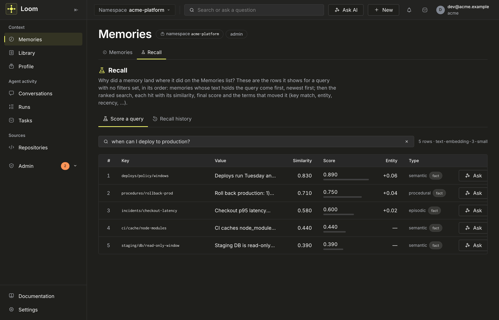
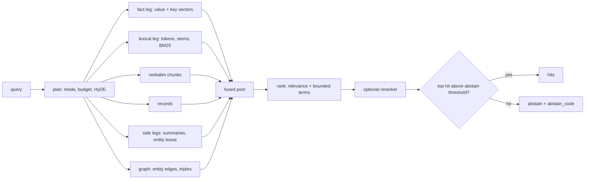

<!-- i18n: source=docs/concepts/retrieval-and-ranking.md blob=451339fc2ff5e4b649b678c1c5d0b58b1cf65e03 model=claude-sonnet-5-5 -->
> Esta página é uma tradução automática da [página em inglês](https://github.com/ClickHouse/loom/blob/main/docs/concepts/retrieval-and-ranking.md), que prevalece.
> Machine-translated from the [English page](https://github.com/ClickHouse/loom/blob/main/docs/concepts/retrieval-and-ranking.md), which is authoritative.

# Recuperação e ranqueamento

Esta página explica como `memory.search` encontra linhas. Ele executa várias etapas de recuperação sobre o namespace ao mesmo tempo, funde os candidatos delas em um único conjunto, ranqueia esse conjunto por relevância mais termos de correção limitados e, em seguida, decide se o melhor resultado é bom o bastante para responder a partir dele. Um resultado fraco é reportado como **abstain** ("o Loom não sabe"), e não como o ruído mais próximo. Os campos de requisição e resposta estão em [busca e ask](https://github.com/ClickHouse/loom/blob/main/docs/features/memory/search-and-ask.md).

## As camadas de recuperação

Cada camada responde a uma falha das outras. Uma camada que não tem nada a acrescentar não retorna nada; uma camada que falha segue em modo fail-open e a resposta a nomeia em `degraded`.

| Camada                | Lê                                                      | Encontra o que as outras perdem                                                                              |
| --------------------- | ------------------------------------------------------- | ------------------------------------------------------------------------------------------------------------ |
| **Fato, vetor**       | Vetor de valor de `loom.memory_embeddings` (sem índice vetorial) | Paráfrases: a pergunta e a afirmação armazenada compartilham significado, não palavras.            |
| **Fato, eixo da chave** | O vetor `memory_key` da mesma tabela                  | Uma pergunta que nomeia o atributo que uma chave codifica. Pontua `least(value distance, key distance)`.     |
| **Lexical**           | Trechos e a chave em minúsculas, com stemming e lematização | Identificadores exatos, números e palavras raras que têm embedding ruim. O stemming roda no ClickHouse (`stem`). |
| **BM25**              | Agregados de IDF por token e de tamanho do corpus       | Ponderação de termos raros para `bm25_hybrid`, com uma cauda ativa para que linhas novas contem de imediato. |
| **Chunks literais**   | `loom.memory_chunks`                                    | Uma passagem de um valor longo de `memory.set` é incorporada à linha cujo valor a contém; a de uma transcrição é um resultado. |
| **Resumos de sessão** | `loom.session_summaries`                                | "O que aconteceu naquela sessão"; com a descida pelos resumos, os melhores resumos puxam os melhores fatos de suas sessões. |
| **Entidade**          | `loom.entity_vectors`, `loom.entity_summaries`          | Linhas sobre uma entidade que a consulta nomeia, mesmo quando a redação é diferente.                         |
| **Grafo**             | `loom.entity_edges`, `loom.entity_triples`              | Linhas a um salto das entidades da consulta e linhas com uma tripla (sujeito, relação, objeto) correspondente. |
| **Registros**         | `loom.memory_records`                                   | Registros tipados cujos campos correspondem.                                                                 |
| **Correspondência de chave** | Partes da chave com stemming                     | Uma linha cuja chave nomeia exatamente o atributo pedido, como critério de desempate (`LOOM_MEMORY_SEARCH_KEY_MATCH_MODE`). |
| **Evidência calculada** | `loom.derived_facts`, datas de eventos                | Agregações ("quantos"), diferenças de datas e o valor mais recente de um atributo, calculados no ClickHouse. |

**Por que tantas camadas.** Uma única camada vetorial perde identificadores e números (eles têm embedding ruim), passagens no fundo de um valor longo (só a primeira parte recebe embedding) e linhas que nomeiam uma entidade com outras palavras. Cada camada é uma consulta sobre uma tabela que o Loom já grava, então adicionar uma custa uma instrução, não um segundo sistema.

**As camadas vetoriais fazem varredura, sem índice vetorial.** A varredura é exata ou, onde [leituras codes-first](https://github.com/ClickHouse/loom/blob/main/docs/architecture/clickhouse.md#vector-storage) se aplicam, uma passagem sobre códigos quantizados mantém um conjunto de candidatos e o repontua com precisão total.

**O eixo da chave** fica ativo por namespace quando suas chaves são reutilizadas (`LOOM_MEMORY_SEARCH_KEY_AXIS=auto`, limiar `LOOM_MEMORY_SEARCH_KEY_AXIS_AUTO_REUSE_SHARE`): ler duas colunas vetoriais custa aproximadamente o dobro de bytes, e só ajuda onde as chaves carregam significado.

**Planejamento e orçamentos.** `retrieval_budget` (`fast`, `standard`, `deep`) decide quais camadas caras rodam. Em `standard`, a recuperação barata roda primeiro e as camadas com LLM (HyDE, decomposição da consulta, a nova tentativa iterativa) só gastam quando a primeira passada é fraca, limitadas por `LOOM_MEMORY_SEARCH_FALLBACK_MAX_ROUNDS` e `LOOM_MEMORY_SEARCH_FALLBACK_MAX_WALL_MS`. Em `fast` (ou na receita `fast`), uma leitura não faz nenhuma chamada a LLM; custa embeddings e leituras no ClickHouse. O HyDE gera o embedding de uma resposta hipotética escrita por um LLM no lugar da pergunta, o que reduz a distância entre como perguntas e afirmações armazenadas são formuladas; `hyde=false` força a consulta original.

## Fusão

`search_mode` define como o conjunto de fatos é ordenado.

- Uma requisição que não define `search_mode` nem `recipe` recebe o modo `retrieval_defaults` do namespace; se ele não existir, usa `LOOM_MEMORY_SEARCH_DEFAULT_MODE` (`semantic`). O schema de transmissão mostra `rrf`; o servidor preenche o padrão real.
- As regras de formato do planejador se aplicam por cima: um identificador na consulta resulta na fusão lexical.
- `recipe` aplica um preset nomeado (`fast`, `balanced`, `quality`, `verbatim`, `code`, `temporal`, `graph`) e prevalece sobre os dois padrões.

| Modo          | Ordenação                                                                                          |
| ------------- | -------------------------------------------------------------------------------------------------- |
| `semantic`    | Similaridade de cosseno mais os termos de ranking abaixo.                                          |
| `rrf`         | Fusão por rank recíproco das ordens lexical e semântica, `1/(k + rank)` com k = 60.                |
| `hybrid`      | `alpha × lexical + (1 − alpha) × cosine`, mais os termos de ranking.                               |
| `bm25_hybrid` | BM25 ponderado por IDF fundido com o cosseno.                                                      |
| `lexical`     | Sobreposição de tokens no conteúdo e na chave; sem ordem vetorial.                                 |
| `graph`       | Cosseno mais sinal do grafo de entidades: sobreposição de um salto e triplas correspondentes.      |
| `temporal`    | Linhas datadas dentro de uma janela em torno da data resolvida da pergunta, cosseno dentro da janela. |
| `related`     | Sobreposição de tags e entidades com `tags` / `entity_filter` da requisição.                       |

**Por que a fusão por rank recíproco existe como um modo.** Os scores de sobreposição lexical se distribuem de 0 a 1, enquanto os cossenos de um embedder real ficam em uma faixa estreita; uma soma ponderada dos dois dá peso insuficiente a um deles, a menos que o alpha seja ajustado para cada corpus. O RRF combina ranks, não scores, então não precisa de ajuste. O Loom também reduz o peso lexical em consultas com formato de código ou de caminho, cujos tokens de caminho compartilhados são quase ruído (`server/memory/app/retrieval/fusion.py`, `_rrf_lexical_weight`). Empates em uma ordem são desfeitos pela outra, depois pela chave e pelo namespace, escritor e sessão da linha, de modo que duas buscas idênticas retornam a mesma janela.

## A expressão de ranqueamento

Nos modos ordenados por cosseno, a pontuação de uma linha de fato é a relevância somada a termos que podem reordenar empates próximos, mas que são limitados para que não superem a relevância
(`server/memory/app/retrieval/fact_rank.py`):

| Termo                     | O que adiciona                                                                                                                                                                                       | Controlado por                                                                                            |
| ------------------------- | ---------------------------------------------------------------------------------------------------------------------------------------------------------------------------------------------------- | --------------------------------------------------------------------------------------------------------- |
| Similaridade              | `1 − cosine distance` do melhor vetor.                                                                                                                                                               | o embedder                                                                                                |
| Boost de entidade         | Até 0.5 × a fração das entidades de `entity_filter` que a linha contém; correspondências de vetor de entidade a partir da consulta.                                                                 | `entity_filter`                                                                                           |
| Recência, cronologia, data | Um impulso para uma consulta com intenção de recência ("mais recente", "atual") ou de ordenação, e para linhas ancoradas perto da data pedida.                                                      | os próprios indícios da consulta; a variante no nível do pool `LOOM_MEMORY_SEARCH_RECENCY_POOL_WEIGHT` tem padrão 0 (desligada) |
| Grupo de priors           | `confidence` armazenado × `confidence_weight`, boosts suaves de tag e categoria, o boost de preferência; limitados em conjunto.                                                                     | `confidence_weight`, `tags_soft`, `prior_cap` (`LOOM_MEMORY_PRIOR_CAP`)                                   |
| Reforço                   | Recuperações e resultados positivos, com decaimento por meia-vida; um evento `harm` retira o boost conquistado.                                                                                     | `LOOM_MEMORY_SEARCH_REINFORCEMENT_WEIGHT` (0.15), `…_HALF_LIFE_DAYS` (90)                                 |
| Confiança                 | `+0.5` afirmado ou observado, `−0.25` importado, `−1` externo, `+1` quando atestado; multiplicado pelo peso.                                                                                        | `LOOM_MEMORY_SEARCH_TRUST_WEIGHT` (padrão 0 = desligado)                                                  |
| Rebaixamentos             | `demote_tags` joga uma linha para o fim sem descartá-la; linhas rotuladas `sensitivity:medium` ou `:high` são rebaixadas, exceto quando a consulta pede um dado de contato ou uma conta bancária (um IBAN). | `demote_tags`, `LOOM_MEMORY_SEARCH_SENSITIVITY_DEMOTE` (0.1)                                              |

**Fixar não é um termo de ranqueamento.** Um pin protege uma linha contra sobrescrita
([como uma escrita é avaliada](https://github.com/ClickHouse/loom/blob/main/docs/concepts/memory.md#how-a-write-is-judged)); ele não a faz subir
no ranking. Um fato é retornado porque responde à pergunta.

`personalization="none"` descarta todo termo derivado do usuário (preferência, o grupo de priors,
reforço) e mantém a relevância, de modo que os dois ranqueamentos possam ser comparados em um mesmo servidor.
`LOOM_MEMORY_SEARCH_SOURCE_CLASS_BOOST_ELIGIBLE` limita quais classes de proveniência podem
receber esses termos: deixar `extracted` de fora impede que uma inferência supere
uma afirmação por causa dos priors.

**Reranker.** `rerank` na requisição, ou o `rerank_endpoint` do namespace, envia o
pool a um reranker (`builtin:openai[:model]`, `builtin:cohere[:model]` ou o nome de um
endpoint que o operador configurou em `LOOM_RERANK_ENDPOINTS_JSON`; uma URL é recusada). O pool é ampliado antes (`LOOM_MEMORY_SEARCH_POOL_MULTIPLIER_RERANK`),
porque um reranker só reordena o que o primeiro estágio trouxe. Ele falha de forma aberta e nunca
descarta um candidato.

Passe `rerank` quando a ordem do pool importar mais do que uma chamada extra por busca. Para
medir isso nas suas próprias consultas, execute cada consulta com `rerank` e com `rerank="none"`
(o que também desliga o `rerank_endpoint` de um namespace), ambas com `explain=true` e no
orçamento que você serve (uma leitura `fast` ou sem LLM não faz chamada a `builtin:openai`), e
compare as duas janelas, lendo o `score_components` de cada resultado conforme explica [Por que isto ficou
nesta posição](#why-did-this-rank-here). Nenhuma execução registrada compara as mesmas buscas com
e sem reranker ([resultados](https://github.com/ClickHouse/loom/blob/main/docs/benchmarks/results.md#longmemeval-s)).

Depois do ranqueamento, a janela servida é moldada: linhas `duplicate` e `superseded` ficam ocultas
a menos que sejam pedidas, no máximo `LOOM_MEMORY_SEARCH_PER_KEY_CAP` linhas por chave são mantidas, e
`exclude_keys` remove as linhas que o chamador já possui.

## Abstenção

Toda busca termina com um veredito sobre o próprio resultado. A resposta traz `abstain`,
`abstain_code` (`no_match`, `below_threshold`, `entity_absent`,
`low_calibrated_confidence`, `page_expired`), um `abstain_reason` em texto, um
`retrieval_confidence` e um `retrieval_risk` com valor `low`, `medium`, `high` ou `abstain`.
Os códigos estão definidos em [busca e ask](https://github.com/ClickHouse/loom/blob/main/docs/features/memory/search-and-ask.md).

As linhas da janela cuja própria similaridade está abaixo do limiar trazem
`below_threshold: true`, de modo que um chamador que quer "abstain significa abstain" por linha
pode filtrar por esse campo.

**De onde vêm os limiares.** Um piso fixo de similaridade é calibrado para um único
modelo de embedding; se você troca o modelo, a distribuição dos cossenos muda, e o mesmo
número passa a filtrar bons resultados ou deixa de filtrar ruído. Com
`LOOM_ADAPTIVE_THRESHOLDS` ativado (o padrão), uma sondagem na inicialização gera embeddings de três corpora pequenos
e deriva cada gate a partir da distribuição do próprio embedder
(`server/memory/app/embedder_calibration.py`):

| Corpus da sondagem          | Gates derivados                                                                                   |
| --------------------- | ----------------------------------------------------------------------------------------------- |
| Pares de distratores  | O piso de ruído (percentil 90 + 0.02) e o limiar de abstenção (piso + 0.05).                      |
| Pares pergunta → fato | Os gates de gatilho: reescrita da consulta, fallback de HyDE e pulo do rerank (percentis 10, 25 e 75). |
| Pares de paráfrases   | Os limiares de conflito e de duplicata no momento da escrita (mediana, percentil 75).           |

Uma calibração por namespace, quando existe uma armazenada, substitui a do cluster inteiro, e
o worker `recalibration` repete a sondagem (`LOOM_RECALIBRATION_INTERVAL_SECONDS`) para que
os gates acompanhem um embedder revisado sem aviso. `calibration.get` mostra qual camada está
em vigor. As configurações escalares (`LOOM_MEMORY_SEARCH_MIN_SIMILARITY` 0.22,
`LOOM_MEMORY_SEARCH_ABSTAIN_THRESHOLD` 0.30, `LOOM_MEMORY_SEARCH_HYDE_FALLBACK_THRESHOLD`
0.45, `LOOM_MEMORY_SEARCH_QUERY_REWRITE_THRESHOLD` 0.38) valem para embedders falsos, uma
sondagem que falhou ou a adaptatividade desativada; nesse caso, refazer o benchmark após
uma troca de embedder fica por sua conta.

**O trade-off.** Um piso troca recall por precisão. Um agente que recebe as cinco linhas mais próximas
de uma pergunta fora do assunto vai usá-las; uma abstenção diz a ele que deve perguntar ou dizer que
não sabe. Um piso alto demais esconde respostas formuladas de um jeito diferente da pergunta. A
posição do Loom é que uma abstenção explícita, sobre a qual o agente pode agir, vale mais do que uma
janela preenchida, e a escolha fica com o chamador a cada leitura:

- `min_similarity` define o piso desta leitura;
- `floor_mode` decide o que acontece com as linhas abaixo dele: `readmit` (padrão: anexadas depois
  das linhas confiáveis, marcadas como abaixo do piso, de modo que `top_k` seja preenchido), `ids_only` (anexadas
  com o corpo vazio: a chave indica que existe uma correspondência fraca sem colocar o texto dela
  no contexto) ou `drop`.

Um resultado vazio de um escopo com extração adiada em andamento informa
`pending_extraction`: um salvamento está a caminho, então a resposta vazia não é prova
de ausência.

## Por que isto ficou nesta posição

`explain=true` em `memory.search` anexa `score_components` a cada resultado retornado: os sinais de ranqueamento, o score RRF e o peso quando esse modo foi executado e, depois de um reranker, o deslocamento de cada linha (`rerank_from`, `rerank_pos`, `rerank_delta`) e, quando o reranker mudou a ordem, o seu próprio score fundido (`rank_score_pre_rerank`). Uma memória cujo código vinculado mudou e que desceu na lista carrega quantas posições desceu (`code_changed_places`; quando isso acontece está descrito em [memórias vinculadas a código](https://github.com/ClickHouse/loom/blob/main/docs/concepts/memory.md#memories-linked-to-code)). `memory.search_trace` recebe a mesma requisição e pontua apenas a etapa vetorial (sem fusão, montagem ou reranker): cada candidato com seu `similarity`, `entity_boost`, `rank_score`, `rank` e o plano de onde veio (`source`: `fact` ou `chunk`). Com `LOOM_SEARCH_TRACE_LOG_ENABLED=true`, toda busca também acrescenta uma linha em `loom.search_trace_log` (chaves retornadas, scores, abstain, risco, latência), que pode ser lida com `memory.search_trace_log`; o texto da consulta só é armazenado quando o namespace consente com a captura de texto. O Recall Lab do painel (`<server>/recall`) mostra as linhas que a lista de Memórias mostra para uma consulta: correspondências por palavra-chave e, em seguida, resultados de `memory.search` com seus `score_components`.

`memory.ask` recupera os dados da mesma forma e depois escreve uma resposta a partir de um conjunto mais restrito; veja [busca e ask](https://github.com/ClickHouse/loom/blob/main/docs/features/memory/search-and-ask.md). A ferramenta MCP `loom_search` (a operação `search.query`) e `context.pack` pesquisam vários planos ao mesmo tempo; veja [busca unificada](https://github.com/ClickHouse/loom/blob/main/docs/features/unified-search.md).

## Limites

- A busca lê apenas vetores do modelo de embedding ativo. Linhas geradas por outro modelo
  ficam invisíveis até que `loom reembed` as regenere.
- Apenas a primeira parte de um valor longo recebe embedding; a etapa de chunks é o que encontra
  uma passagem mais adiante. Um valor que na verdade é um documento pertence ao knowledge.
- O gate de abstenção lê a linha de rank 1. Com `rrf`, uma correspondência apenas lexical pode ocupar o rank 1
  enquanto um cosseno melhor está no rank 2; `LOOM_MEMORY_SEARCH_ABSTAIN_TOP_SIM_SCOPE=window`
  lê, em vez disso, o melhor cosseno da janela.
- A calibração deriva os gates de pequenos corpora de teste embutidos. Um corpus diferente deles
  (código, um único domínio restrito) pode exigir uma calibração por namespace.

## Relacionados

- [Busca e pergunta](https://github.com/ClickHouse/loom/blob/main/docs/features/memory/search-and-ask.md): todos os campos de requisição e
  de resposta.
- [Busca unificada](https://github.com/ClickHouse/loom/blob/main/docs/features/unified-search.md): `loom_search` e `context.pack` em
  detalhe.
- [Grafo de entidades](https://github.com/ClickHouse/loom/blob/main/docs/features/entity-graph.md): de onde vêm as pernas de entidade e de grafo.
- [Memória](https://github.com/ClickHouse/loom/blob/main/docs/concepts/memory.md): os campos que o ranqueamento lê (`source_class`, `status`, tempo).
- [Ajuste de desempenho](https://github.com/ClickHouse/loom/blob/main/docs/guides/performance-tuning.md).
- Operações: [memória](https://github.com/ClickHouse/loom/blob/main/docs/reference/operations.md#memory),
  [calibração](https://github.com/ClickHouse/loom/blob/main/docs/reference/operations.md#calibration),
  [contexto](https://github.com/ClickHouse/loom/blob/main/docs/reference/operations.md#context). Configurações:
  [busca de memória](https://github.com/ClickHouse/loom/blob/main/docs/reference/configuration.md#memorysearch),
  [pergunta à memória](https://github.com/ClickHouse/loom/blob/main/docs/reference/configuration.md#memoryask),
  [Mcp](https://github.com/ClickHouse/loom/blob/main/docs/reference/configuration.md#mcp).
