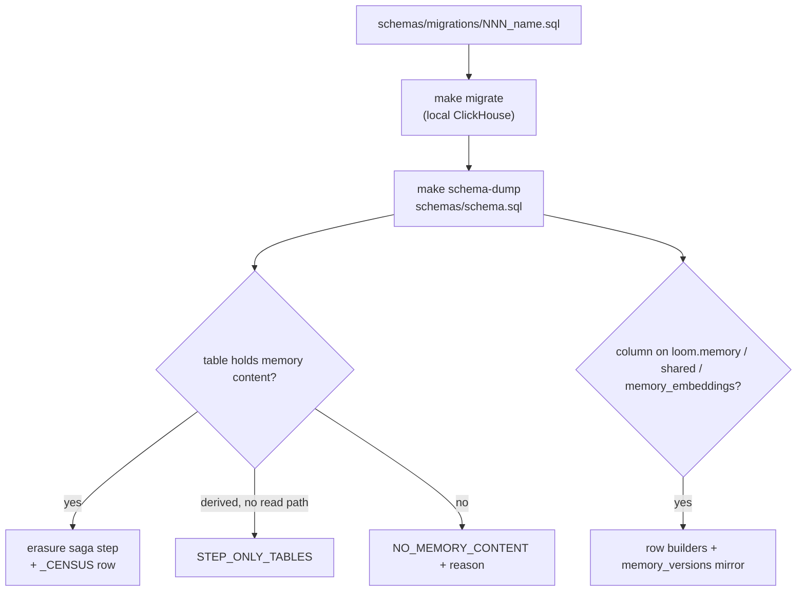

<!-- i18n: source=docs/development/adding-a-table.md blob=d8af79bee19277559de78fd0ef566e3df03ea7cb model=claude-sonnet-5-5 -->
> Esta página é uma tradução automática da [página em inglês](https://github.com/ClickHouse/loom/blob/main/docs/development/adding-a-table.md), que prevalece.
> Machine-translated from the [English page](https://github.com/ClickHouse/loom/blob/main/docs/development/adding-a-table.md), which is authoritative.

# Adicionar uma tabela ou coluna do ClickHouse

O estado do ClickHouse no Loom são tabelas nos bancos de dados `loom` e `loom_telemetry`; sob a autoridade de memória do Postgres, a memória ativa, o estado de conhecimento e os registros associados ficam no Postgres. A página [autoridade de armazenamento](../architecture/storage-authority.md#the-tables) lista as tabelas do Postgres. O schema do ClickHouse muda apenas por meio de migrations numeradas e aditivas, porque duas builds servem o mesmo schema durante um deploy. Cada regra abaixo é garantida por um teste. [ClickHouse](https://github.com/ClickHouse/loom/blob/main/docs/architecture/clickhouse.md) explica as famílias de tabelas.

## 1. Escreva a migration e regenere o schema

[Migrações](https://github.com/ClickHouse/loom/blob/main/docs/development/migrations.md) define as regras: numeração, o que conta como aditivo, diretivas do runner, reconstruções da chave de ordenação e `make schema-dump` / `make schema-check` contra o ClickHouse fixado. Em resumo:

- Adicione `schemas/migrations/<NNN>_<what>.sql` com o próximo número livre. O comentário do cabeçalho diz para que serve a mudança e o que as linhas antigas e as builds antigas enxergam.
- Referencie as tabelas como `loom.<table>` e escreva `IF NOT EXISTS` / `IF EXISTS`. A telemetria derivada das tabelas do próprio Loom vai em `loom_telemetry` ([por quê](https://github.com/ClickHouse/loom/blob/main/docs/architecture/clickhouse.md)); o preflight já verifica as permissões dela, e o censo de apagamento nomeia a tabela junto com seu banco de dados.
- Nunca edite nem apague uma migration já mergeada. Corrija um erro com um novo arquivo.
- Execute `make migrate`, `make schema-dump` e depois `python scripts/codegen/docs_reference.py` para que a [referência do schema](https://github.com/ClickHouse/loom/blob/main/docs/reference/schema.md) liste a tabela.

Até que um deployment aplique a migration, a proteção de schema do cliente recusa uma leitura ou escrita que cite uma tabela que uma migration pendente criaria, com `SCHEMA_PENDING`.

## 2. Espelhe todas as colunas nos caminhos de escrita do ReplacingMergeTree

`loom.memory`, `loom.shared` e `loom.memory_embeddings` são tabelas `ReplacingMergeTree(version)` lidas com `FINAL`. Todo handler que grava uma nova linha de versão (set, tombstone, restore, touch, `update_by_id`, `bulk_set`, promote, demote) carrega **todas** as colunas persistidas para a frente. Uma coluna omitida em uma versão posterior é lida como zero com `FINAL`.

Ao adicionar uma coluna a uma dessas tabelas:

1. Adicione-a à lista canônica de colunas em `server/memory/store/rows.py`
   (`MEMORY_PERSISTED_COLS` ou `EMBEDDING_PERSISTED_COLS`).
2. Inclua-a nos builders desse arquivo (`build_memory_version_row`, `build_revision_row`,
   `build_first_version_row`, `build_embedding_row`) e em toda projeção que os alimenta
   (o `SELECT` que carrega a linha existente).
3. Nunca monte uma linha de versão manualmente em um handler; chame os builders.

`tests/unit/test_memory_write_path_mirror.py` e `tests/unit/test_embedding_mirror_carry.py` verificam os caminhos de escrita secundários.

**O espelho do histórico.** `loom.memory_versions` é um gêmeo somente de acréscimo (append-only) de `loom.memory`, preenchido pela view materializada `memory_versions_mv`. `memory.history`, `memory.redact` e `namespace.rollback` leem dela, porque as mesclagens (merges) descartam do `ReplacingMergeTree` as linhas substituídas. Adicione uma nova coluna de `loom.memory` a `loom.memory_versions` e ao `SELECT` da view **na mesma migração**. `tests/unit/test_memory_versions_schema.py` compara as duas listas de colunas em `schema.sql` com `MEMORY_PERSISTED_COLS`.

Todo novo caminho de escrita define `actor` e `source_class` carimbados pelo servidor (`server.memory.domain.provenance`), nunca valores vindos do corpo da requisição.

## 3. Classificar a tabela para o apagamento

O apagamento é uma saga (`server/erasure/app/saga.py`). Seu último passo é um censo de resíduos sobre cada tabela que os caminhos de leitura acessam; qualquer linha ativa no escopo faz a saga falhar de forma fechada. `tests/unit/test_every_table_is_classified.py` falha para qualquer `CREATE TABLE` em `schema.sql` que não esteja em exatamente uma das três listas em `server/erasure/store/census.py`:

| Lista               | Coloque a tabela aqui quando                                                                                                                      | Você também adiciona                                                                                                                                  |
| ------------------- | ------------------------------------------------------------------------------------------------------------------------------------------------- | ----------------------------------------------------------------------------------------------------------------------------------------------------- |
| `_CENSUS`           | Ela pode conter conteúdo de memória servido por um caminho de leitura.                                                                            | Um passo da saga que remove as linhas no escopo e um `Substrate(table, live, user_pred, ns_step, user_step)` que nomeia esse passo para cada escopo. |
| `STEP_ONLY_TABLES`  | Um passo da saga a modifica, mas o censo não a conta (ledgers derivados, mapas de alias), com o motivo no comentário acima do dict.               | O passo, indexado pelo seu nome.                                                                                                                      |
| `NO_MEMORY_CONTENT` | Ela não contém conteúdo de memória no escopo (contagens, cursores, caches de dados públicos).                                                     | Um motivo de uma linha.                                                                                                                               |

Para uma tabela em `_CENSUS`:

- `live` é o predicado que uma linha ativa satisfaz (`tombstoned_at IS NULL`, ou `"1"` quando toda linha conta); `user_pred` é `user_id = {uid:String}` quando a tabela tem um eixo de usuário, e `None` para uma tabela apenas de namespace (nesse caso ela só é contada em apagamentos com escopo de namespace).
- O passo é uma função em `server/erasure/store/steps_*.py`, listada com o seu nome de passo em cada tabela da saga que se aplique (`NAMESPACE_STEPS`, `USER_STEPS` em `server/erasure/app/saga_steps.py`), e `final=False` no `Substrate` para um `MergeTree` simples (FINAL não é permitido nele).
- Uma saga retomada executa novamente o passo responsável por qualquer tabela em que o último censo encontrou linhas (`steps_to_reopen`), então o passo deve ser idempotente.
- Uma tabela do plano de código com chave `(org, namespace)` normalmente pertence a `CODE_INDEX_STEP_ONLY_TABLES` (removida pelo passo `code_index.purge` da saga); um teste unitário mantém essa tupla alinhada com o schema.

Teste o formato da instrução do passo com um cliente stub, como fazem `tests/unit/test_erasure_repo.py` e `tests/unit/test_erasure_late_steps.py`.

## 4. Classifique qualquer mutation

Um `ALTER TABLE loom.<t> UPDATE|DELETE` é uma mutation do ClickHouse: ela reescreve as parts de forma assíncrona e não é transacional. `tests/unit/test_clickhouse_mutation_inventory.py` conta todas as mutations visíveis em `server/` e compara com `_EXPECTED_MUTATIONS`. Uma nova mutation faz o teste falhar até que você a adicione ali, com um comentário explicando o motivo.

Prefira uma nova linha de versão em uma `ReplacingMergeTree`, uma coluna de tombstone ou um `DELETE FROM` leve. Nunca use uma mutation como um claim ou lock pelo qual uma requisição espera; a caixa de entrada de tarefas faz o claim por meio de uma tabela de lease `KeeperMap`.

## Lista de verificação

- [ ] Novo `schemas/migrations/<NNN>_<what>.sql`, aditivo e idempotente; nenhum arquivo já mesclado é editado.
- [ ] `make schema-dump` contra um ClickHouse fixado e novo; `make schema-check` sem pendências.
- [ ] `python scripts/codegen/docs_reference.py` para a referência do schema.
- [ ] Colunas RMT: lista de colunas em `rows.py`, builders, projeções; `memory_versions` e
      `memory_versions_mv` na mesma migration.
- [ ] Classificação de apagamento: `_CENSUS` + etapa da saga, `STEP_ONLY_TABLES`, ou
      `NO_MEMORY_CONTENT` com um motivo.
- [ ] Toda nova mutação listada no teste de inventário.
- [ ] Uma linha em [layout de armazenamento](https://github.com/ClickHouse/loom/blob/main/docs/architecture/storage-layout.md), na tabela da sua família
      para uma tabela do ClickHouse (a seção das tabelas `_` para um nome que começa com `_`),
      com todas as colunas preenchidas. `tests/unit/test_storage_layout_rows.py` verifica que a
      linha existe (e, para uma tabela do ClickHouse, que ela some quando a tabela é removida; a linha de uma tabela
      Postgres removida é apagada manualmente), e, para uma linha do ClickHouse, que a célula
      Today corresponde ao schema, a célula Erasure ao census, e que suas citações nomeiam
      a tabela; com o dump do schema pendente, ele falha até que o dump seja incluído.
- [ ] `make test-unit` (os testes de aditividade, numeração, espelho, classificação e inventário).

## Relacionados

- [Migrações](https://github.com/ClickHouse/loom/blob/main/docs/development/migrations.md)
- [ClickHouse](https://github.com/ClickHouse/loom/blob/main/docs/architecture/clickhouse.md)
- [Retenção e eliminação](https://github.com/ClickHouse/loom/blob/main/docs/features/memory/retention-and-erasure.md)
- [Atualizações](https://github.com/ClickHouse/loom/blob/main/docs/operations/upgrades.md)
