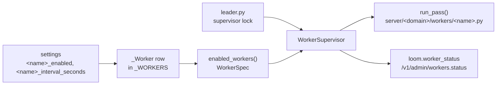

<!-- i18n: source=docs/development/adding-a-worker.md blob=caf48d881a70356a242d6cb16a1569b75e93391e model=claude-sonnet-5-5 -->
> Esta página é uma tradução automática da [página em inglês](https://github.com/ClickHouse/loom/blob/main/docs/development/adding-a-worker.md), que prevalece.
> Machine-translated from the [English page](https://github.com/ClickHouse/loom/blob/main/docs/development/adding-a-worker.md), which is authoritative.

<a id="add-a-background-worker"></a>

# Adicionar um worker em segundo plano

Um worker é uma linha em `server/workers/registry.py` (`_WORKERS`) mais um módulo com uma função de passagem. `enabled_workers()` transforma as linhas habilitadas em `WorkerSpec`s, e o `WorkerSupervisor` (`server/workers/supervisor.py`) executa, mede o tempo, aplica backoff e drena cada um. A [referência de workers](https://github.com/ClickHouse/loom/blob/main/docs/reference/workers.md) gerada lista todas as linhas.



<a id="1-write-the-pass"></a>

## 1. Escreva o pass

Crie `server/<domain>/workers/<name>.py` com um `async def run_pass()`. O supervisor o chama uma vez por intervalo e descarta o valor de retorno. Um exemplo pequeno é `server/tasks/workers/lease_sweep.py`:

```python
from server.workers import pass_context
from server.workers.status import record_pass


async def run_pass() -> SweepResult:
    from server.tasks.app.sweep import sweep_once

    with record_pass("task_lease_sweep") as rec:
        counts = await sweep_once()
        rec.outcome = dict(counts)
    result = SweepResult(**counts)
    if result.total == 0:
        pass_context.mark_idle()
    else:
        log.info("task_lease_sweep: expired=%d ...", result.expired)
    return result
```

O contrato do pass:

- **Idempotente e limitado.** Um pass pode ser cancelado no seu prazo, executado novamente após uma falha ou executado na outra cor após um deploy. Faça uma quantidade limitada de trabalho e deixe o restante para o próximo pass.
- **Prazo.** O padrão é `min(4 × interval, 900 s)`, com piso de 60 s (`default_max_pass_seconds`). Um pass que ultrapassa o prazo é cancelado e conta como falha. Defina `max_pass_seconds` ou `max_pass_setting` na linha para um pass mais longo.
- **Falhas.** Uma exceção faz o pass falhar. O supervisor tenta novamente com backoff exponencial (de 1 s, dobrando até 60 s) e marca o worker como `degraded` após 3 falhas consecutivas. Um pass interrompido no prazo, ou um worker cujo intervalo excede o prazo (passes diários e semanais), espera o intervalo inteiro (`failure_hold_seconds`), para que uma nova tentativa não gaste o mesmo tempo de banco de dados novamente.
- **Falhas parciais.** Uma etapa que falha sem fazer o pass falhar chama `pass_context.note_failure(exc, what)`. Ela conta para a sequência de falhas e aparece em `loom.worker.partial_failures{worker}`.
- **Ocioso.** Um pass que não encontrou nada chama `pass_context.mark_idle()`. O supervisor então espera `idle_interval_seconds`.
- **Cursor.** Um worker que percorre páginas lê `pass_context.resume_cursor()` e chama `pass_context.set_cursor(value)` onde parou. O cursor é armazenado na linha `loom.worker_status` do pass, de modo que um processo reiniciado retoma de onde parou.
- **Um `except` amplo diz o porquê:** `# noqa: BLE001 — <what must not fail>`.

<a id="2-attribute-its-queries"></a>

## 2. Atribua as consultas dela

O supervisor marca cada execução:

- as consultas ao ClickHouse carregam `log_comment` `worker.<name>` (`set_worker_identity` em `server/workers/status.py`);
- os spans do provedor carregam `loom.operation=worker.<name>`;
- a execução roda na classe de tráfego em segundo plano (`bind_background`);
- o gasto de LLM e de embedder cai em uma única linha do ledger, `worker.<name>.pass`.

Um loop **fora** do supervisor (uma task, uma thread, um loop de CLI) deve se marcar sozinho; caso contrário, suas consultas são registradas como `untagged:<module>.<function>`:

```python
from server.core.ch import set_query_tag

set_query_tag("worker.my_loop")
```

<a id="3-add-its-settings"></a>

## 3. Adicione as configurações

Adicione o interruptor e a cadência à seção da área em `server/settings/catalog.py` (`Memory`, `Code`, `Tracker`, …). Cada comentário se torna o texto da linha na [referência de configuração](https://github.com/ClickHouse/loom/blob/main/docs/reference/configuration.md) gerada.

```python
    # Lease sweeper: return expired leases to todo, resume deferred tasks at
    # resume_at, escalate stale triage. One read per pass.
    task_lease_sweep_enabled: bool = True
    # Seconds between passes while there is work.
    task_lease_sweep_interval_seconds: int = 60
    # Seconds between passes that found nothing.
    task_lease_sweep_idle_interval_seconds: int = 300
```

Deixe um worker **desativado** por padrão quando ele precisa de credenciais, gera custo em um provedor ou atende um plano que o operador ativa por escolha própria. Workers ativados por padrão rodam em todas as stacks, inclusive em um laptop.

<a id="4-add-the-registry-row"></a>

## 4. Adicione a linha no registro

```python
(
    _Worker(
        "task_lease_sweep",
        "server.tasks.workers.lease_sweep",
        "task_lease_sweep_enabled",
        "task_lease_sweep_interval_seconds",
        idle_interval="task_lease_sweep_idle_interval_seconds",
    ),
)
```

| Campo de `_Worker`                     | Significado                                                                                                                                                  |
| -------------------------------------- | ------------------------------------------------------------------------------------------------------------------------------------------------------------ |
| `name`                                 | O nome do worker: a tag de log, a operação do ledger, a linha de status.                                                                                     |
| `module`                               | O caminho completo do módulo. Só é importado quando o worker está habilitado, para que o boot continue rápido e as dependências opcionais continuem opcionais. |
| `enabled`                              | O flag de configuração que o liga; `None` = sempre ligado.                                                                                                   |
| `interval`                             | O campo de configuração que guarda a cadência em segundos.                                                                                                   |
| `pass_attr`                            | O nome da função de passada (padrão `run_pass`).                                                                                                             |
| `also_requires`                        | Um segundo flag de configuração de que o worker precisa (o ledger que ele lê, o plano que ele atende); desligado → o worker fica desligado.                  |
| `idle_interval`                        | Campo de configuração para a espera após uma passada ociosa.                                                                                                 |
| `max_pass_seconds`, `max_pass_setting` | O prazo da passada, fixo ou lido de uma configuração.                                                                                                        |
| `first_pass_due`                       | Um atributo do módulo: uma verificação assíncrona consultada uma vez na inicialização; `True` executa a primeira passada agora, em vez de após o escalonamento do boot. |
| `owned_tables`                         | `True`: o módulo exporta `OWNED_TABLES` e `due_scope`; a primeira passada é devida quando uma tabela própria não tem linha para um namespace no escopo.     |

**Escalonamento do boot.** Sem um hook de primeira passada, a primeira passada espera `crc32(name) % interval`. Um worker diário em processos que vivem algumas horas pode, assim, nunca executar, então declare o que ele preenche:

```python
from server.workers.first_pass import OwnedTable

OWNED_TABLES = (OwnedTable("loom.qa_item_embeddings", namespace_column="namespace"),)


def due_scope() -> list[tuple[str, str]]: ...  # the (org, namespace) pairs this worker fills
```

Essa é a declaração de `server/tracker/workers/embed.py`. A verificação é uma instrução por tabela, limitada por `FIRST_PASS_DUE_TIMEOUT_SECONDS`. Uma tabela ilegível conta como devida.

<a id="5-understand-where-it-runs"></a>

## 5. Entenda onde ele roda

**Um supervisor por deployment.** `server/workers/leader.py` elege um único processo entre todos os containers e hosts por meio do ClickHouse: a chave `workers_supervisor` na tabela de lock do Keeper `loom._migration_lock`. Quem detém o lease o renova a cada `LOOM_SUPERVISOR_LEASE_TTL_S / 6`; um detentor que perde o lease interrompe seus workers; quando o detentor morre, outro processo assume após `LOOM_SUPERVISOR_LEASE_TTL_S` (padrão 30 s).

| `LOOM_BACKGROUND_WORKERS` | Efeito                                                                                                                  |
| ------------------------- | ----------------------------------------------------------------------------------------------------------------------- |
| `auto` (padrão)           | Disputa o lease; executa o supervisor enquanto o detém. Fora do deployment (sem `LOOM_DEPLOYMENT`), equivale a `off`.   |
| `on`                      | Sempre executa o supervisor.                                                                                            |
| `off`                     | Somente web.                                                                                                            |

Execute todas as réplicas em `auto`: qualquer uma delas pode se tornar a líder. Um servidor `make server` ou iso não executa workers, a menos que defina `on`.

**Duas cópias podem se sobrepor brevemente.** Um detentor interrompe seus workers em T/2 sem uma renovação, antes que outro processo possa assumir em T, mas uma instrução que ele já enviou ainda é aplicada, e um processo `on` não obtém lease. Torne inofensiva uma segunda cópia: escritas idempotentes, claims com lease, cursores no armazenamento. Um worker que gasta com um LLM dobra seu gasto enquanto duas cópias estão em execução.

**Pare entre lotes.** Um loop longo chama `pass_context.check_stop()` antes de cada lote que grava. Ele levanta `PassStopped` quando a passagem foi interrompida ou o lease ficou obsoleto, o que também alcança o trabalho executado em `asyncio.to_thread`. `PassBudget.exhausted()` o chama por você.

**Upgrades graduais.** Um build mais antigo cede o lease a um build mais novo ativo (veja [Falha e recuperação](../architecture/failure-and-recovery.md#background-workers)). O líder antigo libera o lease ao parar, e um processo mais novo o assume na rodada seguinte, em poucos segundos.

<a id="6-pin-it-in-tests"></a>

## 6. Fixe o comportamento nos testes

- **Snapshot do registry.** `tests/unit/test_worker_registry_snapshot.py` monta a lista de workers em três perfis de configuração (`defaults`, `all_on`, `production`) e compara cada campo de `WorkerSpec` com `tests/unit/snapshots/worker_registry.json`. Regenere o snapshot apenas quando a mudança for intencional:

  ```bash
  LOOM_UPDATE_WORKER_SNAPSHOT=1 python -m pytest tests/unit/test_worker_registry_snapshot.py
  ```

  Se o worker deve rodar em produção, adicione a flag dele a `_PRODUCTION_FLAGS` nesse teste.

- **Paridade.** `tests/unit/test_worker_registry_parity.py` verifica que `worker_meta()` (o que `/v1/admin/workers.status` exibe) e `enabled_workers()` listam o mesmo conjunto com todas as flags ativadas.
- **A própria passagem.** Um teste unitário chama `run_pass()` contra um repositório stub ou um ClickHouse local. Fora de uma passagem supervisionada, as chamadas de `pass_context` apenas registram log.
- **Documentação gerada.** `python scripts/codegen/docs_reference.py` regenera a
  [referência de workers](https://github.com/ClickHouse/loom/blob/main/docs/reference/workers.md); `make lint` falha enquanto ela estiver desatualizada.

<a id="7-check-it-runs"></a>

## 7. Verifique se está funcionando

- `/v1/admin/workers.status` combina o registro deste processo com a linha mais recente de `loom.worker_status` por worker, de modo que a camada web mostra os workers em execução no contêiner de workers.
- `/v1/health?include=workers` informa o status de cada worker e `workers_leader`: se o processo que respondeu detém o lock e por quê.
- Configure alertas para `loom.worker.consecutive_failures{worker}` e `loom.worker.partial_failures{worker}` ([monitoramento](https://github.com/ClickHouse/loom/blob/main/docs/operations/monitoring.md)).

<a id="related"></a>

## Relacionados

- [Estendendo o Loom](https://github.com/ClickHouse/loom/blob/main/docs/development/extending-loom.md)
- [Referência de workers](https://github.com/ClickHouse/loom/blob/main/docs/reference/workers.md)
- [Falha e recuperação](../architecture/failure-and-recovery.md)
- [Status dos workers](https://github.com/ClickHouse/loom/blob/main/docs/operations/monitoring.md#worker-status)
