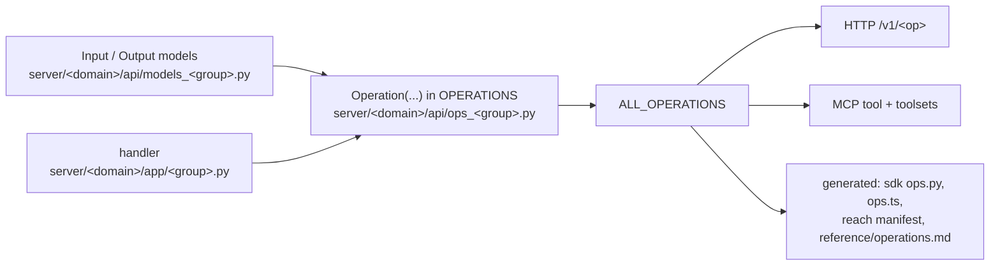

<!-- i18n: source=docs/development/adding-an-operation.md blob=32e9eb1349c29c12bc71e2adc8c55441a459025d model=claude-sonnet-5-5 -->
> Esta página é uma tradução automática da [página em inglês](https://github.com/ClickHouse/loom/blob/main/docs/development/adding-an-operation.md), que prevalece.
> Machine-translated from the [English page](https://github.com/ClickHouse/loom/blob/main/docs/development/adding-an-operation.md), which is authoritative.

<a id="add-an-operation"></a>

# Adicionar uma operação

Uma operação é declarada uma única vez, no registro. A rota HTTP (`POST /v1/<op>`), o schema OpenAPI, a ferramenta MCP (`loom_<op with dots as underscores>`), o catálogo (`/v1/operations`, `ops.capabilities`), as tabelas de operações dos SDKs e a [referência de operações](https://github.com/ClickHouse/loom/blob/main/docs/reference/operations.md) derivam dela. Você escreve os modelos, o handler, a declaração e os testes, e regenera o restante.



O exemplo é `calibration.get`, uma das menores operações: `server/memory/api/models_calibration.py`, `server/memory/api/ops_calibration.py` e `server/memory/app/calibration.py`.

<a id="1-define-the-input-and-output-models"></a>

## 1. Defina os modelos de entrada e saída

Coloque-os no módulo de modelos do grupo, `server/<domain>/api/models_<group>.py`. Um módulo de modelos contém apenas modelos Pydantic de transporte: ele não importa nenhum handler.

```python
from pydantic import BaseModel, Field


class CalibrationGetInput(BaseModel):
    org: str
    namespace: str


class CalibrationGetOutput(BaseModel):
    source: str  # "namespace" / "cluster" / "scalar"
    embedder_model: str = ""
    noise_floor: float
    ...
    similar_pairs_n: int = Field(default=0)
```

Regras para os modelos:

- **Identidade.** Uma op endereçada por namespace recebe `org` e `namespace`. Ops que gravam linhas recebem o restante da tupla de identidade: `agent`, `user_id`, `session_id`, `run_id` (os três últimos têm `'-'` como padrão). Via MCP, o servidor preenche os campos de identidade omitidos com os padrões da conexão e depois autoriza o `(org, namespace)` indicado no corpo.
- **Colunas preenchidas pelo servidor nunca vêm do corpo.** Um caminho de escrita define `actor` (`server.memory.app.provenance.writer_actor`) e `source_class` (`server.memory.domain.provenance.source_class_for`). Uma requisição só pode declarar um rebaixamento para `derived`, `external` ou `imported`.
- **Oculte do MCP os campos irrelevantes para o agente.** Marque um ajuste de ranking ou uma chave de pipeline com `json_schema_extra=MCP_HIDDEN` (`server/operations/base.py`). O schema do MCP o omite; a op continua aceitando o campo.
- **Sem validadores no nível do modelo do tipo "um entre A ou B"** nas entradas de leitura. O transporte valida o corpo antes da autorização, então um `@model_validator` que lança erro descreve a op a um principal que o gate do namespace recusaria. Coloque a regra no handler e lance `server.core.errors.ValidationError`. `tests/unit/test_op_inputs_after_gate.py` verifica todas as ops registradas.
- **Para aposentar um campo**, apague-o. Um cliente que ainda o envia continua sendo atendido, com o campo listado em `ignored_args` ([campos desconhecidos e removidos](https://github.com/ClickHouse/loom/blob/main/docs/reference/http-api.md#unknown-and-removed-fields)).

<a id="2-write-the-handler"></a>

## 2. Escreva o handler

Um módulo de handler por grupo, em `server/<domain>/app/`. Um handler é `async`, recebe o modelo de entrada e retorna o modelo de saída. Ele importa os modelos de wire no topo do módulo; os modelos nunca importam um handler, então a importação é acíclica:

```python
from server.memory.api.models_calibration import CalibrationGetInput, CalibrationGetOutput


async def handle_calibration_get(input: CalibrationGetInput) -> CalibrationGetOutput:
    from server.memory.app.embedder_calibration import get_calibration, get_namespace_calibration

    ns_cal = await get_namespace_calibration(input.org, input.namespace)
    ...
```

- A lógica pura vai no `domain/` do domínio, e o SQL no seu `store/`. O handler as compõe.
- **Recusas** lançam uma subclasse de `server.core.errors.LoomServerError` (ou uma `HTTPException` com um detalhe `{"code", "message"}`). Os transportes a convertem no envelope de erro e, via MCP, em um resultado `isError`. Um novo código de erro aparece na [referência de erros](https://github.com/ClickHouse/loom/blob/main/docs/reference/errors.md) gerada.
- **Um `except` amplo diz por quê:** `except Exception as e:  # noqa: BLE001 — <what must not fail>`.
- O transporte marca as consultas do ClickHouse com `log_comment`; o handler não faz nada.
- Leia as configurações como `settings.<field>`, nunca com `getattr(settings, ...)`.
- Se a op escreve em `loom.memory` ou `loom.shared`, construa as linhas com os builders em
  `server/memory/store/rows.py` ([adicionar uma tabela](https://github.com/ClickHouse/loom/blob/main/docs/development/adding-a-table.md#2-mirror-every-column-on-replacingmergetree-write-paths)).

<a id="ops-addressed-by-an-org-wide-id"></a>

### Ops endereçadas por um id de toda a organização

Uma op que recebe apenas `(org, memory_id)`, como `memory.get_by_id` ou `memory.update_by_id`, não recebe namespace do transporte. Declare-a como `row_scoped=True`, resolva o namespace que o chamador alcança antes da leitura e **oculte** uma linha de outro tenant:

```python
import server.memory.store as memory_repo
from server.memory.app.id_namespace import namespace_for_id

namespace = await namespace_for_id(input.org, input.memory_id, strong=False)
if namespace is None:
    return MemoryGetByIdOutput(found=False)
row = await memory_repo.get_by_id(input.memory_id, org=input.org, namespace=namespace, ...)
if row is None:
    return MemoryGetByIdOutput(found=False)
```

Responda como se a linha não existisse, nunca com 403: um 403 confirma que o id existe em outro tenant. Passe `Role.WRITER` e `strong=True` para `namespace_for_id` em uma escrita, para que os detentores sejam lidos na versão atual. Uma op que precisa ler a linha primeiro, como `memory.redact`, a verifica com `authz.row_in_scope` após a busca ([operações com escopo de linha](https://github.com/ClickHouse/loom/blob/main/docs/architecture/security.md#row-scoped-operations)).

<a id="3-declare-the-operation"></a>

## 3. Declarar a operação

```python
from server.operations.base import Operation, Role

calibration_get = Operation(
    name="calibration.get",
    maturity="experimental",
    input_model=CalibrationGetInput,
    output_model=CalibrationGetOutput,
    handler=handle_calibration_get,
    idempotent=True,
    required_role=Role.VIEWER,
    audit=False,
)

OPERATIONS: list[Operation] = [calibration_get]
```

O orçamento de latência é uma entrada de `OP_BUDGETS_P99_MS` em `server/settings/catalog.py`, onde o orçamento de cada op é definido, `"calibration.get": 60,` (o p99 alvo de projeto da op, em ms; uma chamada bem-sucedida que o ultrapasse emite um evento `budget.violated`). Os formatos de requisição que o handler registra em tempo de execução (`server.observability.budget_shape`) têm seus próprios orçamentos em `OP_SHAPE_BUDGETS_P99_MS`, e o catálogo os lista. O teste `tests/unit/test_op_budgets.py` falha para uma op sem entrada. Um deployment ajusta uma op com `LOOM_LATENCY_BUDGET_OVERRIDES` e todas elas com `LOOM_LATENCY_BUDGET_MULTIPLIER`.

A declaração fica no módulo de ops do grupo, `server/<domain>/api/ops_<group>.py`, que importa os modelos e o handler. Acrescente-a à lista `OPERATIONS` do módulo. Um **novo módulo de grupo** é importado e acrescentado a `_OPERATION_MODULES` em `server/operations/registry.py`.

| Campo                         | Obrigatório | Significado                                                                                                                                                                                                                                                                                                                         |
| ----------------------------- | ----------- | ----------------------------------------------------------------------------------------------------------------------------------------------------------------------------------------------------------------------------------------------------------------------------------------------------------------------------------- |
| `name`                        | sim         | Formato `<group>.<verb>` com ponto. Caminho HTTP `/v1/<name>`; ferramenta MCP `loom_<name with . → _>`.                                                                                                                                                                                                                              |
| `input_model`, `output_model` | sim         | Modelos Pydantic.                                                                                                                                                                                                                                                                                                                   |
| `handler`                     | sim         | Callable assíncrono: modelo de entrada → modelo de saída.                                                                                                                                                                                                                                                                           |
| `idempotent`                  | sim         | Seguro para repetir após uma falha transitória. Os SDKs e os clientes dependem disso.                                                                                                                                                                                                                                              |
| `required_role`               | sim         | `Role.VIEWER`, `WRITER`, `ADMIN`, `ORG_ADMIN` ou `PLATFORM_ADMIN`.                                                                                                                                                                                                                                                                  |
| `audit`                       | não         | `True`: em caso de sucesso, grava uma linha em `loom.audit_log`. Defina-o para tudo que altera memória, concessões, políticas ou configuração.                                                                                                                                                                                      |
| `writes`                      | não         | A op altera o estado armazenado, embora um viewer possa chamá-la e repetir seja seguro (uma linha de feedback, um marcador de visto). Um papel writer ou `audit=True` já indica "grava".                                                                                                                                             |
| `maturity`                    | não         | `stable` (padrão) ou `experimental`. Veja o [passo 5](#5-check-reach-and-maturity).                                                                                                                                                                                                                                                 |
| `skip_namespace_authz`        | não         | Ignora a verificação de namespace do transporte para ops que atuam **sobre** um namespace (join, leave, register) ou cujo alvo só o handler consegue resolver (`memory.verify` por id, `erasure.request` por escopo, `erasure.list` por papel do chamador); o handler aplica suas próprias regras. A verificação de papel continua sendo feita. |
| `deployment_scoped`           | não         | A op lê fatos sobre o deployment (seu build, seu registro), não os dados de algum namespace; um token com escopo passa com seu melhor papel por namespace.                                                                                                                                                                          |
| `row_scoped`                  | não         | Endereçada por um id válido em toda a organização; o handler autoriza o escopo da linha (`namespace_for_id` antes da leitura, ou `row_in_scope` depois dela) e oculta uma linha de outro escopo como não encontrada.                                                                                                                 |

A op é **somente leitura** (`readOnlyHint` do MCP, o toolset `readonly`) exatamente quando é `idempotent`, `required_role == Role.VIEWER`, não é `audit` e não é `writes` (`Operation.read_only`). Clientes que aprovam automaticamente ferramentas somente leitura confiam nessas flags.

<a id="4-decide-mcp-visibility"></a>

## 4. Decidir a visibilidade no MCP

`server/operations/toolsets.py` decide onde a op é listada:

- **Um roster curado** (`_MCP_CORE_OPS`, `_MCP_CODING_OPS`, `_MCP_ATOMIC_OPS`, `_MCP_TASK_OPS`, `_MCP_TRACKER_OPS`, `_MCP_CODE_CORE_OPS`) a lista naquele `?toolset=`. Cada propriedade listada custa tokens a cada turno, então adicione apenas o que esse arquétipo chama. `tests/unit/test_mcp_listing_budget.py` mantém a listagem abaixo de um limite de tokens.
- **Não listada** (a maioria das ops): pode ser chamada pelo nome por meio de `loom_op` em qualquer listagem (somente leituras em `readonly`, [toolsets do MCP](https://github.com/ClickHouse/loom/blob/main/docs/reference/mcp.md#toolsets)). `?toolset=all` lista uma op `stable`, e uma op `experimental` apenas quando o roster core ou atomic a lista (`listed_under_all` em `server/operations/toolsets.py`).
- **`_MCP_HIDDEN_OPS`**: não acessível por MCP. `tests/unit/test_hidden_op_says_why.py` exige uma recusa que indique o que chamar no lugar.

Uma op listada precisa de sua descrição em `server/transport/mcp_descriptions.py`
(`TOOL_DESCRIPTIONS`). Escreva-a para o modelo: quando chamar a ferramenta, o que ela retorna, para que não usá-la. Uma descrição sobre um fato alterado interpola `revision_policy()` do mesmo módulo em vez de declarar a sua própria. Cite outra op pelo nome com pontos; cada listagem renomeia uma op listada para a sua ferramenta e marca uma não listada ([referência do MCP](https://github.com/ClickHouse/loom/blob/main/docs/reference/mcp.md#tool-list)). Nunca escreva uma op como uma chamada (`op(args)`), dentro de um trecho de código mais longo, nem com um "(via loom_op)" escrito à mão. Um nome de op dado como valor de exemplo de um campo vai entre aspas simples (`'memory.ask'`), que a listagem deixa como está.

<a id="5-check-reach-and-maturity"></a>

## 5. Verifique o alcance e a maturidade

O **alcance** (reach) de uma op é derivado (`Operation.reach`, `server/operations/reach.py`): a participação dela na lista do MCP, mais uma varredura versionada dos SDKs, de `examples/`, `dev/` e `scripts/`, dos hooks de plugin e dos pontos de chamada `"/v1/<op>"` do painel. `{"http_only"}` significa que apenas um POST bruto em `/v1/*` a alcança.

Toda op está em todas as superfícies ou diz no código por que não está. O HTTP serve todas as ops do registro, e os dois SDKs são gerados a partir dele. O MCP a alcança, a menos que `_MCP_HIDDEN_OPS` a reserve para pessoas e operadores. O painel a chama quando uma pessoa precisa dela: para administrar, revisar, inspecionar, configurar ou excluir com confirmação; uma nova op desse tipo é entregue com o seu controle. Uma op que só um agente ou um programa cliente chama, ou que o painel atende por meio de outra op, é listada em `NOT_IN_DASHBOARD` (`server/operations/dashboard.py`) com o motivo. O `--check` do censo (`tests/unit/test_op_reach_census.py`) falha em uma op que não tenha nem ponto de chamada no painel nem entrada em `server/operations/dashboard.py`.

- Uma op oculta do MCP que não tem outro caminho de alcance (`server/operations/reach.py` lista os tipos) declara `maturity="experimental"`.
- Uma op `stable` está [listada no toolset `all` do MCP](https://github.com/ClickHouse/loom/blob/main/docs/reference/operations.md#mcp-all-listing) ou, se estiver oculta do MCP, tem outro caminho de alcance, e deve ter chamadores em produção; `python scripts/codegen/op_reach_census.py --call-counts --days 30` mostra se ela os tem. Declare uma nova op como `experimental`, a menos que ela substitua uma stable.
- Atualize o manifesto: `python scripts/codegen/op_reach_census.py --write-manifest` (grava `server/operations/reach_manifest.py`).

<a id="6-write-the-tests"></a>

## 6. Escreva os testes

| Teste                                                    | O que ele exige da sua op                                                                                                                                                                                                                                                                                                                                  |
| -------------------------------------------------------- | ---------------------------------------------------------------------------------------------------------------------------------------------------------------------------------------------------------------------------------------------------------------------------------------------------------------------------------------------------------- |
| Um teste unitário em `tests/unit/`                       | Cobre as recusas do handler e o caminho feliz.                                                                                                                                                                                                                                                                                                             |
| `tests/integration/test_cross_principal_leakage.py`      | Toda op de leitura é executada como outro tenant (um writer e um viewer em outro namespace, e outra organização) com nonces canário; nenhuma resposta pode conter um deles, e toda chamada termina em 200 (vazia), 403 ou 404, nunca em 500. Os payloads são sintetizados a partir do seu modelo de entrada, então uma nova op de leitura é testada no dia em que é registrada. |
| `tests/integration/test_restricted_namespace_leakage.py` | O mesmo para namespaces restritos.                                                                                                                                                                                                                                                                                                                         |
| `tests/unit/test_op_inputs_after_gate.py`                | Seu modelo de entrada é construído sem erro de validação no nível do modelo.                                                                                                                                                                                                                                                                               |
| `tests/unit/test_op_reach_census.py`                     | O alcance e a maturidade estão de acordo, e o manifesto está atualizado.                                                                                                                                                                                                                                                                                   |
| `tests/unit/test_mcp_listing_budget.py`                  | Uma op listada mantém a listagem dentro do orçamento, e sua descrição não aponta para nenhuma ferramenta que o cliente não possa chamar.                                                                                                                                                                                                                   |

Se a suíte de vazamento não conseguir sintetizar um corpo para a sua op, ela informa isso; adicione uma dica em vez de ignorar o teste. Uma op que modifica o próprio namespace do chamador vai em `_SKIP_OPS` da suíte, com o gate de writer coberto em outro lugar. Os testes de integração precisam de um servidor em execução (`LOOM_BASE_URL`) e são ignorados sem um. Gere tokens com os helpers da suíte, não com autocadastro, que o CI não habilita.

<a id="7-regenerate-and-run-the-gates"></a>

## 7. Regenerar e executar os gates

```bash
python scripts/codegen/sdk_py_gen.py                       # sdk/python/loom/ops.py
python scripts/codegen/sdk_py_client_gen.py                # sdk/python/loom/client.py
python scripts/codegen/sdk_ts_gen.py                       # sdk/typescript/src/generated/ops.ts
python scripts/codegen/op_reach_census.py --write-manifest # server/operations/reach_manifest.py
python scripts/codegen/docs_reference.py                   # generated regions of docs/reference/*.md
make format
make lint          # ruff, gates, every generator with --check, the reach census --check, Biome's dashboard accessibility rules
make typecheck
make test-unit     # reach census, MCP listing budget
```

O CI falha quando um arquivo gerado está desatualizado. Os arquivos de SDK gerados dão a todos os clientes a op de uma só vez: `agent.call("calibration.get", {...})` em Python e TypeScript é tipado com base nos novos TypedDicts e interfaces. Um método escrito à mão em um cliente de SDK (`sdk/python/loom/<group>.py`) é opcional; adicione um para um verbo comum. Ele conta como um caminho de alcance.

`python scripts/codegen/wire_changelog.py <rev_a> <rev_b>` imprime o que mudou para os clientes entre duas revisões. As notas de versão são geradas a partir dele.

<a id="before-you-open-the-pr"></a>

## Antes de abrir o PR

- [ ] Models, handler, declaração, entrada em `OPERATIONS` (e `_OPERATION_MODULES` para um novo grupo).
- [ ] `required_role`, `idempotent`, `audit`, `writes`, `maturity` escolhidos deliberadamente.
- [ ] Operações `row_scoped` respondem a uma linha de outro escopo como se ela não existisse.
- [ ] Posicionamento no toolset e, se listado, uma descrição.
- [ ] Os testes citados acima passam; os arquivos gerados foram regenerados.
- [ ] A página da funcionalidade que é dona da operação inclui o link para sua âncora na
      [referência de operações](https://github.com/ClickHouse/loom/blob/main/docs/reference/operations.md).

<a id="related"></a>

## Relacionados

- [Estendendo o Loom](extending-loom.md)
- [Visão geral do sistema](https://github.com/ClickHouse/loom/blob/main/docs/architecture/system-overview.md): a ordem dos gates que toda op atravessa
- [API HTTP](https://github.com/ClickHouse/loom/blob/main/docs/reference/http-api.md)
- [Geração de código](code-generation.md)
