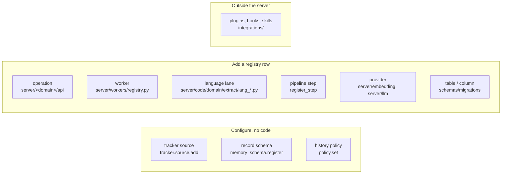

<!-- i18n: source=docs/development/extending-loom.md blob=73da8dff0ce992ad0dcb19d796cbf828d8785b33 model=claude-sonnet-5-5 -->
> Esta página é uma tradução automática da [página em inglês](https://github.com/ClickHouse/loom/blob/main/docs/development/extending-loom.md), que prevalece.
> Machine-translated from the [English page](https://github.com/ClickHouse/loom/blob/main/docs/development/extending-loom.md), which is authoritative.

# Estender o Loom

O Loom tem um registro para cada tipo de coisa: operações, workers, configurações, provedores, lanes de linguagem, etapas de extração e fontes de tracker. Para estender o Loom, adicione uma linha ao registro certo; HTTP, MCP, os SDKs e a referência gerada acompanham.

Verifique primeiro se apenas dados resolvem. Uma fonte de tracker, um esquema de registro, um procedimento ou uma política de histórico são configurados, não programados.

## Escolha o ponto de extensão

| Você quer…                                                   | Ponto de extensão             | Onde                                                                                             | Guia                                                                   |
| ------------------------------------------------------------ | ----------------------------- | ------------------------------------------------------------------------------------------------ | ---------------------------------------------------------------------- |
| Expor uma nova capacidade para os chamadores                 | Uma operação                  | `server/<domain>/api/ops_<group>.py`, `server/<domain>/app/<group>.py`                           | [Adicionar uma operação](https://github.com/ClickHouse/loom/blob/main/docs/development/adding-an-operation.md)                             |
| Executar trabalho em segundo plano de forma agendada         | Um worker                     | `server/<domain>/workers/<name>.py`, uma linha em `server/workers/registry.py`                   | [Adicionar um worker](https://github.com/ClickHouse/loom/blob/main/docs/development/adding-a-worker.md)                                     |
| Armazenar algo novo                                          | Uma tabela ou coluna          | `schemas/migrations/<NNN>_*.sql`, `server/<domain>/store/`                                       | [Adicionar uma tabela](https://github.com/ClickHouse/loom/blob/main/docs/development/adding-a-table.md)                                       |
| Indexar uma nova linguagem de programação                    | Uma faixa de linguagem do índice de código | `server/code/domain/extract/lang_<lang>.py`, `lang_detect.py`, `server/code/app/index/ingest.py` | [Adicionar suporte a uma linguagem](https://github.com/ClickHouse/loom/blob/main/docs/development/adding-language-support.md)                     |
| Mudar o que a extração mantém para alguns chamadores         | Uma etapa do pipeline         | `register_step` em `server/memory/app/pipeline.py`                                               | [Pipeline de extração](https://github.com/ClickHouse/loom/blob/main/docs/guides/extraction-pipeline.md)                |
| Ler um novo issue tracker ou histórico de CI                 | Uma fonte de tracker (somente dados) | `tracker.source.add` + `tracker.source.set_mapping`                                       | [Contrato de registros do tracker](https://github.com/ClickHouse/loom/blob/main/docs/features/tracker/record-contract.md)      |
| Guardar fatos com identidade e campos tipados                | Um esquema de registro (somente dados) | `memory_schema.register`, `memory.record.write`                                         | [Escrita de memória](https://github.com/ClickHouse/loom/blob/main/docs/features/memory/writing.md)                        |
| Restringir o que os agentes podem fazer com base no histórico | Uma política de histórico (somente dados) | `policy.set`                                                                         | [Tokens e grants](https://github.com/ClickHouse/loom/blob/main/docs/guides/tokens-and-grants.md#add-history-policy) |
| Usar outro provedor de embedding ou de LLM                   | Um cliente de provedor        | `server/embedding/`, `server/llm/`                                                               | [abaixo](#add-a-provider)                                              |
| Adicionar uma configuração                                   | Um campo de configuração      | A seção da área em `server/settings/catalog.py`                                                  | [abaixo](#add-a-setting)                                               |
| Capturar sessões de outro cliente, ou distribuir orientações para agentes | Uma integração, hook ou skill | `integrations/`, `skills/`                                                         | [abaixo](#add-an-integration)                                          |

## O que toda extensão compartilha

- **O código é o registro.** Os transportes iteram `ALL_OPERATIONS`, o supervisor itera `_WORKERS` e a referência de configurações é gerada a partir de `server/settings/`. Cada registro tem um teste de snapshot ou de censo que falha até você regenerá-lo.
- **Arquivos gerados.** `make lint` executa cada gerador com `--check`: as tabelas de operações do SDK (`scripts/codegen/sdk_py_gen.py`, `sdk_ts_gen.py`), o manifesto de alcance (`op_reach_census.py`), as páginas de referência (`docs_reference.py`, `settings_reference.py`) e as cópias do plugin do Codex (`agent_plugin_sync.py`). Veja [geração de código](https://github.com/ClickHouse/loom/blob/main/docs/development/code-generation.md).
- **Maturidade.** Uma nova op declara `maturity="experimental"`, a menos que substitua uma op estável ([adicionando uma operação](https://github.com/ClickHouse/loom/blob/main/docs/development/adding-an-operation.md#5-check-reach-and-maturity)).
- **Medição.** Uma mudança no ranking, na extração ou em um padrão de provider executa o benchmark relevante antes e depois ([ajuste de desempenho](https://github.com/ClickHouse/loom/blob/main/docs/guides/performance-tuning.md#measure-first)).
- **Formas fundamentais não são pontos de extensão.** O engine (ClickHouse), a tupla de identidade, a auditoria de hash de conteúdo por linha e as cinco operações de revisão de crenças só mudam com uma justificativa de design no PR e na documentação de arquitetura ([visão geral do sistema](https://github.com/ClickHouse/loom/blob/main/docs/architecture/system-overview.md)).

## Adicionar um provedor

Embedders e LLMs são clientes escolhidos por configurações.

**Um embedder** fica em `server/embedding/`, ao lado de `openai.py`, `gemini.py`, `local.py` e `fake.py`. Ele compartilha a infraestrutura HTTP de `server/embedding/_provider.py`:

- novas tentativas apenas em status que permitem repetição, três tentativas;
- `EmbedderInputTooLarge` em vez de um truncamento silencioso pelo provedor;
- `MalformedEmbedding` para um vetor vazio, com largura errada ou não finito.

Conecte-o em `server/embedding/embedder.py`: a inferência do provedor a partir de `LOOM_EMBEDDING_MODEL` (`_inferred_provider`), os valores de `LOOM_EMBEDDING_PROVIDER` e as variáveis de chave em `KEY_ENVS`. Se a chave estiver ausente, o Loom recorre ao embedder fake e registra um erro no log.

**Um LLM** fica em `server/llm/`, ao lado de `openai.py`, `anthropic.py` e `fake.py`, e implementa `LLMClient` (`server/llm/client.py`). Conecte-o em `_build_llm_client` e em `DEFAULT_MODEL_BY_PROVIDER`, `KEY_ENV_BY_PROVIDER` e `resolve_llm_provider` (`server/core/llm_provider.py`).

> **Aviso:** um provedor altera a qualidade. Os limiares de similaridade são calibrados para `text-embedding-3-small`. Execute `make bench-quick` com um novo provedor antes de torná-lo o padrão. Um novo embedder exige `loom reembed` em cada namespace existente.

## Adicionar uma configuração

Um novo campo vai na seção da sua área em `server/settings/catalog.py` (`MemorySearch`, `Code`, `Tracker`, …), o único arquivo em que toda configuração é declarada. O comentário acima dele diz o que ele controla e o que seus valores significam; esse comentário vira a linha correspondente na [referência de configuração](https://github.com/ClickHouse/loom/blob/main/docs/reference/configuration.md) gerada. O nome da variável de ambiente é `LOOM_<FIELD>`.

Leia-o como `settings.<field>`, nunca como `getattr(settings, "<field>", default)`. O `tests/unit/test_settings_attribute_access.py` falha no segundo caso: um valor padrão copiado acaba divergindo e esconde o ponto de leitura de quem remove o campo. Regenere com `python scripts/codegen/settings_reference.py` e `python scripts/codegen/settings_schema.py`.

Para aposentar uma flag, exclua a configuração, o seu branch e qualquer campo por requisição que a carregava. Um cliente que ainda envie o campo continua sendo atendido, com o campo listado em `ignored_args`.

## Adicionar uma integração

| Integração                                | Onde                                                                | Notas                                                                                                                                                                                                                                                                                                    |
| ----------------------------------------- | ------------------------------------------------------------------- | -------------------------------------------------------------------------------------------------------------------------------------------------------------------------------------------------------------------------------------------------------------------------------------------------------- |
| Um hook ou skill de plugin de agente de código | `integrations/claude-code-plugin/` (`hooks/`, `lib/`, `skills/`)    | A fonte de verdade; `python scripts/codegen/agent_plugin_sync.py` copia scripts, skills e o ícone da listagem (`assets/`) para `integrations/codex-plugin/`. Conecte manualmente um novo hook ao `hooks.json` do Codex. Os clientes instalados recebem uma alteração quando a versão do plugin no manifesto muda. |
| Um hook de captura de sessão para outro cliente | `integrations/<client>/` (`cursor/`, `generic/`)                    | Chame `loom ingest-transcript` ou `conversation.append`, e `memory.set_from_messages` para a extração.                                                                                                                                                                                                   |
| Uma skill de agente portátil              | `skills/<name>/SKILL.md`                                            | Instalada pelo nome em qualquer cliente Agent-Skills; apenas orientação, sem hooks.                                                                                                                                                                                                                      |
| Um adaptador de framework                 | `sdk/python/loom/integrations/`, `sdk/typescript/src/integrations/` | Envolva o SDK na interface de store ou de memória do framework (`LoomStore` do LangGraph e `LoomMemoryStore` do Strands em Python, um adaptador do Strands em TypeScript).                                                                                                                               |
| Um backend de observabilidade             | `server/observability/`                                             | Os spans já carregam `loom.request_id` e são exportados por OTLP; prefira um coletor OTLP a um novo exportador.                                                                                                                                                                                          |

[Integrações](https://github.com/ClickHouse/loom/blob/main/docs/features/integrations/index.md) descreve as que já são distribuídas. [Integração de agentes](https://github.com/ClickHouse/loom/blob/main/docs/guides/agent-integration.md) cobre o que qualquer novo cliente deve escrever e ler.

## Relacionados

- [Guia do repositório](https://github.com/ClickHouse/loom/blob/main/docs/development/repository-guide.md)
- [Testes](https://github.com/ClickHouse/loom/blob/main/docs/development/testing.md)
- [Contribuindo](https://github.com/ClickHouse/loom/blob/main/CONTRIBUTING.md)
