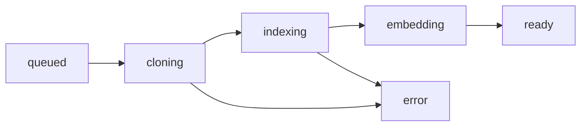

<!-- i18n: source=docs/features/code-index/repositories.md blob=dfd41b79236a859839f989a995deb2de9cd4ad2b model=claude-sonnet-5-5 -->
> Esta página é uma tradução automática da [página em inglês](https://github.com/ClickHouse/loom/blob/main/docs/features/code-index/repositories.md), que prevalece.
> Machine-translated from the [English page](https://github.com/ClickHouse/loom/blob/main/docs/features/code-index/repositories.md), which is authoritative.

<a id="adding-repositories"></a>

# Adicionando repositórios

Uma instalação nova não indexa nenhum repositório. As entradas vêm de duas fontes, combinadas: os
repositórios que as próprias pessoas adicionam e a configuração do operador. Uma entrada do operador
para um namespace adicionado aqui é ignorada (veja as regras abaixo). Um namespace de código corresponde a uma
branch ([visão geral](https://github.com/ClickHouse/loom/blob/main/docs/features/code-index/overview.md#one-namespace-is-one-branch)).

| Caminho             | Como                                                                                                 | Construído por                         | Camadas                                            |
| ------------------- | ---------------------------------------------------------------------------------------------------- | -------------------------------------- | -------------------------------------------------- |
| Autoatendimento     | **Repositories → Add repository** no painel, ou **Add branch** em um card que você mantém            | o worker `code_ingest`, em fatias      | camada rápida; camadas do compilador opcionais     |
| Configurado pelo operador | uma entrada em `LOOM_CODE_REPOS_JSON` (ou nas configurações escalares `LOOM_CODE_*`), depois `loom code backfill` | o operador, com a CLI `loom code` | camada rápida, mais a camada do compilador onde configurada |

O autoatendimento não exige acesso de operador nem ao shell para a camada rápida. As camadas do compilador são
upgrades de precisão opcionais e precisam da toolchain da linguagem na imagem do worker.

<a id="self-service-repositories"></a>

## Repositórios self-service

Exige `LOOM_CODE_SELF_SERVICE_ENABLED` e o worker `code_ingest`. Ambos estão habilitados
pela implantação Compose de desenvolvimento padrão; implantações personalizadas podem desabilitar qualquer um deles.

Exige também o [sandbox de jobs de repositório](https://github.com/ClickHouse/loom/blob/main/docs/operations/code-index-operations.md#repository-job-sandbox):
um repositório adicionado aqui recebe camadas do compilador que executam o próprio código de build dele, e seu
clone se comunica com um host escolhido pela pessoa; sem o sandbox, a adição é recusada
(`SANDBOX_UNAVAILABLE`) e as entradas já adicionadas deixam de ser buscadas ou indexadas.
Dos stacks Compose fornecidos, apenas o blue/green (`dev/docker-compose.colour.yml`)
o executa, em um host com o perfil AppArmor carregado. Nos demais, inclusive no stack
publicado, indexe um repositório por meio de `LOOM_CODE_REPOS_JSON`
([guia rápido](../../getting-started/quickstart.md#optional-index-a-repository-on-the-released-stack)).

Cada organização mantém no máximo `LOOM_CODE_SELF_SERVICE_MAX_REPOS` (20) entradas.

Qualquer membro autenticado de uma organização pode adicionar um repositório e se torna seu primeiro mantenedor.
O remoto pode ser `owner/name` (atalho do GitHub), uma URL HTTPS ou uma URL Git no estilo
SSH/scp. GitHub, GitLab e Bitbucket são identificados explicitamente; os demais servidores usam o
adaptador genérico. Caminhos locais e URLs `file://` são recusados. O remoto precisa responder a
`git ls-remote`, usando o token de acesso opcional para HTTPS ou a configuração SSH do worker.
Quando a branch está em branco, o Loom segue o `HEAD` simbólico do remoto; não há suposição de `master`.
O namespace é `code-<name>` para a branch padrão e
`code-<name>-<branch-slug>` nos demais casos.

O worker clona um espelho bare em `LOOM_CODE_REPOS_ROOT` (padrão
`var/code_repos/self`, um por repositório Git, compartilhado por suas branches). Ele constrói o
primeiro índice com `LOOM_CODE_BOOTSTRAP_FILES_PER_PASS` (400) arquivos por passada, com um cursor, de modo que uma
reinicialização retoma de onde parou. `code.repos` informa o progresso em `stage` e `stage_detail`:



A entrada permanece em `embedding` até que `LOOM_CODE_READY_EMBED_COVERAGE` (0.95) dos seus
chunks tenha um vetor; até lá, `code.search` responde de forma lexical
([atualização](https://github.com/ClickHouse/loom/blob/main/docs/features/code-index/freshness.md)).

| Op                          | Papel  | O que faz                                                                                                                                                 |
| --------------------------- | ------ | --------------------------------------------------------------------------------------------------------------------------------------------------------- |
| `code.repo.remote_branches` | viewer | o que o remoto Git mostra antes de qualquer gravação: provedor, branches e heads, branch padrão, branches no formato de release, cota e avisos de prontidão |
| `code.repo.add`             | viewer | adiciona `repo@branch` (em branco descobre a padrão do remoto), opcionalmente mais `branches`; acesso, filtros, `scip_producer`, `access_token`           |
| `code.repo.add_branch`      | admin  | indexa outra branch de um repositório que você mantém; herda remoto, token, prefixos e acesso                                                             |
| `code.repo.set_access`      | admin  | define `classification` (`standard` / `restricted`) e `join_policy` (`open` / `approval` / `closed`)                                                      |
| `code.repo.set_source`      | admin  | vincula os namespaces de tracker que este repositório lê, o principal primeiro ([visão geral do tracker](https://github.com/ClickHouse/loom/blob/main/docs/features/tracker/overview.md#linking-a-tracker-to-a-repository)) |
| `code.repo.remove`          | admin  | desativa um índice self-service; `confirm` deve ser igual ao namespace                                                                                    |

Os argumentos estão na [referência de operações](https://github.com/ClickHouse/loom/blob/main/docs/reference/operations.md#code).

Regras:

- Uma organização mantém no máximo `LOOM_CODE_SELF_SERVICE_MAX_REPOS` (20) entradas
  self-service ativas, incluindo branches (`REPO_QUOTA`). Uma branch já indexada, em qualquer
  namespace, ou cujo namespace contenha dados ou concessões que você não administra, é recusada
  com `REPO_EXISTS`; entre em um índice existente. Uma branch de uma entrada configurada pelo operador
  sem primeiro índice é recusada com `REPO_NOT_INDEXED` até que `loom code backfill`
  tenha sido executado para ela.
- As concessões de admin fluem entre as branches de um repositório em uma só direção. As
  entradas do operador passam seus admins a todas as branches do repositório, e uma branch adicionada aqui
  passa seus admins apenas a outras branches standard adicionadas aqui. Uma branch restricted
  adicionada aqui recebe apenas os admins do operador. Cada sincronização revoga as outras cópias que
  ela mantém, ou transforma a de um admin do operador em cópia da concessão do operador; uma cópia cujo
  `granted_by` nomeia uma entrada que a réplica não configura também é revogada
  (uma entrada desativada, ou uma nova que um deploy gradual ainda não alcançou: conceda novamente o admin nessa entrada). Uma branch cujos admins eram todos
  essas cópias fica sem nenhum, e somente uma concessão de admin em uma das entradas do operador do repositório
  a alcança. Um membro que tinha
  essa cópia pode ter concedido ou aprovado acessos a outros ali, inclusive a si mesmo: revise
  as concessões da branch. Ampliar a branch novamente não traz de volta uma cópia que uma restrição
  revogou; conceda esse admin novamente em uma branch irmã. Somente um admin com uma concessão dada ali,
  ou uma cópia de uma de uma entrada do operador, pode ampliá-la; uma cópia de uma branch adicionada aqui
  não conta.
- Uma revogação segue o mesmo caminho. Uma feita em uma entrada do operador remove de uma branch
  adicionada aqui apenas uma concessão copiada, e nenhuma de uma branch standard enquanto o sujeito mantiver
  uma concessão de admin dada em uma branch adicionada aqui. Uma cópia que é o único admin de uma branch
  permanece, exceto em uma branch restricted adicionada aqui, onde a revogação leva uma cópia cuja
  origem não é uma entrada do operador (uma cujo titular mantém uma concessão de admin dada em uma
  entrada do operador diferente da revogada é reescrita pela próxima sincronização); uma
  cópia do operador mantida ali some na próxima sincronização quando sua concessão do operador deixar de existir.
- Uma entrada do operador que nomeia um namespace adicionado aqui (`code.repo.add` ou
  `code.repo.add_branch`), mesmo que removido depois, é ignorada, com um aviso no
  log do servidor, pois as concessões de quem o adicionou passariam a ser as de uma entrada do operador.
  Remover a branch não libera o nome: liste a entrada em outro namespace.
  Uma linha de registro sem tipo é lida como a linha de acesso da entrada, um namespace
  criado por um membro com `namespace.register` não tem linha de registro, e enquanto o
  self-service está desligado o registro não é lido: revise as concessões de um namespace antes de
  listá-lo em cada um desses casos.
- A linha de acesso que `code.repo.set_access` grava para uma entrada do operador não é listada
  enquanto a entrada está fora da configuração, portanto o namespace não é indexado; ela
  volta a valer se a entrada retornar, e não conta na cota de repositórios da organização. Uma linha de registro sem tipo é listada
  como uma branch adicionada aqui quando sua entrada deixa de existir.
- Uma cópia em um namespace do operador cujo `granted_by` é `repo-maintainers:<namespace>`
  e nomeia uma branch adicionada aqui, ou um namespace que não está mais configurado, permanece até ser revogada:
  liste essas concessões e revogue as que não devem continuar.
- Enquanto o self-service está desligado, uma revogação em uma entrada do operador não vê nenhuma branch adicionada aqui,
  portanto uma cópia ali da concessão revogada permanece quando o self-service é religado:
  revogue-a nessa branch.
- Um repositório restricted nunca é `open`: `code.repo.add` define `approval`. Ampliar um índice
  restricted para standard exige `confirm` igual ao namespace.
- O token de um repositório privado é armazenado criptografado com uma chave derivada de
  `LOOM_JWT_SECRET` e nunca é retornado. Rotacionar esse segredo torna os tokens armazenados
  inutilizáveis até que um mantenedor os informe novamente.
- `code.repo.remove` desativa as linhas do registro e elimina todas as linhas `code_*` do
  namespace por meio de uma saga de apagamento retomável. O espelho é excluído quando nenhuma outra branch
  o usa. Uma entrada configurada pelo operador é recusada com `REPO_FROM_CONFIG`.
- `LOOM_CODE_SELF_SERVICE_ENABLED=false` remove o recurso (`SELF_SERVICE_OFF`).
- `LOOM_CODE_INTEL_ENABLED=false` recusa toda op `code.repo.*`, exceto `code.repo.remove`,
  com `PRECONDITION_FAILED`, como faz com toda outra op `code.*`. Uma desativação com a chave desligada
  elimina o índice e o espelho desta réplica; as outras réplicas só varrem sua cópia do espelho
  quando a inteligência de código for ligada novamente.

Adicione um repositório público e uma branch de release em uma única chamada:

```bash
curl -fsS -X POST "$LOOM_BASE_URL/v1/code.repo.add" \
  -H "Authorization: Bearer $LOOM_API_KEY" -H 'Content-Type: application/json' \
  -d '{"org":"acme","repo":"acme/widgets","branch":"main","branches":["release/2.4"]}'
```

A resposta nomeia o namespace de cada branch. As branches que não puderam ser adicionadas voltam em
`skipped` com o motivo.

<a id="repository-profiles-and-compiler-preflight"></a>

## Perfis de repositório e preflight do compilador

Toda entrada informa um `profile` e um `provider` em `code.index_status`. O perfil `generic` controla a busca, os símbolos, as chamadas, o impacto e os pacotes de contexto independentes de repositório. O perfil `clickhouse` identifica as convenções exclusivas do ClickHouse para registro de SQL, códigos de erro e testes stateless; essas suposições não são inferidas apenas porque um projeto contém C++ ou SQL.

`compiler_candidates` é inferido a partir dos manifestos de build. Um candidato sem watermark aparece em `quality_warnings` com os workers a habilitar:

| Candidato             | Preflight no ambiente do worker                                                                                                                                                | Worker                                       |
| --------------------- | ------------------------------------------------------------------------------------------------------------------------------------------------------------------------------ | -------------------------------------------- |
| C/C++                 | `scip-clang --version` (na imagem amd64); o CMake do repositório é configurado com clang 21                                                                                    | `code_scip_full`, depois `code_scip_delta`   |
| TypeScript/JavaScript | O indexador e os gerenciadores de pacotes estão incluídos no Docker; servidores nativos executam `sh scripts/install-code-toolchains.sh`. As dependências do repositório são preparadas automaticamente. | `code_scip_ts_delta`                         |
| Go                    | `scip-go --version`; `go env` é bem-sucedido para todos os módulos                                                                                                             | `code_scip_go_delta`                         |
| Python                | `scip-python --version`; as importações do projeto são resolvidas no respectivo ambiente                                                                                       | `code_scip_py_delta`, depois `code_scip_apply` |

A camada rápida continua utilizável quando o preflight do compilador falha. `code.index_status` e a aba Health expõem erros dos workers, cobertura por linguagem, arestas não resolvidas, cobertura de embeddings e atualização. O histórico de PRs e revisões usa atualmente a API do GitHub; outros provedores continuam recebendo o histórico do Git e a inteligência de código, com um aviso explícito durante o onboarding.

<a id="operator-configured-repositories"></a>

## Repositórios configurados pelo operador

`LOOM_CODE_REPOS_JSON` contém um objeto por branch indexada. Os campos da entrada,
os pré-requisitos (imagem, embedder, espelhos graváveis, token do GitHub), o primeiro índice
(`loom code init`, `backfill`, `backfill-prs`, `scripts/ops/code_intel_bootstrap.sh`),
a camada do compilador e as outras branches estão no
[runbook de operações do índice de código](https://github.com/ClickHouse/loom/blob/main/docs/operations/code-index-operations.md). O worker
nunca inicia uma entrada configurada pelo operador; uma entrada sem a marca d'água `git_head` é ignorada
até que `loom code backfill` seja executado. Todas as configurações estão na
[referência de configuração](https://github.com/ClickHouse/loom/blob/main/docs/reference/configuration.md#code).

<a id="who-can-read"></a>

## Quem pode ler

Os namespaces de código seguem as regras usuais de concessão
([identidades e namespaces](https://github.com/ClickHouse/loom/blob/main/docs/concepts/identities-and-namespaces.md),
[tokens e concessões](https://github.com/ClickHouse/loom/blob/main/docs/guides/tokens-and-grants.md)): um token precisa citar o namespace
de código (ou `*`), caso contrário a chamada falha com `AUTH_INSUFFICIENT`. Três chaves alteram
isso:

| Chave                                                             | Efeito                                                                                                                                       |
| ----------------------------------------------------------------- | -------------------------------------------------------------------------------------------------------------------------------------------- |
| `LOOM_CODE_ORG_READABLE=true`, ou o `org_readable` da entrada     | todo principal autenticado da organização lê sem uma concessão (desativado por padrão); as escritas continuam dependendo de concessão       |
| `LOOM_CODE_REPO_PUBLIC=true`, ou o `public` da entrada            | o namespace é registrado com `join_policy=open` e visível para descoberta, de modo que qualquer membro da organização entra como leitor imediatamente; caso contrário, a política é `approval` |
| `classification: "restricted"` (entrada, ou `code.repo.set_access`) | nunca é legível pela organização nem público; um mantenedor aprova cada leitor, e toda leitura exige um token que cite o namespace e uma concessão direta ativa |

Uma linha de `code.repo.set_access` prevalece sobre a classificação e a política de entrada configuradas
e sobrevive a reinicializações. `code.refresh` (writer) e as operações de admin sempre exigem uma concessão.

<a id="failure-modes"></a>

## Modos de falha

| Sintoma                                           | Causa e correção                                                                                                                                                                                                                                                       |
| ------------------------------------------------- | ---------------------------------------------------------------------------------------------------------------------------------------------------------------------------------------------------------------------------------------------------------------------- |
| Uma entrada configurada nunca é indexada          | não há marca d'água `git_head`: execute `loom code init` e `loom code backfill`; ou o namespace foi adicionado pela página (removido depois ou não), e o log diz que a entrada foi ignorada: liste-a em outro namespace                                                 |
| Adicionar um repositório responde `SANDBOX_UNAVAILABLE` | este deployment não consegue executar o sandbox: liste o repositório em `LOOM_CODE_REPOS_JSON` (a menos que `LOOM_CODE_SANDBOX_REQUIRED` esteja definido, o que também ignora esses), ou consulte os [requisitos do sandbox](https://github.com/ClickHouse/loom/blob/main/docs/operations/code-index-operations.md#repository-job-sandbox) |
| Um card de autoatendimento fica em `error`        | leia `stage_detail` em `code.repos`; um clone com falha é tentado de novo na próxima passagem (timeout `LOOM_CODE_BOOTSTRAP_CLONE_TIMEOUT_S`)                                                                                                                         |
| Um repositório privado de autoatendimento para de buscar | `LOOM_JWT_SECRET` foi rotacionado; informe o token novamente                                                                                                                                                                                                    |
| Uma entrada está ausente em `code.repos`          | verifique `loom.code.repos_config_errors`; `code.repos` também lista apenas o que o chamador pode ler                                                                                                                                                                  |
| Revogar ou rebaixar um admin responde busy        | uma revogação em um namespace de código primeiro relê `loom.code_repos`, de modo que enxerga os branches adicionados aqui a partir de outro processo, e responde busy enquanto essa leitura falhar; tente de novo quando a leitura for bem-sucedida                      |
| Um branch restrito adicionado aqui não tem admin  | todos os seus admins eram cópias de branches adicionados aqui, que a sincronização revoga; conceda admin em uma das entradas de operador do repositório (se não houver nenhuma, o operador lista primeiro um branch dele em `LOOM_CODE_REPOS_JSON`)                    |
| Um novo mantenedor não tem os outros branches     | a concessão de admin foi feita antes de este processo ler `loom.code_repos` (esse processo registra `not synced` na primeira vez); a próxima concessão de admin ou aprovação em um branch do repositório, ou um branch adicionado, a copia; ou conceda-a novamente      |
| As respostas são apenas lexicais                  | a entrada não atingiu `LOOM_CODE_READY_EMBED_COVERAGE` ([atualidade](https://github.com/ClickHouse/loom/blob/main/docs/features/code-index/freshness.md))                                                                                                              |

<a id="related"></a>

## Relacionados

- [Visão geral](https://github.com/ClickHouse/loom/blob/main/docs/features/code-index/overview.md) e [operações por pergunta](https://github.com/ClickHouse/loom/blob/main/docs/features/code-index/operations.md)
- [Atualização dos dados](https://github.com/ClickHouse/loom/blob/main/docs/features/code-index/freshness.md) e [histórico e PRs](https://github.com/ClickHouse/loom/blob/main/docs/features/code-index/history-and-prs.md)
- [Runbook de operações do índice de código](https://github.com/ClickHouse/loom/blob/main/docs/operations/code-index-operations.md)
