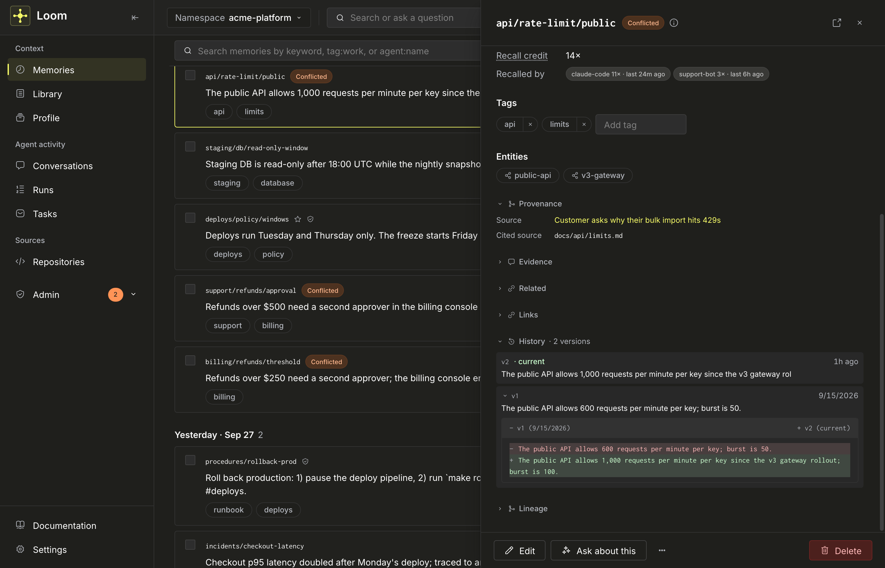

<!-- i18n: source=docs/features/memory/history-and-provenance.md blob=331db28f47c0d0f68295a93f97f4f36b6e5051ad model=claude-sonnet-5-5 -->
> Esta página é uma tradução automática da [página em inglês](https://github.com/ClickHouse/loom/blob/main/docs/features/memory/history-and-provenance.md), que prevalece.
> Machine-translated from the [English page](https://github.com/ClickHouse/loom/blob/main/docs/features/memory/history-and-provenance.md), which is authoritative.

<a id="history-and-provenance"></a>

# Histórico e proveniência

Toda escrita na memória cria uma nova versão; nada é editado no local. As versões são mantidas
em um espelho somente de acréscimo (append-only), de modo que o histórico de um fato sobrevive às mesclagens em segundo plano. Cada linha
registra quem a escreveu e como ela entrou na memória, as linhas derivadas registram suas fontes, e uma
pessoa pode atestar que uma linha é verdadeira. O funcionamento do espelho de versões está descrito em
[arquitetura de memória](https://github.com/ClickHouse/loom/blob/main/docs/architecture/memory-architecture.md).



<a id="operations"></a>

## Operações

| Operação             | Papel  | Responde                                                                                                                                         |
| -------------------- | ------ | ------------------------------------------------------------------------------------------------------------------------------------------------ |
| `memory.history`     | viewer | Todas as versões de uma chave, da mais recente para a mais antiga, incluindo versões com tombstone e versões com conteúdo sensível removido (redact). |
| `memory.provenance`  | viewer | De onde veio a linha ativa: trace de origem, escritor, classe da origem e a conversa da qual foi extraída.                                       |
| `memory.evidence`    | viewer | Os turnos de origem dos quais um fato foi extraído, com o trecho que o sustenta e como cada vínculo foi criado.                                  |
| `memory.backlinks`   | viewer | O que aponta para uma linha: versões, digests, links tipados de entrada e saída, contagem de evidências, entidades vizinhas.                     |
| `memory.lineage`     | viewer | O histórico de promoção de uma memória compartilhada: quem a promoveu, a partir de quais linhas e por qual revisão.                              |
| `memory.verify`      | writer | Atesta que uma linha é verdadeira em nome da pessoa ou da conta de serviço autenticada, ou revoga a atestação.                                   |
| `memory.redact`      | admin  | Remove (oculta) o valor sensível de uma versão histórica, mantendo a linha e sua entrada de auditoria.                                           |
| `namespace.rollback` | admin  | Retorna todos os heads de memória de um namespace à versão que tinham em um ponto no tempo.                                                      |
| `namespace.snapshot` | admin  | Exporta o estado curado de um namespace como um payload JSON.                                                                                    |
| `namespace.restore`  | viewer | Importa um snapshot para um namespace novo, ou para um existente que o chamador administra; nunca para uma collection.                           |

`namespace.snapshot` e `namespace.restore` não são ferramentas MCP. As listas de campos estão
na referência de operações, em [memória](https://github.com/ClickHouse/loom/blob/main/docs/reference/operations.md#memory) e
[namespace](https://github.com/ClickHouse/loom/blob/main/docs/reference/operations.md#namespace).

<a id="versions-memoryhistory"></a>

## Versões: `memory.history`

`loom.memory` guarda o estado atual e é lida com `FINAL`, de modo que um merge mantém apenas a
versão mais recente de cada linha. `loom.memory_versions` é um espelho somente de acréscimo (append-only), preenchido por uma
materialized view a cada insert; é o histórico que `memory.history`,
`memory.redact` e `namespace.rollback` leem.

Uma linha de histórico traz `version` (a época em nanossegundos da escrita), `written_at`, `value`,
`confidence`, `pinned`, `expires_at`, `tombstoned_at`, `redacted_at`,
`redaction_reason`, `content_sha256`, `agent`, `actor` e `source_class`. `created_at`
é a primeira escrita da linha e se repete em cada versão. `agent="*"` abrange todos os escritores da
chave.

```python
from loom import Agent

async with Agent(org="acme", namespace="support", agent="auditor") as agent:
    for v in await agent.memory.history("customer/4812/plan", agent_id="*"):
        print(v["written_at"], v["actor"], v["source_class"], v["value"])
```

Um tombstone também é uma versão, então uma exclusão aparece no histórico e `memory.restore` pode
reviver a chave em até 14 dias. Para leituras do estado atual em um ponto no tempo, use `as_of` em
`memory.get`, `memory.search` e `memory.ask`
([tempo de validade](https://github.com/ClickHouse/loom/blob/main/docs/features/memory/writing.md#validity-time-valid_at-and-valid_to)).

<a id="who-wrote-it-actor-and-source-class"></a>

## Quem escreveu: actor e source class

O servidor grava `actor` (`human:<subject>` ou `process:<subject>`) e `source_class`
em cada linha, a partir do token e da operação. Os valores de `source_class` estão em
[conceitos de memória](../../concepts/memory.md). Uma requisição só pode rebaixar sua classe para
`external`, `imported` ou `derived`.

`memory.provenance` retorna os dois, além de:

- `source_trace` e um `source_kind` derivado dele (`conversation`, `extracted`,
  `observed`, `consolidated`, `app`, `manual`, `other`);
- o `source_resource_id` citado pelo autor da escrita;
- o `thread_id` da conversa e `thread_exists` (falso quando o namespace não
  registra transcrições, ou a transcrição não existe mais);
- os vínculos criados manualmente (`memory.link`) que tocam a linha.

Os resultados de busca trazem `source_class` e `verified`, que o termo opcional de confiança
(`LOOM_MEMORY_SEARCH_TRUST_WEIGHT`) lê.

<a id="evidence-which-turns-a-fact-came-from"></a>

## Evidência: de quais turnos um fato veio

A extração vincula cada fato aos seus turnos em `loom.memory_belief_sources`.
`memory.evidence(memory_key)` retorna esses vínculos com o texto do turno (até 600
caracteres), o papel, o horário, o trecho de apoio (`span`) e a forma como o vínculo foi criado:

| `scope`   | `support_type`    | Significado                                                              |
| --------- | ----------------- | ------------------------------------------------------------------------ |
| `cited`   | `extracted_from`  | O extrator indicou o turno de apoio.                                     |
| `lexical` | `lexical_support` | O servidor associou o fato ao turno que melhor correspondia.             |
| `window`  | `window`          | Nada correspondeu; a janela de extração inteira é vinculada.             |
| `derived` | `derived_from`    | Linhagem da consolidação: o item é o texto da memória de origem.         |

A resposta contabiliza os vínculos por escopo, de modo que uma verificação consiga distinguir um fato citado de um vinculado de forma frouxa. Para a redação exata de uma conversa, `memory.recall` pesquisa os turnos armazenados
([extração](https://github.com/ClickHouse/loom/blob/main/docs/features/memory/extraction.md)).

<a id="lineage"></a>

## Linhagem

- `memory.consolidate` e os resumos periódicos gravam um link `derived_from` por fonte em
  `loom.memory_belief_sources`; `memory.evidence` os retorna como itens `derived`.
- O resumo de uma sessão lista as chaves que ele comprimiu (`derived_from` em um resultado `summary`).
- `memory.lineage` (`scope="shared"`) percorre a promoção de uma memória compartilhada: o evento, quem
  a promoveu, as linhas de apoio, o candidato a aprendizado de onde ela veio, quando há correspondência
  (`match_confidence` `exact` ou `inferred`), e os eventos de auditoria. `mechanism` é
  `review`, `import`, `auto` ou `unknown`.
- `memory.backlinks` é o inverso: o que aponta para uma linha.

`memory.delete` aposenta um resumo consolidado cujas fontes foram todas removidas e rebaixa
para `conflicted` um resumo que ainda tem fontes remanescentes.

<a id="attestation-memoryverify"></a>

## Atestação: `memory.verify`

`pinned` e `confidence` não dizem quem verificou um fato. `memory.verify` registra isso: o
ator do token do chamador e o hash de conteúdo que ele atestou. Enderece a linha por
`memory_id`, ou por `namespace` e `memory_key` com a identidade do writer. Exige
permissão de writer no namespace da linha.

`memory.get` e `memory.get_by_id` retornam `verification`, derivado do hash armazenado
e do hash atual da linha:

| `verification` | Significado                                                       |
| -------------- | ----------------------------------------------------------------- |
| `human`        | Uma pessoa atestou e o conteúdo não mudou desde então.            |
| `process`      | Uma conta de serviço atestou e o conteúdo não mudou desde então.  |
| `stale`        | Alguém atestou, e o conteúdo mudou desde então.                   |
| `none`         | Nunca foi atestado, ou foi revogado.                              |

- Uma edição não limpa uma atestação; ela a torna `stale` até que alguém verifique novamente.
- `revoke=true` a limpa. Verificar novamente uma linha inalterada pelo mesmo ator não faz nada
  (`changed=false`).
- O prefixo `human:` vem do token, então um agente não pode marcar sua própria escrita como human.
  O `actor` do corpo só é lido no modo dev sem autenticação.
- Snapshots e restaurações carregam as colunas de atestação; uma restauração nunca remove
  `verified_by`.

<a id="scrubbing-history-memoryredact"></a>

## Apagando o histórico: `memory.redact`

`memory.redact(memory_id, version)` oculta o texto de uma versão histórica em todos os lugares onde ele foi copiado, e também todas as versões de perfil que um modelo construiu a partir da memória. Ele grava `redacted_at` e `redaction_reason`, e mantém as linhas e suas entradas de auditoria. Use-o para um segredo ou um dado pessoal que vazou para uma versão anterior. Aqui, redigir significa remover ou ocultar conteúdo sensível por motivo de privacidade, não escrever nem compor texto.

| Onde                                              | O que acontece                                                                                                                                                  |
| ------------------------------------------------- | --------------------------------------------------------------------------------------------------------------------------------------------------------------- |
| `loom.memory`, `loom.memory_versions`             | `value` passa a ser `"[REDACTED]"`; `value_json`, `evidence`, `entities` e `concepts` são limpos.                                                               |
| `loom.memory_embeddings`, `loom.memory_chunks`    | As linhas cujo trecho ou hash de chunk não é o da versão atual (head) são excluídas; as linhas da versão atual permanecem.                                      |
| As versões de perfil do usuário construídas a partir da memória | Toda versão cujo trace cita a memória tem o conteúdo ocultado do mesmo modo, inclusive a versão atual, junto com as linhas derivadas da sua chave.      |
| `loom.shared`, uma cópia promovida a partir da chave | Toda versão cujo `value` é o texto ocultado pela redação passa a ser `"[REDACTED]"`, e suas linhas de busca são excluídas. Uma cópia ativa continua promovida até que um administrador a rebaixe. |

Fora do escopo: tags, arquivos, `content_sha256`, `loom.memory_evidence` (pertence ao apagamento definitivo), as tabelas de linhagem (apenas ids e hashes) e o grafo de entidades. Uma cópia compartilhada é deixada como está enquanto a versão atual também contém o texto ocultado (uma edição revertida byte a byte).

- Ele recusa a versão atual da memória (`refused_head=true`): exclua ou reescreva a chave antes. Um perfil ativo com conteúdo ocultado fica fora de renderizações, packs e buscas de perfil até que o worker o reconstrua.
- Os dois modos de lock o recusam, tanto na chave da própria memória quanto em qualquer chave de perfil que ele alcance.
- Ele exclui as respostas em cache de `memory.ask` e `code.ask` e os precedentes que citaram a chave ou a chave de uma cópia compartilhada (`cache_rows_deleted`, `precedent_rows_deleted`). Para uma chave de perfil que ele alcance, a exclusão vale para toda a organização: o perfil de cada usuário tem a mesma chave, então ele limpa toda resposta em cache e todo precedente da organização cuja janela continha essa chave, em todos os namespaces.
- O namespace é verificado depois da busca; uma recusa responde `redacted=false`, não 403.
- Uma versão que não existe responde `redacted=false` e não oculta nada, nem mesmo versões de perfil.
- Ele executa um `ALTER TABLE … UPDATE` síncrono nas duas tabelas de memória (e em `loom.shared` quando uma cópia ainda contém o texto) e um `DELETE` leve nas linhas derivadas: uma chamada administrativa.

Escritas que concorrem com a redação de uma cópia compartilhada (a limpeza de privacidade do histórico):

- uma linha de busca que o worker de embeddings grava depois da limpeza, a partir de um stub que ele leu antes, permanece até a próxima redação dessa chave; uma escrita comum não é o gatilho de limpeza;
- uma promoção da chave perde sua linha de busca até ser promovida novamente;
- um rebaixamento que leu a cópia antes da limpeza grava seu tombstone com o texto, que permanece até que essa versão específica seja redigida novamente; uma escrita comum não é o gatilho de limpeza.

Uma cópia que uma promoção posterior da sua chave substituiu, e que o `loom.shared` já mesclou e descartou, não é mais encontrada: sua linha de busca, que o `FINAL` não serve mais, permanece até uma limpeza posterior da chave, e as respostas em cache sob uma chave diferente da ocultada permanecem até expirarem. Esse é o limite de uma redação feita em regime de melhor esforço.

Uma cópia cujo valor é `"[REDACTED]"` conta como uma que uma redação anterior já ocultou, então uma memória que contém esse texto por si mesma e foi promovida perde suas linhas de busca na próxima redação da sua chave.

O alcance sobre perfis e seus limites estão em [segurança](https://github.com/ClickHouse/loom/blob/main/docs/architecture/security.md#sensitivity).
Para remover os dados de uma pessoa em todos os lugares, use [apagamento definitivo](https://github.com/ClickHouse/loom/blob/main/docs/features/memory/retention-and-erasure.md#erasure).

<a id="rolling-a-namespace-back-namespacerollback"></a>

## Revertendo um namespace: `namespace.rollback`

`namespace.rollback(as_of)` reinsere, para cada chave, a versão mais alta igual ou anterior a
`as_of` como a nova versão principal (head), e marca com tombstone as chaves criadas depois dela. A reversão em si gera novas
versões, então pode ser desfeita da mesma forma.

- Por padrão é uma simulação (dry run), que informa `reinstate`, `remove` e `sample`; `dry_run=false`
  a aplica.
- `memory_keys` (até 500) restringe o alcance; `max_keys` (padrão 5,000) limita uma chamada e
  `truncated` indica que é preciso chamar novamente.
- O `embedding_worker` gera novamente os embeddings das versões principais reinstaladas.
- Um `as_of` mais antigo que o histórico do namespace, ou no futuro, é recusado.

```bash
curl -sX POST http://localhost:7777/v1/namespace.rollback \
  -H "Authorization: Bearer $LOOM_API_KEY" -H 'Content-Type: application/json' \
  -d '{"org":"dev","namespace":"local","as_of":"<YYYY-MM-DD>T09:00:00Z"}' \
  | jq '{reinstate, remove, truncated, sample}'
```

<a id="snapshots-namespacesnapshot-and-namespacerestore"></a>

## Snapshots: `namespace.snapshot` e `namespace.restore`

`namespace.snapshot` exporta o estado curado de um namespace como JSON: cada linha de memória com
`version`, `content_sha256`, `actor`, `source_class`, colunas de validade e de atestação,
a configuração por tipo, as concessões (grants) e até `include_audit_tail_n` linhas
recentes de auditoria (padrão 1,000). `include_embeddings` é false por padrão, portanto o destino gera novamente os embeddings
com o próprio modelo.

`namespace.restore(target_namespace, payload)` grava o payload de volta como linhas de versão.
É idempotente em `snapshot_id` (uma nova execução responde `restored=false`). Ele restaura em um
namespace novo (o chamador passa a ser admin; é recusado para um nome sem linha que já
contenha dados ou concessões, a menos que o chamador já o administre) ou em um namespace que o chamador administra;
`rebind_agent` reatribui o escritor de cada linha. As linhas restauradas são `imported`.

Um snapshot não é um backup de implantação; consulte
[backup e recuperação](https://github.com/ClickHouse/loom/blob/main/docs/operations/backup-and-recovery.md).

<a id="the-audit-log"></a>

## O log de auditoria

Toda escrita que cria ou altera a memória deixa uma linha apenas com hash em `loom.audit_log`
(chave, id, hash do conteúdo, ator, classe da fonte, veredito; nunca o valor). Checkpoints
a cada hora encadeiam o log. Veja [auditoria](https://github.com/ClickHouse/loom/blob/main/docs/features/observability/audit.md).

<a id="limits"></a>

## Limites

- **A remoção de conteúdo sensível (redact) de uma versão que foi mesclada é feita em regime de melhor esforço** em `loom.memory`; o espelho é limpo de qualquer forma.
- **O histórico só é tão completo quanto o espelho.** Uma coluna adicionada a `loom.memory` deve ser adicionada a `loom.memory_versions` e à sua view na mesma migration.
- **A validade considera apenas o valid-time.** `knowledge_time` reproduz `created_at` em relação aos carimbos de desativação (`invalid_at`) e de exclusão (`tombstoned_at`); não existe uma tabela separada de transaction-time.
- **`thread_exists=false` não é um erro.**
- **Um rollback não restaura chaves excluídas definitivamente** (`skipped_no_head`).

<a id="related"></a>

## Relacionados

- [Gravação de memória](https://github.com/ClickHouse/loom/blob/main/docs/features/memory/writing.md)
- [Conflitos e recusa](https://github.com/ClickHouse/loom/blob/main/docs/features/memory/conflicts-and-refusal.md)
- [Retenção e exclusão](https://github.com/ClickHouse/loom/blob/main/docs/features/memory/retention-and-erasure.md)
- [Auditoria](https://github.com/ClickHouse/loom/blob/main/docs/features/observability/audit.md)
