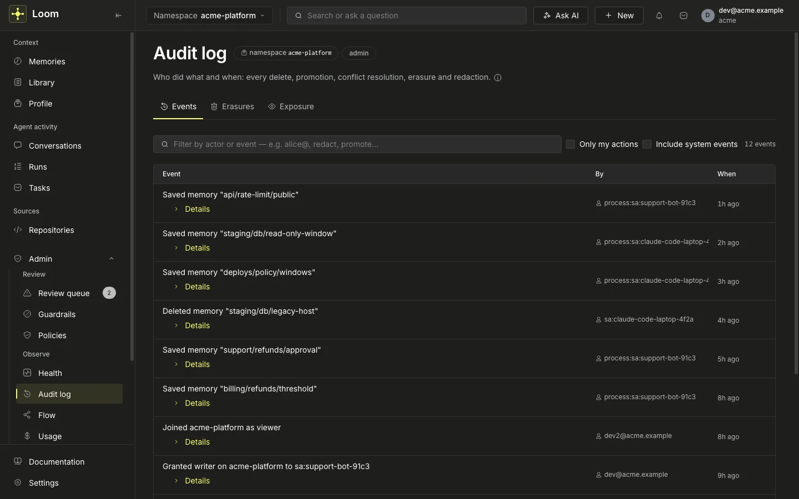

<!-- i18n: source=docs/features/observability/audit.md blob=8e4e9949ca4f7a4e54f9bad556832bda780a76c4 model=claude-sonnet-5-5 -->
> Esta página é uma tradução automática da [página em inglês](https://github.com/ClickHouse/loom/blob/main/docs/features/observability/audit.md), que prevalece.
> Machine-translated from the [English page](https://github.com/ClickHouse/loom/blob/main/docs/features/observability/audit.md), which is authoritative.

<a id="audit-log"></a>

# Log de auditoria

As linhas de auditoria, o worker `audit_verifier` e a cadeia de checkpoints vêm ativados por padrão.

O Loom grava uma linha em `loom.audit_log` para cada operação que altera o estado de uma forma pela qual alguém possa precisar prestar contas, além de alguns eventos gerados pelo próprio servidor. O objetivo é tornar a adulteração detectável. Cada linha carrega um SHA-256 do seu próprio conteúdo, e um worker sela as janelas horárias já encerradas em uma cadeia de hashes. Um administrador do ClickHouse ainda pode editar a tabela; a próxima passagem do verificador mostra a edição ou a exclusão. Isto é uma primitiva de engenharia, não uma certificação de conformidade.



<a id="what-leaves-an-audit-row"></a>

## O que gera uma linha de auditoria

| Origem                                                                | `event_type`                                                                                                                                                                                                                                  | `subject` contém                                                                                                                                                                                                                                                                                                                                                                                             |
| --------------------------------------------------------------------- | --------------------------------------------------------------------------------------------------------------------------------------------------------------------------------------------------------------------------------------------- | ------------------------------------------------------------------------------------------------------------------------------------------------------------------------------------------------------------------------------------------------------------------------------------------------------------------------------------------------------------------------------------------------------------- |
| Qualquer operação declarada `audit=True`                              | o nome da op (`memory.delete`, `grants.create`)                                                                                                                                                                                               | o `audit_subject` da op, quando ela declara um (sem credencial, ou com um hash para texto que um apagamento precisa alcançar); caso contrário, a entrada validada com todo valor de texto que não nomeia algo transformado em hash, como JSON                                                                                                                                                                  |
| `memory.set` (escritas pontuais)                                      | `memory.set`                                                                                                                                                                                                                                  | chave, id da memória, `content_sha256`, `source_class`, veredito, `pinned`. Nunca o valor                                                                                                                                                                                                                                                                                                                    |
| `memory.update`, `memory.update_by_id`                                | o nome da op                                                                                                                                                                                                                                  | chave, id da memória, `content_sha256`, `source_class`, versão e o veredito da verificação de conflito antes da marcação pós-escrita (`duplicate` para uma versão gravada como duplicata, vazio quando a linha revisada não tem embedding: um tipo que não tem, ou um valor `high`). Nunca o valor                                                                                                             |
| `memory.bulk_set`                                                     | `memory.bulk_set`                                                                                                                                                                                                                             | uma linha apenas com hashes por escrita                                                                                                                                                                                                                                                                                                                                                                      |
| Toda revisão confirmada no Postgres                                   | `memory.revision`                                                                                                                                                                                                                             | chave, id da memória, versão, `content_sha256`, `source_class`, status, `pinned`, tombstoned e, como ator, o principal do token; se não houver, o da etapa do pipeline; senão `-` em uma requisição e `process:loom` nos jobs do próprio Loom. Armazenada junto com a revisão, portanto não é fail-open: é repetida até ser gravada ou estacionada ([autoridade de armazenamento](../../architecture/storage-authority.md#audit)) |
| `memory.import`                                                       | `memory.bulk_set` para os fatos que grava; `memory.import` para os vínculos de categoria que grava                                                                                                                                            | a linha apenas com hashes da escrita em lote; para os vínculos, `count` e `category_links` (chave e nome da categoria). Nunca o texto                                                                                                                                                                                                                                                                         |
| Uma leitura de uma linha `high`, ou de evidência mantida como `high`  | `memory.sensitive_read` (de `memory.get`, `memory.get_by_id`, `memory.bulk_get`, `memory.history`, `memory.evidence`, `namespace.snapshot`, `erasure.export` e `memory.export_evidence` com `include_high`)                                   | chave e id da memória (`memory.history` e `erasure.export` acrescentam a versão); para evidência liberada, seu tipo, sessão, índice do chunk e chaves vinculadas; para um turno de conversa servido por `erasure.export`, seu agente, id da thread e id da mensagem; para uma thread, seu agente e id da thread                                                                                                |
| Uma requisição admitida a um namespace restrito                       | `namespace.restricted_access` (de uma op que o nomeia, de `audit.list` que o nomeia (transporte `op`), do download e upload de documentos, de um inbox watch, de `admin/claim_release`, `admin/namespace.adopt`, das emissões de token delegado e do primer do MCP) | `op`, `transport`, o `token_id` e os `roles` do chamador; para uma emissão, `granted_to`, o subject do novo token                                                                                                                                                                                                                                                                                            |
| O Loom aposentando memórias por conta própria                         | `memory.auto_supersede`                                                                                                                                                                                                                       | `reason`, `count` e `retired`: até 200 linhas aposentadas (id, chave, agente, usuário e sessão, a linha e a chave atrás das quais cada uma foi aposentada, o rótulo do juiz, `judge_verdict`, `judge_confidence`, `judge_model` e `judge_prompt_version` para uma aposentadoria pelo resolvedor de conflitos, e `unconfirmed` (`"true"`) quando a releitura não pôde confirmar a aposentadoria). Nunca o valor. Mais linhas são divididas em vários eventos |
| `memory.restore` de uma linha substituída                             | `memory.unsupersede`                                                                                                                                                                                                                          | chave, id da memória, `superseded_by`, o `content_sha256` e a `version` restaurados                                                                                                                                                                                                                                                                                                                          |
| Uma linha de `grants.revoke` obtida sob outra grafia, ou uma entre várias | `grants.revoke`                                                                                                                                                                                                                           | `namespace`, o `subject` armazenado, `named` (o subject que a chamada nomeou) e `landed` (`"unknown"`) quando o insert da linha falhou. Ao lado da linha da própria op, que contém a entrada                                                                                                                                                                                                                 |
| O próprio servidor                                                    | `budget.violated`, `ratelimit.exceeded`, `worker.failed`, `audit.tamper_detected`, …                                                                                                                                                          | sobre o que é o evento                                                                                                                                                                                                                                                                                                                                                                                       |

A coluna **Audit** da [referência de operações](https://github.com/ClickHouse/loom/blob/main/docs/reference/operations.md) gerada
lista as ops que o transporte audita (o flag `audit` em cada `Operation`); as escritas de memória na
tabela acima gravam a própria linha e não têm marca ali. Nenhuma op de leitura é declarada
`audit=True`; a leitura de uma linha `high` grava `memory.sensitive_read` (acima). `audit.list` é
`audit=False`: ler a trilha adiciona apenas a linha de acesso restrito para um namespace restrito.

O transporte grava a linha depois que o handler tem sucesso (`emit_op_audit` em
`server/transport/_common.py`, para HTTP e MCP). A escrita é **fail-open**: um insert
que falha é registrado em log e a linha se perde; a operação continua com sucesso.

Para uma op `audit=True`, o subject é o seu `audit_subject`, quando ela declara um; caso contrário, a
entrada validada, conforme o formato de `audit.input_subject`. Campos que nomeiam aquilo sobre o que a chamada atuou ou quem atuou (os campos de identidade, os principais `subject`, `actor`, `grantee`,
`owner_email`, `requester`, `approver` e `decision_maker`, `version`, e nomes terminados
em id, key, URI, name, org, agent, namespace ou no sufixo `_by`) e campos tipados como
número, booleano, data ou hora, Literal ou Enum permanecem como enviados; um campo cujo nome
indica uma credencial (`audit.is_credential` em `server/observability/audit.py`) vira hash
seja qual for o sufixo. Um campo que contém um único modelo aninhado segue a mesma regra, e uma lista de
modelos vira hash inteira. Os principais e os campos `_by` mantidos como enviados são dados pessoais
que um apagamento não remove de `loom.audit_log`. Todo outro valor (um valor de memória, o
raciocínio de uma decisão, um motivo, os campos de um registro, as linhas de um snapshot restaurado) é
armazenado como `{"sha256", "chars"}`, seu SHA-256 e comprimento (o hash que o
`content_sha256` de uma memória teria, de modo que o de um valor movido coincide com ele), já que o apagamento não alcança
`loom.audit_log`. Três linhas que um handler grava por conta própria armazenam texto nesse formato sob o nome
do campo: o `rationale` de `memory.cross_promote` e de `memory.copy_to`,
o `reason` de `memory.proposal_accept` e de `memory.proposal_reject` (uma decisão que a política
do dono toma registra o modo e os limites da política), e
o `closed` de `triple.follows_row_supersession`, cujo ator é o principal que escreve
ou `process:loom`. O hash de um valor curto pode ser recuperado por tentativa; a regra mantém texto longo
fora da trilha, não toda palavra. Uma op cuja entrada carrega uma credencial (a senha de uma
fonte de tracker, o token de acesso de um repositório) declara um `audit_subject` que a
omite. Conceda acesso a `loom.audit_log` como aos dados que ele descreve.

<a id="the-row"></a>

## A linha

`loom.audit_log` é uma `MergeTree` particionada por mês e ordenada por
`(org, namespace, event_type, ts)`, com um índice bloom-filter em `request_id`.

| Coluna                                       | Significado                                                                                                                                                                                       |
| -------------------------------------------- | ------------------------------------------------------------------------------------------------------------------------------------------------------------------------------------------------- |
| `ts`                                         | UTC, precisão de milissegundos                                                                                                                                                                    |
| `event_type`                                 | nome da op ou evento do servidor                                                                                                                                                                  |
| `org`, `namespace`                           | o tenant que o gate autorizou                                                                                                                                                                     |
| `actor`                                      | o subject do token (`anonymous` quando a autenticação está desativada); a linha própria de uma escrita de memória (`memory.set`, `memory.bulk_set`, `memory.update`, `memory.update_by_id`) o registra como `kind:subject`, `-` sem token |
| `subject`                                    | texto JSON; quem chama decide se vai fazer o parse                                                                                                                                                |
| `request_id`                                 | une-se a `loom.agent_events` e ao header de resposta `X-Request-Id`                                                                                                                               |
| `row_hash`                                   | SHA-256 sobre a linha canônica                                                                                                                                                                    |
| `build_commit`, `instance`, `instance_label` | qual build e qual processo gravaram a linha                                                                                                                                                       |
| `consumer`                                   | o cliente em nome do qual a requisição foi feita                                                                                                                                                  |
| `token_id`                                   | a credencial que fez a requisição (seu `jti`, ou então um prefixo do hash do token)                                                                                                               |

O hash cobre `ts`, `event_type`, `org`, `namespace`, `actor`, `subject` e
`request_id` como JSON ASCII com chaves ordenadas (`_canonical` em `server/observability/audit.py`).
Os carimbos de build, instance, consumer e token ficam fora do hash, então adicionar uma coluna
de carimbo não invalida as linhas antigas.

`audit.list`, `erasure.export` e `namespace.snapshot` retornam o subject de uma linha
`erasure.failed` ou `erasure.abandoned` com o motivo da falha reduzido à etapa e ao tipo do
erro, de modo que um hash recalculado a partir dessas linhas pode diferir do armazenado.
`dev/verify_audit_chain.py` verifica as linhas armazenadas.

<a id="per-row-hashes-and-checkpoints"></a>

## Hashes por linha e checkpoints

Várias réplicas do servidor gravam ao mesmo tempo, então uma cadeia de hashes de linha para linha se bifurcaria. Em vez disso, cada linha carrega o próprio hash, e as gravações não precisam de coordenação. Um hash por linha detecta uma linha **modificada**, mas não uma linha removida; a cadeia de checkpoints cobre as remoções (o design está em [arquitetura de segurança](https://github.com/ClickHouse/loom/blob/main/docs/architecture/security.md)):

1. Quando uma janela de `LOOM_AUDIT_CHECKPOINT_WINDOW_SECONDS` (1 h) está fechada há
   `LOOM_AUDIT_CHECKPOINT_GRACE_SECONDS` (10 min), o worker `audit_verifier` a sela em
   `loom.audit_checkpoints`: a contagem de linhas, um SHA-256 sobre os hashes de linha ordenados e um
   `checkpoint_hash` que inclui o hash do checkpoint anterior.
2. Cada passagem recontabiliza as últimas `LOOM_AUDIT_CHECKPOINT_VERIFY_WINDOWS` (24) janelas seladas
   e verifica os vínculos novamente.

Um único worker sela, então a cadeia tem um único escritor e o caminho da requisição não paga nada. Uma remoção só aparece depois que a janela é selada, e somente enquanto a janela é recontada.

Uma recontagem é classificada por `classify` em `server/insights/domain/audit_checkpoints.py`:

| Achado         | Significa                                                                                       | Adulteração?                |
| -------------- | ----------------------------------------------------------------------------------------------- | --------------------------- |
| `deletion`     | menos linhas do que as seladas                                                                  | sim                         |
| `modification` | mesma contagem, digest diferente                                                                | sim                         |
| `chain`        | o hash de um checkpoint não é recalculado corretamente, ou ele não aponta para o seu antecessor | sim                         |
| `late_insert`  | mais linhas do que as seladas: um backfill ou um insert assíncrono muito atrasado               | não por si só; é reportado  |

Uma janela vazia também é selada, com o digest da string vazia, de modo que uma linha inserida nela depois resulta em uma divergência.

<a id="the-verifier-worker"></a>

## O worker verificador

`audit_verifier` (`server/insights/workers/audit_verifier.py`) é executado a cada
`LOOM_AUDIT_VERIFIER_INTERVAL_SECONDS` (uma hora) no processo que detém o lease dos workers.
Cada execução:

1. Recalcula o hash de todas as linhas da última hora (10,000 linhas por página, no máximo 500,000; além
   desse limite, informa `truncated`).
2. Verifica as janelas seladas e depois sela as janelas fechadas, no máximo
   `LOOM_AUDIT_CHECKPOINT_MAX_SEAL_PER_PASS` (48) por execução. Um erro nessa etapa é registrado como falha
   parcial e nunca bloqueia a verificação por linha.
3. Grava **uma** linha `audit.tamper_detected` para as quebras não informadas antes
   (`subject.break_keys`), de modo que uma quebra é informada uma vez, e não a cada hora.

O resultado da execução (`rows_checked`, `breaks`, `windows_sealed`, `windows_verified`,
`checkpoint_breaks`, `new_breaks`, `truncated`) é registrado em `loom.worker_status`, como o de
todos os workers; veja [processos em segundo plano](https://github.com/ClickHouse/loom/blob/main/docs/reference/workers.md).

<a id="checkpoint-lag"></a>

### Atraso do checkpoint

`loom.audit.checkpoint_lag_windows` conta as janelas de uma hora entre o `window_end` selado mais recente
e o momento atual. Ele é lido diretamente de `loom.audit_checkpoints`, então informa o valor mesmo
quando o selador está parado.

| Leitura                | Significado                                                                                 |
| ---------------------- | ------------------------------------------------------------------------------------------- |
| 0 ou 1                 | saudável: a cadeia fica atrás pelo período de tolerância                                    |
| subindo continuamente  | o selador está parado: o worker está desativado, falhando ou não detém o lease              |
| caindo                 | um backfill após uma parada; cada execução sela no máximo 48 janelas                        |
| 0 sem checkpoints      | nada foi selado até hoje (o indicador marca 0 em uma tabela vazia)                          |

Veja [telemetria](https://github.com/ClickHouse/loom/blob/main/docs/features/observability/telemetry.md#backlogs-and-process-state) para o restante do catálogo.

<a id="reading-the-trail"></a>

## Lendo a trilha

`audit.list` pagina as linhas do chamador da mais recente para a mais antiga, com um cursor keyset opaco. Uma página nunca termina no meio de uma escrita: as linhas gravadas por uma requisição no mesmo milissegundo vêm na mesma página, então uma página pode conter mais de `limit` linhas.

| Campo        | Significado                                                                      |
| ------------ | -------------------------------------------------------------------------------- |
| `org`        | obrigatório                                                                      |
| `namespace`  | um namespace que o chamador pode ler (caso contrário, uma página vazia); omita para todos |
| `event_type` | correspondência exata                                                            |
| `since`      | linhas com `ts >= since`                                                         |
| `limit`      | 1–500, padrão 50                                                                 |
| `cursor`     | `next_cursor` da página anterior; passe os filtros novamente junto com ele       |
| `fields`     | projeta as linhas de saída nesses campos                                         |

A op exige `viewer` e aplica os escopos por conta própria. Um namespace informado passa pela mesma verificação de uma leitura nele; informar um que você não pode ler retorna uma página vazia, não um 403. Sem `namespace`, um admin da org cujo token declara `*` lê a org, exceto os namespaces e coleções restritos que ele não pode ler, e um admin da plataforma lê a org, exceto os namespaces restritos que ele não pode ler, qualquer que seja sua declaração (uma sessão do painel nomeia apenas os namespaces da própria pessoa). Qualquer outro chamador, inclusive um admin da org cujo token lista namespaces, lê os namespaces que seu token ou suas concessões alcançam.

```bash
curl -s "$LOOM_BASE_URL/v1/audit.list" \
  -H "Authorization: Bearer $LOOM_API_KEY" -H 'Content-Type: application/json' \
  -d '{"org": "acme", "namespace": "support", "event_type": "memory.delete", "limit": 100}'
```

```python
from loom import Agent

async with Agent(org="acme", namespace="support", agent="auditor") as admin:
    page = await admin.audit.list(event_type="memory.delete", limit=100)
    while page.get("next_cursor"):
        page = await admin.audit.list(
            event_type="memory.delete", cursor=page["next_cursor"], limit=100
        )
```

A visão **Audit log** da gaveta de administração lê a mesma op. Ela oculta os eventos do servidor (`budget.violated`, `ratelimit.exceeded`, `worker.failed`) atrás de um botão de alternância e mostra o resumo de apagamentos ao lado da lista.

Para acompanhar uma requisição pelo ledger e pela trilha de auditoria:

```sql
SELECT ts, event_type, actor, subject FROM loom.audit_log WHERE request_id = '<id>';
SELECT * FROM loom.agent_events WHERE request_id = '<id>';
```

<a id="verifying-offline"></a>

### Verificando offline

`dev/verify_audit_chain.py` recalcula o hash de cada linha em uma janela com o `row_matches_hash` do worker. Saída 0 = todas passaram, 1 = divergência, 2 = não foi possível verificar. Uma divergência é identificada por partição, `ts`, `request_id` e hash armazenado, nunca por ator, assunto ou namespace.

```bash
python dev/verify_audit_chain.py --org acme --ts-since <YYYY-MM-DD> --json
```

<a id="erasure-and-the-audit-log"></a>

## Erasure e o log de auditoria

Um erasure mantém a trilha de auditoria, incluindo a sua própria linha de auditoria; o residue census não exige que `loom.audit_log` esteja vazia. Para um escopo `user_id`, a exportação compara `subject` por substring, já que a tabela não tem uma coluna `user_id`. Consulte [retenção e erasure](https://github.com/ClickHouse/loom/blob/main/docs/features/memory/retention-and-erasure.md).

<a id="settings"></a>

## Configurações

| Configuração                              | Padrão  | Efeito                                                                  |
| ----------------------------------------- | ------- | ----------------------------------------------------------------------- |
| `LOOM_AUDIT_VERIFIER_ENABLED`             | `true`  | executa o worker de verificação                                         |
| `LOOM_AUDIT_VERIFIER_INTERVAL_SECONDS`    | `3600`  | cadência das execuções                                                  |
| `LOOM_AUDIT_CHECKPOINT_WINDOW_SECONDS`    | `3600`  | duração da janela                                                       |
| `LOOM_AUDIT_CHECKPOINT_GRACE_SECONDS`     | `600`   | por quanto tempo uma janela deve ficar fechada antes de ser selada      |
| `LOOM_AUDIT_CHECKPOINT_VERIFY_WINDOWS`    | `24`    | janelas seladas recontadas a cada execução                              |
| `LOOM_AUDIT_CHECKPOINT_MAX_SEAL_PER_PASS` | `48`    | limite de janelas seladas por execução                                  |
| `LOOM_BUDGET_VIOLATION_AUDIT_INTERVAL_S`  | `60`    | no máximo uma linha `budget.violated` por op a cada intervalo (após o burst) |
| `LOOM_BUDGET_VIOLATION_AUDIT_BURST`       | `5`     | violações por janela que ainda gravam a própria linha                   |

Todas as configurações estão na [referência de configuração](https://github.com/ClickHouse/loom/blob/main/docs/reference/configuration.md).

<a id="limits-and-failure-modes"></a>

## Limites e modos de falha

- **Escritas fail-open.** Uma inserção de auditoria que falha perde a linha e nunca faz a operação falhar,
  exceto um `memory.restore` que desfaz uma retirada e um `namespace.restore`, que
  dependem do seu registro. Uma linha é inserida diretamente enquanto o trabalho é executado, sem passar por fila: a linha de uma
  op antes da sua resposta, a de uma exclusão desacoplada a cada etapa executada. Uma falha abrupta perde
  apenas as linhas do trabalho ainda em andamento (com `LOOM_RESTRICTED_AUDIT_INLINE=false`, também uma
  linha de acesso restrito gravada depois da sua resposta). Sob a autoridade Postgres, a linha de auditoria de uma
  escrita de memória fica durável no Postgres antes de a escrita responder ([auditoria](../../architecture/storage-authority.md#audit)).
- **Detecção, não prevenção.** Qualquer pessoa com acesso de escrita à tabela do ClickHouse pode
  alterá-la. O verificador mostra a alteração; ele não consegue desfazê-la.
- **Retrospectiva limitada.** A verificação por linha lê a última hora; a recontagem do checkpoint
  cobre as últimas 24 janelas seladas. Uma edição mais antiga que ambas não é reexaminada pelo
  worker. Execute `dev/verify_audit_chain.py` sobre as partições mais antigas.
- **Uma inserção tardia não é adulteração.** Um backfill em uma janela antiga é relatado como
  `late_insert`.
- **Sem TTL por padrão.** As linhas de auditoria expiram apenas sob uma janela de retenção:
  `LOOM_RETENTION_AUDIT_LOG_DAYS` acima de 0 para a tabela inteira, ou o
  `retention_days` de um namespace para as linhas desse namespace
  ([retenção configurada](https://github.com/ClickHouse/loom/blob/main/docs/features/memory/retention-and-erasure.md#configured-retention)).

<a id="related"></a>

## Relacionados

- [Telemetria](https://github.com/ClickHouse/loom/blob/main/docs/features/observability/telemetry.md): o ledger, as métricas e a atribuição de consultas.
- [Custo e uso](https://github.com/ClickHouse/loom/blob/main/docs/features/observability/cost-and-usage.md).
- [Arquitetura de segurança](https://github.com/ClickHouse/loom/blob/main/docs/architecture/security.md).
- [Histórico e proveniência](https://github.com/ClickHouse/loom/blob/main/docs/features/memory/history-and-provenance.md): o histórico de versões
  por memória, que é um mecanismo diferente.
