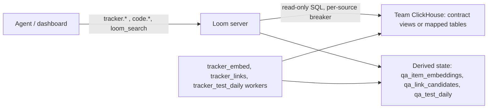

<!-- i18n: source=docs/features/tracker/overview.md blob=c43c9c14bbb3aece5e21c57716e38e3f7ca0c5e8 model=claude-sonnet-5-5 -->
> Esta página é uma tradução automática da [página em inglês](https://github.com/ClickHouse/loom/blob/main/docs/features/tracker/overview.md), que prevalece.
> Machine-translated from the [English page](https://github.com/ClickHouse/loom/blob/main/docs/features/tracker/overview.md), which is authoritative.

<a id="issue-duplicate-checks-and-regression-candidates-for-agents"></a>

# Verificação de duplicatas de issues e candidatos a regressão para agentes

Com `LOOM_TRACKER_ORG` definido e uma fonte registrada, o Loom permite que agentes verifiquem se um bug já foi reportado e classifiquem as mudanças que podem
ter introduzido uma regressão, usando registros do tracker e o histórico de PRs indexado.
Para um repositório
com histórico de PRs indexado e sem tracker, use
[histórico de código e candidatos a bisect](../code-index/history-and-prs.md).

Um tracker é o registro que uma equipe mantém de issues, pull requests, incidentes e execuções de CI, armazenado no
ClickHouse da própria equipe. O Loom o lê ao vivo com uma credencial somente leitura e nunca o copia.
Toda instrução é escrita com base no [contrato de registros](https://github.com/ClickHouse/loom/blob/main/docs/features/tracker/record-contract.md), então um novo
tracker não exige nenhuma mudança de código: a equipe expõe views com os nomes do contrato ou salva um mapeamento a partir de suas próprias tabelas.

As leituras ao vivo mantêm uma única cópia do registro sob o controle de acesso da equipe, e a
implantação não guarda nada que precise ser apagado. Toda leitura tem um orçamento de tempo e um
circuit breaker; quando a fonte não responde, o resultado informa `tracker_unavailable`.

O Loom mantém apenas estado derivado: embeddings de similaridade (`loom.qa_item_embeddings`),
vínculos issue→PR recuperados (`loom.qa_link_candidates`), um resumo diário de CI por teste
(`loom.qa_test_daily`), o ajuste de calibração da verificação de duplicatas e as fontes registradas
(`loom.qa_sources`, com credenciais criptografadas).



<a id="portability-and-record-types"></a>

## Portabilidade e tipos de registro

O plano de tracker é neutro em relação ao repositório. Jira, GitHub, GitLab, Linear, um help desk ou um tracker interno podem atender ao mesmo contrato por meio de views do ClickHouse ou de um mapeamento salvo; nenhum nome de repositório ou fornecedor é selecionado no código. Os registros lógicos obrigatórios são issues e pull requests/changes. Os nomes de tabela do contrato são `github_issues` e `github_prs`, mas o modo de mapeamento os apresenta no painel como **itens** e **alterações**, de modo que as tabelas e colunas da própria fonte não precisam ter esses nomes.

Registros estruturados opcionais habilitam mais operações: incidentes, casos de suporte, threads de chat, snapshots de risco de componentes, releases e saúde de releases, histórico de versões, verificações de CI, instâncias de nuvem e seus relacionamentos. São registros de tabela tipados, não anexos de arquivo. PDFs, arquivos do Office e documentos arbitrários pertencem ao plano Library; vincule suas URLs a partir das linhas do tracker quando uma issue precisar citá-los.

Um repositório pode vincular vários namespaces de tracker em ordem. As consultas por número usam o primeiro tracker, porque `#42` é ambíguo entre sistemas. A busca semântica, a verificação de duplicatas, o roteamento de respostas e as varreduras de candidatos de bisect leem todos os trackers vinculados aos quais o solicitante tem acesso, e cada item retornado informa o namespace do seu tracker.

<a id="tracker-namespaces"></a>

## Namespaces de tracker

Um tracker é lido por meio de **namespaces de tracker** (linhas de diretório com `kind = tracker`).
Cada um nomeia sua origem e os `repos` (prefixos `Org/repo` de `source_id`) que pode ler; um
repositório que não está listado nunca é lido.

| Tipo       | Lê                                                                                                                    | Política de entrada            |
| ---------- | --------------------------------------------------------------------------------------------------------------------- | ------------------------------ |
| standard   | adiciona `is_private = 0` a cada instrução; recusa `core_incidents`, `support_cases`, `slack_threads` de imediato     | `open` (padrão) ou `approval`  |
| restricted | também lê linhas privadas; toda leitura exige um token que nomeie o namespace, além de uma concessão direta ativa     | `approval`                     |

Os leitores entram com `namespace.join` (`role: "viewer"`): um namespace aberto admite na hora,
inclusive contas de serviço; um restrito aguarda o seu administrador. Os layouts e a aplicação das regras
estão em [público e privado](https://github.com/ClickHouse/loom/blob/main/docs/features/tracker/record-contract.md#public-and-private); o modelo de acesso está em
[identidades e namespaces](https://github.com/ClickHouse/loom/blob/main/docs/concepts/identities-and-namespaces.md).

<a id="the-operations"></a>

## As operações

Todas as ops do tracker recebem `org` (padrão `LOOM_TRACKER_ORG`) e um `namespace` obrigatório: um
namespace de tracker ou um namespace de código vinculado a um. Via MCP, cada op é uma ferramenta `loom_<op>`
(`loom_tracker_duplicate_check`). O toolset `tracker` lista as ops de pergunta;
`tracker.contract` e `tracker.source.*` podem ser chamadas pelo nome.

| Op                        | Responde                                                                                                                                               |
| ------------------------- | ------------------------------------------------------------------------------------------------------------------------------------------------------ |
| `tracker.duplicate_check` | Este rascunho já existe? Um veredito calibrado `duplicate_of` / `related` / `none`                                                                     |
| `tracker.similar`         | Os relatos que já dizem isso: issues e PRs duplicados e relacionados para um `text` colado, um `issue_number` ou `frames` de stack                     |
| `tracker.item`            | O registro de até dez números de issue ou PR: componente, severidade, veredito de bisect, branches afetadas, testes, CI, backports, o grafo fixes / caused-by |
| `tracker.links`           | Qual PR provavelmente corrigiu esta issue (ou qual issue este PR corrigiu) quando ninguém registrou o vínculo                                          |
| `tracker.flaky`           | Este teste é um flaky conhecido? As issues de teste flaky que o citam, opcionalmente com seu histórico de CI (`include_signal`)                        |
| `tracker.test_signal`     | Flaky, regressão ou infraestrutura? O histórico de CI de um único teste                                                                                |
| `tracker.release`         | Prontidão de release para uma versão: bloqueadores com status e o último snapshot de saúde                                                             |
| `tracker.component`       | O snapshot de risco de um componente e suas issues abertas, das mais graves às menos graves                                                            |
| `tracker.answer`          | Uma pergunta em prosa, ou as âncoras de um artefato, respondidas por templates nomeados; diz o que pesquisou (`explain_only` retorna o plano)          |
| `tracker.binding`         | O que um namespace pode perguntar ao plano de tracker: seus namespaces de tracker, o primário primeiro, e os templates que o chamador pode executar    |
| `tracker.contract`        | O contrato de registro e os templates de view em branco, antes de qualquer conexão                                                                     |
| `tracker.source.*`        | Registrar, inspecionar, verificar, remapear, rotacionar, listar e remover fontes ([contrato de registro](https://github.com/ClickHouse/loom/blob/main/docs/features/tracker/record-contract.md#adding-a-tracker-source)) |

O plano de código também lê um tracker vinculado (`code.bisect_candidates`, `code.backport_gap`,
`code.first_build`, `code.history`, `code.context_pack`; veja
[histórico e PRs](../code-index/history-and-prs.md#pr-and-tracker-planes)), e
[`loom_search`](https://github.com/ClickHouse/loom/blob/main/docs/features/unified-search.md) executa a verificação de duplicatas como uma etapa para uma consulta
com formato de defeito sob um escopo de código.

<a id="duplicate-check"></a>

### Verificação de duplicatas

`tracker.duplicate_check` recebe um rascunho como um relator o registraria: `title`, `body`,
`frames`, `component`, `version` (`X.Y`), os números de issue que ele cita em `mentions`, e
`paths` e `symbols` de código.

```python
from loom import Agent

async with Agent(org="acme", namespace="code-widgets", agent="triage-bot") as bot:
    res = await bot.tracker.duplicate_check(
        namespace="code-widgets",
        title="Upload hangs after token refresh",
        body="Steps: … Observed: the request never returns.",
        component="upload",
        paths=["src/upload/client.py"],
    )
    print(res["verdict"], res["epistemic"], res["answer"])
```

Ela executa as etapas de `tracker.similar` uma vez e pontua cada candidato fundido com o ajuste
logístico armazenado do namespace:

1. **Etapas.** BM25F sobre título e corpo com boosts de componente, versão e código de erro;
   IDF de frames com decaimento por posição; os itens que o texto nomeia por número; uma etapa vetorial sobre os
   embeddings do próprio Loom (`LOOM_TRACKER_SIMILAR_VECTOR_LEG`, apenas recall: ela adiciona
   candidatos, nunca reordena); e uma etapa de correção em andamento: os paths do rascunho → PRs que os
   alteram → as issues que eles corrigem.
2. **Veredito.** `duplicate_of` quando a probabilidade calibrada do primeiro candidato atinge o
   limiar de duplicata, `related` no limiar de relacionado, senão `none` sem itens. O
   ajuste é refeito semanalmente pela passagem `tracker_links` sobre as duplicatas rotuladas do próprio registro;
   o limiar sugerido por cada novo ajuste é servido, limitado por
   `LOOM_TRACKER_DUPCHECK_DUPLICATE_THRESHOLD_MIN` / `_MAX`.
3. **Juiz e rerank.** Em uma resposta `related`, uma chamada de LLM pode promover um candidato do mesmo
   defeito a `duplicate` (nunca rebaixar); uma chamada de rerank ordena as pistas de `nearest`, mas
   nunca muda o veredito. Ambas exigem um provedor de LLM real e falham de forma aberta.
4. **Vínculos.** As linhas de issue trazem seus PRs vinculados, o release em que uma correção é entregue e seus
   backports; em `none` ou `related`, `related_prs` lista PRs que talvez já tratem o
   rascunho ([`code.pr_check`](../code-index/history-and-prs.md#pre-pr-duplicate-check-codepr_check)).

`epistemic` indica o quanto confiar na resposta:

| Valor          | Significa                                                    |
| -------------- | ------------------------------------------------------------ |
| `calibrated`   | há um ajuste armazenado                                      |
| `uncalibrated` | sem ajuste: no máximo `related`, confiança nula              |
| `degraded`     | uma etapa ou um tracker não respondeu; um `none` não é liberação |
| `unavailable`  | o tracker não respondeu                                      |

`none` significa "nenhuma evidência calibrada de duplicata", não "não reportado"; leia a
lista `related` de qualquer forma. Quando endereçada a um namespace de código, a verificação lê todos os trackers que o
chamador pode ler, o vinculado primeiro, até `LOOM_TRACKER_DUPCHECK_FANOUT_NAMESPACES`
(padrão 4), e nomeia o namespace de cada item.

<a id="bisect"></a>

### Bisseção

`code.bisect_candidates` é endereçada ao namespace de código e lê o tracker vinculado a
ele: observações registradas anteriormente nas colunas de triagem de uma `issue_number`
(`triage_reproduces_on`, `triage_clean_on`) fornecem a janela de releases, e os diffs de PR do tracker (`github_prs.diff`,
`affected_file_paths`, o recurso `bisect` do contrato) são varridos em busca dos frames. Sem
frame, a varredura é limitada pelos padrões mais raros da issue
(`LOOM_TRACKER_BISECT_SCOPE_PATTERNS`) e pelos diretórios do seu componente
(`LOOM_TRACKER_BISECT_COMPONENT_DIRS`). Sem um tracker, a bisseção lê o próprio
histórico de PRs do repositório. Ela não reproduz a issue nem verifica as observações de triagem; ela
ranqueia PRs para um engenheiro ou agente de teste investigar. O fluxo completo está em
[histórico e PRs](../code-index/history-and-prs.md#bisect-candidates-codebisect_candidates).

<a id="from-a-bug-draft-to-candidate-prs"></a>

### Do rascunho de um bug aos PRs candidatos

Use esta sequência para verificar relatos anteriores e ranquear mudanças integradas sem compilar o
repositório. As requisições abaixo ilustram um rascunho; não são resultados registrados.

1. Verifique a configuração. As verificações de duplicatas exigem uma [fonte de tracker
   registrada](https://github.com/ClickHouse/loom/blob/main/docs/features/tracker/record-contract.md#adding-a-tracker-source) e um namespace que o chamador possa
   ler. Para usar o mesmo namespace de código nas duas operações, [vincule o
   tracker](#linking-a-tracker-to-a-repository) e inspecione `tracker.binding` ali.
   `kind: "none"` pode significar não vinculado ou recusado; isso não estabelece que não existe tracker.
   Um repositório apenas com [histórico de PRs
   indexado](../code-index/history-and-prs.md#the-pr-plane) pode ranquear mudanças, mas esse
   histórico não substitui a verificação de duplicatas do tracker.
2. Envie o rascunho para `POST /v1/tracker.duplicate_check`, usando o namespace de código vinculado
   ao tracker. Substitua o escopo de exemplo e as pistas de código pelos do seu repositório:

   ```json
   {
     "org": "acme",
     "namespace": "code-widgets",
     "title": "Upload hangs after token refresh",
     "body": "The upload request never returns after refreshing its token.",
     "paths": ["src/upload/client.py"],
     "symbols": ["UploadClient.send"]
   }
   ```

   Leia `verdict`, `epistemic`, `items`, `closest`, `related_prs` e `leg_status` em conjunto.
   Inspecione os relatos e correções vinculados antes de tratá-los como o mesmo defeito.
   `none` não autoriza concluir que o bug não foi reportado; uma leitura degradada ou indisponível
   deixa a questão da duplicata sem resolução.

3. Se a mudança que introduziu o problema ainda precisa de investigação, envie as pistas de código do relato para
   `POST /v1/code.bisect_candidates` nesse mesmo namespace de código:

   ```json
   {
     "org": "acme",
     "namespace": "code-widgets",
     "paths": ["src/upload/client.py"],
     "symbols": ["UploadClient.send"],
     "text": "Upload hangs after refreshing its token.",
     "before": "now",
     "limit": 5
   }
   ```

   Informe `issue_number` apenas para um relato real no tracker vinculado primário. Se
   releases bons e ruins foram observados, informe essas observações como descrito no
   [exemplo de janela de versões](../code-index/history-and-prs.md#bisect-candidates-codebisect_candidates).
   Aqui, `before: "now"` define o limite superior no momento da requisição; não é um
   instante de falha observado. Prefira limites de release observados, um limite superior de tempo observado em `before`
   (e `after` quando conhecido), ou um commit sabidamente ruim em `bad_sha`. Para um rascunho
   não registrado como este, omitir todos os limites de release e de tempo resulta em `unknown` com
   `no_failing_version`; nenhuma varredura de candidatos é executada. Um registro do tracker que já nomeia
   um commit ou PR introdutor pode, em vez disso, responder sem varredura. A operação não
   descobre a última versão boa.

4. Guarde a evidência junto com a investigação. Leia `candidates_from`, `epistemic`,
   `causes`, `tracker_unavailable` e qualquer `partial` / `partial_reason` ao lado da
   lista de candidatos. `candidates_from: "code_history"` identifica o fallback para o
   histórico do repositório, não uma leitura bem-sucedida do tracker. `matched_paths`,
   `matched_symbols` e `score` de cada candidato explicam seu ranking; `epistemic: "lower_bound"` significa
   que uma lista vazia não exclui nada. Inspecione o diff e compare o comportamento relatado
   antes e depois do candidato em uma reprodução ou teste separado. O ranking
   em si não prova nem o defeito nem sua causa.

<a id="ci-test-history"></a>

### Histórico de testes de CI

`tracker.test_signal` lê as execuções de CI de um teste na tabela `checks` e responde
`flaky`, `regression_candidate`, `infra_candidate`, `no_signal` (silêncio, não saúde) ou
`unknown_test` (com nomes de teste semelhantes). Ela pondera a taxa de falha e seu limite inferior de
Wilson, as alternâncias entre execuções consecutivas, as alternâncias em reexecuções do mesmo commit, as tempestades de falhas em muitos
testes não relacionados (infraestrutura) e a rotatividade dos arquivos de origem do teste. `pr_number` adiciona a
sequência de resultados do head desse PR; o código-fonte do teste é varrido em busca de indícios de teste flaky.

O worker `tracker_test_daily` consolida os checks em `loom.qa_test_daily` diariamente, de modo que uma leitura
busca no remoto apenas as horas ainda não consolidadas. A tabela de checks vem do `checks.from` da
entrada da fonte ([opções da entrada de fonte](https://github.com/ClickHouse/loom/blob/main/docs/features/tracker/record-contract.md#source-entry-options)),
senão da tabela `checks` da própria fonte, senão de `LOOM_TRACKER_CHECKS_FROM`; sem nenhuma delas, a op
não tem o que ler. `tracker.flaky` responde à pergunta mais barata: se issues de teste flaky
citam o teste (`flaky_by_issue` ou `no_flaky_signal`).

<a id="links-to-fixing-prs"></a>

### Vínculos com PRs de correção

Issues costumam ser fechadas sem uma aresta `fixes`. A passagem diária `tracker_links` pega cada issue
aberta nos últimos `LOOM_TRACKER_LINKS_ISSUE_DAYS` (90) dias, ranqueia os PRs do trunk integrados depois
dela (BM25F sobre título e corpo, palavras-chave de fechamento, frames de stack no diff, componente), e
grava os `LOOM_TRACKER_LINKS_PER_ISSUE` (20) melhores em `loom.qa_link_candidates`.
`tracker.links` os serve nas duas direções. Um consumidor que precisa de uma única correção
(`code.backport_gap`, bisect) usa o primeiro candidato apenas acima de
`LOOM_TRACKER_LINKS_MIN_SCORE` (1.0) e quando uma palavra-chave de fechamento nomeia a issue.

<a id="linking-a-tracker-to-a-repository"></a>

## Vinculando um tracker a um repositório

Um namespace de código lê seus trackers vinculados em ordem. O primeiro é o **primário**: seus
números são os números de issues e PRs do repositório, então as consultas por número (`tracker.item`,
fatos de PR, blame, backports, primeiro build) leem somente ele. As buscas (`tracker.duplicate_check`,
`tracker.similar`, `tracker.answer`, a etapa de registros de `loom_search`, a varredura de candidatos do bisect)
leem todos os trackers vinculados e informam a origem de cada resultado.

| Quem       | Como                                                                                                                                                                                                                                                                                                                                                                                              |
| ---------- | ---------------------------------------------------------------------------------------------------------------------------------------------------------------------------------------------------------------------------------------------------------------------------------------------------------------------------------------------------------------------------------------------------- |
| maintainer | `code.repo.set_source` com `tracker_namespaces` (admin do repositório e admin de cada tracker que os vínculos do próprio repositório ainda não contenham), ou a seção Trackers do cartão do repositório. Substitui o mapa do operador para esse repositório dentro de `LOOM_CODE_REPOS_REFRESH_SECONDS`. Um tracker cujos `repos` não cobrem o repositório é aceito com `not_covering`. |
| operator   | `LOOM_TRACKER_CODE_NAMESPACE_BINDINGS_JSON`: chaves glob sobre nomes de namespaces de código, cada uma apontando para um namespace de tracker ou uma lista ordenada. Vincula apenas os repositórios do operador (`LOOM_CODE_REPOS_JSON` ou `LOOM_CODE_REPO`); um repositório de autoatendimento (`code.repo.add`) é vinculado pelo seu maintainer.                                                  |

Um tracker padrão vinculado é lido por todos os leitores do repositório, então vincular um é uma
delegação duradoura; um novo vínculo exige o admin do tracker, seja ele restrito ou não. Um leitor
do tracker que não seja seu admin recebe 403; qualquer outra pessoa recebe `NOT_A_TRACKER_NAMESPACE`.
Depois que um admin do tracker vincula um tracker padrão, os admins do repositório decidem quem o lê,
inclusive por meio de uma mudança posterior na política de entrada com `code.repo.set_access`. Um vínculo
em um repositório do operador, definido antes ou depois de uma branch ser adicionada, também é lido pelos
leitores de cada branch adicionada a partir dele com `code.repo.add_branch`, e os admins de cada branch
decidem quem entra nessa branch.

```bash
LOOM_TRACKER_CODE_NAMESPACE_BINDINGS_JSON='{"code-widgets*": ["tracker-widgets", "tracker-helpdesk"]}'
```

Uma branch adicionada com `code.repo.add_branch` a partir de um repositório do operador o registra
como sua raiz (`qa_branch_of`) e, sem vínculos próprios, lê os vínculos desse repositório,
de modo que um glob alterado pelo operador, ou um vínculo definido no repositório, chega até ela. O
vínculo de um maintainer em um repositório de autoatendimento é copiado para uma nova branch; um vínculo definido
nesse repositório depois é definido em suas branches por um admin do tracker com
`code.repo.set_source`. Uma branch de um repositório do operador adicionada de novo com o nome de um
namespace removido que tinha vínculos de um maintainer, antes de a limpeza (purge) desse namespace ser executada,
não lê nenhum tracker até que um admin do tracker o vincule com `code.repo.set_source`.

Os vínculos nunca são deduzidos a partir de nomes, e um vínculo pertence a uma org: duas orgs podem ter o
mesmo nome de namespace de código, e um vínculo definido em uma nunca se aplica na outra. O gate é executado
novamente para quem faz a chamada no namespace vinculado, então um tracker restrito vinculado a um repositório
público continua fechado para qualquer pessoa que o gate recuse. `tracker.binding` informa a que um
namespace resolve; não vinculado, recusado e "sem tracker" são a mesma resposta
(`kind: "none"`), então uma recusa não revela nada.

<a id="adding-a-tracker-from-the-dashboard"></a>

## Adicionando um tracker pelo painel

Qualquer membro da organização que esteja autenticado pode adicionar um tracker a partir da lista Trackers na página Repositories, enquanto `LOOM_TRACKER_SELF_SERVICE_ENABLED` estiver ativada (padrão) e a organização tiver menos de `LOOM_TRACKER_SELF_SERVICE_MAX_SOURCES` (10) fontes. O fluxo mostra primeiro o contrato, depois a conexão (ou um mapeamento proposto por `tracker.source.inspect`) e, em seguida, uma verificação com `dry_run: true` que retorna um rascunho de `CREATE OR REPLACE VIEW` para cada tabela com falha. O botão _Add_ permanece desativado até que o formulário verificado seja o mesmo que será enviado. Quem faz o registro se torna o primeiro administrador. Os passos como ops, o SQL do usuário somente leitura e o formulário do operador estão em [adicionando uma fonte de tracker](https://github.com/ClickHouse/loom/blob/main/docs/features/tracker/record-contract.md#adding-a-tracker-source).

<a id="settings-that-change-it"></a>

## Configurações que alteram o comportamento

| Configuração                                                 | Padrão   | Efeito                                                                                      |
| ------------------------------------------------------------ | -------- | ------------------------------------------------------------------------------------------- |
| `LOOM_TRACKER_ORG`                                           | `""`     | a organização à qual os namespaces do tracker pertencem; vazio = nenhum namespace do tracker é atendido |
| `LOOM_TRACKER_LIVE_SERVE`                                    | on       | chave de desligamento: off = toda leitura do tracker responde `tracker_unavailable`         |
| `LOOM_TRACKER_LIVE_BUDGET_MS`, `LOOM_TRACKER_LIVE_TIMEOUT_S` | 300, 1.5 | orçamento do lado do chamador por leitura e o `max_execution_time` remoto                   |
| `LOOM_TRACKER_CIRCUIT_FAILURE_THRESHOLD`, `_COOLDOWN_S`      | 3, 120   | falhas consecutivas que abrem o circuit breaker de uma fonte e por quanto tempo ele permanece aberto |
| `LOOM_TRACKER_EMBED_ENABLED`                                 | on       | a passagem `tracker_embed` que preenche o ramo vetorial                                     |
| `LOOM_TRACKER_LINKS_ENABLED`                                 | on       | a passagem diária de recuperação de links, que também reajusta a calibração da verificação de duplicatas |
| `LOOM_TRACKER_TEST_DAILY_ENABLED`                            | on       | a consolidação diária de CI por teste                                                       |

As configurações de limiares, ramos, judge, rerank, escopo de bisect e sinais de teste estão na
[referência de configuração](https://github.com/ClickHouse/loom/blob/main/docs/reference/configuration.md#tracker).

<a id="limits-and-failure-modes"></a>

## Limites e modos de falha

- **Uma fonte lenta** responde `tracker_unavailable` (ou degrada uma perna, indicada em
  `leg_status`) dentro do seu orçamento. Cada fonte tem sua própria conexão, seu próprio breaker e seu próprio orçamento,
  de modo que a indisponibilidade de uma equipe nunca afeta a de outra.
- **Uma fonte que falha no contrato não atende** até que suas views ou seu mapeamento sejam
  corrigidos; um veredito de falha é verificado novamente após 60 s
  ([verificando uma fonte](https://github.com/ClickHouse/loom/blob/main/docs/features/tracker/record-contract.md#checking-a-source)).
- **Não calibrado até que exista um ajuste.** A verificação de duplicatas de um novo tracker responde
  `uncalibrated` até que o reajuste tenha rodado sobre suas duplicatas rotuladas; um namespace
  restrito usa o ajuste padrão da organização.
- **A perna vetorial fica atrasada no máximo uma passada**, e uma atualização no momento da consulta gera embeddings dos itens
  alterados desde a passada dentro de `LOOM_TRACKER_SIMILAR_CATCH_UP_BUDGET_MS`.
- **Tabelas ausentes respondem `not_provided`.** Incidentes, releases, verificações de CI e as demais
  tabelas opcionais são lidos somente quando a fonte os fornece.

<a id="related"></a>

## Relacionados

- [Feed do GitHub](github-feed.md): mantenha um registro pertencente à equipe com um job agendado da CLI
- [Contrato do registro](https://github.com/ClickHouse/loom/blob/main/docs/features/tracker/record-contract.md): tabelas, colunas, aliases, modo de mapeamento, fontes
- [Histórico e PRs](../code-index/history-and-prs.md): as ops do plano de código que leem um tracker
- [Adicionando repositórios](../code-index/repositories.md)
- [O painel](https://github.com/ClickHouse/loom/blob/main/docs/features/dashboard.md)
- [Referência de configuração](https://github.com/ClickHouse/loom/blob/main/docs/reference/configuration.md#tracker)
- [Referência de operações](https://github.com/ClickHouse/loom/blob/main/docs/reference/operations.md#tracker)
