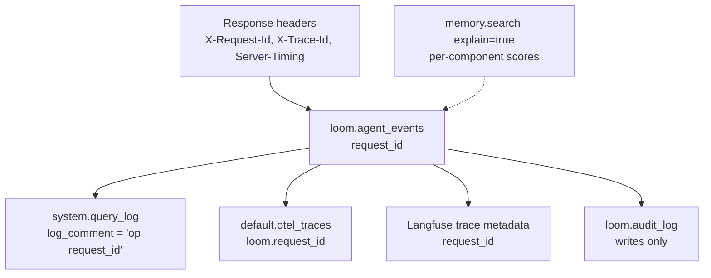

<!-- i18n: source=docs/guides/debugging.md blob=7e3e8e18681a11279a779257bf5385dbd9bce7c0 model=claude-sonnet-5-5 -->
> Esta página é uma tradução automática da [página em inglês](https://github.com/ClickHouse/loom/blob/main/docs/guides/debugging.md), que prevalece.
> Machine-translated from the [English page](https://github.com/ClickHouse/loom/blob/main/docs/guides/debugging.md), which is authoritative.

<a id="debug-a-request"></a>

# Depurar uma requisição

O Loom marca tudo o que uma requisição faz com o mesmo id, então rastrear uma requisição é um join.
Esta página acompanha uma requisição desde os cabeçalhos da resposta até o componente que decidiu
a resposta. Quando o próprio deployment não está saudável, comece pela
[solução de problemas](https://github.com/ClickHouse/loom/blob/main/docs/operations/troubleshooting.md); quando um worker não foi executado, veja o
[status dos workers](https://github.com/ClickHouse/loom/blob/main/docs/operations/monitoring.md#worker-status).



<a id="1-capture-the-requests-ids"></a>

## 1. Capture os ids da requisição

Toda resposta HTTP traz:

| Header                            | Significado                                                                                                                                                                                                  |
| --------------------------------- | ------------------------------------------------------------------------------------------------------------------------------------------------------------------------------------------------------------ |
| `X-Request-Id`                    | O id da requisição. Envie o seu próprio (de 1 a 64 letras, dígitos, `.`, `_` ou `-`) e o Loom o devolve, de modo que o seu log e as linhas do Loom compartilhem uma mesma chave; qualquer outro valor é substituído por um id gerado. |
| `X-Trace-Id`                      | O id de trace do OpenTelemetry da árvore de spans da requisição.                                                                                                                                             |
| `Server-Timing`                   | `app` (tempo do handler) e `ch` (tempo do ClickHouse, número de instruções, bytes lidos) em caso de sucesso.                                                                                                  |
| `X-Loom-Hint`, `X-Loom-Hint-Code` | A dica do mentor para esta chamada, quando houver; os SDKs a registram em log.                                                                                                                               |

```bash
curl -si "$LOOM_BASE_URL/v1/memory.search" -H "Authorization: Bearer $LOOM_API_KEY" \
  -H 'Content-Type: application/json' -H 'X-Request-Id: dbg-0001' \
  -d '{"org":"acme","namespace":"support","agent":"bot","query":"refund window"}' \
  | grep -iE '^(x-request-id|x-trace-id|server-timing)'
```

O `Server-Timing` muitas vezes responde "por que foi lento". Uma duração ou contagem de bytes alta em `ch` aponta para a consulta. Um `app` alto com um `ch` baixo aponta para uma chamada a um provedor (embedding, rerank, LLM).

<a id="2-join-the-request-across-systems"></a>

## 2. Correlacione a requisição entre sistemas

O mesmo id está em `loom.agent_events.request_id`, nos metadados do trace do Langfuse e no
atributo de span `loom.request_id` em `default.otel_traces`.

```sql
-- the ledger row: operation, identity, latency, success, error_code, tokens, cost, model
SELECT * FROM loom.agent_events WHERE request_id = 'dbg-0001';

-- every ClickHouse statement the request issued
SELECT query_duration_ms, read_rows, read_bytes, substring(query, 1, 200) AS q
FROM system.query_log
WHERE type = 'QueryFinish' AND log_comment LIKE '% dbg-0001%'
ORDER BY event_time_microseconds;

-- its spans
SELECT SpanName, Duration, SpanAttributes['loom.operation'] AS op
FROM default.otel_traces
WHERE SpanAttributes['loom.request_id'] = 'dbg-0001'
ORDER BY Timestamp;
```

As tags de `log_comment` estão listadas em
[atribuição de consultas](https://github.com/ClickHouse/loom/blob/main/docs/operations/monitoring.md#logs-traces-and-query-attribution).
Os spans vão para `default.otel_traces` (em `LOOM_CLICKSTACK_DATABASE`, quando definida) quando
`LOOM_OTEL_EXPORTER` resolve para `ch`, ou para o endpoint OTLP. Com o Langfuse configurado, eles também vão para o
[Langfuse](https://github.com/ClickHouse/loom/blob/main/docs/features/integrations/langfuse.md).

> **Nota:** o ledger nunca armazena o texto das consultas. `loom.agent_events` substitui todo
> argumento de texto livre por uma forma `sha256:<16 hex>/<length>`. Para ver o que foi perguntado, use
> o log de trace de busca abaixo ou o log do seu próprio cliente.

<a id="3-explain-a-search-answer"></a>

## 3. Explicar uma resposta de busca

**Por que este resultado ficou nesta posição?** `memory.search` com `explain=true` anexa `score_components`
a cada resultado devolvido: os sinais de ranqueamento e, depois de um reranker, o seu deslocamento (`rerank_from`,
`rerank_pos`, `rerank_delta`) e, quando o reranker alterou a ordem, a sua própria pontuação
fundida (`rank_score_pre_rerank`). Uma linha que desceu porque o código vinculado a ela mudou traz
o número de posições que ela perdeu (`code_changed_places`).

```python
out = await agent.call("memory.search", {"query": "refund window", "explain": True})
for h in out["results"]:
    c = h["score_components"]
    print(
        h["memory_key"],
        h["similarity"],
        h["rank_score"],
        c.get("rerank_from"),
        c.get("rank_score_pre_rerank"),
    )
```

`memory.search_trace` recebe os argumentos de `memory.search` e pontua apenas a etapa vetorial
(sem fusão, montagem nem reranker), devolvendo, por resultado, `similarity`, `distance`,
`entity_boost`, `rank_score`, `rank` e `source`.

**Por que houve abstenção?** Leia a própria resposta de `memory.search`:

| Campo                                     | O que informa                                                                                                  |
| ----------------------------------------- | -------------------------------------------------------------------------------------------------------------- |
| `abstain`, `abstain_code`                 | Qual limite foi acionado: `no_match`, `below_threshold`, `entity_absent`, `low_calibrated_confidence`, `page_expired`. |
| `retrieval_risk`, `retrieval_confidence`  | Quão distante o melhor resultado está dos limites.                                                             |
| `calibration_explanation`                 | Quais limites de similaridade estavam em vigor (calibrados a partir do embedder ou os valores escalares de fallback). |
| `degraded`                                | Provedores que recorreram a fallback nesta leitura e o que a resposta fez em vez disso.                        |
| `pending_extraction`                      | Lotes adiados de `set_from_messages` que ainda não foram extraídos; acima de 0, uma resposta vazia não prova ausência. |
| `namespaces_searched`, `candidates_total` | Se a busca alcançou os namespaces e as linhas que você esperava.                                               |

`calibration.get` mostra os limites em vigor para um namespace e qual camada
(namespace, cluster, escalar) os produziu.
[Recuperação e ranqueamento](../concepts/retrieval-and-ranking.md) explica cada termo.

**O que um agente buscou, ao longo do tempo?** Exige `LOOM_SEARCH_TRACE_LOG_ENABLED=true`
(desativado por padrão). `memory.search_trace_log(since_hours=, agent=, run_id=)` devolve uma linha
por busca: `returned_keys`, `returned_scores`, `abstain`, `retrieval_risk`,
`latency_ms` e a `query` quando `LOOM_LANGFUSE_CAPTURE_IO_LEVEL` não é `off` (o valor
padrão é `off`, portanto, por padrão, as linhas trazem chaves e pontuações sem a pergunta).

<a id="4-explain-a-write"></a>

## 4. Explicar uma escrita

- **A resposta da própria escrita.** `memory.set` retorna `status`, `conflict_verdict`, `peers`,
  `duplicate_of`, `merged_into_key`, `noop` e `advisories`. Uma escrita que "desapareceu"
  geralmente foi mesclada em uma correspondência canônica ou marcada como duplicata. `advisories` aponta
  um valor com codificação dupla ou grande demais.
- **Seu histórico.** `memory.history` lista as versões de uma chave a partir de `loom.memory_versions`.
  `memory.provenance` informa quem a escreveu, a partir de qual origem, sessão e execução.
- **O que a extração descartou.** `memory.extraction_status` lista os lotes adiados de
  `set_from_messages` (`pending`, `failed`). `loom drops --namespace <ns>` mostra
  o que o pipeline descartou, truncou ou abandonou, por etapa e motivo
  ([descartes na ingestão de memória](https://github.com/ClickHouse/loom/blob/main/docs/operations/maintenance.md#memory-ingest-drops)). Uma
  resposta de `set_from_messages` traz `pipeline_errors` e `stage_ms` por etapa
  ([pipeline de extração](https://github.com/ClickHouse/loom/blob/main/docs/guides/extraction-pipeline.md)).
- **A trilha de auditoria.** `audit.list(event_type=, since=)` lê `loom.audit_log`: quem
  alterou o quê, com um hash de conteúdo por linha. Toda escrita que cria ou altera memória
  deixa uma linha apenas com hash ([auditoria](https://github.com/ClickHouse/loom/blob/main/docs/features/observability/audit.md)).
- **A visão de uma execução.** `run.get(run_id)` retorna o que uma execução recuperou (`recalled_keys`), o que
  ela escreveu, seus turnos e seu custo ([rastreamento e retomada](https://github.com/ClickHouse/loom/blob/main/docs/guides/trace-and-resume.md)).

<a id="related"></a>

## Relacionados

- [Solução de problemas](https://github.com/ClickHouse/loom/blob/main/docs/operations/troubleshooting.md)
- [Monitoramento](https://github.com/ClickHouse/loom/blob/main/docs/operations/monitoring.md)
- [Telemetria](https://github.com/ClickHouse/loom/blob/main/docs/features/observability/telemetry.md)
- [Visão geral do sistema](https://github.com/ClickHouse/loom/blob/main/docs/architecture/system-overview.md)
- [Ajuste de desempenho](https://github.com/ClickHouse/loom/blob/main/docs/guides/performance-tuning.md)
