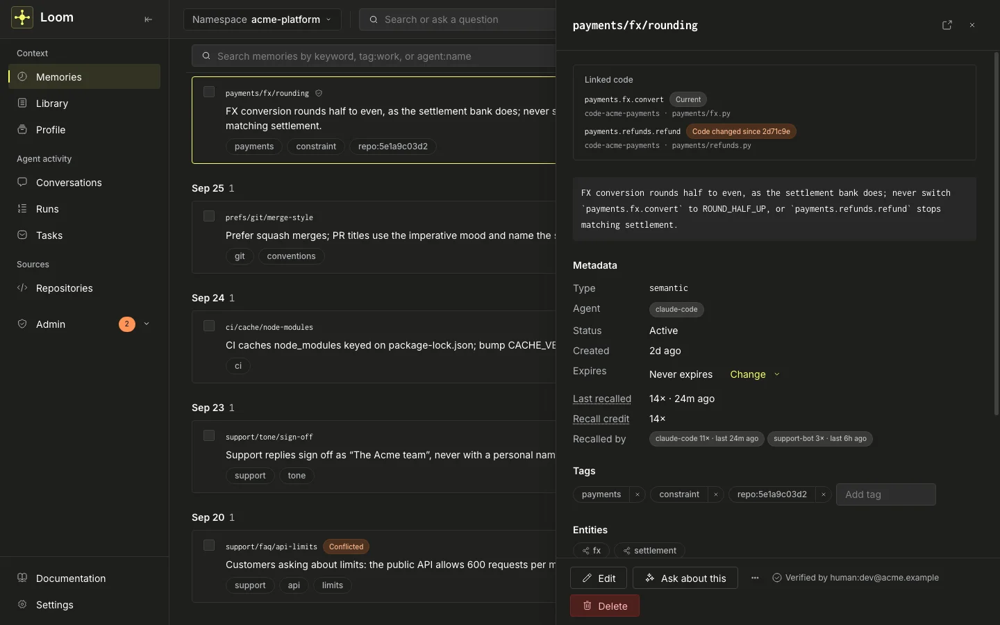

<!-- i18n: source=docs/use-cases/memory-linked-to-code.md blob=fab4f6c6a23848dde1feef736969b204d07adfd8 model=claude-sonnet-5-5 -->
> Эта страница — машинный перевод [английской страницы](https://github.com/ClickHouse/loom/blob/main/docs/use-cases/memory-linked-to-code.md); при расхождениях верна английская версия.
> Machine-translated from the [English page](https://github.com/ClickHouse/loom/blob/main/docs/use-cases/memory-linked-to-code.md), which is authoritative.

# Память, связанная с кодом, для агентов по написанию кода

Loom связывает память кодирующих агентов с функциями, классами и файлами, которые в ней названы, сопровождает их через рефакторинги и помечает память, когда её код меняется. По умолчанию поиск не возвращает память, весь код которой исчез, если только человек не закрепил, не заблокировал и не подтвердил её, а каждое чтение, отдающее урок, сообщает, когда его код изменился или исчез. Это работает через MCP, HTTP и SDK на репозиториях, которые индексирует self-hosted Loom ([индекс кода](code-intelligence.md), `LOOM_CODE_INGEST_ENABLED=true`), а воркер `memory_code_links`, который поддерживает связи, включён по умолчанию.

## Что вы получаете

- **Уроки, привязанные к коду, о котором они говорят.** Память с тегом `repo:<id>` (плагины Claude Code и Codex ставят этот тег на то, что фиксируют их хуки) или записанная в пространство имён кода репозитория связывается с каждым определением (функцией, классом или другим символом), которое она называет в обратных кавычках, либо в любом месте текста как `A::b` или вызов (`a.b()`, `name()`), если оно однозначно указывает на одно место (неквалифицированное имя должно содержать не менее четырёх символов); с определениями в перечисленных в ней файлах, которые она называет голым словом в camelCase или snake_case; и с каждым перечисленным файлом, в котором таких определений нет. Квалифицированное имя, которого ещё нет в trunk, связывается, если оно попадает в trunk в течение `LOOM_MEMORY_CODE_LINKS_PENDING_DAYS` (14 дней).
  [Память, связанная с кодом](https://github.com/ClickHouse/loom/blob/main/docs/concepts/memory.md#memories-linked-to-code)
- **Связи, которые переживают рефакторинги.** На каждом проиндексированном коммите каждая связь получает состояние `fresh`, `moved`, `changed` (с указанием коммита, который её изменил), `unresolved` или `missing`. Связь запоминает токены определения, поэтому пробелы, комментарии и большинство изменений форматтера оставляют её в состоянии `fresh`. [Состояния связей](https://github.com/ClickHouse/loom/blob/main/docs/concepts/memory.md#memories-linked-to-code)
- **Устаревшая память обрабатывается так, как выберете вы.** Решает
  [`code_change_policy`](https://github.com/ClickHouse/loom/blob/main/docs/reference/operations/namespace.md#namespaceregister) пространства имён: `retire_removed` (по умолчанию) убирает из поиска память, весь код которой исчез, и помечает изменённый код; `flag` только помечает; `revise` тоже убирает из поиска память с исчезнувшим кодом и поручает модели сверить утверждение изменённой памяти со старым и новым кодом: то, что остаётся верным, заново привязывается, а опровергнутому предлагается исправление. Память, которую человек закрепил, заблокировал или подтвердил, из поиска не убирается никогда. При любой политике поиск обычно ранжирует память с изменившимся кодом ниже следующих трёх результатов, а не скрывает её; удерживаемая память и строка, найденная по имени, сохраняют своё место. Сама память Loom никогда не переписывается. [Политики](https://github.com/ClickHouse/loom/blob/main/docs/concepts/memory.md#memories-linked-to-code)
- **Уроки везде, где агент читает код.** `code.symbol` возвращает память, связанную с определением, как `lessons`; `code.search`, `code.callers`, `code.callees`, `code.impact`, `code.outline` и `code.context_pack` задачи прикрепляют уроки для файлов, которые возвращают; каждый урок несёт состояние своей связи. Хуки Claude Code и Codex показывают память о файле (`memory.for_file`) до того, как агент его изменит, а хуки Cline делают это, когда агент читает или изменяет файл. [`code.symbol`](https://github.com/ClickHouse/loom/blob/main/docs/reference/operations/code.md#codesymbol) ·
  [плагин Claude Code](https://github.com/ClickHouse/loom/blob/main/docs/features/integrations/claude-code.md) ·
  [плагин Codex](https://github.com/ClickHouse/loom/blob/main/docs/features/integrations/codex.md) ·
  [хуки Cline](https://github.com/ClickHouse/loom/blob/main/integrations/cline/README.md) (экспериментально)
- **Общий доступ для команды.** Уроки читаются из пространства имён кода репозитория и пространств имён, которые назвал вызов (через MCP по умолчанию это собственное пространство вызывающего), поэтому урок, сохранённый в пространстве имён кода репозитория, доходит до каждого агента, которому разрешено читать это пространство имён (токен, суженный до своего пользователя или сессии, уроков не читает).
  [Память, связанная с кодом](https://github.com/ClickHouse/loom/blob/main/docs/concepts/memory.md#memories-linked-to-code)
- **Ветки читают собственный код.** На другой ветке урок проверяется по определению этой ветки, поэтому релизная ветка, в которой остался старый текст, получает `fresh` (на хосте с `LOOM_GIT_HISTORY=none`, где нет git-зеркала, урок несёт состояние trunk). [Память, связанная с кодом](https://github.com/ClickHouse/loom/blob/main/docs/concepts/memory.md#memories-linked-to-code)
- **Документы рядом с кодом.** Документы из источника, зарегистрированного в пространстве имён кода репозитория (его trunk), получают тег репозитория, поэтому поиск по репозиторию читает их вместе с его кодом (воркеру синхронизации нужен `LOOM_KNOWLEDGE_SOURCE_SYNC_ENABLED`).
  [Источники документов](https://github.com/ClickHouse/loom/blob/main/docs/features/knowledge.md#document-sources)
- **Список для проверки.**
  [`namespace.validate`](https://github.com/ClickHouse/loom/blob/main/docs/reference/operations/namespace.md#namespacevalidate) перечисляет память, код которой изменился, не был найден снова или исчез, а панель управления показывает связи каждой памяти и их состояние.

## Начало работы

[Быстрый старт](../getting-started/quickstart.md) запускает Loom, а [добавление репозиториев](https://github.com/ClickHouse/loom/blob/main/docs/features/code-index/repositories.md) включает индекс кода для репозитория. Подключите своего кодирующего агента через его плагин или через MCP ([подключение кодирующего агента](https://github.com/ClickHouse/loom/blob/main/docs/getting-started/connect-a-coding-agent.md)). Сохраните урок, который называет определение из четырёх или более символов в обратных кавычках или как вызов (`` `name()` ``), либо квалифицированное, например `` `Reader.run` ``. Плагины Claude Code и Codex ставят на то, что фиксируют их хуки, тег `repo:<id>`, а стартовая сводка сессии называет этот id ([как он выводится](https://github.com/ClickHouse/loom/blob/main/docs/features/integrations/claude-code.md#configuration)). Урок, который агент сохраняет сам через `loom_memory_set`, связывается, если несёт этот тег (`tags: ["repo:<id>"]`) или записан в пространстве имён кода репозитория; любой клиент может сделать то или другое. Через HTTP (или `agent.call` в Python SDK) урок, сохранённый в вашем собственном пространстве имён, читается, только если вызов называет это пространство имён в `lesson_namespaces`. Каждый проход связывания обрабатывает записи возрастом не менее 60 секунд, а проходы запускаются каждые 60 секунд, поэтому после индексации trunk `code.symbol` по этому определению возвращает урок в `lessons` примерно через две минуты.

Некоторые операции на этой странице помечены как экспериментальные на [странице статуса](https://github.com/ClickHouse/loom/blob/main/docs/reference/status.md).
