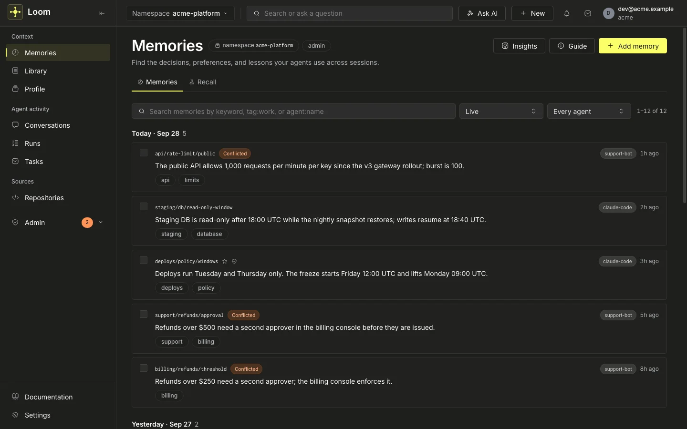

<!-- i18n: source=README.md blob=29675cf2a8d5e7d37f9dc00aeedb1a413885bb38 model=claude-sonnet-5-5 -->
> 本页由机器从[英文原文](https://github.com/ClickHouse/loom/blob/main/README.md)翻译，内容以英文原文为准。
> Machine-translated from the [English page](https://github.com/ClickHouse/loom/blob/main/README.md), which is authoritative.

<h1 align="center">ClickHouse Loom</h1>

<p align="center">
  <b>为 AI agent 提供共享记忆、文档搜索和代码智能。</b><br>
  适用于 Claude Code、Codex、Cursor 以及你自己的 agent。
</p>

<p align="center">
  <a href="https://pypi.org/project/clickhouse-loom/"></a>
  <a href="https://www.npmjs.com/package/@clickhouse/loom"></a>
  <a href="https://github.com/ClickHouse/loom/blob/main/LICENSE"></a>
  <a href="https://glama.ai/mcp/servers/ClickHouse/loom"></a>
  <a href="https://github.com/ClickHouse/loom/actions/workflows/ci.yml?query=branch%3Amain+event%3Apush"></a>
  <a href="https://scorecard.dev/viewer/?uri=github.com/ClickHouse/loom"></a>
</p>

<p align="center">
  <!-- languages -->
  <a href="../../README.md">English</a> · 简体中文 · <a href="../ja/README.md">日本語</a> · <a href="../ko/README.md">한국어</a> · <a href="../pt-BR/README.md">Português (Brasil)</a> · <a href="../es/README.md">Español</a>
  <br>
  <a href="https://loom.clickhouse.com/docs/zh-CN/">文档</a>
  <!-- /languages -->
</p>

<p align="center">
  <a href="#what-loom-is-for">Loom 的用途</a> ·
  <a href="#measured-results">基准测试</a> ·
  <a href="#get-started">快速开始</a> ·
  <a href="#why-loom">功能</a> ·
  <a href="#integrations">集成</a> ·
  <a href="https://clickhouse.github.io/loom/">文档</a>
</p>

<p>
  
  
  
</p>

Loom 是一个开源、可自托管的 MCP 服务器，为你的 agent 提供长期的共享记忆：一个 agent 在会话中学到的内容，下一个 agent 或工具可以找到。

agent 可以通过 MCP、HTTP、Python 或 TypeScript 连接。可以使用 Docker 自托管，也可以[通过 Helm chart 部署在 Kubernetes 上](https://github.com/ClickHouse/loom/blob/main/docs/operations/kubernetes.md)；agent 上下文和索引数据存储在 [ClickHouse](docs/use-cases/self-hosted-clickhouse.md) 中，部署时也可以[在首次启动时选择 Postgres](https://github.com/ClickHouse/loom/blob/main/docs/operations/postgres.md)，用于存放实时记忆和知识状态。控制台把记忆、代码仓库、任务和运行集中在一处。

<a id="what-loom-is-for"></a>

## Loom 的用途

- **在多个编码 agent 之间共享的长期记忆**，通过插件在会话开始时加载上下文，并在会话运行过程中捕获会话内容。
  [Agent 记忆](docs/use-cases/agent-memory.md) ·
  [连接编码 agent](https://github.com/ClickHouse/loom/blob/main/docs/getting-started/connect-a-coding-agent.md)
- **面向 agent 应用的记忆**，按用户划分，通过 Python 或 TypeScript SDK 使用。
  [你的第一个 agent](https://github.com/ClickHouse/loom/blob/main/docs/getting-started/first-agent.md)
- **多用户 MCP 记忆服务器**，支持命名空间、角色和令牌。
  [多用户模式](docs/getting-started/quickstart.md#start-in-multi-user-mode) ·
  [命名空间与共享](https://github.com/ClickHouse/loom/blob/main/docs/features/namespaces-and-sharing.md)
- **代码仓库的代码索引**，编码 agent 可以查询定义、调用方和变更影响。
  [代码索引](docs/use-cases/code-intelligence.md) ·
  [语言支持与限制](https://github.com/ClickHouse/loom/blob/main/docs/features/code-index/overview.md#language-support)
- **与相关代码关联的记忆**，在重构后仍能跟随代码，在代码变更时被标记，并在 agent 读取或编辑代码时出现。
  [与代码关联的记忆](docs/use-cases/memory-linked-to-code.md)
- **降低编码 agent 的模型成本**，见下文的[实测结果](#measured-results)。
  [编码 agent 成本](docs/use-cases/coding-agent-cost.md)
- **带引用的文档搜索（RAG）**，包括由提取服务转换的 PDF、`.docx` 和 `.pptx` 文件。
  [文档搜索](docs/use-cases/document-search.md)
- **多 agent 工作流的共享上下文**：共享记忆、任务收件箱和决策。
  [多 agent](docs/use-cases/multi-agent.md)
- **面向自主 agent 的记忆、召回、审计和擦除。**
  [自主 agent](docs/use-cases/autonomous-agents.md)
- **agent 工作的记录**，包括可搜索的对话（开启记录时）、可用于恢复工作的会话摘要、带有目标、结果以及（若已提供）模型成本的运行记录，以及 PR 和跟踪器历史。
  [运行与 PR 历史](docs/use-cases/runs-and-pr-history.md)

所有用例，以及何时其他工具更合适：[用例](docs/use-cases/index.md)。

Loom 不是用于单个 agent 短期记忆的进程内库，也不是 agent 框架。[Loom 不适用的场景](https://github.com/ClickHouse/loom/blob/main/docs/getting-started/overview.md#when-it-does-not-fit)

<a id="measured-results"></a>

## 实测结果

| 评测                | 使用 Loom  | 不使用 Loom | 效率提升                | 范围                           |
| ------------------- | --------- | ----------- | ----------------------- | ------------------------------ |
| 编码 agent 回答质量 | **0.84**  | 0.78        | 模型成本**降低 20%**    | 24 个问题 × 3 次配对运行       |
| 编码 agent 文件定位 | **96.4%** | 91.4%       | 模型成本**降低 21%**    | 36 个问题 × 10 次配对运行      |
| 记忆与完整历史的回答对比 | **94%**   | 90%         | reader 提示 token **减少 91%** | 100 个配对的 LongMemEval-S 问题 |

两种编码测试均在 ClickHouse 代码库上使用 Claude Code（`claude-sonnet-5`）；成本是整个会话的模型费用，不包括 Loom 服务端的模型调用、托管和索引。回答质量衡量的是对已验证答案要点的覆盖程度，并对矛盾之处扣分。文件定位统计的是，正确的文件是否出现在 agent 在回答末尾被要求给出的至多三个文件之中。

记忆这一行使用相同的 `gpt-5` reader，对比检索到的记忆与完整对话历史。token 节省不包括记忆的构建；94% 与 90% 的准确率差异仅为描述性结果，并未在统计上得到确认。

**另外，Loom 的 `memory.ask` 配置在全部 500 个 LongMemEval-S 问题上取得了 96.6% 的回答准确率。** 这是一项使用自身配置的回答模型的产品评测，不同于上述固定 reader 的对比。

结果仅适用于所测试的工作负载。

[评测协议与可复现的产物](https://github.com/ClickHouse/loom/blob/main/docs/benchmarks/results.md) ·
[详细结果](#benchmark-details) ·
[在你的工作负载上评测](https://github.com/ClickHouse/loom/blob/main/docs/getting-started/evaluate.md)

<a id="get-started"></a>

## 开始使用

<a id="1-choose-your-docker-setup"></a>

### 1. 选择 Docker 部署方式

- **个人使用（默认）：** 无需登录，仅限 localhost 访问，使用 `dev/local` 命名空间。一个人可以连接多个 agent。
- **团队使用：** 带身份验证的账户和命名空间访问控制。[从首次启动起就使用多用户模式](docs/getting-started/quickstart.md#start-in-multi-user-mode)。

两种模式支持相同的 Loom 功能，包括已配置的 LLM 和 embedding。单用户模式并不是功能缩减版。你也可以[在不删除数据的情况下切换现有安装](docs/getting-started/quickstart.md#2-open-the-dashboard)；然后为新账户授予现有命名空间的访问权限。

如果不想安装任何东西，可以在 codespace 中打开试用：

[](https://codespaces.new/ClickHouse/loom?quickstart=1)
（[它运行什么，以及谁可以访问](docs/getting-started/quickstart.md#try-it-in-github-codespaces)）

对于默认的个人安装，需已安装 Docker（在 Windows 上，请在 `docker` 可用的 WSL 2 终端中操作：启用 WSL 集成的 Docker Desktop，或安装在该发行版内的 Docker Engine）：

```bash
curl -fsSL https://github.com/ClickHouse/loom/releases/latest/download/install.sh -o loom-install.sh && sh loom-install.sh && rm loom-install.sh
```

请在你的主目录中运行，或在[只有你有写入权限的其他目录](docs/getting-started/quickstart.md#fast-path-released-image-no-clone)中运行。安装程序会启动 Loom 和 ClickHouse，应用迁移，并打印控制台的 URL：**http://localhost:7777/**；全新安装时，它随后会检查记忆能否保存并读回。在终端中，它还会提供连接它所发现的编码 agent（Claude Code、Codex、VS Code）的选项，全新安装时还会打开控制台。镜像包含服务器、workers、控制台，以及 Python、TypeScript 和 Go 的编译器索引器，在 `amd64` 上还包含 C++ 索引器；TypeScript 依赖会自动准备。[快速入门和固定版本发布](docs/getting-started/quickstart.md)

安装位于 `~/.loom`（可用 `LOOM_INSTALL_DIR` 指定其他目录）：其中包含 Compose 文件，以及 `~/.loom/.env` 中的启动设置。再次运行安装命令会原地升级，并保留你的 `.env` 设置。

请让单用户模式仅限 localhost 访问。如需共享访问，请参阅[团队部署指南](https://github.com/ClickHouse/loom/blob/main/docs/operations/deployment.md#identity-modes)，包括 TLS。

<a id="2-configure-models-and-api-keys"></a>

### 2. 配置模型和 API 密钥

**默认安装无需密钥或网络即可启动。** 存储、控制台、结构化代码索引和语义搜索都能正常工作，语义搜索使用镜像自带的小型本地 embedding 模型；fake LLM 不会给出 AI 生成的回答。

| 组件       | 实际使用时需配置                                   | 不配置时                                                                    |
| ---------- | -------------------------------------------------- | --------------------------------------------------------------------------- |
| Embeddings | 提供商、embedding 模型、维度和 API 密钥。          | `local`（CPU 上的 bge-small）：支持语义检索，但不如托管模型。               |
| LLM        | 提供商、模型和 API 密钥。                          | `fake-echo-1`：无有意义的提取、摘要或回答。                                 |

打开 **Settings → Models & keys**，选择两个提供商和模型，输入它们的密钥，然后点击 **Test & apply**。无需重启 Docker；更改 embedding 空间会重建现有索引。控制台中的 embedding 选项均为托管提供商：如果要保留 `local` 并添加 LLM，请改为在 `~/.loom/.env` 中设置 LLM 相关行（[模型和密钥](https://github.com/ClickHouse/loom/blob/main/docs/getting-started/models-and-keys.md#claude-for-the-llm)）。

**一个 OpenAI API 密钥即可同时用于两种角色。** Claude 需要另外配置 embedding 提供商。支持 OpenAI、Gemini 以及与 OpenAI 兼容的 embedding 端点。你的 agent 的 CLI 登录或订阅不能提供 Loom 的提供商密钥。

更喜欢用环境变量配置？编辑 `~/.loom/.env`，然后重新创建服务器：

```bash
docker compose --project-directory "$HOME/.loom" up -d --force-recreate loom
```

只提供密钥不会改变固定的模型（本地 embedder 和 fake LLM）；还需要同时设置提供商和模型。控制台中保存的设置优先于 `.env`。提供商配置示例和健康检查请参阅[模型和 API 密钥](https://github.com/ClickHouse/loom/blob/main/docs/getting-started/models-and-keys.md)。

**其他所有设置都在一个文件里。** [`loom.example.yaml`](https://github.com/ClickHouse/loom/blob/main/loom.example.yaml) 按领域列出了每项设置及其默认值和作用：ClickHouse 连接、超时和预算、速率限制、workers，以及用于开启和关闭功能的 `*_enabled` 开关。可在 `~/.loom/.env` 中以 `LOOM_<NAME>` 的形式设置其中任何一项，然后重新创建服务器；挂载了配置文件的部署可以改在该文件的副本中设置（[设置如何被读取](https://github.com/ClickHouse/loom/blob/main/docs/operations/deployment.md#how-settings-are-read)）。标记为 `live` 的设置还可以在 Loom 运行时更改：使用 `loom settings set <name> <value>`，或 Admin → Deployment settings。`loom settings list --changed` 会显示哪些与默认值不同，以及每个值的来源（[运行时设置](https://github.com/ClickHouse/loom/blob/main/docs/operations/runtime-settings.md)）。

<a id="3-connect-your-agents"></a>

### 3. 连接你的 agent

如果安装程序已连接了你的 agent，请跳过下面的命令。在运行个人安装的机器上，插件无需令牌：

```bash
# Claude Code
claude plugin marketplace add ClickHouse/loom
claude plugin install loom@loom

# Codex
codex plugin marketplace add ClickHouse/loom
codex plugin add loom@loom
```

启动新会话；第一个会话会连接到 `http://localhost:7777`。在 Codex 中，请以交互方式运行一次 `codex` 并批准插件的 hooks；在此之前只有工具可用。告诉 agent 一些值得保留的内容，然后在下一次会话中询问它。

对于 Cursor，在 Teams 或 Enterprise 套餐中，团队管理员可以将此仓库作为团队 marketplace 导入；它的 [Cursor 插件](https://github.com/ClickHouse/loom/blob/main/docs/features/integrations/cursor.md#plugin)（尚未在 Cursor 中测试）会安装 MCP 条目和 Loom 的 skills。在运行个人安装的机器上，下面的按钮会添加[本地 MCP 条目](https://github.com/ClickHouse/loom/blob/main/docs/features/integrations/cursor.md#mcp-tools)，无需令牌：

[](https://cursor.com/en/install-mcp?name=loom&config=eyJ1cmwiOiJodHRwOi8vbG9jYWxob3N0Ojc3NzcvbWNwP3Rvb2xzZXQ9Y29kaW5nIn0%3D)

对于在运行个人安装的机器上使用 VS Code agent 模式，下面的按钮会添加[本地 MCP 条目](https://github.com/ClickHouse/loom/blob/main/docs/features/integrations/vscode.md#local-single-user-server)，无需令牌：

[](https://vscode.dev/redirect?url=vscode%3Amcp%2Finstall%3F%257B%2522name%2522%253A%2522loom%2522%252C%2522type%2522%253A%2522http%2522%252C%2522url%2522%253A%2522http%253A%252F%252Flocalhost%253A7777%252Fmcp%2522%257D)
[](https://insiders.vscode.dev/redirect?url=vscode-insiders%3Amcp%2Finstall%3F%257B%2522name%2522%253A%2522loom%2522%252C%2522type%2522%253A%2522http%2522%252C%2522url%2522%253A%2522http%253A%252F%252Flocalhost%253A7777%252Fmcp%2522%257D)

对于团队服务器，请向 Claude Code 传入 `--config server_url=… --config token=…`，或按照[连接编码 agent](https://github.com/ClickHouse/loom/blob/main/docs/getting-started/connect-a-coding-agent.md)中的说明将 Codex 指向它。请在 **Settings → Tokens** 中创建令牌。Cursor 和其他 MCP 客户端，以及 [SDK](https://github.com/ClickHouse/loom/blob/main/docs/getting-started/first-agent.md)，也都在那里介绍。

<a id="why-loom"></a>

## 为什么选择 Loom

- **可延续的记忆。** 在 agent 和会话之间共享决策与发现。每条事实都会记录写入者，版本历史和冲突审查使修正可追溯，命名空间可以回滚到任意时间点。[记忆](https://github.com/ClickHouse/loom/blob/main/docs/concepts/memory.md)
- **有依据的代码智能。** 查找定义、调用方、变更影响和相关测试，并将代码与提交、拉取请求和 issue 关联起来。通过源码位置、完整性信号和各层级的新鲜度来核对结果。[代码索引](https://github.com/ClickHouse/loom/blob/main/docs/features/code-index/overview.md)
- **有据可依的检索。** 检索有权限访问的记忆、文档、对话和跟踪器记录。回答会引用其来源，置信度较低时检索可以放弃作答。[检索](https://github.com/ClickHouse/loom/blob/main/docs/concepts/retrieval-and-ranking.md)
- **多 agent 交接。** 通过持久的任务收件箱分配工作，支持租约、重试、审查规则和结果记录。由你的 agent 执行工作流，Loom 负责保留交接过程。[任务队列](https://github.com/ClickHouse/loom/blob/main/docs/features/tasks-and-decisions.md)
- **对 agent 数据的控制。** 管理命名空间访问、来源、保留策略、审计记录和经过验证的擦除。上下文仍可在 ClickHouse 中查询。[安全](https://github.com/ClickHouse/loom/blob/main/docs/architecture/security.md)

<a id="integrations"></a>

## 集成

| 集成                                                                                                                                                                                                                                                                                   | 连接的内容                                                              |
| --------------------------------------------------------------------------------------------------------------------------------------------------------------------------------------------------------------------------------------------------------------------------------------- | ----------------------------------------------------------------------------- |
| [Claude Code](https://github.com/ClickHouse/loom/blob/main/docs/features/integrations/claude-code.md)、[Codex](https://github.com/ClickHouse/loom/blob/main/docs/features/integrations/codex.md)、[Cursor](https://github.com/ClickHouse/loom/blob/main/docs/features/integrations/cursor.md) 和[其他 MCP 客户端](https://github.com/ClickHouse/loom/blob/main/docs/features/integrations/mcp-clients.md)（[所有集成](https://github.com/ClickHouse/loom/blob/main/docs/features/integrations/index.md)） | 在现有的 agent 工作流中使用记忆和代码智能。                 |
| [Python](https://github.com/ClickHouse/loom/blob/main/docs/reference/python-sdk.md)、[TypeScript](https://github.com/ClickHouse/loom/blob/main/docs/reference/typescript-sdk.md) 和 [HTTP](https://github.com/ClickHouse/loom/blob/main/docs/reference/operations.md)                                                                                                                                                         | 你自己的 agent 和应用程序。                                             |
| [Langfuse](https://github.com/ClickHouse/loom/blob/main/docs/features/integrations/langfuse.md)                                                                                                                                                                                                                                          | 请求追踪、模型成本、检索评分和提示词版本归因。 |
| [ClickStack / HyperDX](https://github.com/ClickHouse/loom/blob/main/docs/features/integrations/clickstack.md)                                                                                                                                                                                                                            | ClickHouse 中的 OpenTelemetry 追踪、日志和指标。                         |

Langfuse 和 ClickStack 是可选集成，不是 Docker 技术栈中自带的服务。

<a id="benchmark-details"></a>

## 基准测试详情

<a id="detailed-retrieval-reader-and-code-search-results"></a>

### 检索、阅读器与代码搜索的详细结果

| 评测                                                  | 结果                                                                                               |
| ----------------------------------------------------- | -------------------------------------------------------------------------------------------------- |
| LongMemEval-S 证据检索（500 个问题）                  | 在前 30 条记忆中至少包含一个支持会话的问题占 **98.6%**。                                           |
| LongMemEval-S 固定 `gpt-5` 阅读器（500 个问题）       | 基于前 200 条记忆，回答准确率为 **92.0%**。                                                        |
| LoCoMo（全部 10 段对话）                              | 回答准确率为 **89.6%**；对抗性问题的正确拒答率为 **90.8%**。                                       |
| MemoryAgentBench 事实问题样本（500 个问题）           | SubEM 为 **99.0%**；生成回答的 token 重叠 F1 为 **95.7%**。                                        |
| 概念性代码搜索（36 个问题）                           | 标准文件召回率：前 5 为 **91.2%**，前 10 为 **97.2%**；MRR 为 **0.91**。                           |
| SWE-bench Verified 文件定位（200 个 issue）           | 前 10 个结果中包含被修改文件的 issue：**82%**，BM25 为 **57%**；前 5 个结果中为 **76.5%**。        |
| 跟踪器重复检测（104 对）                              | 已记录的较早重复项排在第一位的比例为 **87.5%**。                                                   |

这些评测衡量的是不同的任务，而不是一个综合分数。SWE-bench 衡量的是文件定位，而不是 issue 的解决。[结果台账](https://github.com/ClickHouse/loom/blob/main/docs/benchmarks/results.md)包含评分定义、小样本评测、较弱和负面的发现，以及完整的评测协议、模型和产物。

[方法论](https://github.com/ClickHouse/loom/blob/main/docs/benchmarks/methodology.md) ·
[覆盖范围与已知缺口](https://github.com/ClickHouse/loom/blob/main/docs/benchmarks/coverage.md) ·
[运行基准测试](https://github.com/ClickHouse/loom/blob/main/docs/benchmarks/running.md)

<a id="documentation-and-contributing"></a>

## 文档与贡献

如需了解共享 agent 上下文、代码智能和带权限的检索，请从[文档](https://clickhouse.github.io/loom/)开始。有关部署要求，请参阅[前提条件](https://github.com/ClickHouse/loom/blob/main/docs/getting-started/overview.md#prerequisites)。

[部署](https://github.com/ClickHouse/loom/blob/main/docs/operations/deployment.md) · [常见问题](https://github.com/ClickHouse/loom/blob/main/docs/faq.md) ·
[参与贡献](https://github.com/ClickHouse/loom/blob/main/CONTRIBUTING.md) · [安全问题报告](https://github.com/ClickHouse/loom/blob/main/SECURITY.md) ·
[`llms.txt`](https://clickhouse.github.io/loom/llms.txt) ·
[`llms-full.txt`](https://clickhouse.github.io/loom/llms-full.txt)

Apache-2.0 · [许可证](https://github.com/ClickHouse/loom/blob/main/LICENSE) · [声明](https://github.com/ClickHouse/loom/blob/main/NOTICE)
