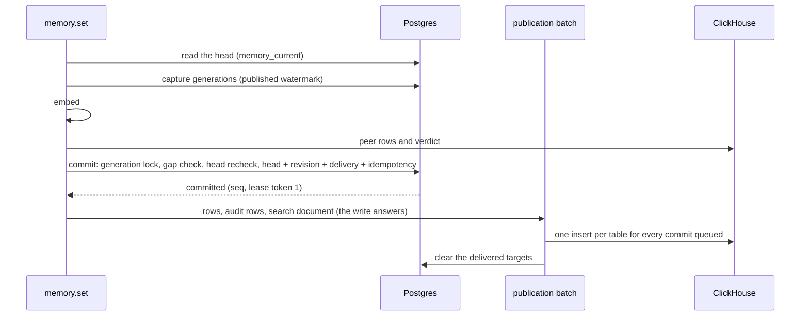

<!-- i18n: source=docs/architecture/storage-authority.md blob=ddfbb1e79149f5d1a03c9c3f7d95d4881dd6a2e6 model=claude-sonnet-5-5 -->
> 本页由机器从[英文原文](https://github.com/ClickHouse/loom/blob/main/docs/architecture/storage-authority.md)翻译，内容以英文原文为准。
> Machine-translated from the [English page](https://github.com/ClickHouse/loom/blob/main/docs/architecture/storage-authority.md), which is authoritative.

# 存储权威：Postgres 负责实时记忆，ClickHouse 负责搜索

Loom 以两种记忆权威之一运行，由每个部署通过 `LOOM_STORAGE_AUTHORITY` 选择。在 `clickhouse`（默认值）下，ClickHouse 保存全部数据，详见[记忆架构](https://github.com/ClickHouse/loom/blob/main/docs/architecture/memory-architecture.md)。在 `postgres` 下，Postgres 保存每个记忆键的当前内容、每个已提交的修订版本、每个修订版本尚需同步给 ClickHouse 的内容，以及每个知识文档的头部（[知识文档](#knowledge-documents)）；ClickHouse 保存所有向量、所有搜索分支、历史记录和分析数据。本页介绍 Postgres 权威：它的表、写入和读取路径、并发下的准入、幂等性、擦除、故障，以及两种 Postgres 部署配置。

## 为什么用两个存储

记忆写入需要有序版本、compare-and-set、锁和 pin 检查。ClickHouse 的一次插入会生成一个 part，而一个 part 意味着一次合并：逐条提交时，记忆表要为每次写入承担这一开销，而且两个并发的写入方在作出各自的判定之前，看不到对方的行。Postgres 提供带行锁的短事务；ClickHouse 则继续做它擅长的事，即扫描向量和文本。

| 状态                                       | 存储                                                                                  |
| ------------------------------------------ | ------------------------------------------------------------------------------------- |
| 当前记忆内容、版本、锁、pin、compare-and-set | Postgres `loom.memory_current`                                                        |
| 修订日志及其投递任务                       | Postgres `loom.memory_revisions`、`loom.memory_deliveries`                            |
| 幂等键和重放应答                           | Postgres `loom.idempotency`                                                           |
| 范围代数（准入）                           | Postgres `loom.scope_generations`                                                     |
| 知识文档头部、其投递任务、删除凭据         | Postgres `loom.knowledge_heads`、`loom.knowledge_deliveries`、`loom.erased_documents` |
| 知识摄取任务                               | Postgres `loom.knowledge_jobs`                                                        |
| 知识数据集目录：服务快照、schema 审批      | Postgres `loom.knowledge_datasets`                                                    |
| 向量、词法和向量搜索、可搜索的记忆行       | ClickHouse `loom.memory_embeddings`、`loom.memory`                                    |
| 修订历史、审计日志、用量                   | ClickHouse `loom.memory_versions`、`loom.audit_log`、用量表                           |

Postgres 不存储任何向量。ClickHouse 的 `loom.memory` 和 `loom.memory_embeddings` 是由已提交的修订发布出来的投影。

副本写入方（锁、touch、状态标记、删除的墓碑、过期）在读取之后、并在该头部版本之上取得自己的版本（`rows.version_over`），因此在时钟超前的副本上写入的头部不会超过它。敏感度扫描的重新标记会高于它所扫描的头部，并且只作用于该头部，按其键以强一致方式读取：之后写入的头部包含其检测器未读过的文本，或带有其写入方自己的标签，会留待下一轮处理；如果它的投递被搁置，则等到该投递被重试时再处理（[敏感度扫描](https://github.com/ClickHouse/loom/blob/main/docs/architecture/security.md#sensitivity)）。在该次读取之后发生变化的头部，会使 Postgres 下的提交被拒绝，而 `high` 重新标记的围栏在其提交之后才设置，所以被拒绝的提交不会在该头部之上留下围栏；在 ClickHouse 上，插入的版本低于该重新标记版本的行会被它超过，与任何副本写入方一样。实体处理和恢复在读取之前取得版本，并将其提升到所读头部之上，因此取得更高版本的写入会胜过它们。写在头部之上的值（`memory.set`、`memory.bulk_set`、`memory.update_by_id`）同样高于该头部，因为在 Postgres 下，提交会保留两者中较新的一个。已删除来源的合并摘要，依据权威存储（它们的头部及其仍然存在的来源）来查找和判定，每个墓碑或降级都会写在仍引用已判定来源的头部之上（包括之后纳入的副本），而由其他来源重建的摘要则不予处理。它们的向量按各行的版本写入，在 Postgres 下处于提交的租约之内：墓碑会以不带文本的方式淘汰它们，降级只复制其头部自身哈希对应的向量（对于在引入哈希之前写入的头部则没有），所以两者都不会携带另一个版本的脱敏可能正在清除的文本。在 Postgres 下，降级需要提供其搜索文档，直到 ClickHouse 持有它为止，否则由投递 worker 构建；在 ClickHouse 上，副本留下的向量行保持其旧状态，直到 `loom reconcile-status` 将其同步。取代（supersession）在读取之前取得版本，并且不会被提升：任何高于该版本的头部都保有该键，无论是之后取得版本的写入，还是来自时钟超前的副本的写入。经过判定的取代会比它所读的版本高一级；其向量行采用状态镜像取得的版本（`mirror_status_to_embeddings(judged=True)`）。在 ClickHouse 权威存储下，副本只是一次普通插入：版本更低、其行落在读取与插入之间的写入（值、删除、重新标记为 `high`）会被它超过，且不会有任何报告。在 Postgres 下，副本只在它所读的头部之上提交（`heads_unchanged(exact=True)`），之后写入的头部会使其被拒绝。

## 表

schema 位于 `schemas/pg_migrations/`（[迁移](#migrations)）。每个租户的主键都以 `org` 开头，每个租户索引也是如此，只有清扫和认领扫描所用的维护索引除外（[存储布局](https://github.com/ClickHouse/loom/blob/main/docs/architecture/storage-layout.md#postgres)）。[存储布局](https://github.com/ClickHouse/loom/blob/main/docs/architecture/storage-layout.md)列出了两个存储中的每一张表，以及迁移它的阶段。

| 表                          | 键                                                         | 内容                                                                                                                                                                                                                                                                                                                                                                                    |
| --------------------------- | ---------------------------------------------------------- | --------------------------------------------------------------------------------------------------------------------------------------------------------------------------------------------------------------------------------------------------------------------------------------------------------------------------------------------------------------------------------------- |
| `loom.authority`            | 单例                                                       | 记录的权威、它的 epoch 以及部署 id                                                                                                                                                                                                                                                                                                                                                      |
| `loom.scope_generations`    | `(org, scope)`                                             | 某个命名空间的最后一个修订号，或某个策略代数（`scope = '*'`，全局策略的 org 为 `''`）                                                                                                                                                                                                                                                                                                  |
| `loom.memory_current`       | `(org, namespace, agent, user_id, session_id, memory_key)` | 每个键的头部：完整的 `loom.memory` 行（JSON 形式），旁边是 `memory_id`、`version`、`seq`、`content_sha256`                                                                                                                                                                                                                                                                              |
| `loom.memory_revisions`     | `(org, namespace, seq)`                                    | 每一条已提交的行，只追加（脱敏会就地擦除其中一条；启用 `LOOM_PG_PAYLOAD_CLEAR_ENABLED` 后，清除流程会清除超过时间界限的已投递修订的 payload：[payload 清除](#payload-clearing)），附带其仅含哈希的审计行，以及保存在类型化列中的元数据（[修订元数据](#revision-metadata)）                                                                                                              |
| `loom.memory_deliveries`    | `(org, namespace, seq)`                                    | 某个修订仍欠 ClickHouse 的目标（位：1 记忆行，2 搜索文档，4 审计行，8 已删除决定的记录，16 旧向量），以及它的租约和 fencing token；最后一个目标送达后删除                                                                                                                                                                                                                                |
| `loom.idempotency`          | `(org, key_hash)`                                          | 一次 op 的请求摘要、它的状态（`running`、`committed`、`done`）、它提交的修订、它的应答、一个租约及其 token                                                                                                                                                                                                                                                                              |
| `loom.erased_memories`      | `(org, namespace, memory_id)`                              | 删除证据：每条被擦除移除的记忆的命名空间和 id、移除时间，以及它的发布者何时静默；不含内容，保留 `LOOM_PG_ERASURE_EVIDENCE_HOURS`                                                                                                                                                                                                                                                        |
| `loom.idempotency_fences`   | `org`                                                      | 擦除最近一次移除该 org 重放应答的时间：其残留普查的边界                                                                                                                                                                                                                                                                                                                                 |
| `loom.audit_outbox`         | `(org, namespace, row_hash)`                               | 擦除在 ClickHouse 收到之前就移除的审计行，以及因被其取代的持有者仍可能插入而被某次认领推迟的审计行，直到投递流程发布它们；只有键和 id，没有值                                                                                                                                                                                                                                            |
| `loom.knowledge_heads`      | `(org, namespace, source_uri)`                             | 每个知识源的头部：完整的 `loom.documents` 行（[知识文档](#knowledge-documents)），以及它所服务的分块的修订和版本（[知识搜索](#knowledge-search)）                                                                                                                                                                                                                                        |
| `loom.knowledge_deliveries` | `(org, namespace, source_uri, version)`                    | 一次文档提交仍欠 ClickHouse 的内容（位：1 文档行，始终设置；2 旧分块的退役；整体发布）、它的行、租约和 token                                                                                                                                                                                                                                                                            |
| `loom.erased_documents`     | `(org, namespace, doc_id)`                                 | 删除证据：擦除所移除的每个文档的每个版本的 `doc_id`（包括 ClickHouse 中的），提交时会被拒绝；不含内容，保留 `LOOM_PG_ERASURE_EVIDENCE_HOURS`                                                                                                                                                                                                                                             |
| `loom.knowledge_jobs`       | `(org, namespace, ingestion_id)`                           | 每个摄取作业：它完整的 `loom.knowledge_ingestions` 行、队列的各列、约束该次运行读写的 token，以及请求取消的时间（[摄取作业](#ingestion-jobs)）                                                                                                                                                                                                                                           |
| `loom.erasure_ledger`       | `(org, id)`                                                | 对部署发起的擦除：每次擦除的范围、purge 标志、紧急程度、请求时间、完成或放弃时间，以及已提交的 Postgres 步骤（`pg_steps`，各自在其步骤的事务中），在第一个 ClickHouse 检查点之前写入，因此任一存储的恢复都会重新执行它丢失的内容（`loom reconcile`）；不含内容，保留 `LOOM_ERASURE_LEDGER_DAYS`                                                                                         |
| `loom.knowledge_datasets`   | `(org, namespace, source_uri, doc_version, dataset_id)`    | 每个数据集在某个文档版本下的目录行：为它提供服务的快照、它的 schema 和审批（[数据集](#datasets)）                                                                                                                                                                                                                                                                                       |

头部就是 `loom.memory FINAL` 会返回的那一行：只有当提交的版本不比它旧时才会替换它，这由 `ReplacingMergeTree(version)` 决定。保存整行使得所有构建 `loom.memory` 行的写入路径都保持不变（`server/memory/store/rows.py`）：它们都通过同一个插入入口 `insert_memory_versions` 提交。该行保持 ClickHouse 的精度（整秒的无时区 UTC 日期时间、Float32 的 confidence），因此从 Postgres 读到的结果与从 ClickHouse 读到的一致。

存储的行（头部，或某个修订的 payload）可以省略取 `loom.memory` 默认值的字段，即第一个版本可以不设置的那些字段（`rows.FIRST_VERSION_DEFAULTS`、`pg_memory.SPARSE_DEFAULTS`）：每个读取方都把缺失字段当作该默认值，Python 中用 `decode_row`，SQL 中用 `coalesce`（或对 NULL 成立的判断）。其他所有字段总是被存储，包括取默认值的字段。此构建存储每个字段。

记忆 id 在一个 org 内并不唯一：从另一个命名空间的快照恢复出的命名空间，会以更新的版本保留这些记忆 id。因此每次按 id 读取头部都要指明其命名空间（`reads.get_by_id`），而仅以 id 寻址的 op（`memory.get_by_id`、`memory.update_by_id`、`memory.verify`）会先找出唯一一个持有该 id 的有效头部且调用方可以访问的命名空间（`id_namespace.namespace_for_id`）。当调用方能访问多个时，它返回 not found，按命名空间访问来计数，所以当其自身的 own-user 读取范围隐藏了其中一份副本时也是如此；当任一持有者的授权无法读取时同样如此（此时该请求属于服务器的失败）。在另一个 agent 下恢复到自身的命名空间，会在第二个键下持有该 id；此时按 id 的 op 作用于持有它的最新头部，因此这样的副本要用它的键来寻址。`memory.redact` 指定的是一个版本，只有一行持有它，并作用于该行的键。

可变的投递进度存放在 `loom.memory_deliveries` 中，与修订 payload 分开，因此清除一个目标绝不会改写修订的内容。

### 修订元数据

一个修订把它的键（`agent`、`session_id`、`memory_key`）、`status`，以及其脱敏的时间和原因，保存在 payload（`row`）旁边的类型化列中。无论哪个构建的写入方设置了 `row`，触发器都会据此设置这些列；`row` 中缺失的字段回退到 `loom.memory` 列的默认值；`row` 被清除时这些列保持不变，仍为 NULL 的则用正被清除的 payload 填充。在这些列出现之前写入的修订，这些列为 NULL，payload 仍在原位，因此读取方从列中取值，为 NULL 时则从 `row` 中取（`pg_memory._meta`）；迁移不会改写任何修订。除了 profile 访问（见下）之外，日志的每个读取方都按该元数据匹配，只在需要修订内容时才读取 `row`，而它可能为 NULL：

- 此时旧版本（`namespace.rollback` 恢复的行、`revisions_at`）是同一个键在 ClickHouse 中的 `memory_versions` 行，当这些列表明它已被脱敏时，以擦除后的形式提供，因此 ClickHouse 的擦除尚未触及的脱敏绝不会被提供出去；日志中已不存在（已擦除）的修订不会被提供；
- 准入时与这样的修订的差距不会从日志中清除：写入会基于重新读取的对端再次得出结论；
- 脱敏会标记这样的修订的各列，而 ClickHouse 的擦除会触及其文本。

profile 修订永久保留其 payload：脱敏对由记忆折叠而成的 profile 的影响，是按 `row` 匹配的，由部分索引 `memory_revisions_profile` 提供支持。

每次提交都会设置修订的 payload；只有 payload 清除流程会清除它。

有十一个维护索引不以 `org` 开头：`memory_deliveries (lease_until)` 和 `knowledge_deliveries (lease_until)` 的 `WHERE NOT settled`（跨租户的投递 worker 队列）、这两者的 `WHERE settled`、`audit_outbox (due_at)`、`idempotency (expires_at)`、`erased_memories (erased_at)`、`erased_documents (erased_at)`、`knowledge_jobs (updated_at)` 和 `erasure_ledger (requested_at)`（清扫），以及 `memory_revisions_payload`（跨租户的 payload 清除流程）。这十一个都局限于单个 Postgres 数据库，租户的行仍通过它们的主键查找。

### payload 清除

启用 `LOOM_PG_PAYLOAD_CLEAR_ENABLED`（默认关闭）后，`pg_payload_clear` worker 会清除那些修订的 payload：恢复可能用到的每一份 ClickHouse 备份都已持有这些修订；元数据则保留。这样，日志的大小就只是其元数据，加上最近一个时间界限内的 payload、profile 修订的 payload、仍欠投递的修订的 payload，以及 ClickHouse 所缺版本的 payload，而旧版本的内容由 ClickHouse 的 `memory_versions` 提供。

- **修订何时被投递。** 在修订提交 15 分钟之后，清空一次投递的完成操作会设置该修订的 `delivered_at`，与删除或结清该投递的语句在同一条语句中；在 15 分钟之内完成的则不改动日志。因此修订的投递时间最多是 `coalesce(delivered_at, committed_at)` 加 15 分钟；没有该时间戳的构建，对其较晚投递的内容会破坏这个界限，[滚动升级规则 43](https://github.com/ClickHouse/loom/blob/main/docs/architecture/rolling-upgrades.md#the-rules)会等待这种情况过去。
- **清除什么。** 当以下条件全部成立时，一次流程会清除某个修订：
  - 它的投递时间已超过时间界限；
  - 它没有投递行：被搁置或已修复的投递，以及已结清、但尚未被投递流程清扫到超过插入界限的投递，会保留该修订的 payload；
  - 它不是 profile 修订；
  - `loom.memory_versions` 持有它的键和版本，且 `memory_id` 与内容哈希相同，以顺序一致性读取。脱敏会保留哈希，因此已脱敏的修订也会被清除。

  ClickHouse 所缺的版本会被计数（worker 结果中的 `missing_in_clickhouse`）并保留。该流程按投递顺序读取部分索引 `memory_revisions_payload`，从上次流程停下的位置开始（其游标在 `loom.worker_status` 中，因此新进程或新颜色会接着继续），每批 `LOOM_PG_DELIVERY_BATCH_ROWS` 行，直到某一批返回不足，或已用掉一半的期限。它用 `FOR NO KEY UPDATE SKIP LOCKED` 清除，因此被脱敏或擦除持有的修订会留给之后的流程。

- **时间界限**是 `LOOM_PG_PAYLOAD_RESTORE_HORIZON_MINUTES`，永远不低于 `LOOM_CH_BACKUP_INTERVAL_MINUTES` 加 60，也不低于插入界限加 60。取 0（默认值）时，它是备份间隔的两倍加 60。这两项设置都是 LIVE 的，每次流程都会读取。进程在采用部署的覆盖值之前不会清除任何内容。为什么该界限能覆盖一次恢复，以及先停止该流程的恢复运行手册，见[备份与恢复](https://github.com/ClickHouse/loom/blob/main/docs/operations/backup-and-recovery.md#the-postgres-journal-and-a-clickhouse-restore)。
- **恢复之后。** 对于仍是其键的头部的已清除修订，其投递会从 `memory_current` 发送头部的行（同一版本），因此 `loom reconcile` 会重新发送 ClickHouse 所缺或持有较旧版本的每个头部。已被取代的已清除修订没有可发送的内容：`loom reconcile` 把它排除在它的持有之外，而仍然触及这种修订的投递（在流程清除它时仍被持有）会在认领时被搁置（[投递](#delivery)）。
- **知识文档**不在这里清除：文档的旧版本在其投递被清扫之后只存在于 ClickHouse 中。

### 被否决的布局

- **一张包含 `loom.memory` 全部列的类型化表。** 这等于复制了完整的关系型 schema，每个新列都要在两套 schema 中各写一次，两者会逐渐不一致；JSON 行就是入口已经在检查的那一行（`check_memory_rows`）。
- **头部放在 Postgres，内容放在 ClickHouse。** 每次点读都需要再查一次，而且 ClickHouse 仍会留在写入路径上。
- **在冲突检查期间持有的每命名空间一把锁。** 它会在推理和一次 ClickHouse 查询期间占用一个数据库连接或一个事务。

### 每个租户一个数据库

租户在每个 Postgres 单元的一个数据库中共享同一个 schema，每个键和租户索引都以 `org` 开头；需要隔离的租户获得它自己的[独立单元](https://github.com/ClickHouse/loom/blob/main/docs/architecture/cells.md)，而不是自己的数据库。我们按每项成本随什么增长来权衡每租户一个数据库：

| 成本                  | 每个租户一个数据库                                                                                                                                                                                                           | 共享 schema                                        |
| --------------------- | ---------------------------------------------------------------------------------------------------------------------------------------------------------------------------------------------------------------------------- | -------------------------------------------------- |
| 连接                  | 一个连接只能访问一个数据库（[Postgres](https://www.postgresql.org/docs/16/manage-ag-overview.html)）；每个租户每个进程一个连接池：按连接池常见的默认池大小，租户数 × 进程数 × 20 个服务器连接                                | 每个单元一个连接池                                 |
| 变更捕获              | 一个逻辑 slot 解码一个数据库（[Postgres](https://www.postgresql.org/docs/16/logicaldecoding-explanation.html)）：每个租户一个 slot 和一个 walsender，各自读取全部 WAL                                                        | 每个单元一个                                       |
| Vacuum 与回卷         | 整个集群默认 3 个 autovacuum worker，每个数据库每个 naptime 启动一次，每个数据库一个 `datfrozenxid` 界限（[Postgres](https://www.postgresql.org/docs/16/routine-vacuuming.html)）                                              | 一组表                                             |
| 迁移                  | 每个数据库各应用一次；启动时的咨询锁只覆盖一个数据库，部分运行会让各租户处于不同的 schema                                                                                                                                    | 每个文件一个事务                                   |
| 隔离                  | 没有：WAL、缓冲区、IO、检查点和 vacuum worker 都属于整个集群（[Postgres](https://www.postgresql.org/docs/16/manage-ag-overview.html)）                                                                                        | 相同；单独的单元才能隔离                           |
| 迁移租户              | 对其数据库做一次 `pg_dump`                                                                                                                                                                                                   | 不在范围内（[独立单元](https://github.com/ClickHouse/loom/blob/main/docs/architecture/cells.md#operations)）     |
| 擦除                  | `DROP DATABASE`，很快，但不能在事务中执行，且在有 slot 使用该数据库时会被拒绝（[Postgres](https://www.postgresql.org/docs/16/sql-dropdatabase.html)）；无论哪种方式，备份和归档的 WAL 都保留着这些数据                        | 在范围的代数锁下按 `org` 删除                      |

它唯一的优势，即用一次转储迁移租户，抵不过其余的代价，而且它所隔离的东西，共享数据库同样没有隔离。每个租户一个 schema 有同样的迁移和目录成本，而且事务级连接池会拒绝它在每个连接上所需的 `search_path`。共享集群上为受监管租户设置的专用数据库，与该集群共享 WAL、IO 和备份；而它自己的独立单元则不会。

### Postgres 分支

写时复制分支（对卷做快照，几秒内在其上启动一个新的 Postgres）针对每一处会产生权威副本的场景做了权衡：

| 用途                                                     | 结论                                                                                                                                                                                            |
| -------------------------------------------------------- | ----------------------------------------------------------------------------------------------------------------------------------------------------------------------------------------------- |
| 权威本身                                                 | 不作为依赖：Loom 可运行于任何 Postgres 16+，而新分支只有一个主库，没有备库                                                                                                                      |
| 集成测试                                                 | 带同步备库的 `postgres:16` 和 `postgres:18` 容器，每次运行时启动，不需要账号或网络，并能测试分支所缺的备库                                                                                       |
| 隔离环境中的恢复                                         | 在某个恢复点上的副本，在提供服务之前先应用擦除：Managed Postgres 的 fork，或 HA 管理器下的恢复集群都能做到；分支是制作这个副本的更快方式                                                         |
| 在生产数据上演练切换或迁移                               | 最强的用途：几秒内得到完整大小的副本；它持有之后的擦除不会触及的生产数据，因此只在演练期间存在；任何 Postgres 上的时间点 fork 也是同样的做法                                                     |
| 每个 pull request 一个预览                               | 不使用生产数据：每次变更一个副本，会增加擦除必须触及的范围                                                                                                                                      |

因此，分支只是制作这些流程所需副本的一种可选方式，绝不是这些流程的前提条件。

## 写入路径

1. **读取。** 处理器从 Postgres 读取该 key 的 head（在这一权威下，`memory_repo.get_by_key`、`get_by_id` 和 `memory_rows_by_identity_keys` 读取的是 Postgres；`as_of` 回放读取的是 ClickHouse 的历史）。守卫（lock、pin、blacklist、字符数上限）的运行方式与 ClickHouse 权威下相同。
2. **捕获。** 准入阶段捕获策略 generation 和命名空间的已发布水位：即最后一个修订号，在此之下每个修订的记忆行和搜索文档都已在 ClickHouse 中，被搁置（parked）的修订不计入，stub 的文档视为已在其中（`pg_memory.capture`）。这里不做任何等待。
3. **裁决。** embedding 和冲突检查在任何事务之外运行。在这一权威下，`memory.set` 自行获取其 peer 行（`conflicts.peer_rows`：写入者在 `_writer_scope` 中的 peer、指明用户时该用户的行，以及所有已 pin 的行），并把它们传给 `check_on_commit`，因此后续轮次可以向其中追加。
4. **提交。** 一个事务（`pg_memory.commit_versions`），锁按固定顺序获取（先是策略范围的 advisory 锁，共享并排序；然后按 `(org, scope)` 取 generation 行；再按 key 取 head；最后按 seq 取 delivery），每个锁最多等待 `LOOM_PG_COMMIT_LOCK_TIMEOUT_MS`：
   - 策略范围以共享方式持有到提交为止（blacklist 或访问变更会以独占方式获取它们，排在持有它们的提交之后、排在其后的提交之前），然后在单独的语句中读取它们的 generation 并比较：捕获之后若有变化，写入会退回到检查步骤；
   - 命名空间 generation 按行数推进，这会锁住它；若它已越过捕获时的值，则在本事务中读取间隙内提交的行，并对其运行准入的间隙检查（[准入](#admission-under-concurrency)）；
   - 每个被写入 key 的 head 会被锁定，并与写入时读到的行重新核对：绝不允许出现写入者没看到的删除、pin、lock、状态或脱敏；若带有 `if_match_sha256`，还必须正是那个版本（compare-and-set），否则它可以带有更新的值（对同一 key 的两次无条件写入：较新的版本获胜，与 ClickHouse 相同）；不满足则写入重新开始；
   - 更新插入 head，插入修订及其 delivery，并在其租约令牌下，把幂等键（若有）连同这些修订标记为 `committed`。
5. **发布。** 写入者把已提交的行、它们的审计行以及它构建的搜索文档交给所在进程的 publication batch（[发布](#publication)），后者把它们与其他排队的提交一起插入 `loom.memory`（其物化视图维护 `loom.memory_versions`）、`loom.audit_log` 和 `loom.memory_embeddings`，并在每个提交的租约令牌下清除这些目标。对没有活动 head 的 key（新 key，或之后被删除的 key）执行 `memory.set`，若未声明关系且不是 `high`，则在提交返回后即应答（[发布](#publication)）；其他所有写入者（包括 `memory.bulk_set`）都会等待其 flush，因此其后的读取能在 ClickHouse 中读到它的行；当 flush 失败或其租约（`LOOM_PG_REQUEST_LEASE_SECONDS` 减去 `LOOM_PG_LEASE_MARGIN_SECONDS`）先行耗尽时，返回 503 `PUBLICATION_PENDING` 并带有 `committed: true`。

事务不做推理，也不查询 ClickHouse。在提交之前失败的写入不会写入任何内容；在提交之后被中断的写入已经持久化，其 delivery 由其他方完成（[投递](#delivery)）。

`memory.bulk_set` 对一个批次遵循相同的步骤：它在查找已有记录之前先捕获，在一个事务中提交所有行并重新核对每个 key 的 head，只给带有向量的行分配搜索文档目标。

### 发布

ClickHouse 对版本行的插入是带围栏的 `INSERT … SELECT FROM input()`，ClickHouse 无法对其做缓冲（[批量插入](https://github.com/ClickHouse/loom/blob/main/docs/architecture/clickhouse.md#batched-inserts)），所以每次写入一次插入就是每次写入一个 part。因此每个进程自行对其提交的发布做批处理（`server/memory/store/pg_batch.py`）。一次 flush 会发送自上次以来排队的所有提交，不论其命名空间和组织：向 `loom.memory` 和 `loom.memory_embeddings` 各做一次插入，按 `created_at` 最多 100 个月拆分成块（这是两张表的分区键；ClickHouse Cloud 将 `max_partitions_per_insert_block` 固定为 100），并向 `loom.audit_log` 做一次审计行的批量插入，然后用一个 Postgres 事务清除已落地的内容。flush 平均每秒最多启动 1000 / `LOOM_PG_PUBLISH_INTERVAL_MS`（250，即 4；上限为 `LOOM_PG_PROJECTION_WAIT_MS` 的一半）次，一次最多可连发相当于一秒的量（至少一次）：偶尔写入的进程会立即发送每次写入，繁忙的进程则每秒向每张表最多发送这么多次插入。一次插入会为其行跨越的每个分区生成一个 part，因此在默认设置下，无论写入速率如何，记忆表从写入中得到的 part 数为：每个服务进程（每个副本的每个 web worker，以及 worker 的进程）、每个被写入的 `created_at` 月份，每秒 4 个；flush 对旧向量的退役（`OLD_VECTORS`）以及被拒绝后逐个提交重发的 flush 会另外增加。

搜索文档由写入者在提交之前构建，向量也在那时计算，与 ClickHouse 权威下相同；在 flush 之前它保存在写入者的进程中，Postgres 不存储向量。在 flush 之前停止的进程丢失的是文档，而不是写入：租约耗尽后，delivery worker 会接手该 delivery，并重新对该修订的文本做 embedding（[投递](#delivery)）。关闭时的排空会先发送已排队的内容。仅当其 key 的 head 仍然使用该文档时，flush 才会发送它：即它所基于的修订，或内容相同的较新副本（pin、touch、冲突标记），且该副本自身的 delivery 不欠文档；此时 flush 把写入者的向量连同副本的列和版本一并带上，因此文本不会被重新 embedding。若在此之后被删除、重写或脱敏，则它有自己的退役或文档，而这份文档会以活动状态覆盖在其上。flush 会立即结束写入者对这类 delivery 的租约（`pg_memory.hand_over`），也会对 ClickHouse 拒绝的提交的每个 delivery 这样做，这样 delivery worker 或在屏障处等待的搜索就能从 head 构建文档或将其了结，而无需等待租约耗尽。没有得到应答的 flush 不会结束任何租约：它的某次插入可能仍在运行。

只有对没有活动 head 的 key 的写入会在其 flush 之前应答，因为它的后续操作不需要 ClickHouse：没有自己的 head 需要修订，没有关系需要围栏，其实体投影与应答并行运行。之后在另一个会话中对该 key 的写入照样能找到它：同 key 读取（`newest_wins` 取代、resolver 对别处持有的 key 的欠账标记、拒绝对已接受事实提出提案的守卫，以及 `memory.delete_version` 对该 key 的值所服务的 chunk 的检查，包括删除者自己较新的 head）使用的是权威的 head（`pg_memory.live_key_heads`）。批量写入的 identity 去重，会在 ClickHouse 已持有的行和仍欠它的行（`pg_memory.unpublished_keepers`）中，找到另一个 key 下相同字节的保留者，并逐一对照权威上的 head 核对。修订会在其新行上为其边加围栏，带关系的写入为其事实加围栏，`high` 行的围栏（`fence_high`）会在 ClickHouse 中重新核对 head：这些都要等待各自的 flush。

flush 中的每个提交都在自己的租约和令牌下发送，就像其写入者单独发送一样，因此下列保证保持不变：flush 在其各提交中最早的租约下运行，对租约已在队列中耗尽的提交不发送任何内容；擦除会等待这些租约结束；脱敏的围栏会结束它们；目标只在提交的令牌下清除。被 ClickHouse 拒绝的 flush 会逐个提交重发，因此持续被拒绝的行只会阻塞它自己的提交；ClickHouse 未应答的 flush 整体留给 delivery worker。滚动升级期间，逐次单独发布每次写入的 N-1 构建会与 N 并存提供服务：两者在相同的租约下发送相同的行。N-1 对 ClickHouse 的读取在 N 中会在屏障处等待（见下），而在 N-1 中不会等待，因此在升级完成之前，N 应答的某个 key 的首次 `memory.set`，在 N-1 副本上最多可能有一次 flush 的时间读不到。

读己之写：`memory.get` 和其他点读取从 Postgres 应答，在提交时即为最新。搜索会在屏障处（[搜索](#search)）等待 flush，最多等待一次 flush 的时间加上写入后的一次插入，`memory.list`、`memory.history`、`memory.get` 或 `memory.get_by_id` 的 `as_of` 回放以及 `namespace.rollback` 的计划也是如此。图谱的围栏只有在 `loom.memory` 显示某次写入持有其值时才会投影该写入的边和事实（`graph_holders`）：首次写入的实体投影与应答并行运行，它会先等待该写入的 flush，最长到其租约为止（`pg_batch.own_write_published`）；若 flush 没有落地，它找不到持有该值的行，与发布处于待处理状态的写入一样，待该行进入后由实体提取器对其投影。围栏按 ClickHouse 持有的样子读取其他任何写入的行。其裁决会写出其他 head 副本的写入（冲突标记、取代、细化）会等待每个副本的 flush，而这又要等待该写入自身的 flush 结束，在繁忙的进程上还要等待节奏。仅读取 ClickHouse 的操作（`memory.keys` 以及[擦除](#erasure)中点名的其他操作）要等到其 flush 落地后才能看到该写入。

`loom.memory` 的其他所有写入者都通过 `insert_memory_versions` 提交：当其版本不更旧时写入新 head，另有修订、delivery 和审计行。对其读到的 head 的副本通过 `lifecycle.insert_versions_over_heads` 提交，且只覆盖其读到的版本；不重新核对 head 的写入者列在[脱敏](#redaction)之下。写入活动行搜索文档的副本（回滚、恢复、撤销）在其提交的租约下写入该文档，并欠它到那时为止，因此租约或故障截断的文档由 delivery worker 构建。周期摘要的行不重新核对 head，它以同样方式写入其文档（`lifecycle.insert_documented_versions`），并且只有在该行及其文档于提交时已到达 ClickHouse 时才链接其谱系，用户擦除通过它到达谱系；仍处于待处理或其文档被拒绝的行，在重写之前没有谱系。`memory.reject` 和 `memory.clear` 把它们的变更写成修订，其向量以该修订的版本重新发出（写入者仍欠的、版本较旧的搜索文档会落在它们之下）。保留设置加在 `loom.memory` 和 `loom.memory_embeddings` 上的表 TTL（`LOOM_RETENTION_MEMORY_DAYS`、`LOOM_RETENTION_MEMORY_EMBEDDINGS_DAYS`、命名空间的 `retention_days`）只会删除 ClickHouse 的副本，因此在这一权威下不对这两张表应用，启动时会拒绝这两项设置。

### 审计

每个已提交行的仅含哈希的审计行（`memory.revision`：key、id、version、内容哈希、来源类别、状态、pin、墓碑、请求 id，操作者为令牌的 principal，否则为流水线阶段的 actor，否则在请求内为 `-`、在 Loom 自身作业中为 `process:loom`，绝不是副本所携带的先前写入者）只构建一次，与修订在同一事务中一并存储，并投递到 `loom.audit_log`。它在写入应答之前已持久化。重试的 delivery 会按哈希跳过已存储的审计行。留下自己行的写入操作（`memory.set`、`memory.update`、`memory.update_by_id`、`memory.bulk_set`）仍会在此之外另留带有其裁决的行。

## 并发下的准入

在 ClickHouse 中得出的判定，到写入提交时可能已经不再正确：检查进行期间创建的同类记忆（peer）不在它读取的行中。只检查返回的候选项的版本，就会漏掉这个 peer，而且 Postgres 的隔离级别也不会跟踪在 ClickHouse 中求值的谓词。Loom 用 generation（世代）来跟踪它：

- 命名空间中的每次提交都会在同一事务内推进该命名空间的 generation，并用它给各个修订编号；
- 黑名单的变更会推进其作用域的策略 generation；准入在提交时会比较这两者。

当命名空间的 generation 已经前进时，缺口（即在捕获的 generation 之后提交的修订）会在提交内部被检查，该提交持有 generation 锁，因此在此期间没有其他提交可以加入这个缺口。缺口中缺失的 seq，要么已被擦除，要么是某次擦除自身对 generation 的推进，它已不可能再是 peer；如果某个判定把写入的行关联到一条已被擦除移除的记忆（它的 canonical 或某个冲突项），则无论缺口如何，该判定都会在提交时被拒绝，并基于重新读取的 peer 再次得出判定：

- 不可能是 peer 的行会被排除：其他记忆类型、写入方自己的 key（在其 head 锁下重新检查）、超出检查范围的向量，以及对 `memory.set` 而言，不是 live 或不是 active 的行，或在写入方作用域（`_writer_scope`）之外且未被固定（pinned）的行（`memory.bulk_set` 对这类行也按其向量来判断）；
- 向量以本进程所提交向量的副本来度量，只有明显超出范围的行（超出幅度大于 ClickHouse 存储精度较低所带来的误差）才会据此被排除；
- `memory.set` 还会拒绝放行改变了其判定中某个 peer 的缺口。

被放行的缺口会以新的 generation 提交。在本地向量上无法放行的缺口，会让写入回到事务之外重新得出判定：`memory.set` 等待缺口中的行发布，在 ClickHouse 的副本上度量它们，把范围内的行加入自己的 peer 行（`pg_admission.absorb`），并基于这些行再次得出判定，而不重新读取 peer；`memory.bulk_set` 以同样的方式度量缺口，如果有行落在某个条目的范围内，或者某个与该条目类型相同但 key 不同的行没有可供度量的该 embedder 模型的 live 向量（已删除，或尚未用该模型嵌入），则重新开始。

因此，互为 peer 的写入会逐个提交，每个写入都能看到它之前的写入。如果某个命名空间的准入处理不过来，一次写入重新检查超过 `LOOM_PG_ADMISSION_DEADLINE_MS` 后，会返回 503 `ADMISSION_CONTENDED`：超出的工作会被拒绝，而不是无限排队。如果 head 持续变化，在 `LOOM_PG_ADMISSION_ROUNDS` 次重新开始后也会返回同样的错误。因此，单个命名空间的提交速度不会超过部署本身的写入速度：一旦并发写入它的写入方排队超过截止时间，超出的部分会返回带 `retry_after_s` 的 503，而在 ClickHouse 权威判定下，这些写入会稍后才得到答复。更长的截止时间是用延迟换取更少的拒绝；增加命名空间或副本数可以提高速率。

基于时间的状态不由 generation 跟踪：锁或过期是否已经过去，在提交时按当时的 head 来判断。

## 搜索

ClickHouse 负责检索和排序；Postgres 负责判定哪些内容是当前有效的（`server/memory/app/search/pg_validation.py`）。

- **屏障（Barrier）。** 搜索会为其读取的每个命名空间记录该命名空间当前的 generation，并在截至该 generation 的所有修订都已发布后才进行检索。通常没有待发布的修订，因为每次写入之后都会立即刷新，在繁忙的进程中则按发布的节奏刷新（[发布](#publication)），此时屏障只是一次查询。否则，搜索会发布已停止的写入方遗留的内容，所有命名空间合计的等待时间不超过 `LOOM_PG_PROJECTION_WAIT_MS`，超时则返回 503 `PROJECTION_BEHIND`；等待过的搜索以顺序一致性读取 ClickHouse。记录之后才提交的写入不会移动屏障：它保证的是覆盖到该屏障为止，而不是跨两个存储的快照。
- **校验（Validation）。** 只有当记忆命中的自身键（org、namespace、agent、user_id、session_id、memory_key）的 head 处于有效状态、类型与命中一致、既未被 rejected，也不是 `high`，也未被 redacted，并且其文档所基于的修订（版本不高于该文档版本的最新修订）的内容哈希与 head 相同，才会返回该命中。标签、置信度或过期时间的变更会保留该文档；命中其他内容、已删除或已过期的记忆，或其身份未被该路径读取的命中，都会被丢弃。显示某个分块段落的命中（即以分块作为其所在行的命中，按该行判定，不限类型；或某一行提升了分块的摘录），只有当该分块的写入方与父键（不限会话）下仍有有效的 head，且按当前构建的切分方式仍将其值切出该分块时才会返回（更改切分器或 `LOOM_MEMORY_SET_CHUNK_MAX_CHUNKS` 会使段落被丢弃，直到该键被再次写入）；其所在行未被该路径指明的命中，仅按其段落本身判定。最近优先和锚点优先的层级行以同样方式检查，即使在 `as_of` 回放下也是如此（它们是当前读取），并且不会补充；层级不会重复计入页面检查已丢弃的版本，计数的是它在窗口之前读取的行数。晋升行（`loom.shared`）、独立的分块命中（`source=chunk`）、摘要、记录、实体摘要、当前状态观察路径和 `memory.timeline` 不做检查，`as_of` 回放的其余部分也不检查，因为它读取的是 ClickHouse 的历史。`memory.search_trace` 在同一屏障处等待，在 `as_of` 回放之外，会略去权威存储不再提供的候选，并将其计入 `stale_dropped`，不做补充。`memory.ask` 在 `as_of` 回放之外，按同一规则判定其最终的候选池，丢弃不通过的项，不补充也不计数：它自己的路径（标识符注入、桥接和 facet 补全）在搜索页面检查之后才读取 ClickHouse，其新增的行带有读取时的身份和版本。它的先例快速路径本来会在检索之前根据 ClickHouse 的写入标记作答，现已关闭；先例只会在经过检查的候选池中复用。
- **补充（Refill）。** 被丢弃的命中会从排序后的剩余结果中补上，最多补一轮、至多一页，不受组装器的按键、按会话和 token 上限限制；响应中的 `stale_dropped` 会统计这些丢弃项，因此页面不足时可以知道原因。暂存页面以同样方式检查，并越过其过期行继续读取，每个仍缺少的命中最多多读四行；其余留给下一页。其总数仍为暂存列表的总数。

## 投递

投递行随提交一同创建，并以令牌 1 租给写入方，租期为 `LOOM_PG_REQUEST_LEASE_SECONDS`。租约已过期的投递，会以下一个令牌被以下两者接管：

- `pg_delivery` worker，每轮处理（`LOOM_PG_DELIVERY_*`），先处理租约最旧的，使用 `FOR UPDATE SKIP LOCKED`；
- 需要发布命名空间积压的准入（`pg_admission.wait_searchable`），只针对它自己的命名空间。

两者都从已提交的修订发布：记忆行、审计行，以及对可搜索的写入发布搜索文档。搜索文档在此处根据修订的文本生成 embedding，除非 ClickHouse 已持有其写入方在该版本构建的文档。在此处构建的文档，其 embedding 来自修订自身的文本：写入方为 `memory.bulk_set` 条目加上了上下文前缀并生成 embedding 的，这里得到的是纯文本的向量，也就是 `memory.set` 会给出的那个向量。认领按命名空间逐个发布；某个命名空间的批次失败时则逐条发布，因此 ClickHouse 持续拒绝的某条修订只会阻塞它自己。发布失败达到 `LOOM_PG_DELIVERY_MAX_ATTEMPTS` 次（行被拒绝、Postgres 语句被拒绝、发布期间租约过期）时，只欠搜索文档而不欠记忆行的投递会发布一个由 embedding worker 补全的占位文档；其他投递则被搁置（parked）：不再被认领，不计入已发布水位，并由 `GET /v1/health?include=postgres` 统计（`postgres.parked_deliveries`）。若某投递所对应修订的 payload 已被清除（[清除 payload](#payload-clearing)），且该修订仍是头部，则发送该键的头部行；否则无内容可发，在认领时即被搁置，`last_error` 为 "payload cleared, nothing to send"（处理方法见 [Postgres 运维](https://github.com/ClickHouse/loom/blob/main/docs/operations/postgres.md#what-the-boot-checks)）。导致 worker 进程终止的发布也会计数：认领在自身发布之前被标记为已开始，并在得出结果时清除标记，因此下一轮会把仍带标记的认领算作一次尝试，单独发布它，并在达到上限时搁置它（只欠搜索文档的投递则改为得到占位文档，若该占位文档也使进程终止则被搁置）。worker 会在各命名空间之间停止一轮，也会在逐条发布或跳过尝试次数而生成占位文档的认领之间，在租约过期后停止，因此其期限只会截断自身就很慢的发布。一轮结束时若某认领没有结果，则清除其标记且不计数：该认领在其发布开始之前被取消（worker 的期限、关闭），或被 Postgres 中断截断。worker 在其一轮被取消时正在运行的发布，会保留标记并计数（此时批次中的每个认领各计一次尝试，并改为单独处理），租约在其上过期的发布同样如此；帮助处理命名空间积压的准入会释放它认领的全部内容。当 ClickHouse 以可自行恢复的状态应答时（合并积压、只读表、Keeper 丢失、查询过多、状态未知的插入、整个服务器内存不足），当所有池化连接都忙时，或发布在连接处失败而 ClickHouse 随后不响应探测时，视为 ClickHouse 并未拒绝任何内容：这一轮停止。ClickHouse 有应答时发生的连接失败、超时，以及跨过多分区的插入块，属于行自身的问题并计数，因此总是以这种方式失败的批次会逐行尝试，持续失败的行会被搁置。同一行的第二份副本是无害的：两张 ClickHouse 表都是 `ReplacingMergeTree(version)`，且每行都保留其修订的版本，因此副本会折叠进第一份，迟到的副本也不会盖过更新的写入。只有当前令牌的持有者才能清除目标，因此被超越的发布方无法把较新认领的工作标记为已完成。

### 只发布持久的修订

若某次提交的同步 standby 等待被取消（客户端超时、取消），则它只在主库上提交，并对主库上的所有会话可见；发生故障切换后它会丢失，新主库会用另一个修订为其编号 `seq`。因此，一行只有在同步 standby 都持有它之后才会到达 ClickHouse。一行只有在其自身提交的 standby 等待结束之后才可见，因此之后写入 WAL 并从自身等待返回的提交，会覆盖其事务读取的每一行。

- delivery worker、审计 outbox 或知识 delivery worker 的认领，是对其所认领行的 UPDATE，因此它的提交会等待 standby（语句超时不覆盖提交的 standby 等待）；客户端的命令超时会取消超过它的等待并抛出错误，且不会发送任何已认领的内容。
- 写入方的 flush 发送的是它自己的提交（已从等待返回），以及构建在其行较新副本之上的文档，该副本会先被持久地重新读取；持久读取已找不到的副本会进入其 `stale` 列表，由 delivery worker 决定如何处理。
- 某个键的头部若不是投递所认领的修订（更新的、被脱敏（redact）的或已不存在的），以及记录退役所保留的实时决策写入方，都是其他会话的提交。它们会在 `pg.durable_transaction()` 中被重新读取；其 COMMIT 携带一条事务性逻辑消息（前缀 `loom.durable`），因此会在做出该读取的连接上等待 standby。文档根据这次读取来构建或处置：副本（pin、touch）会在其上构建文档；删除、其他内容、脱敏（redact）或擦除（erasure）则使被认领的文档不发送而作结。
  读取要在其自己的连接上做到持久，因为另一个连接上的结算提交无法覆盖它：故障切换之后，它会在被认领的修订重新成为头部的主库上把该文档标记为已完成。
- `decision.record` 在其记录落地后以这种方式检查它的写入方，而删除决策时会在其 flush 中以这种方式让它的记录退役，因此各自都要多等一次 standby 往返。
- ClickHouse 缺少的知识作业版本，只有当 `pg_jobs.get(..., durable=True)` 返回相同版本时，才会由 ingest 运行再次投影：只有主库持有的版本，会在故障切换丢失它之后通过 `pg_jobs.adopt` 回来。

任何路径的规则是：由 Postgres 读取驱动的 ClickHouse 发送，只发送调用方已提交或已认领的内容，否则先做持久读取。仅改变 Postgres 状态的决策，若提交它的事务同时做了该读取，则由其提交覆盖。
`tests/unit/test_pg_durable_reads.py` 固定了每个日志读取调用方及其成立的原因。

当故障切换提升的是同步集合中 flush 位置最高的 standby 时，该保证成立，严格的 HA 管理器就是这样做的（[Postgres 运维](https://github.com/ClickHouse/loom/blob/main/docs/operations/postgres.md#self-hosted-postgres)）。不严格的管理器会在其 standby 掉线时清空 `synchronous_standby_names`；此时提交仅存在于主库，如同 `LOOM_PG_DURABILITY=local` 且未指定 standby：故障切换可能丢失已确认的写入，ClickHouse 可能保留它们的行，而恢复之后的 reconcile 会将其删除。

standby 断开时，认领最多等待 `LOOM_PG_STATEMENT_TIMEOUT_MS` 再加一秒，这一轮的结束方式与 Postgres 中断相同；等待被截断的认领，其行会保持租出状态，直到 standby 恢复后 `LOOM_PG_DELIVERY_LEASE_SECONDS` 结束，而这些命名空间中的搜索会在屏障处等待它。脱敏（redact）或擦除（erasure）在锁定已认领的投递时，会在该提交之后等待至多 `LOOM_PG_COMMIT_LOCK_TIMEOUT_MS`，然后返回可重试的 503，与 standby 宕机时它自己的提交一样。

## 幂等性

在这种权威存储下，`Idempotency-Key` 是 `loom.idempotency` 中的一行，其键为 `(org, sha256(v3, org, subject, op, key))`，与 ClickHouse 权威存储一致，并且在失败时采用关闭策略（Postgres 不可用时返回 503）。

| 该键对应的行                                | 携带该键的请求得到的结果                                                                                                                                                                                                                                     |
| ------------------------------------------- | ------------------------------------------------------------------------------------------------------------------------------------------------------------------------------------------------------------------------------------------------------------ |
| 无此行，或已过期                            | 请求会执行，并持有该行（`running`，60 s 租约，一个令牌）                                                                                                                                                                                                     |
| 请求摘要不同                                | 409 `IDEMPOTENT_CONFLICT`                                                                                                                                                                                                                                    |
| `done`                                      | 返回已存储的响应                                                                                                                                                                                                                                             |
| 租约有效期内的 `running` 或 `committed`     | 503 `IDEMPOTENT_IN_PROGRESS`，可重试                                                                                                                                                                                                                         |
| `committed`，租约已结束                     | 200，附带已提交修订的标识（`memory_id`、`version`、`content_sha256`、`memory_key`）和 `idempotent_replay: committed`；对于 `memory.bulk_set`，`written` 列出该批次已提交的行，按提交顺序排列，而不是每个条目一个结果 |
| `committed`，某次擦除删除了一个修订         | 404 `RESOURCE_NOT_FOUND`，针对整个请求                                                                                                                                                                                                                       |
| `running`，租约已结束                       | 请求会执行，使用下一个令牌                                                                                                                                                                                                                                   |

提交时，该键会与各修订在同一事务中被标记为 `committed`，并且仅在该请求持有的令牌下才能提交：被重试接管的请求不能再以该键提交，并返回 503 `IDEMPOTENT_TAKEN_OVER`。未提交就返回响应的请求会删除其占用记录，因此重试会立即执行。键保留 24 小时；此后的重试视为新请求。

## 擦除

第一个执行擦除的步骤是 `pg_memory.delete`（`server/erasure/store/steps_pg.py`）；命名空间擦除只会在它之前先停止该命名空间的文档来源。`pg_memory.delete` 在一个事务中完成以下操作：推进每个受影响命名空间的 generation（这会锁定它，因此该范围内的提交需要等待，并且正在进行中、链接了已被删除记忆的 verdict 会被重新处理）；把 ClickHouse 尚未收到的审计行移入 `loom.audit_outbox`；删除该范围内的 revision（连同它们的 delivery）和 head；并读取被删除的 delivery 中最晚的 lease。随后它会等待，直到所有持有过 lease 的发布方都已停止：发布方不会在 lease 到期之后再发送任何内容，它发出的每个 insert 都会在 lease 结束后的一个传输余量内在服务器上开始执行（更晚的会被拒绝，无论是否携带表），并且最多运行写入上限的时长（ClickHouse 写入超时，若为 0 则为 60 s）。这段等待所覆盖的是权威存储所发布的内容：其 delivery 所欠的记忆行、搜索文档、审计行、决策记录以及旧向量的退役。写入在发布之后在 ClickHouse 中自带的搜索行副本（删除或过期时的向量退役、fence、lift、状态或过期镜像），以及由它派生的内容（图投影、冲突判定、后台 worker），都与其他写入一样：与对其范围的擦除发生竞争，就是在 ClickHouse 权威模式下本来就存在的那种竞争，而擦除的 ClickHouse 步骤和残留普查会覆盖在普查之前落地的内容。若某个 delivery 已被另一个持有者接管并完成，则在其 lease 和 `fenced_until` 都过去之后再经过该上限之前，它会一直保持为已结算状态，因为被它取代的发布方可能仍在发送，所以擦除也要等待它；被搁置的 delivery 则等到它的 `fenced_until`，即不再持有它的持有者最后可以发送的时刻（若是由 claim 将其搁置，则为其最后一个持有者的 lease，若是发布失败，则为失败发生的时间）。ClickHouse 步骤在这段等待之后运行；当 `erasure.request` 运行该 saga 时，这段等待包含在它的响应中：在默认设置下，约为最晚的此类 lease 之后 80 s。`loom.erased_memories` 中每个被删除 id 的证据都保留 `quiet_at`，即该次运行所删除内容的发布方都不可能再落地任何行的时刻：若某次运行发现这些行已经不存在（先前的某次运行删除了它们，并在等待之前就停止了），它会等到该时刻：对于命名空间范围，等待的是该命名空间的证据；对于用户范围，等待的是组织的证据，因为它不指明用户，所以该组织中另一次擦除的等待也要一并等完。幂等步骤会隔离（fence）组织中正在进行的 claim（使用新令牌：它们都不会保存响应），并把时间记录在 `loom.idempotency_fences` 中，仅在这两条语句期间持有组织的 claim 锁；遇到该锁的请求会返回 `IDEMPOTENT_IN_PROGRESS` 并重试。随后它删除在该时间之前 claim 的响应，普查也会统计这些响应；接管被隔离 claim 的重试会重置其 `created_at`，因此它的响应不算残留。

审计轨迹的存续时间长于记忆，而擦除不会等待 ClickHouse 接收它：delivery 流程在这些行的发布方都不可能再落地它们之后，才发布 outbox，一次处理一个命名空间，跳过已在 `loom.audit_log` 中的行，并删除已发布的内容。被拒绝的行会被计数并重试，达到 `LOOM_PG_DELIVERY_MAX_ATTEMPTS` 后被搁置（见 `/v1/health?include=postgres` 中的 `postgres.parked_audits`）；ClickHouse 不可用，或 claim 已耗尽，则不计数。outbox 只保存键和 id，不保存值，与 `loom.audit_log` 相同。若某个 delivery 的 claim 发生在它所取代的 lease（或 fence）的 insert 上限之内，它会以同样方式发送其审计行，并在该持有者不再能落地它之后才到期，因此该 claim 对 `loom.audit_log` 的读取不会漏掉仍在传输中的副本，也不会把该行写两次。

同一事务会把它删除的每条记忆的命名空间和 id 保存在 `loom.erased_memories` 中；按命名空间保存，因为从另一个命名空间的快照恢复出的命名空间会保留其记忆 id。基于擦除之前读取的 head 构建的写入（touch、pin、worker）会在其提交时被以 404 拒绝，该提交位于擦除所持有的 generation 锁之后，因此不可能让该记忆复活。证据保留 `LOOM_PG_ERASURE_EVIDENCE_HOURS`，按读取时的存在时长判断；delivery worker 会清扫已过期的行以回收它们，而拒绝从不等待该清扫。对证据已过期的 id 再次擦除会重新开始记录证据。向命名空间执行 `namespace.restore` 时，会排除快照中仍保留证据的记忆（它们的行无法与过期写入方的行区分开），恢复其余部分，并在 `counts.erased_skipped` 中统计被排除的数量。对该 `snapshot_id` 的重放不会写入任何内容，因此不会让它们回来（同一快照的两次恢复同时进行时都会写入，而证据会让这些记忆在两次恢复中都被排除）；在证据过期之后才首次恢复的快照会写入它们，就像 ClickHouse 权威模式下每次恢复那样，该模式不保留证据。删除证据只保护擦除时移除了该记忆的命名空间，并且只在证据保留期间有效：擦除之前拍摄的快照会把其中的记忆带回任何其他命名空间，无论使用哪种权威存储；在此类恢复之后请重新运行擦除。恢复以 `LOOM_PG_RESTORE_BATCH_ROWS` 为单位分批提交，每批都在一个请求的 lease 之内；一旦某一批的发布处于待处理状态，其余批次就只做提交，delivery worker 可以立即 claim 它们，恢复完成时带有 `publication_pending`：在 worker 发布完它们之前，该命名空间中的搜索或语义写入超过等待时间后会返回 `PROJECTION_BEHIND`。若擦除发生在恢复的检查与某一批之间，该批会被以 409 `PRECONDITION_FAILED` 拒绝：它之前的批次保留，重试会再次写入每条记忆，但不包含那些被擦除的。若擦除尚在运行时，恢复写入了一条擦除并未删除的记忆（在擦除运行前已被删除的记忆），这就是该范围自身行的残留，会使 saga 失败，需要重新运行。

残留普查除 ClickHouse 表之外，还会统计 `pg:loom.memory_current`、`pg:loom.memory_revisions` 和 `pg:loom.idempotency`，统计的是该范围自身的行：只要其证据仍被保留，已擦除的 id 就不可能回来，因为它的提交会被拒绝。用户的合并后依赖项（即某个 `src:` 标签与用户在该行命名空间中写入的某个键配对的摘要）在 ClickHouse 中统计，连同它们的历史、chunk、实体向量和图链接（[擦除 saga](https://github.com/ClickHouse/loom/blob/main/docs/architecture/memory-architecture.md#erasure-saga)），而不在 Postgres 中统计。不含记忆内容的 Postgres 表会连同其原因一并列出（`PG_NO_MEMORY_CONTENT`）。在 ClickHouse 权威模式下，saga 没有 Postgres 步骤，普查也没有 Postgres 行。

在 Postgres 权威模式下，`namespace.snapshot` 读取权威存储所持有的 head，因此 ClickHouse 尚未发布或永远不会发布（被搁置的 delivery）的删除不会被快照。`namespace.inventory` 的记忆计数在 ClickHouse 持有迄今已提交的所有 revision 之后读取，使用与搜索相同的屏障（超过等待时间则返回 503 `PROJECTION_BEHIND`），之后按顺序读取；不会等待被搁置的 delivery。诊断报告（`namespace.audit`、`namespace.validate`、`namespace.tune`、`memory.inspect`，以及 `knowledge.inspect` 的决策计数和记忆发现）从同一屏障开始，但等待超时或 Postgres 无响应并不会让它们失败：它们读取 ClickHouse 所持有的内容，并在 `skipped` 中列出 `projection`，audit 和 validate 还会在 `coverage` 中列出，此时它不是 `complete`。与搜索一样，这段等待可能会发布其他写入方已失效的 delivery。只有当某个抽样行是其键在 ClickHouse 所读版本上的有效 head、处于相同的脱敏状态，并且带有 `memory.get` 在该处所提供值的哈希时，发现才会引用它；之后被重写、删除或脱敏的行不会被引用。对没有有效 head 的键执行 `memory.set`、写入方读取过的 head 的副本（`lifecycle.insert_versions_over_heads`：墓碑、状态、pin、touch，以及任何写入的取代和级联）、`memory.reject`、`memory.clear` 以及周期摘要的行，一旦提交就算完成，即使它们的发布处于待处理状态：delivery worker 会发布它们，搜索只在权威存储的 head 显示其内容时才提供命中，而点读从权威存储响应。写入照常继续，就像在 ClickHouse 权威模式下行一经插入就生效一样：它派生的内容会退役，其 webhook 会发出，失败的 ClickHouse 后续操作会返回它自己的错误。按 id 的写入由其提交确认，提交会保留较新的版本：比读取来源 head 更旧的行会被超越。其他所有写入都返回 503 `PUBLICATION_PENDING`。`memory.bulk_get`（以及通过它读取值的 OKF 导出）和 `memory.get` 一样，从权威存储的 head 响应，`erasure.export` 的记忆部分也是如此。`memory.list` 无论哪种顺序，都在 ClickHouse 持有该命名空间已提交的每条记忆行之后开始，使用搜索的屏障（超过等待时间则返回 503 `PROJECTION_BEHIND`；`as_of` 重放也一样，因为它所读取的历史只有在刷新后才包含写入），所以一次写入在响应之后就会被列出。它只在 ClickHouse 行是该版本上权威存储的有效 head 时才提供该行，无论是否已脱敏（`lifecycle.served_rows`），因此 ClickHouse 尚未发布的删除、重写或脱敏不会被读回。

行会送入模型或成为普通派生行的后台读取遵循同一规则；其中有两种在权威存储的 head 只是 ClickHouse 行的副本时，也会保留 ClickHouse 的行。周期行只有在权威存储的 head 是所读取的行，或是具有相同 id 和文本、处于 active 且不是 `high` 的副本时，才会采用某个来源的实体（按 ClickHouse 所读取的内容）；若写入周期行时某个来源被排除，则该周期行不含该来源的实体，直到周期被重写，因为后续的流程会跳过已写入的周期，除非要求重写。在 Postgres 下，一旦权威存储持有某个周期的 head，该周期就算已写入，此时 ClickHouse 尚未有该行。无法读取某个周期的来源的流程不会写入该周期，之后的流程会写入它。观察提取器的会话上下文保留 ClickHouse 的行（包括其日期），前提是 head 仍是其语句所选择的观察（因此不是 `high`），并且 id 和文本相同，例如先前某次流程标记为 DONE 的观察；它所提炼的批次从权威存储的 head 读取，与副本写入方的做法相同（[脱敏](#redaction)）。冲突解析器会把带有被标记对端的行搁置，若该对端的 delivery 尚未被 ClickHouse 发布，则不调用模型，也不计入尝试，每次搁置 `LOOM_PG_DELIVERY_LEASE_SECONDS`。若结构化画像构建时缺少它所统计的事实，则读取为 `stale`，并在冷却期之后重新构建，只要仍有事实落后，每次都会调用一次模型。若结构化构建没有获得它所统计的任何事实，则不调用模型：它会用全 `null` 的画像替换已提供的画像，并在每个冷却期之后重新写入；对于没有已提供画像的用户则不写入任何内容。

在被搁置的 delivery 落地之前（`/v1/health?include=postgres` 中的 `postgres.parked_deliveries` 会统计它们），这些规则排除在外的行会继续被排除在后台读取之外，被标记对端位于该 delivery 中的解析器行也一样。没有已提供画像且其事实全部落后的用户，会与按 schema 没有画像的其他用户排在一起，位于其余用户之前，而一次流程在对命名空间的每次扫描中只读取这类用户的事实一次，不调用模型。当这些事实的 delivery 被搁置时，此类用户可能占满该命名空间在 `LOOM_STRUCTURED_PROFILE_MAX_USERS_PER_PASS` 中的份额，以及流程所剩余的额度，每次流程都是如此，直到扫描列表越过它们；当它们占满整个扫描时，该命名空间的其他用户要等待这些 delivery。

恢复列表（`include_tombstoned`）也会检查已删除的行，并把权威存储此后仅仅删除了的行（它所过滤的内容没有改变：它读取的列、trace 或状态过滤器；`as_of` 下绝不会如此）列为该已删除的 head，并附带 ClickHouse 的文本预览（`lifecycle.recovered_rows`）；自 ClickHouse 的副本以来被恢复或有其他变更的行，一旦 ClickHouse 持有它，就会加入任一列表。对于隔离门而言保持开放：仅读取 ClickHouse 的读取，包括 `memory.keys`、`memory.statuses`、`memory.related`、图遍历的最近种子以及 `memory.aggregate`，会在权威存储所持有的写入被发布之后显示它。只有当权威存储持有决策记录的决策 head 时，其写入方才算有效；某个有效的决策是否仍为 proposed，只从 ClickHouse 读取。

黑名单清扫会等到 ClickHouse 持有该模式范围内已提交的记忆行（超过等待时间则返回 503 `PROJECTION_BEHIND`），在那里按顺序读取进行匹配，然后按 delivery 的键顺序，翻页遍历其记忆行 ClickHouse 持续拒绝的有效 head（被搁置的 delivery），因此清扫所需的时间会随 `GET /v1/health?include=postgres` 报告的搁置积压而变长。在为某个 head 写入墓碑之前，它会用同样的 RE2 匹配判断权威存储所持有的每个 head，并跳过版本高于该墓碑的 head。它的 `matched` 统计的是 ClickHouse 匹配到的数量加上它写入墓碑的被搁置 head。匹配查询失败会在 `error` 中返回。写入墓碑时的失败，在可能已有行落地之前是该调用的错误，之后清扫则返回已落地的内容，并设置 `error`；`blacklist.add` 会在 `sweep_error` 中报告这两种情况，并保留该模式。响应丢失的提交可能已经落地：它的墓碑在权威存储中，每个都带有其审计行，而响应不会统计它们；它们的 `memory.tombstoned` 事件和 `memory_drops` 计数不会发出。

已删除决策的记录在其墓碑提交之后即被退役，作为它自己的 delivery 的目标（`DECISION_RECORD`，与搜索所等待的记忆行分开）：由请求的发布或 delivery worker 退役它（`pg_publish.retire_decision_records`），因此响应丢失的提交同样会丢失其记录。该退役会保留权威存储认为其写入方仍有效的记录，并且只复制版本低于它在读取有效写入方之前取得的版本的记录（在主机时钟偏差范围内，每个版本都是如此），因此之后再次记录的决策会保留其记录。它的 ClickHouse 副本在服务器按自身时钟检查的截止时间之前开始，即在 lease 结束后的传输余量之内，如同 lease 下的每个 insert，所以它永远不会在擦除已等完其发布方之后才落地。失败的退役仍然保持待处理，会被计数，并在 `LOOM_PG_DELIVERY_MAX_ATTEMPTS` 时自行被搁置。在 ClickHouse 权威模式下，删除会自行退役该记录，而 `memory.clear` 的原地更新不会退役任何记录。

一次提交，如果其行未被嵌入（被设为 'high'，或属于不可搜索的类型），而它之下的 head 是被嵌入的，则同样欠下该 head 向量的退役（`OLD_VECTORS`），在每条写入路径上都是如此：提交根据它所锁定的 head 来决定，而不论写入读取的是哪个版本。发布在这些行写入之后将它们退役并清除目标；失败时响应为 `PublicationPending`，由 delivery worker 在其 lease 下退役它们。无论哪种方式，在退役进行期间，对该键的脱敏可能正在清除这些行，所以它的墓碑只保留每行的排序键和分区，不含文本或向量，并且运行两次不会有任何变化。对此类键的已删除行执行 `memory.restore` 会镜像出一个没有文本或向量的行，而来自退役之前的 `as_of` 重放找不到该键的向量。在 ClickHouse 权威模式下，退役会把被退役的行作为墓碑复制，因此恢复和重放会保留它们的向量。

当键的 head 是该 revision，或是相同内容的较新的、有效的、已嵌入且未脱敏的副本（pin、touch、状态）时，delivery worker 会构建搜索文档，该副本本身不欠文档：此时文档由该 head 的行构建，其状态和标签随之而来。在任何其他较新的 head 之下它都不构建，因为那样构建出的文档会在该 head 的退役之上以有效状态落地。

`memory.import` 根据权威存储的 head 来决定跳过哪些内容。

## 脱敏

`memory.redact` 在一个事务中清除各 head 以及修订日志（revision journal）里该版本的文本（`pg_memory.redact`）。同一个事务会锁定被清除修订的投递（delivery），读取它们的租约（lease）还剩多久，并对它们设置围栏（fence）：换发新的令牌并结束租约，这样仍持有旧令牌的发布方既不能续约，也不能完成投递，下一次认领（claim）发布的就是已清除的修订。已结束的租约会被保留下来（`fenced_until`）：在此之前，它的持有者可能仍在发送旧文本。重试时也会读取第一次调用已清除的那些副本的投递，并等待这段时间过去，对该范围的擦除（erasure）也是如此。清理（sweep）会保留已完成的投递，直到其 `fenced_until` 和插入上界都已过去。处于 parked 状态的投递保持 parked；等待所覆盖的是它的 `fenced_until`，即其最后一个持有者最后可能发送数据的时刻，而 ClickHouse 中已有的内容由 ClickHouse 清除来覆盖。该清除在所有持有者都等待结束后才执行，与擦除的等待方式相同（`pg.wait_out`）：`memory.redact` 在等待结束后才返回，在默认设置下，这大约是从持有该 key 的投递的发布方的租约起再过约 80 秒，若持有者是投递 worker，则包括 30 秒的投递租约。

脱敏与提交一样，先获取命名空间的 generation 锁，因此没有提交能插入它的各条语句之间；它作用于所指定版本的 key（从另一个命名空间恢复而来的命名空间，或在同一命名空间内以另一个 agent 恢复的情况下，记忆的 id 会保留在其他 key 之下，并带有新的版本）。它在事务内、持有 head 的行锁的情况下，连同它所检查的那些锁，再次检查该 key 的 live head：此后若有 head 被写入或恢复，则返回 503。重新检查所读 head 的写入，会把此后发生的脱敏视为 head 已移动：`memory.set`、`memory.bulk_set` 和 `memory.clear` 会从已清除的 head 重新开始，而 `memory.update_by_id` 返回 503 `ADMISSION_CONTENDED`，其重试会读取已清除的 head。已清除的 head 保留其内容哈希，搜索在它被重新写入之前不会返回它；在其上写入的新值不会被脱敏。

删除、恢复以及每个复制型写入方都会复制它们所读到的 head，所以紧接在被脱敏版本之后的各版本带有它的文本，直到该 key 持有其他文本（对同一个值的重新陈述也算一次复制）或到达它的 live head：这些版本会随之一并清除（`redaction_lineage`），对这样被删除的 key 做恢复会返回 `redacted: true` 且不写入任何内容。之后重新写入的文本，要通过对那个较新的版本做脱敏来处理。被指定的版本采用最近一次脱敏的时间和原因；副本则保留它自己第一次的值。重试会再次指定每个副本，因此能处理上一次失败的调用遗留的存储，并且会为每个副本再次发布 `memory.redacted`。复制型写入方（lock、touch、unpin、verify、move、过期、删除的 tombstone、状态标记、supersession、级联 tombstone、`memory.apply` 的 label 或 demote、提案的决定、entity 或 crystallize 标签、restore）都基于权威存储所持有的 head 构建（读取来自 ClickHouse 时用 `lifecycle.current_heads`，若某行的 head 此后已前移，除非较新的 head 仍然符合条件，否则将其排除），并且只在恰好那个版本之上提交：此后若有值写入、删除、pin、lock、状态变更或脱敏，整个调用返回 503 `ADMISSION_CONTENDED`，重试则读取较新的 head。`namespace.rollback` 每次提交一个批次，基于刚刚读到的 head，所以 head 发生移动时会返回 503，而之前的批次已经写入，其审计行会记录这一数量。重试会依据当前的 head 重新规划：之前某批次已使其恢复旧内容的 key 会再次写入，成为相同内容的新版本。在 Postgres 下，一旦 ClickHouse 持有该命名空间已提交的所有记忆行，它就依据 ClickHouse 的历史来规划（超过等待时间则返回 503 `PROJECTION_BEHIND`），因此刚刚写入的 key 也会被规划到；它从权威存储的修订中读取每个要恢复的版本，而脱敏对这些修订的清除早于 ClickHouse 的副本，并且若某个版本在读取之后被脱敏清除，其提交会拒绝（503）。被保持为已脱敏的版本恢复后仍是已脱敏的，且没有搜索文档。恢复的版本是该 key 的一个新版本：此后对旧版本的脱敏不会触及它，所以应先删除该 key，再对那个版本做脱敏。

撤销退役的 `memory.restore` 从该 key 最新的、不是 `superseded` 的更早版本的状态开始（`memory_repo.status_before`），按 key 以及记忆 id 匹配。只有在仍有对端处于 conflicted 且该对端列出该行时，它才恢复 `conflicted`；只有它所重复的原始记忆仍在提供服务时，才恢复 `duplicate`。在 Postgres 下，该状态从权威存储的修订中读取：ClickHouse 的历史可能仍缺少某个尚待发布的版本。

`high` 行（`memory.set`、`memory.bulk_set`、`memory.update`、`memory.update_by_id`、`memory.restore`、`namespace.rollback`、整合（consolidation）的摘要、敏感度清理的 relabel）只要其提交可能已经落地，就会被围栏：无论已收到答复、答复丢失，还是写入从其 COMMIT 起被取消。答复丢失的写入，通过以 `FOR SHARE` 读取其 key 的 head 来判断（`pg_memory.settled_head_versions`）：仍在等待同步备库的 COMMIT 持有该 head 的行，普通读取还看不到它，因此该读取会等待它，每个 head 的锁在 `LOOM_PG_COMMIT_LOCK_TIMEOUT_MS` 内等待，按提交时的 key 顺序，然后回滚，所以它永远不会自己去等待备库。当该行就是 head，或该 key 没有 head（首次写入仍在途中，无法对其等待）时，该行被围栏；低于它的 head 说明它没有被采纳，高于它的 head 则属于较晚的写入。当无法读取 head 时，每一行都被围栏，并记录为 `fenced_outcome_unknown` 丢弃：未落地的那一行会使其 key 此前的 head 退出搜索，直到该 key 被重新写入。答复丢失的 restore 以同样方式回读其 head：低于它的 head 表明它没有落地（head 只会上移），以可重试的 503 返回；高于它的 head 或没有 head，则结果未知，以带 `outcome_unknown` 的方式返回。提交可能已落地但未得到答复的清理 relabel（答复丢失，或其 pass 从 COMMIT 起被取消），以同样方式被围栏。请求被取消时，围栏仍会运行到结束。此时失败的围栏与提交的失败方式一样处理：其旧向量仍随它的发布一起退役，发布失败时则通过投递 worker 退役（`OLD_VECTORS`），仍在途中的副本在该 key 之后再次被写入并设置围栏之前不会被围栏；丢弃账本（drop ledger）记录 `fence_failed` 及 key，若提交本身的答复已丢失，则记录 `fence_failed_outcome_unknown`。在 ClickHouse 作为权威存储时，围栏失败就是该写入的错误，整合的摘要除外，它的围栏失败以同样方式记录。

图（graph）是依据 ClickHouse 的行判断的，之后的扫描不会读取带标签的行，因此敏感度清理在提交之前，会为 'high' relabel 的事实（其文本给图带来的三元组和边）记欠账，记为 `sensitivity_facts_owed`，交由投影修复处理。一旦 relabel 已落地且 ClickHouse 持有它，清理会关闭这些事实并清除该欠账；否则（其发布待处理、答复丢失、其 pass 被取消、其关闭失败），修复会在 ClickHouse 中该 key 的 head 达到 relabel 的版本（包括此后发生的删除）时关闭它们；若权威存储的 head 稳定在它之下，或该 key 没有行，则不记欠账。与对待 follow intent 一样，修复不处理不满十分钟的欠账；清理关闭失败的那一笔要等过这十分钟，而修复关闭失败的那一笔会在它的下一轮 pass 中重试。清理和修复都以 `FOR SHARE` 读取权威存储的 head（`pg_memory.settled_head_versions`），因此仍在等待同步备库的 COMMIT 会被等待，而不是被当作缺失；等待超过 `LOOM_PG_COMMIT_LOCK_TIMEOUT_MS` 时，欠账留待下一轮 pass。边的丢弃与三元组的关闭各自运行，互不依赖对方的结果；区间修复失败的回退重述（fallback restate）单独记欠账（`triples_reconcile`，附带它已做的关闭），与 reconcile 记欠账的方式相同。已落地之后失败或被取消的 relabel 仍会被发布通知；答复丢失的则不会。提交后被取消的 `medium` relabel 会使其向量未被打标。

不重新检查 head 的写入方按它所读到的内容提交，与 ClickHouse 作为权威存储时一样：周期摘要（`loom period-digest`）、`observe.record`、`namespace.restore`、课程导入（lesson import）、`memory.delete_version` 在其 tombstone 之上的回写，以及写围栏的解除。与脱敏竞争的写入可能把文本作为新版本写回；应先删除该 key，再对那个版本做脱敏。另一个记忆之下的副本（`memory.copy`、`memory.cross_promote`、提升到 `loom.shared`）或另一个 key 之下的副本（从本命名空间恢复而来的命名空间，或在同一命名空间内以另一个 agent 恢复），不会受其来源的脱敏影响：也要对它做脱敏。`namespace.restore` 或课程导入写入的是其载荷所带的文本，所以脱敏之前取得的载荷会把旧文本带回来。`memory.consolidate` 只合并权威存储提供的行，并在摘要 key 的 head 之上提交摘要，被合并的行作为其来源，每一行在读取的版本上仍须是其 key 的 live head：被合并的行若在读取之后被删除、重新写入、pin、lock、脱敏或擦除，该簇就会被拒绝。被合并的行在它们被退役期间持续移动、超过 `LOOM_PG_ADMISSION_ROUNDS` 次读取时，会与摘要并存而保持 live（丢弃账本中的 `retire_contended`），读取之后被持有的行也是如此（`merged_row_left_live`）。摘要的向量在提交的租约下写入，失败时留给投递 worker 处理。合并之后对某个被合并来源的脱敏不会触及摘要：也要对摘要做脱敏。

该 key 的搜索行中不持有 live head 文本的那些，在各版本之后被清除，依据是对 head 的读取；已脱敏的 head 视为没有 live head。带有真实内容哈希（64 位小写十六进制）的嵌入行，依据该哈希与从权威存储读取的 live head 的哈希比较来判断，因此在 Postgres 下，ClickHouse 仍把它当作该 key 的 live 行提供的旧行会被清除；没有哈希或哈希为占位符 `'0'` 的行无法与某次写入匹配，则依据其摘录（excerpt）判断，无论它何时落地。在脱敏开始之后才打上戳的带哈希嵌入行（版本戳在读取 head 之前取得，来自该副本的时钟）属于较新的写入，予以保留，除非它带有被脱敏版本的内容哈希，例如 restore 对旧摘录的镜像；因此，与脱敏竞争的、写入被脱敏文本的写入，其搜索行会丢失，直到该 key 被重新写入。被脱敏丢弃的 profile head 不构成任何界限：该 key 的每一条 profile 行都会被判断，与脱敏竞争的 fold 会丢失其搜索行，直到下一次 fold。Chunk 行不带版本。在 Postgres 下，长 `memory.set` 值的 chunk 依据该 key 的 live head 所写入的 chunk 来判断，不限会话，读取自权威存储：较旧值的 chunk 即使 ClickHouse 仍把它们当作 live，也会被清除，期间落地的写入会丢失其 chunk，直到该 key 被重新写入。该 key 的任何其他 chunk（某次提取链接到它的对话 chunk），以及 ClickHouse 作为权威存储时的每个 chunk，都依据 ClickHouse 视为 live 的 chunk 来判断。在 ClickHouse 作为权威存储时，被脱敏值的某个 `memory.set` chunk 若后来的写入未能将其退役，它仍被视为 live 并保留；在脱敏之前删除该 key 可将其移除。不持有投递租约的嵌入写入方（嵌入 worker、重新嵌入、仍在嵌入的长值的 chunk）若在脱敏之前读取了文本，其行可能在清除之后才落地；同样，在清除之前读取了较旧版本的行、复制某 key 的 live 向量行的那些副本也可能如此（状态镜像、touch、verify、标签，以及 'high' 写入的围栏之后的复查）。较晚的写入会使该行不出现在搜索中，但只有重试脱敏才能移除它的文本：chunk 的 tombstone 保留它所退役的内容。在 Postgres 下，保留的 chunk 由执行脱敏的那个构建的 chunker 规划，而在更高的 chunk 上限下写入的 key 会保留它的所有 chunk。围栏行（没有摘录、词项或向量）不含文本，予以保留。与脱敏竞争的 restore 以权威存储为准结束：在 Postgres 下，脱敏返回 503，其重试会使被恢复的 head 保持 live，之后需要再次删除并脱敏；在 ClickHouse 作为权威存储时，它对该 key 不持锁，在脱敏读取副本之前落地的 restore 会随之一并清除，在其之后落地的则保留文本。

在 Postgres 下，reject 只复制 head 自身内容哈希的向量行，不复制已脱敏、无哈希、'high' 或不可搜索的 head 的向量行，并把其版本之下的其余每一行都以无文本方式退役。它对每个 key 只读取一次（在 ClickHouse Cloud 上为顺序一致），在其提交的租约下并在发布之前进行，因此脱敏会等待这些副本完成；副本位于该 reject 的版本，低于任何较晚的 'high' 写入的围栏，并且该 key 的 entity 向量保持不变。在发布落地之前，`memory_embeddings` 把该 key 读作已 rejected，而 `loom.memory` 则不是。`loom reconcile-status` 会扣留这样的行：其 key 在 Postgres 中的 head 比 `loom.memory` 的行更新，或已不存在（擦除尚未到达 ClickHouse），并对其计数。被扣留的行计入它的 `--limit`，因此投递处于 parked 状态的命名空间可能把该限额占满。在某个 pass 读取 head 之后提交的 reject，如果其副本在该 pass 的镜像重新读取向量之前落地，仍可能被该 pass 还原；发布之后再运行 `loom reconcile-status` 会把它镜像回来。副本失败的 reject 会使旧行保持 live，`as_of` 重放之外的搜索会把它们作为过期而丢弃，直到后来的写入将其退役。

在清除之外，被脱敏的文本仍存在于 Postgres 保留旧行镜像的地方：清除所用的 `UPDATE` 留下的 dead tuple（直到 vacuum）、WAL、其归档以及基础备份。已存储的幂等答复（`loom.idempotency`，保留 24 小时）在过期之前可能引用某条摘录。

## 知识文档

`loom.knowledge_heads` 保存每个知识来源的 head，以 `(org, namespace, source_uri)` 为键：它是读取时所返回的完整 `loom.documents` 行，包含其版本、修订号以及是否已删除，还有它所提供的 chunk 的修订号和版本（[知识搜索](#knowledge-search)）。`loom.knowledge_deliveries` 以 `(org, namespace, source_uri, version)` 为键，保存一次提交仍欠 ClickHouse 的内容（位：1 表示 `loom.documents` 行，2 表示撤销该来源较早的 chunk 版本）、它自己的行副本、一个租约及其令牌（`schemas/pg_migrations/002_knowledge_documents.sql`、`004_knowledge_chunk_heads.sql`）。

每一次文档写入都经由同一个入口到达 Postgres，即 `documents.insert_one` / `insert_many`（`server/knowledge/store/documents.py`），它接收写入方所读到的版本（`over`，0 表示没有）：

1. 写入方会拒绝来源 URI 或写入方 id 中含有 Postgres 无法存储的文本的行（422 `VALIDATION_FAILED`；其他文本会原样保留，在存储的行内以 base64 形式保存），然后把新版本的 chunk 插入 ClickHouse。ClickHouse 从这些 chunk 写入起就把它们读作有效；待提交使其成为 head 的 chunk 之后，搜索才会返回它们（[知识搜索](#knowledge-search)）。若写入的文档没有落地，这些 chunk 会被撤销（若是因为构建它所依据的内容被擦除，则将其删除）。
2. 提交按键的顺序锁定各来源的 head，仅当 head 的版本不比写入方所读到的版本新（落后一个版本的会被采纳）且新行高于二者时，才替换该 head。每个写入方都会把自己的版本标记得高于它所读到的版本，因此即使主机时钟落后，写入的版本仍高于 head。head 已变动时，整个提交会被拒绝（`HeadMoved`，409 `PRECONDITION_FAILED`）：写入方撤销自己的 chunk 版本，调用方从一次新的读取重新开始。因此对同一来源的两次写入不会都发布，每个修订号也只会被使用一次；若批量添加两次指定同一来源，则在写入任何内容之前就被拒绝（422）。
3. 写入方在其租约下插入 `loom.documents` 行，并撤销该来源较早的 chunk 版本（每个插入 chunk 的写入方和删除操作都会这样做；搜索只返回 head 的 chunk，而在 ClickHouse 权威模式下，添加和批量添加会保留它们，两者都会被返回），然后凭其令牌删除该 delivery。若写入方在提交后停止，则返回 503 `PUBLICATION_PENDING`；`knowledge_pg_delivery` worker 会在租约到期后接管该 delivery，并根据存储的行发布它，在被拒绝 `LOOM_PG_DELIVERY_MAX_ATTEMPTS` 次后将其搁置（见 `GET /v1/health?include=postgres` 中的 `postgres.parked_knowledge_deliveries`）；ClickHouse 不可用不计入尝试次数。第二份副本会合并到第一份中（`ReplacingMergeTree(version)`），重复的撤销不会再撤销任何内容。

删除是一个 head，其行带有 `superseded_at`；它的 delivery 会撤销所有较早的 chunk 版本，因此当删除操作输给另一次写入而失去 head 时，不会动到那次写入的 chunk。墓碑的撤销在其行发布之前执行，所以一旦删除可见，其 chunk 就已被撤销；`knowledge.restore` 会在来源的声明下读取该删除，并在该来源的某次发布仍可能落地时（有一次尚欠，或 worker 已接管并在其租约的插入上限内完成）返回可重试的 503：否则删除的撤销可能在恢复使 chunk 复原之后才落地。

`knowledge.get` 以及写入方的读取（`get_one`、`get_many_by_uris`）会读取每个来源的 head 及其最新的 `loom.documents` 行，并返回较新的版本：head 提供 ClickHouse 尚未拥有的提交，ClickHouse 则提供不提交 head 的构建所写入的行（在命名空间有 head 之前写入的行，或在[滚动升级](https://github.com/ClickHouse/loom/blob/main/docs/architecture/rolling-upgrades.md)期间由旧副本写入的行）。版本相同时以 ClickHouse 的副本为准：它与 head 的差别只在于就地做出的标记，例如旧构建的擦除墓碑或被擦除的原件。该来源的下一次提交会在该行之上插入或替换 head：只有当 head 比写入方所读到的更新时，提交才会被拒绝；两个并发的首次提交中，第二个会被拒绝。若某个 head 不欠 ClickHouse 任何内容，而 ClickHouse 在其版本上没有行（清除可能留下较旧写入方的行），并且经顺序一致性读取确认（在 ClickHouse Cloud 和单台服务器上是精确的；复制集群会把每个 Loom 进程发往同一个副本，见 [ClickHouse](https://github.com/ClickHouse/loom/blob/main/docs/architecture/clickhouse.md)），则说明它是被这样的构建清除的；读取会删除它而不是返回它。`loom.documents` 上的保留 TTL（`LOOM_RETENTION_DOCUMENTS_DAYS`，命名空间的 `retention_days`）只会删除 ClickHouse 的副本而把文本留在 head 中，因此在此权威模式下不应用它，启动时会拒绝该设置。命名空间的 `retention_days` 同样会把文档的 chunk 留在 `loom.chunks` 中，所以搜索仍能找到仍然保留的文档。若文档的来源 URI 或写入方 id 含有 Postgres 键列无法存储的文本，则它没有 head：它从 ClickHouse 读取，对它的任何写入（删除、元数据编辑、恢复）都会被拒绝（422），因此只有擦除才能移除它。

`knowledge.inspect` 的文档部分（按格式和 scheme 的总数、chunk、列出的文档）读取 ClickHouse，因此可能漏掉它尚未拥有的提交。报告会一次性读取命名空间中未完成的 delivery（行已落地但较早的 chunk 版本尚未撤销的 delivery 也计入）。任何尚欠或被搁置的 delivery 都计入 `skipped`（`documents.projection: …`）。当 delivery 读取、作业比对或列表检查得不到回应时，第一个遇到的会添加 `documents.projection: POSTGRES_UNAVAILABLE: …`（同时覆盖记忆部分，这些部分随后不再等待），并且在该次调用中不再询问 Postgres；作业部分会在其作业未被比对时以各自的名称说明。尚欠或被搁置的 delivery，或此次故障，会使 `listed_complete` 为 false；作业行则不会。记忆部分自身的等待最先发现的故障，名为 `projection: …`。只有当 `get_many_by_uris` 以 ClickHouse 所列出的版本返回某个列出的行且其有效时，该行才会保留；自那以后在 Postgres 中被重写或删除的文档会从列表中消失，并计入 `skipped`（`listed.heads: …`）。

擦除的 `pg_knowledge.delete` 步骤在 `pg_memory.delete` 之后运行，在其自己的连接上、于一个事务中进行：

1. 它单独获取每个命名空间的文档锁（`pg.KNOWLEDGE_LOCK_KEY`），而每次提交都以共享方式持有该锁，因此在被锁定的命名空间中，没有提交能在其读取与删除之间落地。用户范围会锁定所有持有该用户的 head、delivery 或数据集目录行的命名空间（在别处新增首个 Postgres 行的审批由残留普查发现），并反复读取，直到找不到更多需要锁定的、持有这些行的命名空间。只持有 ClickHouse 行的用户命名空间会不加锁地读取以取得证据：在该步骤期间那里的提交会产生一个带有该用户 id 的 head，由残留普查发现，于是该 saga 失败并重新运行。在事务结束之前，被锁定命名空间中的知识写入（任何用户的）会等待 `LOOM_PG_COMMIT_LOCK_TIMEOUT_MS` 并返回 503，所以 ClickHouse 历史很长的范围会在其整个证据读取期间一直持有这些锁。
2. 它按提交的键顺序锁定该范围的 head，删除 delivery、head、摄取作业（[摄取作业](#ingestion-jobs)），最后删除数据集目录行（[数据集](#datasets)），并把该范围内所有文档每个版本的 `doc_id`（包括 ClickHouse 所持有的）在 `LOOM_PG_ERASURE_EVIDENCE_HOURS` 内保存在 `loom.erased_documents` 中。由读取某文档而构建的行会保留其 `doc_id`（删除的墓碑、元数据编辑），携带有效文档的原件或作者的写入会指明它（`built_from`），因此基于已被移除文档构建的提交会被拒绝（`DocumentErased`，404），该检查在擦除所持有的 head 锁之后读取。基于某个版本构建、而该版本在擦除之前已被后来的写入替换的写入，会保留该版本的 id，同样被拒绝；在擦除之后才读取的写入不带任何 id（新版本取得全新的 id，已删除的文档不提供 id），可以提交。在擦除之前已被合并折叠掉的版本不留下 id。
3. 它会等待它所移除的 delivery 的租约结束，以及更早一次运行的租约结束（`quiet_at`）。被搁置的 delivery 没有自己的租约：等待涵盖搁置它的那次发送，从其 `fenced_until` 开始。被 worker 接管并完成的 delivery 会保持为已结算状态，其租约在那时结束，直到插入上限过去（它所替换的请求可能仍有插入在进行中），因此等待也涵盖它，对用户范围则按其自身的 `user_id`，与记忆相同。

随后 ClickHouse 步骤移除文档和 chunk。在其命名空间有 head 之前写入的来源没有可锁定的 head：对它的写入与擦除竞争，与在 ClickHouse 权威模式下的竞争相同。delivery 轮次会清扫过期的证据。

### 知识搜索

在有东西撤销 chunk 之前，ClickHouse 都把它读作有效，因此在撤销尚欠时，较旧版本的 chunk 也读作有效；在墓碑尚欠时，已删除文档的 chunk 也读作有效；写入在提交之前插入的 chunk 也读作有效：包括尚待提交的、被拒绝的，或清理失败的。由 head 决定其中哪些会被返回。插入了 chunk 的写入（添加、upsert、批量添加、摄取的发布）提交时，会把它们的修订号和版本记录在 head 上（`chunks_revision`、`chunks_version`，`schemas/pg_migrations/004_knowledge_chunk_heads.sql`）；删除、元数据编辑或恢复不插入 chunk，并保留它们。当来源没有 head（在其命名空间有 head 之前写入的文档），或者 head 未被删除、chunk 属于 head 的修订号，并且在 `chunks_revision` 为该修订号时还属于 `chunks_version` 时，chunk 才会被返回（`server/knowledge/domain/serving.py`）。版本用来区分两次编号为同一修订号的写入，其中第二次被拒绝；未记录修订号的 chunk，在 `chunks_revision` 为 head 的修订号时仅按版本判断，否则会被返回。

`knowledge.search` 在重排、折叠或截断之前，通过一次 Postgres 读取检查每一页候选项（`server/knowledge/app/pg_serving.py`）。若满页中有候选项被剔除（过期的，或同一 chunk 的第二个被返回版本），则会以两倍深度再取一次，并进行第二次读取，`stale_dropped` 统计过期的数量。在此权威模式下，过期 chunk 是暂时状态：每个在较早版本之上插入某来源 chunk 的写入，都会撤销该版本的 chunk。融合也按版本为 chunk 设键，因此同一索引处的过期 chunk 与被返回的 chunk 是两个候选项，页面对每个 chunk 只保留一条命中。`knowledge.outline`、`knowledge.synthesize` 读取的 chunk 以及 `memory.stack` 的知识部分采用同样的检查，`context.pack` 和 `memory.ask` 则通过 `knowledge.search` 读取；`knowledge.get` 直接返回 head 本身。无法访问 head 的搜索、大纲或综合读取会失败关闭，返回 503 `POSTGRES_UNAVAILABLE`，而不是返回它无法检查的内容；此时 `memory.stack` 会省略其知识部分。只统计 chunk 而不返回它们的操作会读取 ClickHouse 读作有效的每个 chunk：`knowledge.inspect`、`knowledge.list` 的 `chunk_count`、`knowledge.dedup_list` 以及 upsert 的 `duplicate_chunk_count`。

## 摄取作业

`loom.knowledge_jobs` 保存此权威下的每个 `knowledge.ingest` 作业，以 `(org, namespace, ingestion_id)` 为键：其完整的 `loom.knowledge_ingestions` 行（原地修订），以及旁边队列读取的列（`schemas/pg_migrations/005_knowledge_jobs.sql`、`server/knowledge/store/pg_jobs.py`）。`knowledge.ingest` 提交作业，`knowledge.ingest_status` 和 `knowledge.ingest_cancel` 读取作业，摄取 worker 的队列按 `ingestions.due` 所描述的规则读取该表。

- **投影。** 版本一旦提交，也会被插入 `loom.knowledge_ingestions`，报告和 `knowledge.inspect` 读取的就是它。该插入是尽力而为的：每个版本都带有完整的行，因此下一次保存会修复未写入的版本；如果某次运行发现 ClickHouse 落后于某作业的最后一个版本（已结束的作业没有下一次保存），就会通过持久化读取（[只发布持久化的修订](#only-durable-revisions-are-published)）再次投影它：否则，只有主库持有的版本在故障切换丢失后，会通过 ClickHouse 重新出现。`knowledge.inspect` 会把该命名空间最多 1,000 个未结束作业，以及最近保存的 1,000 个非 pending 作业的版本与 ClickHouse 中的版本进行比较，每次读取都按其部分索引的顺序进行，并在 `skipped` 中统计 ClickHouse 持有较旧版本或根本没有的作业（`ingestions.projection: <n> ingestion job(s) …`）：摄取各部分和所列作业可能遗漏这些作业，或显示其较旧的状态。当任一读取发现的数据多于其一页时，`ingestions.projection: at most … were compared …` 表示比较提前停止；否则所有存活作业都已比较。ClickHouse 按默认一致性读取，与各作业部分读取它的方式相同：在单台服务器或副本集群上（每个 Loom 进程一个副本），延迟只会造成多计，而在读取可能到达另一个副本的情况下，某一部分可能显示比比较时所发现的更旧的作业。当比较失败时，`ingestions.projection: <reason>: …` 表示没有进行任何比较（Postgres 未响应时为 `POSTGRES_UNAVAILABLE`）。原件清扫以及用户擦除时对共享原件的检查，也会从 Postgres 读取未结束作业的原件（`owed_originals`），因此投影尚未写入的作业会保留其原件。
- **围栏。** 运行在部署范围内对其 id 的租约下获取作业，与 ClickHouse 下相同，获取时会提升作业的 `lease_token`。运行据以操作的每次作业读取和每次保存都会指明该令牌：发现令牌不同则停止运行（`LeaseLost`），发现没有行则视为已擦除而停止（`JobGone`）。因此，租约在运行期间失效的运行不会再保存任何内容，也不会淘汰此构建后续获取者的任何 chunk 版本；在这些读取之间，其 chunk 和文档的插入受租约保护（`lease.held`），与 ClickHouse 下相同。早于该表的构建仅在租约下获取作业。
- **取消。** 取消会在作业上设置 `cancel_requested_at`，同时与请求者信息一起写入 `loom.knowledge_ingest_cancels`；运行会读取这两处。
- **擦除。** `pg_knowledge.delete` 会连同其 head 和投递一起删除该范围的作业；运行的下一次读取或保存发现没有行便会停止。在 `documents.tombstone` 删除摄取行之前，运行只能在 ClickHouse 中找到该作业并在那里运行，与 ClickHouse 权威下相同；作业一旦被删除，Postgres 就不会再持有它。在 `documents.tombstone` 之后才写入的投影（超时后迟到写入的插入）会被残留普查发现，并再次运行该 saga。
- **过期。** 无论摄取 worker 是否运行，knowledge 投递过程都会删除 30 天内没有任何运行保存过的作业，如同 `loom.knowledge_ingestions` 的 TTL 将其丢弃。在该过程处理到它之前，两个存储中的任何读取都不会提供或等待这样的作业（ClickHouse 的 TTL 只在之后的合并时才丢弃其行），获取操作也会放过它，而不是把它重新投影回来。

早于该表的构建仅在 ClickHouse 中保存其作业，因此读取会取两个存储中较新的版本；对于 Postgres 持有的作业，运行在 ClickHouse 的版本较新时先采用 ClickHouse 的版本；仅 ClickHouse 持有的作业则在那里运行（[滚动升级](https://github.com/ClickHouse/loom/blob/main/docs/architecture/rolling-upgrades.md#the-rules)，规则 40）。

## 数据集

`loom.knowledge_datasets` 在该权威存储下保存数据集目录，以 `(org, namespace, source_uri, doc_version, dataset_id)` 为键：每一行目录记录，即完整的 `loom.datasets` 行，说明某个来源在某个文档版本下的数据集由 `loom.dataset_rows` 的哪个快照提供，以及它的 schema 和审批状态（`schemas/pg_migrations/007_knowledge_datasets.sql`，`server/knowledge/store/pg_datasets.py`）。

- **写入。** 每一次目录写入（一次 ingest 的发布、一次审批、一次元数据编辑的沿用）都在此提交，且只会覆盖该行的旧版本，这由 `ReplacingMergeTree(version)` 决定；随后会尽力写入 `loom.datasets`，供早于该表的构建以及回滚到这类构建时使用。数据集的行先于指向它们的目录行写入，与在 ClickHouse 下相同。
- **审批。** `knowledge.dataset_approve` 在一个事务中提交，该事务处于命名空间的锁之下（文档提交与其共享该锁，擦除独占该锁），并持有来源的 head（`FOR SHARE`）。除非出现以下情况，否则切换会生效：head 已越过被审阅的文档版本（出现了更新的版本，或该版本已被删除）、某次擦除已移除该文档（`loom.erased_documents`），或在审批人读取目录行之后又有一次对该目录行的写入；出现这些情况时，返回 409 `PRECONDITION_FAILED`，且不写入任何内容。在命名空间尚无 head 时写入的来源，以同样方式审批。来源的 claim 仍然使审批与 ingest 的发布互不干扰，发布会检查其运行期间没有审批生效。
- **读取。** 每一次对目录的读取（`datasets_repo.at_version`）都取 Postgres 的行，以及仅 ClickHouse 持有的行（[滚动升级](https://github.com/ClickHouse/loom/blob/main/docs/architecture/rolling-upgrades.md#the-rules)，规则 42，列出了它的调用方）。
- **删除。** 之后的发布、一次删除和一次失败的运行，会先在此移除其目录行，再移除 ClickHouse 的行和快照的行，所用的数据集取自任一存储所记录的名称，因此即使某个数据集的投影从未落地，它的行也会被移除。
- **Postgres 无法存储的键。** 在命名空间尚无 head 时写入的来源，其来源 URI 或上传者可能是 Postgres 无法存储的：其目录仅保留在 ClickHouse 中，读取和审批与没有该权威存储时相同。
- **擦除。** `pg_knowledge.delete` 删除该范围内的目录行，连同其 head、投递和作业，目录行最后删除。一次发布的目录写入会在同一事务中读取其作业的行（`pg_datasets.upsert`），因此一旦擦除删除了该作业，它就不会写入任何内容；而在其后到来的擦除会等待它完成，并删除它写入的内容。元数据编辑的沿用、仅 ClickHouse 持有的作业的发布，以及对仅 ClickHouse 曾持有的数据集的审批，在 Postgres 中没有可读取的行：若其中某一项落在擦除的 Postgres 步骤与其结束之间，会被残留普查发现，然后 saga 再次运行。

早于该表的构建只在 ClickHouse 中保存目录行，因此读取时也会取这些行，同一数据集以较新的版本为准；对仅 ClickHouse 持有的数据集的审批，会通过该审批的提交把它提交到 Postgres（[滚动升级](https://github.com/ClickHouse/loom/blob/main/docs/architecture/rolling-upgrades.md#the-rules)，规则 42）。

## 故障

| 故障                                                 | 影响                                                                                                                                                                                                                                                                                                                                                                                                                                                           |
| ---------------------------------------------------- | -------------------------------------------------------------------------------------------------------------------------------------------------------------------------------------------------------------------------------------------------------------------------------------------------------------------------------------------------------------------------------------------------------------------------------------------------------------- |
| Postgres 不可达                                      | 写入、点读、幂等重放、在屏障处等待的 ClickHouse 读取（`memory.list`、`memory.history`、`as_of` 重放、`namespace.rollback` 的计划）、检查头部的知识读取（`knowledge.search`、`knowledge.outline`、`knowledge.synthesize`）以及数据集操作（`knowledge.dataset_get`、`knowledge.dataset_approve`、`knowledge.query`）均返回 503 `POSTGRES_UNAVAILABLE`；不会回退到 ClickHouse 的副本 |
| 提交的应答丢失                                       | 返回 503 `POSTGRES_UNAVAILABLE`，并带有 `outcome_unknown: true`；使用相同幂等键重试会重放已提交的内容                                                                                                                                                                                                                                                                                                                                                          |
| 提交之后 ClickHouse 不可达                           | 写入已持久化；ClickHouse 恢复应答后才会发布其投递；在此之前，该命名空间中的语义准入、搜索以及在屏障处等待的读取均返回 503 `PROJECTION_BEHIND`                                                                                                                                                                                                                                                                                                                   |
| 写入方在提交后崩溃                                   | 其租约在 `LOOM_PG_REQUEST_LEASE_SECONDS` 内到期；该命名空间的下一次准入或 worker 会发布该修订                                                                                                                                                                                                                                                                                                                                                                  |
| 同一投递有两个发布者                                 | 两份副本合并为一份；只有当前令牌可以清除目标                                                                                                                                                                                                                                                                                                                                                                                                                   |
| ClickHouse 持续拒绝的一行                            | 在发布失败 `LOOM_PG_DELIVERY_MAX_ATTEMPTS` 次后被搁置；该命名空间的其他修订照常发布                                                                                                                                                                                                                                                                                                                                                                            |
| 基于已擦除记忆构建的写入                             | 返回 404 `RESOURCE_NOT_FOUND`，不提交任何内容：擦除的删除证据会在提交时拒绝该写入                                                                                                                                                                                                                                                                                                                                                                              |
| 包含 NUL 字符或孤立代理项的字符串                    | 在提交前返回 422 `VALIDATION_FAILED`：Postgres 的 text 和 jsonb 无法存储它（知识文档以 base64 保存此类文本，只在来源 URI 或写入方 id 中拒绝它）                                                                                                                                                                                                                                                                                                                  |
| 擦除的幂等围栏                                       | 该组织中带有 `Idempotency-Key` 的请求，在围栏的两条语句运行期间返回 503 `IDEMPOTENT_IN_PROGRESS`，并可重试                                                                                                                                                                                                                                                                                                                                                     |

## 已记录的权威

部署首次启动时，会在部署范围的租约 `storage_authority` 下记录其权威：记录在 ClickHouse 中（`loom.storage_authority`，两种配置下的每个副本都会读取），对于 Postgres，还会以相同的部署 id 和 epoch 记录在 `loom.authority` 中。出现以下情况时，副本拒绝启动：

- 它配置为 ClickHouse，而记录显示为 Postgres，或者相反；
- 它配置为 Postgres，而该 ClickHouse 已在 ClickHouse 权威下保存了记忆；
- 它的 Postgres 记录的是另一个部署，或者没有记录，而 ClickHouse 记录的是 Postgres；
- 它首次读取 cell 状态行失败，且没有待执行的 Postgres 迁移（[单元](https://github.com/ClickHouse/loom/blob/main/docs/architecture/cells.md#the-tenancy-check-and-placement)，[故障排查](https://github.com/ClickHouse/loom/blob/main/docs/operations/troubleshooting.md#a-process-with-loom_cell-unset-is-gated)）。

设置了 `LOOM_BOOT_MIGRATE=0` 的进程不会应用任何一个存储的迁移，也不会写入记录：它只检查已有的记录。ClickHouse 进程在表尚未迁移时可以在没有该表的情况下提供服务；Postgres 进程则拒绝启动，直到某次开启迁移的启动记录了权威。它跳过的 Postgres 文件会写入日志，并以 `pg:` 前缀列在 `/v1/health` 的 `pending_migrations` 中（无法读取的账本显示为 `pg:<ledger unreadable>`），同时使 `/v1/health/ready` 保持未就绪：被跳过的文件会一直保持到应用之后进程重启，与被跳过的 ClickHouse 文件一样；无法读取的账本则保持到就绪探针读取成功为止；与构建不一致的账本会使启动被拒绝。

CLI 命令在运行前会将其配置的权威与 ClickHouse 的记录比较，不一致时拒绝执行（退出码 2），在配置为 Postgres 而 ClickHouse 没有记录时同样拒绝；在 Postgres 下，它的第一个连接（无论是连接池中的连接，还是擦除步骤打开的专用连接）也会在执行任何语句之前，检查 `LOOM_PG_DSN` 指向的数据库记录的是否为本部署。如果在配置为另一个存储的 shell 中执行擦除或导入，会遗留或写入该存储的行。不接触记忆的命令，例如令牌吊销，不会打开任何连接，因此在 Postgres 宕机时也能运行。

故障不会让写入在不同权威之间转移，设置也不会：保存了记忆的 ClickHouse 部署会一直保持 ClickHouse 权威。

## 迁移

`schemas/pg_migrations/NNN_*.sql` 遵循 [ClickHouse 日志的规则](https://github.com/ClickHouse/loom/blob/main/docs/development/migrations.md)：文件按编号排列，只增不改，合并后不再编辑。启动时会在 Postgres 会话级 advisory lock 下应用待处理的文件，每个文件在一个事务中执行，并在 `loom.pg_migrations` 中写入对应的一行（文件的 SHA-256）。如果已应用的文件被改动，或者账本中某个文件的记录低于最后编号、却不在当前构建中，启动会被拒绝；较新构建的文件会在给出警告后继续提供，因此 N-1 和 N 版本的构建都可以在 N 的 schema 上运行。

迁移在独立的连接上运行，不设语句超时，因此耗时较长的 DDL 也能执行完毕，同时设置了 `lock_timeout = 5s`：如果某个文件拿不到锁，会被重试，而不是让该表的所有读写都卡在它后面。如果启动时发现已有其他实例正在迁移，则会一直等待 advisory lock，直到对方完成。

## 部署配置

Postgres 连接由一个 DSN（`LOOM_PG_DSN`；由多个[单元（cell）](https://github.com/ClickHouse/loom/blob/main/docs/architecture/cells.md)组成的部署中，每个单元各有一个）和连接池大小（`LOOM_PG_POOL_MIN_SIZE`、`LOOM_PG_POOL_MAX_SIZE`）构成。需要 Postgres 16 或更高版本，仅使用核心功能，不需要任何扩展。每个连接都会设置 `synchronous_commit = on`。启动时，Loom 会读取 `synchronous_standby_names` 和 `pg_stat_replication`：

| `LOOM_PG_DURABILITY`    | 未配置同步备库 | 已配置备库，但没有备库接入 |
| ----------------------- | --------------------------------- | ----------------------------------- |
| `synchronous`（默认） | 拒绝启动              | 发出警告（提交会等待一个备库）        |
| `local`                 | 发出警告                            | 发出警告                             |

服务器自身的 `synchronous_commit` 默认值无关紧要：Loom 的会话会自行设置它。

|                               | ClickHouse Managed Postgres                   | 自托管 Postgres                                                                                                               |
| ----------------------------- | --------------------------------------------- | ---------------------------------------------------------------------------------------------------------------------------------- |
| 已确认写入的持久性 | 两个 HA 备库（其中一个备库为异步） | 位于另一个故障域的同步备库：`synchronous_standby_names`，由 HA 管理器在其严格同步模式下设置 |
| 提升 | 服务自身的故障转移                        | 由 HA 管理器负责，并隔离旧主库                                                                                            |
| Loom 的检查内容              | 相同的启动检查                           | 相同的启动检查                                                                                                               |

两者都属于运维人员的配置，而非代码（[Postgres 运维](https://github.com/ClickHouse/loom/blob/main/docs/operations/postgres.md)）。

## 单元（Cells）

一个部署可以把其组织（org）分散到多个 cell 中，每个 cell 都是一个完整的部署，拥有自己的 Postgres 单元、ClickHouse 服务和 bucket；本页上的每项保证都只在单个 cell 内成立。组织如何放置和路由，参见[单元](https://github.com/ClickHouse/loom/blob/main/docs/architecture/cells.md)。

## 发布关口

每个关口的阈值都在测量之前确定；本地验收的部署配置为：单台主机，Docker 中运行最新版 ClickHouse，`postgres:16` 带一个同步备库，使用 fake embedder，并发数 5，每个操作 30 s（`scripts/ops/benchmark.py`）。对照组：同一构建上的 ClickHouse 权威存储。

| 关口                      | 阈值                                                                                                                                                                                               |
| ------------------------- | -------------------------------------------------------------------------------------------------------------------------------------------------------------------------------------------------- |
| 隔离与正确性              | 测试套件中没有出现信息泄露、已确认写入丢失、保护被跳过、逻辑效果重复或已擦除内容重新出现的情况                                                                                                   |
| 语义准入                  | 以不同的键并发写入同一条事实：恰好新增一条事实                                                                                                                                                     |
| `memory.get` 延迟         | p99 不高于对照组，p50 不高于 15 ms                                                                                                                                                                 |
| `memory.set` 延迟         | p99 低于对照组                                                                                                                                                                                     |
| `memory.bulk_set` 延迟    | p99 不高于对照组的 1.10 倍                                                                                                                                                                         |
| Parts                     | `memory.set` 运行期间，`loom.memory` 和 `loom.memory_embeddings` 的新 part 数：每个服务进程、每个已写入的 `created_at` 月份，各自每秒最多 1000 / `LOOM_PG_PUBLISH_INTERVAL_MS` 个                  |
| `memory.search` 延迟      | p99 不高于对照组的 1.15 倍                                                                                                                                                                         |
| 错误                      | 除明确的过载应答外，没有 5xx                                                                                                                                                                       |
