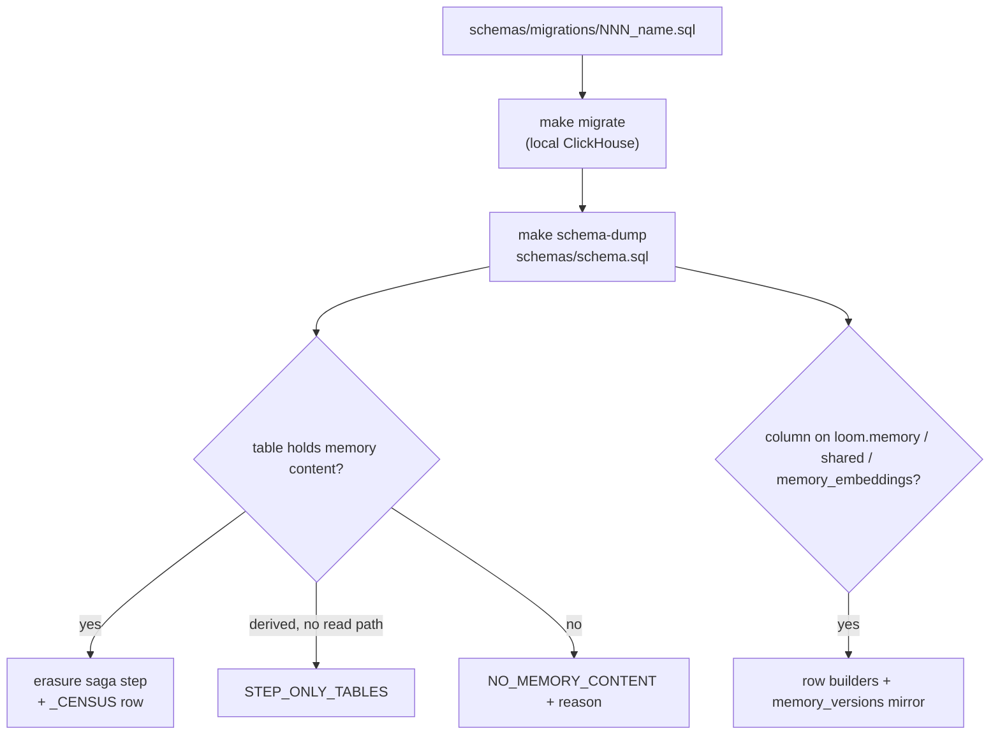

<!-- i18n: source=docs/development/adding-a-table.md blob=d8af79bee19277559de78fd0ef566e3df03ea7cb model=claude-sonnet-5-5 -->
> 本页由机器从[英文原文](https://github.com/ClickHouse/loom/blob/main/docs/development/adding-a-table.md)翻译，内容以英文原文为准。
> Machine-translated from the [English page](https://github.com/ClickHouse/loom/blob/main/docs/development/adding-a-table.md), which is authoritative.

# 添加 ClickHouse 表或列

Loom 的 ClickHouse 状态是 `loom` 和 `loom_telemetry` 数据库中的表；在 Postgres 记忆权威模式下，实时记忆、知识状态以及与之相关的记录都存放在 Postgres 中。[存储权威](../architecture/storage-authority.md#the-tables)页面列出了 Postgres 的表。ClickHouse 的 schema 只能通过带编号的增量迁移来修改，因为部署期间会有两个构建版本同时使用同一份 schema。下面的每条规则都有测试来保证。[ClickHouse](https://github.com/ClickHouse/loom/blob/main/docs/architecture/clickhouse.md) 解释了各个表族。

## 1. 编写迁移并重新生成 schema

[迁移](https://github.com/ClickHouse/loom/blob/main/docs/development/migrations.md)文档规定了相关规则：编号、哪些变更属于增量变更、runner 指令、排序键重建，以及针对固定版本 ClickHouse 的 `make schema-dump` / `make schema-check`。简而言之：

- 添加 `schemas/migrations/<NNN>_<what>.sql`，使用下一个可用编号。文件头部的注释要说明这次变更的用途，以及旧数据行和旧版本构建会看到什么。
- 表名使用 `loom.<table>` 形式，并写上 `IF NOT EXISTS` / `IF EXISTS`。由 Loom 自身的表派生出的遥测数据应放在 `loom_telemetry` 中（[原因](https://github.com/ClickHouse/loom/blob/main/docs/architecture/clickhouse.md)）；preflight 已会检查它的授权，而删除数据时的清点会连同数据库名一起列出该表。
- 不要编辑或删除已合并的迁移。出错时，用一个新文件来修正。
- 运行 `make migrate`、`make schema-dump`，然后运行 `python scripts/codegen/docs_reference.py`，使 [schema 参考](https://github.com/ClickHouse/loom/blob/main/docs/reference/schema.md)列出该表。

在部署应用该迁移之前，客户端的 schema 守卫会拒绝任何读写操作，只要它涉及待执行迁移将要创建的表，并返回 `SCHEMA_PENDING`。

## 2. 在 ReplacingMergeTree 写入路径上镜像每一列

`loom.memory`、`loom.shared` 和 `loom.memory_embeddings` 是 `ReplacingMergeTree(version)` 表，读取时使用 `FINAL`。每个写入新版本行的处理函数（set、tombstone、restore、touch、`update_by_id`、`bulk_set`、promote、demote）都会把**所有**持久化的列带到新版本中。如果后续版本行遗漏了某一列，在 `FINAL` 下读取时该列会是零值。

向这些表添加列时：

1. 将它添加到 `server/memory/store/rows.py` 中的规范列列表（`MEMORY_PERSISTED_COLS` 或 `EMBEDDING_PERSISTED_COLS`）。
2. 在该文件的构建函数（`build_memory_version_row`、`build_revision_row`、`build_first_version_row`、`build_embedding_row`）中带上这一列，并在所有为它们提供数据的投影中带上它（即加载现有行的 `SELECT`）。
3. 不要在处理函数中手工构造版本行，而应调用这些构建函数。

`tests/unit/test_memory_write_path_mirror.py` 和 `tests/unit/test_embedding_mirror_carry.py` 会检查其他写入路径。

**历史镜像。** `loom.memory_versions` 是 `loom.memory` 的只追加副本，由 `memory_versions_mv` 物化视图填充。`memory.history`、`memory.redact` 和 `namespace.rollback` 读取它，因为合并会从 `ReplacingMergeTree` 中丢弃被取代的行。新增 `loom.memory` 的列时，要**在同一个迁移中**把它加到 `loom.memory_versions` 以及该视图的 `SELECT` 中。`tests/unit/test_memory_versions_schema.py` 会将 `schema.sql` 中的两份列列表与 `MEMORY_PERSISTED_COLS` 进行比较。

任何新的写入路径都要设置由服务器标记的 `actor` 和 `source_class`（`server.memory.domain.provenance`），绝不能使用请求体中的值。

## 3. 为擦除对表进行分类

擦除是一个 saga（`server/erasure/app/saga.py`）。它的最后一步是对读取路径涉及的每张表做残留清点；只要范围内还有任何存活的行，saga 就会以失败告终（fail closed）。`schema.sql` 中的任何 `CREATE TABLE`，只要没有恰好出现在 `server/erasure/store/census.py` 的三个列表之一中，`tests/unit/test_every_table_is_classified.py` 就会失败：

| 列表                | 在以下情况下把表放在这里                                                                                                              | 你还需要添加                                                                                                                          |
| ------------------- | ------------------------------------------------------------------------------------------------------------------------------------- | ------------------------------------------------------------------------------------------------------------------------------------- |
| `_CENSUS`           | 表可能保存读取路径会返回的记忆内容。                                                                                                  | 一个删除范围内行的 saga 步骤，以及一个 `Substrate(table, live, user_pred, ns_step, user_step)`，按范围指明该步骤。                    |
| `STEP_ONLY_TABLES`  | 某个 saga 步骤会修改该表，但清点不统计它（派生的账本、别名映射），原因写在字典上方的注释中。                                          | 以步骤名称为键的步骤。                                                                                                                |
| `NO_MEMORY_CONTENT` | 表在范围内不保存记忆内容（计数、游标、公开数据的缓存）。                                                                              | 一行原因说明。                                                                                                                        |

对于 `_CENSUS` 表：

- `live` 是存活行所满足的谓词（`tombstoned_at IS NULL`，或者在每一行都计数时为 `"1"`）；当表有用户维度时，`user_pred` 为 `user_id = {uid:String}`；对于只有命名空间维度的表则为 `None`（此时它只在命名空间范围的擦除中被统计）。
- 步骤是 `server/erasure/store/steps_*.py` 中的一个函数，并以其步骤名称列在每个适用的 saga 表中（`server/erasure/app/saga_steps.py` 里的 `NAMESPACE_STEPS`、`USER_STEPS`）；对于普通的 `MergeTree`，`Substrate` 上要设置 `final=False`（在那里使用 FINAL 是不允许的）。
- 恢复执行的 saga 会重新运行上一次清点中发现有行残留的任何表的所属步骤（`steps_to_reopen`），因此该步骤必须是幂等的。
- 以 `(org, namespace)` 为键的代码平面表通常应归入 `CODE_INDEX_STEP_ONLY_TABLES`（由 saga 的 `code_index.purge` 步骤删除）；有一个单元测试会让该元组与 schema 保持一致。

使用 stub 客户端测试步骤的语句形态，如 `tests/unit/test_erasure_repo.py` 和 `tests/unit/test_erasure_late_steps.py` 所做的那样。

## 4. 对任何 mutation 进行分类

`ALTER TABLE loom.<t> UPDATE|DELETE` 是一个 ClickHouse mutation：它以异步方式重写数据分片，且不具备事务性。`tests/unit/test_clickhouse_mutation_inventory.py` 会根据 `_EXPECTED_MUTATIONS` 统计 `server/` 下所有可见的 mutation。新增的 mutation 在你把它加入该清单并附上说明原因的注释之前，测试都会失败。

优先使用 `ReplacingMergeTree` 上的新版本行、墓碑列（tombstone column）或轻量级 `DELETE FROM`。切勿把 mutation 用作请求要等待的申领或锁；任务收件箱改为通过 `KeeperMap` 租约表来申领。

## 检查清单

- [ ] 新增 `schemas/migrations/<NNN>_<what>.sql`，只做增量修改且幂等；不要编辑已合并的文件。
- [ ] 针对全新的固定版本 ClickHouse 运行 `make schema-dump`；`make schema-check` 无报错。
- [ ] 运行 `python scripts/codegen/docs_reference.py` 生成 schema 参考文档。
- [ ] RMT 列：更新 `rows.py` 的列列表、构建器和投影；`memory_versions` 和 `memory_versions_mv` 在同一个迁移中处理。
- [ ] 擦除分类：加入 `_CENSUS` 和 saga 步骤、`STEP_ONLY_TABLES`，或者加入 `NO_MEMORY_CONTENT` 并说明原因。
- [ ] 任何新的变更操作都要列入清单测试。
- [ ] 在[存储布局](https://github.com/ClickHouse/loom/blob/main/docs/architecture/storage-layout.md)中添加一行：ClickHouse 表放入所属表族的表格（名称以 `_` 开头的表放入 `_` 表的章节），并填写所有列。`tests/unit/test_storage_layout_rows.py` 会检查该行是否存在（对于 ClickHouse 表，表被删除后该行也应已移除；被删除的 Postgres 表的行需要手动移除）；对于 ClickHouse 表的行，还会检查其 Today 单元格与 schema 一致、其 Erasure 单元格与 census 一致，并且其引用中包含该表名；在 schema dump 尚未完成时，该测试会失败，直到 dump 完成。
- [ ] 运行 `make test-unit`（增量、编号、镜像、分类和清单测试）。

## 相关内容

- [迁移](https://github.com/ClickHouse/loom/blob/main/docs/development/migrations.md)
- [ClickHouse](https://github.com/ClickHouse/loom/blob/main/docs/architecture/clickhouse.md)
- [保留与删除](https://github.com/ClickHouse/loom/blob/main/docs/features/memory/retention-and-erasure.md)
- [升级](https://github.com/ClickHouse/loom/blob/main/docs/operations/upgrades.md)
