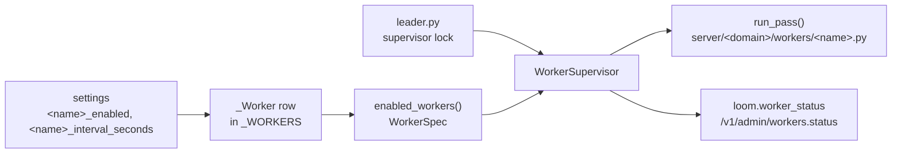

<!-- i18n: source=docs/development/adding-a-worker.md blob=caf48d881a70356a242d6cb16a1569b75e93391e model=claude-sonnet-5-5 -->
> 本页由机器从[英文原文](https://github.com/ClickHouse/loom/blob/main/docs/development/adding-a-worker.md)翻译，内容以英文原文为准。
> Machine-translated from the [English page](https://github.com/ClickHouse/loom/blob/main/docs/development/adding-a-worker.md), which is authoritative.

<a id="add-a-background-worker"></a>

# 添加后台 worker

worker 是 `server/workers/registry.py`（`_WORKERS`）中的一行，加上一个带有单个 pass 函数的模块。`enabled_workers()` 会把已启用的行转换为 `WorkerSpec`，`WorkerSupervisor`（`server/workers/supervisor.py`）负责运行、计时、退避和排空每个 worker。自动生成的 [worker 参考](https://github.com/ClickHouse/loom/blob/main/docs/reference/workers.md)列出了每一行。



<a id="1-write-the-pass"></a>

## 1. 编写 pass

创建 `server/<domain>/workers/<name>.py`，其中包含一个 `async def run_pass()`。supervisor 每隔一个间隔调用它一次，并丢弃其返回值。`server/tasks/workers/lease_sweep.py` 是一个简短的示例：

```python
from server.workers import pass_context
from server.workers.status import record_pass


async def run_pass() -> SweepResult:
    from server.tasks.app.sweep import sweep_once

    with record_pass("task_lease_sweep") as rec:
        counts = await sweep_once()
        rec.outcome = dict(counts)
    result = SweepResult(**counts)
    if result.total == 0:
        pass_context.mark_idle()
    else:
        log.info("task_lease_sweep: expired=%d ...", result.expired)
    return result
```

pass 的约定：

- **幂等且有界。** pass 可能在截止时间被取消，在崩溃后重新运行，或在部署后于另一种颜色的实例上运行。每次只做有限量的工作，其余留给下一次 pass。
- **截止时间。** 默认值为 `min(4 × interval, 900 s)`，下限为 60 s（`default_max_pass_seconds`）。超过截止时间的 pass 会被取消，并计为一次失败。若某个 pass 需要更长时间，请在该行上设置 `max_pass_seconds` 或 `max_pass_setting`。
- **失败。** 异常会使 pass 失败。supervisor 以指数退避重试（从 1 s 起翻倍，直至 60 s），连续失败 3 次后将该 worker 标记为 `degraded`。在截止时间被中断的 pass，或间隔超过其截止时间的 worker（每日和每周的 pass），会等待完整的间隔（`failure_hold_seconds`），这样重试就不会再次消耗同样的数据库时间。
- **部分失败。** 某个分支失败但并未使整个 pass 失败时，调用 `pass_context.note_failure(exc, what)`。它会计入连续失败次数，并显示在 `loom.worker.partial_failures{worker}` 中。
- **空闲。** 没有发现任何工作的 pass 调用 `pass_context.mark_idle()`。随后 supervisor 会休眠 `idle_interval_seconds`。
- **游标。** 分页处理的 worker 读取 `pass_context.resume_cursor()`，并在停下的位置调用 `pass_context.set_cursor(value)`。游标存储在该 pass 的 `loom.worker_status` 行上，因此重启后的进程可以接着处理。
- **宽泛的 `except` 要说明原因：** `# noqa: BLE001 — <what must not fail>`。

<a id="2-attribute-its-queries"></a>

## 2. 标记其查询归属

supervisor 会为每一轮执行打上标记：

- ClickHouse 查询携带 `log_comment` `worker.<name>`（见 `server/workers/status.py` 中的 `set_worker_identity`）；
- provider span 携带 `loom.operation=worker.<name>`；
- 该轮执行在后台流量类别中运行（`bind_background`）；
- 其 LLM 和 embedder 的开销会记入同一条账本记录 `worker.<name>.pass`。

supervisor **之外**的循环（任务、线程、CLI 循环）需要自行打标记，否则其查询会被记录为 `untagged:<module>.<function>`：

```python
from server.core.ch import set_query_tag

set_query_tag("worker.my_loop")
```

<a id="3-add-its-settings"></a>

## 3. 添加相应设置

在 `server/settings/catalog.py` 中对应领域的部分（`Memory`、`Code`、`Tracker` 等）添加开关和执行间隔。每条注释都会成为生成的[配置参考](https://github.com/ClickHouse/loom/blob/main/docs/reference/configuration.md)中对应行的说明文字。

```python
    # Lease sweeper: return expired leases to todo, resume deferred tasks at
    # resume_at, escalate stale triage. One read per pass.
    task_lease_sweep_enabled: bool = True
    # Seconds between passes while there is work.
    task_lease_sweep_interval_seconds: int = 60
    # Seconds between passes that found nothing.
    task_lease_sweep_idle_interval_seconds: int = 300
```

如果 worker 需要凭据、会在提供商上产生费用，或者服务于需要运维人员主动启用的平面，则将其默认设为**关闭**。默认开启的 worker 会在每个部署环境中运行，包括笔记本电脑。

<a id="4-add-the-registry-row"></a>

## 4. 添加注册表行

```python
(
    _Worker(
        "task_lease_sweep",
        "server.tasks.workers.lease_sweep",
        "task_lease_sweep_enabled",
        "task_lease_sweep_interval_seconds",
        idle_interval="task_lease_sweep_idle_interval_seconds",
    ),
)
```

| `_Worker` 字段                         | 含义                                                                                                                                      |
| -------------------------------------- | ----------------------------------------------------------------------------------------------------------------------------------------- |
| `name`                                 | worker 的名称：日志标签、账本操作、状态行。                                                                                               |
| `module`                               | 完整的模块路径。仅在 worker 启用时才导入，因此启动保持快速，可选依赖也保持可选。                                                          |
| `enabled`                              | 用于开启该 worker 的设置标志；`None` = 始终开启。                                                                                         |
| `interval`                             | 保存执行周期（以秒为单位）的设置字段。                                                                                                    |
| `pass_attr`                            | pass 函数的名称（默认为 `run_pass`）。                                                                                                    |
| `also_requires`                        | worker 所需的第二个设置标志（它读取的账本、它服务的平面）；关闭 → 该 worker 关闭。                                                        |
| `idle_interval`                        | 空闲 pass 之后休眠时长的设置字段。                                                                                                        |
| `max_pass_seconds`, `max_pass_setting` | pass 的截止时间，可固定指定，也可从设置中读取。                                                                                           |
| `first_pass_due`                       | 模块属性：启动时询问一次的异步检查；返回 `True` 则立即运行第一次 pass，而不是等到启动错峰之后。                                           |
| `owned_tables`                         | `True`：模块导出 `OWNED_TABLES` 和 `due_scope`；当某个自有表在范围内的命名空间中没有对应行时，第一次 pass 即到期。                         |

**启动错峰。** 如果没有第一次 pass 的钩子，第一次 pass 会等待 `crc32(name) % interval`。这样一来，在只存活数小时的进程上，每日运行的 worker 可能永远不会运行，因此请声明它负责填充的内容：

```python
from server.workers.first_pass import OwnedTable

OWNED_TABLES = (OwnedTable("loom.qa_item_embeddings", namespace_column="namespace"),)


def due_scope() -> list[tuple[str, str]]: ...  # the (org, namespace) pairs this worker fills
```

这就是 `server/tracker/workers/embed.py` 中的声明。该检查对每个表只执行一条语句，并受 `FIRST_PASS_DUE_TIMEOUT_SECONDS` 限制。无法读取的表视为到期。

<a id="5-understand-where-it-runs"></a>

## 5. 了解它在哪里运行

**每个部署只有一个 supervisor。** `server/workers/leader.py` 通过 ClickHouse 在所有容器和主机之间选出一个进程：即 Keeper 锁表 `loom._migration_lock` 中的 `workers_supervisor` 键。持有者每隔 `LOOM_SUPERVISOR_LEASE_TTL_S / 6` 续约一次；失去租约的持有者会停止它的 worker；持有者退出后，另一个进程会在 `LOOM_SUPERVISOR_LEASE_TTL_S`（默认 30 秒）之后接管。

| `LOOM_BACKGROUND_WORKERS` | 效果                                                                                                      |
| ------------------------- | ----------------------------------------------------------------------------------------------------------- |
| `auto`（默认）          | 竞争租约；持有租约期间运行 supervisor。在部署之外（没有 `LOOM_DEPLOYMENT`）时为 `off`。 |
| `on`                      | 始终运行 supervisor。                                                                                  |
| `off`                     | 只运行 Web。                                                                                                   |

让每个副本都以 `auto` 运行：任何一个都可能成为 leader。`make server` 或 iso server 除非设置为 `on`，否则不会运行任何 worker。

**两个副本可能短暂重叠。** 持有者在 T/2 内没有续约时会停止它的 worker，早于其他进程在 T 时接管，但它已经发出的语句仍会生效，而且 `on` 进程不会获取租约。要让第二个副本无害：使用幂等写入、带租约的认领、保存在存储中的游标。调用 LLM 的 worker 在两个副本同时运行期间，开销会翻倍。

**在批次之间停止。** 长循环在写入每个批次之前调用 `pass_context.check_stop()`。一旦该轮次被停止或租约过期，它就会抛出 `PassStopped`，这也会影响在 `asyncio.to_thread` 中运行的工作。`PassBudget.exhausted()` 会替你调用它。

**滚动升级。** 较旧的构建会把租约让给仍在运行的较新构建（参见[故障与恢复](https://github.com/ClickHouse/loom/blob/main/docs/architecture/failure-and-recovery.md#background-workers)）。旧的 leader 在停止时释放租约，较新的进程会在下一轮（几秒内）接管。

<a id="6-pin-it-in-tests"></a>

## 6. 在测试中固定行为

- **Registry 快照。** `tests/unit/test_worker_registry_snapshot.py` 在三种设置配置（`defaults`、`all_on`、`production`）下构建 worker 列表，并将每个 `WorkerSpec` 字段与 `tests/unit/snapshots/worker_registry.json` 进行比较。仅在有意变更时才重新生成快照：

  ```bash
  LOOM_UPDATE_WORKER_SNAPSHOT=1 python -m pytest tests/unit/test_worker_registry_snapshot.py
  ```

  如果 production 应运行该 worker，请将其标志添加到该测试中的 `_PRODUCTION_FLAGS`。

- **一致性。** `tests/unit/test_worker_registry_parity.py` 检查在所有标志开启时，`worker_meta()`（`/v1/admin/workers.status` 所渲染的内容）与 `enabled_workers()` 列出的集合相同。
- **pass 本身。** 单元测试针对桩仓库（stub repository）或本地 ClickHouse 调用 `run_pass()`。在受监督的 pass 之外，`pass_context` 的调用只会记录日志。
- **生成的文档。** `python scripts/codegen/docs_reference.py` 会重新生成 [workers 参考文档](https://github.com/ClickHouse/loom/blob/main/docs/reference/workers.md)；在文档过期时，`make lint` 会失败。

<a id="7-check-it-runs"></a>

## 7. 检查是否运行

- `/v1/admin/workers.status` 会将本进程的注册表与每个 worker 最新的 `loom.worker_status` 行合并，因此 Web 层可以显示在 workers 容器中运行的 worker。
- `/v1/health?include=workers` 会报告每个 worker 的状态以及 `workers_leader`：即应答的进程是否持有锁，以及原因。
- 对 `loom.worker.consecutive_failures{worker}` 和 `loom.worker.partial_failures{worker}` 设置告警（[监控](https://github.com/ClickHouse/loom/blob/main/docs/operations/monitoring.md)）。

<a id="related"></a>

## 相关内容

- [扩展 Loom](https://github.com/ClickHouse/loom/blob/main/docs/development/extending-loom.md)
- [Workers 参考](https://github.com/ClickHouse/loom/blob/main/docs/reference/workers.md)
- [故障与恢复](https://github.com/ClickHouse/loom/blob/main/docs/architecture/failure-and-recovery.md)
- [Worker 状态](https://github.com/ClickHouse/loom/blob/main/docs/operations/monitoring.md#worker-status)
