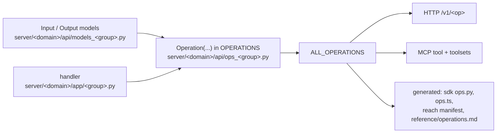

<!-- i18n: source=docs/development/adding-an-operation.md blob=32e9eb1349c29c12bc71e2adc8c55441a459025d model=claude-sonnet-5-5 -->
> 本页由机器从[英文原文](https://github.com/ClickHouse/loom/blob/main/docs/development/adding-an-operation.md)翻译，内容以英文原文为准。
> Machine-translated from the [English page](https://github.com/ClickHouse/loom/blob/main/docs/development/adding-an-operation.md), which is authoritative.

<a id="add-an-operation"></a>

# 添加操作

操作只在注册表中声明一次。HTTP 路由（`POST /v1/<op>`）、OpenAPI schema、MCP 工具（`loom_<op with dots as underscores>`）、目录（`/v1/operations`、`ops.capabilities`）、SDK 的操作表以及[操作参考](https://github.com/ClickHouse/loom/blob/main/docs/reference/operations.md)都由它派生。你需要编写模型、处理函数、声明和测试，然后重新生成其余内容。



示例是 `calibration.get`，它是最小的操作之一：`server/memory/api/models_calibration.py`、`server/memory/api/ops_calibration.py` 和 `server/memory/app/calibration.py`。

<a id="1-define-the-input-and-output-models"></a>

## 1. 定义输入和输出模型

把它们放在该分组的 models 模块中，即 `server/<domain>/api/models_<group>.py`。models 模块只包含 Pydantic 传输模型：它不导入任何 handler。

```python
from pydantic import BaseModel, Field


class CalibrationGetInput(BaseModel):
    org: str
    namespace: str


class CalibrationGetOutput(BaseModel):
    source: str  # "namespace" / "cluster" / "scalar"
    embedder_model: str = ""
    noise_floor: float
    ...
    similar_pairs_n: int = Field(default=0)
```

模型的规则：

- **身份。** 按命名空间寻址的 op 接受 `org` 和 `namespace`。写入行的 op 还接受身份元组的其余部分：`agent`、`user_id`、`session_id`、`run_id`（后三者默认为 `'-'`）。通过 MCP 调用时，服务器会用连接的默认值填充省略的身份字段，然后对请求体中指明的 `(org, namespace)` 进行授权。
- **由服务器写入的列绝不取自请求体。** 写入路径会设置 `actor`（`server.memory.app.provenance.writer_actor`）和 `source_class`（`server.memory.domain.provenance.source_class_for`）。请求只能声明降级为 `derived`、`external` 或 `imported`。
- **对 MCP 隐藏与 agent 无关的字段。** 用 `json_schema_extra=MCP_HIDDEN`（`server/operations/base.py`）标记排序参数或流水线开关。MCP schema 会省略该字段，但 op 仍然接受它。
- **读取类输入不要使用模型级别的“A 或 B 二选一”校验器。** 传输层会在授权之前校验请求体，因此一个会抛出异常的 `@model_validator` 会向命名空间门禁将会拒绝的主体暴露该 op 的信息。请把规则放在 handler 中，并抛出 `server.core.errors.ValidationError`。`tests/unit/test_op_inputs_after_gate.py` 会检查每个已注册的 op。
- **要废弃某个字段，直接删除它。** 仍然发送该字段的客户端依然会得到响应，并且该字段会列在 `ignored_args` 中（[未知字段和已移除字段](https://github.com/ClickHouse/loom/blob/main/docs/reference/http-api.md#unknown-and-removed-fields)）。

<a id="2-write-the-handler"></a>

## 2. 编写 handler

每个分组对应一个 handler 模块，位于 `server/<domain>/app/` 下。handler 是 `async` 函数，接收输入模型并返回输出模型。它在模块顶部导入 wire 模型；模型从不导入 handler，因此导入关系是无环的：

```python
from server.memory.api.models_calibration import CalibrationGetInput, CalibrationGetOutput


async def handle_calibration_get(input: CalibrationGetInput) -> CalibrationGetOutput:
    from server.memory.app.embedder_calibration import get_calibration, get_namespace_calibration

    ns_cal = await get_namespace_calibration(input.org, input.namespace)
    ...
```

- 纯逻辑放在该领域的 `domain/` 中，SQL 放在其 `store/` 中。handler 负责组合它们。
- **拒绝**请求时，抛出 `server.core.errors.LoomServerError` 的子类（或带有 `{"code", "message"}` detail 的 `HTTPException`）。传输层会将其转换为错误信封，在 MCP 上则转换为 `isError` 结果。新增的错误码会出现在生成的[错误参考](https://github.com/ClickHouse/loom/blob/main/docs/reference/errors.md)中。
- **宽泛的 `except` 要说明原因：**`except Exception as e:  # noqa: BLE001 — <what must not fail>`。
- 传输层会用 `log_comment` 标记 ClickHouse 查询；handler 不需要做任何事。
- 读取配置时使用 `settings.<field>`，不要使用 `getattr(settings, ...)`。
- 如果该 op 写入 `loom.memory` 或 `loom.shared`，请使用 `server/memory/store/rows.py` 中的构建器来构造行（[添加表](https://github.com/ClickHouse/loom/blob/main/docs/development/adding-a-table.md#2-mirror-every-column-on-replacingmergetree-write-paths)）。

<a id="ops-addressed-by-an-org-wide-id"></a>

### 通过组织范围 id 寻址的 op

只接收 `(org, memory_id)` 的 op，例如 `memory.get_by_id` 或 `memory.update_by_id`，不会从传输层获得命名空间。请将其声明为 `row_scoped=True`，在读取之前先解析调用方可访问的命名空间，并**隐藏**属于其他命名空间的行：

```python
import server.memory.store as memory_repo
from server.memory.app.id_namespace import namespace_for_id

namespace = await namespace_for_id(input.org, input.memory_id, strong=False)
if namespace is None:
    return MemoryGetByIdOutput(found=False)
row = await memory_repo.get_by_id(input.memory_id, org=input.org, namespace=namespace, ...)
if row is None:
    return MemoryGetByIdOutput(found=False)
```

应答方式与行不存在时相同，绝不返回 403：403 会确认该 id 存在于另一个租户中。写入时，向 `namespace_for_id` 传入 `Role.WRITER` 和 `strong=True`，以便读取最新的持有者。必须先读取行的 op，例如 `memory.redact`，在获取之后用 `authz.row_in_scope` 进行检查（[行级范围的操作](https://github.com/ClickHouse/loom/blob/main/docs/architecture/security.md#row-scoped-operations)）。

<a id="3-declare-the-operation"></a>

## 3. 声明操作

```python
from server.operations.base import Operation, Role

calibration_get = Operation(
    name="calibration.get",
    maturity="experimental",
    input_model=CalibrationGetInput,
    output_model=CalibrationGetOutput,
    handler=handle_calibration_get,
    idempotent=True,
    required_role=Role.VIEWER,
    audit=False,
)

OPERATIONS: list[Operation] = [calibration_get]
```

操作的延迟预算是 `server/settings/catalog.py` 中 `OP_BUDGETS_P99_MS` 的一个条目，所有 op 的预算都在这里设置，即 `"calibration.get": 60,`（该 op 设计目标的 p99，单位为 ms；调用成功但超出该值时会触发 `budget.violated` 事件）。handler 在运行时记录的请求形态（`server.observability.budget_shape`）在 `OP_SHAPE_BUDGETS_P99_MS` 中有各自的预算，目录中列出了这些预算。没有条目的 op 会导致 `tests/unit/test_op_budgets.py` 失败。部署时可以用 `LOOM_LATENCY_BUDGET_OVERRIDES` 调整单个 op，用 `LOOM_LATENCY_BUDGET_MULTIPLIER` 统一调整所有 op。

声明位于该分组的 ops 模块 `server/<domain>/api/ops_<group>.py` 中，该模块会导入模型和 handler。把它追加到模块的 `OPERATIONS` 列表中。**新的分组模块**需要在 `server/operations/registry.py` 中导入，并追加到 `_OPERATION_MODULES`。

| 字段                          | 必填 | 含义                                                                                                                                                                                                                                                                                             |
| ----------------------------- | ---- | ------------------------------------------------------------------------------------------------------------------------------------------------------------------------------------------------------------------------------------------------------------------------------------------------ |
| `name`                        | 是   | 点分格式 `<group>.<verb>`。HTTP 路径为 `/v1/<name>`；MCP 工具为 `loom_<name with . → _>`。                                                                                                                                                                                                       |
| `input_model`, `output_model` | 是   | Pydantic 模型。                                                                                                                                                                                                                                                                                  |
| `handler`                     | 是   | 异步可调用对象：输入模型 → 输出模型。                                                                                                                                                                                                                                                            |
| `idempotent`                  | 是   | 遇到瞬时故障时可以安全重试。SDK 和客户端依赖这一点。                                                                                                                                                                                                                                             |
| `required_role`               | 是   | `Role.VIEWER`、`WRITER`、`ADMIN`、`ORG_ADMIN` 或 `PLATFORM_ADMIN`。                                                                                                                                                                                                                              |
| `audit`                       | 否   | `True`：成功时向 `loom.audit_log` 写入一行。凡是会修改记忆、授权、策略或配置的操作都应设置。                                                                                                                                                                                                     |
| `writes`                      | 否   | 该 op 会修改已存储的状态，但 viewer 可以调用它且重试是安全的（例如一条反馈记录、一个已读标记）。writer 角色或 `audit=True` 本身已经表明会写入。                                                                                                                                                   |
| `maturity`                    | 否   | `stable`（默认）或 `experimental`。参见[第 5 步](#5-check-reach-and-maturity)。                                                                                                                                                                                                                  |
| `skip_namespace_authz`        | 否   | 对作用于命名空间**本身**的 op（join、leave、register），或目标只能由 handler 解析的 op（按 id 的 `memory.verify`、按范围的 `erasure.request`、按调用者角色的 `erasure.list`），跳过传输层的命名空间检查；由 handler 执行自己的规则。角色检查仍会执行。                                              |
| `deployment_scoped`           | 否   | 该 op 读取的是部署本身的信息（其构建、其注册表），而不是任何命名空间的数据；带范围限定的令牌以其各命名空间中的最高角色通过。                                                                                                                                                                      |
| `row_scoped`                  | 否   | 通过组织范围的 id 寻址；handler 对该行所属的范围进行授权（读取前用 `namespace_for_id`，或读取后用 `row_in_scope`），并将不属于调用者的行视为不存在。                                                                                                                                              |

当且仅当 op 满足 `idempotent`、`required_role == Role.VIEWER`、非 `audit` 且非 `writes` 时（`Operation.read_only`），它才是**只读**的（MCP `readOnlyHint`，`readonly` 工具集）。自动批准只读工具的客户端会信任这些标志。

<a id="4-decide-mcp-visibility"></a>

## 4. 决定 MCP 可见性

`server/operations/toolsets.py` 决定 op 在哪里列出：

- **精选名单**（`_MCP_CORE_OPS`、`_MCP_CODING_OPS`、`_MCP_ATOMIC_OPS`、`_MCP_TASK_OPS`、`_MCP_TRACKER_OPS`、`_MCP_CODE_CORE_OPS`）会把 op 列在对应的 `?toolset=` 下。每个列出的属性在每一轮都会消耗 token，因此只添加该类 agent 会调用的内容。`tests/unit/test_mcp_listing_budget.py` 把列表限制在 token 上限之内。
- **未列出**（大多数 op）：可在任意列表中通过 `loom_op` 按名称调用（在 `readonly` 下只能调用读操作，见 [MCP 工具集](https://github.com/ClickHouse/loom/blob/main/docs/reference/mcp.md#toolsets)）。`?toolset=all` 会列出 `stable` op，而 `experimental` op 只有在 core 或 atomic 名单列出它时才会列出（见 `server/operations/toolsets.py` 中的 `listed_under_all`）。
- **`_MCP_HIDDEN_OPS`**：无法通过 MCP 访问。`tests/unit/test_hidden_op_says_why.py` 要求返回的拒绝信息中指明应改为调用什么。

已列出的 op 需要在 `server/transport/mcp_descriptions.py`（`TOOL_DESCRIPTIONS`）中提供描述。请面向模型来写：何时调用该工具、它返回什么、不应该用它做什么。关于已变更事实的描述，应插入同一模块中的 `revision_policy()`，而不是自行表述。引用其他 op 时使用其带点号的 op 名称；每个列表会把已列出的 op 改写为对应的工具名，并标出未列出的 op（[MCP 参考](https://github.com/ClickHouse/loom/blob/main/docs/reference/mcp.md#tool-list)）。切勿把 op 写成调用形式（`op(args)`），也不要写在更长的代码片段内，或手写“(via loom_op)”。作为字段示例值给出的 op 名称要放在单引号中（`'memory.ask'`），列表会保持其原样。

<a id="5-check-reach-and-maturity"></a>

## 5. 检查覆盖范围与成熟度

一个 op 的 **覆盖范围**（reach）是推导出来的（`Operation.reach`，`server/operations/reach.py`）：它由该 op 是否属于 MCP 名单，加上对 SDK、`examples/`、`dev/` 和 `scripts/`、插件 hook 以及控制台中 `"/v1/<op>"` 调用位置的一次已提交扫描共同决定。`{"http_only"}` 表示只有原始的 `/v1/*` POST 请求能访问它。

每个 op 要么出现在所有接口上，要么在代码中说明原因。HTTP 提供注册表中的每个 op，两个 SDK 也都由注册表生成。MCP 会覆盖该 op，除非 `_MCP_HIDDEN_OPS` 将其保留给用户和运维人员使用。当用户需要时，控制台会调用它：用于管理、审阅、检查、配置，或在确认后删除；这类新 op 在发布时要附带对应的控制入口。只有 agent 或客户端程序会调用的 op，或者控制台通过另一个 op 提供的 op，会在 `NOT_IN_DASHBOARD`（`server/operations/dashboard.py`）中列出并注明原因。普查工具的 `--check`（`tests/unit/test_op_reach_census.py`）会对既没有控制台调用位置、在 `server/operations/dashboard.py` 中也没有条目的 op 报错。

- 对 MCP 隐藏且没有其他覆盖路径的 op（`server/operations/reach.py` 列出了这些类型），需要声明 `maturity="experimental"`。
- `stable` op 要么[列在 MCP `all` 工具集中](https://github.com/ClickHouse/loom/blob/main/docs/reference/operations.md#mcp-all-listing)，要么在对 MCP 隐藏时具有其他覆盖路径，并且应当有生产环境的调用方；`python scripts/codegen/op_reach_census.py --call-counts --days 30` 可以显示它是否有这样的调用方。除非新 op 取代某个 stable op，否则请将其声明为 `experimental`。
- 刷新清单：`python scripts/codegen/op_reach_census.py --write-manifest`（写入 `server/operations/reach_manifest.py`）。

<a id="6-write-the-tests"></a>

## 6. 编写测试

| 测试                                                     | 对你的 op 的要求                                                                                                                                                                                                 |
| -------------------------------------------------------- | ---------------------------------------------------------------------------------------------------------------------------------------------------------------------------------------------------------------- |
| `tests/unit/` 下的单元测试                               | 覆盖处理函数的拒绝路径和正常路径。                                                                                                                                                                               |
| `tests/integration/test_cross_principal_leakage.py`      | 每个读取类 op 都以另一个租户的身份调用（另一个命名空间上的写入者和查看者，以及另一个组织），并带有 canary nonce；响应中不得包含任何 nonce，且每次调用都以 200（空结果）、403 或 404 结束，绝不能返回 500。请求内容由你的输入模型合成，因此新的读取类 op 在注册当天就会被探测。 |
| `tests/integration/test_restricted_namespace_leakage.py` | 对受限命名空间做同样的检查。                                                                                                                                                                                     |
| `tests/unit/test_op_inputs_after_gate.py`                | 你的输入模型在构造时不会出现模型级校验错误。                                                                                                                                                                     |
| `tests/unit/test_op_reach_census.py`                     | reach 与 maturity 一致，且 manifest 是最新的。                                                                                                                                                                   |
| `tests/unit/test_mcp_listing_budget.py`                  | 列出的 op 不会使列表超出预算，且其描述不会指向客户端无法调用的工具。                                                                                                                                             |

如果泄漏测试套件无法为你的 op 合成请求体，它会报告这一点；请添加提示（hint），不要跳过。会修改调用者自己命名空间的 op 应放入该套件的 `_SKIP_OPS`，写入者门禁由其他测试覆盖。集成测试需要一个运行中的服务器（`LOOM_BASE_URL`），没有时会跳过。请使用该套件的辅助函数签发令牌，不要使用自助注册，CI 未启用自助注册。

<a id="7-regenerate-and-run-the-gates"></a>

## 7. 重新生成并运行检查

```bash
python scripts/codegen/sdk_py_gen.py                       # sdk/python/loom/ops.py
python scripts/codegen/sdk_py_client_gen.py                # sdk/python/loom/client.py
python scripts/codegen/sdk_ts_gen.py                       # sdk/typescript/src/generated/ops.ts
python scripts/codegen/op_reach_census.py --write-manifest # server/operations/reach_manifest.py
python scripts/codegen/docs_reference.py                   # generated regions of docs/reference/*.md
make format
make lint          # ruff, gates, every generator with --check, the reach census --check, Biome's dashboard accessibility rules
make typecheck
make test-unit     # reach census, MCP listing budget
```

如果生成的文件已过期，CI 会失败。生成的 SDK 文件会让所有客户端同时获得该 op：Python 和 TypeScript 中的 `agent.call("calibration.get", {...})` 会依据新的 TypedDict 和 interface 进行类型检查。SDK 客户端上的手写方法（`sdk/python/loom/<group>.py`）是可选的；对常用的操作可以添加一个。它算作一条 reach 路径。

`python scripts/codegen/wire_changelog.py <rev_a> <rev_b>` 会打印两个版本之间对客户端有影响的变更。发布说明就是据此生成的。

<a id="before-you-open-the-pr"></a>

## 提交 PR 之前

- [ ] 模型、handler、声明、`OPERATIONS` 条目（新增分组时还需要 `_OPERATION_MODULES`）。
- [ ] 已审慎选定 `required_role`、`idempotent`、`audit`、`writes`、`maturity`。
- [ ] `row_scoped` 操作对不属于调用方的行，返回与行不存在时相同的结果。
- [ ] 工具集的归属，以及（如果列出）对应的描述。
- [ ] 上述测试均已通过；生成的文件已重新生成。
- [ ] 负责该操作的功能页面已链接到[操作参考](https://github.com/ClickHouse/loom/blob/main/docs/reference/operations.md)中对应的锚点。

<a id="related"></a>

## 相关内容

- [扩展 Loom](https://github.com/ClickHouse/loom/blob/main/docs/development/extending-loom.md)
- [系统概览](https://github.com/ClickHouse/loom/blob/main/docs/architecture/system-overview.md)：每个 op 依次通过的关卡顺序
- [HTTP API](https://github.com/ClickHouse/loom/blob/main/docs/reference/http-api.md)
- [代码生成](https://github.com/ClickHouse/loom/blob/main/docs/development/code-generation.md)
