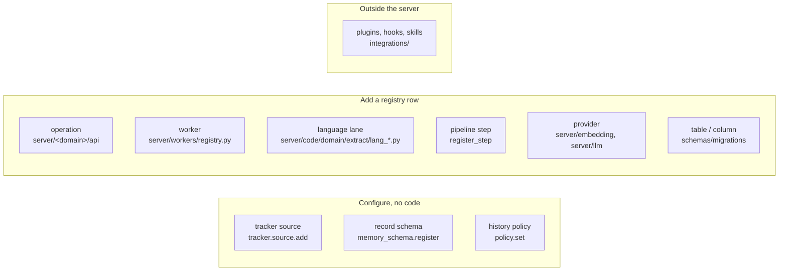

<!-- i18n: source=docs/development/extending-loom.md blob=73da8dff0ce992ad0dcb19d796cbf828d8785b33 model=claude-sonnet-5-5 -->
> 本页由机器从[英文原文](https://github.com/ClickHouse/loom/blob/main/docs/development/extending-loom.md)翻译，内容以英文原文为准。
> Machine-translated from the [English page](https://github.com/ClickHouse/loom/blob/main/docs/development/extending-loom.md), which is authoritative.

# 扩展 Loom

Loom 为每一类事物各设一个注册表：操作、worker、设置、提供方、语言通道、提取步骤和 tracker 源。要扩展 Loom，只需向对应的注册表添加一行；HTTP、MCP、SDK 以及生成的参考文档都会随之更新。

请先确认仅靠数据是否就能满足需求。tracker 源、记录 schema、procedure 或历史策略都是通过配置完成的，无需编程。

## 选择扩展点

| 你想要…… | 扩展点 | 位置 | 指南 |
| ------------------------------------------------------------ | ----------------------------- | ------------------------------------------------------------------------------------------------ | ---------------------------------------------------------------------- |
| 向调用方开放新的能力 | 操作（operation） | `server/<domain>/api/ops_<group>.py`, `server/<domain>/app/<group>.py` | [添加操作](https://github.com/ClickHouse/loom/blob/main/docs/development/adding-an-operation.md) |
| 按计划在后台执行工作 | worker | `server/<domain>/workers/<name>.py`，以及 `server/workers/registry.py` 中的一行 | [添加 worker](https://github.com/ClickHouse/loom/blob/main/docs/development/adding-a-worker.md) |
| 存储新的数据 | 表或列 | `schemas/migrations/<NNN>_*.sql`, `server/<domain>/store/` | [添加表](https://github.com/ClickHouse/loom/blob/main/docs/development/adding-a-table.md) |
| 为新的编程语言建立索引 | 代码索引语言通道 | `server/code/domain/extract/lang_<lang>.py`, `lang_detect.py`, `server/code/app/index/ingest.py` | [添加语言支持](https://github.com/ClickHouse/loom/blob/main/docs/development/adding-language-support.md) |
| 为部分调用方改变提取时保留的内容 | 流水线步骤 | `server/memory/app/pipeline.py` 中的 `register_step` | [提取流水线](https://github.com/ClickHouse/loom/blob/main/docs/guides/extraction-pipeline.md) |
| 读取新的问题跟踪器或 CI 历史 | 跟踪器来源（仅数据） | `tracker.source.add` + `tracker.source.set_mapping` | [跟踪器记录约定](https://github.com/ClickHouse/loom/blob/main/docs/features/tracker/record-contract.md) |
| 保存带有标识和类型化字段的事实 | 记录模式（仅数据） | `memory_schema.register`, `memory.record.write` | [写入记忆](https://github.com/ClickHouse/loom/blob/main/docs/features/memory/writing.md) |
| 根据 agent 的历史限制其可执行的操作 | 历史策略（仅数据） | `policy.set` | [令牌与授权](https://github.com/ClickHouse/loom/blob/main/docs/guides/tokens-and-grants.md#add-history-policy) |
| 使用其他嵌入或 LLM 提供方 | 提供方客户端 | `server/embedding/`, `server/llm/` | [见下文](#add-a-provider) |
| 添加设置项 | 设置字段 | `server/settings/catalog.py` 中对应领域的部分 | [见下文](#add-a-setting) |
| 从其他客户端采集会话，或提供 agent 指引 | 集成、钩子或技能 | `integrations/`, `skills/` | [见下文](#add-an-integration) |

## 所有扩展的共同点

- **代码就是注册表。** 传输层遍历 `ALL_OPERATIONS`，supervisor 遍历 `_WORKERS`，设置参考文档由 `server/settings/` 生成。每个注册表都有快照测试或普查测试，在你重新生成之前测试会一直失败。
- **生成的文件。** `make lint` 会以 `--check` 方式运行每个生成器：SDK 的 op 表（`scripts/codegen/sdk_py_gen.py`、`sdk_ts_gen.py`）、reach 清单（`op_reach_census.py`）、参考页面（`docs_reference.py`、`settings_reference.py`）以及 Codex 插件副本（`agent_plugin_sync.py`）。参见[代码生成](https://github.com/ClickHouse/loom/blob/main/docs/development/code-generation.md)。
- **成熟度。** 新增的 op 需声明 `maturity="experimental"`，除非它替换的是一个稳定的 op（参见[添加操作](https://github.com/ClickHouse/loom/blob/main/docs/development/adding-an-operation.md#5-check-reach-and-maturity)）。
- **度量。** 对排序、提取或提供方默认值的任何改动，都要在改动前后运行相应的基准测试（参见[性能调优](https://github.com/ClickHouse/loom/blob/main/docs/guides/performance-tuning.md#measure-first)）。
- **基础结构不是扩展点。** 引擎（ClickHouse）、身份元组、逐行内容哈希审计以及五个信念修订操作，只有在 PR 和架构文档中给出设计依据后才能更改（参见[系统概览](https://github.com/ClickHouse/loom/blob/main/docs/architecture/system-overview.md)）。

## 添加 provider

Embedder 和 LLM 都是由设置选定的客户端。

**Embedder** 放在 `server/embedding/` 中，与 `openai.py`、`gemini.py`、`local.py` 和 `fake.py` 并列。它共用 `server/embedding/_provider.py` 中的 HTTP 基础代码：

- 仅在可重试的状态码上重试，总共尝试三次（含首次请求，即最多重试两次）；
- 输入过长时抛出 `EmbedderInputTooLarge`，而不是由 provider 静默截断；
- 向量为空、维度不符或含非有限值时抛出 `MalformedEmbedding`。

在 `server/embedding/embedder.py` 中接入：根据 `LOOM_EMBEDDING_MODEL` 推断 provider（`_inferred_provider`）、`LOOM_EMBEDDING_PROVIDER` 的取值，以及 `KEY_ENVS` 中的密钥变量。缺少密钥时会回退到 fake embedder，并记录一条错误日志。

**LLM** 放在 `server/llm/` 中，与 `openai.py`、`anthropic.py` 和 `fake.py` 并列，并实现 `LLMClient`（`server/llm/client.py`）。在 `_build_llm_client` 中，以及在 `DEFAULT_MODEL_BY_PROVIDER`、`KEY_ENV_BY_PROVIDER` 和 `resolve_llm_provider`（`server/core/llm_provider.py`）中接入。

> **警告：** provider 会影响质量。相似度阈值是按 `text-embedding-3-small` 校准的。在将新 provider 设为默认之前，请先针对它运行 `make bench-quick`。新增 embedder 后，需要对每个已有命名空间执行 `loom reembed`。

## 添加设置

新字段放在 `server/settings/catalog.py` 中对应领域的分区里（`MemorySearch`、`Code`、`Tracker` 等），所有设置都在这一个文件中声明。字段上方的注释说明它控制什么以及各个取值的含义；该注释会成为生成的[配置参考](https://github.com/ClickHouse/loom/blob/main/docs/reference/configuration.md)中对应的一行。环境变量名为 `LOOM_<FIELD>`。

读取时使用 `settings.<field>`，不要使用 `getattr(settings, "<field>", default)`。`tests/unit/test_settings_attribute_access.py` 会在出现后一种写法时失败：复制的默认值会逐渐与原值不一致，还会让删除该字段的人找不到读取它的位置。使用 `python scripts/codegen/settings_reference.py` 和 `python scripts/codegen/settings_schema.py` 重新生成。

要下线一个标志，请删除该设置、它对应的分支，以及携带它的所有请求级字段。仍然发送该字段的客户端依然会得到响应，该字段会列在 `ignored_args` 中。

## 添加集成

| 集成                                      | 位置                                                                | 说明                                                                                                                                                                                                                                                                                                     |
| ----------------------------------------- | ------------------------------------------------------------------- | -------------------------------------------------------------------------------------------------------------------------------------------------------------------------------------------------------------------------------------------------------------------------------------------------------- |
| 编码 agent 插件的 hook 或 skill           | `integrations/claude-code-plugin/` (`hooks/`, `lib/`, `skills/`)    | 这是权威来源；`python scripts/codegen/agent_plugin_sync.py` 会把脚本、skill 和列表图标 (`assets/`) 复制到 `integrations/codex-plugin/`。新增 hook 需要手动接入 Codex 的 `hooks.json`。当插件清单中的版本号变化时，已安装的客户端会获取更新。 |
| 其他客户端的会话捕获 hook                 | `integrations/<client>/` (`cursor/`, `generic/`)                    | 调用 `loom ingest-transcript` 或 `conversation.append`，并使用 `memory.set_from_messages` 进行提取。                                                                                                                                                                                                      |
| 可移植的 agent skill                      | `skills/<name>/SKILL.md`                                            | 可按名称安装到任何支持 Agent-Skills 的客户端；仅提供指引，不含 hook。                                                                                                                                                                                                                                    |
| 框架适配器                                | `sdk/python/loom/integrations/`, `sdk/typescript/src/integrations/` | 用框架的存储或记忆接口封装 SDK（Python 中有 LangGraph 的 `LoomStore` 和 Strands 的 `LoomMemoryStore`，TypeScript 中有 Strands 适配器）。                                                                                                                                                                  |
| 可观测性后端                              | `server/observability/`                                             | span 已带有 `loom.request_id` 并通过 OTLP 导出；优先使用 OTLP collector，而不是新增 exporter。                                                                                                                                                                                                           |

[集成](https://github.com/ClickHouse/loom/blob/main/docs/features/integrations/index.md)介绍了已提供的集成。[Agent 集成](https://github.com/ClickHouse/loom/blob/main/docs/guides/agent-integration.md)说明了任何新客户端应当写入和读取的内容。

## 相关内容

- [仓库指南](https://github.com/ClickHouse/loom/blob/main/docs/development/repository-guide.md)
- [测试](https://github.com/ClickHouse/loom/blob/main/docs/development/testing.md)
- [贡献指南](https://github.com/ClickHouse/loom/blob/main/CONTRIBUTING.md)
