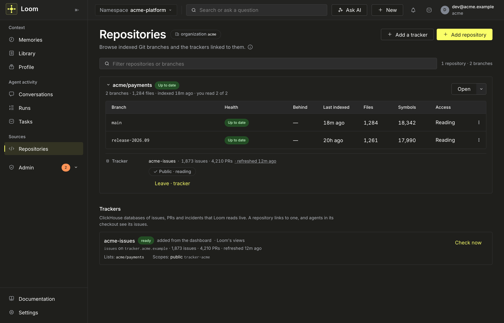
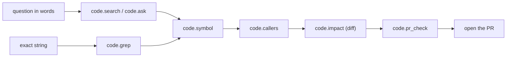

<!-- i18n: source=docs/features/code-index/overview.md blob=65d6f5418ee7375b23c79a5965e673bcdc3da902 model=claude-sonnet-5-5 -->
> 本页由机器从[英文原文](https://github.com/ClickHouse/loom/blob/main/docs/features/code-index/overview.md)翻译，内容以英文原文为准。
> Machine-translated from the [English page](https://github.com/ClickHouse/loom/blob/main/docs/features/code-index/overview.md), which is authoritative.

<a id="code-index-for-coding-agents-over-mcp"></a>

# 面向编码 agent 的 MCP 代码索引

对某个仓库启用代码 worker 后，Loom 会把该仓库索引到 ClickHouse 中，并通过 `code.*` 操作回答结构类问题：某个符号在哪里定义、谁调用了它、一次变更会影响到哪些部分、哪个已合并的 PR 修改过某一行。agent 可以通过 MCP、HTTP（`POST /v1/code.<op>`）或 Python SDK（`agent.code`）调用这些操作。所有 agent 读取的是同一份数据行，因此一个仓库每次合并只需解析和嵌入一次，而不是每个会话都做一次。索引的构建方式见[代码索引架构](https://github.com/ClickHouse/loom/blob/main/docs/architecture/code-index-architecture.md)。

[语言支持表](#language-support)区分了快速层级的符号和边，以及编译器层级的覆盖范围。

代码 worker 默认关闭；部署时按仓库逐个开启（[仓库](repositories.md)）。除非设置 `LOOM_MCP_CODE_TOOLS=true`，默认的 `core` MCP 工具集不会列出任何代码工具；`?toolset=coding` 则始终会列出。



<a id="what-it-answers"></a>

## 它能回答什么

| 你想知道                                   | 调用                                                    |
| ------------------------------------------ | ------------------------------------------------------- |
| 实现 X 的代码在哪里？                      | `code.search`，需要带引用的答案时用 `code.ask`          |
| 这个确切的字符串、消息或标识符在哪里？     | `code.grep`（对于打印出的日志行，使用 `mode: "message"`） |
| `Foo::bar` 是什么，它的函数体写了什么？    | `code.symbol`                                           |
| 谁调用了它，它又调用了谁？                 | `code.callers`、`code.callees`                          |
| 我的改动会影响哪些部分，必须运行哪些测试？ | `code.impact`、`code.test_gate`                         |
| 哪个已合并的 PR 修改了这一行，评审者说了什么？ | `code.blame_range`、`code.history`、`code.review_brief` |
| 我即将提交的 PR 是否已经有类似的存在？     | `code.pr_check`                                         |
| 索引是否足够新，可以用来回答问题？         | `code.index_status`，返回时附带 `as_of`                 |

按任务分组的全部 op 见 [operations.md](https://github.com/ClickHouse/loom/blob/main/docs/features/code-index/operations.md)。

<a id="one-namespace-is-one-branch"></a>

## 一个命名空间对应一个分支

一个代码命名空间跟踪仓库的一个分支。每个索引层级各自推进自己的提交水位线。Loom 维护一个 bare git 镜像，遍历该分支的 first-parent 历史，并把提取出的内容存入以 `(org, namespace)` 为键的 `loom.code_*` 表中。

- 不会读取 agent 检出的任何内容。未提交和未推送的更改永远不会进入索引。只有在把某个功能分支配置为独立条目时，它才会被索引。
- 每个分支都是各自的命名空间；同一仓库的各个分支共用一个镜像。“这个修复在发布分支上吗？”这类问题，应当向该分支的命名空间提问，或同时向多个命名空间提问（`code.grep mode=presence namespaces=[…]`）。
- 名称由 `[a-z0-9-]` 组成：默认分支为 `code-<repo>`，其他分支为 `code-<repo>-<branch-slug>`（`code-myrepo-2-4`）。
- 代码命名空间的 `kind=code`。它保存该仓库由成员编写的团队文件规则及其设计决策，并且不会出现在记忆选择器中。访问权限遵循通常的授权规则（[身份与命名空间](https://github.com/ClickHouse/loom/blob/main/docs/concepts/identities-and-namespaces.md)）。

每个命名空间的索引包含以下内容：

| 单元                                                            | 表                                                    | 产生方                                                                  |
| --------------------------------------------------------------- | ----------------------------------------------------- | ----------------------------------------------------------------------- |
| 文件及其最近一次解析结果                                        | `code_files`                                          | 快速层级                                                                |
| 代码块（函数、类骨架、文件头、文档章节）                        | `code_chunks`                                         | 快速层级；嵌入也由 `code_embed_recovery` 生成                           |
| 符号（定义、签名、范围）                                        | `code_symbols`                                        | 快速层级和编译器层级                                                    |
| 边（调用、继承、重写、包含等）                                  | `code_edges`                                          | 快速层级和编译器层级                                                    |
| 测试 → 代码映射                                                 | `code_test_map`                                       | `code_graph_stats` worker、`loom code crossref`、`code_coverage_import` |
| 已合并的 PR、评审、issue                                        | `code_pr_history`, `code_pr_reviews`, `code_gh_items` | `code_pr_history` worker                                                |
| 每个 PR 的上下文包                                              | `code_context_packs`                                  | 快速层级                                                                |
| 水位线和 worker 状态                                            | `code_index_state`                                    | 每个代码 worker                                                         |
| 查询跟踪和结果                                                  | `code_search_trace`, `code_search_outcome`            | 每个读取操作、`code.outcome`                                            |

<a id="two-tiers"></a>

## 两个层级

结构会被提取两次。每个 symbol 和 edge 都标明所属层级（`tier`：`scip` 或 `treesitter`）。两个层级都有同一行时，以编译器层级的行为准。

- **快速层级。** `code_ingest` worker 对分支从其水位线到镜像已获取的最新提交做 diff，并用 tree-sitter 和各语言通道重新解析变更的文件。它写入 chunk、symbol 和启发式调用图：在同一文件内绑定的调用置信度为 1.0，通过所在类绑定的为 0.8，通过全仓库名称匹配绑定的为 0.6。无法绑定的调用会被舍弃，而不是猜测。在 `LOOM_CODE_READY_EMBED_COVERAGE`（0.95）比例的 chunk 带有向量之前，`code.search` 只从词法检索分支作答，并会说明这一点。
- **编译器层级。** 来自 `scip-clang`（C/C++）、`scip-typescript`、`scip-python` 和 `scip-go` 的 SCIP 索引，由 `code_scip_*_delta` worker 运行，`code_scip_full` 负责为 C/C++ 条目做初始构建和重新索引（参见[代码索引运维](https://github.com/ClickHouse/loom/blob/main/docs/operations/code-index-operations.md#compiler-tier)）。外部生产方可以通过 `code.scip_ingest` 上传。它提供精确的调用、重写和继承 edge。其中 C/C++、Go 和 TypeScript 的步骤会执行仓库自带的构建代码，这些步骤运行在[仓库任务沙箱](https://github.com/ClickHouse/loom/blob/main/docs/operations/code-index-operations.md#repository-job-sandbox)内。

为什么分两层：快速层级成本低，合并后经过一次 ingest 即可检索。编译器层级需要构建环境，因此会滞后。带标签地同时提供两者，可以立即给出答案，并在编译器层级跟上后给出精确的答案。

<a id="workers"></a>

### 工作进程

| 工作进程                                        | 默认 | 作用                                              |
| ----------------------------------------------- | ---- | ------------------------------------------------- |
| `code_ingest`                                   | 关   | 快速层级，每次合并运行；构建自助服务条目          |
| `code_embed_recovery`                           | 关   | 为 ingest 过程中未嵌入的 chunk 生成嵌入           |
| `code_pr_history`                               | 关   | 来自 GitHub 的已合并 PR、评审和 issue             |
| `code_scip_delta`, `code_scip_{ts,py,go}_delta` | 开   | 每次合并的编译器层级增量                          |
| `code_scip_apply`                               | 关   | 应用暂存的 SCIP 增量                              |
| `code_graph_stats`                              | 关   | 每周计算 PageRank、度数和测试映射                 |
| `code_summary`                                  | 关   | 每周由 LLM 生成文件和模块摘要卡片                 |
| `code_backport_gaps`                            | 开   | 每晚生成 backport 报告；依赖 `code_pr_history`    |
| `code_coverage_notify`                          | 开   | 投递 `code.coverage.watch` 事件                   |

设置和间隔见[工作进程参考](https://github.com/ClickHouse/loom/blob/main/docs/reference/workers.md)和[配置参考](https://github.com/ClickHouse/loom/blob/main/docs/reference/configuration.md#code)。

> **注意：提取器戳记。** 行是按内容寻址的，因此即使提取器代码改变，未变更的文件重新 ingest 后仍得到相同的行。提取器模块和语法版本的哈希（即戳记）弥补了这一缺口：戳记变化时，`code_ingest` 会按节奏分批，为该语言族中的每个文件重新推导受影响的阶段。因此，对提取器模块的代码改动会在下次部署时重新索引每个仓库；注释和 docstring 不在戳记范围内。戳记之外的通道解析器（TypeScript、Rust、Go、Java 等）需要改用 `loom code backfill --paths-file`。每小时的对账也会重新 ingest 那些行早于其最后一次变更的文件。详情见[代码索引架构](https://github.com/ClickHouse/loom/blob/main/docs/architecture/code-index-architecture.md)。

<a id="language-support"></a>

## 语言支持

文件的语言先由 `treesitter.lang_for_path` 判定（C/C++、Python、shell、SQL、文档、配置），再由 `lang_detect.LANG_BY_EXTENSION` 判定各 lane 语言，最后依据 shebang 和 shell 检测。“边”指 `code.callers` / `code.callees` 所遍历的内容。`code.impact` 还会加入已映射的测试和共同变更的伙伴文件，因此没有调用边的语言仍然可以得到文件级的影响分析。

| 语言（扩展名）                                                                         | 符号                  | 快速层级的边                                                                  | 编译器层级        |
| -------------------------------------------------------------------------------------- | --------------------- | ----------------------------------------------------------------------------- | ----------------- |
| C / C++ (`.c`, `.cc`, `.cpp`, `.cxx`, `.h`, `.hpp`, `.hxx`, `.ipp`, `.inl`)            | 是                    | 调用、include、继承、重写                                                     | `scip-clang`      |
| Python (`.py`, `.pyi`, `.pyw`, `.ipynb` 代码单元格, `python` shebang)                  | 是                    | 调用、导入、继承、重写                                                        | `scip-python`     |
| TypeScript / JavaScript (`.ts`, `.tsx`, `.mts`, `.cts`, `.js`, `.jsx`, `.mjs`, `.cjs`) | 是                    | 调用（包括 `new`）、导入、继承、重写                                          | `scip-typescript` |
| Vue、Svelte、Astro 组件                                                                | 是                    | 与 TypeScript / JavaScript 相同，来自 script 块                               | —                 |
| Angular 组件模板 (`.component.html`)                                                   | 是                    | 将组件作为一个整体                                                            | —                 |
| Go (`.go`)                                                                             | 是                    | 调用、继承（接口嵌入、结构化实现）；SQL 岛                                    | `scip-go`         |
| Rust (`.rs`)                                                                           | 是                    | 调用、`use` 导入、继承（trait 实现）                                          | —                 |
| Java (`.java`)                                                                         | 是                    | 调用（import 绑定名称，不产生导入边）；SQL 岛                                 | —                 |
| Shell (`.sh`, `.bash`, `.bats`, shebang, rc 文件)                                      | 是                    | 调用（命令）、`source` include                                                | —                 |
| Prisma (`.prisma`)                                                                     | 是                    | 模型关系                                                                      | —                 |
| Protocol Buffers 协议（`.proto`）、FlatBuffers 序列化格式（`.fbs`）                    | 是                    | 导入、类型使用                                                                | —                 |
| Go 模板和 Helm chart (`.tpl`, `.tmpl`, `.gotmpl`, 模板化的 manifest)                   | 是                    | 模板调用                                                                      | —                 |
| Terraform / HCL (`.tf`, `.tfvars`, `.hcl`), Kubernetes manifest                        | 是                    | 引用 (`reads`)                                                                | —                 |
| Jsonnet (`.jsonnet`, `.libsonnet`)                                                     | 是                    | 调用、导入                                                                    | —                 |
| TLA+ (`.tla`, TLC 配置), CMake (`CMakeLists.txt`, `.cmake`)                            | 是                    | include；TLA+ 运算符；CMake 链接图                                            | —                 |
| Markdown 和文档 (`.md`, `.mdc`, `.mdx`, `.rst`, `.html`, `.htm`)                       | 章节（仅 `.md`）      | 相对链接，反引号包裹的名称作为指向代码的 `reads`                              | —                 |
| SQL (`.sql`)                                                                           | 需开关                | 表引用，开启语句记录时                                                        | —                 |
| 宿主文件 (Dockerfile, Makefile, Jenkinsfile, CI YAML)                                  | 需开关                | 被调用的脚本                                                                  | —                 |
| 配置、CSS 和其他文本文件                                                               | 否                    | 无；仅分块用于搜索和 grep                                                     | —                 |

开关（对已有命名空间开启时，都需要针对受影响的目录树运行 `loom code backfill --paths-file`）：

| 设置                              | 默认值 | 效果                                                              |
| --------------------------------- | ------ | ----------------------------------------------------------------- |
| `LOOM_CODE_SQL_STATEMENT_RECORDS` | off    | `.sql` 按语句记录而不是按行窗口处理                               |
| `LOOM_CODE_PY_SQL_ISLANDS`        | off    | Python 中的 SQL 变为语句和表边                                    |
| `LOOM_CODE_SHELL_ISLANDS`         | off    | shell 测试中的 SQL 字符串变为语句                                 |
| `LOOM_CODE_HOST_ISLANDS`          | off    | Dockerfile、Makefile、Jenkinsfile 和 CI YAML 的作业变为符号       |

`code.coverage` 报告一个命名空间中每种语言和每个层级所包含的内容。在信任某种语言的 callers 或 impact 结果之前，请先查看它。添加语言：[添加语言支持](https://github.com/ClickHouse/loom/blob/main/docs/development/adding-language-support.md)。

<a id="how-an-agent-uses-it"></a>

## agent 如何使用



1. **查找。** 用文字描述的问题用 `code.search`，手头已有确切字符串时用 `code.grep`。每条命中都会给出其所在的外层代码单元，因此你很少需要打开文件。
2. **锁定符号。** `code.symbol` 返回定义、签名、函数体、近期 PR，以及（设置 `uses_brief: true` 时）主要调用点。
3. **遍历调用图。** 用 `code.callers` 并指定 `depth` 跳数。查看 `epistemic` 可以知道列表是完整的，还是仅为下界。
4. **评估改动影响。** 用 `files` 或统一格式的 `diff` 调用 `code.impact`，返回受影响的符号、能够覆盖到它们的测试，以及 `co_change_missing`。
5. **检查是否重复。** 用 `code.pr_check`：`verdict` 为 `duplicate_of`、`related` 或 `none`（[history-and-prs.md](https://github.com/ClickHouse/loom/blob/main/docs/features/code-index/history-and-prs.md)）。

以上是 `coding` 工具集列出的 op。`code.callees` 和 `code.test_gate` 可以按名称调用，也可以通过 `loom_op` 调用。请通过 `code.outcome` 报告你如何使用这些命中结果（每个结果都带有 `trace_run_id`）。

客户端：

- Claude Code 和 Codex 插件（[claude-code.md](https://github.com/ClickHouse/loom/blob/main/docs/features/integrations/claude-code.md)、[codex.md](https://github.com/ClickHouse/loom/blob/main/docs/features/integrations/codex.md)）会把检出目录的 remote 解析为对应的代码命名空间，发送 `X-Loom-Code-Scope: <org>/<namespace>`，列出 `?toolset=coding`，并把已建立索引的检出目录中的整文件读取和全树 grep 重定向到这些 op。会话中修改过的文件则在本地读取。
- `loom-code` skill（`skills/loom-code/SKILL.md`）是其他 Agent-Skills 客户端的路由指南。
- [grep 垫片](../integrations/grep-shim.md)会为 `grep` / `rg` 的输出标注每条命中所在的函数。
- 在流水线中，可在固定步骤调用这些 op（分诊、归属、backport 是否存在）。
- 用户可以在控制台中仓库的 **Explore** 标签页里遍历同一张调用图（[演示视频](https://github.com/ClickHouse/loom/blob/main/docs/assets/screenshots/clip-code-callers.webm)）：

  

如果你把 `code.grep` 暴露给自己的模型，请在返回命中结果的同时传入 `as_of`、`abstain_code`、`note` 和 `coverage_floor`。只看到匹配项的模型无法区分索引为空和仓库为空。

<a id="reading-an-answer"></a>

## 解读返回结果

无论通过 HTTP 还是 MCP，每个操作都会按各自的类型化 schema 返回结果，因此 agent 读取的是字段而不是文字描述。一个经过精简的 `code.search` 返回结果：

```json
{
  "results": [
    {
      "path": "src/quota/limiter.cpp",
      "start_line": 412,
      "end_line": 468,
      "symbol": "acme::RequestLimiter::admit",
      "kind": "function",
      "description": "Charges a request against its tenant's window and rejects it once the quota is spent.",
      "tested": true,
      "next": "code.symbol name=acme::RequestLimiter::admit"
    }
  ],
  "next_cursor": "eyJjIjoiN2Q0…",
  "has_more": true,
  "abstain": false,
  "retrieval_risk": "low",
  "retrieval_confidence": 0.71,
  "as_of": { "branch": "main", "status": "fresh", "commit": "4be19c07a" },
  "trace_run_id": "8f0e2c41…"
}
```

`code.symbol` 返回定义及其签名和索引层级；`code.callers` 返回调用图的边，附带 `epistemic`（`exact` 或 `lower_bound`）及其 `causes`；`code.impact` 返回受影响的符号、测试和文件；`code.ask` 在结构化响应中返回带引用的文字回答。Python 和 TypeScript SDK 所带的类型由同一套 schema 生成。

- **新鲜度。** 当返回结果包含 `as_of` 时，请检查 `as_of.stale`。否则使用 `code.index_status` 以及相应层级的水位线；缺失元数据视为未知。首次构建完成并不能说明索引是新鲜的（[freshness.md](https://github.com/ClickHouse/loom/blob/main/docs/features/code-index/freshness.md#the-as_of-block)）。
- **先看 `abstain_code`，再看命中结果。** abstain 是针对问题本身的说明：

  | `abstain_code`                                 | 含义                                                                                  | 应对                                       |
  | ---------------------------------------------- | ------------------------------------------------------------------------------------- | ------------------------------------------ |
  | `""`                                           | 已回答                                                                                | 读取结果                                   |
  | `no_match`                                     | 该字面量未出现在所发送范围内的任何已索引分块中                                        | 扩大范围；检查 `coverage_floor`            |
  | `identifier_absent`                            | 该标识符未命中符号表，且未出现在任何已索引分块中                                      | 检查拼写和分支                             |
  | `not_covered`                                  | `path_prefix` 位于已索引的前缀之外（`note` 列出了这些前缀）                           | 在本地读取                                 |
  | `pattern_too_broad`                            | `code.search pattern=` 匹配的文件数超过了 `LOOM_CODE_SEARCH_PATTERN_MAX_FILES`        | 添加 `langs` / `path_globs` / `path_prefix` |
  | `below_threshold`, `low_calibrated_confidence` | 没有搜索认为可信、能回答该问题的内容                                                  | 换一种问法，或对已知的标识符使用 grep      |
  | `off_domain`                                   | 此命名空间中没有文件与该问题相近                                                      | 检查命名空间                               |

- **`retrieval_risk`**（`low`、`medium`、`high`、`abstain`）是搜索经过校准的置信度。将 `high` 视为需要验证的线索。
- **覆盖范围只是下限。** `coverage_floor: true` 表示索引包含分块器接纳的每一个分块，而不是每一个字节。超过 `LOOM_CODE_INGEST_MAX_FILE_BYTES` 的文件、第三方引入（vendored）和生成的目录树，以及被排除的路径都不在索引中。grep 结果为空并不能证明代码不存在。指定单个文件的 `path_prefix` 只会查询该文件。
- **结构化操作会返回 verdict。** `code.impact`、`code.outline`（`verdict`）和 `code.verify`（`index_verdict`）会说明遍历结果为空的原因：

  | Verdict             | 含义                                                       | `abstain` |
  | ------------------- | ---------------------------------------------------------- | --------- |
  | `no_indexed_paths`  | 请求中没有任何路径声明了内容（测试、数据、配置、文档）     | false     |
  | `no_seeds_in_hunks` | 每个 hunk 都位于所有函数之外                               | false     |
  | `no_static_callers` | 种子已解析，但没有任何东西调用、继承或重写它们             | false     |
  | `not_covered`       | 索引中不包含的源码路径                                     | true      |
  | `no_match`          | 没有解析出任何内容，且索引无法说明原因                     | true      |

  前三种本身就是答案，无需再用 grep 兜底。

- **`epistemic`。** 当编译器层级覆盖每个种子文件、没有名称与种子相同的调用点被拒绝，并且没有重写种子缺少其基类时，`code.callers` 和 `code.impact` 返回 `exact`。否则返回 `lower_bound`，并附带 `causes`：`unresolved_calls`、`ambiguous_calls`、`dispatch_seeds_missing`、`treesitter_only_files`、`external_calls`、`ctor_edges_absent`、`scip_stale_files`、`truncated`。历史结果始终为 `lower_bound`。任何静态索引都无法发现通过函数指针进行的分派。
- **所属单元。** grep 命中结果带有 `scope`、`scope_start_line`、`scope_end_line`；搜索命中结果带有 `symbol`、`start_line`、`end_line`。
- **字面量的开销。** 字面量由 3-gram 索引回答。罕见的标识符开销很小；常见单词或短于三个字符的模式会触及命名空间中的大部分内容。请使用你手上最具体的 token，对范围较广的查询先使用 `mode: "files"`。

<a id="limits"></a>

## 限制

- 仅索引已配置分支上已合并的代码。你的工作树由你自己用 grep 搜索。
- 快速层级图按名称绑定，遇到有歧义的调用位置时会放弃解析。没有编译器层级的语言永远不会返回 `exact`。
- 未合并的 pull request 不会被索引。当镜像中包含某个 open PR 的 head 时（`git_fetch_pr_heads`），`code.callers` / `code.impact` 上的 `pr_number` 会叠加该 PR 的后映像（post-image）；这些边的层级为 `overlay`。

<a id="troubleshooting"></a>

## 故障排查

先看 `code.index_status`（水位线、延迟、层级、worker 错误）和 `code.coverage`（命名空间中保存的内容）。

| 现象                                       | 原因                                                      | 解决方法                                                              |
| ------------------------------------------ | --------------------------------------------------------- | --------------------------------------------------------------------- |
| 刚添加的符号找不到                         | 尚未提交、尚未推送，或尚未摄取                            | 在本地代码树中 grep；`code.index_status` 会显示延迟                   |
| `lag_commits: 0` 但缺少已合并的提交        | 镜像停止了拉取                                            | 查看 `clone_fetched_at` / `fetch_overdue`，然后查看 `/v1/admin/workers.status` |
| 明明存在的修复却找不到                     | 分支命名空间错误                                          | `code.grep mode=presence namespaces=[…]`                              |
| 每个 `code.*` 调用都返回 `AUTH_INSUFFICIENT` | 令牌没有指定代码命名空间                                  | 加入该仓库，或使用 `--namespaces` 生成令牌                            |
| 未指定命名空间的调用被拒绝                 | 没有 `X-Loom-Code-Scope` 请求头，也没有部署默认值         | 传入 `namespace`，或设置 `LOOM_CODE_ORG` / `LOOM_CODE_NAMESPACE`      |
| MCP 列表中没有代码工具                     | 使用 `core` 工具集，且未设置 `LOOM_MCP_CODE_TOOLS=true`   | 挂载 `?toolset=coding`，或设置该标志                                  |
| `code.search` 提示仅支持词法检索           | 嵌入覆盖率低于 `LOOM_CODE_READY_EMBED_COVERAGE`           | 启用 `code_embed_recovery`；关注 `embedding_coverage`                 |
| 某种语言的调用方看起来不完整               | 该语言只有快速层级                                        | 查看 `epistemic` / `causes`；`code.coverage` 会显示 `scip` 列         |
| 部署后所有命名空间都在重新索引             | 某个提取器模块发生了变化（戳记已更新）                    | 属于预期行为；进度见 `code_index_state`                               |
| 自助仓库一直处于 `error` 状态              | 克隆或首次索引失败                                        | 查看 `code.repos` 上的 `stage_detail`                                 |

运维信号（层级延迟、过期文件、失败的任务）见[代码索引运维](https://github.com/ClickHouse/loom/blob/main/docs/operations/code-index-operations.md)。

<a id="related"></a>

## 相关内容

- [operations.md](https://github.com/ClickHouse/loom/blob/main/docs/features/code-index/operations.md)：按任务划分的所有 `code.*` op
- [freshness.md](https://github.com/ClickHouse/loom/blob/main/docs/features/code-index/freshness.md)：`as_of`、提交覆盖范围、CI 刷新
- [repositories.md](repositories.md)：添加仓库、分支、谁可以读取
- [history-and-prs.md](https://github.com/ClickHouse/loom/blob/main/docs/features/code-index/history-and-prs.md)：PR 历史、backport、bisect
- [tracker/overview.md](https://github.com/ClickHouse/loom/blob/main/docs/features/tracker/overview.md)：与仓库关联的 issue、测试和事故记录
- [operations 参考](https://github.com/ClickHouse/loom/blob/main/docs/reference/operations.md#code)：生成的参数
