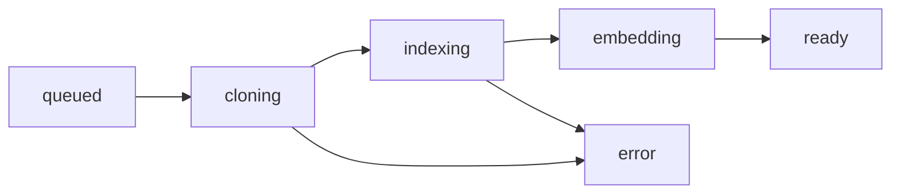

<!-- i18n: source=docs/features/code-index/repositories.md blob=dfd41b79236a859839f989a995deb2de9cd4ad2b model=claude-sonnet-5-5 -->
> 本页由机器从[英文原文](https://github.com/ClickHouse/loom/blob/main/docs/features/code-index/repositories.md)翻译，内容以英文原文为准。
> Machine-translated from the [English page](https://github.com/ClickHouse/loom/blob/main/docs/features/code-index/repositories.md), which is authoritative.

<a id="adding-repositories"></a>

# 添加仓库

全新安装不会索引任何仓库。条目来自两个来源并合并：用户自行添加的仓库，以及运维人员的配置。对于已在此处添加的命名空间，运维人员配置的条目会被跳过（见下文规则）。一个代码命名空间对应一个分支（[概览](https://github.com/ClickHouse/loom/blob/main/docs/features/code-index/overview.md#one-namespace-is-one-branch)）。

| 路径 | 方式 | 构建者 | 层级 |
| ------------------- | ---------------------------------------------------------------------------------------------------- | -------------------------------------- | -------------------------------------------------- |
| 自助添加 | 在控制台中选择 **Repositories → Add repository**，或在你维护的卡片上选择 **Add branch** | `code_ingest` worker，分片执行 | 快速层级；可选的编译器层级 |
| 运维人员配置 | 在 `LOOM_CODE_REPOS_JSON`（或标量 `LOOM_CODE_*` 设置）中添加条目，然后运行 `loom code backfill` | 运维人员，使用 `loom code` CLI | 快速层级，以及已配置处的编译器层级 |

快速层级的自助添加无需运维人员介入，也无需 shell 访问权限。编译器层级是可选的精度升级，需要 worker 镜像中包含对应的语言工具链。

<a id="self-service-repositories"></a>

## 自助仓库

需要 `LOOM_CODE_SELF_SERVICE_ENABLED` 和 `code_ingest` worker。默认的开发 Compose 部署同时启用了这两项；自定义部署可以禁用其中任何一项。

还需要[仓库作业沙箱](https://github.com/ClickHouse/loom/blob/main/docs/operations/code-index-operations.md#repository-job-sandbox)：在此添加的仓库会获得执行其自身构建代码的编译器层级，并且它的克隆操作会连接到用户所选的主机，因此没有沙箱时，添加会被拒绝（`SANDBOX_UNAVAILABLE`），已添加的条目也不再被拉取或建立索引。在提供的 Compose 部署中，只有蓝绿部署（`dev/docker-compose.colour.yml`）运行了沙箱，且要求主机已加载 AppArmor 配置文件。在其他部署上（包括发布版部署），请通过 `LOOM_CODE_REPOS_JSON` 为仓库建立索引（[快速入门](../../getting-started/quickstart.md#optional-index-a-repository-on-the-released-stack)）。

每个组织最多可持有 `LOOM_CODE_SELF_SERVICE_MAX_REPOS`（20）个条目。

组织中任何已登录的成员都可以添加仓库，并成为它的第一位维护者。远程地址可以是 `owner/name`（GitHub 简写）、HTTPS URL，或 SSH/scp 风格的 Git URL。GitHub、GitLab 和 Bitbucket 会被明确标注；其他服务器使用通用适配器。本地路径和 `file://` URL 会被拒绝。远程仓库必须能响应 `git ls-remote`，HTTPS 使用可选的令牌，SSH 则使用 worker 的 SSH 配置。分支留空时，Loom 会跟随远程的符号 `HEAD`，不会假定存在 `master`。默认分支的命名空间为 `code-<name>`，其他分支为 `code-<name>-<branch-slug>`。

worker 会在 `LOOM_CODE_REPOS_ROOT`（默认为 `var/code_repos/self`）下克隆一个裸镜像，每个 Git 仓库一个，由其各分支共享。它使用游标，每轮处理 `LOOM_CODE_BOOTSTRAP_FILES_PER_PASS`（400）个文件来构建首个索引，因此重启后可以继续。`code.repos` 通过 `stage` 和 `stage_detail` 报告进度：



在其分块中达到 `LOOM_CODE_READY_EMBED_COVERAGE`（0.95）的比例带有向量之前，条目会一直停留在 `embedding`；在此期间 `code.search` 以词法方式作答（[新鲜度](https://github.com/ClickHouse/loom/blob/main/docs/features/code-index/freshness.md)）。

| Op                          | 角色   | 作用                                                                                                                                                      |
| --------------------------- | ------ | --------------------------------------------------------------------------------------------------------------------------------------------------------- |
| `code.repo.remote_branches` | viewer | 在写入任何内容之前，显示 Git 远程的情况：提供方、分支及其头部、默认分支、形如发布的分支、配额和就绪警告 |
| `code.repo.add`             | viewer | 添加 `repo@branch`（留空则发现远程默认分支），可选地添加更多 `branches`；访问、过滤器、`scip_producer`、`access_token`                      |
| `code.repo.add_branch`      | admin  | 为你维护的仓库索引另一个分支；它继承远程地址、令牌、前缀和访问设置                                                         |
| `code.repo.set_access`      | admin  | 设置 `classification`（`standard` / `restricted`）和 `join_policy`（`open` / `approval` / `closed`）                                                       |
| `code.repo.set_source`      | admin  | 关联此仓库读取的跟踪器命名空间，主命名空间在前（[跟踪器概览](https://github.com/ClickHouse/loom/blob/main/docs/features/tracker/overview.md#linking-a-tracker-to-a-repository)）           |
| `code.repo.remove`          | admin  | 停用一个自助索引；`confirm` 必须等于命名空间                                                                                           |

参数见[操作参考](https://github.com/ClickHouse/loom/blob/main/docs/reference/operations.md#code)。

规则：

- 一个组织最多持有 `LOOM_CODE_SELF_SERVICE_MAX_REPOS`（20）个活跃的自助条目，包括分支（`REPO_QUOTA`）。已建立索引的分支（无论在哪个命名空间下），或其命名空间中有你无权管理的数据或授权的分支，会以 `REPO_EXISTS` 被拒绝；请改为加入已有索引。对于由运维人员配置、尚无首个索引的条目，其分支会以 `REPO_NOT_INDEXED` 被拒绝，直到为它运行了 `loom code backfill`。
- 管理员授权在一个仓库的各分支之间单向流动。运维人员配置的条目会把其管理员传给该仓库的每个分支，而在此添加的分支只会把其管理员传给同样在此添加的其他标准分支。在此添加的受限分支只接受运维人员的管理员。每次同步都会撤销它持有的其他副本，或把运维管理员的那一份变成运维授权的副本；`granted_by` 指向副本未配置的条目的副本也会被撤销（已停用的条目，或滚动部署尚未覆盖到的新条目：请在该条目上重新授予管理员）。如果一个分支的管理员全都是这类副本，它将没有管理员，只有对该仓库某个运维条目的管理员授权才能到达它。持有此类副本的成员可能在那里授予或批准过其他人，包括他们自己：请检查其授权。再次放宽该分支并不会恢复被限制撤销的副本；请在同级分支上重新授予该管理员。只有在该分支上获得授权的管理员，或来自运维条目的授权副本，才能放宽它；来自在此添加的分支的副本不算。
- 撤销遵循同样的路径。在运维条目上进行的撤销，只会从在此添加的分支中移除复制来的授权；如果主体在此处添加的分支上持有管理员授权，则不会从标准分支中移除。作为某分支唯一管理员的副本会保留，但在此添加的受限分支除外：在那里，撤销会移除来源不是运维条目的副本（如果其持有者在被撤销条目之外的另一个运维条目上保有管理员授权，则由下一次同步改写）；保留在那里的运维副本会在其运维授权消失后的下一次同步时被移除。
- 如果运维条目指定了在此添加的命名空间（通过 `code.repo.add` 或 `code.repo.add_branch`），即使该命名空间此后已被移除，该条目也会被跳过，并在服务器日志中给出警告，因为添加者的授权会变成运维条目的授权。移除分支并不会释放该名称：请把条目列在另一个命名空间下。没有记录类型的注册表行会被视为该条目的访问行；成员用 `namespace.register` 创建的命名空间没有注册表行；自助功能关闭时不会读取注册表：以上每种情况下，在列出某个命名空间之前都请检查它的授权。
- 当运维条目已不在配置中时，`code.repo.set_access` 为它写入的访问行不会被列出，因此该命名空间不会被索引；条目恢复后它会再次生效，并且不计入组织的仓库配额。条目消失后，没有记录类型的注册表行会被当作在此添加的分支列出。
- 运维命名空间上的副本，若其 `granted_by` 为 `repo-maintainers:<namespace>`，并指向在此添加的分支或已不再配置的命名空间，则会一直保留直到被撤销：请列出这些授权，并撤销不应保留的。
- 自助功能关闭时，在运维条目上的撤销看不到在此添加的分支，因此自助功能重新开启后，那里被撤销授权的副本仍会保留：请在该分支上撤销它。
- 受限仓库永远不会是 `open`：`code.repo.add` 会将其设为 `approval`。把受限索引放宽为标准索引需要 `confirm` 等于命名空间。
- 私有仓库的令牌使用由 `LOOM_JWT_SECRET` 派生的密钥加密存储，且不会被返回。轮换该密钥会使已存储的令牌无法使用，直到维护者重新输入。
- `code.repo.remove` 会停用注册表行，并通过可恢复的擦除 saga 清除该命名空间的所有 `code_*` 行。没有其他分支使用该镜像时，镜像会被删除。运维人员配置的条目会以 `REPO_FROM_CONFIG` 被拒绝。
- `LOOM_CODE_SELF_SERVICE_ENABLED=false` 会移除该功能（`SELF_SERVICE_OFF`）。
- `LOOM_CODE_INTEL_ENABLED=false` 会拒绝除 `code.repo.remove` 之外的所有 `code.repo.*` 操作，并返回 `PRECONDITION_FAILED`，与其他所有 `code.*` 操作一致。开关关闭时停用仓库，会清除索引和本副本的镜像；其他副本只有在代码智能再次开启后才会清理它们的镜像副本。

在一次调用中添加一个公开仓库和一个发布分支：

```bash
curl -fsS -X POST "$LOOM_BASE_URL/v1/code.repo.add" \
  -H "Authorization: Bearer $LOOM_API_KEY" -H 'Content-Type: application/json' \
  -d '{"org":"acme","repo":"acme/widgets","branch":"main","branches":["release/2.4"]}'
```

返回结果会给出每个分支的命名空间。未能添加的分支会连同原因出现在 `skipped` 中。

<a id="repository-profiles-and-compiler-preflight"></a>

## 仓库配置档案与编译器预检

每个条目都会在 `code.index_status` 中报告 `profile` 和 `provider`。`generic` 用于与仓库无关的搜索、符号、调用、影响分析和上下文包。`clickhouse` 配置档案用于识别仅适用于 ClickHouse 的 SQL 注册、错误码和无状态测试约定；不会仅因为项目包含 C++ 或 SQL 就推断这些假设。

`compiler_candidates` 是根据构建清单推断出来的。没有水位线的候选项会出现在 `quality_warnings` 中，并列出需要启用的 worker：

| 候选项                | worker 环境中的预检                                                                                                                  | Worker                                       |
| --------------------- | ------------------------------------------------------------------------------------------------------------------------------------ | -------------------------------------------- |
| C/C++                 | `scip-clang --version`（在 amd64 镜像中）；仓库的 CMake 可使用 clang 21 完成配置                                                     | `code_scip_full`，然后是 `code_scip_delta`   |
| TypeScript/JavaScript | Docker 中已包含索引器和包管理器；原生服务器运行 `sh scripts/install-code-toolchains.sh`。仓库依赖会自动准备。                        | `code_scip_ts_delta`                         |
| Go                    | `scip-go --version`；每个模块的 `go env` 都能成功执行                                                                                | `code_scip_go_delta`                         |
| Python                | `scip-python --version`；项目的导入在其环境中可以解析                                                                                | `code_scip_py_delta`，然后是 `code_scip_apply` |

编译器预检失败时，快速层级仍可使用。`code.index_status` 和 Health 标签页会显示 worker 错误、各语言的覆盖率、未解析的边、嵌入覆盖率和新鲜度。PR/评审历史目前使用 GitHub API；其他提供方仍可获得 Git 历史和代码智能，并会收到明确的接入提示警告。

<a id="operator-configured-repositories"></a>

## 运营方配置的仓库

`LOOM_CODE_REPOS_JSON` 为每个被索引的分支保存一个对象。条目字段、前置条件（镜像、embedder、可写镜像、GitHub 令牌）、首次索引（`loom code init`、`backfill`、`backfill-prs`、`scripts/ops/code_intel_bootstrap.sh`）、编译器层级以及其他分支，都记录在[代码索引运维手册](https://github.com/ClickHouse/loom/blob/main/docs/operations/code-index-operations.md)中。worker 不会自行启动运营方配置的条目；没有 `git_head` 水位线的条目会被跳过，直到运行 `loom code backfill`。所有设置见[配置参考](https://github.com/ClickHouse/loom/blob/main/docs/reference/configuration.md#code)。

<a id="who-can-read"></a>

## 谁可以读取

代码命名空间遵循常规的授权规则（[身份与命名空间](https://github.com/ClickHouse/loom/blob/main/docs/concepts/identities-and-namespaces.md)，[令牌与授权](https://github.com/ClickHouse/loom/blob/main/docs/guides/tokens-and-grants.md)）：令牌必须指明该代码命名空间（或 `*`），否则调用会失败并返回 `AUTH_INSUFFICIENT`。有三个开关会改变这一行为：

| 开关                                                              | 效果                                                                                                                                         |
| ----------------------------------------------------------------- | -------------------------------------------------------------------------------------------------------------------------------------------- |
| `LOOM_CODE_ORG_READABLE=true`，或条目中的 `org_readable`          | 组织内每个已通过认证的主体无需授权即可读取（默认关闭）；写入仍由授权决定                                                                     |
| `LOOM_CODE_REPO_PUBLIC=true`，或条目中的 `public`                 | 该命名空间注册为 `join_policy=open` 且可被发现，因此任何组织成员都可立即以读取者身份加入；否则策略为 `approval`                              |
| `classification: "restricted"`（条目，或 `code.repo.set_access`） | 绝不会对组织可读或公开；由维护者逐个批准读取者，且每次读取都需要一个指明该命名空间的令牌，并且持有有效的直接授权                             |

`code.repo.set_access` 的记录优先于配置的分类和加入策略，并且在重启后依然有效。`code.refresh`（writer）和管理员操作始终需要授权。

<a id="failure-modes"></a>

## 故障模式

| 现象                                              | 原因与修复                                                                                                                                                                                                                                                             |
| ------------------------------------------------- | ---------------------------------------------------------------------------------------------------------------------------------------------------------------------------------------------------------------------------------------------------------------------- |
| 已配置的条目始终不建立索引                        | 没有 `git_head` 水位线：运行 `loom code init` 和 `loom code backfill`；或者该命名空间是从页面添加的（之后无论是否已被移除），且日志显示该条目被跳过：请把它列在另一个命名空间下                                                                                        |
| 添加仓库时返回 `SANDBOX_UNAVAILABLE`              | 此部署无法运行沙箱：请改为把仓库列在 `LOOM_CODE_REPOS_JSON` 中（除非设置了 `LOOM_CODE_SANDBOX_REQUIRED`，此时这些条目同样会被跳过），或参阅[沙箱要求](https://github.com/ClickHouse/loom/blob/main/docs/operations/code-index-operations.md#repository-job-sandbox) |
| 自助添加的卡片停留在 `error` 状态                 | 查看 `code.repos` 中的 `stage_detail`；克隆失败会在下一轮重试（超时由 `LOOM_CODE_BOOTSTRAP_CLONE_TIMEOUT_S` 控制）                                                                                                                                                      |
| 自助添加的私有仓库停止拉取                        | `LOOM_JWT_SECRET` 已被轮换；请重新输入令牌                                                                                                                                                                                                                             |
| `code.repos` 中缺少某个条目                       | 检查 `loom.code.repos_config_errors`；此外 `code.repos` 只列出调用方有权读取的内容                                                                                                                                                                                     |
| 撤销或降低管理员权限时返回 busy                   | 对代码命名空间执行撤销时，会先重新读取 `loom.code_repos`，以便看到从其他进程在此处添加的分支；该读取失败期间会返回 busy；待读取成功后重试                                                                                                                              |
| 在此处添加的受限分支没有管理员                    | 它的管理员全部是从此处添加的分支复制而来，而同步会撤销这些权限；请在该仓库的某个运维条目上授予管理员权限（如果没有，运维人员需先把它的某个分支列在 `LOOM_CODE_REPOS_JSON` 中）                                                                                        |
| 新维护者缺少其他分支的权限                        | 管理员授权发生在本进程读取 `loom.code_repos` 之前（该进程首次会记录 `not synced`）；对该仓库某个分支的下一次管理员授权或批准，或新增一个分支，都会复制该权限；也可以重新授权一次                                                                                       |
| 答案只有词法匹配结果                              | 该条目尚未达到 `LOOM_CODE_READY_EMBED_COVERAGE`（[新鲜度](https://github.com/ClickHouse/loom/blob/main/docs/features/code-index/freshness.md)）                                                                                                                        |

<a id="related"></a>

## 相关内容

- [概览](https://github.com/ClickHouse/loom/blob/main/docs/features/code-index/overview.md)和[按问题查找操作](https://github.com/ClickHouse/loom/blob/main/docs/features/code-index/operations.md)
- [新鲜度](https://github.com/ClickHouse/loom/blob/main/docs/features/code-index/freshness.md)和[历史与 PR](https://github.com/ClickHouse/loom/blob/main/docs/features/code-index/history-and-prs.md)
- [代码索引运维手册](https://github.com/ClickHouse/loom/blob/main/docs/operations/code-index-operations.md)
