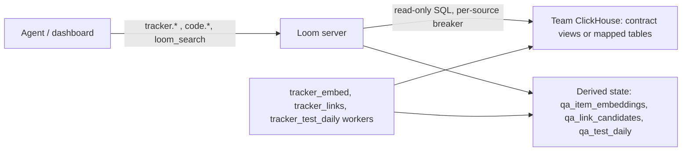

<!-- i18n: source=docs/features/tracker/overview.md blob=c43c9c14bbb3aece5e21c57716e38e3f7ca0c5e8 model=claude-sonnet-5-5 -->
> 本页由机器从[英文原文](https://github.com/ClickHouse/loom/blob/main/docs/features/tracker/overview.md)翻译，内容以英文原文为准。
> Machine-translated from the [English page](https://github.com/ClickHouse/loom/blob/main/docs/features/tracker/overview.md), which is authoritative.

<a id="issue-duplicate-checks-and-regression-candidates-for-agents"></a>

# 面向 agent 的 issue 重复检查与回归候选

设置 `LOOM_TRACKER_ORG` 并注册数据源后，Loom 可以让 agent 检查某个缺陷是否已被报告，并利用跟踪器记录和已索引的 PR 历史，对可能引入回归的变更进行排序。对于已索引 PR 历史但没有跟踪器的仓库，请使用[代码历史与 bisect 候选](https://github.com/ClickHouse/loom/blob/main/docs/features/code-index/history-and-prs.md)。

跟踪器是团队用来记录 issue、拉取请求、事故和 CI 运行的系统，存放在团队自己的 ClickHouse 中。Loom 使用只读凭据实时读取，从不复制这些数据。每条语句都基于[记录契约](record-contract.md)编写，因此接入新的跟踪器无需修改代码：团队只需按契约中的名称提供视图，或者根据自己的表保存一份映射。

实时读取使数据只有一份，并处于团队自己的访问控制之下，部署中不会保存任何需要擦除的数据。每次读取都有时间预算和熔断器；当数据源没有响应时，结果会显示 `tracker_unavailable`。

Loom 只保留派生状态：相似度嵌入（`loom.qa_item_embeddings`）、恢复出的 issue→PR 关联（`loom.qa_link_candidates`）、按测试汇总的每日 CI 数据（`loom.qa_test_daily`）、重复检查的校准拟合结果，以及已注册的数据源（`loom.qa_sources`，凭据已加密）。



<a id="portability-and-record-types"></a>

## 可移植性与记录类型

tracker plane 与代码仓库无关。Jira、GitHub、GitLab、Linear、帮助台或内部 tracker 都可以通过 ClickHouse 视图或已保存的映射来满足同一份契约；代码中不会选定任何代码仓库名称或供应商。必需的逻辑记录是 issue 以及 pull request/变更。契约中的表名为 `github_issues` 和 `github_prs`，但在映射模式下，控制台会将它们显示为 **items** 和 **changes**，因此数据源自身的表和列不必使用这些名称。

可选的结构化记录可以启用更多操作：事故、支持工单、聊天线程、组件风险快照、发布与发布健康状况、版本历史、CI 检查、云实例及其相互关系。这些都是带类型的表记录，而不是文件附件。PDF、Office 文件和任意文档属于 Library plane；当 issue 需要引用它们时，请在 tracker 行中链接其 URL。

一个代码仓库可以按顺序关联多个 tracker 命名空间。编号查找使用第一个 tracker，因为 `#42` 在不同系统之间有歧义。语义搜索、重复检查、答案路由和 bisect 候选扫描会读取调用方有权访问的每个已关联 tracker，并且每个返回的条目都会标明其 tracker 命名空间。

<a id="tracker-namespaces"></a>

## Tracker 命名空间

tracker 通过 **tracker 命名空间**（`kind = tracker` 的目录行）读取。每个命名空间指明其来源，以及允许读取的 `repos`（`source_id` 的 `Org/repo` 前缀）；未列出的仓库一律不会被读取。

| 类型       | 读取范围                                                                                         | 加入策略                      |
| ---------- | ------------------------------------------------------------------------------------------------ | ----------------------------- |
| standard   | 在每条语句中加入 `is_private = 0`；直接拒绝 `core_incidents`、`support_cases`、`slack_threads`   | `open`（默认）或 `approval`   |
| restricted | 也可读取私有行；每次读取都需要指明该命名空间的令牌，并持有有效的直接授权                         | `approval`                    |

读取方通过 `namespace.join`（`role: "viewer"`）加入：开放的命名空间会立即准入，服务账号也包括在内；受限的命名空间则需等待其管理员批准。布局与执行方式见[公开与私有](record-contract.md#public-and-private)；访问模型见[身份与命名空间](https://github.com/ClickHouse/loom/blob/main/docs/concepts/identities-and-namespaces.md)。

<a id="the-operations"></a>

## 操作

所有 tracker 操作都接受 `org`（默认值为 `LOOM_TRACKER_ORG`）和必填的 `namespace`：即 tracker 命名空间，或绑定到某个 tracker 的代码命名空间。通过 MCP 调用时，每个操作对应一个 `loom_<op>` 工具（`loom_tracker_duplicate_check`）。`tracker` 工具集列出各个问答类操作；`tracker.contract` 和 `tracker.source.*` 可按名称调用。

| 操作                      | 回答的问题                                                                                                                                             |
| ------------------------- | ------------------------------------------------------------------------------------------------------------------------------------------------------ |
| `tracker.duplicate_check` | 这份草稿是否已存在？给出经过校准的 `duplicate_of` / `related` / `none` 结论                                                                            |
| `tracker.similar`         | 已经描述过同一问题的报告：针对粘贴的 `text`、`issue_number` 或堆栈 `frames`，返回重复和相关的 issue 与 PR                                              |
| `tracker.item`            | 最多十个 issue 或 PR 编号的记录：组件、严重程度、二分定位结论、受影响的分支、测试、CI、backport、fixes / caused-by 关系图                               |
| `tracker.links`           | 在没人写明关联时，哪个 PR 可能修复了这个 issue（或这个 PR 修复了哪个 issue）                                                                           |
| `tracker.flaky`           | 这个测试是否为已知的 flaky 测试？列出提到它的 flaky 测试 issue，可通过 `include_signal` 附带其 CI 历史                                                 |
| `tracker.test_signal`     | 是 flaky、回归还是基础设施问题？单个测试自身的 CI 历史                                                                                                 |
| `tracker.release`         | 某个版本的发布就绪情况：带状态的阻塞项和最新的健康快照                                                                                                 |
| `tracker.component`       | 单个组件的风险快照及其未关闭的 issue，按严重程度从高到低排列                                                                                           |
| `tracker.answer`          | 用自然语言提出的问题，或某个制品的锚点，由具名模板作答；会说明搜索了哪些内容（`explain_only` 返回查询计划）                                             |
| `tracker.binding`         | 某个命名空间可以向 tracker 平面询问什么：它的 tracker 命名空间（主命名空间在前），以及调用方可运行的模板                                               |
| `tracker.contract`        | 记录契约和空白视图模板，在建立任何连接之前即可读取                                                                                                     |
| `tracker.source.*`        | 注册、检查、核对、重新映射、轮换、列出和移除来源（[记录契约](record-contract.md#adding-a-tracker-source)）                                             |

代码平面也会读取已关联的 tracker（`code.bisect_candidates`、`code.backport_gap`、`code.first_build`、`code.history`、`code.context_pack`；参见[历史与 PR](https://github.com/ClickHouse/loom/blob/main/docs/features/code-index/history-and-prs.md#pr-and-tracker-planes)），而且在代码范围下，对于缺陷形态的查询，[`loom_search`](https://github.com/ClickHouse/loom/blob/main/docs/features/unified-search.md) 会把重复检查作为其中一路来运行。

<a id="duplicate-check"></a>

### 重复检查

`tracker.duplicate_check` 接受报告者提交的草稿：`title`、`body`、`frames`、`component`、`version`（`X.Y`）、其中提到的 issue 编号 `mentions`，以及代码 `paths` 和 `symbols`。

```python
from loom import Agent

async with Agent(org="acme", namespace="code-widgets", agent="triage-bot") as bot:
    res = await bot.tracker.duplicate_check(
        namespace="code-widgets",
        title="Upload hangs after token refresh",
        body="Steps: … Observed: the request never returns.",
        component="upload",
        paths=["src/upload/client.py"],
    )
    print(res["verdict"], res["epistemic"], res["answer"])
```

它会运行一次 `tracker.similar` 的各路检索，并用该命名空间已存储的逻辑回归拟合结果为每个融合后的候选项打分：

1. **检索路径。** 对标题和正文做 BM25F，并对组件、版本和错误码加权；按位置衰减的堆栈帧 IDF；文本中按编号提到的条目；基于 Loom 自身 embedding 的向量检索（`LOOM_TRACKER_SIMILAR_VECTOR_LEG`，仅用于召回：它只增加候选项，不会重新排序）；以及修复进行中路径：草稿的 paths → 修改这些路径的 PR → 这些 PR 修复的 issue。
2. **结论。** 当排名第一的候选项经校准的概率达到重复阈值时为 `duplicate_of`，达到相关阈值时为 `related`，否则为 `none` 且不返回条目。拟合结果由 `tracker_links` 任务每周根据记录中已标注的重复项重新拟合；每次重新拟合给出的建议阈值会被提供出来，并限制在 `LOOM_TRACKER_DUPCHECK_DUPLICATE_THRESHOLD_MIN` / `_MAX` 之间。
3. **判定与重排。** 当结果为 `related` 时，一次 LLM 调用可以把同一缺陷的候选项提升为 `duplicate`（不会降级）；重排调用会对 `nearest` 线索排序，但不会改变结论。两者都需要真实的 LLM 提供方，且失败时放行（fail open）。
4. **关联。** issue 行带有其关联的 PR、修复所在的发布版本及其 backport；当结论为 `none` 或 `related` 时，`related_prs` 列出可能已经解决该草稿问题的 PR（[`code.pr_check`](https://github.com/ClickHouse/loom/blob/main/docs/features/code-index/history-and-prs.md#pre-pr-duplicate-check-codepr_check)）。

`epistemic` 表示答案的可信程度：

| 值             | 含义                                                         |
| -------------- | ------------------------------------------------------------ |
| `calibrated`   | 已存储拟合结果                                               |
| `uncalibrated` | 没有拟合结果：最多为 `related`，置信度为 null                |
| `degraded`     | 某一路检索或某个 tracker 未响应；`none` 不能视为排除重复     |
| `unavailable`  | tracker 未响应                                               |

`none` 的意思是“没有经过校准的重复证据”，而不是“尚未被报告”；无论如何都请查看 `related` 列表。当检查针对代码命名空间时，会读取调用方有权读取的每个 tracker，先读绑定的那个，数量上限为 `LOOM_TRACKER_DUPCHECK_FANOUT_NAMESPACES`（默认 4），并标明每个条目所属的命名空间。

<a id="bisect"></a>

### 二分定位

`code.bisect_candidates` 面向代码命名空间，读取绑定到它的 tracker：某个 `issue_number` 的 triage 列（`triage_reproduces_on`、`triage_clean_on`）中先前记录的观察结果给出发布窗口，并在 tracker 的 PR diff（`github_prs.diff`、`affected_file_paths`、契约的 `bisect` 特性）中扫描这些堆栈帧。没有堆栈帧时，扫描范围受该 issue 最稀有的模式（`LOOM_TRACKER_BISECT_SCOPE_PATTERNS`）及其组件所在目录（`LOOM_TRACKER_BISECT_COMPONENT_DIRS`）限制。没有 tracker 时，二分定位读取仓库自身的 PR 历史。它不会复现该 issue，也不会验证 triage 观察结果；它只是对 PR 排序，供工程师或测试 agent 进一步调查。完整流程见[历史与 PR](https://github.com/ClickHouse/loom/blob/main/docs/features/code-index/history-and-prs.md#bisect-candidates-codebisect_candidates)。

<a id="from-a-bug-draft-to-candidate-prs"></a>

### 从缺陷草稿到候选 PR

按以下步骤，无需构建仓库即可检查已有报告并对已合并的变更排序。下面的请求以一份草稿为例，并不是已记录的结果。

1. 检查设置。重复检查需要一个[已注册的 tracker 来源](record-contract.md#adding-a-tracker-source)，以及调用方有权读取的命名空间。若要对两个操作使用同一个代码命名空间，请先[把 tracker 关联到仓库](#linking-a-tracker-to-a-repository)，再在该命名空间中查看 `tracker.binding`。`kind: "none"` 可能表示未绑定或被拒绝；它并不能说明不存在 tracker。仅有[已索引的 PR 历史](https://github.com/ClickHouse/loom/blob/main/docs/features/code-index/history-and-prs.md#the-pr-plane)的仓库可以对变更排序，但该历史不能替代 tracker 的重复检查。
2. 使用绑定到该 tracker 的代码命名空间，把草稿发送到 `POST /v1/tracker.duplicate_check`。请把示例中的范围和代码线索替换为你自己仓库的内容：

   ```json
   {
     "org": "acme",
     "namespace": "code-widgets",
     "title": "Upload hangs after token refresh",
     "body": "The upload request never returns after refreshing its token.",
     "paths": ["src/upload/client.py"],
     "symbols": ["UploadClient.send"]
   }
   ```

   请同时阅读 `verdict`、`epistemic`、`items`、`closest`、`related_prs` 和 `leg_status`。在把它们当作同一个缺陷之前，先检查所关联的报告和修复。`none` 不能让你断定该缺陷从未被报告；读取降级或不可用时，重复问题仍未解决。

3. 如果仍需调查引入该问题的变更，请在同一个代码命名空间中，把报告中的代码线索发送到 `POST /v1/code.bisect_candidates`：

   ```json
   {
     "org": "acme",
     "namespace": "code-widgets",
     "paths": ["src/upload/client.py"],
     "symbols": ["UploadClient.send"],
     "text": "Upload hangs after refreshing its token.",
     "before": "now",
     "limit": 5
   }
   ```

   只有当主关联 tracker 中确有对应报告时，才提供 `issue_number`。如果观察到了正常和出错的发布版本，请按[版本窗口示例](https://github.com/ClickHouse/loom/blob/main/docs/features/code-index/history-and-prs.md#bisect-candidates-codebisect_candidates)所述提供这些观察结果。这里的 `before: "now"` 把上界设为请求时刻，并不是观察到的故障时间。请优先使用观察到的发布版本边界、在 `before` 中给出观察到的时间上界（已知时再加上 `after`），或在 `bad_sha` 中给出已知有问题的提交。对于像这样尚未提交的草稿，如果省略所有发布版本和时间边界，结果为 `unknown` 并带有 `no_failing_version`；不会运行候选扫描。如果 tracker 记录中已经写明了引入问题的提交或 PR，则可以不经扫描直接作答。该操作不会去查找最后一个正常的版本。

4. 把证据与调查记录放在一起。请结合候选列表，阅读 `candidates_from`、`epistemic`、`causes`、`tracker_unavailable` 以及任何 `partial` / `partial_reason`。`candidates_from: "code_history"` 表示回退到了仓库历史，而不是成功读取了 tracker。每个候选项的 `matched_paths`、`matched_symbols` 和 `score` 说明了它的排名依据；`epistemic: "lower_bound"` 表示空列表并不排除任何可能。请检查 diff，并在单独的复现或测试中比较该候选变更前后所报告的行为。排名本身既不能证明缺陷存在，也不能证明其原因。

<a id="ci-test-history"></a>

### CI 测试历史

`tracker.test_signal` 从 `checks` 表读取单个测试的 CI 运行记录，并回答 `flaky`、`regression_candidate`、`infra_candidate`、`no_signal`（表示没有信号，而不是健康）或 `unknown_test`（并附带相似的测试名）。它综合考虑失败率及其 Wilson 下界、相邻两次运行之间的结果翻转、同一提交上重跑的翻转、大量互不相关的测试同时失败的失败风暴（基础设施问题），以及该测试所在文件的变动量。`pr_number` 会附加该 PR head 的结果连续记录；同时会扫描测试源码中的 flaky 测试特征。

`tracker_test_daily` 工作进程每天把 checks 汇总到 `loom.qa_test_daily`，因此读取时只需从远端获取尚未汇总的那几个小时。checks 表取自来源条目的 `checks.from`（[来源条目选项](record-contract.md#source-entry-options)），否则取来源自身的 `checks` 表，再否则取 `LOOM_TRACKER_CHECKS_FROM`；三者都没有时，该操作无数据可读。`tracker.flaky` 回答成本更低的问题，即是否有 flaky 测试 issue 提到了该测试（`flaky_by_issue` 或 `no_flaky_signal`）。

<a id="links-to-fixing-prs"></a>

### 指向修复 PR 的关联

issue 常常在没有 `fixes` 边的情况下被关闭。每日运行的 `tracker_links` 任务会取最近 `LOOM_TRACKER_LINKS_ISSUE_DAYS`（90）天内创建的每个 issue，对其之后合并到主干的 PR 排序（对标题和正文做 BM25F，并结合关闭关键字、diff 中的堆栈帧和组件），并把前 `LOOM_TRACKER_LINKS_PER_ISSUE`（20）个写入 `loom.qa_link_candidates`。`tracker.links` 提供双向查询。需要唯一修复的使用方（`code.backport_gap`、二分定位）只有在得分高于 `LOOM_TRACKER_LINKS_MIN_SCORE`（1.0），且有关闭关键字指向该 issue 时，才会采用排名第一的候选项。

<a id="linking-a-tracker-to-a-repository"></a>

## 将 tracker 链接到仓库

代码命名空间按顺序读取其链接的 tracker。第一个是**主 tracker**：它的编号就是仓库的 issue 和 PR 编号，因此按编号查找（`tracker.item`、PR 事实、blame、backport、首次构建）只读取主 tracker。搜索（`tracker.duplicate_check`、`tracker.similar`、`tracker.answer`、`loom_search` 的记录分支、bisect 的候选扫描）会读取所有已链接的 tracker，并标明每条结果的来源。

| 角色 | 方式 |
| ---------- | ---------- |
| 维护者 | 使用带 `tracker_namespaces` 的 `code.repo.set_source`（需要仓库管理员权限，以及仓库自身链接中尚未包含的每个 tracker 的管理员权限），或使用仓库卡片的 Trackers 部分。在 `LOOM_CODE_REPOS_REFRESH_SECONDS` 内，替换该仓库的运维人员映射。如果 tracker 的 `repos` 未覆盖该仓库，仍会被接受，并返回 `not_covering`。 |
| 运维人员 | `LOOM_TRACKER_CODE_NAMESPACE_BINDINGS_JSON`：以代码命名空间名称的 glob 作为键，每个键对应一个 tracker 命名空间或一个有序列表。仅链接运维人员自己的仓库（`LOOM_CODE_REPOS_JSON` 或 `LOOM_CODE_REPO`）；自助仓库（`code.repo.add`）由其维护者链接。 |

已链接的标准 tracker 会被该仓库的所有读者读取，因此链接一个 tracker 属于长期授权；无论 tracker 是否受限，新建链接都需要该 tracker 的管理员权限。若 tracker 的读者不是其管理员，会得到 403；其他人会得到 `NOT_A_TRACKER_NAMESPACE`。tracker 管理员链接标准 tracker 之后，由仓库管理员决定谁可以读取它，包括之后通过 `code.repo.set_access` 更改加入策略。运维人员仓库上的链接，无论在添加分支之前还是之后设置，也会被通过 `code.repo.add_branch` 从该仓库添加的每个分支的读者读取，各分支的管理员决定谁可以加入该分支。

```bash
LOOM_TRACKER_CODE_NAMESPACE_BINDINGS_JSON='{"code-widgets*": ["tracker-widgets", "tracker-helpdesk"]}'
```

通过 `code.repo.add_branch` 从运维人员仓库添加的分支，会将该仓库记录为其根（`qa_branch_of`），并且在自身没有链接时读取该仓库的链接，因此运维人员修改的 glob，或在仓库上设置的链接，都会作用到该分支。维护者在自助仓库上设置的链接会被复制到新分支；之后在该仓库上设置的链接，需由 tracker 的管理员使用 `code.repo.set_source` 设置到其分支上。如果运维人员仓库的某个分支，以一个已删除命名空间的名称重新添加，而该命名空间曾有维护者设置的链接，且其清除尚未执行，那么在 tracker 管理员使用 `code.repo.set_source` 链接之前，该分支不会读取任何 tracker。

链接绝不会根据名称猜测，并且链接只属于一个组织：两个组织可以有同名的代码命名空间，在一个组织中设置的链接绝不会作用于另一个组织。针对调用者，会在绑定的命名空间上再次执行检查，因此绑定到公开仓库的受限 tracker，对任何被检查拒绝的人仍然保持关闭。`tracker.binding` 会报告某个命名空间解析到的结果；未绑定、被拒绝和“没有 tracker”是同一个答案（`kind: "none"`），因此拒绝不会泄露任何信息。

<a id="adding-a-tracker-from-the-dashboard"></a>

## 从控制台添加 tracker

任何已登录的组织成员都可以在 Repositories 页面的 Trackers 列表中添加 tracker，前提是 `LOOM_TRACKER_SELF_SERVICE_ENABLED` 处于开启状态（默认开启），且该组织的 tracker 数量少于 `LOOM_TRACKER_SELF_SERVICE_MAX_SOURCES`（10）。该流程首先展示契约，然后是连接信息（或来自 `tracker.source.inspect` 的映射建议），接着执行 `dry_run: true` 检查，为每个未通过的表返回一份 `CREATE OR REPLACE VIEW` 草稿。在已检查的表单与将要提交的表单一致之前，_Add_ 按钮保持禁用。注册者将成为第一个管理员。各步骤对应的 op、只读用户的 SQL 以及运维人员使用的表单，参见[添加 tracker 数据源](record-contract.md#adding-a-tracker-source)。

<a id="settings-that-change-it"></a>

## 影响它的设置

| 设置                                                         | 默认值   | 作用                                                                            |
| ------------------------------------------------------------ | -------- | ------------------------------------------------------------------------------- |
| `LOOM_TRACKER_ORG`                                           | `""`     | tracker 命名空间所属的组织；为空表示不提供任何 tracker 命名空间                 |
| `LOOM_TRACKER_LIVE_SERVE`                                    | on       | 总开关：off 表示所有 tracker 读取都返回 `tracker_unavailable`                   |
| `LOOM_TRACKER_LIVE_BUDGET_MS`, `LOOM_TRACKER_LIVE_TIMEOUT_S` | 300, 1.5 | 调用方对每次读取的预算，以及远端的 `max_execution_time`                         |
| `LOOM_TRACKER_CIRCUIT_FAILURE_THRESHOLD`, `_COOLDOWN_S`      | 3, 120   | 使某个数据源的熔断器打开所需的连续失败次数，以及熔断器保持打开的时长            |
| `LOOM_TRACKER_EMBED_ENABLED`                                 | on       | 填充向量检索分支的 `tracker_embed` 过程                                         |
| `LOOM_TRACKER_LINKS_ENABLED`                                 | on       | 每日的关联恢复过程，同时会重新拟合重复检查的校准                                |
| `LOOM_TRACKER_TEST_DAILY_ENABLED`                            | on       | 按测试统计的每日 CI 汇总                                                        |

阈值、检索分支、judge、rerank、bisect 范围和测试信号相关的设置，见[配置参考](https://github.com/ClickHouse/loom/blob/main/docs/reference/configuration.md#tracker)。

<a id="limits-and-failure-modes"></a>

## 限制与故障模式

- **响应缓慢的数据源**会在其预算内返回 `tracker_unavailable`（或使某一路检索降级，并在 `leg_status` 中指明）。每个数据源都有各自的连接、断路器和预算，因此某个团队的故障不会影响其他团队。
- **未通过契约检查的数据源不会提供服务**，直到其视图或映射修复为止；检查失败的结论会在 60 s 后重新检查（[检查数据源](record-contract.md#checking-a-source)）。
- **在拟合结果生成之前处于未校准状态。** 新 tracker 的重复检查会返回 `uncalibrated`，直到基于其已标注的重复项完成重新拟合；受限命名空间会借用组织的标准拟合结果。
- **向量检索路径最多滞后一轮处理**，查询时的追赶步骤会在 `LOOM_TRACKER_SIMILAR_CATCH_UP_BUDGET_MS` 内为自上一轮处理以来发生变化的条目生成嵌入。
- **缺失的表会返回 `not_provided`。** 事件（incident）、发布（release）、CI 检查以及其他可选表，仅在数据源提供时才会被读取。

<a id="related"></a>

## 相关内容

- [GitHub 订阅源](github-feed.md)：通过定时 CLI 作业维护团队自有的记录
- [记录契约](record-contract.md)：表、列、别名、映射模式、来源
- [历史与 PR](https://github.com/ClickHouse/loom/blob/main/docs/features/code-index/history-and-prs.md)：读取 tracker 的代码平面 op
- [添加仓库](../code-index/repositories.md)
- [控制台](https://github.com/ClickHouse/loom/blob/main/docs/features/dashboard.md)
- [配置参考](https://github.com/ClickHouse/loom/blob/main/docs/reference/configuration.md#tracker)
- [操作参考](https://github.com/ClickHouse/loom/blob/main/docs/reference/operations.md#tracker)
