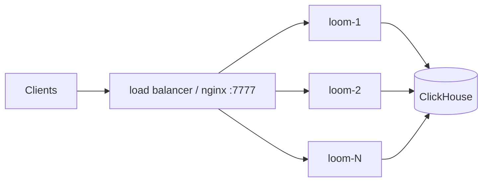
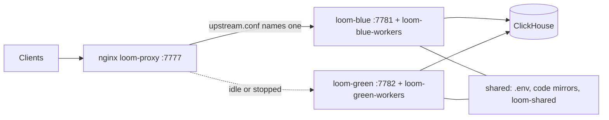

<!-- i18n: source=docs/operations/deployment.md blob=499cdfd2e2f7a23e6940129524e81d1c32c43258 model=claude-sonnet-5-5 -->
> 本页由机器从[英文原文](https://github.com/ClickHouse/loom/blob/main/docs/operations/deployment.md)翻译，内容以英文原文为准。
> Machine-translated from the [English page](https://github.com/ClickHouse/loom/blob/main/docs/operations/deployment.md), which is authoritative.

<a id="deployment"></a>

# 部署

Loom 由一个服务器镜像加 ClickHouse 组成（在 `LOOM_STORAGE_AUTHORITY=postgres` 下还需要 Postgres），文档提取服务则是单独的镜像（[容器镜像](#container-images)）。服务器镜像提供 HTTP、MCP 和控制台，并运行后台 worker。它的容器自身不保存任何持久状态，因此可以随意替换或增加：Loom 的数据保存在 ClickHouse 中，其中包括上传的文档原件，除非原件的字节保存在兼容 S3 的存储桶中（[原件的存放位置](https://github.com/ClickHouse/loom/blob/main/docs/features/knowledge.md#where-originals-are-stored)）。在 [Postgres 记忆权威](https://github.com/ClickHouse/loom/blob/main/docs/architecture/storage-authority.md#why-two-stores)模式下，Postgres 保存实时记忆和知识状态。代码索引在磁盘上保留裸 git 镜像，它是 ClickHouse 所记录远程仓库的缓存。部署随 ClickHouse（以及该权威模式下的 Postgres）、环境变量配置、`LOOM_JWT_SECRET` 一起迁移；如果数据行引用了文档存储桶中的对象，存储桶也要一并迁移（[迁移部署](https://github.com/ClickHouse/loom/blob/main/docs/operations/backup-and-recovery.md#moving-a-deployment)）。`dev/` 下的 compose 文件就是受支持的生产文件。这里提到的每个设置都可以在生成的[配置参考](https://github.com/ClickHouse/loom/blob/main/docs/reference/configuration.md)中找到。

<a id="deployment-ladder"></a>

## 部署阶梯

每一级都沿用上一级的镜像和 schema。变化的是 ClickHouse 所在的位置以及运行的容器数量。安装版堆栈和从克隆仓库启动的本地堆栈会在 Loom 旁边运行文档提取器；下面几级则不会，因此请将 `LOOM_DOCUMENT_EXTRACTOR_URL` 指向你自己运行的提取器（[容器镜像](#container-images)）。

| 层级                          | 启动方式                                                                                               | ClickHouse                                         | 适用场景                                  |
| ----------------------------- | ------------------------------------------------------------------------------------------------------ | -------------------------------------------------- | ----------------------------------------- |
| 安装版堆栈                    | `install.sh` → `compose.yaml`                                                                          | 内置容器、自行管理的服务器或 Cloud                 | 评估、单台主机                            |
| 从克隆仓库启动的本地堆栈      | `loom up` 或 `make dev` → `compose.yaml` + `dev/docker-compose.dev.yml`                                | 内置容器（`loom-ch`）                              | 开发                                      |
| Web 与 worker 分离            | `make dev-cloud` → `dev/docker-compose.cloud.yml`                                                      | 自行管理的服务器或 Cloud                           | 团队；生产环境的形态                      |
| N 个相同副本                  | `dev/docker-compose.replicas.yml`：副本位于 nginx 之后，逐个滚动更新                                   | 自行管理的服务器或 Cloud                           | 横向扩展、滚动重启和升级                  |
| 零停机双实例（可选）          | `./redeploy.sh`：`dev/docker-compose.colour.yml` 的两个项目，位于 `dev/docker-compose.proxy.yml` 之后 | 自行管理的服务器或 Cloud                           | 部署时不出现连接被拒绝的时间窗口          |

容量规划（web 副本数、uvicorn 进程数、workers 容器）见[故障与恢复](https://github.com/ClickHouse/loom/blob/main/docs/architecture/failure-and-recovery.md)，并以[监控](https://github.com/ClickHouse/loom/blob/main/docs/operations/monitoring.md#what-to-alert-on)中的指标为依据。

<a id="choosing-the-clickhouse"></a>

## 选择 ClickHouse

`compose.yaml` 是随发行版提供的唯一部署栈。其中的 `clickhouse` 服务在 `bundled` Compose profile 下运行，因此由 `.env` 中的 `COMPOSE_PROFILES` 决定目标：

| 目标                  | 安装                                                                                                                                  | `.env`                                       |
| --------------------- | ------------------------------------------------------------------------------------------------------------------------------------- | -------------------------------------------- |
| 内置容器（默认）      | `curl -fsSL …/install.sh -o loom-install.sh && sh loom-install.sh && rm loom-install.sh`                                              | `COMPOSE_PROFILES=bundled`，无 `LOOM_CH_*`   |
| 自管理服务器          | `curl -fsSL …/install.sh -o loom-install.sh && sh loom-install.sh --clickhouse http://loom@ch.example.com:8123 && rm loom-install.sh` | `COMPOSE_PROFILES=`，`LOOM_CH_*` 取自 URL    |
| ClickHouse Cloud      | `curl -fsSL …/install.sh -o loom-install.sh && sh loom-install.sh --clickhouse https://loom@<host>:8443 && rm loom-install.sh`        | `COMPOSE_PROFILES=`，`LOOM_CH_*` 取自 URL    |

请在只有你自己可写的目录中运行上述每条命令（[快速开始](../getting-started/quickstart.md#fast-path-released-image-no-clone)）。`curl -fsSL …/install.sh -o loom-install.sh && sh loom-install.sh --bundled && rm loom-install.sh` 可将安装切换回内置容器。

- **Keeper。** 服务器需要一个 Keeper。没有它时，`loom ch-setup` 会停止并打印添加方法；`--bundled` 则改为将安装切换到内置的 ClickHouse。
- **用户。** 给 Loom 一个专用用户（上文的 `loom`），而不是 Cloud 的 `default` 这类管理员用户，否则 Loom 可以管理该服务上的所有数据库和用户。URL 中必须指明用户。
- **URL。** `http://` 默认使用 8123 端口，`https://` 默认使用 8443 端口并启用 TLS。用户名或密码中的 `@`、`:`、`/` 和 `%` 需要进行百分号编码；空密码写作 `user:@host` 或 `LOOM_CH_PASSWORD=`。`LOOM_CH_URL` 可以代替 `--clickhouse`。Docker 主机上的服务器应写作 `host.docker.internal`：容器内的 `localhost` 指的是容器自身。
- **密码。** 设置 `LOOM_CH_PASSWORD`，或在提示时输入（输入不会回显）；写在 URL 中也可以，但 `ps` 和 shell 历史记录会看到它。密码只会写入 `.env`，该文件权限为 600，并使用双引号包裹，其中的 `\`、`"` 和 `$` 会被转义，以便 Compose 原样读回。这个 `.env` 是给 Compose 用的：请通过 `docker compose --project-directory ~/.loom run --rm loom loom …` 运行 Loom 命令，不要让某个检出目录的 `LOOM_ENV_FILE` 指向它，因为那样对转义的读取方式不同。
- **初始化。** 使用你自己的服务器时，安装程序会在启动 Loom 之前运行 `loom ch-setup`。它会创建 `loom` 数据库和只读用户 `loom_reader`（见下文），并检查版本和授权。可随时用 `docker compose --project-directory ~/.loom run --rm loom loom ch-setup` 再次运行；已经就位的内容不会被改动。如果 `loom_reader` 的 profile 或授权与 `ch-setup` 所设定的不同，它会被重建为与之完全一致（仅对 `loom.*` 有 SELECT，使用当前的上限），因此管理员为它添加的角色、授权或 `REVOKE` 在重新运行后不会保留；安装程序在每次安装和升级时都会重新运行 `ch-setup`。只有当现有的 `loom_reader` 具有 `ch-setup` 所设定的形态（密码用户，使用与自身同名的 settings profile）并且能用 `LOOM_CH_PASSWORD` 登录时，才会被替换；同名的其他任何账户都不会被改动。
- **没有管理员权限时。** 当该用户无法创建数据库、读取迁移所读取的系统表、持有迁移所需的 `loom_telemetry` 授权，或无法创建 reader 或其 settings profile 时，`ch-setup` 会停止并打印供管理员执行的 SQL，其中密码为占位符。`loom ch-setup --print-sql` 可在不连接的情况下打印这段 SQL。该 SQL 通过 `GRANT CURRENT GRANTS`，把管理员在 `loom.*` 和 `loom_telemetry.*` 上持有的全部权限授予 Loom 用户（ClickHouse Cloud 不接受 `GRANT ALL`），并授予 Loom 所读取系统表的 `SELECT`，以及 `READ ON REMOTE`，`clusterAllReplicas` 需要它来向每个副本询问其版本（自管理服务器在 `SHOW GRANTS` 中将其显示为 `REMOTE`；通过 `remote()` 写入仍会被拒绝）。它使用 `OR REPLACE` 创建 reader，因此请确认没有其他账户使用该名称；由 `ch-setup` 自己运行该 SQL 时，会拒绝处理无法证明属于 Loom 的同名账户。
- **其他用户的查询。** Loom 读取 `system.query_log` 来获得每个请求的开销，读取 `system.processes` 来查看自己的语句是否仍在运行，因此 Loom 用户能看到该服务器上所有用户过去和正在运行的查询，包括其中的字面量。在 Loom 共用的服务器上，自管理的管理员可以将两者限制为只显示 Loom 自己的查询：`CREATE ROW POLICY loom_own ON system.query_log, system.processes USING user IN ('loom', 'loom_reader') TO loom`；ClickHouse Cloud 不允许在系统表上使用行策略。
- **切换。** 再次使用 `--clickhouse` 运行安装命令（见上表），即可将安装迁移到你自己的服务器；Loom 会在那里的空 `loom` 数据库上启动。内置容器会继续使用其旧卷运行，直到你停止它（安装程序会打印停止命令）；如果需要其中的数据，请先用[备份与恢复](https://github.com/ClickHouse/loom/blob/main/docs/operations/backup-and-recovery.md)复制数据。

每次启动在连接之前都会运行同样的检查（最旧副本的版本、数据库、授权、Keeper），并以一行说明修复方法后停止。无论是否开启启动时迁移，每个 Loom 进程在每次启动时都会检查 `loom.*` 上的 `CREATE TABLE`、`CREATE VIEW`、`ALTER TABLE`、`ALTER VIEW`、`DROP TABLE`、`DROP VIEW`、`INSERT`、`SELECT`、`OPTIMIZE` 和 `TRUNCATE`：除了迁移之外，它还会设置保留 TTL、压缩并重建 provider 表。如果没有 `loom.*` 上的 `SYSTEM REFRESH VIEW`，启动时会给出警告：已清除的代码会保留在可刷新视图中，直到它们下一次计划刷新。管理员执行的 `GRANT CURRENT GRANTS ON loom.*` 涵盖了以上所有权限。执行迁移的进程还需要 `loom_telemetry.*` 上的 `CREATE DATABASE`、`CREATE TABLE`、`CREATE VIEW`、`INSERT` 和 `SELECT`（`GRANT CURRENT GRANTS ON loom_telemetry.*`），该数据库用于请求 SLI 汇总。只有对副本版本和系统表的读取，以及仅迁移需要的 `loom_telemetry` 授权，会在没有待执行迁移或启动时迁移关闭时放宽。不执行迁移的服务器在没有 `loom_telemetry.*` 的 `SELECT` 时会发出警告：此时 `/v1/admin/schema.status` 会报告汇总缺失，视图刷新指标会漏掉它的刷新，而 `loom.sli.rollup_lag_s` 和 `loom.sli.rollup_missed_rows` 永远不会被上报，因此针对它们的告警无法触发。`loom doctor` 将这些检查报告为 `clickhouse_preflight`。

<a id="local-stack-from-a-clone"></a>

### 从克隆运行本地栈

`loom up`（或 `make dev`）会根据 `.env.example` 创建 `.env`（如果已有的文件没有 extractor 令牌，则为其补上一个），并根据模板创建 `deploy/clickhouse-config/named_collections.xml`，然后运行：

```bash
docker compose --env-file .env -f compose.yaml -f dev/docker-compose.dev.yml --profile bundled up -d --build
```

该 override 文件从检出目录构建镜像，并将 Loom 固定到内置的 ClickHouse，因为检出目录中的 `.env` 也供主机上的 `make server` 使用。Compose 读取第一个 `-f` 文件旁边的 `.env`，这里即根目录下的那个；`--env-file .env` 只是显式指明了这一点。

| 服务         | 容器             | 端口                           | 作用                                                                          |
| ------------ | ---------------- | ------------------------------ | ----------------------------------------------------------------------------- |
| `clickhouse` | `loom-ch`        | `8123`（HTTP），`9000`（原生） | ClickHouse OSS（固定镜像），数据库 `loom`，用户 `loom`，密码 `loomdev`。      |
| `loom`       | `loom-server`    | `7777`                         | HTTP、MCP、控制台和后台 worker 合并在一个进程中，由 `Dockerfile` 构建。       |
| `extractor`  | `loom-extractor` | 无                             | 文档提取服务，由 `extractor/Dockerfile` 构建，位于只有 `loom` 共用的网络上。  |

内置的 ClickHouse 使用 `deploy/clickhouse-config/` 中的文件启动：

| 文件                                    | 用途                                                                                                  |
| --------------------------------------- | ----------------------------------------------------------------------------------------------------- |
| `lemmatizers.xml` + `deploy/lemmagen3/` | 用于临时 `lemmatize('en', …)` 查询的英文词形还原器。Loom 自身在 Python 中做词形还原。                 |
| `nlp_user_settings.xml`                 | `loom_reader` 用户和 profile（见下文）、每个租户的配额，以及实验性的 NLP 和 AI SQL 开关。             |
| `keeper.xml`                            | 嵌入式单节点 Keeper，使 `KeeperMap` 表可以工作。                                                      |
| `named_collections.xml`                 | 供 ClickHouse 的 `ai*` SQL 函数使用的命名集合。已被 Git 忽略；随发行版提供时不定义任何集合；密钥通过 `from_env` 获得。 |

- **只读用户。** Loom 以 `LOOM_CH_READER_USER` 运行由调用方决定形态的读取（`code.grep`、带模式的 `code.search`、`memory.aggregate`、`memory.record.query`），`compose.yaml` 和本地栈将其设为 `loom_reader`（对于 `dev/docker-compose.cloud.yml`，请在 `.env` 中设置），因此这些读取都不能写入、修改 schema 或授权。它仅对 `loom.*` 有 SELECT（不能读取 `system.query_log`），并使用只读 profile，其时间、内存和读取行数上限各有一个任何语句都无法超过的上界和一个任何语句都无法低于的下界（时间：0.05 秒，即 `code.grep` 的语句下界），即使使用 `SETTINGS` 子句也不行。其密码为 `LOOM_CH_PASSWORD`。内置服务器在 `nlp_user_settings.xml` 中定义它；在其他任何服务器上，`loom ch-setup` 会根据当前的 `LOOM_CH_CALLER_SHAPED_*` 值，用 SQL 创建相同的用户和 profile。在内置服务器上调高其中某项设置，还需要同时调高 XML profile。在其他服务器上，为了让任何读取都不会在中间状态下因 profile 的边界而失败：调高上限时，先修改 `.env`，重新运行 `ch-setup`，再重新创建 Loom（`up -d --force-recreate loom`）；调低上限时，先修改 `.env`，重新创建 Loom，再重新运行 `ch-setup`。修改 reader 共用的 `LOOM_CH_PASSWORD` 之后，请删除 reader（`DROP USER loom_reader; DROP SETTINGS PROFILE loom_reader`）并重新运行 `ch-setup`：它只会替换能用当前密码登录的 reader。服务器在启动时会探测该用户；当 ClickHouse 拒绝它时，`/v1/health` 和 `loom doctor` 会报告 `ch_reader_user_failing`；在迁移创建 `loom.memory` 之前，探测不报告任何内容，而 `loom doctor` 会说明未探测 reader 用户。将其设为空（在 `.env` 中写 `LOOM_CH_READER_USER=`）时，`ch-setup` 不会创建 reader，读取将以 `LOOM_CH_USER` 运行。
- **端口。** 如果 `8123` 或 `9000` 已被占用，请在 `.env` 中设置 `LOOM_CH_HOST_PORT` 或 `LOOM_CH_NATIVE_HOST_PORT`。这些是仅作用于主机侧的 compose 变量；容器之间始终通过 `clickhouse:8123` 通信。
- **卷。** `loom-ch-data`（ClickHouse）和 `loom-code-repos`（git 镜像）。`make down` 会保留它们；`make down-all` 会删除它们。
- **没有外部系统。** 本地栈不运行 Langfuse 或 ClickStack；在配置它们之前，针对它们的擦除步骤不会执行任何操作。
- **从源码运行。** `make server` 在 `:7777` 上以热重载方式运行 uvicorn，使用 `.env` 中的 ClickHouse 变量名（未设置时为 localhost:8123）。请先用 `make frontend-build` 构建控制台，否则其页面会返回 503。贡献者的环境搭建见[本地开发](https://github.com/ClickHouse/loom/blob/main/docs/development/local-development.md)。

<a id="web-and-workers-apart"></a>

### Web 与 worker 分离

```bash
cp .env.example .env    # then set LOOM_CH_*, auth and providers (below); COMPOSE_PROFILES=
make dev-cloud
```

`dev/docker-compose.cloud.yml` 从检出目录构建镜像，并用它运行两个容器，连接到 `.env` 中的 ClickHouse（需要对其运行一次 `loom ch-setup`）：

| 容器           | 作用                                                    | 关键环境变量                                                                      |
| -------------- | ------------------------------------------------------- | --------------------------------------------------------------------------------- |
| `loom-server`  | `:7777` 上的 Web 层：HTTP、MCP、控制台                  | `LOOM_BACKGROUND_WORKERS=off`                                                     |
| `loom-workers` | 后台 worker；内部 `:7778` 上提供 `/v1/health`           | `LOOM_BACKGROUND_WORKERS=auto`, `LOOM_WEB_WORKERS=1`, `LOOM_SERVES_TRAFFIC=false` |

较长的 worker 处理过程不会与客户端请求共用事件循环，因此不会表现为请求延迟。单个容器也能做到这一点：持有租约的实例在子进程中运行 worker（[N 个相同副本](#n-identical-replicas)）。两个容器读取同一个 `.env`，并挂载同一个 `var/code_repos` 目录，因此在同一台主机上它们共用 git 镜像。文档、密钥和 worker 租约都存放在 ClickHouse 中，所以其他主机上的副本不需要共用该目录：各自保留自己的镜像，挂载只是让镜像在重启后得以保留。`LOOM_SERVES_TRAFFIC=false` 使 worker 容器不计入用于划分速率限制的副本数。先启动的那个容器会应用待执行的迁移（[升级](https://github.com/ClickHouse/loom/blob/main/docs/operations/upgrades.md#how-migrations-run)）。

<a id="how-settings-are-read"></a>

## 设置如何读取

- 每个设置都是一个环境变量 `LOOM_<FIELD>`。提供商密钥沿用各自的名称（`OPENAI_API_KEY`、`ANTHROPIC_API_KEY`、`GEMINI_API_KEY`）。服务器只在启动时读取一次，修改后需要重启。
- 标记为 live 的设置还支持整个部署范围的覆盖（`loom settings set`、控制台），其优先级高于环境变量和所有文件，并且无需重启，几秒内生效（[运行时设置](runtime-settings.md)）。
- 默认读取工作目录中的 `.env`。`LOOM_ENV_FILE` 可指定另一个文件；值为空则不读取任何文件。`.env.example` 是带注释的模板。
- 不属于密钥的设置也可以放在 YAML 设置文件中，路径由 `LOOM_SETTINGS_FILE` 指定（`loom.example.yaml` 是生成的文件，按默认值列出所有设置，`schemas/loom-settings.schema.json` 是其 schema）。环境变量和 `.env` 的优先级高于该文件。出现密钥、重复给出的键、不支持的 `version`，或类型错误、超出范围的值（即使该值被环境变量覆盖）时，服务器会在启动时停止；没有对应设置的名称会被记录到日志并忽略，因此上一个版本的副本可以在包含新设置名称的文件上正常启动。`LOOM_SETTINGS_FILE` 可以在环境变量或 `.env` 中设置。在 compose 下，它指的是容器内的路径：请把该文件挂载到每个 Loom 服务中，否则文件不存在时服务会拒绝启动。在 `compose.yaml` 中，把 `./loom.yaml:/app/config/loom.yaml:ro` 添加到 `loom` 服务的 `volumes:` 中。在 `dev/docker-compose.cloud.yml` 中，把 `../loom.yaml:/app/config/loom.yaml:ro`（其相对路径从 `dev/` 开始解析）添加到 `x-loom-common` 的 `volumes:` 中，两个服务共用该列表；某个服务自己的 `volumes:` 键会替换该列表，而不是追加到其中。
- compose 文件中的 `environment:` 优先于 `.env`。`dev/docker-compose.dev.yml` 固定了 ClickHouse 连接和 `LOOM_SELF_SIGNUP=open`，因此 `.env` 中的这些行在本地环境中不起作用。`compose.yaml` 和 `dev/docker-compose.cloud.yml` 则从 `.env` 读取它们。
- 每次启动前先验证。这样可以在不启动任何服务的情况下，发现 JSON 值设置中的引号错误：

  ```bash
  docker compose --env-file .env -f dev/docker-compose.cloud.yml config >/dev/null
  ```

- `/v1/health` 和 `loom doctor` 会报告已解析的提供商、身份模式，以及每个配置问题及其修复方法。

<a id="required-environment"></a>

## 必需的环境变量

任何他人可以访问的部署，至少需要：

```bash
LOOM_CH_HOST=...
LOOM_CH_PORT=8443                  # 8123 for plain HTTP to a self-managed server
LOOM_CH_USER=...
LOOM_CH_PASSWORD=...
LOOM_AUTH_REQUIRED=true
LOOM_IDENTITY_PROVIDER=trust-network        # or gateway
LOOM_JWT_SECRET=<32+ random bytes>          # python -c 'import secrets; print(secrets.token_urlsafe(32))'
LOOM_PLATFORM_ADMINS=alice                  # SSO emails, or login handles once their account exists
LOOM_REQUIRE_REAL_PROVIDERS=true            # a fake or keyless provider makes /v1/health degraded
# providers: see below
```

<a id="clickhouse-connection"></a>

### ClickHouse 连接

| 变量               | 默认值      | 设置为                                                                               |
| ------------------ | ----------- | ------------------------------------------------------------------------------------ |
| `LOOM_CH_HOST`     | `localhost` | 你的服务地址（本地栈之外使用）。                                                     |
| `LOOM_CH_PORT`     | `8123`      | ClickHouse Cloud 或任何 HTTPS 端点使用 `8443`。                                      |
| `LOOM_CH_SECURE`   | 未设置      | 端口不是 `8443` 而要使用 HTTPS 时设为 `true`（未设置时根据端口推断是否启用 TLS）。   |
| `LOOM_CH_USER`     | `loom`      | 可在 Loom 的数据库中创建表的用户。Cloud 的默认用户是 `default`。                     |
| `LOOM_CH_PASSWORD` | `loomdev`   | 真实的密码。默认值只是开发用的占位符。                                               |
| `LOOM_CH_DATABASE` | `loom`      | Loom 的 schema 所在的数据库；请在首次迁移之前设置，详见下文。                        |

`LOOM_CH_DATABASE` 指定存放所有表、视图以及迁移账本的数据库，`LOOM_CH_TELEMETRY_DATABASE`（默认 `loom_telemetry`）指定存放 Loom 从自身表中派生的遥测数据的数据库。语句和迁移都是针对 `loom.<table>` 和 `loom_telemetry.<table>` 编写的，Loom 会在每条语句到达 ClickHouse 的位置把这两个名称映射到上述设置（`server/core/ch_names.py`）；KeeperMap 表的 Keeper 路径会随 schema 一起变化（`/<database>/task_leases`）。两个部署可以共用一个 ClickHouse 服务，各自使用一对数据库。

请在首次迁移之前确定名称。新的名称会让 Loom 指向一个空的 schema，因此当 `loom` 中已存在 Loom schema 时，只要所指定的数据库不存在，或者其中有表但没有 Loom 账本，server 或 worker 进程（无论是否执行迁移）都会拒绝启动。若要有意新建第二个 schema，请先创建一个空的数据库。重命名后的 schema 需要指定它自己的 `LOOM_CH_TELEMETRY_DATABASE`。名称以字母或 `_` 开头，由字母、数字、`_` 和 `-` 组成，且不能是 `default`、`system`、`information_schema`，也不能是 schema 中用作表名或别名的名称（例如 `memory`），因为 Loom 在读回的 DDL 中无法把它们与数据库区分开。

<a id="identity-and-authentication"></a>

### 身份与认证

| 变量                     | 默认值                                 | 设置时机                                                                                                                         |
| ------------------------ | -------------------------------------- | -------------------------------------------------------------------------------------------------------------------------------- |
| `LOOM_AUTH_REQUIRED`     | `true`（默认的 `.env` 设为 `false`）   | 任何他人可以访问的环境都应保持 `true`。                                                                                          |
| `LOOM_IDENTITY_PROVIDER` | 空（自动推断）                         | 部署中始终设置：`trust-network` 或 `gateway`。无论 `LOOM_AUTH_REQUIRED` 为何值，`single-user` 都会关闭认证。                     |
| `LOOM_SELF_SIGNUP`       | `off`                                  | 设为 `open` 可在控制台启用浏览器注册；绑定到非回环地址时还需要 `LOOM_IDENTITY_PROVIDER=trust-network`。                           |
| `LOOM_SELF_SIGNUP_ORG`   | `dev`                                  | 希望注册的账户归入你自己的组织时设置。                                                                                           |
| `LOOM_DEFAULT_NAMESPACE` | `local`                                | 重命名 `single-user` 模式所服务的唯一命名空间。要求认证时被忽略。                                                                |
| `LOOM_JWT_SECRET`        | 已提交到仓库的开发用密钥               | 开启认证时始终设置。                                                                                                             |
| `LOOM_PLATFORM_ADMINS`   | 空                                     | 指定运维人员。这是获得 `platform_admin` 的唯一途径。                                                                             |
| `LOOM_TRUSTED_CALLERS`   | 空                                     | 在 `gateway` 模式下，允许某个主体发送 `X-Loom-On-Behalf-Of` 以代表终端用户操作。                                                 |

- **`LOOM_JWT_SECRET`** 是根密钥：它以 kid `default`（HS256）为令牌签名，并对所有已存储的凭据以及 `loom.signing_keys` 中的每个签名密钥加密封装。部署迁移时，它是唯一需要带走的密钥。开启认证的部署（`LOOM_DEPLOYMENT=1`，由 compose 文件设置）在使用已提交到仓库的值时会拒绝启动。只有本地栈（`LOOM_INSTANCE_LABEL=deploy:dev`）可以使用它；其他进程会被 `/v1/health`（`dev_jwt_secret`）和 `loom doctor` 标记。
- **轮换签名密钥。** `loom signing-key rotate [--algorithm HS256|RS256]` 会向 ClickHouse 写入新密钥；在所有进程都加载它之后，它于 `--activate-in` 秒（300）后开始签名。旧令牌按其头部中的 `kid` 继续验证，直到执行 `loom signing-key retire <kid>`。无需修改环境变量，也无需重启（[令牌与授权](https://github.com/ClickHouse/loom/blob/main/docs/guides/tokens-and-grants.md#revoke-and-rotate)）。替换 `LOOM_JWT_SECRET` 本身会对所有内容重新加密。由它签发的令牌（kid `default`）将无法再通过验证：请重新签发。在它之下封装的密钥环密钥和已存储的凭据（仓库令牌、tracker-source 密码、document-source 凭据、provider 密钥），只有在旧值被设置为 `LOOM_JWT_SECRET_PREVIOUS` 时才能继续打开，该值绝不会用于验证令牌。顺序如下：在 `.env` 中把新的根密钥放入 `LOOM_JWT_SECRET`，旧的放入 `LOOM_JWT_SECRET_PREVIOUS`；在带有该环境变量的容器中运行 `loom secrets reseal --dry-run && loom signing-key record-root && loom deployment publish --yes`（试运行会在旧根密钥仍被记录时检查上一个根密钥）；重新创建容器；运行 `loom secrets reseal`；待 `loom secrets reseal --check` 以 0 退出后，再移除 `LOOM_JWT_SECRET_PREVIOUS`，因为仍在旧根密钥下封装的值，缺少它就无法打开。密钥环命令和 `loom mint-token` 在持有的根密钥与所记录的不一致时拒绝运行；`/v1/health`（`keyring_root_mismatch`、`signing_keys_unsealable`）和 `loom doctor`（`signing_keyring`）会标记持有其他根密钥的进程。
- **`LOOM_PLATFORM_ADMINS`。** 令牌和授权在命名空间上只有 `viewer`、`writer` 或 `admin`。登录 handle 会提升该密码账户；电子邮件只会提升由提供方验证过该邮箱的 OIDC 登录（自助注册的邮箱绝不会）。`loom set-host <handle-or-email>` 会把该变量写入 `.env`（`--append` 用于扩展列表）；对应的人需要重新登录才能获得该角色。自助注册不允许把列表中的 handle 作为新名称，因此请先创建账户，再把它的 handle 加入列表。

<a id="public-url-and-clients"></a>

### 公开 URL 与客户端

| 变量                   | 默认值           | 设置时机                                                                                                                                                      |
| ---------------------- | ---------------- | ------------------------------------------------------------------------------------------------------------------------------------------------------------- |
| `LOOM_PUBLIC_BASE_URL` | 空               | 只要不是回环地址就始终设置：非回环的 `LOOM_BIND_HOST` 在没有它时拒绝启动。为空时使用请求自身的 `Host`。                                                       |
| `LOOM_BIND_HOST`       | `127.0.0.1`      | Loom 需要被他人访问时。在容器中，它是发布端口所用的地址。                                                                                                     |
| `LOOM_TRUSTED_PROXIES` | `127.0.0.1`      | 位于代理或负载均衡器之后时必须设置：填写其地址或 CIDR。只有这些对端的 `X-Forwarded-For`/`-Proto` 才会被采信。                                                 |
| `LOOM_ALLOW_INSECURE`  | `false`          | 可访问的端口上绝不要开启。它让非回环绑定跳过[代理与 TLS](#proxy-and-tls)中的启动拒绝检查，但缺少 `LOOM_PUBLIC_BASE_URL` 的检查除外。                           |
| `LOOM_OAUTH_ENABLED`   | `false`          | 希望一键连接 MCP 时设置（用 OAuth 2.1 浏览器登录代替粘贴令牌）。                                                                                              |
| `LOOM_OAUTH_ISSUER`    | 空               | 开启 OAuth 时设置：发现元数据所公布的公开 HTTPS 基础 URL。为空时按请求推导。                                                                                  |
| `LOOM_CORS_ORIGINS`    | 空（关闭 CORS）  | 另一个源上的浏览器应用直接调用 Loom 时设置。请精确列出这些源；`*` 会导致拒绝启动。                                                                            |

通过你的身份提供方登录（控制台、`loom login` 和 OAuth）需要 `LOOM_OAUTH_LOGIN_PROVIDER=oidc` 以及 `LOOM_OIDC_*` 设置；[单点登录](https://github.com/ClickHouse/loom/blob/main/docs/operations/sso.md)会逐步说明。

<a id="process-and-scale"></a>

### 进程与扩展

| 变量                             | 默认值                      | 设置时机                                                                                                                                                                                                                                                                                                                                                                                                         |
| -------------------------------- | --------------------------- | ---------------------------------------------------------------------------------------------------------------------------------------------------------------------------------------------------------------------------------------------------------------------------------------------------------------------------------------------------------------------------------------------------------------- |
| `LOOM_BACKGROUND_WORKERS`        | `auto`                      | 每个副本上都保持 `auto`：每个部署由一个经 ClickHouse 选举产生的进程运行 worker。`on` 跳过选举且不写入租约行：除非有 `auto` 进程持有租约，否则其他进程会报告 `workers_lease_absent`。`off` 则从不运行它们。                                                                                                                                                                                                        |
| `LOOM_WORKERS_PROCESS`           | `child`                     | `inline` 在对外服务的事件循环上运行 worker（用于不提供流量的容器）。                                                                                                                                                                                                                                                                                                                                             |
| `LOOM_SHUTDOWN_READY_DELAY_S`    | `15`                        | 在 `/v1/health/ready` 返回 503 后，你的负载均衡器需要超过 15 秒（探测间隔 × 失败阈值）才能把副本摘除时设置。                                                                                                                                                                                                                                                                                                     |
| `LOOM_READY_REQUIRES_MIRRORS`    | `false`                     | 设为 `true` 时，副本在镜像预热把克隆任务排入队列之前，以及在克隆运行或等待期间，都保持未就绪（克隆失败不会让它保持未就绪；doctor 会指出）。需要开启 `LOOM_CODE_MIRROR_WARMUP`：否则启动时不会克隆任何内容。                                                                                                                                                                                                          |
| `LOOM_WEB_WORKERS`               | 镜像：每个 CPU 一个，最多 8 | 每个容器中的 uvicorn 进程数。未设置时，镜像按容器可使用的每个 CPU 启动一个（取其 cpuset，并受 `--cpus` 配额下调），最多每 GiB 内存一个，且最多 8 个。设置一个数字可为共享主机上的 ClickHouse 留出核心。ClickHouse 与主机共享的独立栈默认为 2，`dev/docker-compose.cloud.yml` 和 `dev/docker-compose.colour.yml` 的 web 层默认为 1，除非 `.env` 指定了数量。                                                      |
| `LOOM_REPLICA_COUNT`             | `1`                         | 速率限制所除以的副本数的下限（即处于服务状态的 `loom.instances` 行数），也是无法读取这些行时所用的副本数。                                                                                                                                                                                                                                                                                                       |
| `LOOM_LATENCY_BUDGET_MULTIPLIER` | `1.0`                       | ClickHouse 位于广域网另一端时设置：约为 `20`，否则每次调用都会报告超出预算。                                                                                                                                                                                                                                                                                                                                     |
| `LOOM_LOG_FORMAT`                | `text`                      | 接入日志管道时用 `json`。                                                                                                                                                                                                                                                                                                                                                                                        |

在 compose 文件之外启动的进程（`make server`、`loom serve`、测试服务器）必须设置 `LOOM_INSTANCE_LABEL=<who>:<what>:<port>`，否则会拒绝启动。compose 文件会设置 `LOOM_DEPLOYMENT=1`，并把各服务标记为 `deploy:web`、`deploy:workers`（零停机的双环境中带有 `:<colour>`）或 `deploy:dev`，因此请不要在 `.env` 中设置 `LOOM_DEPLOYMENT`。

<a id="clickhouse-requirements"></a>

## ClickHouse 要求

Loom 本身不需要服务器配置：它依赖的表设置已经写在它的表上（`032_table_settings.sql`），`loom ch-setup` 用 SQL 创建数据库和 reader 用户。

| 要求                      | 原因                                                                                                                                                                                                                                                                       | ClickHouse Cloud                                                                            | 自托管                                                                                                                                                                                                  |
| ------------------------- | -------------------------------------------------------------------------------------------------------------------------------------------------------------------------------------------------------------------------------------------------------------------------- | ------------------------------------------------------------------------------------------- | ------------------------------------------------------------------------------------------------------------------------------------------------------------------------------------------------------- |
| 版本 26.4 或更高          | 能应用全部迁移的最旧服务器（26.3 仍对 `stem()` 设限）；启动时会拒绝更旧的版本                                                                                                                                                                                              | 服务的版本；以最旧的副本为准                                                                | 升级服务器。CI 只测试最新发布版（`dev/clickhouse_release.sh`）；发布包会写明构建时的最新版本                                                                                                            |
| 授权                      | 对 `loom.*` 和 `loom_telemetry.*` 的全部权限（`GRANT ALL`，在 Cloud 上用 `GRANT CURRENT GRANTS`）：迁移会创建、修改和删除表与视图，Loom 在运行时会重建表并刷新视图；对其读取的系统表的 `SELECT`；`READ ON REMOTE`                                                           | `ch-setup --print-sql` 授权的用户                                                           | 管理员，或执行同样的 SQL                                                                                                                                                                                |
| Keeper                    | 必需：每个租约和声明都是一个 KeeperMap 键（迁移锁、workers 租约、任务收件箱租约、登录状态，以及注册、账户、授权变更和 run id 声明）；没有 Keeper，Loom 拒绝启动                                                                                                             | 已提供                                                                                      | 自带的栈运行内嵌 Keeper（`deploy/clickhouse-config/keeper.xml`）；对于你自己的服务器，把该文件加入其 `config.d/`（或添加指向你的 Keeper 的 `<zookeeper>` 配置段）并重启                                  |
| `Quantized` 编码（26.8+） | 先用编码搜索向量：当 `LOOM_EMBEDDING_DIM` 是 8 的倍数时，全新安装会以编码方式创建向量列                                                                                                                                                                                    | 开启 `enable_quantized_codec`（[推荐设置](#recommended-clickhouse-settings)）               | 无需配置；较旧的服务器使用普通向量和全精度扫描                                                                                                                                                          |
| `aiEmbed`（26.7+）        | 仅用于 `loom reembed --in-database`                                                                                                                                                                                                                                        | 服务版本支持时可用                                                                          | 需要一个命名集合（`named_collections.xml.template`）                                                                                                                                                    |

- **更新的服务器。** 超出最低版本的功能会在使用处探测：`Quantized` 编码、`aiEmbed`、轻量级 `UPDATE`（它关闭时，Loom 回退到 mutation）。26.8 之前，向量读取可能在查询条件缓存中留下错误条目，因此在较旧的服务器上，每个 Loom 会话连接时都会关闭该缓存。
- **Run id 声明。** 声明键只在 `run.begin` 运行期间存在；若某次 begin 在写入其行之前失败或终止，它留下的键会一直保留，直到同一用户和会话重新 begin 并完成该 id，或者其命名空间或用户被擦除。
- **Keeper 故障时的 run id。** Keeper 故障期间，缩小范围的令牌若以调用方提供的新 `run_id` 调用 `run.begin`，会得到服务器生成的 id，因此自行生成 id 的客户端必须改用返回的 `run_id`（Claude Code 和 Codex 插件在 run.begin 应答后会切换到它）。已知缺陷：当命名空间级调用方的声明遇到 Keeper 错误，而某个缩小范围的用户在同一时刻对同一个新 id 声明成功时，二者可能最终共用该 id。
- **其他 ClickHouse 镜像。** 已安装的发布包运行其构建时的最新 ClickHouse 版本，更新的 Loom 发布会更换它；仓库的 compose 文件与 CI 一样运行 `latest`。在 `.env` 中设置 `LOOM_CLICKHOUSE_IMAGE` 可运行其他镜像，例如某个发布标签，或用于构建 ClickHouse master 的 `clickhouse/clickhouse-server:head`。CI 不测试 master，而且 Loom 使用的实验性功能在 master 上可能变化。更新的服务器还可能以较旧版本无法读取的格式写入数据，因此切回较旧的发布版可能需要全新的 ClickHouse 卷。
- **ClickHouse Cloud。** Loom 的 DDL 使用普通的 `MergeTree` 引擎，Cloud 将其作为 `SharedMergeTree` 运行，因此复制和持久性由服务提供。实验性 NLP 标志在那里是只读的；运行器会丢弃它，`stem()` 在没有它的情况下运行。
- **自托管。** 单节点的持久性仅限于它自己的磁盘，且没有时间点恢复；高可用需要 Keeper 集群和 `ReplicatedMergeTree`，这是运维方自己的项目。

Loom 如何使用 ClickHouse，见 [ClickHouse](https://github.com/ClickHouse/loom/blob/main/docs/architecture/clickhouse.md)。

<a id="recommended-clickhouse-settings"></a>

### 推荐的 ClickHouse 设置

这些设置让 Loom 能存储和搜索紧凑的向量编码。在首次运行 `loom migrate`，或首次在 `LOOM_BOOT_MIGRATE` 开启（默认）的情况下启动服务器之前，请确保 Loom 的 ClickHouse 用户可以开启这两项：全新安装只有在那一刻编码可以开启时，才会以编码方式创建向量列。

| 设置                      | 值    | 它给 Loom 带来什么                                                                                                    |
| ------------------------- | ----- | --------------------------------------------------------------------------------------------------------------------- |
| `enable_quantized_codec`  | `1`   | 向量列使用 `Quantized` 编码存储（26.8+），搜索先扫描紧凑编码，再以全精度对最佳行重新打分。                            |
| `allow_suspicious_codecs` | `1`   | 开启 `Quantized` 后，`entity_vectors` 在其后保留 `LZ4`，用于压缩重复的向量数据。                                      |

用下面的查询检查 Loom 的用户得到的设置：

```sql
SELECT name, value, readonly, min, max, disallowed_values
FROM system.settings
WHERE name IN ('enable_quantized_codec', 'allow_suspicious_codecs')
```

设置在 `value = 1` 时没有问题，无论是否只读；在 `value = 0` 且该用户不能将其设为 1 时则被阻止（规则见[受限设置](https://github.com/ClickHouse/loom/blob/main/docs/architecture/clickhouse.md#gated-clickhouse-settings)）。如果没有 `enable_quantized_codec` 这一行，说明服务器版本低于 26.8：迁移在那里创建普通表，`vector_codec_rebuild.py` 拒绝运行。

- **自托管 ClickHouse 26.8 或更高。** 两项设置默认都可由用户设置，Loom 会在每个需要它们的 `CREATE` 中发送它们，因此全新安装无需任何操作。请检查没有设置配置文件或约束阻止它们。
- **ClickHouse Cloud。** 服务将两项都以只读方式保持为 0。`enable_quantized_codec` 通过设置配置文件覆盖为服务开启；`allow_suspicious_codecs` 为 Loom 的用户开启。Loom 自己无法更改其中任何一项。之后再运行一次查询：两项都应显示 `value = 1`。

如果 Loom 是在这些设置开启之前，或服务器升级到 26.8 之前安装的，它的向量表是普通表（或 `entity_vectors` 缺少其链）。开启设置或升级服务器不会改变现有的表；重建才会。当 dry run 打印的宽度（`dimension <n>`）不是 8 的倍数时，表保持普通，无法通过重建编码。

请在维护窗口内执行重建。每个 Loom 服务器、worker 和直接写表的写入方都必须停止，并且所有进行中的写入、擦除和 ClickHouse mutation 都必须在复制开始前完成。在重建、只读检查、回滚和清理期间保持它们停止：复制可能恢复已擦除的行，而擦除并不能完全覆盖重建和回滚产生的副本。复制开始前，下面的查询应不返回任何行（这里和下面每条语句中的 `loom` 都是你的 `LOOM_CH_DATABASE`）：

```sql
SELECT table, mutation_id, command FROM system.mutations
WHERE database = 'loom' AND NOT is_done
```

先前运行留下的 `<table>_pre_rebuild` 副本会阻止该表的重建。当前窗口内产生的副本，用该表对应的那一行加上 `mode="--drop-pre-rebuild --yes"` 删除，如步骤 3。在副本创建之后写入方又运行过的情况下，`--drop-pre-rebuild` 会拒绝它：活动表包含副本所缺少的更改（新行、擦除墓碑、re-embed 的删除）。要删除这样的副本，先按[交换后的检查发现什么](https://github.com/ClickHouse/loom/blob/main/docs/operations/maintenance.md#what-the-checks-after-a-swap-find)中的读取方法检查，再手动执行 `DROP TABLE loom.<table>_pre_rebuild SYNC`。自副本开始以来对副本执行的 mutation，在工具让其合并保持停止期间不会完成；存在这样的 mutation 时，`--drop-pre-rebuild` 会拒绝并指明 `--rollback`。若要保留新的布局，先运行[交换后的检查发现什么](https://github.com/ClickHouse/loom/blob/main/docs/operations/maintenance.md#what-the-checks-after-a-swap-find)中的读取，在 `system.mutations` 中确认活动表已带有该 mutation 的效果，然后手动删除副本。若要保留只有副本包含的更改，运行 `--rollback --yes`。

1. 开始重建前，检查 Loom 的 ClickHouse 用户得到了上述设置。
2. 用 `scripts/ops/vector_codec_rebuild.py` 重建每个编码表。该工具不在镜像中：请在已部署版本的仓库克隆中运行，先执行 `uv sync --locked`，并使用部署的 `LOOM_*` 环境（其 `.env`），使 `LOOM_CH_*` 和 `LOOM_EMBEDDING_DIM` 与运行中的 Loom 一致。在 bash 中运行该代码块。`mode` 保存要执行的动作：先以 `mode=--dry-run` 运行该块查看每个计划，再以 `mode=--yes` 运行以重建。把 `cluster` 设为你的集群名称，或设为 `''` 只检查这台服务器：

   ```bash
   mode=--dry-run
   cluster=default
   rebuild() {
     uv run python -P -m scripts.ops.vector_codec_rebuild "$@" --cluster "$cluster" $mode
   }
   rebuild --table memory_embeddings --columns embedding,memory_key_embedding
   rebuild --table memory_chunks --columns embedding
   rebuild --table code_chunks --columns embedding
   rebuild --table entity_vectors --columns entity_embedding --chain LZ4
   rebuild --table session_summaries --columns summary_embedding
   rebuild --table conversation_embeddings --columns embedding
   rebuild --table chunks --columns embedding
   rebuild --table entity_summaries --columns summary_embedding
   rebuild --table code_answers --columns question_embedding
   rebuild --table categories --columns embedding
   rebuild --table code_summaries --columns embedding \
     --index-granularity 256 --gate-fetch-multiplier 10
   rebuild --table qa_item_embeddings --columns embedding --gate-fetch-multiplier 10
   ```

   运行前，请对照 `CODED_TABLES`（`server/core/schema/vector_codec_ddl.py`）检查该列表，它列出了每个编码表及其向量列。`--gate-fetch-multiplier` 的值是搜索分支使用的默认值。如果部署设置了某个值（其环境、`.env`、设置文件，或对 `LOOM_MEMORY_SEARCH_FACT_CODES_FETCH_MULTIPLIER` 的实时覆盖），请在对应的行上传入该值：`memory_embeddings` 用 `LOOM_MEMORY_SEARCH_FACT_CODES_FETCH_MULTIPLIER`，`code_summaries` 用 `LOOM_CODE_SEARCH_CARDS_FETCH_MULTIPLIER`，`qa_item_embeddings` 用 `LOOM_TRACKER_EMBED_FETCH_MULTIPLIER`，其余用 `LOOM_VECTOR_SEARCH_QUANTIZED_FETCH_MULTIPLIER`。在 `allow_suspicious_codecs` 无法开启的地方，工具会拒绝 `--chain`。跳过 `entity_vectors` 那一行，它就保持原样，即普通表，或不带该链的编码表；或者，在它是普通表的情况下，不带 `--chain` 重建它，保留量化而不使用额外的 `LZ4` 压缩。

   空表也会被重建。有行但没有真实向量的表（只有没有 embedding 的行的零占位符）无法通过召回检查（退出码 5），并保持其布局。下面的查询使用该行的第一列和 dry run 的 `dimension <n>`，统计检查可探测的真实向量数（`chunks` 不加 `FINAL`）：`SELECT countIf(length(<column>) = <n> AND arrayExists(x -> x != 0, <column>)) FROM loom.<table> FINAL`。当查询对有行的表返回 0 时，跳过该表的那一行。真实向量旁边的占位符不影响检查。当某个普通的指定列包含宽度不是 `LOOM_EMBEDDING_DIM`（即它要编码的宽度）的真实向量时，工具会拒绝（退出码 3），`--dry-run` 也一样；消除该拒绝的 re-embed 见[维护指南](https://github.com/ClickHouse/loom/blob/main/docs/operations/maintenance.md#compaction-and-optimize)。

   要停止该代码块，请在运行它的 shell 中所导出的 `$LOOM_REBUILD_DIR` 里创建 `ABORT_REBUILD`（工具不会从 `.env` 读取它；默认：你运行命令所在的目录）：正在运行的那一行会在其复制或交换之前停止，之后的每个 rebuild 行会在开始前停止。`--drop-pre-rebuild` 和 `--rollback` 行不会读取它。Ctrl-C 只会停止正在运行的那一行，bash 会继续执行下一行。下次运行前请删除该文件。

   运行停止（检查失败、中止文件、中断、会话丢失）可能留下 `loom.<table>_rebuild`，它是该表行的副本，擦除并不能完全覆盖它（命名空间擦除只清除 `code_*` 副本）。在交换与重命名之间停止的运行，会把旧表留在该名称下。用 `mode=--dry-run` 运行该表的那一行，并按它打印的 `next` 操作，如下面的清理所述：仅当 `next` 以 `not swapped` 开头时才手动删除 `loom.<table>_rebuild`，或者在再次运行该行时传入 `--restart --yes`。

3. 工具的检查通过后，用只读的 ClickHouse 查询检查这些表，然后删除旧副本：对已重建的表，用 `mode="--drop-pre-rebuild --yes"` 再次运行它们各自的那一行。在此之前，每个已重建的表都会把旧副本保留为 `loom.<table>_pre_rebuild`，这是一份完整的第二副本，其合并已被工具停止。若要改为回退，请用 `mode="--rollback --yes"` 运行该表的那一行；此时编码后的副本会位于 `loom.<table>_pre_rebuild`，用同样的方式删除它。`--rollback` 会先比较两张表，当线上表中含有会因回退而丢失的变更时，它会拒绝执行，且不交换任何内容。请重复使用该表重建时所用的标志：工具会检查它所构建的布局，因此 `entity_vectors` 只有在其重建带有 `--chain LZ4` 时才需要该标志。

   `--drop-pre-rebuild` 会在删除副本之前比较两张表。当它拒绝执行（退出码 3），或重建在交换之后未通过检查（退出码 7）时，请保持写入方和擦除处于停止状态，并按运行时打印的步骤操作（见其摘要行中的 `next`），详见[交换之后的检查会发现什么](https://github.com/ClickHouse/loom/blob/main/docs/operations/maintenance.md#what-the-checks-after-a-swap-find)。只有在完成该节给出的读取检查之后，才可以手动删除 `_pre_rebuild` 副本。

在重启 Loom 或恢复流量之前，请删除已处理的表遗留的所有 `<table>_rebuild` 和 `<table>_pre_rebuild` 副本，包括中止的运行或回退所留下的副本。下面的查询会列出它们（`_rebuild` 后缀也会匹配 `_pre_rebuild`）：

```sql
SELECT name FROM system.tables
WHERE database = 'loom' AND endsWith(name, '_rebuild')
```

删除 `<table>_pre_rebuild` 副本时，按步骤 3 使用 `--drop-pre-rebuild --yes`。删除 `<table>_rebuild` 孪生表之前，先用 `mode=--dry-run` 运行该表的那一行，并按它打印的 `next` 操作；之前的运行可能在打印出该步骤之前就已停止。当 `next` 指明 `RENAME TABLE loom.<table>_rebuild TO loom.<table>_pre_rebuild` 时，说明交换已执行但重命名未执行，`<table>_rebuild` 就是旧表，即回退副本：请执行该步骤，而不是删除。在这种状态下，该表那一行的每次运行都会以退出码 3 拒绝执行，带有 `--yes`、`--reuse` 或 `--restart` 的同一行也一样，无论它指定了什么布局或列，`--drop-pre-rebuild` 同样如此。当 `next` 要求比较 `<table>` 和 `<table>_rebuild` 时，两者都已编码，且都可能是旧表：删除任何一个之前，先比较它们的行。当 `next` 指明 `scripts.ops.table_rebuild` 时，孪生表具有不同的排序键或分区键，可能是该工具的旧表：运行它的 `--dry-run` 并按其报告操作，切勿删除。当 `next` 指明该孪生表是从未被交换进来的遗留表时，说明没有执行过交换：用 `--restart --yes` 重新运行，或者删除它。工具通过孪生表的 UUID 识别遗留表，该 UUID 记录在 `$LOOM_REBUILD_DIR` 中，因此请在同一目录下运行每一行。当 `next` 以 `not swapped` 开头时，用 `DROP TABLE IF EXISTS loom.<table>_rebuild SYNC` 删除该孪生表；对于其他任何 `next`，不要删除任何内容，而要手动检查两张表。

清理完成后再启动 Loom；每个进程都会在启动时读取编解码器设置。

<a id="providers"></a>

## 提供方

如需可直接使用的配置，以及 agent 订阅与服务器 API 密钥之间的区别，请先阅读[配置模型和 API 密钥](https://github.com/ClickHouse/loom/blob/main/docs/getting-started/models-and-keys.md)。

embedder 将文本转换为向量。LLM 负责提取事实、标记实体、判断冲突并撰写 `memory.ask` 的回答。两者默认使用无需网络的 fake 实现。

| Embedder（`LOOM_EMBEDDING_MODEL`） | 维度（`LOOM_EMBEDDING_DIM`） | 依赖                                                   |
| --------------------------------- | ---------------------------- | ------------------------------------------------------ |
| `fake-ngram-3072`                 | 3072                         | 无；字符 n-gram，仅用于测试和连通性验证  |
| `local` / `local:bge-small`       | 384                          | `local-embedder` extra（fastembed，CPU）；见下文 |
| `local:bge-base`                  | 768                          | 同上                                       |
| `local:minilm`                    | 384                          | 同上                                       |
| `text-embedding-3-small`          | 1536                         | `OPENAI_API_KEY`                                       |
| `text-embedding-3-large`          | 3072                         | `OPENAI_API_KEY`                                       |
| `gemini-embedding-001`            | 3072                         | `GEMINI_API_KEY`（或 `GOOGLE_API_KEY`）                 |

| LLM（`LOOM_LLM_PROVIDER`） | 依赖                                                          | 默认 `LOOM_LLM_MODEL` |
| ------------------------- | -------------------------------------------------------------- | ------------------------ |
| `fake`                    | 无；提取不产生任何结果                           | `fake-echo-1`            |
| `openai`                  | `OPENAI_API_KEY`                                               | `gpt-6-luna`             |
| `anthropic`               | `ANTHROPIC_API_KEY`                                            | `claude-haiku-4-5`       |
| `local`                   | 位于 `LOOM_LOCAL_LLM_BASE_URL` 的 chat-completions 服务器，无需密钥 | `qwen2.5:3b`             |

- **维度。** `LOOM_EMBEDDING_DIM` 必须等于模型的维度。它在创建表时确定。服务器在启动时探测 embedder；不一致时会显示为 `embedding_dim_mismatch` 问题。
- **本地 embedder。** 镜像已包含它以及默认模型（`bge-small`）的文件，固定到某一个修订版本，并在构建和加载时通过 sha256 校验，因此没有网络的服务器也能进行嵌入。镜像将这些文件放在 `/app/models`，位于 `/app/var` 之外，而 Helm chart 会在后者之上挂载其缓存卷。该技术栈的 `env.example` 使用它进行嵌入。与固定值不匹配的文件会被拒绝。
- **其他本地别名。** `local:bge-base` 和 `local:minilm` 会在首次嵌入时按其固定的修订版本下载到 `LOOM_LOCAL_EMBEDDING_MODEL_DIR`，这需要网络。在镜像中，该目录位于容器自身的层内，因此重新创建的容器会再次下载。使用 chart 时，请在 `env` 中设置 `LOOM_LOCAL_EMBEDDING_MODEL_DIR: /app/var/models`：该变量由镜像设置，所以 `settingsFile` 中的键不起作用。除非缓存卷从快照启动（`cache.ephemeral.dataSourceRef`），否则每个新 pod 都会重新填充。该变量会移动所有别名，包括 `bge-small`，因此这样设置的 pod 会下载 `bge-small`，而不是使用镜像自带的副本；若要在无网络时用 `bge-small` 嵌入，请保持为 `/app/models`。文件直接来自 `huggingface.co`，没有镜像设置。
- **推断。** 当 `LOOM_LLM_PROVIDER` 为空时，会在加载时推断一次：先根据模型名称（`gpt*`、`o1*`、`o3*`、`o4*`、`chatgpt*` → openai，`claude*` → anthropic，`fake*` → fake），否则根据已有的密钥（先 `OPENAI_API_KEY`，再 `ANTHROPIC_API_KEY`），再否则为 fake。显式指定的值不会被覆盖。启动日志和 `loom doctor`（`llm_provider`）会说明选择了什么以及原因。
- **缺少密钥。** 已配置的提供方若缺少其密钥，会回退到 fake 客户端，并报告 `embedder_key_missing` 或 `llm_key_missing`。设置 `LOOM_REQUIRE_REAL_PROVIDERS=true` 后，这些情况会变为错误，且 `/v1/health` 显示 `status: degraded`。
- **回退。** `LOOM_LLM_FALLBACK_MODEL` 指定第二个模型（可来自任意提供方），当主模型在重试后仍持续失败时由它作答。
- **更改默认值。** 更改模型或 embedder 之前，请运行 `make bench-quick`（[基准测试](https://github.com/ClickHouse/loom/blob/main/docs/benchmarks/running.md)）。新的 embedder 意味着新的向量空间：之后请运行 `loom reembed`（[维护](https://github.com/ClickHouse/loom/blob/main/docs/operations/maintenance.md#re-embed-and-re-extract)）。

<a id="models-per-job"></a>

### 按任务配置模型

所有指定模型的设置都位于 [`server/settings/catalog.py`](https://github.com/ClickHouse/loom/blob/main/server/settings/catalog.py) 的 `Models` 部分，每个任务一项。在 `.env` 中设置其中任意一项，即可将该任务切换到另一个模型。提供方由名称决定，因此只要两个密钥都已设置，一个任务可以运行在 Claude 上，而其余任务运行在 GPT 上；名称为 `LOOM_LLM_MODEL` 本身或不带提供方前缀的任务，运行在 `LOOM_LLM_PROVIDER` 上。值为空时使用 `LOOM_LLM_MODEL`。

| 任务                                   | 设置                                 | 默认值           |
| ------------------------------------- | --------------------------------------- | ----------------- |
| 提取、重排、实体                          | `LOOM_LLM_MODEL`                        | 提供方默认值  |
| 冲突解析器                     | `LOOM_CONFLICT_RESOLVER_MODEL`          | `gpt-6.1-sol`     |
| 主模型持续失败时的回答 | `LOOM_LLM_FALLBACK_MODEL`               | 关闭               |
| 嵌入                            | `LOOM_EMBEDDING_MODEL`                  | `fake-ngram-3072` |
| `memory.ask` 综合（强层级）  | `LOOM_MEMORY_ASK_SYNTH_MODEL`           | `LOOM_LLM_MODEL`  |
| `memory.ask` 低成本层级               | `LOOM_MEMORY_ASK_SYNTH_MODEL_CHEAP`     | 关闭               |
| `memory.ask` 中间层级                 | `LOOM_MEMORY_ASK_MID_MODEL`             | 关闭               |
| 编码捕获持久性检查      | `LOOM_MEMORY_EXTRACT_VERIFY_MODELS`     | `claude-opus-5-5` |
| 档案合并                          | `LOOM_PROFILE_CONSOLIDATION_MODEL`      | `LOOM_LLM_MODEL`  |
| 结构化档案                   | `LOOM_STRUCTURED_PROFILE_MODEL`         | `LOOM_LLM_MODEL`  |
| 反思提炼                    | `LOOM_REFLECTION_DISTILL_MODEL`         | `LOOM_LLM_MODEL`  |
| 会话简报                        | `LOOM_SESSION_BRIEF_LLM_MODEL`          | `gpt-6-luna`      |
| `code.ask` 综合                  | `LOOM_CODE_ASK_LLM_MODEL`               | `LOOM_LLM_MODEL`  |
| `code.search` HyDE 段落            | `LOOM_CODE_SEARCH_HYDE_MODEL`           | 关闭               |
| `code.search` 概念扩展       | `LOOM_CODE_SEARCH_CONCEPT_EXPAND_MODEL` | 关闭               |
| `code.bisect_candidates` 重排       | `LOOM_CODE_BISECT_LLM_RERANK_MODEL`     | `gpt-6-luna`      |
| 文件和模块摘要卡片         | `LOOM_CODE_SUMMARY_MODEL`               | `LOOM_LLM_MODEL`  |
| 重复检查重排                   | `LOOM_TRACKER_DUPCHECK_RERANK_MODEL`    | `gpt-6-luna`      |
| 重复检查判定                    | `LOOM_TRACKER_DUPCHECK_JUDGE_MODEL`     | `LOOM_LLM_MODEL`  |
| 抽样检索判定                | `LOOM_RETRIEVAL_JUDGE_MODEL`            | `gpt-6.1-sol`     |

例如，同时设置了两个密钥的部署，可以将 `gpt-6-luna` 用作 `LOOM_LLM_MODEL`，并用于 `memory.ask` 低成本层级和 HyDE，将 `claude-opus-5-5` 用于 `memory.ask` 强层级综合，将 `gpt-6.1-sol` 用于 `code.ask`。

提供方的内部机制（重试、回退、缓存）见 [LLM 架构](https://github.com/ClickHouse/loom/blob/main/docs/architecture/llm-architecture.md)。

<a id="memory-behaviour"></a>

### 记忆行为

这些默认值决定用户最先看到的内容：写入是否被标记，以及搜索是否弃答。

| 变量                                      | 默认值                                                                   | 作用                                                                                                                                                                                                                                                                                                                        |
| --------------------------------------------- | ------------------------------------------------------------------------- | ----------------------------------------------------------------------------------------------------------------------------------------------------------------------------------------------------------------------------------------------------------------------------------------------------------------------------- |
| `LOOM_ADAPTIVE_THRESHOLDS`                    | `true`                                                                    | 在启动时根据 embedder 的余弦分布推导搜索和冲突的门限。请保持开启。                                                                                                                                                                                                                           |
| `LOOM_CONFLICT_THRESHOLD`                     | `0.85`                                                                    | 余弦值达到或超过该值时，写入会被标记为 `conflicted` 的回退门限。`1.0` 表示禁用。命名空间可以覆盖它。                                                                                                                                                                                                               |
| `LOOM_MEMORY_CONFLICT_RESOLVER_ENABLED`       | 除非 LLM 提供方或解析器模型的提供方为 `fake`，否则为 `true` | leader 的冲突解析器会对每次写入进行判断，条件是存在同类型且余弦值为 0.60 或更高的有效对端，或带有 `conflicted` 标记，每个写入版本判断一次：在 `gpt-6.1-sol` 上每个被判断的行约 $0.005，不超过该命名空间每日成本上限的四分之一（`LOOM_MEMORY_CONFLICT_RESOLVER_CAP_SHARE`）。`false` 表示关闭。 |
| `LOOM_MEMORY_SEARCH_MIN_SIMILARITY`           | `0.22`                                                                    | 回退的余弦下限，低于它的命中会被丢弃。                                                                                                                                                                                                                                                                           |
| `LOOM_MEMORY_SEARCH_ABSTAIN_THRESHOLD`        | `0.3`                                                                     | 回退的最高命中相似度，低于它时搜索弃答。                                                                                                                                                                                                                                                                    |
| `LOOM_MEMORY_SEARCH_TRUST_WEIGHT`             | `0.0`                                                                     | 来源信息（`source_class`、`verified`）在排序中的权重；`0` 表示关闭。                                                                                                                                                                                                                                                     |
| `LOOM_MEMORY_ASK_EXCLUDE_UNVERIFIED_EXTERNAL` | `true`                                                                    | 将未经证明的 `external` 行排除在 `memory.ask` 综合之外；它们仍会作为命中出现。                                                                                                                                                                                                                                    |
| `LOOM_ENTITY_EXTRACT_ENABLED`                 | `true`                                                                    | 后台 LLM 实体标记。在较空闲的实例上可将其关闭以节省 LLM 开销。                                                                                                                                                                                                                                                                             |
| `LOOM_DEFAULT_DAILY_COST_CAP_USD`             | `1.0`                                                                     | 每个命名空间滚动 24 小时的 LLM 花费上限；`0` 表示禁用。命名空间可通过 `daily_cost_cap_usd` 覆盖它。                                                                                                                                                                                                                |

回退门限在自适应阈值关闭或 embedder 为 fake 时生效。如果你固定设置 `LOOM_ADAPTIVE_THRESHOLDS=false`，请在每次更换 embedder 后重新做基准测试。超出成本上限后，由 LLM 驱动的 worker 会跳过该命名空间；`memory.ask` 和 `knowledge.synthesize` 会以 `budget_capped` 弃答；`code.search` 的查询扩展和 `code.ask` 的综合会被跳过。普通的读写绝不会因成本而被拒绝（[成本与用量](https://github.com/ClickHouse/loom/blob/main/docs/features/observability/cost-and-usage.md)）。

<a id="turning-on-an-llm-backed-worker"></a>

### 开启由 LLM 驱动的 worker

有几个 worker 默认关闭，因为它们会消耗 LLM 费用（[worker 参考](https://github.com/ClickHouse/loom/blob/main/docs/reference/workers.md)）。

1. 配置真实的 LLM 提供方。
2. 在唯一的 workers 容器上设置该 worker 的 `LOOM_*_ENABLED` 标志，并重新创建该容器。
3. 对于按命名空间运行的 worker，需让该命名空间选择启用（`namespace.register` 或命名空间设置）：`profile_consolidation` 和 `entity_communities` 需要 `consolidation_enabled`。

任意数量的 Loom 可以在同一个 URL 之后共用一个 ClickHouse 服务：每一个都是完整的副本，提供相同的数据和 op，并接受相同的令牌，而每个部署只需执行一次的工作则遵循 ClickHouse 租约（[运行 N 个副本](replicas.md)）。

**每个部署只有一个 workers 进程。** 在 `auto` 模式下，所有主机的进程会在 ClickHouse 中争夺同一个 supervisor 租约（键为 `workers_supervisor`），因此恰好只有一个进程运行 workers。只有 `LOOM_DEPLOYMENT=1` 的进程会争夺该键：在部署之外（同一 ClickHouse 上的 iso 或分支服务器），`auto` 不运行任何 workers，启动日志会说明这一点。`on` 会在那里也运行它们，作为部署自身副本之外的第二份，但绝不会执行 leader 的工作（保留期 ALTER、tracker 命名空间行、已发布的配置）。配置与部署已发布配置不同的副本未就绪，也不会参与争夺。持有者每隔 `LOOM_SUPERVISOR_LEASE_TTL_S / 6` 续约一次，如果超过 TTL 的一半仍未续约，就会停止其 workers；当它终止后，另一个 `auto` 进程会在 `LOOM_SUPERVISOR_LEASE_TTL_S`（默认 30 秒；时序见[故障与恢复](https://github.com/ClickHouse/loom/blob/main/docs/architecture/failure-and-recovery.md#background-workers)）之后接管。`LOOM_BACKGROUND_WORKERS=on` 会跳过选举：第二个 `on` 进程会使 LLM worker 的扫描及其花费翻倍。

<a id="optional-planes-and-integrations"></a>

### 可选的平面与集成

每一项在配置之前都处于关闭状态；`.env.example` 中为每一项提供了一个带注释的块。

| 领域                     | 起点                                                                                                         | 阅读                                                                                                        |
| ------------------------ | ------------------------------------------------------------------------------------------------------------------ | ----------------------------------------------------------------------------------------------------------- |
| 代码索引 | `LOOM_CODE_REPO` 或 `LOOM_CODE_REPOS_JSON`、`LOOM_CODE_INGEST_ENABLED`、`LOOM_MCP_CODE_TOOLS` | [仓库](../features/code-index/repositories.md)、[代码索引运维](https://github.com/ClickHouse/loom/blob/main/docs/operations/code-index-operations.md) |
| 跟踪器记录 | `LOOM_TRACKER_ORG`、`LOOM_TRACKER_SOURCES_JSON`、`LOOM_TRACKER_CREDENTIALS_JSON` | [跟踪器](https://github.com/ClickHouse/loom/blob/main/docs/features/tracker/overview.md) |
| 遥测 | `LOOM_OTEL_EXPORTER`：`ch`（`otel_*` 表）、`otlp`（collector）；留空时，若设置了 endpoint 则选用 `otlp` | [遥测](https://github.com/ClickHouse/loom/blob/main/docs/features/observability/telemetry.md) |
| 其他系统中的擦除 | `LOOM_LANGFUSE_URL`、`LOOM_CLICKSTACK_DATABASE` 及其凭据 | [保留与擦除](https://github.com/ClickHouse/loom/blob/main/docs/features/memory/retention-and-erasure.md) |

<a id="memory-and-documents-only"></a>

### 仅记忆和文档

代码平面的 op 默认提供服务（`LOOM_CODE_INTEL_ENABLED=true`），即使没有配置任何仓库也是如此。如果部署只提供记忆、文档和对话，不需要代码索引，可以用 `LOOM_CODE_INTEL_ENABLED=false` 将其关闭。这会带来哪些变化，又保留了什么：

- 启动时仍会应用所有迁移。空表不会增加服务开销，而且无论使用哪些表，擦除都会覆盖所有表。
- 除 `code.repo.remove` 外，所有 `code.*` 操作都会返回前置条件错误。关闭开关之前，请先停用所有代码索引：[代码索引运维](https://github.com/ClickHouse/loom/blob/main/docs/operations/code-index-operations.md#rollout-and-shutdown)介绍了停用、擦除以及磁盘上保留的内容。控制台的代码页面会显示该前置条件错误。
- 服务器默认的 MCP 工具列表（`LOOM_MCP_TOOLSET=core`，`LOOM_MCP_CODE_TOOLS` 关闭）不包含代码工具，但只要客户端条目的 toolset 包含 `coding`、`tracker`（`code.bisect_candidates`、`code.pr_check`、`code.impact`）或 `assistant`（`code.search`、`code.symbol`），就会列出会拒绝调用的代码工具。插件、面向 Claude Code、Codex 和 Cursor 的 `loom install`、`loom up` 和 `loom init` 打印的内容，以及控制台中 Claude Code、Codex 和 Cursor 的代码片段，请求的都是 `coding`。请把这些条目改为 `core`（agent 使用任务收件箱的地方再加上 `tasks`）：可以使用 Claude Code 插件的 `toolset` 选项（[选项](https://github.com/ClickHouse/loom/blob/main/docs/features/integrations/claude-code.md#install)）、`loom install --toolset core`，对于 Codex 插件，则在 `~/.codex/config.toml` 中覆盖 `[mcp_servers.loom]`，并保留插件的 `http_headers_helper` 行，因为该覆盖会整体替换这个条目（[服务器](https://github.com/ClickHouse/loom/blob/main/docs/features/integrations/codex.md#the-server)）。
- 插件钩子通过 `code.repos` 查找会话所属的仓库，该调用会被拒绝，之后大约每分钟重试一次。此时会话开始时的引导信息会增加一行代码索引提示，指引 agent 使用 `loom_code_*` 工具；若要去掉这一行，请在 agent 运行钩子的环境中设置 `LOOM_CODE_MAP=false`。
- 该开关还会停止覆盖率 worker（`code_coverage_notify`，负责发送覆盖率监视通知，以及 `code_coverage_import`）。其他每个代码和跟踪器 worker 都有各自的 `LOOM_*_ENABLED` 设置，该开关不会改变它们；在没有配置仓库和跟踪器源时，它们无事可做：每一轮只读取少量行就结束。git 镜像预热和主机循环不会运行，只有在 `LOOM_CODE_INGEST_ENABLED` 或 `LOOM_CODE_SANDBOX_REQUIRED` 开启时，启动才会探测仓库作业沙箱。只要 `LOOM_CODE_SELF_SERVICE_ENABLED` 开启，每个进程仍会重新读取仓库注册表；只要 `LOOM_TRACKER_SELF_SERVICE_ENABLED` 开启，就会重新读取跟踪器源：每个间隔一次小规模读取（`LOOM_CODE_REPOS_REFRESH_SECONDS`、`LOOM_TRACKER_SOURCES_REFRESH_SECONDS`）。
- `memory.*`、`knowledge.*`、`conversation.*`、`context.pack` 和 `search.query`（MCP 中的 `loom_search`）与其他部署一样正常提供服务；`search.query` 不会有代码或跟踪器结果可添加。

<a id="identity-modes"></a>

## 身份模式

**OSS 同时支持单用户和多用户部署。** 默认的 Docker 安装程序会选择 `single-user` 并绑定到 `127.0.0.1`：一个人，无需登录，多个 agent 共享本地上下文。对于共享的团队服务器，请通过 `LOOM_AUTH_REQUIRED=true`、命名空间授权和 [TLS](#proxy-and-tls) 选用 `trust-network` 或 `gateway`。agent 的数量与用户的数量互相独立；多个 agent 并不要求启用多用户模式。

`LOOM_IDENTITY_PROVIDER` 用于选择模式。当它为空时：未启用认证 → `single-user`；启用认证且 `LOOM_SELF_SIGNUP=open` → `trust-network`；启用认证的其他情况 → `gateway`。显式设置为 `single-user` 会禁用认证，即使 `LOOM_AUTH_REQUIRED=true` 也是如此；启用团队访问时，请同时修改这两项设置。模型说明见[身份与命名空间](https://github.com/ClickHouse/loom/blob/main/docs/concepts/identities-and-namespaces.md#identity-modes)；声明与授权见[令牌与授权](https://github.com/ClickHouse/loom/blob/main/docs/guides/tokens-and-grants.md)。

| 模式            | 谁来认证用户                                      | 令牌来源                                   | 账户生命周期                        | 适用场景                       |
| --------------- | ------------------------------------------------- | ------------------------------------------ | ----------------------------------- | ------------------------------ |
| `single-user`   | 无人认证                                          | 无；每次调用都使用默认身份                 | 不适用                              | 一台机器上的一个人             |
| `trust-network` | Loom（控制台中的邮箱 + argon2id 密码）            | 登录（365 天令牌）、`loom mint-token`      | 先到先得；由运维人员释放            | 成员之间互相信任的团队         |
| `gateway`       | 你自己的身份层                                    | 你的签发方，使用共享密钥签名               | 由你管理                            | 使用 SSO 的组织                |

<a id="trust-network-self-signup"></a>

### Trust-network：自助注册

```bash
LOOM_AUTH_REQUIRED=true
LOOM_IDENTITY_PROVIDER=trust-network
LOOM_SELF_SIGNUP=open
LOOM_JWT_SECRET=<...>
```

切换已安装的本地部署时，请编辑 `~/.loom/.env`（或检出目录中的 `.env`），并保留其中已有的随机 `LOOM_JWT_SECRET`；替换它会使令牌和已加密保存的凭据失效。按照[快速开始](../getting-started/quickstart.md#2-open-the-dashboard)中的方式重新创建 Loom 容器以加载更改。请保留数据卷。注册新账户不会自动让它访问已有的本地记忆：请通过运维人员配置相应的命名空间授权。

任何能访问该端口的人都可以注册，并在自己的命名空间上获得 writer 令牌，因此网络就是访问边界。在非回环的 `LOOM_BIND_HOST` 上，除非 `LOOM_IDENTITY_PROVIDER` 为 `trust-network`，否则服务器在开放注册时会拒绝启动；无论哪种情况，`loom doctor` 和 `/v1/health` 都会列出开放的注册。

用户在控制台中注册。第一个认领某个命名空间名称的人成为其管理员。注册会拒绝已被占用的名称，无论该名称是否已登记，给出的答复都与已登记的名称相同（[新名称可以认领什么](https://github.com/ClickHouse/loom/blob/main/docs/architecture/security.md#what-a-new-name-may-claim)）。agent 使用 `loom init --agent <name>` 自行注册，该命令会返回一个认领码，之后由某个人在 `/oauth/agent-claim` 输入一次，并设置自己的密码，以取得所有权。如果某个 agent 账户的密码只是其认领码的普通哈希，且没有认领标记，那么即使有人已用该认领码登录，它仍视为未被认领：其所有者可立即在该页面使用同一认领码进行认领，因为谁持有认领码并先认领，谁就获胜。认领会使该账户在此之前签发的所有令牌失效；请重新签发。参见 [agent 认领](https://github.com/ClickHouse/loom/blob/main/docs/architecture/security.md#identity-modes)。

系统没有邮箱验证，也没有自助重置密码功能。对于丢失的账户，运维人员运行 `loom claim-release --org <org> --namespace <ns>`：它会撤销授权、清除所有者并停用该命名空间。记忆和名称都会保留，因此新的注册者无法占用该名称并成为旧数据的管理员。范围为 `namespace` 的 `erasure.request` 会删除数据，但保留注册表中的行。如需完整的账户生命周期，请使用 `gateway`。

<a id="single-user-laptop-no-auth"></a>

### Single-user：笔记本电脑，无认证

```bash
LOOM_AUTH_REQUIRED=false
LOOM_IDENTITY_PROVIDER=single-user
LOOM_DEFAULT_NAMESPACE=local   # optional
```

未指定命名空间的调用会解析为组织 `LOOM_SELF_SIGNUP_ORG`（默认 `dev`）中的 `LOOM_DEFAULT_NAMESPACE`：在 MCP 上，除 `code.*` 外的所有 op 均如此；在 HTTP 上，对于不带令牌的调用，组织适用于除 `code.*` 和 `tracker.*` 外的所有 op，命名空间适用于常用的记忆和搜索 op（[具体哪些 op](https://github.com/ClickHouse/loom/blob/main/docs/reference/http-api.md#request)）。服务器在启动时会将其创建为带有 admin 授权的真实命名空间，因此即使以后启用认证，它仍可管理。更改该设置后，原命名空间的记忆仍保留在原处，但不可见（启动日志会列出它们）。

> **警告。** 切勿将 `single-user` 模式暴露到网络上。任何能访问该端口的人都是其命名空间的管理员。

<a id="gateway-an-upstream-identity-provider"></a>

### Gateway：上游身份提供方

```bash
LOOM_AUTH_REQUIRED=true
LOOM_IDENTITY_PROVIDER=gateway
LOOM_JWT_SECRET=<shared with the upstream minter>
LOOM_TRUSTED_CALLERS=oauth2-proxy,my-mcp-gateway
```

你的认证层（OAuth2 代理、OIDC 或 SAML 提供方，或自定义的签发方）负责认证用户，并签发一个短期有效的 HS256 Loom 令牌，其中包含 `sub`、`org`、`namespaces`、`roles` 和 `exp`，使用共享密钥签名。Loom 在每次调用时都会验证该令牌，并且从不接触密码。`LOOM_TRUSTED_CALLERS` 中的主体可以发送 `X-Loom-On-Behalf-Of`，代表另一个主体行事；真实的调用方会记录在每一条账本记录中。

<a id="proxy-and-tls"></a>

## 代理与 TLS

在前面放置一个终止 TLS 的代理或负载均衡器：由它持有客户端看到的证书，下面的检查也以此为前提。除非 `LOOM_TLS_CERT_FILE` 和 `LOOM_TLS_KEY_FILE` 指定了证书和密钥，否则镜像在其端口上提供纯 HTTP 服务；指定后，该端口只提供 HTTPS，这会加密代理到 Loom 的这一跳（[Loom 端口上的 TLS](#tls-on-the-loom-port)）。

- Loom 自己发送 `Strict-Transport-Security`，其 `max-age` 取自 `LOOM_HSTS_MAX_AGE_SECONDS`（默认 `31536000`，即一年）；浏览器只在 HTTPS 下遵从它。它覆盖整个主机名下的所有端口，因此请给 Loom 单独的主机名；如果该名称与必须保持纯 HTTP 可访问的服务共用，则设为 `0`。如果想让终止代理自己发送该头，也设为 `0`，域名需要时可加上 `includeSubDomains` 或 `preload`。禁止嵌入框架和 `Referrer-Policy` 同样由 Loom 提供（[响应头](https://github.com/ClickHouse/loom/blob/main/docs/architecture/security.md#response-headers)）。
- uvicorn 只接受来自 `LOOM_TRUSTED_PROXIES`（默认 `127.0.0.1`）中对端的 `X-Forwarded-For` 和 `X-Forwarded-Proto`；请将其设为你的代理的地址或网络。`X-Forwarded-Host` 从不被读取：面向客户端的 URL 来自 `LOOM_PUBLIC_BASE_URL`。
- 在负载均衡器之后（同一 URL 后有多个副本）必须设置 `LOOM_TRUSTED_PROXIES`：将其设为均衡器的地址或 CIDR。保持默认时，每个请求都来自均衡器的地址，所有客户端会共用同一个注册和登录限额（`signup.agent` 对整个部署每小时允许 5 次），某一个调用方的登录失败还会把所有人锁在外面。当该设置为默认值，且一天内的登录和注册尝试全部来自同一个非回环地址时，`loom doctor` 会发出警告（`trusted_proxies`）。
- 使用 `compose.yaml` 或 `dev/docker-compose.cloud.yml`，且代理在宿主机上时，代理通过发布的端口访问 Loom，因此 Loom 看到的对端是 Docker 网络的网关，而不是 `127.0.0.1`。请将 `LOOM_TRUSTED_PROXIES` 设为该网关，可由 `docker network inspect <project>_default -f '{{range .IPAM.Config}}{{.Gateway}}{{end}}'` 打印得到。保持默认时，转发头会被丢弃，URL 显示为 `http://`，所有客户端在限流和登录锁定上都共用代理的地址。宿主机上的每个进程也都来自该网关，因此只应在你控制的主机上信任它。
- 非回环的 `LOOM_BIND_HOST` 在没有 `LOOM_PUBLIC_BASE_URL` 时拒绝启动；除非设置了 `LOOM_ALLOW_INSECURE=1`，以下情况同样拒绝启动：认证关闭、`LOOM_MCP_AUTH_MODE=open`（每个 MCP 工具都会在没有主体的情况下运行）、`LOOM_SELF_SIGNUP=open`（除非 OIDC 登录将其关闭）且没有 `LOOM_IDENTITY_PROVIDER=trust-network`、使用开发用 JWT 密钥，或密钥低于最小长度（HMAC `LOOM_JWT_SECRET` 短于 32 字节，或 RSA 根密钥、`LOOM_JWT_PUBLIC_KEYS_JSON` 或内联的终端用户签发者密钥小于 2048 位；只检查长度；从 `jwks_url` 获取的密钥不检查）。认证关闭时，任何 `Host` 既不是回环主机也不是公开 URL 主机的请求会得到 `421`（DNS 重绑定）。来自其他源页面的请求（`Origin` 不是服务器自身的源，或 `Sec-Fetch-Site` 为 `cross-site` 或 `same-site`）会得到 `403`，除非 `LOOM_CORS_ORIGINS` 列出了该源：认证关闭时除了跟随链接打开页面之外的每个请求，以及认证开启时的每个非 GET 请求，都适用此规则，因为在代理模式下由代理自己添加 bearer。设置了 `LOOM_PUBLIC_BASE_URL` 时，`Origin` 必须与该 URL 的协议、主机和端口完全一致；未设置时，与请求的 `Host`（主机和端口，任意协议）相同的 `Origin` 视为同源。改写 `Host` 的代理需要设置 `LOOM_PUBLIC_BASE_URL`，控制台自身的调用才会被视为同源。
- 在容器中，服务器监听所有网络接口，因此该检查信任声明的 `LOOM_BIND_HOST`，而不是套接字：它必须与 compose 文件发布端口所用的地址一致。
- 对持有大量连接的任何进程，请提高文件描述符限制；compose 文件将 `nofile` 设为 65536。
- `/docs`、`/redoc`、`/openapi.json` 和 `/v1/api/openapi.json` 无需令牌即可访问。它们描述 API，不返回数据。没有关闭它们的设置；如果不希望暴露 API 接口，请在代理处拒绝这些路径。

请把 `deploy/proxy/nginx.conf` 中的选择沿用到你自己的前端：

| 设置                                    | 原因                                                                                          |
| --------------------------------------- | --------------------------------------------------------------------------------------------- |
| `client_max_body_size 64m`              | 高于 `LOOM_MAX_REQUEST_BYTES`（32 MiB），因此超大请求由 Loom 自己返回 JSON 413。              |
| `proxy_read_timeout 600s`               | 强层级的 `memory.ask` 可能运行数分钟。                                                        |
| `proxy_buffering off`                   | 按 Loom 写出的节奏流式返回响应。                                                              |
| `proxy_next_upstream off`               | 从不在另一个上游重放 POST。                                                                   |
| `X-Forwarded-For $remote_addr`          | 替换客户端发送的任何链，这一跳无法区分它与伪造的链。                                          |
| 来自终止代理的 `X-Forwarded-Proto`      | 保留面向客户端的协议，使 Loom 向客户端返回 `https://` URL。                                   |
| `access_log off`                        | 请求账本（`loom.agent_events`）就是访问日志。                                                 |

<a id="tls-on-the-loom-port"></a>

### Loom 端口上的 TLS

- `LOOM_TLS_CERT_FILE` 是 PEM 证书链，`LOOM_TLS_KEY_FILE` 是对应的 PEM 密钥，不能加密（需要口令的密钥会被拒绝）；两者要么都设置，要么都不设置。两者都设置时，该端口只应答 TLS：纯 HTTP 请求得不到应答，因此代理和所有健康检查都要使用 `https://`。
- 在运行中的部署上开启或关闭 TLS，会一次性改变所有客户端使用的端口：已重启的副本只应答新协议，未重启的只应答旧协议。请为切换预留时间窗口，或者启动开启 TLS 的第二个部署，再把客户端迁移过去。
- `LOOM_TLS_MIN_VERSION` 是该端口接受的最低 TLS 版本：`1.2`（默认）或 `1.3`。当该端口的所有客户端都支持 1.3 时，可选择 `1.3`。
- 每个 web 进程在每次握手时检查这两个文件，并在它们变化后重新加载，因此更新后的证书和密钥对无需重启即可生效；已经打开的连接继续使用它开始时的证书。无法加载的证书和密钥对（密钥与证书不匹配，或一个文件先于另一个被替换）会记录警告，并保留上一对可用的，直到文件再次变化；服务器暂时无法读取的文件（其权限模式，或文件缺失）也保持原状，直到某次握手能够读取它们。请用一次重命名替换每个文件，或像 Kubernetes Secret 挂载那样同时替换两者。在证书和密钥对无法加载时启动的服务器会拒绝启动。当证书和密钥对无法加载时，uvicorn 用来替换已退出进程而启动的 web 进程会记录日志，等待 10 秒后退出，然后 uvicorn 再次启动它；其他 web 进程继续使用它们最后一对可用的证书和密钥提供服务。
- 所有用户都可读的密钥文件会在启动时记录警告。
- 证书和密钥对在 web 进程启动之前加载一次，因此无法加载时会中止启动。`scripts/serve.sh`（镜像）和 `loom serve` 支持它；以其他方式启动的服务器（`uvicorn server.main:app`、`make server`）在设置了这些项时会拒绝启动，而不是提供纯 HTTP 服务。
- 服务器所用的用户必须能读取这两个文件（镜像中为 `loom`，uid 999）。
- 镜像的健康检查从容器的环境中读取 `LOOM_TLS_CERT_FILE` 来选择 `https://`，并且不验证其自身回环端口的证书：请在环境变量中设置这对文件，而不要只写在设置文件里，否则检查会失败。
- compose 文件提供纯 HTTP 服务：它们替换镜像自带检查的健康检查以及 `loom up` 都使用 `http://`。
- 代理需按其连接时使用的名称，用签发 Loom 证书的 CA 来验证该证书。使用 nginx 时：`proxy_ssl_verify on`、`proxy_ssl_trusted_certificate`、`proxy_ssl_name` 和 `proxy_ssl_server_name on`。
- cell 探测监听器（`LOOM_CELL_PROBE_PORT`）提供纯 HTTP 服务，设置了这些项时 `loom router
serve` 拒绝启动。

<a id="container-images"></a>

## 容器镜像

仓库中的 [`Dockerfile`](https://github.com/ClickHouse/loom/blob/main/Dockerfile) 构建每一级部署都使用的服务器镜像：

| 阶段               | 产出                                                                                                                                                                                |
| ------------------ | ----------------------------------------------------------------------------------------------------------------------------------------------------------------------------------- |
| `py-builder`       | 带有 `aws`、`code`、`lemma` 和 `local-embedder` 扩展的服务器                                                                                                                        |
| `local-models`     | `bge-small` 的固定版本文件，通过 sha256 获取并校验（`python -m server.embedding.local_models fetch bge-small`）                                                                      |
| `frontend-builder` | `frontend/dist/` 中的控制台包（没有它，控制台页面返回 503；`/v1/admin/*` 仍然可以应答）                                                                                              |
| `go-builder`       | 固定版本且经过校验和验证的 Go 工具链，以及用于 Go 编译器层级的 scip-go                                                                                                              |
| `node-builder`     | 固定版本的 Node、scip-typescript 和 pnpm，用于 TypeScript 编译器层级；scip-python 用于 Python 层级                                                                                  |
| 运行时             | Python 3.12，非 root 用户 `loom`（uid/gid 999），`git`，`dev/` 运维工具，迁移文件，供 `code.calibrate` 使用的 `bench/fixtures`，以及位于 `/app/models` 的 `local-models` 文件        |

运行时暴露 7777 端口，内置 `/v1/health/ready` 健康检查（间隔 10 秒；当环境中有 `LOOM_TLS_CERT_FILE` 时通过 HTTPS 检查），并运行 `scripts/serve.sh`。该脚本通过 `python -m server.core.web_server`（它同时负责提供 TLS 证书对）启动 uvicorn，进程数为 `LOOM_WEB_WORKERS`（未设置时：容器可使用的每个 CPU 一个进程，每 GiB 内存最多一个，最多 8 个）。该脚本会读取 `LOOM_UVICORN_LOOP`（`asyncio`、`auto`、`uvloop`）和 `LOOM_GRACEFUL_SHUTDOWN_S`（默认 10）。未设置时，事件循环为 `asyncio`，`loom serve` 和 `make server` 也是如此：worker 和代码操作会派生 git 进程，而 uvloop 每次派生都会 fork 整个进程，一旦堆达到几 GB，就会让其事件循环停滞数十毫秒。构建时写入的 `LOOM_BUILD_COMMIT` 就是 `/v1/health` 作为 `build_commit` 报告的值。

多个 web 进程在 `/run/loom` 中共享一些小文件（速率限制表、运行时覆盖项、图标记），compose 文件将其挂载为归镜像用户所有的 tmpfs。使用普通的 `docker run` 时，请以同样方式挂载，即 `--tmpfs /run/loom:uid=999,gid=999,mode=0700`：单独的 `--tmpfs /run/loom` 归 root 所有且对所有人开放，因此服务器会放弃它，改用容器可写层中的 `/tmp/loom-<uid>`。在那里，与没有 tmpfs 时一样，这些文件保留在可写层中，重启容器不会删除之前容器留下的文件；请删除容器（`docker run --rm`），而不要重启它。在根文件系统只读且没有 tmpfs 的情况下，多个 web 进程无处共享：未设置 `LOOM_WEB_WORKERS` 时，`scripts/serve.sh` 只启动一个进程并给出说明；若将其设为大于 1，或将 `LOOM_RUNTIME_DIR` 固定到它无法使用的目录，它会停止并说明原因。请挂载 tmpfs，或将 `LOOM_RUNTIME_DIR` 固定到只有服务器用户可以进入的可写目录（模式 0700：更宽松的模式会被拒绝，而不会被修改）。

每次发布都会向 `ghcr.io/clickhouse/loom` 推送多架构镜像（linux/amd64 和 linux/arm64），标签为 `X.Y.Z`、`X.Y`，稳定版本还会有 `latest`。两个镜像（`loom` 和下文的 `loom-extractor`）都包含构建来源证明和 SBOM，并带有发布工作流的无密钥签名（在工作流开始签名之前发布的版本没有签名）。请使用 cosign 3 或更高版本验证：

```bash
cosign verify ghcr.io/clickhouse/loom:X.Y.Z \
  --certificate-identity https://github.com/ClickHouse/loom/.github/workflows/release.yml@refs/tags/vX.Y.Z \
  --certificate-oidc-issuer https://token.actions.githubusercontent.com
```

签名位于每个镜像的多架构索引上，因此应验证标签或索引摘要（`docker buildx imagetools inspect ghcr.io/clickhouse/loom:X.Y.Z` 输出中的 `Digest:` 行），而不是某个单一架构的摘要。一行命令安装器会在其生成的 `.env` 中固定 `X.Y.Z`；生产环境中请固定不可变的版本（或该索引摘要），不要跟踪 `latest`（[发布流程](https://github.com/ClickHouse/loom/blob/main/docs/development/release-process.md)）。

文档提取服务（解析器，独立于服务器：[文档提取](https://github.com/ClickHouse/loom/blob/main/docs/architecture/document-extraction.md)）是一个独立的镜像，由 [`extractor/Dockerfile`](https://github.com/ClickHouse/loom/blob/main/extractor/Dockerfile) 根据 `extractor/uv.lock` 构建，并以相同的标签发布为 `ghcr.io/clickhouse/loom-extractor`。它以 uid 10001 运行，该用户在镜像中不拥有任何内容，监听 8790 端口，并带有 `/healthz` 健康检查。`compose.yaml` 将其作为 `extractor` 服务运行，版本与服务器一样为 `LOOM_VERSION`：它位于自己的内部网络上（没有对外路由），只有 `loom` 服务共享该网络，不发布端口，根文件系统只读，丢弃所有 capability，启用 `no-new-privileges`，并限制内存、CPU 和进程数。该网络允许服务的进程访问 `loom`；而每次提取的进程完全不能创建 socket，因此在提取逐个运行时（compose 栈就是这样运行的），恶意文件可能控制的那个进程既无法访问 `loom`，也无法访问其他任何东西（[文档提取](https://github.com/ClickHouse/loom/blob/main/docs/architecture/document-extraction.md#the-service-boundary)）。该服务只获得一个变量，即令牌；服务器从 `.env` 中读取 `LOOM_DOCUMENT_EXTRACTOR_URL`（`http://extractor:8790`）和 `LOOM_DOCUMENT_EXTRACTOR_TOKEN`，这些由安装器写入，每次安装使用新的令牌，并会添加到在该服务出现之前的安装中（已有的 URL 会保留）。`LOOM_EXTRACTOR_IMAGE_REPOSITORY` 用于指定另一个镜像，就像 `LOOM_IMAGE_REPOSITORY` 对服务器镜像所做的那样。开发栈（`make dev`）从检出的代码构建它。自带 ClickHouse 的那些栈（`dev/docker-compose.cloud.yml`、`dev/docker-compose.replicas.yml`、blue/green 各颜色）不运行它：请将 `LOOM_DOCUMENT_EXTRACTOR_URL` 和 `LOOM_DOCUMENT_EXTRACTOR_TOKEN` 指向你自己运行的 extractor，否则服务器会报告所有格式都不可用。

对应的 GitHub Release 附带 `loom-stack.tar.gz`、它的 SHA-256 文件和 `install.sh`。该压缩包是受支持的、无需源码的笔记本部署方式：其中包含 Compose 以及栈所需的 ClickHouse 配置和字典，而 UI 和服务器保留在镜像中。每个版本的 `install.sh` 安装的是该版本；再次运行安装命令会保留 `.env`（只会推进固定的 `LOOM_VERSION`，为没有 extractor 令牌的 `.env` 补上一个，并补上 extractor URL，除非已有自己的 URL）和数据卷。用旧版本的 `install.sh` 覆盖较新的安装会被拒绝；有意降级请参见[降级安装器安装的版本](https://github.com/ClickHouse/loom/blob/main/docs/operations/upgrades.md#downgrading-an-installer-install)。

<a id="release-files"></a>

## 发布文件

GitHub Release 上的每个文件都带有由发布工作流生成的无密钥签名，签名位于文件旁边的 Sigstore bundle 中，名为 `<file>.sigstore.json`（在工作流开始为文件签名之前发布的版本没有该文件）。当工作流再次发布某个版本时，被替换的文件在附上新的 bundle 后即可通过验证；如果发布运行结束后仍无法通过验证，则按 [SECURITY.md](https://github.com/ClickHouse/loom/blob/main/SECURITY.md) 中的说明进行报告。请将文件与其 bundle 一并下载，并使用 cosign 3 或更高版本进行验证：

```bash
url=https://github.com/ClickHouse/loom/releases/download/vX.Y.Z
curl -fsSLO "$url/loom-stack.tar.gz" -O "$url/loom-stack.tar.gz.sigstore.json"
cosign verify-blob loom-stack.tar.gz --bundle loom-stack.tar.gz.sigstore.json \
  --certificate-identity https://github.com/ClickHouse/loom/.github/workflows/release.yml@refs/tags/vX.Y.Z \
  --certificate-oidc-issuer https://token.actions.githubusercontent.com
```

<a id="n-identical-replicas"></a>

## N 个相同的副本

每个副本运行相同的镜像和相同的环境，并设置 `LOOM_BACKGROUND_WORKERS=auto`，磁盘上不保存其他副本需要的任何内容：文档、密钥、配置和 worker 租约都在 ClickHouse 中，每个副本各自克隆自己的 git 镜像。负载均衡器可以把任意请求发送到任意副本，不需要会话粘滞。



持有 `workers_supervisor` 租约的副本会在子进程中运行后台 worker，因此它响应请求的速度与其他副本一样快。该副本停止后，由另一个副本接管租约。

`dev/docker-compose.replicas.yml` 是参考配置：两个副本位于 nginx（`deploy/proxy/replicas.conf`）之后，ClickHouse 取自 `.env`，没有共享卷。其中的 nginx 不做就绪检查：开源版 nginx 只有被动检查，所以它会跳过连接被拒绝的副本，但仍会把请求路由到已启动但未就绪（密钥未加载、配置漂移、预热中）或正在排空的副本。在生产环境中，请把副本放在会探测 `/v1/health/ready` 的负载均衡器之后：Kubernetes 就绪探针、HAProxy、Envoy、云负载均衡器的目标组或 nginx Plus。

| 探针 | 路径 | 配置 |
| --------- | ------------------ | ------------------------------------------------------------------------------------------------- |
| 启动探针 | `/v1/health/ready` | 允许 900 秒：启动时可能需要等待其他副本持有的迁移租约，最长可达这个时间。 |
| 存活探针 | `/v1/health/live` | 仅在启动之后使用。不调用 ClickHouse，因此 ClickHouse 故障不会导致健康的副本被重启。 |
| 就绪探针 | `/v1/health/ready` | 每 5 秒一次。返回 503 时会列出未通过的检查；`/v1/health` 在 `readiness` 下显示相同的列表。 |

Kubernetes（容器的探针；[Helm 图表](https://github.com/ClickHouse/loom/blob/main/docs/operations/kubernetes.md) 会设置这些探针）：

```yaml
startupProbe:
  httpGet: { path: /v1/health/ready, port: 7777 }
  periodSeconds: 10
  failureThreshold: 90 # 900 s
livenessProbe:
  httpGet: { path: /v1/health/live, port: 7777 }
  periodSeconds: 10
  failureThreshold: 3
readinessProbe:
  httpGet: { path: /v1/health/ready, port: 7777 }
  periodSeconds: 5
  failureThreshold: 2
```

HAProxy：

```text
backend loom
  option httpchk GET /v1/health/ready
  http-check expect status 200
  default-server inter 5s fall 2 rise 1
  server loom-1 loom-1:7777 check
  server loom-2 loom-2:7777 check
```

Envoy（在 cluster 上）：

```yaml
health_checks:
  - timeout: 3s
    interval: 5s
    unhealthy_threshold: 2
    healthy_threshold: 1
    http_health_check: { path: /v1/health/ready }
```

检查间隔为 5 秒、失败 2 次时，正在排空的副本大约在 10 秒内退出轮转，早于 15 秒的 `LOOM_SHUTDOWN_READY_DELAY_S`。

停止即是排空。收到 SIGTERM 后，副本在 `/v1/health/ready` 上返回 503，并在 `LOOM_SHUTDOWN_READY_DELAY_S`（15 秒）内继续提供服务，每个保持连接的请求在响应后关闭连接。随后 uvicorn 关闭端口，并最多等待 `LOOM_GRACEFUL_SHUTDOWN_S`（10 秒）让进行中的请求完成，生命周期排空最多 40 秒，进程最后注销其 provider participant 行。请给容器 75 秒（`stop_grace_period: 75s`，Kubernetes 中为 `terminationGracePeriodSeconds: 75`）。

在负载均衡器之后，请把 `LOOM_TRUSTED_PROXIES` 设置为它的地址，否则在登录限制中，所有客户端都会被算作该负载均衡器。

<a id="zero-downtime-pair"></a>

## 零停机双栈部署

`redeploy.sh` 运行两份栈副本（“colour”），并在代理处在两者之间切换流量。它部署 `origin/main` 的最新提交，因此固定发布版本的安装需要调整第 1 步。



- `dev/docker-compose.colour.yml` 为每个 colour 作为独立的 compose 项目各启动一次（`LOOM_COLOUR=blue|green`，`LOOM_COLOUR_PORT=7781|7782`），为每个 colour 提供一个 web 容器（`loom-<colour>`，workers 为 `off`）和一个 workers 容器（`loom-<colour>-workers`，workers 为 `auto`，不发布端口）。两个 colour 共享 `.env`、代码镜像和一个 `loom-shared` 卷，其中存放速率限制表。supervisor 租约保存在 ClickHouse 中。
- `dev/docker-compose.proxy.yml` 在主机的 `:7777` 端口上运行 nginx（`loom-proxy`），使用 `deploy/proxy/nginx.conf`。它将请求转发到 `var/proxy/upstream.conf` 中指定的 colour（模板：`deploy/proxy/upstream.conf.example`）。切换只需写入一个文件并执行 `nginx -s reload`，无需重新绑定任何端口。nginx 会通过 Docker 的 DNS 重新解析 colour 的名称，因此以新地址重启的 colour 容器可以再次被访问，恢复后约 30 秒内生效（期间 nginx 返回 502）。

每台主机在首次 redeploy 之前需执行一次：加载 colour 运行仓库任务沙箱所用的 AppArmor 配置文件，然后在由即将部署的检出代码构建的临时容器中进行检查（两条命令都见[仓库任务沙箱](https://github.com/ClickHouse/loom/blob/main/docs/operations/code-index-operations.md#repository-job-sandbox)）：

```bash
sudo install -m644 deploy/apparmor/loom-repo-sandbox /etc/apparmor.d/loom-repo-sandbox
sudo apparmor_parser -r -W /etc/apparmor.d/loom-repo-sandbox
```

在部署检出目录中运行 [`redeploy.sh`](https://github.com/ClickHouse/loom/blob/main/redeploy.sh)，它会依次执行：

1. 获取 `origin/main` 并 rebase 到其上；若工作树有未提交改动且落后于远端则拒绝继续；若将发布的改动涉及迁移、compose 文件、代理、`Dockerfile`、`.env.example`、依赖清单或其自身，则先询问确认；
2. 运行 [`dev/apparmor_check.sh`](https://github.com/ClickHouse/loom/blob/main/dev/apparmor_check.sh)：colour 的 compose 指定了 AppArmor 配置文件 `loom-repo-sandbox`，因此主机必须运行 AppArmor 并已加载该配置文件，否则 Docker 将拒绝启动 colour；
3. 运行 [`dev/redeploy_preflight.sh`](https://github.com/ClickHouse/loom/blob/main/dev/redeploy_preflight.sh)：比较正在运行的 `build_commit` 与目标版本（退出码 3 表示无需部署），检查谁占用了端口，并执行 `loom migrate --dry-run --strict`；
4. 在当前活跃的 colour 继续提供服务的同时，构建并启动空闲的 colour；
5. 在 `LOOM_REDEPLOY_READY_TIMEOUT_S`（默认 180 秒）内，等待其 `/v1/health` 报告 `status: ok` 且 `schema.pending` 为空，并等待其 workers 容器变为 healthy；
6. 运行 [`dev/sandbox_probe.sh`](https://github.com/ClickHouse/loom/blob/main/dev/sandbox_probe.sh)：在两个新容器中执行仓库任务沙箱探测。若沙箱未在该配置文件下运行，或无法检查某个容器，则删除新 colour 的容器并退出，旧 colour 继续提供服务（在此之前，`LOOM_CODE_SANDBOX_REQUIRED` 会阻止新的 workers 在无沙箱的情况下运行仓库任务）；
7. 重写 `upstream.conf` 并重新加载 nginx；
8. 将旧 colour 的镜像标记为 `loom:prev` 并停止旧 colour（15 秒内未就绪，uvicorn 最多排空 10 秒，然后执行 lifespan；`docker stop -t 75`）。旧容器只是**停止，不会被删除**；
9. 通过 `:7777` 检查健康状态，并将本次部署记录到 `var/deployed.json`。

| 命令                       | 作用                                                                                     |
| -------------------------- | ---------------------------------------------------------------------------------------- |
| `./redeploy.sh`            | 执行上述流程；若已是 `origin/main` 则不做任何改动直接退出                                |
| `./redeploy.sh --force`    | 即使没有新提交也重新构建并切换                                                           |
| `./redeploy.sh --rollback` | 启动已停止的上一个 colour，进行健康检查，并将代理切回（无 schema 步骤）                  |
| `./redeploy.sh --status`   | 显示当前由哪个 colour 提供服务，以及各 colour 的构建、容器状态和 workers 租约            |
| `loom deploy-delta`        | 约 30 分钟后：显示切换前后两侧的账本和 ClickHouse 语句形态                               |

`LOOM_PREFLIGHT_STRICT=0` 会把仅存在于账本中的行和校验和漂移变为报告，而不是中止部署。若设置了 `LOOM_PUBLIC_HEALTH_URL`，则最后会探测该地址。

回滚不需要 schema 步骤，因为每次迁移都是增量的（[升级](https://github.com/ClickHouse/loom/blob/main/docs/operations/upgrades.md#rollback)）。已停止的 colour 就是回滚目标：切勿在主机上运行 `docker container prune`（[备份与恢复](https://github.com/ClickHouse/loom/blob/main/docs/operations/backup-and-recovery.md#the-rollback-colour)）。旧 colour 停止后，新 colour 的 workers 会在数秒内获取 supervisor 租约。

从单容器切换到双栈：当 `loom-server` 占用 `:7777` 时，`redeploy.sh` 会拒绝启动。先启动 `loom-blue`，停止 `loom-server`，再启动代理（`docker compose -p loom-proxy -f dev/docker-compose.proxy.yml up -d`）。

<a id="production-checklist"></a>

## 生产环境检查清单

| 步骤 | 操作 |
| --------------- | ---------------------------------------------------------------------------------------------------------------------------------------------------------------------------------------------------------------------------------------------------------------------------------------------------- |
| ClickHouse | 使用 Cloud，或带 Keeper 的自管服务器，版本 26.4 或更高，并已用 `loom ch-setup` 完成准备（[要求](#clickhouse-requirements)）。设置 `LOOM_CH_*`，启用 TLS。跨广域网时，设置 `LOOM_LATENCY_BUDGET_MULTIPLIER≈20`。 |
| 提供方 | 使用带密钥的真实 embedder 和 LLM，并设置 `LOOM_REQUIRE_REAL_PROVIDERS=true`。embedder 只选择一次。只启用需要的 LLM worker，并检查成本上限。 |
| 身份 | 设置 `LOOM_AUTH_REQUIRED=true`，并显式设置 `LOOM_IDENTITY_PROVIDER`。用 `loom set-host` 指定平台管理员。在需要之前先了解 `loom claim-release`。 |
| 密钥与令牌 | 生成 `LOOM_JWT_SECRET`，并存放在迁移后的部署也能取到的位置；制定轮换计划（`loom signing-key rotate`）。服务令牌使用 `--ttl-days` 签发，并制定重新签发的计划；没有 `exp` 的令牌只能通过 `loom revoke-token` 作废。 |
| 代理 | 前面放置 TLS 终结器；容器端口不可被直接访问；采用上文的 nginx 配置选择；CORS 关闭或列出允许的来源。将 `LOOM_TRUSTED_PROXIES` 设置为代理或负载均衡器。 |
| 副本 | 使用相同的副本，并设置 `LOOM_BACKGROUND_WORKERS=auto`；启动、存活和就绪探针见 [N 个相同副本](#n-identical-replicas)；停止宽限期 75 秒。用 `docker compose … config` 校验 `.env`。 |
| 部署 | 固定镜像或提交。使用蓝绿双实例时，保留已停止的一方。首次切换之前，请先通读一遍[升级流程](https://github.com/ClickHouse/loom/blob/main/docs/operations/upgrades.md#upgrade-procedure)。 |
| 主机 | 使用双实例时，主机需支持 AppArmor，已加载 `deploy/apparmor/loom-repo-sandbox`，并通过其一次性容器检查（[仓库任务沙箱](https://github.com/ClickHouse/loom/blob/main/docs/operations/code-index-operations.md#repository-job-sandbox)）。 |
| 备份 | 使用 Cloud 原生备份，或在 OSS 上使用 `BACKUP DATABASE` / 备份工具（[选择备份方式](https://github.com/ClickHouse/loom/blob/main/docs/operations/backup-and-recovery.md#choosing-a-backup)）。用 `./scripts/ops/backup_drill.sh` 演练；恢复之后运行 `python dev/verify_audit_chain.py`。 |
| 监控 | 按 `/v1/health/ready` 路由，对 `/v1/health` 设置告警；每次修改配置后运行 `loom doctor`；接入[告警](https://github.com/ClickHouse/loom/blob/main/docs/operations/monitoring.md#what-to-alert-on)；设置 `LOOM_OTEL_EXPORTER` 和 `LOOM_LOG_FORMAT=json`。 |
| 规模 | 根据信号扩展 Web 副本和 `LOOM_WEB_WORKERS`。速率限制所除以的副本数取自 `loom.instances` 中的实时行；`LOOM_REPLICA_COUNT` 只是其下限（[故障与恢复](https://github.com/ClickHouse/loom/blob/main/docs/architecture/failure-and-recovery.md)、[性能调优](https://github.com/ClickHouse/loom/blob/main/docs/guides/performance-tuning.md)）。 |

<a id="related"></a>

## 相关内容

- [监控](https://github.com/ClickHouse/loom/blob/main/docs/operations/monitoring.md)、[升级](https://github.com/ClickHouse/loom/blob/main/docs/operations/upgrades.md)、[备份与恢复](https://github.com/ClickHouse/loom/blob/main/docs/operations/backup-and-recovery.md)、[故障排查](https://github.com/ClickHouse/loom/blob/main/docs/operations/troubleshooting.md)
- [安全](https://github.com/ClickHouse/loom/blob/main/docs/architecture/security.md)：威胁模型
- [配置参考](https://github.com/ClickHouse/loom/blob/main/docs/reference/configuration.md)：所有设置项
