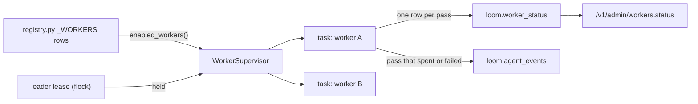

<!-- i18n: source=docs/reference/workers.md blob=f87e42a2c2dfebb8afda1a3c564252eabe3f4c04 model=claude-sonnet-5-5 -->
> 本页由机器从[英文原文](https://github.com/ClickHouse/loom/blob/main/docs/reference/workers.md)翻译，内容以英文原文为准。
> Machine-translated from the [English page](https://github.com/ClickHouse/loom/blob/main/docs/reference/workers.md), which is authoritative.

<a id="workers-reference"></a>

# Workers 参考

worker 是一个受监督的后台循环：由 worker supervisor 按固定间隔运行一个 pass 函数。worker 负责那些不应让请求等待的工作：补全缺失的向量、提取实体、验证审计链、恢复被中断的擦除操作，以及摄取代码和跟踪器数据。本页末尾的表格由注册表生成，因此列出了此提交中的代码所声明的每一个 worker。

<a id="how-workers-run"></a>

## worker 如何运行



**worker 就是注册表中的行。** `server/workers/registry.py` 在 `_WORKERS` 中为每个循环保存一个 `_Worker(...)`：包含名称、持有其 `run_pass` 的模块、用于启用它的设置标志（没有则表示始终启用）、保存其运行间隔的设置字段，以及可选的第二个必需标志（`also_requires`）、空闲间隔、单次执行的截止时间、首次执行钩子和它所拥有的表。`enabled_workers()` 把已启用的行转换为 `WorkerSpec`，并且只在此时才导入 worker 的模块，因此已禁用的 worker 的可选依赖不会被加载。设置在 supervisor 启动时读取：对 worker 标志或间隔的修改，会在运行这些 worker 的进程下次重启时生效。

**每个 worker 一个任务。** `WorkerSupervisor`（`server/workers/supervisor.py`）为每个已启用的 spec 启动一个 asyncio 任务，并负责管理它的循环：

- **启动错峰。** 首次执行会等待 `crc32(name) % interval` 秒（间隔小于 2 秒时为零），这样各个 worker 不会在同一个启动时刻一起查询 ClickHouse。该哈希在不同进程和重启之间保持稳定。
- **首次执行到期。** 输出缺失的 worker 会立即运行。检查依据是 worker 自己的 `first_pass_due` 钩子，或根据其 `owned_tables` 得出的通用规则：当某个所拥有的表中没有范围内命名空间的行时，即视为到期（`server/workers/first_pass.py`）。该检查的时限为 30 秒，出现任何错误时都视为“未到期”。
- **已逾期。** 最近一次记录的执行时间早于其间隔的 worker，会在启动后 300 秒的范围内开始执行，而不是等待完整的错峰时间，这样频繁重启就不会一直推迟每日执行的任务。
- **截止时间。** 每次执行都有超时限制：取该行的 `max_pass_seconds`，否则取四倍间隔，并限制在 60 秒到 900 秒之间（`default_max_pass_seconds`）。超过截止时间的执行会被取消，并计为一次失败。
- **失败与退避。** 失败的执行会在指数退避后重试，退避时间依次为 1、2、4 …… 秒，上限为 60 秒。在截止时间被中断的执行，或者间隔长于其截止时间的 worker（每日和每周执行的那些），会改为等待完整的间隔：快速重试只会再次消耗同样的数据库时间。从连续第三次失败起，supervisor 会以 ERROR 级别记录 `<worker>: DEGRADED — N consecutive failures`，并在状态注册表中把该 worker 标记为降级。
- **部分执行。** 执行完成但其中某一分支失败（`pass_context.note_failure`）时，会计入失败次数，但保持正常间隔，因为其余工作仍需按时完成。
- **空闲间隔。** 正常完成且没有发现任何待办事项的执行（`pass_context.mark_idle()`），如果该行有空闲间隔，就等待该间隔。这样工作成批到来的 worker 在有工作时会频繁轮询，没有工作时则很少轮询。
- **关闭。** 停止服务器会取消每个任务（正在进行的执行会被取消，而不是执行完），最多等待 10 秒让任务退出（`WorkerSupervisor.stop_all`），然后刷新待写入的状态行。

每次执行都在 `background` 流量类别中运行（ClickHouse 优先级较低且线程数受限，因此执行时不会与生产读取平等竞争），并在 `log_comment` 中为其查询打上 `worker.<name>` 标记。

<a id="which-process-runs-the-workers"></a>

## 哪个进程运行 worker

`LOOM_BACKGROUND_WORKERS` 决定进程是否启动 supervisor（`server/workers/leader.py`）：

| 值               | 行为                                                                                                                                                                                              |
| ---------------- | ------------------------------------------------------------------------------------------------------------------------------------------------------------------------------------------------- |
| `auto`（默认）   | 持有 `workers_supervisor` 租约（`loom._migration_lock` 中的一个 Keeper 键）的部署进程运行 supervisor；其他进程竞争该租约，并在租约过期后接管。 |
| `on`             | 始终运行 supervisor（单进程容器，或专用的 workers 容器）；在 Postgres 作为权威存储（后端模式）时，仅当 cell gate 允许该进程提供服务时才运行。                                                  |
| `off`            | 从不运行（纯 web 副本）。                                                                                                                                                                         |

整个部署只有一个租约，因此使用 `uvicorn --workers N` 的 N 个副本之间，每个 worker 总共只运行一份，而不是每个进程各运行一份。leader 退出后，它的键会在 `LOOM_SUPERVISOR_LEASE_TTL_S` 之后过期。

随附的 compose 文件把这两种角色拆分到同一镜像的不同容器中。`dev/docker-compose.cloud.yml` 运行 `loom` 服务（容器 `loom-server`，即 web 层，`LOOM_BACKGROUND_WORKERS=off`）和 `loom-workers`（一个进程，`on`，不发布端口）。`dev/docker-compose.colour.yml` 运行 `loom-<colour>`（`off`）和 `loom-<colour>-workers`（`auto`），并且只有 workers 容器竞争共享锁，因此在蓝绿切换重叠期间，旧的 colour 会一直持有 workers，直到它停止，新的 colour 在一个重试间隔内接管。**为什么使用单独的容器：** 如果某个进程在处理请求的同一事件循环上运行耗时较长的任务，它对保持连接的客户端的尾部响应会变慢；让 workers 脱离 web 层可以消除这一开销，代价是多一个容器。参见 [部署](https://github.com/ClickHouse/loom/blob/main/docs/operations/deployment.md)。

`jwt_revocation_refresh` 在 supervisor 运行的地方始终开启。每个进程，无论是否为 leader，也都会在启动时加载令牌吊销列表，因此没有 workers 的 web 副本也绝不会接受已吊销的令牌。

<a id="turning-a-worker-on-or-off"></a>

## 开启或关闭 worker

1. 在下表的 **开启条件** 列中找到该 worker 的开关，并在运行 worker 的容器上设置它（`LOOM_<NAME>_ENABLED=true` 或 `false`）。带有第二个开关的 worker（该列中的 `+ LOOM_…`）只有在两个开关都打开时才会运行：`code_backport_gaps` 需要 `LOOM_CODE_PR_HISTORY_ENABLED`，`code_coverage_notify` 需要 `LOOM_CODE_INTEL_ENABLED`。
2. 如有需要，使用 **执行周期设置** 修改其执行周期。
3. 重启该容器，然后确认 worker 的状态（见下文）。

开启由 LLM 驱动的 worker（`profile_consolidation`、`reflection_distill`、`observe_extract`、`code_summary`，以及默认开启的 `entity_extractor`、`conversation_titler` 和 `conflict_resolver`）时，除了开关之外还需要：

1. 配置真实的 LLM provider。使用 fake provider 时，worker 会基于伪造的输出运行；`conversation_titler` 会跳过本轮处理；`conflict_resolver` 除非设置了它的开关，否则保持关闭，设置后也只会保留冲突检查标记为待处理的行，直到配置了带密钥的真实 provider。当解析出的 provider 没有密钥时，`loom doctor` 的 `llm_provider` 一行会给出警告。参见[部署](https://github.com/ClickHouse/loom/blob/main/docs/operations/deployment.md#providers)。
2. 在运行 worker 的那个容器上设置该 worker 的开关。
3. 对于按命名空间运行的 worker，通过 `namespace.register` 或命名空间的设置让该命名空间加入：`consolidation_enabled` 控制 `profile_consolidation`（并且除了最近遍历过图的命名空间外，还用于为不使用 LLM 的 `entity_communities` 处理选择命名空间）。你可以先只在一个命名空间中推出某个 worker。

每个命名空间都有一个滚动 24 小时的支出上限 `LOOM_DEFAULT_DAILY_COST_CAP_USD`（默认 `1.0`；`0` 表示禁用），可由每个命名空间的 `daily_cost_cap_usd` 覆盖（可在控制台的 **Usage** 视图中编辑）。超过上限后，由 LLM 驱动的 worker 会跳过该命名空间，由 LLM 驱动的请求路径会停止花费而不是报错：`memory.ask` 和 `knowledge.synthesize` 会以 `budget_capped` 弃答，`code.search` 的查询扩展和 `code.ask` 的综合回答会被跳过。普通的读写绝不会因成本而被拒绝。`cost.summary` 和 `cost.budget_status` 会报告支出；参见[成本与用量](https://github.com/ClickHouse/loom/blob/main/docs/features/observability/cost-and-usage.md)。

<a id="seeing-what-the-workers-did"></a>

## 查看 worker 做了什么

```bash
curl -s -H "Authorization: Bearer $ADMIN_TOKEN" \
  http://localhost:7777/v1/admin/workers.status | jq
```

`GET /v1/admin/workers.status`（需要 `admin` 令牌）会列出所有已注册的 worker，包括已禁用的 worker，并给出 `enabled`、运行间隔，对于已禁用的 worker 还会给出 `disabled_reason: disabled_by_setting`。该接口会把当前进程内的注册表与每个 worker 在 `loom.worker_status` 中的最新一行合并，因此仅运行 web 的容器也能报告 workers 容器已完成的各次运行；其 `store` 块会说明有多少行来自该表，以及由哪些实例上报。控制台中管理员的 **Health** 视图显示的是同样的数据，而 `/v1/health?include=workers` 还会加上 supervisor 对被请求进程的视图。

每一次完成的运行（包括空闲的运行）都会写入一行 `loom.worker_status`。如果某次运行花费了 LLM 或 embedder 的费用，或者运行失败，还会写入一行操作为 `worker.<name>.pass` 的 `loom.agent_events`，这样维护开销会与请求开销出现在同一份账本中。针对持续失败的 worker 的处理手册见[故障排查](https://github.com/ClickHouse/loom/blob/main/docs/operations/troubleshooting.md)。

<a id="reading-the-table"></a>

## 表格说明

| 列 | 含义 |
| ------------------- | -------------------------------------------------------------------------------------------------------------------------------------------------------------------------------------------------------------------------------------------------------------------------------------- |
| **Worker**          | 注册表中的名称。它出现在 `workers.status`、`worker.<name>` 查询标签以及 `DEGRADED` 日志行中。 |
| **功能**    | worker 模块文档字符串的第一句话。 |
| **启用条件**  | 该行 `enabled` 字段（加上 `also_requires`）对应的环境变量，或“始终开启”。 |
| **默认值**         | 在使用真实 LLM provider 且未设置其他任何项时，该设置加载后的值（部分值由校验器解析：使用 fake provider 时，冲突解析器处于关闭状态）。具体部署的 `.env` 可能不同；默认堆栈见[快速开始](../getting-started/quickstart.md)。 |
| **执行周期设置** | 间隔对应的环境变量；当间隔是 worker 模块中的常量时，则为 `<module>.<attribute>`。 |
| **默认值（秒）**     | 间隔的默认值，单位为秒（模块常量则留空）。 |

生成器（`scripts/codegen/docs_reference.py`，`render_workers`）读取 `_WORKERS` 和设置的默认值；当本页过期时，`make lint` 会失败。除开关和执行周期之外，用于调整 worker 的设置（批大小、租约时长、各 worker 的限制）见[配置参考](https://github.com/ClickHouse/loom/blob/main/docs/reference/configuration.md#workers)及其各平面的章节。

<a id="tests-that-pin-the-worker-set"></a>

## 固定 worker 集合的测试

- `tests/unit/test_worker_registry_snapshot.py` 在三种设置配置下构建受监管列表（所有开关取默认值、所有 `*_enabled` 标志全部开启，以及一套生产环境开关配置），并将每个 `WorkerSpec` 字段（顺序、执行周期、截止时间、空闲间隔、首次执行钩子、pass 可调用对象）与 `tests/unit/snapshots/worker_registry.json` 进行比较。仅在有意变更时才重新生成：`LOOM_UPDATE_WORKER_SNAPSHOT=1 python -m pytest tests/unit/test_worker_registry_snapshot.py`。
- `tests/unit/test_worker_registry_parity.py` 将每个 `*_enabled` 标志全部开启，并断言 `worker_meta()`（`workers.status` 所渲染的内容）与 `enabled_workers()`（supervisor 所运行的内容）给出相同的集合。

[添加 worker](https://github.com/ClickHouse/loom/blob/main/docs/development/adding-a-worker.md)介绍了如何编写 pass 并添加对应的行。

<a id="workers"></a>

## 工作进程

<!-- BEGIN GENERATED: workers -->
<!-- Generated by `python scripts/codegen/docs_reference.py`; edit the source, not this region. -->
<!-- prettier-ignore-start -->

| 工作进程 | 作用 | 启用开关 | 默认值 | 执行周期设置 | 默认值（秒） |
| --- | --- | --- | --- | --- | --- |
| `audit_verifier` | 审计防篡改检测 worker。 | `LOOM_AUDIT_VERIFIER_ENABLED` | True | `LOOM_AUDIT_VERIFIER_INTERVAL_SECONDS` | 3600 |
| `code_backport_gaps` | 每晚生成整体 backport 报告：针对最近 `LOOM_CODE_BACKPORT_GAPS_DAYS` 内已合并的每个主干 PR，若维护者为其标记了 backport 标签（loom 台账上的 `pr-must-backport*`，QA 的… | `LOOM_CODE_BACKPORT_GAPS_ENABLED` + `LOOM_CODE_PR_HISTORY_ENABLED` | True | `LOOM_CODE_BACKPORT_GAPS_INTERVAL_SECONDS` | 86400.0 |
| `code_coverage_import` | 每日实测覆盖率导入（`server.code.app.index.coverage_import`）。 | `LOOM_CODE_COVERAGE_IMPORT_ENABLED` + `LOOM_CODE_INTEL_ENABLED` | False | `LOOM_CODE_COVERAGE_IMPORT_INTERVAL_SECONDS` | 86400.0 |
| `code_coverage_notify` | 覆盖率监控通知投递。 | `LOOM_CODE_COVERAGE_NOTIFY_ENABLED` + `LOOM_CODE_INTEL_ENABLED` | True | `LOOM_CODE_COVERAGE_NOTIFY_INTERVAL_SECONDS` | 60 |
| `code_crossref` | 对每个自上次运行以来 `git_head` 发生变化的 C++ 条目做 SQL <-> C++ 交叉引用：生成 `code_test_map` 行，将测试查询与注册其所用函数和设置的文件关联起来。 | `LOOM_CODE_CROSSREF_ENABLED` | True | `LOOM_CODE_CROSSREF_INTERVAL_SECONDS` | 1800 |
| `code_embed_recovery` | 代码平面的 embedding 恢复（对应记忆平面的 embedding worker）。 | `LOOM_CODE_EMBED_RECOVERY_ENABLED` | False | `LOOM_CODE_EMBED_RECOVERY_INTERVAL_SECONDS` | 30 |
| `code_graph_stats` | 每周图统计：include 图上的 PageRank、各文件的度数，以及测试↔源码映射。 | `LOOM_CODE_GRAPH_STATS_ENABLED` | False | `LOOM_CODE_GRAPH_STATS_INTERVAL_SECONDS` | 604800 |
| `code_ingest` | 代码平面按每次合并执行的快速层级摄取。 | `LOOM_CODE_INGEST_ENABLED` | False | `LOOM_CODE_INGEST_INTERVAL_SECONDS` | 120 |
| `code_pr_history` | 通过 GitHub REST API 同步已合并 PR 的历史（可按游标续传）。 | `LOOM_CODE_PR_HISTORY_ENABLED` | False | `LOOM_CODE_PR_HISTORY_INTERVAL_SECONDS` | 900 |
| `code_scip_apply` | 将暂存的 SCIP 增量应用到编译器层级。 | `LOOM_CODE_SCIP_APPLY_ENABLED` | False | `LOOM_CODE_SCIP_APPLY_INTERVAL_SECONDS` | 60 |
| `code_scip_delta` | 每次合并后保持编译器层级的新鲜度：scip-clang 增量。 | `LOOM_CODE_SCIP_DELTA_ENABLED` | True | `LOOM_CODE_SCIP_DELTA_INTERVAL_SECONDS` | 300 |
| `code_scip_full` | C++ 全量重新索引，每轮处理一个条目。 | `LOOM_CODE_SCIP_FULL_ENABLED` | True | `LOOM_CODE_SCIP_FULL_INTERVAL_SECONDS` | 900 |
| `code_scip_go_delta` | 每次合并后保持 Go 编译器层级的新鲜度。 | `LOOM_CODE_SCIP_GO_DELTA_ENABLED` | True | `LOOM_CODE_SCIP_GO_DELTA_INTERVAL_SECONDS` | 900 |
| `code_scip_py_delta` | 每次合并后的 Python 编译器层级增量。 | `LOOM_CODE_SCIP_PY_DELTA_ENABLED` | True | `LOOM_CODE_SCIP_PY_DELTA_INTERVAL_SECONDS` | 600 |
| `code_scip_ts_delta` | 每次合并后保持 TypeScript 编译器层级的新鲜度。 | `LOOM_CODE_SCIP_TS_DELTA_ENABLED` | True | `LOOM_CODE_SCIP_TS_DELTA_INTERVAL_SECONDS` | 600 |
| `code_summary` | 每周由 LLM 生成文件/模块摘要卡片，用于 code.map 的定位导览。 | `LOOM_CODE_SUMMARY_ENABLED` | False | `LOOM_CODE_SUMMARY_INTERVAL_SECONDS` | 604800 |
| `conflict_resolver` | 对冲突检查标记的写入逐行判定，每行一次 LLM 调用，最多同时进行 `memory_conflict_resolver_concurrency` 个，并根据判定结果执行操作（`memory.app.conflict_resolver`）。 | `LOOM_MEMORY_CONFLICT_RESOLVER_ENABLED` | True | `LOOM_MEMORY_CONFLICT_RESOLVER_INTERVAL_SECONDS` | 10.0 |
| `conversation_titler` | 对话标题生成 worker。 | `LOOM_CONVERSATION_TITLER_ENABLED` | True | `LOOM_CONVERSATION_TITLER_INTERVAL_SECONDS` | 1800 |
| `delete_version_check` | 完成 memory.delete_version 在写入墓碑之后需要完成的检查。 | `LOOM_DELETE_VERSION_CHECK_ENABLED` | True | `LOOM_DELETE_VERSION_CHECK_INTERVAL_SECONDS` | 60 |
| `document_blob_gc` | 清理文档原件：没有任何存活文档引用的 `loom.document_blobs` 行，以及没有任何行引用的存储桶对象。 | `LOOM_DOCUMENT_BLOB_GC_ENABLED` | True | `LOOM_DOCUMENT_BLOB_GC_INTERVAL_SECONDS` | 3600 |
| `embedding_worker` | Embedding 恢复 worker。 | `LOOM_EMBEDDING_WORKER_ENABLED` | True | `LOOM_EMBEDDING_WORKER_INTERVAL_SECONDS` | 5 |
| `entity_communities` | 实体社区 worker（默认关闭）。 | `LOOM_ENTITY_COMMUNITIES_ENABLED` | False | `LOOM_ENTITY_COMMUNITIES_INTERVAL_SECONDS` | 21600 |
| `entity_extractor` | 实体提取 worker。 | `LOOM_ENTITY_EXTRACT_ENABLED` | True | `LOOM_ENTITY_EXTRACT_INTERVAL_SECONDS` | 60 |
| `erasure_reclaim` | 擦除回收 worker：已清除行的字节从磁盘上移除。 | `LOOM_ERASURE_RECLAIM_ENABLED` | True | `LOOM_ERASURE_RECLAIM_INTERVAL_SECONDS` | 3600 |
| `erasure_recovery` | 擦除 Saga 恢复 worker。 | `LOOM_ERASURE_RECOVERY_ENABLED` | True | `LOOM_ERASURE_RECOVERY_INTERVAL_SECONDS` | 60 |
| `extraction_queue` | 重放被延迟的 `memory.set_from_messages` 请求。 | `LOOM_EXTRACTION_QUEUE_ENABLED` | True | `LOOM_EXTRACTION_QUEUE_INTERVAL_SECONDS` | 15 |
| `keeper_sweep` | 删除进程退出时仍持有的 KeeperMap 键（`server.core.leases.DEAD_KEYS`）：过期一小时的租约和认领，以及已存在一天的图投影槽位。 | 始终开启 |  | `LOOM_KEEPER_SWEEP_INTERVAL_SECONDS` | 3600.0 |
| `knowledge_gaps` | 每天一次，将各命名空间近期的未命中归并为 `knowledge.gaps.list` 所提供的缺口。 | `LOOM_KNOWLEDGE_GAPS_ENABLED` | False | `LOOM_KNOWLEDGE_GAPS_INTERVAL_SECONDS` | 86400 |
| `knowledge_ingest` | 运行摄取任务（`server/knowledge/app/ingest_run.py`）。 | `LOOM_KNOWLEDGE_INGEST_ENABLED` | True | `LOOM_KNOWLEDGE_INGEST_INTERVAL_SECONDS` | 0 |
| `knowledge_pg_delivery` | 知识投递 worker：发布那些请求已提交到 Postgres 权威库、但尚未发布到 ClickHouse 的知识文档（`server.knowledge.app.pg_delivery`），并清理已过期的… | `LOOM_PG_DELIVERY_ENABLED` | True | `LOOM_PG_DELIVERY_INTERVAL_SECONDS` | 2 |
| `knowledge_source_push` | 续期有限数量的 Drive 通道集合；常规的数据源轮询仍保持独立。 | `LOOM_KNOWLEDGE_SOURCE_PUSH_ENABLED` | False | `LOOM_KNOWLEDGE_SOURCE_PUSH_INTERVAL_SECONDS` | 300 |
| `knowledge_source_retire` | 即使数据源同步或认证已关闭，也要完成排队中的数据源删除。 | 始终开启 |  | `LOOM_KNOWLEDGE_SOURCE_SYNC_INTERVAL_SECONDS` | 900 |
| `knowledge_source_sync` | 将每个已注册文档数据源中变更的文件拉取到其命名空间的文档中（`server.knowledge.app.source_sync`）。 | `LOOM_KNOWLEDGE_SOURCE_SYNC_ENABLED` | False | `LOOM_KNOWLEDGE_SOURCE_SYNC_INTERVAL_SECONDS` | 900 |
| `mcp_session_run_sweep` | MCP 会话运行清理器。 | 始终开启 |  | `LOOM_MCP_SESSION_RUN_SWEEP_INTERVAL_SECONDS` | 60 |
| `memory_code_links` | 代码链接轮次：将上一轮之后写入的记忆链接到它们所提及的代码（首轮或落后于队列时，也包括更早写入的记忆），然后跟进每个仓库的… | `LOOM_MEMORY_CODE_LINKS_ENABLED` | True | `LOOM_MEMORY_CODE_LINKS_INTERVAL_SECONDS` | 60 |
| `memory_expiry_sweep` | 记忆过期清理 worker。 | `LOOM_MEMORY_EXPIRY_SWEEP_ENABLED` | True | `LOOM_MEMORY_EXPIRY_SWEEP_INTERVAL_SECONDS` | 300 |
| `memory_webhook_deliver` | 记忆 webhook：将发件箱中到期的事件 POST 到对应的 webhook。 | `LOOM_MEMORY_WEBHOOK_DELIVER_ENABLED` | True | `LOOM_MEMORY_WEBHOOK_DELIVER_INTERVAL_SECONDS` | 5 |
| `namespace_gc` | namespace_gc worker：清除无人写入的已注册基准测试命名空间。 | `LOOM_NAMESPACE_GC_WORKER_ENABLED` | True | `LOOM_NAMESPACE_GC_INTERVAL_SECONDS` | 3600 |
| `oauth_signin_state_sweep` | 仅变更一次的登录状态，保存在 ClickHouse Keeper 中。 | 始终开启 |  | `LOOM_OAUTH_SIGNIN_STATE_SWEEP_INTERVAL_SECONDS` | 300 |
| `observe_extract` | 环境捕获（observe）平面的延迟提取 worker。 | `LOOM_OBSERVE_EXTRACT_ENABLED` | False | `LOOM_OBSERVE_EXTRACT_INTERVAL_SECONDS` | 300 |
| `orphan_vector_reconcile` | 孤立向量对账 worker。 | `LOOM_ORPHAN_VECTOR_RECONCILE_ENABLED` | True | `LOOM_ORPHAN_VECTOR_RECONCILE_INTERVAL_SECONDS` | 600 |
| `pg_delivery` | Postgres 投递 worker：发布请求未发布的已提交修订。 | `LOOM_PG_DELIVERY_ENABLED` | True | `LOOM_PG_DELIVERY_INTERVAL_SECONDS` | 2 |
| `pg_payload_clear` | Postgres 载荷清除：当恢复可能用到的每份 ClickHouse 备份都已包含某条记忆修订的载荷（`row`）后，将其丢弃。 | `LOOM_PG_PAYLOAD_CLEAR_ENABLED` | False | `LOOM_PG_PAYLOAD_CLEAR_INTERVAL_SECONDS` | 60 |
| `profile_consolidation` | 画像整合 worker。 | `LOOM_PROFILE_CONSOLIDATION_ENABLED` | False | `LOOM_PROFILE_CONSOLIDATION_INTERVAL_SECONDS` | 21600 |
| `projection_repair` | 投影修复 worker。 | `LOOM_PROJECTION_REPAIR_ENABLED` | True | `LOOM_PROJECTION_REPAIR_INTERVAL_SECONDS` | 300 |
| `query_history` | 选择加入的查询分组会变成私有草稿；由 supervisor 持久化数据源轮换。 | `LOOM_KNOWLEDGE_QUERY_HISTORY_ENABLED` | False | `LOOM_KNOWLEDGE_QUERY_HISTORY_INTERVAL_SECONDS` | 3600 |
| `recalibration` | 重新校准 worker：重新运行 embedder 校准探测，以便在供应商悄悄修订 embedder 时，阈值仍保持一致。 | `LOOM_RECALIBRATION_ENABLED` | True | `LOOM_RECALIBRATION_INTERVAL_SECONDS` | 604800 |
| `reflection_distill` | 反思提炼 worker（默认关闭）。 | `LOOM_REFLECTION_DISTILL_ENABLED` | False | `LOOM_REFLECTION_DISTILL_INTERVAL_SECONDS` | 3600 |
| `retention_reconcile` | 保留策略对账 worker。 | `LOOM_RETENTION_RECONCILE_ENABLED` | True | `LOOM_RETENTION_RECONCILE_INTERVAL_SECONDS` | 300 |
| `sensitivity_sweep` | 每日敏感度清扫。 | `LOOM_SENSITIVITY_SWEEP_ENABLED` | True | `LOOM_SENSITIVITY_SWEEP_INTERVAL_SECONDS` | 86400 |
| `structured_profile` | 结构化画像 worker。 | `LOOM_STRUCTURED_PROFILE_ENABLED` | True | `LOOM_STRUCTURED_PROFILE_INTERVAL_SECONDS` | 120 |
| `task_lease_sweep` | 任务收件箱清理器。 | `LOOM_TASK_LEASE_SWEEP_ENABLED` | True | `LOOM_TASK_LEASE_SWEEP_INTERVAL_SECONDS` | 60 |
| `task_webhook_deliver` | 任务收件箱平面的签名 webhook（唤醒层）。 | `LOOM_TASK_WEBHOOK_DELIVER_ENABLED` | True | `LOOM_TASK_WEBHOOK_DELIVER_INTERVAL_SECONDS` | 5 |
| `tracker_embed` | `tracker_embed` 轮次：每三十分钟一次（该分支在查询时的追赶机制覆盖调用期间的间隙），针对每一个已配置的 tracker 命名空间（`configured_namespaces()`，即数据源映射；一个… | `LOOM_TRACKER_EMBED_ENABLED` | True | `LOOM_TRACKER_EMBED_INTERVAL_SECONDS` | 1800.0 |
| `tracker_links` | 每日 issue–PR 链接恢复：对每个已配置 tracker 命名空间中最近 `LOOM_TRACKER_LINKS_ISSUE_DAYS` 内创建的每个 issue，按 BM25F 对其之后时间窗口内已合并的主干 PR 排序… | `LOOM_TRACKER_LINKS_ENABLED` | True | `LOOM_TRACKER_LINKS_INTERVAL_SECONDS` | 86400.0 |
| `tracker_test_daily` | 公开 CI 历史的每测试每日汇总。 | `LOOM_TRACKER_TEST_DAILY_ENABLED` | True | `LOOM_TRACKER_TEST_DAILY_INTERVAL_SECONDS` | 1800 |
| `usage_fold` | 用量回填 worker。 | `LOOM_USAGE_FOLD_ENABLED` | True | `LOOM_USAGE_FOLD_INTERVAL_SECONDS` | 300 |

<!-- prettier-ignore-end -->
<!-- END GENERATED: workers -->

<a id="related"></a>

## 相关内容

- [配置参考](https://github.com/ClickHouse/loom/blob/main/docs/reference/configuration.md)：每个 worker 的调优设置。
- [监控](https://github.com/ClickHouse/loom/blob/main/docs/operations/monitoring.md)：健康检查、指标和 worker 的 gauge 指标。
- [故障排查](https://github.com/ClickHouse/loom/blob/main/docs/operations/troubleshooting.md)：worker 反复失败。
- [代码索引运维](https://github.com/ClickHouse/loom/blob/main/docs/operations/code-index-operations.md)：代码平面的 worker 和回填。
- [添加 worker](https://github.com/ClickHouse/loom/blob/main/docs/development/adding-a-worker.md)。
